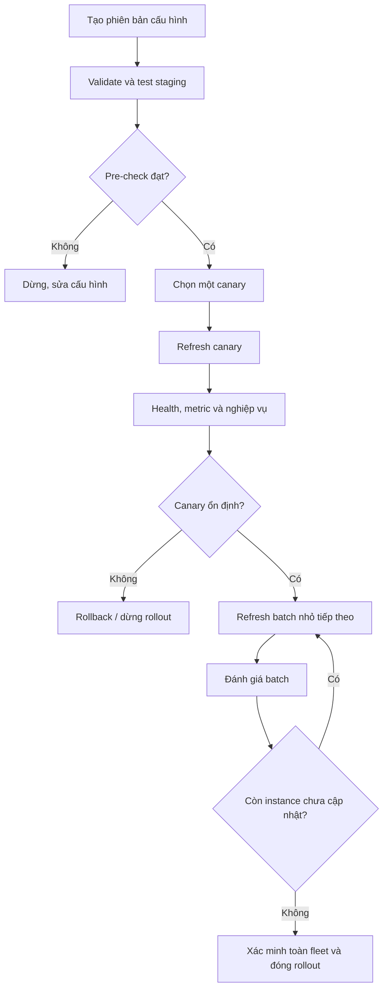

# Triển khai thay đổi cấu hình trên nhiều instance theo từng đợt

Một dịch vụ chạy nhiều instance thường nhận cùng một bộ cấu hình từ Spring Cloud Config Server hoặc một nguồn externalized configuration khác. Khi cần thay đổi timeout, giới hạn kết nối, endpoint phụ thuộc hoặc feature flag, cập nhật cấu hình một lần rồi refresh đồng loạt có thể làm tất cả instance chuyển trạng thái cùng lúc. Nếu giá trị mới có lỗi, toàn bộ năng lực phục vụ có thể bị ảnh hưởng trước khi đội vận hành kịp phát hiện.

Một quy trình an toàn hơn là triển khai theo từng đợt: xác định phiên bản cấu hình, thử trên một instance canary, quan sát hành vi, mở rộng sang nhóm nhỏ, rồi mới cập nhật phần còn lại. Spring Cloud Context cung cấp cơ chế cập nhật `Environment`, rebind `@ConfigurationProperties` và làm mới bean `@RefreshScope`; Spring Cloud Bus có thể gửi refresh event tới một instance, một nhóm instance hoặc toàn bộ dịch vụ. Những cơ chế này là công cụ thực thi từng bước trong quy trình rollout, còn việc chọn batch, kiểm tra sức khỏe và quyết định tiếp tục hay rollback vẫn thuộc về quy trình vận hành.

Bài học thuộc chương **Vận hành** của **SPRING_CLOUD_CORE**. Nội dung tập trung vào kế hoạch rollout cấu hình nhiều instance, canary và batch, Spring Cloud Config, refresh endpoint, Spring Cloud Bus, readiness và service discovery, quan sát kết quả, xử lý lỗi, rollback và kiểm thử trước khi áp dụng production.

## 1. Mục tiêu học tập

Sau bài này, bạn có thể:

- Giải thích vì sao thay đổi cấu hình trên nhiều instance cần được rollout có kiểm soát.
- Phân biệt cập nhật Config Server với việc refresh từng client.
- Chuẩn bị một phiên bản cấu hình có thể truy nguyên và rollback.
- Thiết kế canary instance và các batch tiếp theo.
- Gọi `/actuator/refresh` cho một instance hoặc dùng Spring Cloud Bus để nhắm đúng nhóm.
- Tạo Bus ID duy nhất để phân biệt các instance.
- Dùng readiness, load balancer hoặc service registry để kiểm soát traffic khi refresh có ảnh hưởng lớn.
- Xác minh `@ConfigurationProperties` và `@RefreshScope` đã nhận cấu hình mới.
- Theo dõi health, metric, log và Bus acknowledgement trong từng batch.
- Phân biệt event đã được gửi/nhận với refresh thực sự thành công.
- Dừng rollout và rollback khi có dấu hiệu bất thường.
- Kiểm thử quy trình trên staging và xác định trường hợp cần restart hoặc rolling deployment.

## 2. Vì sao cần rollout theo từng đợt?

Giả sử một dịch vụ thanh toán có 20 instance. Đội vận hành muốn thay đổi:

```yaml
payments:
  client:
    connect-timeout: 1500ms
    read-timeout: 3s
    max-connections: 80
```

Nếu tất cả instance cùng nhận thay đổi, một lỗi như timeout quá ngắn hoặc pool quá nhỏ có thể làm tỷ lệ lỗi tăng trên toàn bộ dịch vụ. Khi rollout từng đợt, chỉ một phần traffic ban đầu chịu ảnh hưởng. Đội vận hành có thời gian quan sát và dừng trước khi mở rộng.

| Cách áp dụng | Ưu điểm | Rủi ro |
| --- | --- | --- |
| Refresh tất cả cùng lúc | Nhanh, ít thao tác | Lỗi cấu hình tác động đồng thời lên toàn bộ instance |
| Refresh từng instance | Phạm vi ảnh hưởng nhỏ, dễ xác định instance lỗi | Tốn thao tác và thời gian |
| Canary rồi tăng batch | Cân bằng tốc độ và khả năng phát hiện lỗi | Cần định danh instance, theo dõi và điều phối rõ ràng |
| Rolling restart | Phù hợp với cấu hình không refresh được | Tốn thời gian khởi động và cần đủ capacity dự phòng |

Rollout theo batch đặc biệt hữu ích khi cấu hình tác động tới connection pool, timeout, retry, circuit breaker, routing, discovery hoặc feature flag. Với thay đổi chỉ mang tính quan sát và không tác động runtime, quy trình có thể đơn giản hơn; vẫn nên lưu lại phiên bản và kết quả áp dụng.

### 2.1. Phạm vi ảnh hưởng không chỉ phụ thuộc số instance

Một batch 10% không luôn tương đương 10% rủi ro. Nếu 10 instance đó cùng phục vụ một tenant lớn, cùng nằm trong một availability zone hoặc cùng giữ một loại workload, ảnh hưởng có thể tập trung hơn dự kiến.

Khi chọn batch, cần xem xét:

- Số instance và lượng traffic thực tế mỗi instance nhận.
- Phân bố theo zone, node, tenant hoặc partition.
- Capacity còn lại nếu batch bị đưa ra khỏi traffic.
- Tác động của cấu hình lên downstream service.
- Khả năng rollback và thời gian để instance ổn định lại.

## 3. Các giai đoạn của một lần thay đổi cấu hình

Một lần rollout nên có các giai đoạn rõ ràng:

1. **Chuẩn bị:** xác định property thay đổi, owner, phiên bản cấu hình và tiêu chí thành công.
2. **Kiểm tra trước:** validate cấu hình, kiểm thử trên staging và xác nhận khả năng rollback.
3. **Canary:** áp dụng lên một instance hoặc một nhóm rất nhỏ.
4. **Đánh giá:** kiểm tra health, lỗi, latency, tài nguyên và hành vi nghiệp vụ.
5. **Mở rộng:** refresh batch tiếp theo theo thứ tự đã định.
6. **Hoàn tất:** xác minh tất cả instance đã chạy đúng phiên bản cấu hình.
7. **Đóng thay đổi:** lưu audit, kết quả và phiên bản rollback.



Không chuyển sang batch tiếp theo chỉ vì request refresh trả HTTP thành công. Cần có thời gian quan sát phù hợp với loại thay đổi và traffic của dịch vụ.

## 4. Chuẩn bị phiên bản cấu hình có thể truy nguyên

Spring Cloud Config Server thường lấy cấu hình từ Git. Git label có thể là branch, tag hoặc commit ID. Để một rollout có thể tái lập, cần biết chính xác nội dung mà các batch đã đọc.

Ví dụ cấu hình ứng dụng:

```yaml
spring:
  application:
    name: payments-service
  config:
    import: "configserver:https://config.internal.example"
```

Config Server phục vụ cấu hình theo application, profile và label. Một URL truy vấn có dạng:

```text
/{application}/{profile}/{label}
```

Ví dụ:

```bash
curl https://config.internal.example/payments-service/prod/release-2026-11-18
```

### 4.1. Ưu tiên label bất biến cho một release

Branch như `main` thay đổi theo commit mới. Nếu canary refresh lúc 10:00 và batch tiếp theo refresh lúc 10:15, hai batch có thể đọc hai phiên bản khác nhau nếu branch được cập nhật giữa chừng.

Có hai cách quản lý:

- Freeze branch trong thời gian rollout, không merge thêm thay đổi cấu hình.
- Dùng tag hoặc commit ID bất biến làm label cho release.

Nếu client dùng label riêng, khai báo label mà client phải yêu cầu từ Config Server:

```yaml
spring:
  cloud:
    config:
      label: release-2026-11-18
```

Client phải được cấu hình để yêu cầu đúng label này. Nếu label được cấp từ cấu hình local/bootstrap hoặc deployment environment, thay đổi label có thể cần restart/redeploy để được đọc lại. Với một rollout refresh tại chỗ, cách đơn giản là giữ nguyên label đang dùng và freeze branch đó trong suốt quá trình. Ghi lại cả label lẫn commit ID thực tế trong change record; không chỉ ghi “đã refresh config main”, vì `main` có thể trỏ tới commit khác sau đó.

### 4.2. Kiểm tra nội dung trước khi phát hành

Trước khi refresh production:

- Kiểm tra diff của các property thay đổi.
- Kiểm tra profile và application name.
- Xác nhận không có secret hoặc endpoint ngoài dự kiến.
- Validate kiểu dữ liệu, range và đơn vị.
- Kiểm tra tương thích với phiên bản code đang chạy.
- Xác định các instance có thể cần restart.
- Lưu commit/tag trước thay đổi để rollback.

Không dùng cùng một lần rollout để thay đổi nhiều nhóm property không liên quan. Nếu nhiều thay đổi cùng lúc gây lỗi, sẽ khó xác định property nào là nguyên nhân.

## 5. Phân loại property trước khi refresh

Không phải property nào cũng có thể cập nhật an toàn trong runtime.

| Loại property | Ví dụ | Cách áp dụng |
| --- | --- | --- |
| `@ConfigurationProperties` có thể rebind | Timeout, giới hạn pool có hỗ trợ cập nhật | Refresh và kiểm tra giá trị đã bind |
| Bean trong `@RefreshScope` | Client giữ endpoint hoặc credential khi được khởi tạo | Xóa cache refresh scope, xác minh lần khởi tạo kế tiếp |
| Property chỉ đọc lúc startup | Port server, một số logging/bootstrap settings | Rolling restart hoặc redeploy |
| Cấu hình không được hỗ trợ refresh | Bean nằm trong danh sách `never-refreshable` | Restart hoặc thay implementation phù hợp |
| Secret hoặc credential | Token, certificate, password | Theo quy trình secret rotation riêng, xác minh kết nối mới |
| Cấu hình có thay đổi schema/protocol | Header, payload, routing contract | Triển khai tương thích nhiều phiên bản trước khi đổi đồng loạt |

### 5.1. EnvironmentChangeEvent và rebind

Khi `EnvironmentChangeEvent` được phát, Spring Cloud xử lý các thay đổi theo những cách tiêu chuẩn, trong đó có:

- Rebind các bean `@ConfigurationProperties`.
- Cập nhật logger level với các property `logging.level.*`.

Spring Cloud Config Client không tự polling thay đổi trong `Environment` theo mặc định. Với hệ thống nhiều instance, có thể chủ động broadcast event bằng Spring Cloud Bus thay vì để từng instance tự polling Config Server.

### 5.2. Giới hạn của rebind

Việc rebind `@ConfigurationProperties` cập nhật bean hiện có tại chỗ. Với một số object có nhiều trường liên quan, thread khác có thể đọc trạng thái trung gian trong lúc rebind. Nếu cần một view nhất quán hơn trong suốt refresh, cân nhắc `@RefreshScope` cho bean phù hợp.

Các class dùng constructor binding, bao gồm Java record được annotate `@ConfigurationProperties`, không thể refresh theo cơ chế rebind thông thường. Cần thiết kế restart hoặc cách tạo bean khác cho trường hợp này.

## 6. @RefreshScope và bean cần khởi tạo lại

`@RefreshScope` tạo proxy lazy và cache target bean đã khởi tạo. Khi refresh scope được invalidate, target cũ bị loại khỏi cache; lần gọi tiếp theo sẽ tạo target mới với cấu hình hiện hành.

Ví dụ:

```java
@Component
@RefreshScope
public class PaymentGatewayClient {

    private final WebClient webClient;

    public PaymentGatewayClient(
            @Value("${payments.gateway.base-url}") String baseUrl) {
        this.webClient = WebClient.builder()
                .baseUrl(baseUrl)
                .build();
    }

    public Mono<String> authorize(String paymentId) {
        return this.webClient.post()
                .uri("/authorizations/{id}", paymentId)
                .retrieve()
                .bodyToMono(String.class);
    }
}
```

Khi `payments.gateway.base-url` thay đổi và refresh scope được làm mới, target client sẽ được tạo lại ở lần sử dụng tiếp theo.

### 6.1. Không phải mọi bean đều tự refresh

Đặt `@RefreshScope` trên một lớp `@Configuration` không có nghĩa mọi bean do lớp đó khai báo đều tự động thuộc refresh scope. Bean phụ thuộc vào target đó có thể giữ reference cũ nếu chính nó không được làm mới hoặc không lấy dependency qua proxy phù hợp.

Hãy xác định rõ bean nào cần refresh, bean nào chỉ cần rebind và bean nào cần restart.

### 6.2. Kiểm tra bean không refresh được

Spring Cloud có property `spring.cloud.refresh.never-refreshable` để chỉ định bean/class không được refresh, và `spring.cloud.refresh.extra-refreshable` cho một số loại bean bổ sung.

`HikariDataSource` là loại mặc định không refreshable. Không nên giả định thay đổi JDBC URL rồi gọi refresh sẽ tự tạo pool Hikari mới. Với datasource hoặc resource giữ state, cần kiểm tra semantics của implementation và cân nhắc rolling restart.

## 7. Refresh một instance bằng Actuator

Spring Cloud Context cung cấp endpoint `/actuator/refresh` để cập nhật cấu hình và refresh các bean thuộc `@RefreshScope`.

Để expose endpoint:

```yaml
management:
  endpoints:
    web:
      exposure:
        include: "health,refresh"
```

Gọi trên đúng instance canary:

```bash
curl -X POST https://payments-canary-01.internal/actuator/refresh
```

Endpoint này cần được bảo vệ bằng authentication, authorization và network policy phù hợp. Không expose management endpoint trực tiếp ra Internet hoặc qua ingress công khai nếu không có yêu cầu và biện pháp bảo vệ rõ ràng.

### 7.1. Refresh endpoint thực hiện gì?

Về khái quát, refresh sẽ làm mới các property source theo cơ chế Spring Cloud Config/Context, phát hiện key thay đổi, rebind các `@ConfigurationProperties` và invalidate cache `@RefreshScope`.

Giá trị trả về của endpoint có thể là danh sách key thay đổi. Đây là tín hiệu hữu ích nhưng không chứng minh mọi bean phụ thuộc đã hoạt động với giá trị mới hoặc downstream đã chấp nhận kết nối.

### 7.2. Chỉ gọi endpoint khi instance đúng mục tiêu

Trong môi trường container hoặc Kubernetes, nhiều pod có thể nằm sau một service/load balancer. Gọi `/actuator/refresh` qua service chung có thể chỉ tới một pod bất kỳ.

Để nhắm đúng canary, dùng management address hoặc cơ chế điều phối có thể định danh instance cụ thể. Không giả định một request qua load balancer sẽ refresh toàn bộ replicas.

## 8. Dùng Spring Cloud Bus cho nhiều instance

Spring Cloud Bus truyền các event qua broker, thường là RabbitMQ hoặc Kafka thông qua Spring Cloud Stream binder. Các instance cùng tham gia bus nhận message và xử lý event phù hợp với destination của chúng.

Các starter phổ biến:

```xml
<dependency>
    <groupId>org.springframework.cloud</groupId>
    <artifactId>spring-cloud-starter-bus-amqp</artifactId>
</dependency>
```

Hoặc dùng starter Kafka theo dependency management của release train.

Bus refresh endpoint:

```yaml
management:
  endpoints:
    web:
      exposure:
        include: "health,busrefresh"
```

Gửi refresh tới bus:

```bash
curl -X POST https://payments-admin.internal/actuator/busrefresh
```

`/actuator/busrefresh` phát refresh event qua bus; các instance đích xử lý event để refresh scope và rebind `@ConfigurationProperties`.

### 8.1. Broadcast không đồng nghĩa rollout theo batch

Gọi `/actuator/busrefresh` không có destination thường gửi sự kiện tới tất cả instance phù hợp trên bus. Đây là cách tiện lợi để refresh diện rộng, nhưng không phù hợp với canary nếu chưa xác định phạm vi đích.

Để rollout theo từng đợt, hãy sử dụng destination path của Bus để chỉ nhắm một instance hoặc một nhóm instance.

## 9. Định danh instance trên Spring Cloud Bus

Mỗi instance cần có Bus ID duy nhất. Có thể cấu hình bằng `spring.cloud.bus.id`; mặc định Bus tạo ID từ các thông tin môi trường như application name, server port hoặc application index, và instance ID.

Ví dụ dạng ID:

```text
payments-service:2:pod-7f8d9
```

Trong đó các phần được phân tách bằng dấu `:`. Khi dùng địa chỉ hóa, Spring Cloud Bus dùng `PathMatcher` với dấu `:` làm path separator.

### 9.1. Định danh duy nhất là bắt buộc

Nếu nhiều instance có cùng Bus ID, cơ chế chống xử lý trùng event có thể khiến message không được xử lý như mong đợi. Đảm bảo từng replica có ID khác nhau, đặc biệt khi chạy nhiều container trên các host khác nhau.

Ví dụ cấu hình tường minh:

```yaml
spring:
  application:
    name: payments-service
  cloud:
    bus:
      id: "${spring.application.name}:${INSTANCE_GROUP}:${HOSTNAME}"
```

`INSTANCE_GROUP` và `HOSTNAME` phải được nền tảng triển khai cấp giá trị duy nhất hoặc đủ phân biệt theo chính sách của hệ thống. Nếu dùng giá trị ngẫu nhiên khi mỗi lần restart, ID có thể thay đổi giữa các lần chạy; điều đó có thể chấp nhận nếu chỉ cần định danh instance đang hoạt động.

### 9.2. Kiểm tra ID trước rollout

Trước khi gửi message theo destination:

- Thu thập Bus ID từ từng instance.
- Xác nhận không trùng.
- Xác định pattern destination cho canary và batch.
- Xác minh instance ngoài nhóm sẽ bỏ qua message.
- Lưu danh sách ID trong change record để đối chiếu.

## 10. Nhắm một instance hoặc một batch bằng Bus destination

Spring Cloud Bus cho phép thêm destination vào đường dẫn endpoint. Ví dụ tài liệu sử dụng:

```text
/actuator/busrefresh/customers:9000
```

Chỉ instance có service ID phù hợp xử lý event; các instance khác bỏ qua.

Để nhắm toàn bộ instance của một service, có thể dùng wildcard:

```text
/actuator/busrefresh/payments-service:**
```

Với ID có cấu trúc:

```text
payments-service:canary:pod-a
payments-service:batch-1:pod-b
payments-service:batch-1:pod-c
payments-service:batch-2:pod-d
```

Có thể gửi:

```bash
curl -X POST \
  https://payments-admin.internal/actuator/busrefresh/payments-service:canary:**
```

Hoặc:

```bash
curl -X POST \
  https://payments-admin.internal/actuator/busrefresh/payments-service:batch-1:**
```

Các wildcard cần tuân theo cú pháp `PathMatcher` của Bus. Kiểm thử pattern trên staging và xác minh danh sách instance nhận event trước khi dùng cho production.

### 10.1. Không dùng wildcard toàn dịch vụ cho canary

Đường dẫn:

```text
/actuator/busrefresh/payments-service:**
```

nhắm toàn bộ instance của service, không phải một batch nhỏ. Chỉ dùng khi đã quyết định refresh toàn bộ fleet.

### 10.2. Có thể nhắm một instance cụ thể

Nếu biết Bus ID đầy đủ:

```bash
curl -X POST \
  https://payments-admin.internal/actuator/busrefresh/payments-service:canary:pod-a
```

Đây là cách phù hợp để refresh một canary trước khi mở rộng. Cần xác minh ID khớp với giá trị mà instance thực sự đăng ký trên bus.

## 11. Kế hoạch canary và batch

Một kế hoạch đơn giản cho 20 instance:

| Giai đoạn | Phạm vi | Điều kiện chuyển bước |
| --- | --- | --- |
| Canary | 1 instance | Health ổn định, metric không xấu đi, smoke test đạt |
| Batch 1 | 2 instance | Không tăng lỗi hoặc latency ngoài ngưỡng |
| Batch 2 | 4 instance | Tải downstream và tài nguyên ổn định |
| Batch 3 | 6 instance | Không xuất hiện lỗi mới theo zone/tenant |
| Batch cuối | 7 instance còn lại | Các batch trước đạt và capacity đủ |
| Final verification | Toàn bộ 20 instance | Mọi instance báo đúng config version |

Tỷ lệ batch không phải con số cố định. Dịch vụ có ít replica hoặc traffic cao nên dùng batch nhỏ hơn. Dịch vụ có capacity dư và thay đổi ít rủi ro có thể mở rộng nhanh hơn.

### 11.1. Thời gian quan sát giữa các batch

Không có một khoảng chờ chung cho mọi hệ thống. Cần chờ đủ lâu để:

- Các request đang chạy qua timeout/retry window.
- Connection pool tạo hoặc loại connection mới.
- Health check và metrics phản ánh thay đổi.
- Downstream service thể hiện tác động.
- Các tác vụ nền hoặc message consumer đi qua ít nhất một chu kỳ liên quan.

Ví dụ, thay đổi timeout HTTP có thể cần quan sát qua nhiều request; thay đổi batch scheduler có thể cần chờ tới chu kỳ job tiếp theo.

### 11.2. Giữ capacity dự phòng

Nếu phải drain instance trước khi refresh, hãy kiểm tra số instance còn lại đủ phục vụ traffic đỉnh. Không đưa quá nhiều instance ra khỏi load balancer cùng lúc.

## 12. Điều phối traffic trong khi refresh

Với thay đổi không gây gián đoạn, có thể refresh canary khi vẫn nhận traffic. Với thay đổi có thể làm gián đoạn kết nối, thay đổi endpoint hoặc tái tạo client có state, nên đưa instance ra khỏi traffic trước.

Một quy trình điển hình:

1. Đặt instance vào trạng thái không nhận request mới bằng readiness hoặc cơ chế maintenance của nền tảng.
2. Xác nhận load balancer/service mesh ngừng gửi traffic tới instance.
3. Chờ request đang xử lý hoàn tất hoặc hết drain timeout.
4. Gọi refresh trên instance.
5. Kiểm tra health, kết nối downstream và smoke test.
6. Đưa instance trở lại trạng thái ready.
7. Chờ traffic ổn định rồi chuyển sang instance tiếp theo.

### 12.1. Readiness phải được traffic layer tôn trọng

Đặt readiness state không tự động đảm bảo mọi load balancer hoặc consumer đều ngừng gửi request. Cần xác minh nền tảng triển khai, ingress, service mesh hoặc discovery client có thực sự loại instance khỏi lựa chọn hay không.

Nếu dùng service registry, có thể cần cập nhật status theo API/provider cụ thể hoặc dùng cơ chế maintenance/drain của nền tảng. Không giả định mọi provider có cùng semantics về `OUT_OF_SERVICE`, `DOWN` hay deregistration.

### 12.2. Phân biệt readiness và liveness

- **Readiness:** instance có nên nhận traffic mới không?
- **Liveness:** process có cần được khởi động lại không?

Một lần refresh cấu hình thất bại không nhất thiết có nghĩa process cần restart ngay. Có thể readiness chuyển sang không nhận traffic trong khi đội vận hành điều tra. Liveness nên phản ánh khả năng tiến trình tiếp tục hoạt động, không dùng thay thế cho readiness.

## 13. Xác minh sau mỗi lần refresh

Sau khi refresh một instance, cần xác minh ba lớp:

1. **Cấu hình:** Environment hoặc `@ConfigurationProperties` chứa giá trị mới.
2. **Bean:** bean refresh scope đã được tạo lại khi được sử dụng và không có lỗi reinitialization.
3. **Hành vi:** request thực tế, metric và kết nối downstream hoạt động đúng.

Các nguồn quan sát:

| Nguồn | Điều cần xác minh |
| --- | --- |
| `/actuator/env` | Property source và giá trị đã được nạp |
| `/actuator/configprops` | Giá trị đã bind vào `@ConfigurationProperties` |
| `/actuator/health` | Readiness và health indicator, bao gồm refresh scope nếu được bật |
| Log ứng dụng | Exception khi rebind hoặc tạo lại bean |
| Metrics | Error rate, latency, connection pool, retry và saturation |
| Bus trace/ack | Message được gửi và instance đã nhận event |
| Application-specific diagnostics | Config version hoặc release ID đang hoạt động |

Không log plaintext secret để xác minh cấu hình. Có thể log version, key name không nhạy cảm hoặc fingerprint an toàn thay vì giá trị thật.

### 13.1. RefreshScopeHealthIndicator

Spring Cloud cung cấp `RefreshScopeHealthIndicator`. Nếu bean không thể khởi tạo lại hoặc rebind cấu hình thất bại sau refresh, health indicator có thể chuyển sang `DOWN` và cung cấp exception liên quan.

Đưa tín hiệu này vào tiêu chí dừng rollout. Tuy nhiên, không chỉ dựa vào health indicator: cần theo dõi thêm lỗi nghiệp vụ, latency và dependency ngoài.

### 13.2. Bus acknowledgement không phải bằng chứng refresh thành công

Spring Cloud Bus có thể trace event được gửi và acknowledgement từ các instance. Ack cho biết instance đã nhận/xử lý message ở tầng bus; nó không tự chứng minh mọi bean đã hoạt động đúng với cấu hình mới.

Đối chiếu Bus trace với refresh health, log, metrics và smoke test. Nếu cần theo dõi tập trung, có thể thu nhận event ack và sent để so sánh danh sách instance dự kiến với danh sách thực tế.

## 14. Theo dõi Spring Cloud Bus

Bus sử dụng Spring Cloud Stream và binder như RabbitMQ hoặc Kafka. Để các instance trao đổi event, broker phải sẵn sàng và các ứng dụng phải cùng tham gia cấu hình bus tương thích.

Ví dụ bật trace:

```yaml
spring:
  cloud:
    bus:
      trace:
        enabled: true
```

Tùy cấu hình và phiên bản, trace repository có thể ghi nhận event sent và acknowledgement. Các event này hữu ích để điều tra:

- Event đã được phát từ instance nào?
- Destination được gửi tới là gì?
- Instance nào đã nhận ack?
- Có instance nào không tham gia bus hoặc có ID trùng?
- Broker có lỗi hoặc consumer bị chậm không?

### 14.1. Broker là dependency vận hành

Trước rollout:

- Xác minh broker healthy.
- Kiểm tra credential và TLS.
- Kiểm tra queue/topic và consumer group.
- Đảm bảo mọi instance cần refresh đã kết nối bus.
- Kiểm tra độ trễ và backlog message.
- Xác minh message không bị lọc bởi destination sai.

Nếu broker không sẵn sàng, không giả định lệnh `/actuator/busrefresh` đã cập nhật toàn bộ instance. Dùng direct refresh cho canary hoặc dừng rollout cho tới khi bus phục hồi theo runbook.

### 14.2. Không dùng busenv như một bản phát hành cấu hình lâu dài

`/actuator/busenv` có thể cập nhật một key/value trong Environment trên nhiều instance. Đây là thao tác runtime hữu ích cho một số trường hợp, nhưng không thay thế nguồn cấu hình được quản lý và version control.

Nếu chỉ thay Environment tạm thời mà không cập nhật Config Server hoặc nguồn chính, lần refresh sau có thể lấy lại giá trị cũ. Mọi thay đổi cần tồn tại lâu dài phải được ghi vào nguồn cấu hình chuẩn trước hoặc đồng thời theo quy trình đã thiết kế.

## 15. Dừng rollout khi nào?

Đặt ngưỡng dừng trước khi bắt đầu. Ví dụ:

- Error rate vượt ngưỡng nền trong một cửa sổ quan sát.
- p95/p99 latency tăng đáng kể.
- Refresh health indicator chuyển `DOWN`.
- Connection pool cạn hoặc số connection lỗi tăng.
- Downstream timeout/retry tăng.
- Một nhóm tenant hoặc zone gặp lỗi tập trung.
- Một instance không thể trở lại readiness.
- Số Bus acknowledgement thấp hơn số instance mục tiêu và không giải thích được.

Khi có dấu hiệu bất thường:

1. Không gửi refresh tới batch tiếp theo.
2. Giữ các instance chưa cập nhật ở phiên bản cấu hình ổn định.
3. Xác định batch và instance đã nhận thay đổi.
4. Kiểm tra lỗi có tương quan với property vừa đổi không.
5. Chọn rollback hoặc forward-fix sau khi đánh giá nguyên nhân.
6. Ghi lại trạng thái từng instance để tránh rollback thiếu hoặc lặp.

Không tiếp tục rollout chỉ vì một số instance vẫn healthy. Cần đánh giá theo toàn bộ metric và traffic profile liên quan.

## 16. Rollback cấu hình

Rollback nên được chuẩn bị trước khi bắt đầu. Nếu dùng Git backend, lưu commit hoặc tag trước thay đổi. Có thể tạo một commit revert hoặc trỏ cấu hình về label bất biến đã được xác minh.

Quy trình rollback:

1. Dừng mở rộng batch.
2. Xác định phiên bản cấu hình tốt gần nhất.
3. Phát hành lại commit/tag rollback trong Config Server.
4. Refresh canary hoặc instance đã lỗi trước.
5. Xác minh health, property và hành vi đã trở lại.
6. Mở rộng rollback theo batch giống quy trình triển khai.
7. Xác minh toàn fleet đã thống nhất ở phiên bản rollback.

### 16.1. Không chỉ revert Git rồi kết thúc

Các instance đã refresh vẫn giữ trạng thái Environment hiện tại cho tới khi nhận refresh/restart tiếp theo. Revert repository không tự động thay đổi tất cả context đang chạy.

Cần chủ động gửi refresh tới đúng instance đã nhận phiên bản lỗi và xác minh giá trị mới đã được nạp.

### 16.2. Rollback có thể không đảo ngược side effect

Một số thay đổi cấu hình có thể gây side effect khó đảo ngược, ví dụ:

- Tạo kết nối tới database mới và ghi dữ liệu vào đó.
- Thay đổi routing khiến message đi sang queue khác.
- Bật feature tạo dữ liệu theo schema mới.
- Xoay vòng credential làm credential cũ bị thu hồi.

Trong các trường hợp này, rollback property không đủ. Cần kế hoạch tương thích dữ liệu, credential overlap hoặc forward-fix riêng.

## 17. Thay đổi cần restart thay vì refresh

Refresh không phải là restart toàn bộ ứng dụng. Một số property chỉ được đọc trong startup, một số bean không hỗ trợ refresh, và một số thay đổi yêu cầu tạo lại process.

Nên dùng rolling restart/redeploy khi thay đổi liên quan tới:

- `server.port`, context path hoặc thiết lập server chỉ đọc lúc startup.
- Bootstrap/config import location hoặc identity của Config Client.
- Dependency graph, classpath hoặc auto-configuration.
- Bean immutable không nằm trong refresh scope.
- Datasource/SDK không hỗ trợ refresh.
- Native image hoặc AOT transformation không hỗ trợ context refresh theo cơ chế hiện hành.
- Thay đổi cần nâng version code hoặc thư viện.

### 17.1. Rolling restart theo batch

Quy trình tương tự refresh rollout:

1. Chọn một instance.
2. Drain traffic.
3. Khởi động instance mới với artifact/config version đã xác định.
4. Chờ readiness và smoke test.
5. Đưa instance vào traffic.
6. Tiếp tục instance tiếp theo.

Nếu có thể chạy hai phiên bản code cùng lúc, bảo đảm giao thức và schema tương thích trong giai đoạn chuyển tiếp.

## 18. Ví dụ runbook cho 12 instance

Giả sử `payments-service` có 12 instance và cần đổi `payments.client.read-timeout` từ `2s` lên `3s`.

### 18.1. Kế hoạch

| Batch | Instance | Số lượng |
| --- | --- | ---: |
| Canary | `payments-service:canary:pod-a` | 1 |
| Batch 1 | `payments-service:batch-1:pod-b`, `pod-c` | 2 |
| Batch 2 | `payments-service:batch-2:pod-d`, `pod-e`, `pod-f` | 3 |
| Batch 3 | `payments-service:batch-3:pod-g`, `pod-h`, `pod-i` | 3 |
| Batch cuối | `payments-service:batch-4:pod-j`, `pod-k`, `pod-l` | 3 |

Các ID trên là ví dụ; môi trường thật phải dùng Bus ID duy nhất đã xác minh.

### 18.2. Phát hành cấu hình

Trong repository cấu hình:

```yaml
payments:
  client:
    read-timeout: 3s
```

Với quy trình refresh tại chỗ này, client đang dùng branch `main`. Commit thay đổi và ghi lại label cùng commit ID:

```text
config-label: main
config-release: 4f8a2d1
```

Không merge thêm thay đổi vào `main` trong lúc rollout. Canary và các batch tiếp theo cùng refresh từ branch đã freeze, còn commit ID giúp truy nguyên chính xác nội dung đã được phát hành. Nếu chọn label bất biến như tag hoặc commit ID thay cho branch, client phải được cấu hình yêu cầu label đó; thay đổi label ở cấu hình local/bootstrap có thể cần rolling restart/redeploy trước khi rollout refresh.

### 18.3. Refresh canary

```bash
curl -X POST \
  "https://payments-admin.internal/actuator/busrefresh/payments-service:canary:pod-a"
```

Kiểm tra configprops, refresh health, latency, timeout và một giao dịch thử nghiệm.

### 18.4. Refresh batch 1

Nếu canary đạt:

```bash
curl -X POST \
  "https://payments-admin.internal/actuator/busrefresh/payments-service:batch-1:**"
```

Đợi metric ổn định và xác minh cả hai instance nhận đúng cấu hình.

### 18.5. Mở rộng batch

Tiếp tục với `batch-2`, `batch-3` và `batch-4`. Sau mỗi lần gửi, đối chiếu danh sách instance mục tiêu với Bus trace/ack và health.

### 18.6. Hoàn tất

Xác minh:

- 12 instance đang hoạt động.
- Tất cả đã nạp cùng config release.
- Không có instance còn giữ giá trị cũ.
- Error rate và latency trong ngưỡng.
- Không có refresh failure hoặc broker backlog bất thường.
- Change record có commit ID, thời gian và kết quả từng batch.

## 19. Kiểm thử quy trình trước production

Một quy trình rollout nên được diễn tập trên staging với nhiều instance thật hoặc các test fixture có Bus ID riêng.

Các kịch bản cần kiểm tra:

| Kịch bản | Kết quả mong đợi |
| --- | --- |
| Canary refresh thành công | Chỉ canary nhận cấu hình mới |
| Destination nhắm batch 1 | Instance ngoài batch không xử lý event |
| Bus ID bị trùng | Test phát hiện và chặn rollout |
| Broker mất kết nối | Có cảnh báo; không đánh dấu batch thành công |
| Config Server không truy cập được | Refresh thất bại hoặc giữ config hiện tại theo semantics của client |
| Bean refresh scope khởi tạo lỗi | Health indicator phản ánh lỗi |
| `@ConfigurationProperties` rebind | Giá trị mới được xác minh |
| Property bị xóa khỏi remote source | Kiểm tra behavior thực tế, không giả định giá trị biến mất tự động ở mọi loại bean |
| Rollback label | Instance đã cập nhật trở lại phiên bản cũ |
| Instance không ack | Runbook phát hiện thiếu instance và không mở rộng batch |
| Instance đang drain | Không nhận traffic mới trong thời gian refresh |
| Restart-required property | Quy trình chuyển sang rolling restart |

### 19.1. Kiểm thử property bị xóa

Spring Cloud có giới hạn khi refresh: xóa một property khỏi cấu hình không nhất thiết cập nhật sự hiện diện của property theo cách ứng dụng mong đợi. Nếu logic phụ thuộc vào việc property có mặt hay không, hãy kiểm thử chính xác semantics trong phiên bản và loại bean đang dùng.

Một cách thiết kế thường dễ kiểm soát hơn là giữ property và thay đổi giá trị theo trạng thái rõ ràng, thay vì dựa vào việc xóa key để biểu thị trạng thái.

### 19.2. Kiểm thử rollback

Đừng chỉ test đường đi tới cấu hình mới. Hãy test cả đường quay lại phiên bản trước, bao gồm refresh bean, kết nối downstream và hành vi khi instance đã nhận cấu hình mới nhưng chưa được đưa trở lại traffic.

## 20. Các lỗi vận hành thường gặp

| Triệu chứng | Nguyên nhân có thể | Cách xử lý |
| --- | --- | --- |
| Chỉ một instance được refresh khi gọi endpoint qua load balancer | Request HTTP chỉ tới một backend | Dùng Bus hoặc gọi management endpoint từng instance |
| Tất cả instance refresh cùng lúc | Gọi busrefresh không destination | Dừng broadcast; dùng destination cho canary/batch |
| Instance không nhận Bus event | Broker, consumer, destination hoặc Bus ID lỗi | Kiểm tra broker, trace và ID |
| Hai instance xử lý event không đúng | Bus ID trùng | Cấp ID duy nhất và xác minh lại |
| Bus ack có nhưng bean lỗi | Ack không chứng minh refresh bean thành công | Kiểm tra refresh health, log và smoke test |
| Property mới có trong Environment nhưng client vẫn dùng endpoint cũ | Bean không refresh scope hoặc đã giữ object cũ | Xem dependency graph và vòng đời bean |
| `@ConfigurationProperties` có giá trị trung gian | Rebind tại chỗ trong khi thread khác đang đọc | Dùng `@RefreshScope` cho bean cần view nhất quán hoặc triển khai restart |
| HikariDataSource không nhận cấu hình mới | Hikari mặc định không refreshable | Dùng rolling restart hoặc chiến lược datasource phù hợp |
| Config Server trả phiên bản khác giữa các batch | Branch thay đổi trong lúc rollout | Freeze branch hoặc dùng label bất biến |
| Refresh endpoint trả lỗi | Config Server/broker/bean refresh lỗi | Đọc response, log, refresh health và trạng thái property source |
| Instance không trở lại readiness | Reinitialization hoặc downstream connection thất bại | Giữ instance ngoài traffic, điều tra và rollback |
| Rollback Git nhưng instance vẫn dùng giá trị mới | Chưa refresh lại các instance đã cập nhật | Gửi rollback refresh theo đúng danh sách instance |
| Refresh không áp dụng property startup-only | Property chỉ được đọc lúc khởi động | Rolling restart/redeploy |
| Batch làm quá tải downstream | Nhiều client tái tạo kết nối đồng thời | Giảm batch, thêm khoảng chờ và kiểm soát connection warm-up |

## 21. Checklist vận hành

- [ ] Xác định owner và danh sách property thay đổi.
- [ ] Phân loại property cần refresh hoặc restart.
- [ ] Có commit/tag cấu hình và phiên bản rollback.
- [ ] Freeze branch hoặc pin label trong suốt rollout.
- [ ] Đã kiểm thử cấu hình trên staging.
- [ ] Có tiêu chí thành công và ngưỡng dừng.
- [ ] Danh sách instance và Bus ID đã được xác minh duy nhất.
- [ ] Canary và batch destination đã được kiểm thử.
- [ ] Actuator refresh/busrefresh được bảo vệ.
- [ ] Broker và Config Server đang healthy.
- [ ] Readiness/drain được load balancer hoặc service registry tôn trọng.
- [ ] Có metric, log, health và smoke test sau mỗi batch.
- [ ] Không mở rộng khi batch trước chưa đạt.
- [ ] Đã có quy trình rollback và test rollback.
- [ ] Sau rollout đã xác minh toàn bộ instance cùng config release.
- [ ] Change record lưu thời gian, commit ID, batch và kết quả.

## 22. Tổng kết

Triển khai thay đổi cấu hình trên nhiều instance cần kết hợp nguồn cấu hình có phiên bản, cơ chế refresh phù hợp và quy trình điều phối theo batch. Spring Cloud Context cung cấp `EnvironmentChangeEvent`, rebind `@ConfigurationProperties` và `@RefreshScope`; Spring Cloud Bus gửi refresh event tới một instance, một nhóm hoặc toàn bộ dịch vụ thông qua destination.

Để giảm rủi ro, hãy bắt đầu bằng canary, quan sát health và metric, sau đó mở rộng từng batch. Dùng Bus ID duy nhất để nhắm đúng instance; dùng readiness hoặc cơ chế drain khi refresh có thể ảnh hưởng traffic; và đối chiếu acknowledgement với kết quả refresh thực tế. Nếu thay đổi không hỗ trợ refresh, dùng rolling restart.

Một rollout chỉ hoàn tất khi tất cả instance đã được xác minh đang chạy cùng phiên bản cấu hình dự kiến, hành vi nghiệp vụ ổn định và có thể truy nguyên hoặc rollback về phiên bản trước.

## 23. Tài liệu tham khảo

- [Spring Cloud Commons — Environment Changes and Refresh Scope](https://docs.spring.io/spring-cloud-commons/reference/spring-cloud-commons/application-context-services.html)
- [Spring Cloud Bus — Bus Endpoints](https://docs.spring.io/spring-cloud-bus/reference/spring-cloud-bus/bus-endpoints.html)
- [Spring Cloud Bus — Addressing Instances](https://docs.spring.io/spring-cloud-bus/reference/spring-cloud-bus/addressing.html)
- [Spring Cloud Bus — Configuration and Event Tracing](https://docs.spring.io/spring-cloud-bus/reference/spring-cloud-bus/configuration.html)
- [Spring Cloud Config — Config Client and Externalized Configuration](https://docs.spring.io/spring-cloud-config/reference/client.html)
- [Spring Cloud Config — Git Backend and Labels](https://docs.spring.io/spring-cloud-config/reference/server/environment-repository/git-backend.html)
- [Spring Cloud Commons — Configuration Properties](https://docs.spring.io/spring-cloud-commons/reference/configprops.html)

