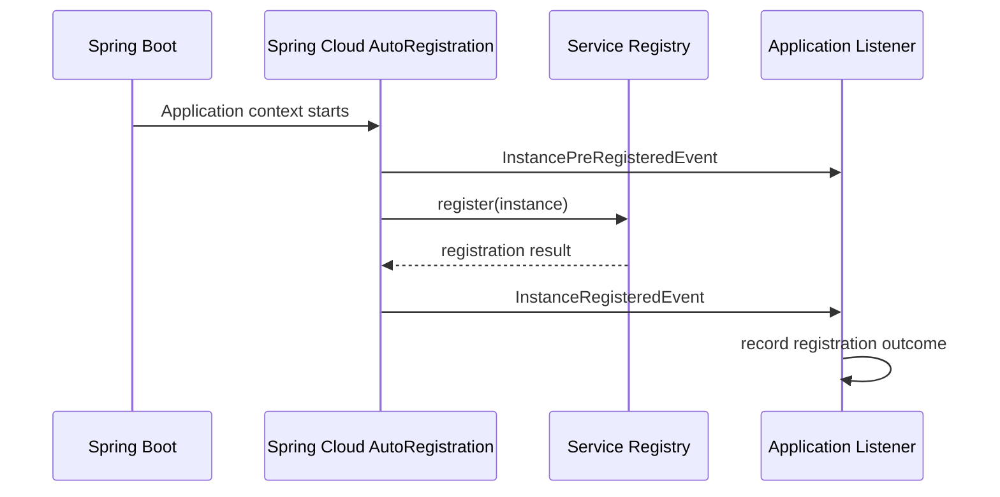

# Liveness, readiness và trạng thái đăng ký dịch vụ

Trong hệ thống Spring Cloud chạy trên Kubernetes hoặc một nền tảng điều phối container, một instance có thể đang chạy process nhưng chưa sẵn sàng nhận request; có thể sẵn sàng xử lý request nhưng chưa đăng ký thành công vào service registry; hoặc registry vẫn lưu trạng thái cũ sau khi ứng dụng đã lỗi. Nếu gộp các tình huống này thành một tín hiệu health duy nhất, hệ thống có thể gửi traffic tới instance chưa sẵn sàng hoặc liên tục khởi động lại mọi replica khi một dependency dùng chung gặp sự cố.

Cần phân biệt ba lớp trạng thái:

1. **Liveness** cho biết process có còn hoạt động đúng để tiếp tục chạy hay cần được khởi động lại.
2. **Readiness** cho biết instance hiện có thể nhận traffic hay cần tạm thời rút khỏi luồng phục vụ.
3. **Service registration status** cho biết instance đang được đăng ký và công bố thế nào trong registry như Eureka hoặc Consul.

Spring Boot Actuator cung cấp health group cho liveness/readiness. Spring Cloud Commons cung cấp abstraction DiscoveryClient, ServiceRegistry, health indicator và endpoint quản lý trạng thái đăng ký. Các registry cụ thể có cơ chế heartbeat, health check và thời gian đồng bộ riêng.

Bài học thuộc chương **Vận hành** của module **SPRING_CLOUD_CORE**. Nội dung hướng dẫn thiết kế probe, quản lý vòng đời đăng ký, kiểm tra trạng thái registry, cấu hình Kubernetes và xử lý tình huống các replica có trạng thái không đồng nhất.

## 1. Mục tiêu học tập

Sau bài học, người học có thể:

- Phân biệt liveness, readiness, startup probe và trạng thái đăng ký dịch vụ.
- Giải thích các trạng thái LivenessState và ReadinessState trong Spring Boot.
- Cấu hình Actuator health group cho Kubernetes.
- Chọn đúng dependency nào được đưa vào readiness check.
- Hiểu vì sao liveness không nên phụ thuộc database, Config Server hoặc registry bên ngoài.
- Theo dõi auto-registration qua ServiceRegistry và các registration event.
- Đọc và thay đổi trạng thái đăng ký qua Actuator serviceregistry.
- Phân biệt hành vi health check của Eureka và Consul.
- Xử lý độ trễ heartbeat, cache registry và deregistration.
- Kiểm tra tình trạng Pod, EndpointSlice và service registry khi traffic không đến được instance.

## 2. Ba lớp trạng thái không thay thế nhau

| Trạng thái | Câu hỏi trả lời | Ai sử dụng? | Hành động điển hình |
| --- | --- | --- | --- |
| Liveness | Process có còn có thể tiếp tục chạy không? | Kubernetes kubelet hoặc nền tảng điều phối | Restart container khi probe thất bại đủ ngưỡng |
| Readiness | Instance có thể nhận request tại thời điểm này không? | Kubernetes Service, load balancer hoặc gateway | Ngừng route traffic tới instance chưa sẵn sàng |
| Registration status | Registry đang công bố instance với trạng thái nào? | Discovery client, service registry, Spring Cloud LoadBalancer | Cho phép hoặc hạn chế client chọn instance theo chính sách của registry |

Một instance có thể có các trạng thái sau:

- Liveness UP, readiness OUT_OF_SERVICE: JVM vẫn sống nhưng ứng dụng đang nạp dữ liệu, drain traffic hoặc tạm ngừng phục vụ.
- Liveness UP, readiness UP, registration chưa có: ứng dụng đã sẵn sàng cục bộ nhưng chưa xuất hiện trong registry.
- Readiness UP, registration OUT_OF_SERVICE: ứng dụng có thể xử lý request trực tiếp, nhưng client discovery có thể không chọn instance.
- Liveness DOWN: instance cần được khởi động lại; registry có thể mất thêm thời gian mới loại instance khỏi danh sách.

Không suy ra trạng thái registry chỉ từ /actuator/health. Cũng không suy ra process còn sống chỉ vì registry vẫn hiển thị instance UP; registry có thể chưa nhận heartbeat hoặc health update mới.

## 3. Liveness trong Spring Boot

Liveness là tín hiệu về sức khỏe nội tại của process. Nếu ứng dụng rơi vào trạng thái không thể tự phục hồi, Kubernetes có thể restart container để đưa process về trạng thái sạch.

Spring Boot quản lý ApplicationAvailability và cung cấp LivenessStateHealthIndicator. Health group này được expose tại:

```text
/actuator/health/liveness
```

Các trạng thái nội bộ quan trọng:

- BROKEN: ứng dụng chưa thể được xem là đang sống bình thường.
- CORRECT: ứng dụng đã vượt qua giai đoạn khởi tạo cần thiết và vẫn có thể tiếp tục chạy.

### 3.1. Không đưa dependency bên ngoài vào liveness

Không nên làm liveness phụ thuộc vào:

- Database dùng chung.
- Config Server.
- Eureka hoặc Consul.
- Redis, Kafka hoặc API của đối tác.
- Một service khác mà nhiều replica cùng phụ thuộc.

Nếu database dùng chung tạm thời mất kết nối và liveness của mọi replica chuyển DOWN, Kubernetes có thể restart đồng loạt các replica. Việc restart tạo thêm kết nối, tải khởi động và traffic retry lên chính hệ thống đang gặp sự cố, làm sự cố lan rộng.

Liveness nên phản ánh khả năng tự phục hồi của process. Một thread deadlock nghiêm trọng hoặc trạng thái nội bộ không thể xử lý request có thể là lý do để đánh dấu liveness BROKEN; một dependency bên ngoài tạm thời không truy cập được thường không phải lý do đó.

## 4. Readiness trong Spring Boot

Readiness trả lời câu hỏi: instance có thể nhận request mới hay chưa? Spring Boot cung cấp ReadinessStateHealthIndicator và health group:

```text
/actuator/health/readiness
```

Các trạng thái nội bộ:

- REFUSING_TRAFFIC: ứng dụng chưa nhận request mới.
- ACCEPTING_TRAFFIC: ứng dụng có thể nhận traffic.

Spring Boot giữ readiness ở REFUSING_TRAFFIC trong khi startup tasks còn chạy. Khi ứng dụng phát tín hiệu ready, trạng thái chuyển sang ACCEPTING_TRAFFIC.

Readiness cũng có thể chuyển về trạng thái từ chối traffic khi ứng dụng bắt đầu shutdown graceful. Điều này giúp load balancer ngừng đưa request mới vào instance trước khi process đóng.

### 4.1. Khi nào nên đưa dependency vào readiness?

Chỉ thêm health check của dependency nếu instance không thể cung cấp chức năng cốt lõi khi dependency đó không khả dụng.

Ví dụ:

- Một service chỉ đọc dữ liệu từ database riêng của từng instance có thể cần database check trong readiness.
- Một service có cache cục bộ và fallback khi Redis mất kết nối có thể vẫn sẵn sàng.
- Config Server chỉ được gọi lúc startup; khi ứng dụng đã tải cấu hình thành công, Config Server tạm thời mất kết nối không nhất thiết khiến instance mất readiness.
- Service registry không truy cập được có thể ảnh hưởng khả năng được discovery, nhưng việc đưa registry health vào readiness cần xét cách hệ thống route traffic và cache danh sách instance.

Spring Boot không tự thêm tất cả health indicator bên ngoài vào readiness group. Nhà phát triển phải chủ động lựa chọn.

Nếu tất cả replica cùng chuyển readiness sang REFUSING_TRAFFIC, Kubernetes Service không còn endpoint backend để chuyển request. Với Service loại ClusterIP hoặc NodePort, client có thể không thiết lập được kết nối; không nhất thiết nhận một HTTP response 503.

## 5. Startup probe và vòng đời availability

Kubernetes có ba probe thường dùng:

| Probe | Mục đích | Khi thất bại |
| --- | --- | --- |
| startupProbe | Cho ứng dụng đủ thời gian khởi động lần đầu | Kubelet tiếp tục kiểm tra startup; chưa áp dụng liveness/readiness cho đến khi startup thành công |
| livenessProbe | Phát hiện process cần restart | Restart container khi vượt ngưỡng thất bại |
| readinessProbe | Phát hiện instance chưa thể nhận traffic | Loại instance khỏi endpoint phục vụ |

Spring Boot mô tả vòng đời availability như sau:

| Giai đoạn | Liveness | Readiness | HTTP server |
| --- | --- | --- | --- |
| Starting | BROKEN | REFUSING_TRAFFIC | Chưa bắt đầu |
| Started | CORRECT | REFUSING_TRAFFIC | Chưa nhận request nghiệp vụ |
| Ready | CORRECT | ACCEPTING_TRAFFIC | Nhận request |
| Graceful shutdown | CORRECT | REFUSING_TRAFFIC | Từ chối request mới, xử lý request đang chạy nếu graceful shutdown được bật |

startupProbe hữu ích khi ứng dụng cần thời gian dài để tải cấu hình, warm up cache, chạy migration hoặc khởi tạo kết nối. Nếu không có startup probe và liveness threshold quá ngắn, kubelet có thể restart ứng dụng trước khi startup hoàn tất.

## 6. Bật health group cho Kubernetes

Khi chạy trong Kubernetes, Spring Boot Actuator tự cấu hình liveness và readiness health group. Có thể bật rõ ràng trong các môi trường khác bằng property management.endpoint.health.probes.enabled.

Ví dụ:

```yaml
management:
  endpoint:
    health:
      probes:
        enabled: true
```

Hai endpoint mặc định:

- GET /actuator/health/liveness
- GET /actuator/health/readiness

Nếu management server chạy trên port riêng, probe có thể thành công trong khi web server chính không nhận được kết nối. Ví dụ management port vẫn hoạt động nhưng connection pool hoặc main server port đã lỗi.

Để probe đi qua main application port, cấu hình:

```yaml
management:
  endpoint:
    health:
      probes:
        enabled: true
        add-additional-paths: true
```

Spring Boot sẽ cung cấp thêm:

- /livez cho liveness trên main server port.
- /readyz cho readiness trên main server port.

Có thể dùng additional-path của từng health group để tùy chỉnh path nếu hệ thống có quy ước URL riêng.

## 7. Cấu hình Kubernetes Deployment

Ví dụ Deployment dùng port HTTP 8080 và health path trên main server port:

```yaml
apiVersion: apps/v1
kind: Deployment
metadata:
  name: orders-service
spec:
  replicas: 3
  selector:
    matchLabels:
      app: orders-service
  template:
    metadata:
      labels:
        app: orders-service
    spec:
      containers:
        - name: orders-service
          image: example/orders-service:1.0.0
          ports:
            - name: http
              containerPort: 8080
          startupProbe:
            httpGet:
              path: /livez
              port: http
            periodSeconds: 10
            timeoutSeconds: 2
            failureThreshold: 30
          livenessProbe:
            httpGet:
              path: /livez
              port: http
            periodSeconds: 10
            timeoutSeconds: 2
            failureThreshold: 3
          readinessProbe:
            httpGet:
              path: /readyz
              port: http
            periodSeconds: 5
            timeoutSeconds: 2
            failureThreshold: 3
```

Trong ví dụ:

- Startup probe cho phép tối đa khoảng 300 giây kiểm tra thất bại liên tiếp trước khi kubelet kết luận startup không thành công, theo periodSeconds nhân failureThreshold.
- Liveness kiểm tra process sau khi startup probe thành công.
- Readiness kiểm tra khả năng nhận traffic thường xuyên hơn.

Đây là thông số minh họa. Hãy chọn initialDelaySeconds, periodSeconds, timeoutSeconds, failureThreshold và successThreshold theo phân phối thời gian startup thực tế và SLA của dịch vụ. Không đặt timeout quá ngắn khiến probe thất bại do tải CPU tạm thời.

Nếu không bật add-additional-paths, dùng endpoint /actuator/health/liveness và /actuator/health/readiness, đồng thời cấu hình đúng port đang expose Actuator.

## 8. Tùy chỉnh readiness health group

Spring Boot không thêm external health indicator vào readiness group theo mặc định. Nếu một dependency thực sự quyết định instance có thể phục vụ request hay không, có thể bổ sung indicator đó:

```yaml
management:
  endpoint:
    health:
      group:
        readiness:
          include: "readinessState,catalogDependency"
```

Ví dụ một health indicator kiểm tra dependency cốt lõi:

```java
import org.springframework.boot.actuate.health.Health;
import org.springframework.boot.actuate.health.HealthIndicator;
import org.springframework.stereotype.Component;

@Component("catalogDependency")
public class CatalogDependencyHealthIndicator implements HealthIndicator {

    private final CatalogConnection catalogConnection;

    public CatalogDependencyHealthIndicator(
            CatalogConnection catalogConnection) {
        this.catalogConnection = catalogConnection;
    }

    @Override
    public Health health() {
        if (catalogConnection.isAvailable()) {
            return Health.up().build();
        }

        return Health.down()
            .withDetail("dependency", "catalog")
            .build();
    }
}
```

CatalogConnection trong ví dụ đại diện cho một abstraction do ứng dụng cung cấp; việc kiểm tra phải có timeout ngắn và không tạo request nặng mỗi lần probe chạy.

Không đưa indicator này vào liveness. Nếu dependency chỉ là tối ưu hiệu năng hoặc có fallback, không đưa nó vào readiness vì điều đó có thể loại bỏ một instance vẫn phục vụ được.

## 9. DiscoveryClient health indicator của Spring Cloud Commons

Spring Cloud Commons tự cấu hình DiscoveryClientHealthIndicator dựa trên implementation đang được ứng dụng sử dụng. Indicator này kiểm tra health của discovery client; nó không phải phép đo toàn diện về mọi service instance trong registry.

Các property quan trọng:

```yaml
spring:
  cloud:
    discovery:
      client:
        health-indicator:
          enabled: true
          include-description: false
          use-services-query: false
```

Ý nghĩa:

- enabled: bật/tắt DiscoveryClient health indicator.
- include-description: quyết định có đưa description của discovery client vào kết quả health tổng hợp hay không.
- use-services-query: mặc định true, indicator gọi DiscoveryClient.getServices(). Khi đặt false, nó dùng DiscoveryClient.probe() nhẹ hơn.

Trong deployment có rất nhiều service, truy vấn toàn bộ danh sách service ở mỗi lần health check có thể tốn tài nguyên. Dùng probe() nếu mục tiêu chỉ là kiểm tra discovery client có hoạt động.

Spring Cloud Commons còn có DiscoveryCompositeHealthContributor, tổng hợp các DiscoveryHealthIndicator đã đăng ký. Có thể tắt composite indicator bằng:

```properties
spring.cloud.discovery.client.composite-indicator.enabled=false
```

### 9.1. Discovery health không đồng nghĩa registration health

DiscoveryClientHealthIndicator kiểm tra implementation discovery hiện tại. Nó không chứng minh:

- Instance của chính ứng dụng đã được đăng ký đúng host/port.
- Registry đã đồng bộ trạng thái mới nhất.
- Mọi consumer đã tải registry snapshot mới.
- Một service ID cụ thể có instance khả dụng.
- Request từ consumer thực sự tới được endpoint của instance.

Nếu cần biết service ID cụ thể có instance, kiểm tra DiscoveryClient.getInstances(serviceId) hoặc kiểm tra qua Actuator serviceregistry và giao diện/API của registry.

Không đưa toàn bộ discovery health vào liveness. Chỉ đưa một check có mục đích rõ ràng vào readiness khi ứng dụng thực sự không thể phục vụ nếu discovery mất kết nối.

## 10. Vòng đời auto-registration trong Spring Cloud

Khi discovery implementation có mặt trên classpath, Spring Cloud có thể tự đăng ký ứng dụng đang chạy với service registry. Trong cấu hình hiện đại, EnableDiscoveryClient không còn bắt buộc chỉ để kích hoạt discovery.

Auto-registration được bật mặc định. Có thể tắt bằng:

```yaml
spring:
  cloud:
    service-registry:
      auto-registration:
        enabled: false
```

Hoặc dùng EnableDiscoveryClient(autoRegister = false) nếu muốn tắt ở cấu hình annotation.

Hai lựa chọn này có mục đích khác nhau:

- spring.cloud.discovery.enabled=false tắt service discovery.
- spring.cloud.service-registry.auto-registration.enabled=false tắt auto-registration nhưng không đồng nghĩa tắt khả năng truy vấn discovery.

Spring Cloud Commons cung cấp abstraction ServiceRegistry với các thao tác:

- register(Registration): đăng ký một instance.
- deregister(Registration): hủy đăng ký instance.

Registration là marker interface; mỗi implementation có loại registration riêng, ví dụ Eureka, Consul hoặc Zookeeper. Khi dùng trực tiếp ServiceRegistry, phải truyền đúng registration type tương ứng với implementation.

## 11. Theo dõi registration events

Spring Cloud Commons phát hai event trong quá trình auto-registration:

- InstancePreRegisteredEvent: trước khi service được đăng ký.
- InstanceRegisteredEvent: sau khi service được đăng ký.

Ứng dụng có thể dùng listener để ghi log hoặc thực hiện công việc phụ thuộc vào kết quả đăng ký.

Ví dụ về quy trình:



Hai event này không được phát khi spring.cloud.service-registry.auto-registration.enabled=false. Nếu tắt auto-registration, ứng dụng tự chịu trách nhiệm gọi ServiceRegistry.register() và quản lý deregistration.

Không dùng InstanceRegisteredEvent làm bằng chứng duy nhất rằng consumer đã nhìn thấy instance. Registry và các discovery client có thể có cache hoặc chu kỳ đồng bộ riêng.

## 12. Đọc và thay đổi trạng thái qua Actuator ServiceRegistry endpoint

Spring Cloud Commons cung cấp endpoint serviceregistry, phụ thuộc vào bean Registration trong ApplicationContext.

Khi expose endpoint, đường dẫn mặc định là:

```text
/actuator/serviceregistry
```

Đọc trạng thái registration:

```bash
curl -sS http://localhost:8080/actuator/serviceregistry
```

Thay đổi status của registration bằng POST:

```bash
curl -i -X POST \
  -H "Content-Type: application/json" \
  -d '{"status":"OUT_OF_SERVICE"}' \
  http://localhost:8080/actuator/serviceregistry
```

Endpoint yêu cầu body có field status. Giá trị hợp lệ phụ thuộc service registry implementation. Ví dụ Eureka hỗ trợ UP, DOWN, OUT_OF_SERVICE và UNKNOWN; không giả định Consul hoặc Zookeeper dùng cùng tập giá trị.

Để expose endpoint:

```yaml
management:
  endpoints:
    web:
      exposure:
        include: "health,info,serviceregistry"
```

Chỉ expose endpoint này trên management interface được bảo vệ. POST thay đổi trạng thái instance đang đăng ký và có thể làm instance bị loại khỏi traffic discovery. Không mở endpoint cho client công khai.

### 12.1. Status khác với deregistration

Đặt status OUT_OF_SERVICE hoặc trạng thái tương ứng của registry thường có nghĩa instance vẫn tồn tại trong registry nhưng không được chọn để phục vụ traffic theo chính sách của provider.

Deregistration loại bỏ registration khỏi registry. Hai thao tác có thể được dùng ở hai giai đoạn khác nhau:

1. Đưa instance ra khỏi traffic.
2. Chờ request đang chạy hoàn tất hoặc hết thời gian drain.
3. Deregister instance khi shutdown.

Cách triển khai cụ thể phụ thuộc Eureka, Consul, Zookeeper và nền tảng điều phối. Không dùng status update thay cho deregistration nếu mục tiêu là xóa hoàn toàn registration.

## 13. Eureka: heartbeat và health check

Eureka nhận thông tin instance như host, port, status URL, home page và metadata. Client gửi heartbeat định kỳ để thông báo instance vẫn còn hoạt động.

Giá trị mặc định phổ biến:

- Heartbeat/lease renewal: 30 giây.
- Lease expiration: 90 giây.

Nếu heartbeat không đến trong thời gian lease expiration, Eureka có thể loại instance khỏi registry. Registry và client còn có cache đồng bộ; một instance mới đăng ký có thể mất thêm thời gian trước khi mọi client đều nhìn thấy nó.

### 13.1. Heartbeat không tự động truyền Actuator health

Theo mặc định, Eureka dùng heartbeat để xác định client còn sống. Nếu không bật health check integration, trạng thái Actuator của ứng dụng không nhất thiết được truyền sang Eureka. Sau khi đăng ký thành công, Eureka có thể tiếp tục công bố instance ở trạng thái UP dù Actuator health của ứng dụng đã không còn UP.

Bật tích hợp health check trong application.yml:

```yaml
eureka:
  client:
    healthcheck:
      enabled: true
```

Đặt property này trong application.yml, không đặt trong bootstrap.yml. Khi bật, health status của ứng dụng được truyền sang Eureka để các client tránh chọn instance không ở trạng thái UP.

Tích hợp này vẫn khác Kubernetes readiness probe. Kubernetes dùng readiness để điều khiển endpoint của Pod; Eureka dùng status của instance trong registry để các discovery client lựa chọn. Hai hệ thống có thể cập nhật theo chu kỳ khác nhau.

### 13.2. Điều tra đăng ký Eureka chậm

Nếu ứng dụng đã log đăng ký thành công nhưng consumer chưa thấy instance:

- Kiểm tra Eureka client đã nhận heartbeat chưa.
- Kiểm tra Eureka Server có nhận registration và instance metadata chưa.
- Kiểm tra registry fetch interval và cache ở consumer.
- Kiểm tra host/port đăng ký có thể truy cập từ consumer không.
- Kiểm tra zone và metadata nếu hệ thống dùng nhiều vùng.

Không giảm lease renewal interval xuống quá thấp chỉ để làm registration xuất hiện nhanh hơn. Eureka có các giả định nội bộ về chu kỳ heartbeat; giữ mặc định trong production trừ khi đã kiểm thử và có lý do rõ ràng.

## 14. Consul: HTTP health check

Spring Cloud Consul tạo HTTP health check khi đăng ký service. Mặc định, Consul gọi:

```text
/actuator/health
```

Chu kỳ mặc định là 10 giây. Nếu health check thất bại, Consul đánh dấu instance ở trạng thái critical.

Có thể tùy chỉnh path và interval:

```yaml
spring:
  cloud:
    consul:
      discovery:
        health-check-path: /actuator/health
        health-check-interval: 15s
```

Nếu dùng management context path, servlet path hoặc actuator base path riêng, phải cấu hình health check path khớp với endpoint thật. Nếu không, Consul sẽ đánh dấu instance critical dù endpoint nghiệp vụ vẫn hoạt động.

Có thể tắt HTTP health check bằng:

```yaml
spring:
  cloud:
    consul:
      discovery:
        register-health-check: false
```

Chỉ tắt khi đã có cơ chế health check khác phù hợp. Không tắt để che lỗi endpoint hoặc lỗi định tuyến.

### 14.1. Health endpoint nào được Consul gọi?

Mặc định Consul gọi /actuator/health, tức global health endpoint. Global health có thể tổng hợp database, discovery, disk và các indicator khác đang có trong ứng dụng.

Nếu global health phụ thuộc vào một hệ thống dùng chung, lỗi của hệ thống đó có thể làm tất cả service instance bị đánh dấu critical. Trước khi thay đổi health check, cần xác định dependency nào thực sự ảnh hưởng đến khả năng phục vụ request.

## 15. Phối hợp readiness với service registry

Trong một ứng dụng Spring Cloud, readiness và registry status nên có quan hệ rõ ràng nhưng không cần đồng nhất.

Một chiến lược triển khai có thể là:

1. Process khởi động; readiness ở REFUSING_TRAFFIC.
2. Ứng dụng tải cấu hình và khởi tạo dependency cốt lõi.
3. Ứng dụng chuyển readiness sang ACCEPTING_TRAFFIC.
4. Service registry đăng ký instance và bắt đầu heartbeat/health check.
5. Consumer discovery nhìn thấy instance sau khi registry cập nhật cache.
6. Khi shutdown, ứng dụng ngừng nhận traffic mới, drain request và deregister.

Tùy auto-registration implementation, thời điểm register có thể xảy ra trong startup lifecycle trước hoặc sau khi readiness chuyển trạng thái. Vì vậy, hãy xác nhận bằng log/event và hành vi registry thực tế, không giả định thứ tự chỉ từ một annotation.

Trong Kubernetes, Service routing dựa trên Pod readiness và EndpointSlice. Eureka/Consul routing dựa trên registry status và discovery cache. Nếu dùng đồng thời cả hai cơ chế, hãy xác định đâu là nguồn quyết định traffic cho từng loại caller.

## 16. Shutdown graceful và rút instance khỏi traffic

Khi nhận tín hiệu shutdown, ứng dụng nên:

- Chuyển readiness sang từ chối traffic mới.
- Cho các request đang chạy có thời gian hoàn tất.
- Đưa instance ra khỏi service registry nếu provider cần thao tác deregister riêng.
- Đóng connection pool, scheduler và tài nguyên.
- Kết thúc process trước khi orchestrator buộc dừng container.

Spring Boot hỗ trợ graceful shutdown cho web server. Có thể cấu hình thời gian tối đa cho mỗi shutdown phase:

```yaml
server:
  shutdown: graceful

spring:
  lifecycle:
    timeout-per-shutdown-phase: 30s
```

Giá trị 30 giây là ví dụ; phải phối hợp với terminationGracePeriodSeconds trong Kubernetes, preStop hook và thời gian deregistration của registry. Nếu thời gian Kubernetes cho phép ngắn hơn thời gian ứng dụng cần drain, process có thể bị kill trước khi hoàn tất.

## 17. Kiểm tra trạng thái khi vận hành

Một quy trình kiểm tra nhanh có thể dùng các lệnh sau.

Kiểm tra liveness và readiness:

```bash
curl -i http://localhost:8080/actuator/health/liveness
curl -i http://localhost:8080/actuator/health/readiness
```

Kiểm tra registration status:

```bash
curl -sS http://localhost:8080/actuator/serviceregistry
```

Kiểm tra Kubernetes Pod và sự kiện probe:

```bash
kubectl get pods -l app=orders-service
kubectl describe pod <pod-name>
kubectl get endpointslice -l kubernetes.io/service-name=orders-service
```

Kiểm tra log của ứng dụng:

```bash
kubectl logs <pod-name> -c orders-service --since=15m
```

Đối chiếu theo thứ tự:

- Pod có Ready hay không?
- Startup/liveness/readiness probe nào thất bại?
- EndpointSlice còn chứa địa chỉ Pod không?
- Registry có registration cho instance ID này không?
- Status trong registry có phải UP hoặc trạng thái có thể nhận traffic không?
- Consumer discovery có thấy instance và gọi được host/port không?

## 18. Các lỗi thường gặp

| Triệu chứng | Nguyên nhân có thể | Cách xử lý |
| --- | --- | --- |
| Container restart liên tục khi database lỗi | Database bị đưa vào liveness | Loại external dependency khỏi liveness; cân nhắc readiness |
| Pod chạy nhưng không nhận request | Readiness đang REFUSING_TRAFFIC | Kiểm tra startup tasks, readiness indicator và EndpointSlice |
| Health endpoint báo UP nhưng app port không nhận kết nối | Actuator chạy trên management port riêng | Dùng additional probe paths trên main server port |
| Eureka hiển thị UP dù Actuator DOWN | Chỉ có heartbeat, chưa bật Eureka health check | Bật eureka.client.healthcheck.enabled trong application.yml |
| Eureka registration xuất hiện chậm | Heartbeat, registry cache hoặc client cache chưa đồng bộ | Kiểm tra lease, registry fetch và metadata; không giảm interval tùy tiện |
| Consul đánh dấu service critical | Health check path sai hoặc global health đang DOWN | Kiểm tra /actuator/health, context path và health indicators |
| Service không xuất hiện trong registry | Auto-registration bị tắt hoặc registration lỗi | Kiểm tra classpath, spring.cloud.service-registry.auto-registration.enabled và registration logs |
| /actuator/serviceregistry trả 404 | Endpoint chưa expose hoặc không có Registration bean | Kiểm tra discovery implementation và actuator exposure |
| POST status thành công nhưng traffic vẫn đến instance | Provider/client cache chưa cập nhật hoặc caller không dùng registry đó | Kiểm tra registry status, client cache và luồng routing |
| Một replica unready làm tất cả traffic lỗi | Readiness phụ thuộc hệ thống dùng chung | Đánh giá lại dependency và fallback; tránh đồng loạt rút mọi replica |
| Instance cũ vẫn tồn tại sau shutdown | Deregistration hoặc lease expiration chưa hoàn tất | Kiểm tra graceful shutdown, deregistration và TTL/lease của registry |

## 19. Bài tập vận dụng

Một hệ thống orders-service chạy ba replica trên Kubernetes và đăng ký vào Eureka. Sau một đợt triển khai:

- Một Pod bị restart liên tục khi database dùng chung mất kết nối.
- Hai Pod còn lại có readiness UP.
- Eureka vẫn hiển thị cả ba instance UP.
- Consumer đôi khi gọi tới Pod đang lỗi.
- Khi scale down, instance cũ còn trong registry một thời gian.

Hãy thực hiện:

1. Kiểm tra liveness/readiness health group của từng Pod.
2. Xác định vì sao database lỗi làm liveness thất bại.
3. Tách database check khỏi liveness và đánh giá có cần đưa vào readiness hay không.
4. Kiểm tra eureka.client.healthcheck.enabled và vị trí khai báo trong application.yml.
5. Đối chiếu heartbeat, lease expiration và cache của consumer.
6. Đọc /actuator/serviceregistry để xác nhận status của từng instance.
7. Thiết kế quy trình drain traffic trước khi deregister khi scale down.
8. Cấu hình startup probe để tránh restart trong giai đoạn khởi động dài.
9. Kiểm tra EndpointSlice của Kubernetes và danh sách instance từ Eureka.
10. Đề xuất cảnh báo khi readiness, Pod state và registry status không đồng nhất.

**Tiêu chí hoàn thành:** giải thích được vì sao liveness không nên phụ thuộc database; xác định được khác biệt giữa Pod readiness và Eureka status; chứng minh instance lỗi không còn được chọn; và có quy trình deregistration khi shutdown.

## 20. Ghi nhớ

- Liveness quyết định restart; readiness quyết định nhận traffic; registration status điều khiển khả năng được discovery client lựa chọn.
- Spring Boot cung cấp /actuator/health/liveness và /actuator/health/readiness.
- startupProbe bảo vệ ứng dụng có thời gian khởi động dài.
- Không đưa external dependency vào liveness vì có thể tạo cascading restart.
- Chỉ thêm dependency vào readiness khi thiếu dependency đó thực sự khiến instance không thể phục vụ.
- management.endpoint.health.probes.add-additional-paths=true tạo /livez và /readyz trên main server port.
- Spring Cloud Commons có DiscoveryClientHealthIndicator, DiscoveryCompositeHealthContributor, ServiceRegistry và serviceregistry actuator endpoint.
- Auto-registration bật mặc định; có thể tắt riêng auto-registration mà vẫn giữ discovery.
- Eureka mặc định dựa vào heartbeat; muốn truyền Actuator health cần bật eureka.client.healthcheck.enabled=true trong application.yml.
- Consul mặc định gọi /actuator/health mỗi 10 giây; path phải khớp management context thực tế.
- OUT_OF_SERVICE là status của provider, không đồng nghĩa với deregistration.
- Kubernetes readiness, Eureka status và Consul health check có thể cập nhật theo chu kỳ khác nhau.
- Khi shutdown, rút traffic, drain request rồi deregister theo vòng đời của registry.

## 21. Tài liệu tham khảo

- [Spring Boot — Kubernetes Probes and Application Availability](https://docs.spring.io/spring-boot/reference/actuator/endpoints.html): liveness/readiness health groups, startup probe, additional paths và lựa chọn external checks.
- [Spring Boot — Actuator Health Endpoint](https://docs.spring.io/spring-boot/reference/actuator/endpoints.html): health groups, status mapping và endpoint exposure.
- [Spring Cloud Commons — Service Discovery and ServiceRegistry](https://docs.spring.io/spring-cloud-commons/reference/spring-cloud-commons/common-abstractions.html): DiscoveryClient health indicators, auto-registration events, ServiceRegistry và actuator endpoint.
- [Spring Cloud Commons — Configuration Properties](https://docs.spring.io/spring-cloud-commons/reference/configprops.html): các property của discovery health indicator và auto-registration.
- [Spring Cloud Netflix — Eureka Client Health Checks](https://docs.spring.io/spring-cloud-netflix/reference/spring-cloud-netflix.html): heartbeat, health check integration và registration lifecycle.
- [Spring Cloud Consul — Service Discovery](https://docs.spring.io/spring-cloud-consul/reference/discovery.html): HTTP health check, registration metadata, path và interval.

