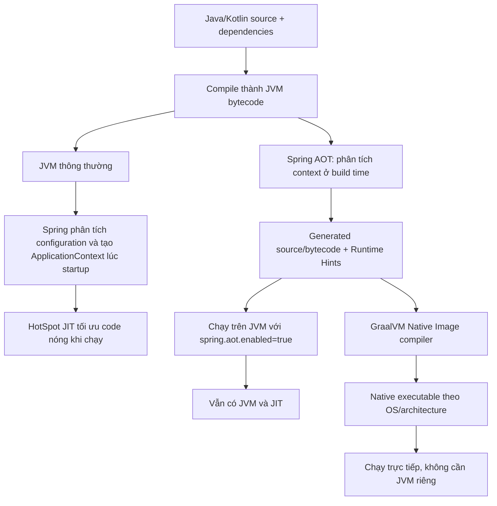

# Khác biệt giữa JVM thông thường, Spring AOT và native image

## 1. Ba khái niệm thường bị nhầm lẫn

Một ứng dụng Spring Boot có thể được đóng gói và chạy theo nhiều cách. Ba khái niệm quan trọng là:

- **JVM thông thường**: ứng dụng được biên dịch thành bytecode, sau đó chạy trên Java Virtual Machine. Spring phân tích cấu hình và tạo ApplicationContext lúc startup; HotSpot có thể biên dịch các đoạn code nóng bằng JIT khi ứng dụng đang chạy.
- **Spring AOT (Ahead-of-Time)**: Spring phân tích ứng dụng trong quá trình build, đánh giá bean definition và sinh mã khởi tạo cùng metadata cần thiết. Kết quả vẫn có thể chạy trên JVM; không bắt buộc phải tạo native executable.
- **Native image**: GraalVM Native Image dùng phân tích tĩnh và biên dịch ứng dụng thành executable phụ thuộc hệ điều hành/kiến trúc đích. Ứng dụng chạy mà không cần cài JVM riêng và không dùng HotSpot JIT.

Vì vậy, Spring AOT và native image không phải hai tên gọi của cùng một thứ. Spring AOT là bước chuẩn bị ứng dụng để giảm công việc động lúc runtime và cung cấp thông tin cho native compiler. Native image là một cách tạo sản phẩm triển khai từ kết quả AOT.

Trong phạm vi Spring Cloud, sự khác biệt này ảnh hưởng đến những thành phần có cấu hình động như Config Client, `@RefreshScope`, Gateway route, OpenFeign client và discovery integration. Một ứng dụng chạy tốt trên JVM thông thường chưa chắc đã chạy đúng khi bật AOT hoặc native image.

Bài học thuộc chương **AOT và checkpoint** của **SPRING_CLOUD_CORE**. Nội dung đi từ vòng đời chạy ứng dụng đến build, giới hạn cấu hình, hỗ trợ của Spring Cloud và cách kiểm thử lựa chọn triển khai phù hợp.

## 2. Vòng đời từ source code đến process đang chạy



Ở JVM thông thường, nhiều quyết định về bean, profile, điều kiện auto-configuration và proxy được xử lý khi ứng dụng khởi động. Trong AOT, Spring thực hiện một phần công việc đó trước khi triển khai. Trong native image, GraalVM tiếp tục phân tích những thành phần có thể được gọi và biên dịch chúng thành binary.

Điểm khác nhau không chỉ nằm ở định dạng file đầu ra. Nó nằm ở **thời điểm thực hiện công việc**, **mức độ linh hoạt còn lại khi runtime**, và **môi trường thực thi**.

## 3. JVM thông thường hoạt động như thế nào?

Java compiler (`javac` hoặc compiler tương ứng của Kotlin) chuyển source code thành bytecode trong file `.class`. JAR Spring Boot chứa bytecode, resource và dependency. Khi chạy:

```bash
java -jar app.jar
```

JVM tải class theo nhu cầu, Spring đọc annotation và configuration, đánh giá các condition, tạo bean và xây dựng ApplicationContext. HotSpot JIT theo dõi code đang được thực thi rồi biên dịch một số method sang machine code để tối ưu hiệu năng sau khi ứng dụng đã chạy đủ lâu.

Các đặc điểm chính:

- Cần một JRE/JDK tương thích để chạy.
- Có thể nạp class động và dùng reflection theo cách thông thường của JVM.
- Có thể chọn profile, property và nhiều bean condition khi startup.
- Một số thay đổi cấu hình có thể được áp dụng trong runtime nếu ứng dụng hỗ trợ refresh/rebinding.
- Thường có thời gian startup và mức memory ban đầu cao hơn native image, nhưng có khả năng tối ưu throughput sau warm-up nhờ JIT.
- Một JAR có thể chạy trên nhiều hệ điều hành/kiến trúc miễn là có JVM phù hợp.

JVM thông thường phù hợp khi ứng dụng cần tính linh hoạt lúc startup, dùng thư viện động hoặc có yêu cầu throughput dài hạn. Đây cũng là môi trường thuận tiện nhất để phát triển và chạy phần lớn unit/integration test.

### 3.1. Spring startup vẫn là một phần chi phí

Khi khởi động một Spring Boot application, framework phải đọc configuration, tìm component, xử lý auto-configuration, đánh giá condition, tạo bean definition, tạo proxy và khởi tạo các bean không lazy.

Ứng dụng có nhiều starter, nhiều bean hoặc nhiều context có thể tốn đáng kể thời gian ở giai đoạn này. JIT không loại bỏ phần chi phí khởi tạo context; nó chủ yếu tối ưu code được thực thi nhiều trong quá trình chạy.

Spring AOT nhắm vào một phần công việc có thể hoàn thành trước khi ứng dụng khởi động. Native image tiếp tục biên dịch code đã xác định được để giảm công việc tại runtime.

## 4. Spring AOT thực hiện điều gì ở build time?

Spring AOT phân tích ứng dụng dựa trên main application class và môi trường build đã cấu hình. AOT engine chuẩn bị một biểu diễn cố định hơn của bean factory, đánh giá các condition và sinh các tài nguyên giúp Spring khởi tạo context hiệu quả hơn.

Kết quả thường gồm:

| Đầu ra | Mục đích |
| --- | --- |
| Generated Java source | Mô tả bean registration/khởi tạo theo cách có thể phân tích và biên dịch trước |
| Generated bytecode | Hỗ trợ proxy hoặc các cấu trúc được tạo trước |
| Reflection hints | Khai báo type/member cần reflection ở runtime |
| Resource hints | Giữ lại resource cần đọc từ classpath |
| Serialization hints | Khai báo type cần serialize/deserialize theo cách động |
| JDK proxy hints | Khai báo interface cần tạo dynamic proxy |
| JNI hints | Khai báo các thành phần native interface cần thiết |

AOT không đơn giản là cache toàn bộ ApplicationContext đang chạy. Nó sinh mã và metadata để tái tạo context với các bean đã được xác định trong quá trình build.

Spring Framework cung cấp API `RuntimeHints` để ứng dụng hoặc thư viện bổ sung thông tin về reflection, resource, serialization và proxy khi phân tích tĩnh không thể suy ra đầy đủ.

### 4.1. AOT vẫn có thể chạy trên JVM

Đây là điểm phân biệt quan trọng. Sau khi build có chứa AOT-generated code, có thể chạy ứng dụng trên JVM với:

```bash
java -Dspring.aot.enabled=true -jar app.jar
```

Ứng dụng vẫn chạy bytecode trên JVM. JVM vẫn quản lý memory, garbage collection, thread và class loading; HotSpot vẫn có thể dùng JIT để tối ưu code nóng. Khác biệt là Spring dùng phần khởi tạo đã được sinh trước thay vì thực hiện toàn bộ quá trình phân tích cấu hình động như JVM mode thông thường.

AOT trên JVM là cách hữu ích để kiểm tra generated initialization và các giới hạn AOT trước khi đầu tư build native image. Nó cũng có thể cải thiện startup mà không buộc phải chuyển sang binary native.

### 4.2. Generated code không thay thế mọi logic runtime

AOT sinh code cho cấu trúc Spring đã được xác định. Ứng dụng vẫn đọc các property runtime và thực hiện logic nghiệp vụ thông thường. Tuy nhiên, các property làm thay đổi cấu trúc bean phải được xem xét đặc biệt.

Ví dụ, một giá trị dùng để đổi endpoint của một client có thể chỉ là dữ liệu cấu hình runtime. Nhưng một property dùng trong `@ConditionalOnProperty` để quyết định có tạo bean hay không lại ảnh hưởng đến bean graph. Khi bật AOT, quyết định tạo bean đó được đánh giá trong build.

Không nên kết luận rằng AOT đóng băng tất cả property. Nó đóng băng các quyết định cấu trúc mà AOT đã dùng để sinh context; các giá trị runtime không làm thay đổi cấu trúc đó vẫn có thể được đọc theo thiết kế của ứng dụng.

## 5. Native image là gì?

GraalVM Native Image thực hiện phân tích tĩnh từ entry point của ứng dụng, tìm các class, method và field có thể reachable, sau đó biên dịch chúng thành executable cho nền tảng đích.

Một native executable Spring Boot thường được tạo theo chuỗi:

1. Spring AOT phân tích ApplicationContext và sinh mã/hints.
2. GraalVM Native Image đọc bytecode, generated code, dependency và reachability metadata.
3. Native Image phân tích call graph theo closed-world assumption.
4. Compiler tạo executable chứa code và resource được xác định là cần thiết.
5. Process chạy trực tiếp trên hệ điều hành mà không cần JVM riêng.

Các đặc điểm chính:

- Không cần cài JVM riêng trên máy chạy binary.
- Binary gắn với OS và kiến trúc CPU mục tiêu.
- Classpath được cố định ở thời điểm build; không thể thêm JAR mới vào runtime như JVM thông thường.
- Không có lazy class loading theo mô hình JVM truyền thống.
- Không có HotSpot JIT trong process native.
- Code dùng reflection, resource loading, serialization hoặc dynamic proxy có thể cần reachability metadata/hints.
- Những code path mà phân tích không nhận diện là reachable có thể bị loại khỏi binary.

Native image thường có startup nhanh và memory footprint ban đầu thấp hơn JVM deployment. Đổi lại, quá trình build có thể tốn nhiều CPU, RAM và thời gian; khả năng dynamic loading bị hạn chế; hiệu năng throughput dài hạn phụ thuộc workload và không được JIT tối ưu như HotSpot.

Không nên xem native image là lựa chọn luôn nhanh hơn trong mọi tình huống. Hãy benchmark bằng workload thực tế, cả startup, memory, throughput và latency sau warm-up.

## 6. So sánh JVM, Spring AOT trên JVM và native image

| Tiêu chí | JVM thông thường | Spring AOT chạy trên JVM | Native image |
| --- | --- | --- | --- |
| Đầu vào khi chạy | Bytecode/JAR | JAR có generated AOT assets | Native executable |
| Phân tích Spring bean | Chủ yếu lúc startup | Phần lớn ở build time | Ở build time |
| JVM cần trên máy chạy | Có | Có | Không cần JVM riêng |
| HotSpot JIT | Có | Có | Không |
| Dynamic classpath | Linh hoạt hơn | Classpath cố định theo build | Classpath đóng tại build |
| Profile/bean condition | Đánh giá khi startup | Bị giới hạn theo quyết định build | Bị giới hạn theo quyết định build |
| Reflection/resource động | JVM hỗ trợ rộng | JVM hỗ trợ, nhưng code AOT cần tương thích | Cần hints/metadata nếu không suy ra được |
| Startup | Thường cao hơn | Có thể giảm nhờ generated initialization | Thường thấp |
| Memory footprint ban đầu | Thường cao hơn | Vẫn là JVM process | Thường thấp hơn |
| Build cost | Thấp hơn | Tăng do chạy AOT processing | Cao hơn đáng kể do native compilation |
| Portability | JAR đa nền tảng | JAR đa nền tảng | Binary theo OS/architecture |
| Runtime tuning | JVM flags, JIT, GC | JVM flags, JIT, GC | Native Image build/runtime options |

Spring AOT trên JVM và native image dùng chung một số kết quả AOT, nhưng không có cùng môi trường thực thi. Khi một lỗi chỉ xảy ra ở native executable, cần kiểm tra cả hai lớp: Spring AOT output và giới hạn của GraalVM Native Image.

## 7. Giới hạn quan trọng khi bật AOT

AOT cần biết classpath và bean graph tại build time. Do đó, các yếu tố sau cần được cấu hình nhất quán:

- Active profile dùng để tạo context trong quá trình AOT.
- Property dùng trong các `@ConditionalOnProperty` hoặc điều kiện tương đương.
- Classpath, starter và provider được đưa vào build.
- Các `@Import`, component scan và cấu hình programmatic ảnh hưởng đến bean graph.
- Những service ID, proxy interface hoặc resource cần được phát hiện trước.

Ví dụ:

```java
@Configuration(proxyBeanMethods = false)
@ConditionalOnProperty(
        prefix = "platform.discovery",
        name = "consul.enabled",
        havingValue = "true"
)
class ConsulDiscoveryConfiguration {

    @Bean
    ConsulAdapter consulAdapter(ConsulClient client) {
        return new ConsulAdapter(client);
    }
}
```

Nếu `platform.discovery.consul.enabled=true` khi chạy AOT processing, bean graph được sinh với nhánh Consul đã bật. Nếu runtime lại đổi property thành `false` và mong bean đó biến mất, kết quả không tương đương JVM thông thường.

Tương tự, profile được kích hoạt lúc build có ảnh hưởng đến cấu hình được sinh. Spring Boot ghi rõ classpath phải cố định và bean không thể thay đổi theo profile/condition tùy ý trong runtime AOT mode.

### 7.1. Phân biệt property cấu trúc và property dữ liệu

| Loại property | Ví dụ | Cách nghĩ khi dùng AOT |
| --- | --- | --- |
| Quyết định bean graph | `feature.enabled`, `@Profile`, điều kiện tạo provider | Phải xác định trong build environment |
| Dữ liệu runtime | URL, timeout, tên queue được bind vào bean đã có | Có thể thay đổi nếu không làm đổi cấu trúc context và integration hỗ trợ |
| Classpath/provider | Có hay không có Consul/Eureka client library | Phải được quyết định khi build |
| Resource được tải động | File cấu hình ngoài, file trong classpath | File ngoài có thể được mount lúc runtime; resource nằm trong image cần hints phù hợp |

Đừng dùng cùng một native binary cho các môi trường nếu mỗi môi trường yêu cầu một bean graph khác nhau. Có thể tạo artifact riêng cho từng biến thể cấu trúc, hoặc thiết kế ứng dụng sao cho khác biệt môi trường chỉ nằm ở property runtime mà bean graph không đổi.

## 8. Build và chạy Spring AOT trên JVM

### 8.1. Với Gradle

Có thể áp dụng Spring Boot AOT plugin trực tiếp khi muốn chạy AOT trên JVM mà không build native image:

```kotlin
plugins {
    id("org.springframework.boot") version "4.1.2"
    java
}

apply(plugin = "org.springframework.boot.aot")
```

Chạy AOT processing và đóng gói JAR:

```bash
./gradlew processAot bootJar
```

Sau đó chạy JAR trên JVM:

```bash
java -Dspring.aot.enabled=true -jar build/libs/my-app.jar
```

Plugin AOT có thể được áp dụng tự động khi dùng GraalVM Native Image plugin. Nếu chỉ muốn thử AOT JVM, không cần thêm native plugin.

### 8.2. Với Maven

Nếu dùng `spring-boot-starter-parent`, profile `native` của Spring Boot Maven plugin có thể cấu hình `process-aot` và các thiết lập liên quan:

```bash
./mvnw -Pnative package
```

Sau khi package, chạy JAR trên JVM với system property:

```bash
java -Dspring.aot.enabled=true -jar target/my-app.jar
```

Kiểm tra cấu hình Maven nếu dự án không dùng Spring Boot parent hoặc đã tùy biến plugin management. Mục tiêu là bảo đảm `process-aot` thực sự chạy và generated assets được đưa vào JAR.

## 9. Build native image

Native image cần GraalVM Native Image toolchain hoặc Cloud Native Buildpacks được cấu hình cho native build. Việc build có thể cần compiler, linker, header và thư viện hệ thống tùy OS.

### 9.1. Với Gradle

Thêm GraalVM Native Image plugin:

```kotlin
plugins {
    id("org.springframework.boot") version "4.1.2"
    id("org.graalvm.buildtools.native") version "1.1.14"
    java
}
```

Plugin native tự tích hợp Spring Boot AOT. Build executable:

```bash
./gradlew nativeCompile
```

Task `nativeCompile` sử dụng output từ `processAot`. Vị trí binary thường nằm dưới `build/native/nativeCompile/`; kiểm tra log Gradle để biết tên executable cụ thể.

### 9.2. Với Maven

Khi dùng Spring Boot Maven parent và profile `native`, có thể tạo native container image bằng Buildpacks:

```bash
./mvnw -Pnative spring-boot:build-image
```

Profile này cấu hình AOT processing và thiết lập phù hợp cho native image build. Với multi-module project hoặc plugin tùy biến, kiểm tra module nào là application module và cấu hình native plugin ở đúng nơi.

### 9.3. Build đúng nền tảng đích

Native executable không phải JAR đa nền tảng. Binary được tạo cho OS và architecture mục tiêu. Nếu deploy trên Linux ARM64, không thể mặc định lấy binary Linux AMD64 hoặc Windows rồi chạy trực tiếp.

Nên build trong môi trường tương ứng với production hoặc dùng cross-compilation/buildpack phù hợp. Cũng cần cố định phiên bản JDK/GraalVM, compiler và native dependencies để build có thể tái lập.

## 10. Runtime hints cho reflection và resource

JVM thông thường có thể tìm class và gọi method bằng reflection khi runtime. Native Image cần biết trước những phần dynamic này để giữ lại đúng code trong executable.

Spring AOT tự sinh nhiều hints cho các pattern Spring phổ biến. Khi ứng dụng hoặc thư viện có use case động mà AOT không nhận diện, có thể khai báo `RuntimeHintsRegistrar`.

Ví dụ đăng ký resource và reflection:

```java
import org.springframework.aot.hint.MemberCategory;
import org.springframework.aot.hint.RuntimeHints;
import org.springframework.aot.hint.RuntimeHintsRegistrar;

public class PlatformRuntimeHints implements RuntimeHintsRegistrar {

    @Override
    public void registerHints(RuntimeHints hints, ClassLoader classLoader) {
        hints.resources().registerPattern("templates/report/*.html");

        hints.reflection().registerType(
                LegacyPayload.class,
                MemberCategory.INVOKE_DECLARED_CONSTRUCTORS,
                MemberCategory.INVOKE_DECLARED_METHODS,
                MemberCategory.DECLARED_FIELDS
        );
    }
}
```

Đăng ký registrar bằng `@ImportRuntimeHints`:

```java
import org.springframework.context.annotation.Configuration;
import org.springframework.context.annotation.ImportRuntimeHints;

@Configuration(proxyBeanMethods = false)
@ImportRuntimeHints(PlatformRuntimeHints.class)
class PlatformNativeConfiguration {
}
```

Ví dụ này chỉ minh họa cách khai báo hints. Chọn `MemberCategory` đúng với những constructor/method/field thực sự được truy cập. Đăng ký reflection quá rộng có thể làm binary lớn hơn và che khuất các vấn đề thiết kế.

Các nguồn cần kiểm tra:

- Reflection gọi method/constructor không được gọi trực tiếp trong bytecode.
- Class được nạp bằng tên từ property hoặc file cấu hình.
- Resource được đọc bằng `ClassPathResource`, `getResourceAsStream` hoặc pattern động.
- Serialization/deserialization dùng type không được phát hiện qua contract thông thường.
- JDK dynamic proxy hoặc CGLIB proxy.
- JNI/native library và service provider metadata.

Không thêm hints theo kiểu đoán mò. Dùng native image build report, lỗi runtime và test để xác định chính xác thành phần nào cần khai báo.

## 11. Spring Cloud Config Client trong AOT và native image

Spring Cloud Config Client có hỗ trợ Spring AOT và GraalVM native image từ các dòng release hiện đại. Tuy nhiên, Config Client có một số ràng buộc quan trọng.

### 11.1. Nguồn cấu hình phải truy cập được trong quá trình AOT

Khi AOT processing xây dựng ApplicationContext, Config Client có thể cần kết nối tới Config Server, Consul, Zookeeper, Vault hoặc nguồn cấu hình khác để nạp property. Vì vậy, nguồn cấu hình cần truy cập được từ môi trường build AOT và đúng địa chỉ/cấu hình mà ứng dụng dùng trong quá trình phân tích.

Các property có thể làm thay đổi việc tạo bean phải có giá trị phù hợp ở build time và runtime. Nếu build với một profile/provider rồi runtime chạy với profile/provider khác, bean graph đã sinh có thể không khớp.

Lưu ý: native image có thể khởi động process rất nhanh nhưng Config Client vẫn phải chờ network request tới Config Server hoặc backend. Thời gian kết nối từ xa vẫn là một phần của startup thực tế.

### 11.2. Các giới hạn cần kiểm tra

- Config Client AOT/native không hỗ trợ legacy config-first bootstrap khi `spring.config.use-legacy-processing=true`.
- Context refresh và `@RefreshScope` không được hỗ trợ với Spring AOT transformations/native images trong Spring Cloud Commons.
- Với native image, đặt `spring.cloud.refresh.enabled=false`.
- Không giả định property thay đổi sau deploy có thể làm thay đổi bean graph đã sinh.
- Nếu dùng SSH hoặc thư viện mã hóa ở Config backend, kiểm tra yêu cầu native metadata/security provider theo tài liệu của module và GraalVM.

Ví dụ cấu hình khi dùng Config Client ở AOT/native:

```yaml
spring:
  cloud:
    refresh:
      enabled: false
    config:
      uri: https://config.internal.example
```

Đây là cấu hình minh họa phần refresh. URI và các property ảnh hưởng tới việc tạo bean phải được cung cấp nhất quán khi AOT processing và khi chạy binary.

## 12. Spring Cloud Commons và `@RefreshScope`

Spring Cloud Context hỗ trợ refresh các bean được quản lý bởi `@RefreshScope` khi môi trường cấu hình thay đổi. Cơ chế này cần có khả năng làm mới context/target bean ở runtime.

AOT và native image dựa vào cấu trúc bean đã được xác định khi build. Vì thế, Spring Cloud Commons không hỗ trợ context refresh cho Spring AOT transformations và native images. Khi chạy theo các chế độ này, cần tắt refresh:

```yaml
spring:
  cloud:
    refresh:
      enabled: false
```

Nếu ứng dụng đang phụ thuộc vào `POST /actuator/refresh`, Spring Cloud Bus refresh hoặc `@RefreshScope` để thay đổi endpoint/client config mà không restart, phải thiết kế lại vòng đời cấu hình trước khi bật AOT/native.

Một số giá trị runtime vẫn có thể đọc từ property source, nhưng điều đó không đồng nghĩa bean refresh scope có thể bị hủy và tạo lại như JVM mode thông thường.

## 13. Ví dụ Spring Cloud Gateway và OpenFeign

Các integration Spring Cloud có mức hỗ trợ và giới hạn riêng. Không suy ra rằng tất cả module đều tương thích chỉ vì Spring Boot AOT đã chạy thành công.

### 13.1. Spring Cloud Gateway

Spring Cloud Gateway hỗ trợ AOT và native image. Với route dùng load balancing, service ID cần được xác định rõ ràng để AOT có thể xử lý.

Có thể khai báo qua `@LoadBalancerClient`:

```java
import org.springframework.cloud.loadbalancer.annotation.LoadBalancerClient;
import org.springframework.context.annotation.Configuration;

@LoadBalancerClient(name = "inventory-service")
@Configuration(proxyBeanMethods = false)
class InventoryLoadBalancerConfiguration {
}
```

Hoặc khai báo danh sách service ID cần eager-load:

```yaml
spring:
  cloud:
    loadbalancer:
      eager-load:
        clients:
          - inventory-service
          - pricing-service
```

Các route và service ID có cấu trúc thay đổi tùy ý sau build cần được đánh giá riêng. Nếu Gateway sinh route từ một nguồn dữ liệu động, hãy xác nhận cách integration hỗ trợ runtime route update và native image trong đúng release.

### 13.2. Spring Cloud OpenFeign

OpenFeign hỗ trợ Spring AOT và native image với các điều kiện:

- `spring.cloud.refresh.enabled=false`.
- `spring.cloud.openfeign.client.refresh-enabled` không được đặt thành `true` (mặc định là `false`).
- `spring.cloud.openfeign.lazy-attributes-resolution` không được đặt thành `true` (mặc định là `false`).

Ví dụ giữ các mode tương thích:

```yaml
spring:
  cloud:
    refresh:
      enabled: false
    openfeign:
      client:
        refresh-enabled: false
      lazy-attributes-resolution: false
```

Nếu URL Feign client cần override theo môi trường runtime, hãy khai báo URL bằng configuration property thay vì chỉ hard-code trong `@FeignClient` annotation, rồi kiểm tra khả năng override được tài liệu OpenFeign hỗ trợ trong native image. Không bật refresh behavior nếu mục tiêu là AOT/native.

## 14. Checkpoint/restore với CRaC khác native image như thế nào?

Checkpoint/restore là một hướng tối ưu khác và vẫn chạy trên HotSpot JVM. Project CRaC (Coordinated Restore at Checkpoint) cho phép ghi lại trạng thái bộ nhớ của một process đang chạy rồi khôi phục process từ snapshot đó.

Thiết lập CRaC cần JDK có hỗ trợ checkpoint/restore (hiện hướng dẫn Spring Framework giới hạn Linux), dependency `org.crac:crac` từ phiên bản 1.4.0 và các JVM option phù hợp, chẳng hạn `-XX:CRaCCheckpointTo=PATH` hoặc `-XX:CRaCRestoreFrom=PATH`. Hãy kiểm tra yêu cầu OS, kernel, JDK vendor và CPU architecture của môi trường chạy.

Một quy trình thường gặp:

1. Khởi động ứng dụng bằng JDK có hỗ trợ CRaC.
2. Chờ Spring ApplicationContext khởi tạo.
3. Có thể chạy một số workload để JVM warm-up và JIT biên dịch các đường code thường dùng.
4. Yêu cầu JVM tạo checkpoint.
5. Lưu snapshot bộ nhớ và trạng thái process.
6. Khởi chạy instance mới bằng cách restore snapshot.
7. Spring và các resource được tích hợp lifecycle xử lý việc đóng/mở lại tài nguyên cần thiết.

Khác với native image, CRaC không biên dịch ứng dụng thành executable độc lập. Process được restore vẫn là JVM process, có HotSpot và tiếp tục JIT tối ưu khi chạy.

| Tiêu chí | CRaC checkpoint/restore | Native image |
| --- | --- | --- |
| Mô hình | Snapshot process JVM đang chạy | Compile code thành native executable |
| JVM lúc runtime | Có | Không cần JVM riêng |
| Warm-up/JIT state | Có thể được giữ trong snapshot | Không có HotSpot JIT |
| Tạo artifact | Checkpoint files | Native executable |
| Phụ thuộc môi trường | OS/kernel, JDK CRaC, tài nguyên process | OS/architecture và native toolchain |
| Vấn đề chính | Lifecycle resource, tính tương thích snapshot | Closed-world, hints, dynamic feature |
| Bảo mật | Snapshot có thể chứa toàn bộ dữ liệu nhạy cảm trong memory | Binary có thể chứa dữ liệu đã được đưa vào build-time state |

CRaC phù hợp khi muốn giảm thời gian startup và warm-up nhưng vẫn giữ khả năng chạy JVM. Native image phù hợp khi muốn triển khai executable nhỏ gọn và không cần JVM riêng. Hai hướng giải quyết bài toán khác nhau.

### 14.1. Lifecycle resource trước và sau checkpoint

Socket, file descriptor, thread pool, connection pool và background task có thể không còn hợp lệ sau khi process được restore. Spring Boot quản lý một số resource phổ biến ở mức giới hạn; ứng dụng và thư viện khác có thể cần tích hợp lifecycle riêng.

Bean cần dừng tài nguyên trước checkpoint và mở lại sau restore có thể dùng Spring `Lifecycle`/`SmartLifecycle` hoặc CRaC `Resource` tùy integration. Không giả định mọi JDBC driver, HTTP client hoặc SDK tự xử lý restore đúng cách.

### 14.2. Liên hệ với Spring Cloud RefreshScope

Spring Cloud Commons có `RefreshScopeLifecycle` để trigger context refresh khi JVM được restart/restore với CRaC. Mục tiêu là rebind `@ConfigurationProperties` và refresh bean được đánh dấu `@RefreshScope` sau khi restore.

Có thể tắt behavior này bằng:

```yaml
spring:
  cloud:
    refresh:
      on-restart:
        enabled: false
```

Điều này thuộc luồng CRaC/JVM checkpoint restore. Nó không có nghĩa `@RefreshScope` được hỗ trợ trong native image. Context refresh vẫn không được hỗ trợ cho Spring AOT transformations/native images và cần `spring.cloud.refresh.enabled=false` trong các chế độ đó.

### 14.3. Bảo vệ checkpoint files

Checkpoint có thể chứa snapshot memory của process. Mọi giá trị mà JVM đã nhìn thấy — gồm credential, token, configuration, request data và session state — có thể xuất hiện trong checkpoint files.

Do đó:

- Lưu checkpoint trên storage được mã hóa và giới hạn quyền đọc.
- Không public checkpoint như một artifact container thông thường nếu chưa đánh giá dữ liệu trong đó.
- Kiểm soát nơi tạo, sao chép, lưu trữ và xóa checkpoint.
- Rotate credential nếu snapshot bị lộ hoặc chia sẻ ngoài trust boundary.
- Đảm bảo snapshot chỉ restore trên môi trường OS/JDK/CPU tương thích và có chính sách bảo vệ dữ liệu tương ứng.

## 15. Ảnh hưởng đến cấu hình và triển khai Spring Cloud

Khi chọn AOT hoặc native image, cần xem lại cách ứng dụng nhận cấu hình và đăng ký service.

| Thành phần | Câu hỏi cần trả lời |
| --- | --- |
| Spring Cloud Config | Config Server có truy cập được trong AOT build không? Property ảnh hưởng bean graph có giống build/runtime không? |
| Config Client bootstrap | Ứng dụng có đang dùng legacy config-first bootstrap không? |
| RefreshScope | Có phụ thuộc `@RefreshScope` hoặc `/actuator/refresh` không? |
| Discovery Client | Provider và HTTP/native dependencies có reachability metadata không? |
| Gateway | Load-balanced service ID đã được khai báo rõ ràng chưa? |
| OpenFeign | Refresh mode và lazy attribute resolution có tắt không? |
| Secret manager/Vault | Token/certificate có được lấy runtime thay vì nhúng vào binary hoặc build output không? |
| Logging/metrics | Backend exporter và dynamic resource có được native support không? |
| Serialization | Jackson/custom serializer có hints cho type động không? |

Với Config Server hoặc Vault, cần tránh đưa secret production vào quá trình AOT/native build. Build time là một trust boundary riêng: environment, remote configuration hoặc class initialization có thể ảnh hưởng generated assets. Cấp build credential riêng với quyền tối thiểu và không lưu chúng trong build cache hoặc artifact.

## 16. Kiểm thử AOT và native image

Không cần chuyển toàn bộ test suite sang native image. Spring Boot khuyến nghị dùng JVM để phát triển và chạy phần lớn unit/integration test, sau đó tập trung native testing vào các điểm khác biệt.

Một quy trình hợp lý:

1. Chạy unit/integration tests trên JVM thông thường.
2. Chạy Spring AOT processing để phát hiện cấu hình không thể xử lý.
3. Chạy AOT-generated application trên JVM với `spring.aot.enabled=true`.
4. Build native executable.
5. Chạy native executable trong môi trường tương ứng production.
6. Kiểm tra endpoint, resource loading, serialization, reflection, proxy và kết nối ngoài.
7. Đo startup/memory/latency với workload giống nhau.

Các nhóm test cần có:

| Nhóm | Điều cần xác minh |
| --- | --- |
| Context startup | AOT context tạo đúng bean và condition |
| Configuration | Profile/condition được chốt đúng trong build |
| Reflection | Không thiếu method/constructor hints |
| Resource | File template, schema, certificate hoặc metadata có mặt |
| Serialization | JSON/Jackson hoạt động với DTO và custom type |
| Proxy | AOP, transaction, security và client proxy được tạo đúng |
| Spring Cloud Config | Config source có thể truy cập, property đúng, không dựa vào refresh |
| Discovery/Gateway | Service ID và provider integration được nhận diện |
| External I/O | TLS, DNS, socket, database và HTTP client chạy được trên native |
| CRaC | Resource đóng trước checkpoint và mở lại sau restore |

Nếu native image chạy lỗi nhưng JVM/AOT JVM chạy được, hãy kiểm tra reachability metadata, resource hints, reflection, proxy và class initialization trước khi sửa logic nghiệp vụ.

## 17. Đo hiệu năng công bằng

So sánh các chế độ bằng cùng cấu hình, dữ liệu, môi trường CPU/RAM và workload.

Các phép đo nên tách riêng:

- **Cold start**: từ lúc process được tạo đến khi readiness đạt trạng thái sẵn sàng.
- **Warm start**: với CRaC, thời gian restore snapshot; với JVM, thời gian startup sau khi runtime/cache đã có sẵn nếu có.
- **Memory footprint**: RSS/working set sau startup và ở tải ổn định.
- **Throughput**: request/second sau khi JVM đã warm-up.
- **Latency**: p50/p95/p99 trong giai đoạn startup và steady state.
- **Build time**: thời gian compile bytecode, AOT processing và native compilation.
- **Artifact size**: JAR, native executable, container image và checkpoint files.

Một ví dụ so sánh:

| Chế độ | Startup | Warm-up | Build | Runtime flexibility |
| --- | --- | --- | --- | --- |
| JVM | Thường dài hơn | JIT cần thời gian | Nhanh | Cao |
| AOT JVM | Có thể nhanh hơn JVM | Vẫn có JIT | Tăng do AOT | Bị giới hạn bean graph |
| Native image | Thường rất nhanh | Không có HotSpot JIT | Tốn nhiều thời gian hơn | Thấp hơn |
| CRaC restore | Có thể rất nhanh | Có thể giữ trạng thái warm-up | Cần tạo snapshot | Vẫn là JVM, cần quản lý lifecycle |

Không dùng thời gian startup của một lần chạy đơn lẻ làm kết luận. Chạy lặp lại, đo cùng điều kiện và phân biệt thời gian khởi động Spring context với thời gian chờ Config Server, registry, database hoặc secret manager.

## 18. Chẩn đoán lỗi thường gặp

| Triệu chứng | Nguyên nhân có thể | Hướng xử lý |
| --- | --- | --- |
| AOT processing tạo bean graph khác mong đợi | Profile/property dùng ở build khác runtime | Cố định build environment và xác minh condition |
| Runtime không thấy bean dù property đã đổi | Bean condition đã được đánh giá ở build time | Build artifact riêng cho cấu trúc bean khác hoặc thiết kế lại condition |
| Native image báo missing reflection | Thiếu RuntimeHints/reachability metadata | Đăng ký type/member cần thiết và thêm native test |
| Template/resource không tìm thấy | Resource chưa được giữ trong native image | Thêm resource hint và kiểm tra generated metadata |
| Dynamic proxy hoạt động trên JVM nhưng lỗi native | Proxy interface chưa được khai báo | Đăng ký JDK proxy hint |
| Config Client AOT build thất bại | Config Server/Consul/Vault không truy cập được trong build | Cấp nguồn cấu hình build-time có kiểm soát hoặc điều chỉnh chiến lược config |
| Config Client native startup vẫn chậm | Request remote config vẫn phải chạy lúc startup | Đo network latency và timeout riêng |
| `/actuator/refresh` không hoạt động | Context refresh không được hỗ trợ trong AOT/native | Tắt refresh và dùng rollout/restart hoặc mô hình cấu hình phù hợp |
| Gateway route load-balanced không resolve | Service ID chưa được khai báo rõ cho AOT | Khai báo `@LoadBalancerClient` hoặc eager-load clients |
| OpenFeign native startup lỗi | Refresh mode hoặc lazy attribute resolution được bật | Tắt các property không tương thích và kiểm tra đúng release |
| CRaC restore lỗi socket/database | Resource không được đóng/mở lại đúng lifecycle | Tích hợp checkpoint/restore callbacks và kiểm thử sau restore |
| CRaC snapshot chứa secret | Snapshot lưu trạng thái bộ nhớ process | Bảo vệ checkpoint files như dữ liệu bí mật |
| Native executable chạy trên máy khác bị lỗi | Binary không tương thích OS/architecture hoặc native dependency | Build cho đúng target và xác minh runtime libraries |

## 19. Quy trình lựa chọn chế độ triển khai

Có thể dùng quy trình sau:

1. Bắt đầu bằng JVM thông thường để phát triển và hoàn thiện chức năng.
2. Đo startup, memory và throughput để xác định chi phí thật sự.
3. Nếu chủ yếu muốn giảm thời gian tạo Spring context mà vẫn cần JVM, thử Spring AOT trên JVM.
4. Nếu muốn giảm startup/memory và chấp nhận build-time constraints, đánh giá native image.
5. Nếu muốn giữ JVM/JIT nhưng giảm startup và warm-up bằng snapshot, đánh giá CRaC.
6. Kiểm tra hỗ trợ của từng Spring Cloud module đang dùng.
7. Chạy test AOT/native/CRaC trên cùng release train và JDK mục tiêu.
8. Đo lại trên môi trường gần production trước khi chọn.
9. Ghi rõ profile, property và classpath đã dùng để tạo AOT/native artifact.
10. Thiết lập pipeline build/release tương ứng với OS/architecture và quản lý bảo mật artifact.

Không có một chế độ phù hợp cho mọi microservice. Một API server chạy liên tục với throughput cao có thể hợp JVM/JIT; một function cần cold start thấp có thể hợp native image; một workload JVM có thể hưởng lợi từ CRaC; một service cần tính linh hoạt cao về provider/profile có thể giữ JVM thông thường.

## 20. Câu hỏi tự kiểm tra

1. JVM thông thường phân tích Spring ApplicationContext ở thời điểm nào?
2. Spring AOT tạo ra những loại generated assets nào?
3. Vì sao Spring AOT vẫn có thể chạy trên JVM?
4. Native image khác AOT JVM ở môi trường thực thi và JIT như thế nào?
5. Closed-world assumption ảnh hưởng classpath và reflection ra sao?
6. Vì sao profile và `@ConditionalOnProperty` cần được xác định khi build AOT?
7. `RuntimeHints` dùng để giải quyết những tình huống dynamic nào?
8. Vì sao Config Client cần nguồn cấu hình truy cập được trong quá trình AOT?
9. Vì sao Spring Cloud `@RefreshScope` không tương thích với AOT/native image?
10. Spring Cloud Gateway cần khai báo service ID nào để hỗ trợ AOT?
11. OpenFeign cần tắt những property nào khi chạy AOT/native?
12. CRaC checkpoint/restore khác native image như thế nào?
13. Vì sao checkpoint files cần được bảo vệ như secret?
14. Cần đo những chỉ số nào để so sánh JVM, AOT JVM, native image và CRaC?

## 21. Tài liệu tham khảo chính thức

- [Spring Boot — Ahead-of-Time Processing With the JVM](https://docs.spring.io/spring-boot/reference/packaging/aot.html) — cách chạy AOT-generated code trên JVM và các giới hạn classpath/bean graph.
- [Spring Boot — Introducing GraalVM Native Images](https://docs.spring.io/spring-boot/reference/packaging/native-image/introducing-graalvm-native-images.html) — quy trình Spring AOT, native image, closed-world và generated hints.
- [Spring Boot Gradle Plugin — Ahead-of-Time Processing](https://docs.spring.io/spring-boot/gradle-plugin/aot.html) — `processAot`, `nativeCompile` và cách chạy AOT trên JVM.
- [Spring Boot Maven Plugin — Ahead-of-Time Processing](https://docs.spring.io/spring-boot/maven-plugin/aot.html) — `process-aot`, native profile và build image.
- [Spring Framework — Ahead of Time Optimizations](https://docs.spring.io/spring-framework/reference/core/aot.html) — AOT engine, generated initialization và `RuntimeHints`.
- [GraalVM — Native Image Compatibility Guide](https://www.graalvm.org/dev/reference-manual/native-image/metadata/Compatibility/) — closed-world assumption, static analysis và các tính năng cần metadata.
- [Spring Cloud Commons — Application Context Services](https://docs.spring.io/spring-cloud-commons/reference/spring-cloud-commons/application-context-services.html) — giới hạn refresh scope trong AOT/native và refresh khi JVM restart với CRaC.
- [Spring Cloud Config — AOT and Native Image Support](https://docs.spring.io/spring-cloud-config/reference/client.html) — điều kiện Config Client, legacy bootstrap, refresh scope và remote config source khi build.
- [Spring Cloud Gateway — AOT and Native Image Support](https://docs.spring.io/spring-cloud-gateway/reference/spring-cloud-gateway-server-webflux/aot-and-native-image-support.html) — yêu cầu khai báo service ID cho load-balanced routes.
- [Spring Cloud OpenFeign — AOT and Native Image Support](https://docs.spring.io/spring-cloud-openfeign/reference/spring-cloud-openfeign.html) — refresh mode và lazy attribute resolution.
- [Spring Boot — Checkpoint and Restore With the JVM](https://docs.spring.io/spring-boot/reference/packaging/checkpoint-restore.html) — CRaC và checkpoint/restore trên HotSpot JVM.
- [Spring Framework — JVM Checkpoint Restore](https://docs.spring.io/spring-framework/reference/integration/checkpoint-restore.html) — lifecycle callbacks, checkpoint files và yêu cầu bảo vệ snapshot.

*Tài liệu phân biệt Spring AOT, native image và CRaC theo thời điểm xử lý và môi trường thực thi. Hãy chọn chế độ sau khi kiểm tra các giới hạn của Spring Cloud integration, xác minh hành vi bằng test và benchmark trên workload thực tế.*
