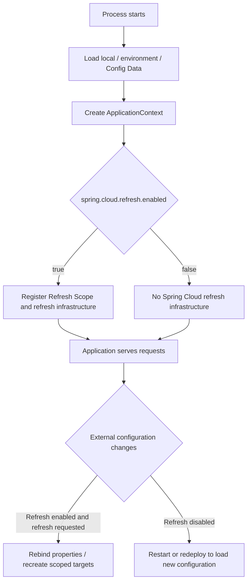

# Cấu hình spring.cloud.refresh.enabled theo chế độ chạy

## 1. Vì sao phải chọn refresh mode theo chế độ chạy?

Spring Cloud Context cung cấp `@RefreshScope`, `ContextRefresher` và các thành phần liên quan để ứng dụng có thể nhận cấu hình mới khi đang chạy. Trong một ứng dụng JVM thông thường, đây là khả năng hữu ích: sau khi Environment được cập nhật, bean cấu hình có thể được rebind và target thuộc Refresh Scope có thể được tạo lại.

Khi chuyển ứng dụng sang Spring AOT hoặc GraalVM Native Image, mô hình khởi tạo thay đổi. Spring phân tích ApplicationContext ở build time, sinh mã khởi tạo và cố định nhiều quyết định về bean. Context refresh của Spring Cloud không được hỗ trợ trong các chế độ này. Vì vậy, Spring Cloud yêu cầu:

```yaml
spring:
  cloud:
    refresh:
      enabled: false
```

Điểm cần nhớ là `spring.cloud.refresh.enabled` quyết định việc đăng ký Refresh Scope và các tính năng refresh liên quan ngay trong quá trình tạo ApplicationContext. Với artifact AOT hoặc native, phải đặt giá trị `false` khi xử lý AOT/build và giữ nhất quán khi chạy. Chỉ truyền `false` sau khi artifact đã được tạo không thay thế được quyết định build time.

Sau bài học, người đọc có thể:

- Chọn `spring.cloud.refresh.enabled` phù hợp cho JVM thông thường, JVM AOT và native image.
- Phân biệt refresh cấu hình lúc chạy với nạp cấu hình lúc khởi động.
- Cấu hình property ở build time, profile và runtime mà không làm lệch ApplicationContext đã AOT.
- Tách công tắc refresh toàn cục khỏi refresh tự động khi CRaC checkpoint được restore.
- Thiết kế bean và test phù hợp khi Refresh Scope bị tắt.

## 2. Ý nghĩa chính xác của spring.cloud.refresh.enabled

Spring Cloud Commons khai báo property `spring.cloud.refresh.enabled` với giá trị mặc định `true`. Property này bật auto-configuration cho Refresh Scope và các tính năng liên quan.

| Giá trị | Ý nghĩa |
| --- | --- |
| `true` | Cho phép Spring Cloud cấu hình Refresh Scope và các tính năng refresh liên quan |
| `false` | Không tạo auto-configuration của Refresh Scope và các tính năng refresh liên quan |

Ví dụ khai báo tường minh:

```yaml
spring:
  cloud:
    refresh:
      enabled: true
```

Trong JVM thông thường, nếu ứng dụng cần refresh cấu hình khi đang chạy, có thể giữ mặc định hoặc đặt `true` rõ ràng. Nếu ứng dụng không sử dụng refresh, cũng có thể đặt `false` để bỏ phần hạ tầng refresh khỏi ApplicationContext.

Khi đặt `false`, cần hiểu tác động ở cấp kiến trúc:

- `@RefreshScope` không còn cơ chế scope được Spring Cloud đăng ký.
- Những thành phần tự động cấu hình cho refresh không được tạo theo cơ chế đó.
- `ContextRefresher` và luồng refresh của Spring Cloud không còn là khả năng mà ứng dụng có thể dựa vào.
- Cấu hình đã nạp lúc khởi động vẫn được sử dụng bình thường.
- Việc dùng Spring Cloud Config Client, Config Data, service discovery, service registry hoặc LoadBalancer không bị tắt chỉ vì property này là `false`; từng tính năng có điều kiện cấu hình riêng.

Không dùng `spring.cloud.refresh.enabled` như một công tắc bật/tắt toàn bộ Spring Cloud hoặc toàn bộ externalized configuration.

## 3. Refresh cấu hình lúc chạy khác với nạp cấu hình lúc khởi động

Hai luồng sau thường bị nhầm lẫn:

1. **Config Data / externalized configuration:** ứng dụng đọc `application.yml`, environment variable, file mount hoặc Config Server khi khởi động.
2. **Context refresh:** ứng dụng đã chạy, Environment nhận giá trị mới, các bean được rebind hoặc target Refresh Scope được tạo lại.

Ví dụ, ứng dụng vẫn có thể nạp cấu hình từ Config Server khi khởi động bằng:

```yaml
spring:
  config:
    import: "optional:configserver:"
  cloud:
    refresh:
      enabled: false
```

`spring.config.import` điều khiển việc nạp Config Data. `spring.cloud.refresh.enabled` điều khiển auto-configuration của refresh. Hai property giải quyết hai giai đoạn khác nhau.

Khi refresh bị tắt, Config Server vẫn có thể cung cấp giá trị cho lần khởi động hiện tại. Nếu cấu hình trên Config Server thay đổi sau đó, ứng dụng không tự động rebind bean qua Spring Cloud Context. Cần khởi động lại hoặc triển khai lại instance để nhận bộ cấu hình mới.



Vì vậy, ứng dụng native image vẫn có thể dùng external configuration tại startup. Điều không được hỗ trợ là cơ chế Context Refresh của Spring Cloud trong AOT/native mode.

## 4. Ma trận cấu hình theo chế độ chạy

| Chế độ | `spring.cloud.refresh.enabled` | Refresh thủ công lúc chạy | Ghi chú |
| --- | --- | --- | --- |
| JVM thông thường, không AOT | `true` nếu cần refresh; nếu không có thể đặt `false` | Có, nếu các thành phần liên quan được cấu hình | Đây là chế độ phù hợp khi ứng dụng cần `@RefreshScope` |
| JVM chạy mã đã xử lý AOT | `false` | Không được Spring Cloud Context hỗ trợ | Quyết định phải được áp dụng lúc AOT processing |
| GraalVM Native Image | `false` | Không được Spring Cloud Context hỗ trợ | Native image được xây dựng từ AOT output |
| JVM dùng CRaC checkpoint/restore, không AOT | Thường giữ `true` nếu cần refresh khi restore | Có | Có thêm `spring.cloud.refresh.on-restart.enabled` |
| CRaC kết hợp AOT | `false` theo giới hạn AOT | Không dùng Context Refresh | AOT constraint được ưu tiên |

Đừng chọn giá trị chỉ dựa vào môi trường triển khai có tên “production” hoặc “container”. Container chạy JVM thông thường vẫn có thể dùng Refresh Scope; native executable chạy trong container thì phải tắt refresh. Hãy phân loại theo cách artifact được xử lý và thực thi.

## 5. JVM thông thường: giữ refresh khi ứng dụng cần cập nhật bean

Với ứng dụng JVM không bật AOT, Spring tạo ApplicationContext khi process khởi động. Nếu cần lấy cấu hình mới trong vòng đời process, có thể bật refresh:

```yaml
# application-jvm.yml
spring:
  cloud:
    refresh:
      enabled: true
```

Khi chạy profile JVM:

```bash
java -jar inventory-service.jar --spring.profiles.active=jvm
```

Hoặc bỏ property và dùng mặc định `true` của Spring Cloud Commons.

### 5.1. Bean nào cần Refresh Scope?

Chỉ đánh dấu `@RefreshScope` cho bean thực sự cần tạo lại khi cấu hình đổi, ví dụ client giữ endpoint hoặc timeout tại thời điểm khởi tạo:

```java
import org.springframework.cloud.context.config.annotation.RefreshScope;
import org.springframework.context.annotation.Bean;
import org.springframework.context.annotation.Configuration;

@Configuration(proxyBeanMethods = false)
public class InventoryClientConfiguration {

    @Bean
    @RefreshScope
    InventoryClient inventoryClient(InventoryProperties properties) {
        return new InventoryClient(
                properties.getBaseUrl(),
                properties.getConnectTimeout()
        );
    }
}
```

`InventoryClient` được truy cập qua scoped proxy. Khi refresh thành công, target hiện tại bị hủy và target mới được tạo ở lần gọi tiếp theo.

Không cần đánh dấu mọi bean hoặc mọi `@ConfigurationProperties` bằng `@RefreshScope`. Rebinding và Refresh Scope là hai cơ chế có vai trò khác nhau; chỉ chọn bean cần được tạo lại.

### 5.2. Refresh endpoint không tự xuất hiện chỉ vì property là true

Nếu muốn gọi refresh qua HTTP, ứng dụng còn phải có Actuator và expose endpoint phù hợp:

```yaml
management:
  endpoints:
    web:
      exposure:
        include:
          - health
          - refresh
```

Sau đó cần bảo vệ endpoint bằng authentication, authorization và network policy. `spring.cloud.refresh.enabled=true` cho phép cấu hình refresh infrastructure; nó không tự expose endpoint quản trị ra HTTP.

## 6. JVM AOT: đặt false trong quá trình xử lý AOT

Spring AOT phân tích ApplicationContext ở build time và sinh mã khởi tạo. Khi chạy JAR đã được xử lý AOT trên JVM, ứng dụng sử dụng cấu trúc bean đã được xác định trong quá trình đó.

Spring Cloud Context không hỗ trợ Context Refresh trong Spring AOT transformations. Vì vậy phải đặt:

```yaml
spring:
  cloud:
    refresh:
      enabled: false
```

### 6.1. Đặt property ở build time

Có thể đặt property trong cấu hình chung của artifact AOT:

```yaml
# application-aot.yml
spring:
  cloud:
    refresh:
      enabled: false
```

Profile `aot` phải được chọn trong lúc chạy AOT processing. Spring Boot cố định các profile đã active ở build time trong AOT output; các profile này được áp dụng khi chạy ứng dụng AOT. Không chờ đến lúc chạy JAR mới bật profile `aot` nếu quá trình AOT đã được tạo với cấu hình khác.

Ví dụ về ý tưởng build với profile AOT trên shell Bash:

```bash
SPRING_PROFILES_ACTIVE=aot ./mvnw -Pnative package
```

Lệnh trên minh họa việc đưa profile vào môi trường của tiến trình build. Tên Maven profile và lệnh cụ thể phụ thuộc cấu hình dự án; điều quan trọng là AOT processing phải nhìn thấy `spring.cloud.refresh.enabled=false`.

Trong lệnh này, `-Pnative` là Maven build profile dùng theo cấu hình Spring Boot để đưa AOT generated code vào JAR; `SPRING_PROFILES_ACTIVE=aot` là Spring profile quyết định cấu hình ứng dụng. Hai profile thuộc hai hệ thống khác nhau. JAR có AOT code vẫn có thể chạy trên JVM với `-Dspring.aot.enabled=true`.

Một cách khác là đặt property trực tiếp trong cấu hình được dùng trong build:

```bash
SPRING_CLOUD_REFRESH_ENABLED=false ./mvnw -Pnative package
```

Chỉ dùng cách này nếu biến môi trường được truyền tới tiến trình thực hiện Spring AOT processing trong build pipeline. Hãy kiểm tra log và cấu hình build để xác nhận giá trị thực tế.

### 6.2. Giữ giá trị nhất quán khi chạy

JAR có AOT output nên được chạy với cùng quyết định cấu hình:

```bash
java -Dspring.aot.enabled=true -jar inventory-service.jar
```

Nếu AOT output được tạo với `spring.cloud.refresh.enabled=false`, không cố ghi đè thành `true` ở runtime. Runtime override không thể bổ sung lại các bean và quyết định cấu hình đã bị loại khỏi AOT output.

Nếu ứng dụng cần hai cách chạy khác nhau:

- Artifact JVM thường có thể giữ refresh bật.
- Artifact AOT cần được tạo với refresh tắt.

Hãy tạo hai build configuration hoặc hai artifact phù hợp thay vì kỳ vọng một AOT artifact có thể đổi cấu trúc ApplicationContext tùy ý sau khi build.

## 7. Native Image: tắt refresh trước khi tạo executable

GraalVM Native Image sử dụng Spring AOT để phân tích và tạo executable. Vì vậy, giới hạn của Spring Cloud Context trong AOT cũng áp dụng cho native image.

Với native image, đặt property thành `false` trong cấu hình được dùng khi native build:

```yaml
# application-native.yml
spring:
  cloud:
    refresh:
      enabled: false
```

Profile `native` phải active trong quá trình AOT/native image build. Nếu dùng biến môi trường:

```bash
SPRING_PROFILES_ACTIVE=native ./mvnw -Pnative package
```

Hoặc:

```bash
SPRING_CLOUD_REFRESH_ENABLED=false ./mvnw -Pnative package
```

Tùy build plugin, lệnh tạo native executable có thể khác. Kiểm tra rằng property đã được áp dụng ở tiến trình Spring AOT, không chỉ ở tiến trình chạy executable.

Khi chạy native executable:

```bash
./target/inventory-service
```

Không bật lại `spring.cloud.refresh.enabled=true` qua command line hoặc Config Server. Native image không thể khôi phục Refresh Scope infrastructure đã không được tạo trong AOT phase.

### 7.1. Điều gì vẫn hoạt động trong native image?

Tắt refresh không có nghĩa native image không thể dùng Spring Cloud:

- Config Data có thể nạp cấu hình ở startup nếu integration đó hỗ trợ AOT/native image.
- Discovery Client, Service Registry hoặc LoadBalancer có thể hoạt động nếu integration tương ứng hỗ trợ native image và đáp ứng các điều kiện riêng.
- `@ConfigurationProperties` vẫn được bind khi khởi tạo context.
- Thay đổi cấu hình sau startup cần quy trình restart hoặc redeploy.

Từng integration có thể có yêu cầu AOT riêng. Ví dụ, Spring Cloud Config Client có hỗ trợ AOT/native image nhưng không hỗ trợ config-first bootstrap legacy khi `spring.config.use-legacy-processing=true`. Đừng suy ra rằng một integration hỗ trợ native image thì mọi chế độ cấu hình của nó đều được hỗ trợ.

## 8. Bean @RefreshScope khi refresh bị tắt

Khi `spring.cloud.refresh.enabled=false`, không nên để ứng dụng vẫn đăng ký bean được đánh dấu `@RefreshScope`. Auto-configuration tạo scope đã bị tắt; một bean còn yêu cầu scope `refresh` có thể làm ApplicationContext khởi động thất bại vì không có scope tương ứng.

Nếu ứng dụng cần cùng một client trong cả JVM thường và AOT, hãy tách cấu hình theo property:

```java
import org.springframework.boot.autoconfigure.condition.ConditionalOnProperty;
import org.springframework.cloud.context.config.annotation.RefreshScope;
import org.springframework.context.annotation.Bean;
import org.springframework.context.annotation.Configuration;

@Configuration(proxyBeanMethods = false)
@ConditionalOnProperty(
        prefix = "spring.cloud.refresh",
        name = "enabled",
        havingValue = "true",
        matchIfMissing = true
)
class RefreshableInventoryClientConfiguration {

    @Bean
    @RefreshScope
    InventoryClient inventoryClient(InventoryProperties properties) {
        return new InventoryClient(properties.getBaseUrl());
    }
}
```

Với chế độ refresh tắt, đăng ký bean thông thường:

```java
@Configuration(proxyBeanMethods = false)
@ConditionalOnProperty(
        prefix = "spring.cloud.refresh",
        name = "enabled",
        havingValue = "false"
)
class FixedInventoryClientConfiguration {

    @Bean
    InventoryClient inventoryClient(InventoryProperties properties) {
        return new InventoryClient(properties.getBaseUrl());
    }
}
```

Hai cấu hình cùng cung cấp một bean `InventoryClient`, nhưng chỉ một cấu hình được chọn theo property. Với AOT, điều kiện này được đánh giá ở build time. Giá trị phải được giữ nhất quán khi chạy.

Nếu ứng dụng không cần dynamic refresh ở bất kỳ chế độ nào, cấu hình đơn giản hơn là bỏ `@RefreshScope` và dùng bean thông thường.

## 9. CRaC checkpoint/restore là một trường hợp khác

Project CRaC (Coordinated Restore at Checkpoint) lưu trạng thái của một JVM đang chạy để khôi phục process sau đó. Đây là checkpoint/restore của HotSpot JVM; nó không phải GraalVM Native Image và không tự động đồng nghĩa với Spring AOT.

Spring Cloud hỗ trợ refresh context khi JVM được restart/restore bằng `RefreshScopeLifecycle`. Lifecycle này có thể:

- Rebind các bean `@ConfigurationProperties`.
- Refresh target của các bean `@RefreshScope`.
- Giúp bean nhận lại cấu hình hoặc tài nguyên cần được làm mới sau khi restore.

Hai property có trách nhiệm riêng:

| Property | Trách nhiệm |
| --- | --- |
| `spring.cloud.refresh.enabled` | Bật/tắt Refresh Scope và các tính năng refresh liên quan |
| `spring.cloud.refresh.on-restart.enabled` | Bật/tắt tự động refresh context khi restart/restore |

`spring.cloud.refresh.on-restart.enabled` có mặc định `true` trong Spring Cloud Commons hiện hành.

### 9.1. CRaC JVM cần refresh khi restore

Nếu ứng dụng chạy CRaC trên JVM thông thường và cần rebind/refresh sau restore:

```yaml
spring:
  cloud:
    refresh:
      enabled: true
      on-restart:
        enabled: true
```

Đây là cách giữ cả Refresh Scope lẫn hành vi refresh tự động khi restart/restore.

### 9.2. CRaC JVM không cần refresh tự động khi restore

Nếu ứng dụng vẫn cần refresh thủ công khi đang chạy nhưng không muốn Spring Cloud tự refresh mỗi lần restore:

```yaml
spring:
  cloud:
    refresh:
      enabled: true
      on-restart:
        enabled: false
```

Chỉ tắt `on-restart`; không tắt `refresh.enabled`. Khi đó ứng dụng vẫn giữ các tính năng refresh thông thường nhưng không tạo hành vi tự refresh theo lifecycle restart.

### 9.3. CRaC kết hợp AOT

Nếu ứng dụng vừa dùng AOT vừa có checkpoint/restore, giới hạn AOT vẫn áp dụng: đặt `spring.cloud.refresh.enabled=false`. Không bật refresh chỉ vì JVM có CRaC. Khi refresh toàn cục đã tắt, `spring.cloud.refresh.on-restart.enabled` không thể khôi phục Refresh Scope hoặc Context Refresh.

## 10. Cấu hình profile theo từng artifact

Một cách tổ chức dễ đọc là dùng profile cho các chế độ có cấu trúc ApplicationContext khác nhau:

```text
src/main/resources/
├── application.yml
├── application-jvm.yml
├── application-aot.yml
├── application-native.yml
└── application-crac.yml
```

Ví dụ:

```yaml
# application-jvm.yml
spring:
  cloud:
    refresh:
      enabled: true
```

```yaml
# application-aot.yml
spring:
  cloud:
    refresh:
      enabled: false
```

```yaml
# application-native.yml
spring:
  cloud:
    refresh:
      enabled: false
```

```yaml
# application-crac.yml
spring:
  cloud:
    refresh:
      enabled: true
      on-restart:
        enabled: true
```

Profile chỉ là cách tổ chức property. Với AOT/native, profile tương ứng phải được chọn trong AOT processing. Với JVM thường hoặc CRaC không AOT, profile có thể được chọn theo cách chạy thông thường.

Không nên đóng gói một AOT artifact với profile `aot` rồi trông chờ đổi sang `jvm` ở runtime để bật Refresh Scope. Những bean đã được quyết định ở build time không thể được thêm lại bằng cách đổi profile sau đó.

## 11. External configuration và build-time consistency

Trong AOT, các property ảnh hưởng tới việc tạo bean được đánh giá khi xử lý ApplicationContext ở build time. Vì vậy, các giá trị như:

- `spring.cloud.refresh.enabled`.
- Active profile.
- Các property được dùng trong `@ConditionalOnProperty`.
- Các property làm thay đổi việc tạo hoặc loại bean.

cần được xác định nhất quán khi build và khi chạy.

Nếu AOT processing tải cấu hình từ Config Server, nguồn cấu hình cần sẵn sàng trong quá trình build. Những property ảnh hưởng đến cấu trúc bean không nên thay đổi giữa build và runtime. Cấu hình từ xa vẫn có thể cung cấp giá trị nghiệp vụ lúc chạy, nhưng không thể thay đổi tùy ý các quyết định cấu trúc ApplicationContext đã được AOT cố định.

Với ứng dụng dùng Config Server:

```yaml
spring:
  config:
    import: "optional:configserver:"
  cloud:
    refresh:
      enabled: false
```

Đặt `spring.cloud.refresh.enabled=false` trong cấu hình build dành cho AOT/native. Sau đó dùng Config Data để lấy các property cần thiết ở startup. Khi Config Server cập nhật giá trị, triển khai lại instance để nạp cấu hình mới.

Không dùng remote property source để đổi `spring.cloud.refresh.enabled` từ `false` sang `true` sau khi AOT/native image đã được tạo. Quyết định đó đến quá muộn để thêm refresh infrastructure vào artifact.

## 12. Kiểm thử theo chế độ chạy

Không nên chỉ kiểm tra file YAML. Cần xác nhận ApplicationContext được tạo với đúng hạ tầng và artifact hoạt động đúng cách.

### 12.1. Kiểm thử điều kiện auto-configuration trên JVM

Có thể dùng `ApplicationContextRunner` để xác nhận refresh infrastructure có mặt khi bật và không được đăng ký khi tắt:

```java
import org.junit.jupiter.api.Test;
import org.springframework.boot.SpringBootConfiguration;
import org.springframework.boot.autoconfigure.EnableAutoConfiguration;
import org.springframework.boot.test.context.runner.ApplicationContextRunner;
import org.springframework.cloud.context.scope.refresh.RefreshScope;

import static org.assertj.core.api.Assertions.assertThat;

class RefreshModeConfigurationTests {

    private final ApplicationContextRunner contextRunner =
            new ApplicationContextRunner()
                    .withUserConfiguration(TestApplication.class);

    @Test
    void registersRefreshScopeWhenEnabled() {
        contextRunner
                .withPropertyValues("spring.cloud.refresh.enabled=true")
                .run(context -> assertThat(context)
                        .hasSingleBean(RefreshScope.class));
    }

    @Test
    void doesNotRegisterRefreshScopeWhenDisabled() {
        contextRunner
                .withPropertyValues("spring.cloud.refresh.enabled=false")
                .run(context -> assertThat(context)
                        .doesNotHaveBean(RefreshScope.class));
    }

    @SpringBootConfiguration
    @EnableAutoConfiguration
    static class TestApplication {
    }
}
```

Test cần có Spring Cloud Context trên test classpath và dùng cùng dependency management với ứng dụng. Nó kiểm tra auto-configuration trong JVM test context; nó không thay thế kiểm thử artifact AOT hoặc native image.

### 12.2. Kiểm thử JVM thường có refresh

Với profile JVM:

1. Khởi động ứng dụng với `spring.cloud.refresh.enabled=true`.
2. Xác nhận bean `@RefreshScope` được tạo qua proxy.
3. Cập nhật nguồn property test.
4. Gọi `ContextRefresher.refresh()` hoặc endpoint refresh được bảo vệ.
5. Xác nhận bean properties nhận giá trị mới và target scoped được tạo lại.

### 12.3. Kiểm thử AOT và native image

Với AOT/native:

1. Đảm bảo property `spring.cloud.refresh.enabled=false` có mặt trong AOT processing.
2. Xác nhận không còn bean `@RefreshScope` không tương thích trong cấu hình đã chọn.
3. Build artifact và khởi động artifact thực tế.
4. Xác nhận Config Data và các integration khác vẫn nạp cấu hình startup như mong đợi.
5. Xác nhận không có code hoặc endpoint nào giả định `ContextRefresher` luôn tồn tại.
6. Thay đổi property nguồn và xác nhận instance mới nhận giá trị sau khi restart/redeploy.

Đối với native image, cần chạy smoke test trên executable được tạo ra; một test JVM thông thường không chứng minh native runtime đã hoạt động đúng.

### 12.4. Kiểm thử CRaC restore

Với JVM CRaC:

- Khi `spring.cloud.refresh.enabled=true` và `on-restart.enabled=true`, xác nhận lifecycle refresh chạy sau restore và bean được rebind/tạo lại theo thiết kế.
- Khi `on-restart.enabled=false`, xác nhận không có refresh tự động do lifecycle restart.
- Nếu vẫn cần refresh thủ công, xác nhận `ContextRefresher` vẫn khả dụng khi `refresh.enabled=true`.
- Kiểm tra resource như socket, connection pool và scheduler được khôi phục theo yêu cầu của ứng dụng.

## 13. Lỗi thường gặp và cách chẩn đoán

| Triệu chứng | Nguyên nhân có thể | Cách xử lý |
| --- | --- | --- |
| Native image báo lỗi liên quan Refresh Scope | `spring.cloud.refresh.enabled` vẫn là `true` trong AOT processing | Đặt `false` trong cấu hình build và tạo lại image |
| JVM AOT không có bean refresh | Đây là hành vi mong đợi khi AOT dùng refresh disabled | Dùng bean thông thường hoặc restart/redeploy khi cấu hình đổi |
| Runtime đặt `true` nhưng không có RefreshScope | AOT output được tạo với `false` | Tạo lại artifact thường nếu cần refresh; không cố bật lại ở runtime |
| ApplicationContext không khởi động vì thiếu scope `refresh` | Còn bean `@RefreshScope` trong cấu hình khi refresh infrastructure đã tắt | Điều kiện hóa cấu hình refreshable hoặc bỏ annotation ở chế độ AOT/native |
| Config Server vẫn tải được cấu hình nhưng không refresh sau đó | Config Data startup hoạt động, Context Refresh đã tắt | Restart/redeploy instance để nhận cấu hình mới |
| CRaC restore không rebind bean | `spring.cloud.refresh.on-restart.enabled=false` hoặc refresh toàn cục đã tắt | Kiểm tra cả hai property và mode build |
| AOT build dùng profile khác với runtime mong muốn | Profile/property đã được cố định khi AOT processing | Đồng bộ profile build và runtime, tạo lại artifact |
| JVM thường không có refresh dù property là true | Thiếu Spring Cloud Context, bean không dùng proxy hoặc cấu hình refresh bị loại bởi điều kiện khác | Kiểm tra dependency và ApplicationContext |
| Native image có property mới nhưng bean không đổi | Không có Context Refresh trong native image | Khởi động instance mới hoặc triển khai lại |
| Dùng legacy Config First Bootstrap trong AOT | Chế độ bootstrap legacy không hỗ trợ AOT/native image trong một số Config Client path | Chuyển sang Config Data API theo tài liệu phiên bản |

## 14. Checklist triển khai

1. Xác định artifact chạy JVM thường, JVM AOT, native image hay JVM CRaC.
2. Đặt `spring.cloud.refresh.enabled=true` chỉ khi chế độ chạy hỗ trợ và ứng dụng cần refresh.
3. Đặt `spring.cloud.refresh.enabled=false` trong AOT processing và native image build.
4. Giữ property nhất quán giữa AOT build và runtime.
5. Không đăng ký bean `@RefreshScope` khi refresh infrastructure bị tắt.
6. Tách bean refreshable và bean cố định nếu cần hỗ trợ nhiều chế độ.
7. Phân biệt Config Data startup với Context Refresh lúc chạy.
8. Với CRaC, quyết định riêng `spring.cloud.refresh.on-restart.enabled`.
9. Không nhầm CRaC checkpoint/restore với GraalVM Native Image.
10. Kiểm tra mọi property ảnh hưởng tới bean creation đã được xác định ở build time.
11. Chạy smoke test trên JAR AOT hoặc native executable thực tế.
12. Có quy trình restart/redeploy để nhận cấu hình mới khi refresh bị tắt.

## 15. Tài liệu tham khảo

- [Spring Cloud Context — Application Context Services](https://docs.spring.io/spring-cloud-commons/reference/spring-cloud-commons/application-context-services.html): giới hạn Context Refresh với AOT/native image và `RefreshScopeLifecycle` khi restart.
- [Spring Cloud Commons — Configuration Properties](https://docs.spring.io/spring-cloud-commons/reference/configprops.html): giá trị mặc định và mô tả `spring.cloud.refresh.enabled`, `spring.cloud.refresh.on-restart.enabled`.
- [Spring Boot — Ahead-of-Time Processing With the JVM](https://docs.spring.io/spring-boot/reference/packaging/aot.html): AOT processing, profile và các giới hạn khi bean graph được cố định ở build time.
- [Spring Boot — Checkpoint and Restore With the JVM](https://docs.spring.io/spring-boot/reference/packaging/checkpoint-restore.html): mô hình checkpoint/restore của JVM.
- [Spring Framework — JVM Checkpoint Restore](https://docs.spring.io/spring-framework/reference/integration/checkpoint-restore.html): lifecycle callback và hỗ trợ CRaC.
- [Spring Cloud Config — AOT and Native Image Support](https://docs.spring.io/spring-cloud-config/reference/client.html): các giới hạn của Config Client trong AOT/native image và yêu cầu cấu hình lúc build.

`spring.cloud.refresh.enabled` là quyết định về khả năng refresh của ApplicationContext. JVM thông thường có thể giữ refresh nếu ứng dụng cần; AOT và native image phải tắt tính năng này trong quá trình build; CRaC JVM có thể giữ refresh và điều khiển riêng hành vi tự refresh khi restore bằng `spring.cloud.refresh.on-restart.enabled`. Hãy chọn mode trước khi tạo artifact và kiểm thử đúng artifact sẽ triển khai.
