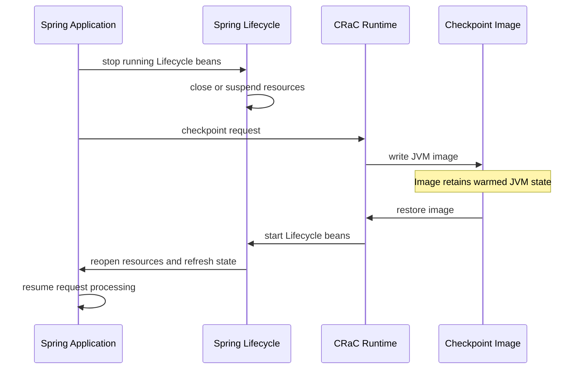
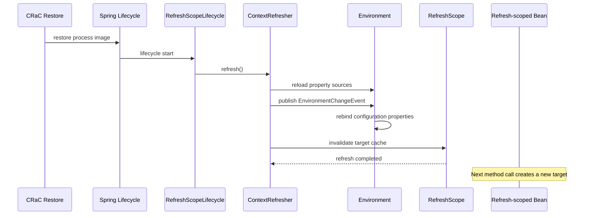

# Checkpoint, restore và vai trò RefreshScopeLifecycle khi được hỗ trợ

Checkpoint/restore cho phép lưu trạng thái của một JVM đang chạy thành một ảnh bộ nhớ rồi khôi phục JVM từ ảnh đó. Với một ứng dụng Spring đã được khởi động và warm-up, cách làm này có thể giảm thời gian khởi động và giữ lại phần tối ưu JIT đã đạt được. Tuy nhiên, ảnh checkpoint cũng giữ nhiều trạng thái của process: object trong heap, cấu hình đã nạp, cache, thông tin phiên và tham chiếu tới tài nguyên bên ngoài.

Spring Framework tích hợp checkpoint/restore theo hợp đồng vòng đời Lifecycle: dừng các bean đang chạy trước checkpoint và khởi động lại chúng sau restore. Spring Cloud Context bổ sung RefreshScopeLifecycle để gọi ContextRefresher.refresh() trong vòng đời restart. Nhờ đó, cấu hình có thể được tải lại, các bean ConfigurationProperties được rebind và target của bean RefreshScope được làm mới sau khi JVM phục hồi.

Bài học thuộc chương **AOT và checkpoint** của module **SPRING_CLOUD_CORE**. Nội dung tập trung vào Project CRaC, hai chế độ checkpoint/restore của Spring Framework, vòng đời tài nguyên, điều kiện có RefreshScopeLifecycle, cấu hình bật/tắt, giới hạn khi dùng AOT/native image và cách kiểm thử ứng dụng sau restore.

## 1. Mục tiêu học tập

Sau bài học, người học có thể:

- Giải thích checkpoint/restore và vai trò của Project CRaC.
- Phân biệt checkpoint một JVM đang chạy với checkpoint tự động tại startup.
- Hiểu Spring Framework sử dụng Lifecycle.stop() và Lifecycle.start() để quản lý tài nguyên.
- Xác định yêu cầu runtime, dependency và JVM options để chạy CRaC.
- Giải thích vai trò của RefreshScopeLifecycle sau restore.
- Cấu hình spring.cloud.refresh.on-restart.enabled.
- Phân biệt context refresh, refresh scope và việc mở lại tài nguyên ngoài JVM.
- Xử lý socket, connection pool, scheduler, token và dữ liệu thay đổi theo môi trường.
- Kiểm thử mốc onRefresh, checkpoint thực tế và hành vi của bean sau restore.
- Nhận biết giới hạn của Context Refresh khi dùng Spring AOT transformation hoặc native image.

## 2. Checkpoint/restore là gì?

Checkpoint/restore là cơ chế chụp trạng thái của một process đang chạy rồi khôi phục process từ trạng thái đã lưu. Trong Java, Project CRaC (Coordinated Restore at Checkpoint) cung cấp API để JVM phối hợp với các thư viện và ứng dụng trước khi checkpoint và sau khi restore.

Quy trình cơ bản:

1. Khởi động ứng dụng trên một JVM hỗ trợ CRaC.
2. Thực hiện workload để nạp cấu hình, tạo bean, mở kết nối và warm-up các đường chạy thường dùng.
3. Yêu cầu JVM checkpoint.
4. JVM phối hợp với ứng dụng để dừng hoặc chuẩn bị tài nguyên.
5. Trạng thái JVM được ghi thành checkpoint image.
6. Khởi chạy một process từ image đó.
7. Ứng dụng tiếp tục từ trạng thái đã lưu và khôi phục các tài nguyên cần thiết.

Checkpoint image giữ lại trạng thái runtime, bao gồm heap và các tối ưu hóa JIT. Vì vậy, restore có thể nhanh hơn việc khởi động lại toàn bộ ứng dụng và chạy warm-up từ đầu.

### 2.1. Checkpoint khác restart thông thường

| Hoạt động | Restart thông thường | Checkpoint/restore |
| --- | --- | --- |
| JVM | Tạo JVM mới | Phục hồi JVM từ image |
| Heap/object graph | Tạo lại từ đầu | Khôi phục trạng thái đã lưu |
| JIT warm-up | Thường phải chạy lại | Có thể giữ trạng thái đã warm-up |
| ApplicationContext | Tạo mới | Tiếp tục từ process image |
| Kết nối ngoài | Tạo lại khi startup | Phải kiểm tra và khôi phục sau restore |
| Cấu hình | Đọc theo startup mới | Có thể đang giữ giá trị tại thời điểm checkpoint; cần refresh nếu nguồn đã đổi |

Checkpoint/restore không phải serialization một vài bean Spring. Nó lưu trạng thái process ở mức JVM và hệ điều hành. Do đó, các tham chiếu tới socket, file descriptor, thread, database connection hoặc thông tin phiên có thể không còn hợp lệ khi môi trường đã thay đổi.

## 3. Khi nào checkpoint/restore hữu ích?

Checkpoint/restore phù hợp khi thời gian khởi động và warm-up là một phần đáng kể trong thời gian đưa instance vào phục vụ.

Ví dụ:

- Ứng dụng Spring Cloud có nhiều bean và auto-configuration.
- Ứng dụng cần tải cấu hình từ Config Server và khởi tạo nhiều client.
- Các đường chạy thường dùng cần JIT warm-up trước khi đạt latency ổn định.
- Nền tảng triển khai có thể lưu và phân phối checkpoint image.
- Ứng dụng có thể phối hợp đóng/mở lại tài nguyên trước và sau checkpoint.

Checkpoint/restore cần sự hỗ trợ từ JVM, hệ điều hành, container runtime và các thư viện đang sử dụng. Không phải mọi môi trường Java đều có thể restore cùng một checkpoint image.

## 4. Điều kiện nền tảng để dùng CRaC

Theo hướng dẫn Spring Framework, cần các thành phần sau:

- JVM có hỗ trợ checkpoint/restore.
- Môi trường Linux tương thích với runtime/engine checkpoint đang dùng.
- Dependency org.crac:crac trên classpath; Spring Framework hiện hỗ trợ từ phiên bản 1.4.0 trở lên.
- JVM options để tạo checkpoint hoặc restore từ checkpoint.
- Các thư viện và tài nguyên ngoài JVM có lifecycle xử lý checkpoint/restore phù hợp.

Dependency Maven minh họa:

```xml
<dependency>
    <groupId>org.crac</groupId>
    <artifactId>crac</artifactId>
    <version>1.4.0</version>
</dependency>
```

Trong dự án dùng dependency management, hãy kiểm tra version được quản lý bởi BOM hoặc nền tảng runtime đã chọn. Ví dụ trên cho biết tọa độ và mức version tối thiểu được Spring Framework hỗ trợ; không nên ghim version riêng nếu dependency management của dự án đã quản lý nó.

Các JVM options thường gặp:

| Option | Mục đích |
| --- | --- |
| -XX:CRaCCheckpointTo=PATH | Khởi động JVM có thể checkpoint và chỉ định nơi ghi image |
| -XX:CRaCRestoreFrom=PATH | Khởi chạy JVM bằng checkpoint image đã tạo |
| -Dspring.context.checkpoint=onRefresh | Yêu cầu Spring tạo checkpoint tự động tại lifecycle phase onRefresh |
| -Dspring.context.exit=onRefresh | Dừng ứng dụng tại cùng lifecycle phase để kiểm thử mà không cần CRaC runtime |

## 5. Hai chế độ checkpoint/restore trong Spring Framework

Spring Framework hỗ trợ hai cách dùng chính. Chúng có mục đích khác nhau và tạo ra trạng thái ứng dụng ở các mốc khác nhau.

| Chế độ | Thời điểm checkpoint | Trạng thái tại checkpoint | Mục tiêu |
| --- | --- | --- | --- |
| On-demand checkpoint/restore | Sau khi ứng dụng đã chạy và có thể đã warm-up | Có thể giữ JVM đã warm-up, bean đang hoạt động và cache | Khôi phục nhanh một instance đã sẵn sàng |
| Automatic checkpoint/restore at startup | Trong LifecycleProcessor.onRefresh | Singleton không lazy đã khởi tạo, nhưng lifecycle chưa start và ContextRefreshedEvent chưa phát | Fast-forward qua phần khởi tạo context |

### 5.1. On-demand checkpoint/restore

Với chế độ on-demand, ứng dụng khởi động như bình thường. Sau khi đã warm-up, operator hoặc nền tảng triển khai yêu cầu checkpoint.

Trước khi ghi image, Spring dừng các bean đang chạy có tham gia hợp đồng Lifecycle. Sau restore, Spring gọi lại lifecycle start để bean có cơ hội mở lại tài nguyên.

Luồng khái quát:



Một checkpoint được tạo sau warm-up có thể giữ hiệu năng JIT và cache đã hình thành. Đổi lại, ứng dụng phải có quy trình xử lý tài nguyên ngoài JVM và kiểm tra trạng thái sau restore.

### 5.2. Automatic checkpoint tại startup

Có thể yêu cầu Spring tạo checkpoint tự động ở lifecycle phase onRefresh bằng JVM property:

```bash
java -Dspring.context.checkpoint=onRefresh \
  -XX:CRaCCheckpointTo=/var/lib/orders/checkpoint \
  -jar orders-service.jar
```

Checkpoint được tạo sau khi các singleton không lazy đã được khởi tạo và callback InitializingBean.afterPropertiesSet() đã chạy. Tuy nhiên, lifecycle chưa được start và ContextRefreshedEvent chưa được phát.

Cách này giúp lưu một context đã qua giai đoạn tạo bean, nhưng không tương đương với một JVM đã warm-up bằng workload thực tế. Những tác vụ chỉ chạy sau lifecycle start hoặc sau ContextRefreshedEvent chưa được thực hiện ở thời điểm checkpoint.

### 5.3. Dùng spring.context.exit=onRefresh để kiểm thử

Spring Framework cung cấp property:

```bash
java -Dspring.context.exit=onRefresh \
  -jar orders-service.jar
```

Ứng dụng sẽ thoát ở lifecycle phase tương tự automatic checkpoint. Cách này hữu ích để phát hiện bean hoặc initialization callback nào đang mở kết nối từ xa trước khi lifecycle start.

Có thể dùng nó để kiểm tra:

- Bean có yêu cầu database connection quá sớm không?
- Một client có mở socket trong constructor không?
- Tác vụ khởi tạo có phụ thuộc service bên ngoài trước khi resource lifecycle sẵn sàng không?
- Ứng dụng có thể hoàn thành context initialization khi remote dependency tạm thời chưa truy cập được không?

Property này không tạo checkpoint image và không kiểm thử việc restore. Nó chỉ giúp xác minh hành vi tại mốc lifecycle đó mà không cần CRaC-enabled JVM hoặc Linux.

## 6. Spring Framework quản lý tài nguyên qua Lifecycle

Checkpoint/restore có thể làm mất hiệu lực những tài nguyên gắn với process hoặc môi trường tại thời điểm checkpoint. Spring Framework phối hợp với hợp đồng Lifecycle:

- Trước checkpoint, gọi stop() trên các bean Lifecycle đang chạy.
- Sau restore, gọi start() để bean khôi phục hoạt động.
- Bean quản lý socket, file hoặc thread pool có thể đóng tài nguyên trước checkpoint và mở lại sau restore.
- Thư viện không tích hợp Spring có thể đăng ký org.crac.Resource để nhận callback checkpoint/restore.

Ví dụ một bean quản lý kết nối tới hệ thống bên ngoài:

```java
import org.springframework.context.SmartLifecycle;
import org.springframework.stereotype.Component;

@Component
public class CatalogConnectionLifecycle implements SmartLifecycle {

    private volatile boolean running;

    @Override
    public void start() {
        // Open a new connection after startup or restore.
        openConnection();
        running = true;
    }

    @Override
    public void stop() {
        // Close the old connection before checkpoint or shutdown.
        closeConnection();
        running = false;
    }

    @Override
    public boolean isRunning() {
        return running;
    }

    private void openConnection() {
        // Create a connection using the current runtime configuration.
    }

    private void closeConnection() {
        // Release the connection and related resources.
    }
}
```

Đây là ví dụ cấu trúc lifecycle. Trong ứng dụng thực tế, cần xử lý lỗi kết nối, timeout, retry, idempotency và shutdown callback phù hợp với thư viện client đang dùng.

Không phải mọi bean Spring đều tự động được gọi stop() và start(). Chỉ các bean tham gia lifecycle contract hoặc tài nguyên đã đăng ký với CRaC mới có callback tương ứng. Hãy kiểm tra tài liệu của database driver, HTTP client, messaging client và thư viện native mà ứng dụng sử dụng.

## 7. Vai trò của RefreshScopeLifecycle

RefreshScopeLifecycle thuộc Spring Cloud Context. API này có từ Spring Cloud Context 4.1.0 và được tạo bởi refresh auto-configuration khi các điều kiện phù hợp được thỏa mãn.

Bean này triển khai Spring Lifecycle và dùng ContextRefresher để thực hiện context refresh trong vòng đời restart. Mục đích là làm mới cấu hình sau khi JVM được phục hồi từ checkpoint, vì ảnh checkpoint có thể chứa cấu hình cũ.

Theo cấu hình hiện hành:

```yaml
spring:
  cloud:
    refresh:
      on-restart:
        enabled: true
```

spring.cloud.refresh.on-restart.enabled mặc định là true. Có thể đặt false để tắt hành vi tự động refresh context trong vòng đời restart:

```yaml
spring:
  cloud:
    refresh:
      on-restart:
        enabled: false
```

Khi property này bị tắt:

- RefreshScopeLifecycle không được tạo bởi auto-configuration.
- Các chức năng refresh thông thường vẫn có thể hoạt động nếu spring.cloud.refresh.enabled còn bật.
- Ứng dụng phải tự quyết định cách cập nhật cấu hình và refresh bean sau restore nếu cần.

### 7.1. RefreshScopeLifecycle thực hiện những gì?

Khi được hỗ trợ và bật, RefreshScopeLifecycle gọi ContextRefresher.refresh() trong vòng đời restart. Refresh flow của Spring Cloud có thể:

1. Tải lại hoặc xây dựng lại các property source theo cơ chế refresher đang được ứng dụng dùng.
2. Tính các key thay đổi trong Environment.
3. Phát EnvironmentChangeEvent.
4. Rebind các bean ConfigurationProperties phù hợp.
5. Cập nhật logger level từ property logging.level.*.
6. Invalidate target cache của RefreshScope để target được tạo lại ở lần truy cập tiếp theo.

Nếu ứng dụng dùng Spring Cloud Config Client, việc tải lại cấu hình phụ thuộc Config Data hoặc bootstrap refresh implementation đang được dùng, Config Server có thể truy cập được và cấu hình profile/label vẫn hợp lệ.

### 7.2. Sơ đồ refresh sau restore



RefreshScope bean thường là proxy. Khi target cache bị invalidate, target mới được tạo khi proxy được gọi ở lần tiếp theo. Vì vậy, thời điểm ContextRefresher.refresh() hoàn tất và thời điểm target bean mới thực sự được khởi tạo có thể khác nhau.

## 8. Phân biệt refresh cấu hình với khôi phục tài nguyên

RefreshScopeLifecycle xử lý cấu hình và refresh-scoped bean. Nó không thay thế lifecycle của database connection, socket, scheduler hoặc client bên ngoài.

| Thành phần | Việc cần làm sau restore | Cơ chế phù hợp |
| --- | --- | --- |
| ConfigurationProperties | Rebind theo Environment mới | ContextRefresher / EnvironmentChangeEvent |
| RefreshScope bean | Tạo lại target với cấu hình mới | RefreshScope invalidation |
| Database connection pool | Xác minh và mở lại connection | Spring Lifecycle hoặc driver-specific CRaC integration |
| HTTP connection pool | Loại connection cũ, tạo pool mới nếu cần | Client lifecycle hoặc CRaC Resource |
| File handle | Mở lại file descriptor hợp lệ | Lifecycle hoặc CRaC Resource |
| Scheduler | Khôi phục lịch chạy phù hợp | Lifecycle, scheduler-specific handling |
| Token hoặc session | Làm mới credential/session hết hạn | Authentication client hoặc ứng dụng |
| Cache cục bộ | Làm mới dữ liệu phụ thuộc môi trường | Cache lifecycle / application refresh logic |

Ví dụ: Config Server trả về URL database mới sau restore. ContextRefresher có thể cập nhật Environment và invalidate một bean RefreshScope. Nhưng nếu connection pool cũ không đóng/mở đúng vòng đời, ứng dụng vẫn có thể dùng connection đã được tạo trước checkpoint. Phải xử lý cả refresh cấu hình lẫn tài nguyên.

## 9. Dùng RefreshScope cho bean có cấu hình thay đổi

Một bean có cấu hình được inject lúc khởi tạo có thể được đánh dấu RefreshScope để Spring Cloud tạo lại target khi refresh.

Ví dụ:

```java
import org.springframework.beans.factory.annotation.Value;
import org.springframework.cloud.context.config.annotation.RefreshScope;
import org.springframework.stereotype.Component;

@Component
@RefreshScope
public class CatalogEndpoint {

    private final String baseUrl;

    public CatalogEndpoint(
            @Value("${catalog.base-url}") String baseUrl) {
        this.baseUrl = baseUrl;
    }

    public String baseUrl() {
        return baseUrl;
    }
}
```

Sau khi restore, nếu Config Server trả về catalog.base-url mới và ContextRefresher áp dụng được property source đó, target cũ bị invalidate. Lần gọi baseUrl() tiếp theo sẽ tạo target mới với giá trị mới.

Không cần đánh dấu tất cả bean bằng RefreshScope. Chỉ dùng cho bean có state hoặc cấu hình thực sự cần tạo lại. Việc tạo lại target có thể đóng tài nguyên cũ và tạo tài nguyên mới, vì vậy cần xem xét lifecycle và chi phí khởi tạo.

## 10. Những loại cấu hình không tự refresh theo cách thông thường

Một số giới hạn cần nhớ:

- ConfigurationProperties sử dụng constructor binding, bao gồm Java record, không thể rebind theo cơ chế thông thường.
- RefreshScope trên một class Configuration không tự động đặt mọi bean được khai báo trong class đó vào refresh scope.
- Bean hoặc class bị đưa vào spring.cloud.refresh.never-refreshable không được refresh theo cơ chế thông thường.
- HikariDataSource nằm trong nhóm mặc định không refreshable của Spring Cloud.
- Xóa một property khỏi nguồn cấu hình không tương đương với cập nhật một giá trị mới trong mọi trường hợp; cần kiểm tra hành vi absence/default của ứng dụng.
- Các object không nằm trong refresh scope vẫn có thể giữ tham chiếu hoặc state cũ sau khi Environment đổi.

RefreshScopeLifecycle kích hoạt refresh flow; nó không loại bỏ các giới hạn của ConfigurationProperties, RefreshScope hay loại bean cụ thể.

## 11. Quản lý scheduler và công việc chạy định kỳ

Checkpoint/restore có thể tạo ảnh hưởng đặc biệt tới tác vụ chạy theo lịch. Với Scheduled(fixedRate = ...), các lần chạy bị bỏ lỡ trong khoảng thời gian JVM bị checkpoint có thể được thực hiện khi restore theo cách scheduler xử lý fixed rate.

Ví dụ:

```java
@Scheduled(fixedRate = 5000)
public void pollCatalog() {
    // Poll every five seconds according to fixed-rate scheduling.
}
```

Nếu không muốn scheduler thực hiện dồn các lượt bị lỡ sau restore, cân nhắc fixedDelay hoặc cron expression:

```java
@Scheduled(fixedDelay = 5000)
public void pollCatalog() {
    // Delay is measured after each completed execution.
}

@Scheduled(cron = "0 */1 * * * *")
public void refreshCatalogSummary() {
    // Recalculate according to wall-clock schedule.
}
```

Lựa chọn phụ thuộc ngữ nghĩa nghiệp vụ:

- fixedRate: phù hợp khi cần nhịp thời gian đều và có chính sách xử lý backlog rõ ràng.
- fixedDelay: khoảng nghỉ được tính sau khi lần chạy trước hoàn tất.
- cron: lịch chạy theo thời gian thực, mỗi lần được tính theo biểu thức lịch.

Không đổi fixedRate sang fixedDelay một cách máy móc. Hãy xác định có cần chạy bù các lượt bị bỏ lỡ hay không và bảo đảm job có idempotency nếu có thể chạy lại.

## 12. Ví dụ chạy checkpoint và restore theo cách on-demand

Khởi động ứng dụng trên JVM CRaC-enabled và chỉ định thư mục checkpoint:

```bash
java -XX:CRaCCheckpointTo=/var/lib/orders/checkpoint \
  -jar orders-service.jar
```

Sau khi ứng dụng warm-up, gửi workload đại diện để tạo các code path thường dùng. Sau đó tìm PID và yêu cầu checkpoint:

```bash
jcmd <pid> JDK.checkpoint
```

Khi checkpoint hoàn tất, có thể triển khai image checkpoint tới môi trường tương thích. Khởi chạy từ image:

```bash
java -XX:CRaCRestoreFrom=/var/lib/orders/checkpoint
```

Trước khi đưa instance vào nhận traffic, xác minh:

- JVM đã restore thành công.
- Lifecycle bean đã mở lại tài nguyên.
- Config Client đã tải được cấu hình cần thiết.
- RefreshScopeLifecycle đã thực hiện refresh nếu đang bật và phiên bản hỗ trợ.
- Các bean refresh-scoped có thể tạo target mới.
- Connection pool, HTTP client và scheduler hoạt động bình thường.
- Service registration/instance ID không bị trùng khi nhân bản cùng checkpoint image.

Đường dẫn checkpoint phải được bảo vệ và có đủ dung lượng. Checkpoint image cần được tạo và restore trên môi trường tương thích về hệ điều hành, kiến trúc CPU và runtime.

## 13. Cấu hình RefreshScopeLifecycle trong Spring Cloud

Để Spring Cloud tự cấu hình refresh scope và lifecycle restart, ứng dụng cần có Spring Cloud Context trên classpath. Trong nhiều dự án, module này được đưa vào qua Spring Cloud starter; nếu quản lý dependency trực tiếp, dùng version theo Spring Cloud BOM.

Cấu hình bật mặc định:

```yaml
spring:
  cloud:
    refresh:
      enabled: true
      on-restart:
        enabled: true
```

Tắt riêng refresh on restart:

```yaml
spring:
  cloud:
    refresh:
      on-restart:
        enabled: false
```

Tắt toàn bộ refresh auto-configuration:

```yaml
spring:
  cloud:
    refresh:
      enabled: false
```

Ba cấu hình có ý nghĩa khác nhau:

| Property | Tác động |
| --- | --- |
| spring.cloud.refresh.enabled=true | Bật refresh scope và các thành phần refresh liên quan |
| spring.cloud.refresh.on-restart.enabled=true | Tạo RefreshScopeLifecycle để refresh context trong vòng đời restart |
| spring.cloud.refresh.on-restart.enabled=false | Tắt riêng refresh tự động khi restart; các cơ chế refresh khác có thể vẫn dùng được |
| spring.cloud.refresh.enabled=false | Tắt refresh auto-configuration, gồm refresh scope và lifecycle liên quan |

## 14. Phiên bản hỗ trợ và quan hệ với Spring AOT

RefreshScopeLifecycle có từ Spring Cloud Context 4.1.0. Khi dùng các release train cũ hơn, không giả định class hoặc property spring.cloud.refresh.on-restart.enabled đã tồn tại.

Hãy kiểm tra:

- Spring Boot version.
- Spring Cloud release train tương thích.
- Spring Cloud Context version thực tế trong dependency tree.
- Javadoc của RefreshScopeLifecycle trong version đang chạy.
- spring.cloud.refresh.on-restart.enabled có được bind và auto-configuration có tạo bean hay không.

Checkpoint/restore bằng CRaC là cơ chế của JVM đang chạy. Spring AOT transformation và native image là các hướng tối ưu/đóng gói khác. Không nên đồng nhất chúng.

Spring Cloud ghi rõ Context Refresh không được hỗ trợ cho Spring AOT transformations và native images. Trong các trường hợp đó, cần đặt:

```yaml
spring:
  cloud:
    refresh:
      enabled: false
```

Nếu ứng dụng chạy CRaC trên JVM nhưng đồng thời được build bằng Spring AOT processing, hãy kiểm tra đúng giới hạn của release train và cách build đang dùng. Không giả định RefreshScopeLifecycle có thể refresh context trong mọi kiểu artifact.

## 15. Bảo vệ checkpoint image và cấu hình nhạy cảm

Checkpoint image chứa trạng thái bộ nhớ JVM. Bất kỳ giá trị nào JVM đã nhìn thấy đều có khả năng xuất hiện trong image, bao gồm:

- Password và token đã được giải mã.
- Secret lấy từ Config Server hoặc secret manager.
- Private key và credential trong client.
- Dữ liệu request/response còn trong heap.
- Session, cache và thông tin người dùng.

Áp dụng các nguyên tắc:

1. Lưu checkpoint image ở vùng lưu trữ có kiểm soát quyền truy cập.
2. Mã hóa volume hoặc artifact store theo chính sách bảo mật của tổ chức.
3. Không đưa checkpoint image chứa secret vào registry/container image công khai.
4. Hạn chế thời gian lưu và xóa image cũ theo retention policy.
5. Không chia sẻ checkpoint image giữa môi trường dev, staging và production nếu image chứa cấu hình hoặc dữ liệu của môi trường nguồn.
6. Xác minh credential và session sau restore; không giả định chúng vẫn còn hiệu lực.
7. Không log nội dung heap hoặc giá trị secret khi điều tra lỗi restore.

Nếu cùng một checkpoint image được nhân bản thành nhiều replica, mỗi replica có thể bắt đầu với cùng dữ liệu trong heap. Cần tạo hoặc làm mới instance ID, registration metadata và state phải duy nhất sau restore.

## 16. Kiểm thử checkpoint/restore

Nên kiểm thử theo nhiều mức để phân biệt lỗi Spring lifecycle với lỗi của CRaC runtime.

### 16.1. Kiểm tra mốc automatic checkpoint

Dùng:

```bash
java -Dspring.context.exit=onRefresh \
  -jar orders-service.jar
```

Xác nhận ứng dụng hoàn thành context initialization và thoát ở lifecycle phase mong đợi. Nếu thất bại, xem bean initialization hoặc tài nguyên nào đang được mở trước lifecycle start.

Bài test này không cần CRaC-enabled JVM và không kiểm chứng restore.

### 16.2. Kiểm tra RefreshScopeLifecycle được cấu hình

Trong context test phù hợp với version Spring Cloud đang dùng:

- Khi spring.cloud.refresh.enabled=true và spring.cloud.refresh.on-restart.enabled=true, xác nhận auto-configuration tạo RefreshScopeLifecycle.
- Khi spring.cloud.refresh.on-restart.enabled=false, xác nhận bean lifecycle này không được tạo.
- Khi spring.cloud.refresh.enabled=false, xác nhận refresh auto-configuration bị tắt.

Có thể dùng ApplicationContextRunner hoặc một context test nhỏ để kiểm tra điều kiện auto-configuration. Không cần khởi chạy CRaC chỉ để kiểm tra property condition.

### 16.3. Integration test với CRaC

Một test restore thực tế nên:

1. Khởi chạy ứng dụng bằng CRaC-enabled JVM.
2. Cấu hình Config Server trả về catalog.base-url với giá trị A.
3. Khởi tạo context và gọi bean CatalogEndpoint để tạo refresh target.
4. Tạo checkpoint sau warm-up.
5. Thay đổi remote property thành giá trị B.
6. Restore JVM từ checkpoint.
7. Xác nhận ContextRefresher đã đọc được cấu hình mới.
8. Gọi CatalogEndpoint và xác nhận target mới dùng giá trị B.
9. Kiểm tra connection pool/client đã mở lại và không dùng socket cũ.
10. Xác nhận health/readiness chỉ chuyển sang trạng thái nhận traffic sau khi các bước phục hồi thành công.

### 16.4. Kiểm tra health và lỗi refresh

Spring Cloud cung cấp RefreshScopeHealthIndicator. Nếu bean không thể re-initialize hoặc rebind sau context refresh, health indicator có thể chuyển DOWN và cung cấp exception details.

Trong test, kiểm tra cả:

- Refresh flow có trả về thành công không?
- Các property cần thay đổi đã được cập nhật chưa?
- Bean refresh-scoped có tạo target mới không?
- Health indicator có phản ánh lỗi tạo target không?
- Ứng dụng có ngăn nhận traffic khi cấu hình hoặc tài nguyên chưa sẵn sàng không?

Không chỉ assert ContextRefresher.refresh() đã được gọi. Cần xác minh giá trị cấu hình và hành vi bean sau restore.

## 17. Chẩn đoán lỗi thường gặp

| Triệu chứng | Nguyên nhân có thể | Cách xử lý |
| --- | --- | --- |
| JVM không tạo được checkpoint | Runtime/JDK không hỗ trợ CRaC hoặc môi trường không đủ điều kiện | Kiểm tra JVM build, Linux, CRaC engine và quyền truy cập |
| Restore thất bại trên máy khác | OS, CPU architecture hoặc runtime không tương thích | Dùng môi trường restore tương thích với checkpoint image |
| Ứng dụng restore nhưng gọi database lỗi | Connection pool giữ socket cũ hoặc không được mở lại | Thêm lifecycle/CRaC resource handling cho pool |
| Bean vẫn dùng cấu hình cũ | Refresh lifecycle bị tắt hoặc refresher không tải được property source mới | Kiểm tra version, property, Config Server và refresh logs |
| RefreshScopeLifecycle không có trong context | Spring Cloud Context quá cũ hoặc refresh auto-configuration bị tắt | Kiểm tra version và spring.cloud.refresh.enabled |
| Refresh target tạo lỗi sau restore | Property mới không hợp lệ hoặc constructor/factory method thất bại | Xem RefreshScopeHealthIndicator và exception gốc |
| Record ConfigurationProperties vẫn giữ giá trị cũ | Constructor-bound configuration không rebind theo cơ chế thông thường | Thiết kế lại binding hoặc tạo bean phù hợp với refresh |
| Scheduler chạy bù nhiều lần sau restore | Dùng fixed-rate và có các lần chạy bị bỏ lỡ | Đánh giá fixedDelay/cron và chính sách xử lý backlog |
| Restore thành công nhưng instance đăng ký trùng | Nhiều replica được tạo từ cùng checkpoint image và giữ cùng instance ID | Sinh instance ID duy nhất và đăng ký lại sau restore |
| Ứng dụng dùng secret cũ | Secret nằm trong checkpoint image hoặc nguồn chưa được refresh | Xác minh secret source, refresh flow và credential rotation |
| Native image không có refresh behavior | Context Refresh không hỗ trợ AOT/native image | Đặt spring.cloud.refresh.enabled=false và thiết kế cấu hình phù hợp |

## 18. Quy trình vận hành đề xuất

Khi đưa checkpoint image vào môi trường chạy:

1. Xây dựng image trên đúng JDK/runtime có CRaC support.
2. Chạy ứng dụng và warm-up theo workload đại diện nếu dùng on-demand checkpoint.
3. Kiểm tra các bean quản lý tài nguyên đã triển khai Lifecycle hoặc CRaC integration.
4. Tạo checkpoint image và lưu ở nơi an toàn.
5. Khi triển khai, restore image trên môi trường tương thích.
6. Cho các lifecycle bean mở lại tài nguyên.
7. Để RefreshScopeLifecycle thực hiện context refresh nếu phiên bản và cấu hình hỗ trợ.
8. Kiểm tra Config Server, secret source và dependency ngoài.
9. Xác nhận refresh-scoped target tạo lại thành công.
10. Cập nhật instance identity, service registration và readiness.
11. Chỉ đưa instance vào nhận traffic sau khi health check phù hợp chuyển UP.
12. Theo dõi latency, lỗi connection pool và refresh health trong giai đoạn đầu sau restore.

Đối với automatic checkpoint at startup, bỏ qua bước warm-up đầy đủ: checkpoint được tạo trước khi lifecycle start và trước ContextRefreshedEvent. Hãy đo hiệu năng thực tế sau restore để xác định chế độ nào phù hợp.

## 19. Bài tập vận dụng

Một orders-service dùng Spring Cloud Config Client, ConfigurationProperties, RefreshScope, HTTP client và Eureka. Nhóm vận hành muốn tạo checkpoint sau khi JVM warm-up để scale replica nhanh hơn.

Hãy thiết kế giải pháp:

1. Chọn CRaC-enabled JDK và kiểm tra môi trường Linux.
2. Thêm org.crac:crac tương thích vào classpath.
3. Tạo bean lifecycle để đóng và mở lại HTTP client hoặc connection pool.
4. Bật spring.cloud.refresh.on-restart.enabled.
5. Cấu hình Config Server trả về catalog.base-url và orders.timeout.
6. Khởi động, warm-up và tạo checkpoint.
7. Thay đổi cấu hình trên Config Server.
8. Restore hai replica từ cùng checkpoint image.
9. Xác nhận ContextRefresher cập nhật cấu hình và bean RefreshScope dùng giá trị mới.
10. Sinh instance ID riêng cho mỗi replica trước khi đăng ký Eureka.
11. Kiểm tra Eureka registration, readiness và request từ consumer.
12. Thử tắt spring.cloud.refresh.on-restart.enabled và quan sát khác biệt.
13. Kiểm tra lỗi nếu HTTP client không đóng/mở lại tài nguyên đúng lifecycle.
14. Đánh giá rủi ro secret trong checkpoint image và đề xuất chính sách lưu trữ.

**Tiêu chí hoàn thành:** phân biệt được hai chế độ checkpoint; chứng minh cấu hình mới được áp dụng sau restore; xác nhận tài nguyên ngoài JVM được mở lại; mỗi replica có identity riêng; và checkpoint image được bảo vệ như một artifact có thể chứa secret.

## 20. Ghi nhớ

- CRaC checkpoint lưu trạng thái JVM; restore phục hồi process từ image đã tạo.
- Spring Framework dùng Lifecycle.stop() trước checkpoint và Lifecycle.start() sau restore để phối hợp tài nguyên.
- On-demand checkpoint có thể giữ JVM đã warm-up; automatic checkpoint onRefresh diễn ra trước lifecycle start và không tạo JVM đã warm-up đầy đủ.
- spring.context.exit=onRefresh giúp kiểm thử mốc initialization mà không cần CRaC runtime.
- RefreshScopeLifecycle có từ Spring Cloud Context 4.1.0.
- spring.cloud.refresh.on-restart.enabled mặc định là true trong các phiên bản có hỗ trợ.
- RefreshScopeLifecycle gọi ContextRefresher.refresh() trong vòng đời restart để rebind cấu hình và refresh RefreshScope beans.
- Refresh cấu hình không thay thế việc đóng/mở lại socket, file, connection pool hoặc scheduler.
- Constructor-bound ConfigurationProperties và Java records không thể rebind theo cơ chế refresh thông thường.
- Fixed-rate scheduled tasks có thể chạy bù các lượt bị bỏ lỡ; cân nhắc fixedDelay hoặc cron theo nghiệp vụ.
- Context Refresh không hỗ trợ Spring AOT transformations và native images; cấu hình spring.cloud.refresh.enabled=false theo tài liệu.
- Checkpoint image có thể chứa mọi secret và cấu hình mà JVM đã đọc; phải bảo vệ như dữ liệu nhạy cảm.

## 21. Tài liệu tham khảo

- [Spring Framework — JVM Checkpoint Restore](https://docs.spring.io/spring-framework/reference/integration/checkpoint-restore.html): CRaC prerequisites, Lifecycle stop/start, on-demand và automatic checkpoint.
- [Spring Boot — Checkpoint and Restore With the JVM](https://docs.spring.io/spring-boot/reference/packaging/checkpoint-restore.html): tích hợp checkpoint/restore trong Spring Boot và quản lý tài nguyên.
- [Spring Cloud Commons — Application Context Services](https://docs.spring.io/spring-cloud-commons/reference/spring-cloud-commons/application-context-services.html): RefreshScope, RefreshScopeLifecycle, refresh on restart và giới hạn AOT/native.
- [Spring Cloud Commons — Configuration Properties](https://docs.spring.io/spring-cloud-commons/reference/configprops.html): giá trị mặc định của spring.cloud.refresh.on-restart.enabled.
- [RefreshScopeLifecycle Javadoc](https://www.javadoc.io/doc/org.springframework.cloud/spring-cloud-context/5.0.0-M4/org/springframework/cloud/context/refresh/RefreshScopeLifecycle.html): lifecycle contract và phiên bản giới thiệu API.
- [Project CRaC — Checkpoint and Restore](https://crac.org/use/checkpoint-and-restore/): lệnh checkpoint và restore của JVM.

