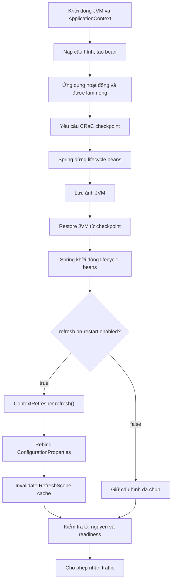

# Điều khiển refresh.on-restart.enabled và kiểm chứng khôi phục

> **Chương:** AOT và checkpoint
> **Module:** `SPRING_CLOUD_CORE` — hiểu các nền tảng cốt lõi của Spring Cloud trong hệ thống phân tán, đặc biệt Spring Cloud Commons, Context, cấu hình bên ngoài và tương thích phiên bản với Spring Boot. Người học tìm hiểu refresh scope, discovery, service registry, giao tiếp dịch vụ và cách kiểm thử, vận hành các abstraction chung.
> **Trọng tâm:** spring.cloud.refresh.on-restart.enabled điều khiển việc Spring Cloud tự làm mới cấu hình khi JVM được khôi phục từ checkpoint. Bài học giải thích quan hệ giữa CRaC, Spring Lifecycle, ContextRefresher, ConfigurationProperties và RefreshScope; đồng thời hướng dẫn kiểm tra property, xử lý tài nguyên ngoài, nhận diện giới hạn AOT/native image và xác minh ứng dụng sau restore.

## 1. Vì sao phải refresh sau khi restore?

Checkpoint/restore cho phép lưu trạng thái bộ nhớ của một JVM đang chạy rồi khôi phục trạng thái đó trong một tiến trình JVM sau. Với Project CRaC (Coordinated Restore at Checkpoint), nền tảng có thể chuẩn bị sẵn một ứng dụng Spring đã khởi tạo, thậm chí đã được làm nóng, để giảm thời gian khởi động ở lần triển khai tiếp theo.

Tốc độ khởi động nhanh đi kèm một vấn đề: trạng thái trong bộ nhớ được chụp tại thời điểm checkpoint có thể đã cũ khi JVM được restore. Ví dụ:

- hostname hoặc IP của container thay đổi;
- endpoint của downstream được cập nhật;
- credential hoặc secret đã được rotation;
- cấu hình timeout, feature flag hoặc giới hạn kết nối thay đổi;
- socket, connection pool, thread hoặc client cần được mở lại;
- service instance phải đăng ký lại với hạ tầng discovery.

Nếu tiếp tục dùng nguyên trạng thái đã chụp, ứng dụng có thể khởi động rất nhanh nhưng vẫn dùng địa chỉ mạng, cấu hình hoặc tài nguyên không còn hợp lệ.

Spring Cloud Context cung cấp cơ chế refresh khi restart. Bean RefreshScopeLifecycle được đăng ký theo mặc định và gọi ContextRefresher.refresh() khi lifecycle của Spring được khởi động lại sau restore. Quá trình này cập nhật Environment, rebind các bean cấu hình và invalidate target cache của RefreshScope.

Property điều khiển cơ chế đó là:

```properties
spring.cloud.refresh.on-restart.enabled=true
```

Giá trị mặc định là true trong Spring Cloud Commons hiện hành. Đặt thành false nếu ứng dụng không muốn tự động refresh theo lifecycle restart.

### Kết quả học tập

Sau bài này, người học có thể:

1. giải thích lý do phải refresh cấu hình sau JVM checkpoint/restore;
2. phân biệt process restart, ApplicationContext restart và CRaC restore;
3. hiểu vai trò của RefreshScopeLifecycle và ContextRefresher;
4. cấu hình spring.cloud.refresh.on-restart.enabled;
5. phân biệt property này với spring.cloud.refresh.enabled và spring.context.checkpoint;
6. xác minh property binding và các bean được refresh;
7. nhận diện giới hạn của RefreshScope, ConfigurationProperties và DataSource;
8. kiểm thử lifecycle refresh và quy trình restore;
9. xử lý cấu hình AOT/native image;
10. bảo vệ checkpoint artifact và kiểm soát readiness sau restore.

## 2. Phân biệt ba kiểu khởi động lại

Từ “restart” có thể chỉ nhiều hành vi khác nhau. Cần xác định đúng loại restart trước khi cấu hình.

| Kiểu hoạt động | Điều gì xảy ra? | Vai trò của property |
| --- | --- | --- |
| JVM/process khởi động mới | Process mới chạy main method và tạo ApplicationContext mới | Không phải cơ chế chính; cấu hình được nạp trong startup bình thường |
| ApplicationContext restart | Context đóng rồi khởi tạo lại trong cùng process theo cơ chế restart của Spring Cloud | Không đồng nghĩa với endpoint /actuator/restart; cần xem lifecycle cụ thể |
| JVM checkpoint/restore | JVM được chụp trạng thái và khôi phục từ ảnh checkpoint; Spring lifecycle beans được stop/start quanh checkpoint | Đây là trường hợp chính mà RefreshScopeLifecycle hỗ trợ |

Một lần rollout container thông thường tạo JVM mới. Spring Boot đọc cấu hình lại trong startup mới, nên không cần dựa vào checkpoint refresh để cập nhật giá trị.

CRaC restore khác với startup mới: JVM tiếp tục từ trạng thái bộ nhớ đã lưu. Các đối tượng, bean và giá trị property đã được tạo trước checkpoint có thể vẫn mang trạng thái cũ. Lifecycle restart cho Spring cơ hội đóng/mở lại tài nguyên và làm mới cấu hình sau khi restore.

### 2.1. Checkpoint và restore theo Project CRaC

Quy trình tổng quát:

1. Khởi động ứng dụng trên JDK có hỗ trợ CRaC.
2. Chuẩn bị ứng dụng, nạp cấu hình và có thể thực hiện workload làm nóng JVM.
3. Yêu cầu checkpoint.
4. Spring dừng các lifecycle bean để chúng đóng hoặc giải phóng tài nguyên trước khi JVM được chụp.
5. Nền tảng lưu trạng thái JVM và bộ nhớ checkpoint.
6. Ở thời điểm khác, nền tảng restore JVM.
7. Spring khởi động lại các lifecycle bean.
8. RefreshScopeLifecycle thực hiện refresh cấu hình nếu được bật.
9. Ứng dụng kiểm tra tài nguyên và readiness trước khi nhận traffic.

RefreshScopeLifecycle không thay thế toàn bộ CRaC resource management. Các thư viện và tài nguyên không do Spring lifecycle quản lý có thể cần tích hợp CRaC riêng hoặc callback đóng/mở tương ứng.

### 2.2. Sơ đồ vòng đời



Sơ đồ mô tả đường đi chính. Việc một instance có thực sự được phép nhận traffic còn phụ thuộc health check, readiness probe, service registry và quy trình của nền tảng triển khai.

## 3. spring.cloud.refresh.on-restart.enabled điều khiển điều gì?

### 3.1. Ý nghĩa và giá trị mặc định

spring.cloud.refresh.on-restart.enabled là property của Spring Cloud Context. Trong Spring Cloud Commons 5.0.4, giá trị mặc định là true.

Khi property có giá trị true hoặc không được khai báo, auto-configuration tạo bean RefreshScopeLifecycle. Bean này dùng ContextRefresher để refresh Environment và refresh scope khi lifecycle được khởi động lại.

Ví dụ bật tường minh:

```yaml
spring:
  cloud:
    refresh:
      on-restart:
        enabled: true
```

Đặt false để tắt lifecycle refresh tự động:

```yaml
spring:
  cloud:
    refresh:
      on-restart:
        enabled: false
```

Nếu ứng dụng không khai báo property, hành vi mặc định vẫn bật. Do đó, khi cần tắt rõ ràng trong một profile, hãy đặt false trong đúng nguồn cấu hình có hiệu lực và xác minh giá trị cuối cùng từ Environment.

### 3.2. Bean nào được tạo?

Trong auto-configuration của Spring Cloud Context, bean lifecycle được tạo với điều kiện property:

```java
@ConditionalOnProperty(
    value = "spring.cloud.refresh.on-restart.enabled",
    matchIfMissing = true
)
@Bean
RefreshScopeLifecycle refreshScopeLifecycle(
        ContextRefresher contextRefresher) {
    return new RefreshScopeLifecycle(contextRefresher);
}
```

Điểm cần hiểu:

- matchIfMissing = true nghĩa là không khai báo property cũng được xem là bật.
- Đặt false làm điều kiện không match và bean RefreshScopeLifecycle không được tạo.
- Điều kiện này chỉ kiểm soát lifecycle helper cho refresh khi restart.
- Nó không tự tắt toàn bộ RefreshScope hoặc các API refresh khác.

Chi tiết tên package và cách auto-configuration được tổ chức có thể thay đổi giữa các release. Hãy đối chiếu API của release train đang sử dụng trước khi tự cấu hình bean hoặc viết điều kiện thay thế.

### 3.3. Property không đồng nghĩa với một lần refresh thủ công

spring.cloud.refresh.on-restart.enabled không phải công tắc bật/tắt endpoint /actuator/refresh. Nếu Spring Cloud refresh auto-configuration vẫn hoạt động, ứng dụng vẫn có thể sử dụng cơ chế refresh thủ công theo cấu hình và bảo mật tương ứng.

Ví dụ:

```yaml
spring:
  cloud:
    refresh:
      enabled: true
      on-restart:
        enabled: false
```

Refresh scope và các tính năng refresh vẫn được bật, nhưng Spring Cloud không tạo lifecycle bean tự động refresh khi JVM restore. Ứng dụng vẫn có thể gọi ContextRefresher hoặc endpoint refresh nếu endpoint được cấu hình và expose.

## 4. Phân biệt các property liên quan

Không nên nhầm spring.cloud.refresh.on-restart.enabled với các property khác có tên gần giống.

| Property | Phạm vi điều khiển | Khi nào dùng? |
| --- | --- | --- |
| spring.cloud.refresh.on-restart.enabled | Tạo hoặc bỏ RefreshScopeLifecycle tự động refresh sau lifecycle restart | Khi ứng dụng dùng checkpoint/restore và cần quyết định có refresh sau restore không |
| spring.cloud.refresh.enabled | Bật auto-configuration cho RefreshScope và các tính năng refresh liên quan | Khi cần tắt toàn bộ Spring Cloud refresh support, ví dụ AOT/native image |
| spring.context.checkpoint | Điều khiển checkpoint của Spring Framework, ví dụ giá trị onRefresh | Khi muốn tạo checkpoint tự động ở một phase của startup |
| spring.context.exit | Điều khiển việc thoát ứng dụng tại một phase, ví dụ onRefresh | Khi kiểm tra startup phase mà không cần thực hiện CRaC checkpoint |
| spring.cloud.config.initialize-on-context-refresh | Điều khiển thời điểm chạy PropertySourceLocators trong cơ chế bootstrap cũ | Khi xử lý cấu hình bootstrap và refresh theo phiên bản Spring Cloud tương ứng |

Hai cấu hình thường bị nhầm nhất:

- spring.cloud.refresh.on-restart.enabled=false chỉ tắt automatic refresh lifecycle khi restart.
- spring.cloud.refresh.enabled=false tắt refresh auto-configuration rộng hơn; không nên dùng nó chỉ để tắt hành vi on-restart.

### 4.1. Ma trận hành vi

| refresh.enabled | refresh.on-restart.enabled | Kết quả dự kiến |
| --- | --- | --- |
| true | true | Refresh support hoạt động và lifecycle refresh sau restart được đăng ký |
| true | false | Refresh support vẫn hoạt động; không đăng ký lifecycle refresh tự động |
| false | true | Refresh auto-configuration không hoạt động; property on-restart không tạo lifecycle bean độc lập |
| false | false | Refresh auto-configuration và lifecycle refresh đều tắt |

Ma trận giả định các dependency và điều kiện auto-configuration khác đã đáp ứng. Nếu ứng dụng tự khai báo bean hoặc thay thế auto-configuration, hãy kiểm tra context thực tế.

## 5. ContextRefresher thực hiện những bước nào?

Khi RefreshScopeLifecycle kích hoạt ContextRefresher.refresh(), Spring Cloud thực hiện hai nhóm công việc chính: cập nhật Environment và invalidate cache của refresh scope.

### 5.1. Nạp lại Environment

Context refresher tạo lại các property source có thể nạp từ nguồn cấu hình theo cơ chế đang dùng, rồi so sánh với trạng thái trước refresh. Những key thay đổi được xác định để phát hành EnvironmentChangeEvent.

Tùy ứng dụng, nguồn cấu hình có thể là:

- Config Server qua Config Data;
- configuration tree được mount;
- property source do ứng dụng hoặc EnvironmentPostProcessor cung cấp;
- nguồn cấu hình tích hợp khác có hỗ trợ reload.

Không nên giả định mọi nguồn đều tự được đọc lại. Hãy xác định refresher của release đang dùng và xác minh từng nguồn có được tải lại sau restore hay không.

### 5.2. Rebind ConfigurationProperties

Spring Cloud lắng nghe EnvironmentChangeEvent và rebind các bean ConfigurationProperties. Logger có key bắt đầu bằng logging.level. cũng có thể được cập nhật.

Ví dụ:

```java
import java.net.URI;
import java.time.Duration;

import org.springframework.boot.context.properties.ConfigurationProperties;

@ConfigurationProperties(prefix = "client")
public class ClientProperties {

    private URI endpoint;
    private Duration timeout = Duration.ofSeconds(2);

    // getters and setters
}
```

Nếu Config Server trả endpoint hoặc timeout mới và refresher nạp được property source mới, bean cấu hình sẽ được bind lại theo Environment mới.

Việc rebind không có nghĩa mọi singleton trong ứng dụng đều được tạo lại. Bean thông thường dùng @Value trong constructor hoặc lưu property vào field có thể tiếp tục giữ giá trị cũ nếu không có cơ chế cập nhật tương ứng.

Các object dùng constructor binding, bao gồm Java record được đánh dấu ConfigurationProperties, không thể được refresh theo cơ chế rebinding hiện hành. Hãy kiểm tra thiết kế cấu hình nếu cần thay giá trị sau restore.

### 5.3. RefreshScope cache bị invalidate

Sau khi cập nhật Environment, ContextRefresher.refresh() gọi RefreshScope.refreshAll(). Các target instance đang được cache trong refresh scope bị hủy. Khi ứng dụng gọi proxy ở lần tiếp theo, target bean được tạo lại và nhận cấu hình hiện hành.

Ví dụ:

```java
import org.springframework.cloud.context.config.annotation.RefreshScope;
import org.springframework.context.annotation.Bean;
import org.springframework.context.annotation.Configuration;

@Configuration
public class RemoteClientConfiguration {

    @Bean
    @RefreshScope
    RemoteClient remoteClient(ClientProperties properties) {
        return new RemoteClient(
                properties.getEndpoint(),
                properties.getTimeout()
        );
    }
}
```

Sau restore và refresh, proxy remoteClient vẫn là điểm tham chiếu được các bean khác sử dụng. Target bên trong proxy được tạo lại ở lần truy cập tiếp theo.

### 5.4. Refresh không phải tạo mới mọi bean

Cần phân biệt:

- Bean ConfigurationProperties được rebind theo cơ chế rebinder.
- Bean RefreshScope bị invalidate target cache và tạo lại khi được gọi.
- Singleton bình thường không thuộc hai nhóm trên không tự động được tạo lại.
- Static state, cache riêng của thư viện và tài nguyên ngoài phải được xử lý theo lifecycle riêng.

Nếu một bean giữ socket, thread hoặc connection pool, hãy kiểm tra nó có lifecycle đóng/mở đúng cách hay không. Chỉ bật refresh property không bảo đảm mọi tài nguyên ngoài được khôi phục chính xác.

## 6. Cấu hình và kiểm chứng property

### 6.1. Bật mặc định

Nếu muốn giữ hành vi mặc định, có thể không khai báo property. Tuy nhiên, trong hệ thống dùng CRaC, khai báo rõ giúp người vận hành nhìn thấy quyết định cấu hình:

```yaml
spring:
  cloud:
    refresh:
      on-restart:
        enabled: true
```

Đặt cấu hình trong file/profile được nạp khi tạo checkpoint. Nếu dùng nguồn cấu hình ngoài, xác định nguồn nào có quyền ghi đè giá trị này.

### 6.2. Tắt automatic refresh

Ví dụ:

```yaml
spring:
  cloud:
    refresh:
      on-restart:
        enabled: false
```

Chỉ tắt khi ứng dụng có quy trình cập nhật cấu hình và tái tạo tài nguyên khác. Nếu không có cơ chế thay thế, instance sau restore có thể dùng trạng thái đã chụp và kết nối tới endpoint cũ.

### 6.3. Xác minh effective value

Có thể kiểm tra property qua log cấu hình có kiểm soát, Actuator env hoặc configprops nếu đã expose và bảo vệ các endpoint đó.

Các câu hỏi cần xác nhận:

1. Property có thực sự là false hoặc true theo môi trường mong muốn không?
2. Có nguồn cấu hình nào ghi đè property không?
3. Refresh auto-configuration có được nạp không?
4. Bean RefreshScopeLifecycle có xuất hiện trong ApplicationContext không?
5. Log sau restore có ghi nhận lifecycle refresh không?
6. Những key nào thay đổi sau refresh?
7. Bean hoặc resource quan trọng có thực sự dùng giá trị mới không?

Không expose endpoint quản trị ra mạng công khai chỉ để debug. Dùng log nội bộ, test hoặc management interface đã được bảo vệ.

## 7. Chọn bật hay tắt trong từng tình huống

### 7.1. Ứng dụng dùng CRaC và cấu hình có thể thay đổi

Thường nên giữ spring.cloud.refresh.on-restart.enabled=true nếu:

- ứng dụng được checkpoint khi đang chạy;
- endpoint hoặc network identity có thể thay đổi giữa checkpoint và restore;
- Config Server hoặc nguồn cấu hình có thể được truy cập lại sau restore;
- bean cấu hình hoặc refresh-scoped client cần nhận giá trị mới.

Cần kiểm tra nguồn cấu hình còn khả dụng khi restore và các resource lifecycle đã được tích hợp đúng.

### 7.2. Ứng dụng không dùng checkpoint/restore

Nếu ứng dụng chỉ khởi động JVM mới khi triển khai, property này thường không mang lại lợi ích thực tế. Có thể giữ mặc định hoặc tắt nếu tổ chức muốn loại bỏ lifecycle helper không cần thiết.

Đừng kỳ vọng property này thay thế cơ chế externalized configuration ở startup thông thường.

### 7.3. Ứng dụng cần giữ nguyên cấu hình trong ảnh checkpoint

Một số hệ thống cần checkpoint là ảnh bất biến, tái lập đúng trạng thái đã được kiểm thử. Nếu tự động lấy cấu hình mới sau restore sẽ làm thay đổi hành vi so với ảnh đã phê duyệt, có thể đặt property thành false.

Khi đó, cần bảo đảm các tài nguyên bên ngoài vẫn tương thích với cấu hình đã chụp hoặc có quy trình migration/reinitialization riêng. Không dùng ảnh checkpoint cũ vô thời hạn nếu credential, certificate hoặc endpoint đã bị thu hồi.

### 7.4. AOT và native image

Spring Cloud Context không hỗ trợ Context Refresh trong các ứng dụng được biến đổi AOT hoặc native image theo tài liệu hiện hành. Với AOT/native image, property cần đặt là:

```yaml
spring:
  cloud:
    refresh:
      enabled: false
```

Không nhầm cấu hình này với spring.cloud.refresh.on-restart.enabled=false. Tắt on-restart không giải quyết giới hạn AOT/native image nếu các tính năng refresh khác vẫn được bật.

## 8. Tài nguyên ngoài và giới hạn cần chú ý

### 8.1. DataSource và connection pool

Một DataSource có thể giữ kết nối tới database bằng URL, username hoặc password đã có tại thời điểm checkpoint. Sau restore, chỉ rebind một bean cấu hình không đồng nghĩa connection pool đã được thay mới.

Spring Cloud ghi rõ HikariDataSource không refreshable theo cơ chế mặc định và nằm trong danh sách spring.cloud.refresh.never-refreshable. Vì vậy:

- không giả định đổi URL/credential trong Environment sẽ tự thay pool Hikari;
- kiểm tra pool được đóng trước checkpoint và mở lại sau restore;
- nếu cần đổi cấu hình pool, thiết kế lifecycle hoặc cơ chế tạo lại DataSource phù hợp;
- xác minh kết nối mới bằng health check hoặc truy vấn kiểm tra sau restore.

Không đưa DataSource vào RefreshScope một cách máy móc khi implementation và lifecycle của pool không hỗ trợ việc tạo lại an toàn.

### 8.2. Socket, HTTP client và thread pool

Một số client giữ socket, DNS result, connection pool hoặc thread. CRaC/Spring lifecycle có thể dừng một số resource do framework quản lý, nhưng thư viện bên thứ ba có thể cần integration riêng.

Hãy kiểm tra:

- resource có đóng trước checkpoint không;
- resource có mở lại sau restore không;
- client có dùng DNS hoặc địa chỉ mạng cũ không;
- scheduled task có xử lý đúng khoảng thời gian JVM bị checkpoint không;
- thread nào có thể sống ngoài lifecycle của ApplicationContext.

### 8.3. Cấu hình bị xóa khỏi Environment

Spring Cloud có giới hạn khi refresh: việc loại bỏ một property source hoặc xóa hẳn key không phải lúc nào cũng biểu hiện như một giá trị mới có thể bind. Thiết kế cấu hình nên có trạng thái tường minh, ví dụ giá trị false hoặc một sentinel hợp lệ, thay vì phụ thuộc hoàn toàn vào sự vắng mặt của key.

### 8.4. Bean constructor-bound và immutable object

Bean cấu hình dùng constructor binding hoặc Java record không thể được rebinding như bean mutable thông thường. Nếu giá trị cần đổi sau restore, cân nhắc:

- dùng bean mutable được hỗ trợ rebind;
- đặt component phụ thuộc cấu hình trong refresh scope nếu phù hợp;
- tạo lại object thông qua lifecycle riêng;
- hoặc giữ cấu hình bất biến và tạo checkpoint mới khi cần thay đổi.

## 9. Checkpoint ở onRefresh và checkpoint sau warm-up

Spring Framework hỗ trợ hai cách checkpoint chính.

### 9.1. Automatic checkpoint onRefresh

Có thể đặt JVM system property:

```bash
-Dspring.context.checkpoint=onRefresh
```

Spring Framework tạo checkpoint trong phase LifecycleProcessor.onRefresh. Tại thời điểm đó:

- các singleton không lazy đã được khởi tạo;
- callback InitializingBean.afterPropertiesSet() đã chạy;
- lifecycle beans chưa được start;
- ContextRefreshedEvent chưa được phát hành.

Điều này có nghĩa bean có thể đã khởi tạo client hoặc truy cập database trước khi checkpoint được tạo. Không nên nghĩ rằng onRefresh luôn chụp ứng dụng trước mọi kết nối bên ngoài.

### 9.2. Checkpoint sau khi ứng dụng đã warm-up

Với on-demand checkpoint, ứng dụng được khởi động và có thể xử lý workload trước khi checkpoint. Ảnh JVM có thể chứa trạng thái JIT và cache đã được làm nóng.

Đổi lại, các tài nguyên mạng, kết nối và dữ liệu trong bộ nhớ cũng được chụp. Cần lifecycle stop/start đúng cách để không sử dụng socket hoặc connection cũ sau restore.

### 9.3. Dùng spring.context.exit=onRefresh để kiểm tra

Để quan sát ứng dụng tại phase onRefresh mà không cần CRaC runtime, Spring Framework cung cấp:

```bash
-Dspring.context.exit=onRefresh
```

Property này làm ứng dụng thoát ở phase tương ứng thay vì tạo checkpoint. Nó hữu ích để phát hiện các bean đang kết nối remote service quá sớm trong startup.

Đây là công cụ chẩn đoán phase startup, không thay thế kiểm thử restore thật trên JDK hỗ trợ CRaC.

## 10. Kiểm thử automatic refresh khi restore

### 10.1. Kiểm thử điều kiện tạo lifecycle bean

Với test context, xác minh hai trường hợp:

| Property | Kỳ vọng |
| --- | --- |
| Không khai báo | Lifecycle refresh được bật theo mặc định |
| spring.cloud.refresh.on-restart.enabled=true | Có RefreshScopeLifecycle |
| spring.cloud.refresh.on-restart.enabled=false | Không đăng ký lifecycle helper |

Có thể kiểm tra bean bằng ApplicationContextRunner hoặc integration test dùng đúng auto-configuration và dependency của phiên bản Spring Cloud.

### 10.2. Kiểm thử RefreshScopeLifecycle độc lập

Ví dụ kiểm thử lifecycle bằng mock:

```java
import org.junit.jupiter.api.Test;
import org.springframework.cloud.context.refresh.ContextRefresher;
import org.springframework.cloud.context.refresh.RefreshScopeLifecycle;

import static org.mockito.Mockito.mock;
import static org.mockito.Mockito.verify;

class RefreshScopeLifecycleTests {

    @Test
    void refreshesContextWhenLifecycleStarts() {
        ContextRefresher refresher = mock(ContextRefresher.class);
        RefreshScopeLifecycle lifecycle =
                new RefreshScopeLifecycle(refresher);

        lifecycle.start();

        verify(refresher).refresh();
    }
}
```

Test này xác minh lifecycle gọi refresher khi được start. Nó không thay thế kiểm thử CRaC thực tế, vì chưa mô phỏng checkpoint, restore, network resource hoặc property source bên ngoài.

### 10.3. Kiểm thử property được nạp lại

Một integration test hữu ích nên:

1. khởi động Config Server giả lập hoặc nguồn cấu hình có thể thay đổi;
2. chạy ứng dụng với property version A;
3. xác minh bean cấu hình và refresh-scoped client đang dùng A;
4. tạo checkpoint;
5. thay đổi cấu hình remote sang version B;
6. restore JVM;
7. xác minh log lifecycle refresh;
8. xác minh Environment và bean cấu hình có B;
9. gọi proxy để xác nhận target refresh-scoped được tạo lại;
10. xác minh client kết nối đúng endpoint và credential của B.

Không chỉ kiểm tra HTTP health trả 200. Health có thể xanh trong khi một bean vẫn giữ endpoint hoặc credential cũ.

### 10.4. Kiểm thử tài nguyên database

Nếu ứng dụng dùng database, hãy kiểm tra riêng:

- database có sẵn trước checkpoint hay không;
- pool được đóng đúng thời điểm không;
- database có sẵn sau restore không;
- credential/URL mới có được nạp không;
- pool có tạo connection mới không;
- truy vấn thực tế có thành công không.

Với HikariCP, phải xử lý giới hạn never-refreshable và lifecycle pool như một phần riêng của thiết kế. Không kết luận DataSource đã đổi chỉ vì ConfigurationProperties bean đã được rebind.

### 10.5. Kiểm thử khi tắt on-restart

Đặt:

```properties
spring.cloud.refresh.on-restart.enabled=false
```

Sau restore, xác minh lifecycle helper không chạy và giá trị trong bean giữ nguyên nếu không có cơ chế khác cập nhật chúng. Sau đó kiểm tra quy trình thay thế có chủ động nạp cấu hình mới và tái tạo resource hay không.

## 11. Quan sát và troubleshooting

### 11.1. Dấu hiệu lifecycle refresh đã chạy

Log của Spring Cloud có thể ghi thông báo tương tự:

```text
Refreshing context on restart.
Refreshed keys: [spring.cloud.client.hostname, spring.cloud.client.ip-address]
```

Tên key thay đổi tùy môi trường. Không có key thay đổi không nhất thiết nghĩa là refresh thất bại; có thể nguồn cấu hình không thay đổi. Hãy xác minh cả bean và resource sau restore.

### 11.2. RefreshScopeHealthIndicator

Spring Cloud có RefreshScopeHealthIndicator để theo dõi quá trình rebind và khởi tạo lại bean refresh scope. Nếu bean không thể re-initialize hoặc rebind, indicator có thể chuyển sang trạng thái DOWN và cung cấp chi tiết exception.

Đừng bỏ qua trạng thái này trong readiness hoặc giám sát sau restore. Một process sống không đồng nghĩa mọi bean đã sẵn sàng.

### 11.3. Bảng lỗi thường gặp

| Triệu chứng | Nguyên nhân có thể | Hướng xử lý |
| --- | --- | --- |
| Không thấy log refresh khi restore | Property bị đặt false hoặc lifecycle bean không được tạo | Kiểm tra effective property và auto-configuration |
| Refresh chạy nhưng key không đổi | Config Server trả cùng giá trị hoặc nguồn không được tải lại | Kiểm tra property source và response remote |
| Bean Value vẫn giữ giá trị cũ | Bean singleton không thuộc refresh scope | Dùng cấu hình có thể rebind hoặc refresh scope phù hợp |
| ConfigurationProperties không nhận giá trị mới | Bean constructor-bound hoặc nguồn property không được nạp lại | Kiểm tra kiểu binding và Environment |
| DataSource vẫn dùng credential cũ | Pool Hikari không refreshable theo mặc định | Thiết kế lifecycle đóng/mở pool hoặc tạo lại DataSource |
| Client không kết nối được sau restore | Socket, DNS, endpoint hoặc resource cũ | Kiểm tra CRaC resource lifecycle và tạo client mới |
| RefreshScopeHealthIndicator chuyển DOWN | Bean rebind hoặc reinitialize thất bại | Đọc exception và kiểm tra bean phụ thuộc |
| AOT/native image lỗi do refresh support | Context refresh không được hỗ trợ trong AOT/native | Đặt spring.cloud.refresh.enabled=false |
| Ảnh checkpoint chứa secret cũ | JVM memory đã lưu credential tại checkpoint | Bảo vệ checkpoint artifact và rotation/reload secret có kiểm soát |
| Service nhận traffic quá sớm | Readiness chưa đợi refresh và resource initialization | Chỉ đánh dấu ready sau khi kiểm tra cấu hình và dependency |

### 11.4. Quy trình xử lý sự cố sau restore

1. Xác nhận JVM được restore từ checkpoint đúng phiên bản.
2. Xác nhận Spring lifecycle beans đã được restart.
3. Kiểm tra effective value của spring.cloud.refresh.on-restart.enabled.
4. Xác nhận RefreshScopeLifecycle được tạo trong context.
5. Đọc log Refreshing context on restart.
6. Kiểm tra Config Server hoặc property source có truy cập được sau restore.
7. Đọc danh sách changed keys và kiểm tra Environment.
8. Kiểm tra ConfigurationProperties và các bean RefreshScope.
9. Kiểm tra các resource như DataSource, HTTP client, socket và thread pool.
10. Xác minh readiness trước khi cho phép instance nhận traffic.
11. Nếu refresh thất bại, giữ instance khỏi traffic và thực hiện rollback/restore theo quy trình vận hành.

## 12. Bảo vệ checkpoint artifact

Ảnh checkpoint là bản lưu trạng thái bộ nhớ của JVM. Nó có thể chứa:

- password hoặc token đã được nạp vào memory;
- private key hoặc dữ liệu TLS;
- thông tin người dùng trong cache;
- request/response hoặc dữ liệu nghiệp vụ;
- object nội bộ của thư viện và framework.

Cần xem checkpoint artifact như một tài sản nhạy cảm:

- giới hạn quyền đọc/ghi;
- mã hóa khi lưu trữ và truyền tải;
- không đẩy checkpoint lên artifact repository công khai;
- có retention và quy trình xóa rõ ràng;
- quản lý version code và version cấu hình tương ứng;
- kiểm soát ai được phép restore ảnh;
- rotation secret sau sự cố nếu checkpoint bị lộ.

Nếu checkpoint được đóng gói trong container image, quyền pull image cũng có thể đồng nghĩa quyền lấy dữ liệu memory snapshot. Hãy áp dụng kiểm soát tương đương với secret-bearing artifact.

## 13. Checklist triển khai

Trước khi bật automatic refresh on restart, xác nhận:

- [ ] Ứng dụng thật sự dùng JVM checkpoint/restore như CRaC.
- [ ] Spring Cloud Context version hỗ trợ RefreshScopeLifecycle.
- [ ] spring.cloud.refresh.on-restart.enabled có giá trị đúng theo môi trường.
- [ ] Config Server hoặc property source có thể truy cập sau restore.
- [ ] Các property cần thay đổi được nạp lại qua ContextRefresher.
- [ ] Bean cần cập nhật dùng ConfigurationProperties hoặc RefreshScope phù hợp.
- [ ] Constructor-bound configuration không bị kỳ vọng sẽ rebind.
- [ ] DataSource và connection pool có lifecycle riêng nếu cần thay đổi.
- [ ] Socket, HTTP client, thread pool và tài nguyên ngoài được đóng/mở đúng cách.
- [ ] RefreshScopeHealthIndicator được giám sát.
- [ ] Readiness chỉ thành công sau khi resource và cấu hình hợp lệ.
- [ ] Đã test với property version A và B qua một lần checkpoint/restore.
- [ ] AOT/native image đã tắt refresh support bằng spring.cloud.refresh.enabled=false nếu áp dụng.
- [ ] Checkpoint artifact được bảo vệ như dữ liệu chứa secret.

## 14. Bài tập vận dụng

### Bài tập 1 — Bật refresh khi restore

Một service chạy trên CRaC, có Config Server cung cấp hostname của downstream. Sau restore, hostname có thể đổi.

Hãy cấu hình spring.cloud.refresh.on-restart.enabled=true và mô tả cách kiểm tra Environment cùng bean sử dụng hostname mới.

### Bài tập 2 — Tắt refresh tự động

Một ứng dụng cần giữ nguyên cấu hình đã được phê duyệt trong checkpoint. Nhóm vận hành muốn tắt refresh tự động khi restore nhưng vẫn giữ khả năng gọi /actuator/refresh theo quy trình thủ công.

Hãy chọn property phù hợp và giải thích vì sao không dùng spring.cloud.refresh.enabled=false.

### Bài tập 3 — Phân biệt ba property

Giải thích sự khác nhau giữa:

- spring.cloud.refresh.on-restart.enabled;
- spring.cloud.refresh.enabled;
- spring.context.checkpoint.

Nêu tình huống sử dụng của từng property.

### Bài tập 4 — DataSource giữ credential cũ

Sau restore, ConfigurationProperties đã có password mới nhưng DataSource vẫn kết nối bằng password cũ.

Hãy giải thích giới hạn refresh của HikariDataSource và đề xuất cách quản lý vòng đời pool để tạo kết nối mới an toàn.

### Bài tập 5 — Checkpoint onRefresh kết nối database quá sớm

Ứng dụng dùng -Dspring.context.checkpoint=onRefresh, nhưng log cho thấy Hibernate đã khởi tạo DataSource trước khi checkpoint.

Hãy giải thích phase onRefresh, thời điểm singleton và afterPropertiesSet() chạy, sau đó đề xuất cách phát hiện bean truy cập remote service quá sớm.

### Bài tập 6 — Refresh thất bại sau restore

Log có Refreshing context on restart, nhưng RefreshScopeHealthIndicator chuyển DOWN vì một client không tạo lại được.

Hãy đề xuất quy trình chẩn đoán từ property source, Environment, bean lifecycle, network resource đến readiness và rollback.

## 15. Tự kiểm tra nhanh

1. Giá trị mặc định của spring.cloud.refresh.on-restart.enabled là gì? **True trong Spring Cloud Commons hiện hành.**
2. Bean nào thực hiện refresh trong lifecycle restart? **RefreshScopeLifecycle.**
3. RefreshScopeLifecycle gọi API nào? **ContextRefresher.refresh().**
4. ContextRefresher thực hiện những việc chính nào? **Cập nhật Environment, phát EnvironmentChangeEvent, rebind cấu hình và refresh scope.**
5. spring.cloud.refresh.on-restart.enabled=false có tắt toàn bộ RefreshScope không? **Không.**
6. Property nào tắt refresh auto-configuration rộng hơn? **spring.cloud.refresh.enabled=false.**
7. spring.context.checkpoint=onRefresh thuộc thành phần nào? **Spring Framework LifecycleProcessor.**
8. onRefresh checkpoint được tạo trước hay sau lifecycle start? **Trước lifecycle start và trước ContextRefreshedEvent.**
9. HikariDataSource có refreshable theo mặc định không? **Không.**
10. Java record dùng constructor binding có thể rebind không? **Không theo cơ chế refresh hiện hành.**
11. AOT/native image có hỗ trợ Context Refresh không? **Không; cần đặt spring.cloud.refresh.enabled=false.**
12. Checkpoint artifact có thể chứa secret không? **Có, vì nó lưu trạng thái memory của JVM.**

**Thông điệp cốt lõi:** spring.cloud.refresh.on-restart.enabled giúp Spring Cloud làm mới cấu hình sau JVM checkpoint/restore. Hãy hiểu nó là một lifecycle refresh có phạm vi rõ ràng: Environment được cập nhật, bean cấu hình được rebind và target của RefreshScope được tạo lại khi cần. Hiệu quả thực tế còn phụ thuộc nguồn cấu hình có được tải lại, bean có hỗ trợ refresh và tài nguyên ngoài có lifecycle phù hợp. Kiểm thử restore end-to-end, readiness và bảo vệ checkpoint artifact là những phần không thể bỏ qua.

**Tài liệu tham khảo:**

- [Spring Cloud Commons 5.0.4 — Application Context Services, Refresh Scope on Restart](https://docs.spring.io/spring-cloud-commons/reference/spring-cloud-commons/application-context-services.html)
- [Spring Cloud Commons 5.0.4 — Configuration Properties](https://docs.spring.io/spring-cloud-commons/reference/configprops.html)
- [Spring Cloud Context API — RefreshScopeLifecycle](https://www.javadoc.io/doc/org.springframework.cloud/spring-cloud-context/latest/org/springframework/cloud/context/refresh/RefreshScopeLifecycle.html)
- [Spring Framework — JVM Checkpoint Restore](https://docs.spring.io/spring-framework/reference/integration/checkpoint-restore.html)
- [Spring Boot — Checkpoint and Restore With the JVM](https://docs.spring.io/spring-boot/reference/packaging/checkpoint-restore.html)

RefreshScopeLifecycle được giới thiệu từ Spring Cloud Context 4.1.0. Tên property, package API và khả năng tương thích phụ thuộc release train; hãy kiểm tra Spring Cloud/Boot version thực tế trước khi áp dụng.
