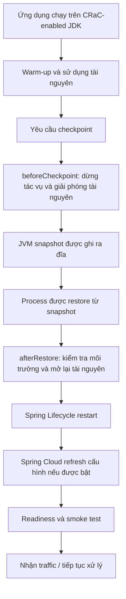

# Quản lý socket, thread và tài nguyên bên ngoài sau restore

Checkpoint/restore với CRaC lưu trạng thái bộ nhớ của một JVM đang chạy để có thể khôi phục nhanh ở một thời điểm khác. Snapshot có thể giữ lại object graph, bean Spring, cache và JIT warm-up. Tuy nhiên, nhiều tài nguyên mà ứng dụng sử dụng lại gắn với hệ điều hành hoặc dịch vụ bên ngoài: socket TCP, file descriptor, kết nối database, consumer session, thread đang chờ, lease phân tán và lịch chạy tác vụ.

Sau restore, một tham chiếu `Socket` hoặc connection pool vẫn có thể tồn tại trong heap nhưng kết nối bên ngoài đã đóng, địa chỉ mạng đã đổi hoặc lease đã hết hạn. Nếu ứng dụng dùng lại trạng thái cũ mà không khởi tạo lại, lỗi có thể xuất hiện ngay ở request đầu tiên hoặc muộn hơn dưới dạng timeout, stale connection, message bị xử lý trùng và thread bị treo.

Spring Framework tích hợp CRaC với vòng đời bean `Lifecycle`: dừng các bean trước checkpoint và khởi động lại chúng sau restore. Spring Boot hỗ trợ thêm một số tài nguyên như socket, file và thread pool trong phạm vi giới hạn. Spring Cloud Context bổ sung `RefreshScopeLifecycle`, giúp rebind `@ConfigurationProperties` và refresh bean `@RefreshScope` khi ứng dụng được khởi động lại sau restore. Các dependency và tài nguyên do thư viện bên ngoài hoặc code ứng dụng tự quản lý vẫn cần được rà soát và có vòng đời phù hợp.

Bài học thuộc chương **AOT và checkpoint** của **SPRING_CLOUD_CORE**. Nội dung tập trung vào cách kiểm kê tài nguyên bên ngoài, đóng và mở lại socket/file, dừng và khởi động thread, xử lý database pool và message consumer, dùng `org.crac.Resource`, phối hợp với Spring `Lifecycle`, kiểm tra Spring Cloud refresh sau restore và xây dựng quy trình kiểm thử CRaC an toàn.

## 1. Mục tiêu học tập

Sau bài này, bạn có thể:

- Giải thích vì sao object trong heap có thể còn nhưng tài nguyên bên ngoài đã mất hiệu lực sau restore.
- Phân biệt checkpoint/restore đang chạy với checkpoint tự động trong startup.
- Mô tả vai trò của `Lifecycle`, `SmartLifecycle` và `org.crac.Resource`.
- Lập danh sách socket, file, thread, connection pool và session cần xử lý.
- Dừng nhận công việc mới và chờ công việc đang chạy hoàn tất trước checkpoint.
- Đóng socket và kết nối bên ngoài trước checkpoint, sau đó tạo kết nối mới sau restore.
- Quản lý executor, scheduler và các tác vụ định kỳ để tránh chạy bù ngoài ý muốn.
- Xử lý database pool, message consumer, distributed lock, lease và timer.
- Đăng ký custom CRaC resource đúng cách và giữ tham chiếu tới resource callback.
- Tận dụng `RefreshScopeLifecycle` của Spring Cloud khi restore.
- Kiểm tra cấu hình, secret, DNS và môi trường mới trước khi mở traffic.
- Tạo test và runbook để phát hiện lỗi tài nguyên sau restore.

## 2. CRaC checkpoint/restore hoạt động như thế nào?

CRaC (Coordinated Restore at Checkpoint) là cơ chế phối hợp giữa JVM và ứng dụng để tạo snapshot rồi khôi phục trạng thái JVM. Ứng dụng chạy trên một JDK có hỗ trợ CRaC, được warm-up nếu cần, sau đó yêu cầu checkpoint. Snapshot được ghi ra một thư mục; lần chạy sau có thể restore từ snapshot đó thay vì khởi động và warm-up lại từ đầu.

Một checkpoint có thể giữ lại:

- Object graph và trạng thái heap.
- Các bean Spring đã được tạo.
- Cache và dữ liệu đã nạp.
- JIT compiled code và trạng thái warm-up của JVM.
- Giá trị cấu hình mà process đã đọc.
- Trạng thái logic của các component.

Các tài nguyên phụ thuộc vào hệ điều hành hoặc dịch vụ bên ngoài cần được xử lý riêng. Ví dụ, một object `Socket` có thể vẫn nằm trong heap nhưng file descriptor và kết nối peer không còn hợp lệ sau khi restore.



Mục tiêu của callback không phải giữ nguyên mọi kết nối cũ. Mục tiêu là đưa ứng dụng về trạng thái có thể dừng an toàn trước snapshot và khôi phục khả năng phục vụ sau snapshot.

### 2.1. Điều kiện nền tảng

Theo tài liệu Spring Framework hiện hành, để sử dụng tích hợp JVM checkpoint/restore cần:

- Một JDK có hỗ trợ checkpoint/restore bằng CRaC.
- Nền tảng hệ điều hành và checkpoint engine tương thích; hướng dẫn Spring hiện mô tả Linux.
- Thư viện `org.crac:crac` từ phiên bản `1.4.0` trở lên trên classpath.
- Các tham số JVM như `-XX:CRaCCheckpointTo=PATH` hoặc `-XX:CRaCRestoreFrom=PATH`.

Không phải JDK phân phối nào cũng có CRaC. Hãy kiểm tra tài liệu của vendor JDK, kernel, checkpoint engine và quyền cần thiết trên môi trường chạy. Việc chỉ thêm dependency `org.crac:crac` không biến một JDK thông thường thành CRaC-enabled runtime.

## 3. Hai chế độ checkpoint của Spring

Spring Framework hỗ trợ hai cách sử dụng chính.

| Chế độ | Thời điểm checkpoint | Mục đích |
| --- | --- | --- |
| On-demand checkpoint/restore | Sau khi ứng dụng đã chạy, có thể đã warm-up | Lưu trạng thái JVM đang hoạt động để restore nhanh với code path đã được làm nóng |
| Automatic checkpoint/restore at startup | Trong giai đoạn startup được Spring chỉ định | Tạo ảnh khởi động để bỏ qua một phần quá trình khởi tạo ở lần chạy sau |

### 3.1. On-demand checkpoint/restore

Ứng dụng khởi động như bình thường, nhận workload warm-up, sau đó operator hoặc ứng dụng yêu cầu checkpoint. Trước khi snapshot, Spring dừng các bean triển khai `Lifecycle`. Sau restore, Spring khởi động lại các bean đó.

Đây là chế độ phù hợp khi cần snapshot một JVM đã thực hiện các code path phổ biến. Nó cũng đòi hỏi tích hợp nền tảng để bảo đảm tài nguyên từ xa có thể đóng, mở lại và xác thực trong môi trường restore.

### 3.2. Automatic checkpoint/restore at startup

Có thể bật checkpoint tự động trong giai đoạn refresh của Spring bằng:

```bash
java -Dspring.context.checkpoint=onRefresh \
     -XX:CRaCCheckpointTo=./crac-image \
     -jar app.jar
```

Checkpoint được tạo trong giai đoạn `LifecycleProcessor.onRefresh`, sau khi các singleton không lazy đã được tạo và callback `InitializingBean.afterPropertiesSet()` đã chạy, nhưng trước khi lifecycle được start và trước `ContextRefreshedEvent`.

Chế độ này giúp lưu trạng thái đã hoàn thành một phần quá trình tạo context. Nó không tạo ra một JVM đã được warm-up đầy đủ như on-demand checkpoint sau khi chạy workload thực tế.

### 3.3. Kiểm tra giai đoạn startup mà không cần CRaC

Spring Framework cung cấp:

```bash
java -Dspring.context.exit=onRefresh -jar app.jar
```

Thay vì tạo checkpoint, ứng dụng thoát ở cùng giai đoạn lifecycle. Có thể dùng cách này để kiểm tra bean nào đang kết nối dịch vụ từ xa quá sớm, trước khi lifecycle được start.

Nếu ứng dụng không thể khởi tạo khi Config Server, database hoặc broker chưa sẵn sàng ở giai đoạn đó, hãy xem lại việc kết nối trong constructor hoặc `@PostConstruct`. Những kết nối cần được mở khi component start nên được quản lý trong lifecycle phù hợp.

## 4. Spring Lifecycle phối hợp với CRaC

Spring Framework tích hợp CRaC bằng cách liên kết checkpoint/restore với vòng đời của `ApplicationContext`.

Với chế độ on-demand:

1. CRaC thông báo rằng checkpoint sắp diễn ra.
2. Spring dừng các bean đang chạy có triển khai `Lifecycle`.
3. Bean có cơ hội đóng socket, file, executor hoặc tài nguyên riêng.
4. JVM tạo snapshot sau khi quá trình chuẩn bị hoàn tất.
5. Khi restore, Spring gọi start để các bean mở lại tài nguyên và tiếp tục hoạt động.

Đây là tích hợp nền tảng của Spring Framework. Bean không cần tự đăng ký một CRaC callback nếu toàn bộ tài nguyên của nó được quản lý đúng qua Spring lifecycle.

### 4.1. Lifecycle và SmartLifecycle

`Lifecycle` cung cấp hai thao tác cơ bản:

```java
public interface Lifecycle {
    void start();
    void stop();
    boolean isRunning();
}
```

`SmartLifecycle` bổ sung khả năng tự khởi động, thứ tự qua `phase` và callback cho quá trình stop bất đồng bộ. Nó phù hợp với component phải dừng consumer, chờ worker hoặc đóng kết nối theo một trình tự cụ thể.

Ví dụ minh họa một component quản lý socket:

```java
@Component
public class UpstreamChannel implements SmartLifecycle {

    private volatile Socket socket;
    private volatile boolean running;

    @Override
    public void start() {
        try {
            Socket candidate = new Socket();
            candidate.connect(
                    new InetSocketAddress("upstream.internal", 9000),
                    3000);
            this.socket = candidate;
            this.running = true;
        }
        catch (IOException ex) {
            throw new IllegalStateException(
                    "Cannot connect to upstream", ex);
        }
    }

    @Override
    public void stop() {
        this.running = false;
        Socket current = this.socket;
        this.socket = null;

        if (current != null) {
            try {
                current.close();
            }
            catch (IOException ex) {
                throw new IllegalStateException(
                        "Cannot close upstream socket", ex);
            }
        }
    }

    @Override
    public void stop(Runnable callback) {
        try {
            stop();
        }
        finally {
            callback.run();
        }
    }

    @Override
    public boolean isRunning() {
        return this.running;
    }

    @Override
    public boolean isAutoStartup() {
        return true;
    }

    @Override
    public int getPhase() {
        return 0;
    }
}
```

Ví dụ này chỉ minh họa vòng đời. Trong ứng dụng thật, cần bổ sung timeout, retry có giới hạn, xác thực peer, đồng bộ với request đang sử dụng socket và chính sách readiness. Không cho request mới dùng socket trong thời gian component đang stop hoặc chưa start xong.

### 4.2. Phase và thứ tự dừng

Spring dùng `phase` để sắp xếp `SmartLifecycle`. Bean có phase thấp được start trước và stop sau; bean có phase cao được start sau và stop trước.

Ví dụ, nếu một consumer phụ thuộc vào connection manager:

- Connection manager có phase thấp hơn.
- Consumer có phase cao hơn.
- Khi stop, consumer dừng trước để không còn tạo công việc mới.
- Connection manager dừng sau khi consumer đã hoàn tất và đóng kết nối.

Khi start sau restore, thứ tự đảo lại: connection manager sẵn sàng trước rồi consumer mới bắt đầu nhận công việc.

Không đặt phase tùy ý. Hãy mô hình hóa dependency giữa các component và xác minh thứ tự thực tế bằng log lifecycle.

### 4.3. Spring lifecycle không bao phủ mọi object

Spring chỉ điều phối bean có lifecycle phù hợp. Một thư viện có thể tạo thread hoặc socket nội bộ mà không đăng ký với Spring. Một object được tạo bằng `new` trong code ứng dụng cũng không tự động được Spring dừng.

Với các tài nguyên đó, cần:

- Bọc chúng trong một bean triển khai `Lifecycle`/`SmartLifecycle`, hoặc
- Tích hợp trực tiếp với `org.crac.Resource`.

Chọn một nơi sở hữu vòng đời cho mỗi tài nguyên. Tránh để Spring lifecycle và custom CRaC callback cùng đóng/mở một socket hoặc executor nếu không có cơ chế phối hợp rõ ràng.

## 5. Kiểm kê tài nguyên cần xử lý

Trước khi bật checkpoint/restore, lập danh sách mọi tài nguyên bên ngoài mà ứng dụng đang giữ.

| Nhóm | Ví dụ | Trước checkpoint | Sau restore |
| --- | --- | --- | --- |
| Socket | TCP client, server socket, HTTP connection | Dừng request mới, đóng socket | Resolve endpoint và mở kết nối mới |
| File | File stream, watcher, file lock | Flush, đóng handle và giải phóng lock | Mở lại file, kiểm tra path/quyền/nội dung |
| Thread | Worker thread, scheduler, poller | Dừng nhận việc, chờ hoặc interrupt có kiểm soát | Tạo/khởi động worker phù hợp |
| Database | JDBC connection, pool, transaction | Chờ transaction, đóng connection/pool nếu cần | Tạo pool/kết nối mới và kiểm tra health |
| Message broker | Kafka consumer, AMQP channel, stream session | Pause/stop consumer, hoàn tất hoặc commit công việc | Tạo session mới, tham gia group/rebalance |
| Distributed coordination | Lease, distributed lock, leader election | Nhả lock/lease hoặc bảo đảm hết hạn có kiểm soát | Lấy lease/lock mới và xác minh ownership |
| Timer/cache | Scheduled task, token, cache có TTL | Dừng timer, ghi nhận deadline cần thiết | Tính lại thời gian và refresh dữ liệu |
| Cloud/service discovery | Client session, registration heartbeat | Dừng heartbeat/session cũ nếu cần | Kết nối lại, đăng ký hoặc xác minh trạng thái |

### 5.1. Phân biệt trạng thái trong heap và trạng thái ở hệ thống ngoài

Một object Java có thể còn tham chiếu đến:

- Socket đã bị peer đóng.
- Connection pool chứa connection đã timeout.
- Consumer session không còn thuộc group.
- File descriptor không còn trỏ tới file hợp lệ.
- Lease đã hết hạn.
- DNS result hoặc địa chỉ IP không còn đúng.
- Token đã hết hạn trong khoảng thời gian JVM bị dừng.

Vì vậy, sau restore không nên chỉ kiểm tra `object != null`. Cần kiểm tra tài nguyên có còn hợp lệ theo giao thức và hệ thống sở hữu nó hay không.

## 6. Quản lý socket và kết nối mạng

Socket là một trong các tài nguyên cần được quan tâm đầu tiên. Kết nối TCP phụ thuộc vào trạng thái kernel, peer, địa chỉ mạng, NAT, firewall và thời gian sống của connection. Snapshot heap không bảo đảm toàn bộ trạng thái kết nối ngoài process sẽ tồn tại như cũ.

Các trường hợp thường gặp:

- Client TCP giữ socket tới dịch vụ nội bộ.
- HTTP client giữ connection trong connection pool.
- WebSocket hoặc gRPC channel giữ kết nối lâu dài.
- Server socket đang listen trên port.
- UDP socket hoặc multicast membership.
- TLS session và channel được thư viện mạng quản lý.

### 6.1. Trước checkpoint

Một trình tự an toàn:

1. Ngừng nhận request hoặc message mới vào component.
2. Chờ các request đang dùng connection hoàn tất trong thời gian giới hạn.
3. Flush dữ liệu đang gửi nếu giao thức yêu cầu.
4. Đóng socket/channel hoặc connection pool theo API của thư viện.
5. Xóa tham chiếu tới tài nguyên đã đóng để code không dùng nhầm.
6. Ghi log trạng thái đóng, không ghi credential hoặc payload nhạy cảm.

Không đóng socket ngay khi vẫn còn thread đang đọc/ghi mà không có chính sách xử lý. Thread có thể nhận `SocketException`, request có thể bị cắt giữa chừng hoặc message có thể chưa được xác nhận.

### 6.2. Sau restore

Tạo kết nối mới theo cấu hình và môi trường hiện tại:

- Resolve DNS lại thay vì giả định IP cũ còn hợp lệ.
- Kiểm tra hostname, TLS certificate và truststore.
- Lấy credential/token còn hiệu lực.
- Mở socket hoặc HTTP channel mới.
- Xác minh kết nối bằng handshake hoặc health request.
- Chỉ chuyển component sang trạng thái running khi kết nối sẵn sàng.

Nếu endpoint không truy cập được sau restore, component nên giữ readiness ở trạng thái không nhận traffic và retry theo backoff có giới hạn.

### 6.3. HTTP client và connection pool

Không phải mọi HTTP client đều tự biết rằng JVM vừa restore. Hãy kiểm tra tài liệu của implementation đang dùng để xác định:

- Có hỗ trợ CRaC trực tiếp không?
- Có tự đóng idle connection trước checkpoint không?
- Có loại bỏ stale connection sau restore không?
- Có cần tạo lại client/pool hay chỉ evict connection?
- Có thể cập nhật DNS hoặc TLS material sau restore không?

Nếu client được tạo như bean `@RefreshScope`, Spring Cloud refresh có thể tạo lại target bean sau restart. Tuy nhiên, chỉ dùng cách đó khi client và dependency của nó thực sự được tạo lại đúng vòng đời. Đừng giả định mọi HTTP client tự động được làm mới chỉ vì có Spring Cloud Context.

## 7. Quản lý file handle và file watcher

File descriptor là tài nguyên của hệ điều hành. Một `FileInputStream`, `FileChannel`, `WatchService`, lock hoặc logger file đang mở cần được xử lý trước checkpoint theo khả năng của thư viện.

### 7.1. Trước checkpoint

- Hoàn tất hoặc dừng thao tác đọc/ghi đang chạy.
- Flush buffer nếu dữ liệu cần được ghi bền vững.
- Gọi `force()` với `FileChannel` nếu yêu cầu durability phù hợp.
- Đóng stream/channel.
- Giải phóng file lock.
- Dừng `WatchService` và thread đang poll event.
- Ghi lại path và vị trí logic cần tiếp tục, nếu nghiệp vụ yêu cầu.

Không phải mọi file write đều cần `fsync`. Chọn chính sách theo yêu cầu durability của dữ liệu và filesystem. CRaC không thay thế transaction hoặc cơ chế lưu trữ bền vững.

### 7.2. Sau restore

- Kiểm tra file path còn tồn tại và có quyền truy cập.
- Mở lại file/channel.
- Xác minh inode hoặc file identity nếu file có thể bị thay thế.
- Đọc lại cấu hình nếu nội dung có thể thay đổi trong thời gian snapshot.
- Tạo lại watcher và đăng ký watch key.
- Kiểm tra file lock đã được cấp lại nếu cần.

Một file có cùng path không nhất thiết là cùng file object. Trong môi trường container, volume mount hoặc symlink có thể trỏ tới tài nguyên khác sau khi restore.

### 7.3. File log

Logging framework có thể có cơ chế riêng để quản lý file appender. Không tự ý đóng file descriptor của logger nếu chưa biết logger đang quản lý nó. Kiểm tra hỗ trợ của logging implementation và Spring Boot ở phiên bản đang dùng; nếu có custom appender hoặc file writer, cần thêm lifecycle tương ứng.

## 8. Quản lý thread và executor

Thread là trạng thái sống của JVM. Một thread đang block trong socket read, chờ monitor, chờ queue hoặc chạy task dài có thể khiến checkpoint bị trì hoãn hoặc làm ứng dụng sau restore tiếp tục từ một điểm không an toàn.

### 8.1. Trước checkpoint

Với mỗi executor hoặc worker pool:

1. Dừng nhận task mới.
2. Pause hoặc stop consumer/poller cấp công việc.
3. Chờ task đang chạy hoàn tất trong khoảng thời gian có giới hạn.
4. Hủy task có thể hủy an toàn.
5. Shutdown executor nếu chiến lược restore sẽ tạo executor mới.
6. Đóng resource mà worker đang sử dụng.
7. Xác nhận không còn thread nền giữ lock hoặc socket cần giải phóng.

Không dùng `Thread.stop()` để ép dừng thread. Dùng interruption, cancellation token, timeout và giao thức shutdown của component.

### 8.2. Sau restore

Có thể khởi tạo lại executor hoặc khởi động lại executor đã được dừng nếu implementation hỗ trợ. Trước khi mở traffic:

- Xác nhận thread worker đã hoạt động.
- Kiểm tra queue không chứa task đã hết hạn.
- Xác minh thread không tiếp tục một thao tác từ thời điểm trước checkpoint khi thao tác đó không còn hợp lệ.
- Kiểm tra tên thread, daemon status và context class loader nếu tạo thread thủ công.
- Khôi phục metrics và tracing instrumentation nếu chúng gắn với executor.

### 8.3. Tránh executor sống qua restore nhưng không còn dependency hợp lệ

Một thread pool có thể vẫn còn trong heap và báo `isShutdown() == false`, nhưng các connection hoặc file mà task sử dụng đã bị đóng. Trạng thái running của executor không đồng nghĩa các dependency bên ngoài đã sẵn sàng.

Hãy quản lý executor cùng component sở hữu resource. Nếu component dừng, worker cũng phải dừng; nếu component khởi động lại, worker chỉ được chạy sau khi dependency đã sẵn sàng.

## 9. Scheduled task và tác vụ định kỳ

Checkpoint có thể kéo dài một khoảng thời gian đáng kể. Điều đó ảnh hưởng tới cách scheduler xử lý lịch đã bỏ lỡ.

Với `@Scheduled(fixedRate = 5000)` hoặc `ScheduledExecutorService.scheduleAtFixedRate`, sau restore scheduler có thể cố thực hiện các lần chạy bị bỏ lỡ trong thời gian JVM dừng. Hành vi này có thể tạo burst công việc, gọi API quá nhiều hoặc chạy lại job vốn đã quá hạn.

### 9.1. Chọn trigger phù hợp

| Kiểu lịch | Đặc điểm | Cân nhắc sau restore |
| --- | --- | --- |
| Fixed rate | Theo nhịp cố định, không phụ thuộc thời gian task trước hoàn tất | Có thể chạy bù các lần bị lỡ |
| Fixed delay | Chờ một khoảng sau khi lần trước hoàn tất | Tránh backlog lịch cố định giữa hai lần thực thi |
| Cron | Tính lần chạy kế tiếp theo lịch | Tính lại theo thời điểm hiện tại sau mỗi lần thực thi |

Nếu không muốn chạy bù mọi lần bị lỡ, Spring Framework khuyến nghị cân nhắc `fixedDelay` hoặc cron expression thay cho fixed rate.

### 9.2. Hủy và lên lịch lại có chủ đích

Với scheduler tự quản lý:

- Hủy scheduled future trước checkpoint.
- Lưu trạng thái nghiệp vụ cần thiết, không chỉ lưu số lần tick.
- Sau restore, tính thời điểm chạy kế tiếp theo wall clock hiện tại.
- Kiểm tra task có idempotent không.
- Dùng distributed lock hoặc idempotency key nếu nhiều instance có thể cùng chạy.

Ví dụ:

```java
@Scheduled(fixedDelay = 5000)
public void pollPendingWork() {
    // Poll only after the previous execution has completed.
}
```

`fixedDelay` không tự giải quyết mọi vấn đề lịch. Nếu task phải chạy đúng một lần cho mỗi mốc thời gian, cần lưu lịch và trạng thái xử lý ở nơi bền vững, không dựa vào số tick trong bộ nhớ JVM.

## 10. Database connection và connection pool

Database connection thường chứa socket, session, transaction state và thông tin xác thực. Sau restore, connection cũ có thể đã bị database server đóng, firewall hết timeout hoặc credential đã được xoay vòng.

### 10.1. Trước checkpoint

- Dừng nhận transaction mới.
- Chờ transaction đang chạy hoàn tất hoặc rollback theo chính sách.
- Đảm bảo không còn thread đang giữ connection.
- Đóng hoặc invalidate connection pool nếu thư viện không hỗ trợ CRaC.
- Không snapshot transaction đang ở trạng thái giữa chừng.
- Dừng health query hoặc background validation task.

Một connection đã được mượn khỏi pool không được trả về pool trong lúc pool đang đóng. Cần phối hợp shutdown với request processing.

### 10.2. Sau restore

- Tạo pool hoặc mở connection mới.
- Xác thực lại credential.
- Kiểm tra TLS và certificate.
- Chạy validation query hoặc connection test theo cấu hình pool.
- Xác minh database role, schema và quyền truy cập.
- Chỉ mở traffic sau khi pool có thể cấp connection hợp lệ.

Không giả định `Connection.isClosed()` luôn phát hiện được mọi stale connection trước khi thực hiện một request thực tế. Một số lỗi chỉ xuất hiện khi driver gửi lệnh tới server.

### 10.3. Lưu ý với HikariDataSource và Spring Cloud refresh

Spring Cloud Commons mặc định liệt kê `HikariDataSource` trong nhóm `never-refreshable`. Điều này liên quan tới refresh scope, không phải là bảo đảm CRaC tự đóng hoặc tạo lại Hikari pool.

Không dùng `/actuator/refresh` để thay thế quy trình checkpoint/restore cho pool. Hãy kiểm tra lifecycle và CRaC support của pool/driver đang sử dụng. Nếu không có hỗ trợ phù hợp, bọc pool trong một component có lifecycle hoặc chọn rolling restart theo chiến lược triển khai.

## 11. Message broker và consumer session

Kafka, RabbitMQ và các broker khác duy trì session, channel, consumer group, heartbeat và offset ở bên ngoài JVM. Sau restore, broker có thể đã loại consumer khỏi group hoặc đóng channel.

### 11.1. Trước checkpoint

- Pause việc nhận message mới.
- Chờ handler đang chạy hoàn tất.
- Commit offset/ack theo semantics của broker.
- Đóng consumer, channel hoặc connection nếu thư viện yêu cầu.
- Dừng heartbeat và background poller.
- Ghi nhận trạng thái xử lý bền vững.

Không commit offset trước khi xử lý xong message nếu điều đó có thể làm mất message. Với at-least-once delivery, chấp nhận khả năng message được giao lại và bảo đảm handler idempotent.

### 11.2. Sau restore

- Tạo consumer/session mới.
- Kết nối broker và xác thực lại.
- Tham gia lại consumer group.
- Thực hiện rebalance nếu broker yêu cầu.
- Xác minh subscription và assignment.
- Chỉ resume khi handler và dependency downstream sẵn sàng.

Không dùng session ID hoặc heartbeat state trong heap để kết luận consumer vẫn thuộc group cũ.

### 11.3. Spring Kafka, Spring AMQP và Spring Cloud Stream

Các listener container thường có lifecycle riêng để start/stop consumer. Hãy kiểm tra tài liệu của phiên bản Spring Kafka, Spring AMQP hoặc binder đang dùng để xác nhận behavior khi Spring dừng `Lifecycle` trước checkpoint.

Nếu component không được Spring quản lý hoặc thư viện chưa tích hợp CRaC, cần custom lifecycle. Tránh đồng thời để listener container tự dừng và custom callback đóng cùng một connection nếu không có thứ tự và tính idempotent.

## 12. Distributed lock, lease và leader election

Một JVM bị checkpoint có thể ngừng chạy trong khi thời gian ở hệ thống bên ngoài vẫn tiếp tục. Lease có TTL có thể hết hạn; lock có thể được cấp cho instance khác; leader election có thể chọn leader mới.

### 12.1. Trước checkpoint

- Nhả distributed lock nếu giao thức cho phép.
- Hủy hoặc dừng lease renewal task.
- Rời khỏi leader election nếu component có API tương ứng.
- Đánh dấu instance không nhận công việc mới.
- Hoàn tất hoặc persist trạng thái công việc đang giữ lock.

### 12.2. Sau restore

- Đọc trạng thái ownership hiện tại từ hệ thống coordination.
- Xin lease/lock mới.
- Kiểm tra fencing token hoặc generation number.
- Chỉ thực hiện thao tác ghi khi ownership mới được xác nhận.
- Khởi động lại heartbeat/renewal sau khi tài nguyên đã sẵn sàng.

Một lock object còn trong heap không chứng minh lock ở Redis, ZooKeeper, database hoặc service coordinator vẫn thuộc process này.

### 12.3. Fencing token

Với thao tác ghi có rủi ro, dùng fencing token hoặc version tăng đơn điệu nếu hệ thống hỗ trợ. Tài nguyên nhận ghi chỉ chấp nhận token mới nhất, nhờ đó một instance cũ vừa restore không thể ghi đè dữ liệu do leader mới đã cập nhật.

## 13. Clock, timer, token và cache có TTL

Restore có thể diễn ra sau vài giây, vài phút hoặc lâu hơn. Thời gian hệ thống bên ngoài vẫn trôi trong lúc JVM không hoạt động.

Các giá trị có thể lỗi thời:

- OAuth access token hoặc signed request.
- DNS cache và địa chỉ IP.
- Cache có TTL.
- Circuit breaker state.
- Retry deadline.
- Lease renewal deadline.
- Session cookie hoặc connection ticket.
- Timer dựa trên `System.nanoTime()` hoặc wall clock.
- Certificate và trust material được cập nhật.

### 13.1. Sau restore cần tính lại deadline

Không dùng một timestamp hoặc deadline trong heap mà không xét khoảng thời gian checkpoint. Hãy xác minh token còn hạn, cache còn hợp lệ và lease vẫn thuộc instance.

Phân biệt:

- Wall clock: thời điểm lịch, có thể thay đổi theo đồng hồ hệ thống.
- Monotonic clock: dùng đo khoảng thời gian trong một tiến trình, không nên giả định giá trị cũ có cùng ý nghĩa qua restore hoặc môi trường khác.

Với lịch nghiệp vụ, lưu thời điểm hoặc trạng thái ở nơi bền vững và tính lại sau restore.

### 13.2. DNS và địa chỉ dịch vụ

Nếu service discovery hoặc DNS có thể trả địa chỉ khác sau restore, hãy resolve lại và tạo connection mới. Không giữ IP cũ chỉ vì nó đã nằm trong object client trước checkpoint.

## 14. Triển khai custom org.crac.Resource

Với thư viện không dùng Spring `Lifecycle`, có thể triển khai `org.crac.Resource` và đăng ký với global context.

Resource có hai callback:

```java
public interface Resource {
    void beforeCheckpoint(Context<? extends Resource> context)
            throws Exception;

    void afterRestore(Context<? extends Resource> context)
            throws Exception;
}
```

Ví dụ đơn giản quản lý một socket TCP:

```java
@Component
public class RawSocketResource {

    private final String host = "upstream.internal";
    private final int port = 9000;

    private volatile Socket socket;

    // Giữ strong reference tới callback resource.
    private final Resource cracResource = new Resource() {
        @Override
        public void beforeCheckpoint(
                Context<? extends Resource> context) throws Exception {
            closeSocket();
        }

        @Override
        public void afterRestore(
                Context<? extends Resource> context) throws Exception {
            openSocket();
        }
    };

    public RawSocketResource() {
        Core.getGlobalContext().register(this.cracResource);
    }

    @PostConstruct
    public void initialize() throws IOException {
        openSocket();
    }

    @PreDestroy
    public void destroy() throws IOException {
        closeSocket();
    }

    private synchronized void openSocket() throws IOException {
        if (this.socket != null && !this.socket.isClosed()) {
            return;
        }

        Socket candidate = new Socket();
        candidate.connect(
                new InetSocketAddress(this.host, this.port),
                3000);
        this.socket = candidate;
    }

    private synchronized void closeSocket() throws IOException {
        Socket current = this.socket;
        this.socket = null;

        if (current != null) {
            current.close();
        }
    }
}
```

Các import cần thiết gồm `org.crac.Core`, `org.crac.Context`, `org.crac.Resource`, `java.net.Socket`, `java.net.InetSocketAddress`, `java.io.IOException`, `jakarta.annotation.PostConstruct` và `jakarta.annotation.PreDestroy`.

Đây là ví dụ minh họa việc đóng và mở socket. Component thực tế còn phải chặn request đang sử dụng socket trước khi đóng, xử lý retry sau restore, xác thực TLS nếu có và công bố trạng thái readiness. Không cho thread khác đọc `socket` trong lúc callback đang đóng hoặc mở lại mà không có cơ chế đồng bộ.

### 14.1. Đăng ký resource đúng cách

`Core.getGlobalContext().register(resource)` đăng ký callback với CRaC. Global context quản lý resource bằng weak reference. Nếu chỉ viết:

```java
Core.getGlobalContext().register(new MyResource());
```

mà không giữ object ở đâu khác, resource có thể bị garbage collection trước checkpoint.

Hãy giữ callback trong field của bean hoặc một registry có vòng đời rõ ràng. Ví dụ trên dùng `private final Resource cracResource`.

### 14.2. Không đăng ký lặp mỗi lần reconnect

Đăng ký resource một lần khi component được tạo. Không gọi `register()` mỗi lần mở lại socket hoặc sau mỗi lần reconnect, nếu không callback có thể được gọi nhiều lần cho cùng một component.

Nếu component có vòng đời động, cần thiết kế rõ thời điểm đăng ký và quản lý tham chiếu. Không dựa vào việc GC tự loại callback đã đăng ký.

## 15. Thứ tự callback và dependency giữa các resource

CRaC gọi `beforeCheckpoint` theo thứ tự resource được đăng ký; `afterRestore` được gọi theo thứ tự ngược lại. Điều này giúp xây dựng trình tự đóng và mở tài nguyên theo dependency.

Ví dụ:

- Consumer cần broker connection.
- Worker cần executor.
- Executor cần network client.
- Network client cần TLS material.

Thứ tự mong muốn:

| Giai đoạn | Trình tự |
| --- | --- |
| Trước checkpoint | Dừng consumer → dừng worker → đóng network client → giải phóng file/connection |
| Sau restore | Mở file/connection → tạo network client → khởi động worker → resume consumer |

Để có thứ tự ngược như trên, đăng ký resource theo trình tự consumer, worker, network client, file/connection. Khi restore, callback được gọi ngược lại.

### 15.1. Không phụ thuộc thứ tự ngẫu nhiên

Nếu nhiều component cùng đăng ký resource trong constructor hoặc thông qua component scanning, thứ tự tạo bean có thể không phản ánh dependency mà bạn mong muốn.

Khi thứ tự quan trọng:

- Dùng một resource coordinator sở hữu thứ tự.
- Hoặc thiết kế các bean `SmartLifecycle` với phase rõ ràng.
- Ghi log thứ tự stop/start.
- Kiểm thử với checkpoint/restore thật.

Không dựa vào thứ tự component scan hoặc thứ tự file cấu hình để suy đoán callback order.

### 15.2. Một resource nên có một owner

Tránh đóng cùng socket từ cả `Lifecycle.stop()` và `Resource.beforeCheckpoint()` nếu hai callback không phối hợp. Việc close hai lần có thể không gây lỗi với một số API nhưng dễ che giấu race condition và lỗi lifecycle.

Chọn một trong hai hướng:

- Tài nguyên thuộc Spring bean: quản lý bằng `Lifecycle`/`SmartLifecycle`.
- Tài nguyên của thư viện không tích hợp Spring: quản lý bằng `org.crac.Resource`.

Nếu phải kết hợp, thiết kế thao tác idempotent và xác định rõ callback nào là chủ sở hữu.

## 16. Dừng truy cập trong lúc tài nguyên đang suspended

Một component có thể bị dừng trước checkpoint nhưng vẫn còn được bean khác tham chiếu. Trong thời gian giữa stop và restore, một thread khác có thể gọi vào component và nhận tài nguyên đã đóng.

CRaC best practices mô tả một số mẫu đồng bộ:

- Read/write lock để ngăn truy cập mới trong khi resource đang đóng.
- Phaser hoặc barrier để đợi các worker đến điểm an toàn.
- Event loop pause để dừng task theo đúng thread sở hữu.
- Cancellation và timeout cho worker có thể chờ lâu.

Ví dụ ý tưởng với read/write lock:

```java
private final ReadWriteLock lifecycleLock =
        new ReentrantReadWriteLock();

public Result callUpstream(Request request) {
    Lock read = this.lifecycleLock.readLock();
    read.lock();
    try {
        return invokeUsingCurrentConnection(request);
    }
    finally {
        read.unlock();
    }
}

public void beforeCheckpoint() throws Exception {
    Lock write = this.lifecycleLock.writeLock();
    write.lock();

    // Khi lấy được write lock, không còn callUpstream đang chạy.
    closeCurrentConnection();
}

public void afterRestore() throws Exception {
    try {
        openNewConnection();
    }
    finally {
        this.lifecycleLock.writeLock().unlock();
    }
}
```

Đây chỉ là mẫu đồng bộ. Cần bổ sung xử lý exception để không giữ write lock vĩnh viễn khi mở lại connection thất bại. Cũng cần cân nhắc chi phí read lock trên hot path. Với component chỉ có một event loop, một cơ chế pause riêng có thể nhẹ hơn.

### 16.1. Không để callback chờ vô hạn

Một request bị treo có thể khiến checkpoint không bao giờ hoàn tất. Dùng timeout cho drain và worker shutdown. Nếu không thể đạt trạng thái an toàn trong giới hạn, hủy checkpoint và tiếp tục vận hành bình thường thay vì snapshot một trạng thái chưa chuẩn bị xong.

## 17. Spring Cloud Context refresh sau restore

Spring Cloud Commons tích hợp với Spring Framework restart lifecycle thông qua bean `RefreshScopeLifecycle`.

Khi ứng dụng được restart sau checkpoint/restore, bean này kích hoạt context refresh. Quá trình đó hỗ trợ:

- Rebind các bean `@ConfigurationProperties`.
- Refresh các bean nằm trong `@RefreshScope`.
- Nạp lại trạng thái cấu hình theo cơ chế refresh của Spring Cloud Context.

Mặc định, hành vi này được bật trong Spring Cloud Commons hiện hành. Có thể tắt bằng:

```yaml
spring:
  cloud:
    refresh:
      on-restart:
        enabled: false
```

### 17.1. Khi nào cần refresh cấu hình sau restore?

Ví dụ JVM được checkpoint khi Config Server trả:

```yaml
payments:
  gateway:
    base-url: https://gateway-v1.internal
```

Trong lúc JVM dừng, hệ thống có thể triển khai endpoint mới:

```yaml
payments:
  gateway:
    base-url: https://gateway-v2.internal
```

Sau restore, `RefreshScopeLifecycle` giúp context refresh và các bean refresh scope có thể được tạo lại với cấu hình mới. Điều này phù hợp khi ứng dụng mong muốn dùng cấu hình hiện hành của môi trường restore.

Nếu yêu cầu restore đúng snapshot cấu hình cũ để đảm bảo tính tái lập, phải quản lý version/label cấu hình rõ ràng và thiết kế chính sách refresh tương ứng. Không để hành vi refresh tự động làm thay đổi cấu hình ngoài dự kiến.

### 17.2. Refresh không mở lại mọi tài nguyên

`RefreshScopeLifecycle` xử lý Spring Cloud Context. Nó không bảo đảm:

- Socket tùy chỉnh đã được mở lại.
- Executor bên ngoài đã hoạt động.
- Message consumer đã tham gia lại group.
- Database pool của thư viện bên thứ ba đã được tạo lại.
- Distributed lease đã được cấp lại.
- Một client tự tạo bằng `new` đã nhận cấu hình mới.

Các tài nguyên đó vẫn cần lifecycle riêng. Hãy phân biệt refresh property/bean với khôi phục kết nối hệ điều hành và dịch vụ bên ngoài.

### 17.3. Health indicator của refresh scope

Spring Cloud cung cấp `RefreshScopeHealthIndicator`. Nếu bean không thể khởi tạo lại hoặc rebind cấu hình thất bại sau context refresh, health indicator có thể chuyển sang `DOWN` và cung cấp exception liên quan.

Đưa health này vào kiểm tra sau restore. Không mở traffic chỉ vì JVM đã restore thành công; cần xác minh cả refresh scope và các dependency bên ngoài.

## 18. Config Server, secret và môi trường restore

Checkpoint image lưu trạng thái bộ nhớ của JVM. Những dữ liệu ứng dụng đã đọc có thể nằm trong snapshot, bao gồm:

- Property từ Config Server.
- Password, API token và access token.
- Private key hoặc dữ liệu TLS đã nạp vào heap.
- Header hoặc credential trong client object.
- Dữ liệu cache có tính nhạy cảm.

Do đó, checkpoint image phải được xem như artifact nhạy cảm. Giới hạn quyền đọc, mã hóa nơi lưu trữ, quản lý retention và không publish image chứa secret vào registry công khai.

### 18.1. Restore trong môi trường khác

CRaC cho phép restore trong môi trường tương thích, nhưng không nên giả định mọi thuộc tính môi trường giống nhau. Trước khi phục vụ:

- Xác minh hostname, IP và network route.
- Đọc lại DNS và endpoint dịch vụ nếu cần.
- Xác minh secret mount và credential hiện tại.
- Kiểm tra timezone, wall clock và certificate.
- Kiểm tra file mount và quyền truy cập.
- Cập nhật service registration hoặc instance identity.
- Xác minh Config Server/Vault có sẵn sàng.

### 18.2. Cấu hình cần refresh hay cần giữ snapshot?

Có hai chiến lược khác nhau:

| Chiến lược | Hành vi | Trường hợp phù hợp |
| --- | --- | --- |
| Restore đúng cấu hình snapshot | Giữ version cấu hình đã dùng lúc checkpoint | Cần tái lập trạng thái, image gắn với một release cụ thể |
| Refresh theo môi trường restore | Rebind property và tạo lại refresh-scoped bean theo cấu hình hiện tại | Image dùng chung nhiều môi trường hoặc cấu hình có thể thay đổi độc lập |

Chọn chiến lược trước khi build image. Không kết hợp image từ một release với cấu hình mới hơn mà chưa kiểm tra tương thích code/config.

## 19. Phân biệt CRaC với AOT và Native Image

AOT (Ahead-of-Time) trong Spring tối ưu một số công việc xử lý metadata và tạo mã hỗ trợ để giảm chi phí startup. CRaC checkpoint/restore lưu trạng thái một JVM đang chạy.

| Cơ chế | Điều được tối ưu | Runtime |
| --- | --- | --- |
| Spring AOT trên JVM | Công việc chuẩn bị/khởi tạo trước runtime | JVM thông thường |
| CRaC | Startup và warm-up bằng cách restore trạng thái JVM đã snapshot | CRaC-enabled JVM |
| GraalVM Native Image | Biên dịch ứng dụng thành native executable | Native runtime |

CRaC không phải native image và không thay thế AOT. Một ứng dụng có thể dùng AOT trên JVM rồi checkpoint bằng CRaC nếu runtime và thư viện tương thích.

### 19.1. Spring Cloud refresh và AOT/native

Spring Cloud Commons hiện không hỗ trợ Context Refresh cho Spring AOT transformations và native images. Với các trường hợp đó, tài liệu yêu cầu:

```yaml
spring:
  cloud:
    refresh:
      enabled: false
```

Điều này không có nghĩa CRaC trên JVM phải tắt refresh. Hãy phân biệt AOT chạy trên JVM với native image và xác minh tương thích của đúng phiên bản Spring Boot/Spring Cloud đang triển khai.

## 20. Quy trình checkpoint và restore thực tế

Ví dụ chạy một ứng dụng trên CRaC-enabled JDK:

```bash
java \
  -XX:CRaCCheckpointTo=./crac-image \
  -jar target/payments-service.jar
```

Sau khi ứng dụng warm-up và đã kiểm tra trạng thái tài nguyên, yêu cầu checkpoint:

```bash
jcmd <PID> JDK.checkpoint
```

Restore từ image:

```bash
java -XX:CRaCRestoreFrom=./crac-image
```

Đường dẫn và quyền tạo snapshot phụ thuộc runtime, checkpoint engine và môi trường. Hãy kiểm tra log của ứng dụng khi checkpoint; thông báo từ `jcmd` không thay thế việc xác minh callback và trạng thái tài nguyên.

### 20.1. Trình tự vận hành

1. Khởi động ứng dụng trên CRaC-enabled JDK.
2. Warm-up các code path cần thiết nếu dùng on-demand checkpoint.
3. Đưa instance ra khỏi traffic hoặc chuyển sang trạng thái không nhận công việc mới.
4. Dừng consumer, scheduler và worker.
5. Chờ request/transaction đang chạy hoàn tất.
6. Đóng socket, file handle, pool và session theo ownership.
7. Yêu cầu checkpoint.
8. Kiểm tra log và xác minh image được tạo.
9. Restore process từ image trong môi trường đích.
10. Mở lại tài nguyên, refresh cấu hình nếu cần.
11. Kiểm tra readiness, health, kết nối và smoke test.
12. Chỉ sau đó mới cho instance nhận traffic.

### 20.2. Không checkpoint khi instance vẫn đang nhận workload không kiểm soát

Một checkpoint có thể được yêu cầu khi hệ thống còn request, message hoặc transaction đang chạy. Nếu không có cơ chế drain, snapshot có thể chứa task ở trạng thái giữa chừng hoặc resource đang được truy cập đồng thời.

Hãy dùng load balancer, service mesh hoặc cơ chế orchestration để điều phối traffic. Không xem callback CRaC là thay thế cho việc kiểm soát workload.

## 21. Kiểm thử tài nguyên sau restore

Một bài test CRaC cần xác minh hành vi trước checkpoint và sau restore, không chỉ kiểm tra JVM có khởi động lại được hay không.

| Kịch bản | Kết quả mong đợi |
| --- | --- |
| Socket đang mở trước checkpoint | Được đóng có kiểm soát; sau restore kết nối mới được tạo |
| DNS trả IP mới | Client resolve lại và kết nối tới endpoint hợp lệ |
| File được thay thế khi JVM dừng | File được mở lại và nội dung/identity được xác minh |
| Worker đang chạy | Được drain hoặc dừng theo timeout |
| Fixed-rate scheduler bị dừng lâu | Không tạo burst chạy bù ngoài ý muốn |
| Database pool cũ | Connection cũ không được dùng lại; pool hoạt động với connection mới |
| Broker consumer | Session mới và assignment hợp lệ được thiết lập |
| Distributed lease hết hạn | Instance lấy lease mới trước khi thực hiện thao tác có quyền sở hữu |
| Config Server thay đổi property | Chính sách refresh hoặc pin version được thực thi đúng |
| `@RefreshScope` bean | Target được khởi tạo lại khi cần |
| Refresh bean lỗi | Health indicator phản ánh trạng thái `DOWN` |
| Secret rotation | Credential mới được nạp; snapshot cũ không làm lộ hoặc dùng sai credential |

### 21.1. Dùng spring.context.exit=onRefresh

Trước khi chạy CRaC thật, có thể thử:

```bash
java -Dspring.context.exit=onRefresh -jar app.jar
```

Kiểm tra xem bean nào cố kết nối từ xa trong giai đoạn khởi tạo thay vì khi lifecycle start. Điều này giúp tìm các constructor hoặc `@PostConstruct` đang tạo socket, mở pool hoặc gọi dịch vụ quá sớm.

### 21.2. Kiểm thử trên môi trường tương thích production

CRaC phụ thuộc JDK, kernel, checkpoint engine, filesystem và quyền hệ điều hành. Test trên laptop hoặc container khác cấu hình production không đủ để chứng minh image sẽ restore an toàn.

Hãy kiểm tra cùng loại runtime, image, network policy, secret mount và storage driver như môi trường triển khai thật.

### 21.3. Kiểm thử lặp lại và thời gian dừng dài

Thực hiện nhiều vòng checkpoint/restore. Một số lỗi chỉ xuất hiện ở lần thứ hai do:

- Resource bị đăng ký trùng.
- Executor được tạo lại nhưng executor cũ chưa đóng.
- Socket mới được mở nhưng socket cũ vẫn bị giữ.
- Callback không idempotent.
- Cache hoặc lease không được cập nhật.

Ngoài ra, thử restore sau một khoảng thời gian đủ dài để token, lease, DNS và certificate có cơ hội thay đổi.

## 22. Các lỗi thường gặp

| Triệu chứng | Nguyên nhân có thể | Cách xử lý |
| --- | --- | --- |
| `SocketException` ngay sau restore | Dùng socket hoặc connection cũ | Đóng trước checkpoint và mở socket mới sau restore |
| Checkpoint không hoàn tất | Thread đang giữ lock hoặc task không dừng | Drain worker, timeout và kiểm tra deadlock |
| Request treo sau restore | Thread dùng component đang suspended | Đồng bộ truy cập và chỉ mở readiness sau khi start |
| Database connection lỗi ngẫu nhiên | Pool chứa connection cũ | Tạo pool/connection mới và kiểm tra health |
| Consumer không nhận message | Session/group membership đã mất | Reconnect và tham gia lại consumer group |
| Message bị xử lý trùng | Offset/ack hoặc task đang chạy chưa được persist đúng | Thiết kế idempotency và commit theo semantics broker |
| Scheduler chạy burst | Dùng fixed-rate và có nhiều lần bị lỡ | Dùng fixed-delay/cron hoặc hủy và lên lịch lại |
| File watcher không hoạt động | WatchService hoặc descriptor cũ | Đóng và đăng ký watcher mới |
| Callback không được gọi | Resource bị GC hoặc chưa đăng ký | Giữ strong reference và đăng ký global context |
| Callback chạy hai lần cho cùng resource | Đăng ký lặp khi reconnect | Đăng ký một lần theo vòng đời component |
| Resource đóng hai lần | Cả Lifecycle và CRaC callback cùng sở hữu | Chọn một owner hoặc thiết kế thao tác idempotent |
| Instance dùng lease đã hết hạn | Snapshot giữ trạng thái ownership cũ | Lấy lease mới và kiểm tra fencing token |
| Config property vẫn cũ sau restore | Refresh lifecycle bị tắt hoặc property source không cập nhật | Kiểm tra `spring.cloud.refresh.on-restart.enabled` và chính sách version |
| Refresh scope health `DOWN` | Bean rebind hoặc khởi tạo lại thất bại | Đọc exception và kiểm tra dependency sau restore |
| Secret cũ xuất hiện trong image | Snapshot lưu dữ liệu từng có trong heap | Bảo vệ image, pin version và thiết kế secret rotation |
| Restore thất bại trên host khác | Runtime, CPU, kernel hoặc filesystem không tương thích | Kiểm tra điều kiện checkpoint engine và môi trường đích |

## 23. Checklist vận hành

- [ ] Xác nhận JDK và nền tảng có hỗ trợ CRaC.
- [ ] Có dependency `org.crac:crac` phù hợp.
- [ ] Phân loại tài nguyên theo owner và lifecycle.
- [ ] Không còn request/transaction chưa hoàn tất trước checkpoint.
- [ ] Socket và HTTP connection được đóng hoặc xử lý theo integration hỗ trợ.
- [ ] File handle, watcher và lock được giải phóng.
- [ ] Thread, executor và scheduler được dừng có kiểm soát.
- [ ] Fixed-rate task đã được đánh giá nguy cơ chạy bù.
- [ ] Database pool và broker session được tạo lại sau restore khi cần.
- [ ] Distributed lock/lease được xác minh lại.
- [ ] Resource callback được đăng ký một lần và giữ strong reference.
- [ ] Thứ tự stop/start giữa các resource được kiểm thử.
- [ ] Spring Cloud refresh sau restart được cấu hình đúng.
- [ ] `RefreshScopeHealthIndicator` được theo dõi.
- [ ] Config Server, Vault, DNS, TLS và secret được kiểm tra lại.
- [ ] Snapshot image được bảo vệ như artifact có thể chứa secret.
- [ ] Đã kiểm thử restore trên runtime tương thích production.
- [ ] Có smoke test và readiness gate trước khi mở traffic.
- [ ] Đã thử nhiều vòng checkpoint/restore và rollback.

## 24. Tổng kết

CRaC giúp JVM restore nhanh từ snapshot, nhưng không biến socket, file handle, connection pool, thread hay session bên ngoài thành tài nguyên bền vững. Trước checkpoint, ứng dụng cần dừng workload, giải phóng tài nguyên và đưa component về trạng thái an toàn. Sau restore, ứng dụng cần tạo lại kết nối, xác thực môi trường, khởi động worker và chỉ nhận traffic khi các dependency đã sẵn sàng.

Spring Framework hỗ trợ quy trình này thông qua `Lifecycle`; Spring Boot quản lý một số tài nguyên trong phạm vi giới hạn; thư viện không tích hợp Spring có thể dùng `org.crac.Resource`. Spring Cloud Commons bổ sung refresh khi restart để rebind cấu hình và refresh bean `@RefreshScope`, nhưng không thay thế lifecycle cho socket, pool hoặc message consumer tùy chỉnh.

Một hệ thống chỉ thực sự sẵn sàng sau restore khi tài nguyên bên ngoài đã được mở lại, session/lease được xác minh, cấu hình đúng với chính sách triển khai và health/readiness đã đạt. Hãy kiểm thử nhiều vòng trên runtime gần với production và coi checkpoint image là artifact nhạy cảm.

## 25. Tài liệu tham khảo

- [Spring Boot — Checkpoint and Restore With the JVM](https://docs.spring.io/spring-boot/reference/packaging/checkpoint-restore.html)
- [Spring Framework — JVM Checkpoint Restore](https://docs.spring.io/spring-framework/reference/integration/checkpoint-restore.html)
- [Spring Cloud Commons — Application Context Services and Refresh Scope on Restart](https://docs.spring.io/spring-cloud-commons/reference/spring-cloud-commons/application-context-services.html)
- [CRaC — Checkpoint and Restore](https://crac.org/use/checkpoint-and-restore/)
- [CRaC — Implementing the API](https://crac.org/use/implementing-the-api/)
- [CRaC — Best Practices](https://crac.org/reference/best-practices/)
- [CRaC — Debugging Failures](https://crac.org/reference/debugging-failures/)

