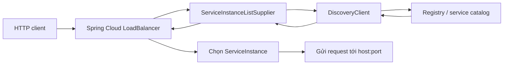

# Kiểm tra thay đổi trong DiscoveryClient và HTTP client integration

Khi nâng Spring Cloud từ dòng 4.x lên 5.0.x, cần kiểm tra cả hợp đồng discovery lẫn cách HTTP client đi qua load balancer. Spring Cloud Commons 5.0 thuộc release train 2025.1, dựa trên Spring Boot 4 và Spring Framework 7. Các thay đổi liên quan trực tiếp đến bài này gồm JSpecify null-safety trên public API, API version-based load balancing và tích hợp Spring HTTP Service Clients AutoConfiguration.

Hai lớp cần được phân biệt:

- **DiscoveryClient** truy vấn service instance từ Eureka, Consul, Zookeeper hoặc discovery provider khác.
- **HTTP client integration** kết nối request với LoadBalancer để chọn instance và gửi request tới địa chỉ vật lý.

DiscoveryClient không tự biến mọi RestClient hoặc WebClient thành client load-balanced. Ứng dụng vẫn phải cấu hình builder, interceptor, filter function hoặc HTTP Service Client group phù hợp.

Bài học thuộc chương **Nâng cấp** của **SPRING_CLOUD_CORE**. Trọng tâm là nâng Spring Cloud Commons 4.3.x lên 5.0.x, rà soát custom DiscoveryClient, xử lý nullability, phân biệt blocking/reactive discovery, kiểm tra các HTTP client integration hiện có và áp dụng HTTP Service Clients của Spring Framework 7.

## 1. Mục tiêu học tập

Sau bài này, người học có thể:

1. Chọn release train Spring Cloud tương thích với Spring Boot.
2. Nhận diện các thay đổi chính của Spring Cloud Commons 5.0.
3. Giải thích ảnh hưởng của JSpecify nullability đến custom DiscoveryClient và Kotlin.
4. Phân biệt DiscoveryClient với ReactiveDiscoveryClient.
5. Kiểm tra thứ tự khi ứng dụng có nhiều DiscoveryClient.
6. Hiểu cách DiscoveryClientHealthIndicator kiểm tra discovery.
7. Mô tả luồng từ DiscoveryClient đến ServiceInstanceListSupplier, LoadBalancer và HTTP client.
8. Phân biệt tích hợp LoadBalancer cho RestTemplate, RestClient và WebClient.
9. Khai báo HTTP Service Client bằng @ImportHttpServices.
10. Cấu hình group base-url để bật hoặc bỏ qua load balancing.
11. Áp dụng API version-based load balancing dựa trên metadata của ServiceInstance.
12. Viết kiểm thử cho discovery contract và request thực tế.
13. Lập checklist nâng cấp có thể dùng cho nhiều service.

## 2. Chọn phiên bản tương thích

Spring Cloud được phát hành theo release train. Không nên nâng riêng spring-cloud-commons lên 5.0.x trong một ứng dụng vẫn dùng release train 2025.0 hoặc Spring Boot 3.5.x.

| Spring Cloud release train | Spring Cloud Commons | Spring Boot |
| --- | --- | --- |
| 2025.1.x (Oakwood) | 5.0.x | 4.0.x; hỗ trợ 4.1.x từ 2025.1.2 |
| 2025.0.x (Northfields) | 4.3.x | 3.5.x |
| 2024.0.x (Moorgate) | 4.2.x | 3.4.x |

Tại thời điểm biên soạn, tài liệu Spring Cloud đánh dấu 2025.1.4 là release train stable mới nhất; 2026.0.0-RC2 vẫn là preview. Khi triển khai production, chọn bản stable và kiểm tra lại compatibility matrix.

Một lưu ý trong giai đoạn chuyển tiếp: Spring Cloud 2025.0.0 không tương thích với Spring Boot 4.0.1 và các bản 4.0.x mới hơn. Spring Cloud 2025.1.1 bổ sung hỗ trợ cho Boot 4.0.1 trở lên; từ 2025.1.2, release train hỗ trợ cả Boot 4.1.x.

### 2.1. Nâng theo release train

Nếu ứng dụng hiện dùng Spring Boot 3.5.x và Spring Cloud 2025.0.x, hãy lập kế hoạch nâng Boot lên thế hệ 4 cùng Spring Cloud 2025.1.x. Nếu chưa sẵn sàng chuyển Boot 4, tiếp tục dùng release train tương thích với Boot 3.5 thay vì trộn các module 4.3.x và 5.0.x.

Ví dụ Maven dùng BOM:

```xml
<properties>
    <spring-boot.version>4.0.2</spring-boot.version>
    <spring-cloud.version>2025.1.4</spring-cloud.version>
</properties>

<dependencyManagement>
    <dependencies>
        <dependency>
            <groupId>org.springframework.cloud</groupId>
            <artifactId>spring-cloud-dependencies</artifactId>
            <version>2025.1.4</version>
            <type>pom</type>
            <scope>import</scope>
        </dependency>
    </dependencies>
</dependencyManagement>
```

Đây là ví dụ minh họa cho một bộ phiên bản tương thích; hãy dùng patch Spring Boot và Spring Cloud đã được tổ chức phê duyệt. Không đặt version riêng cho spring-cloud-commons, spring-cloud-loadbalancer, Eureka hoặc Consul nếu BOM đã quản lý chúng.

### 2.2. Vì sao không nên nâng từng module độc lập?

Discovery client provider và LoadBalancer cùng phụ thuộc vào hợp đồng trong Spring Cloud Commons. Nếu ứng dụng dùng Commons 5.0 nhưng provider vẫn ở thế hệ không tương thích, lỗi có thể xuất hiện dưới dạng NoSuchMethodError, ClassNotFoundException, lỗi liên kết annotation hoặc auto-configuration không match.

Trước khi chạy ứng dụng, kiểm tra dependency tree để chắc rằng các module Spring Cloud thuộc cùng release train. Đặc biệt chú ý starter do công ty tự quản lý version hoặc dependency transitively được thư viện khác kéo vào.

## 3. Thay đổi đáng chú ý trong Spring Cloud Commons 5.0

Spring Cloud 2025.1 là major release dựa trên Spring Framework 7 và Spring Boot 4. Các thay đổi liên quan trực tiếp đến DiscoveryClient và HTTP client integration gồm:

| Thay đổi | Ý nghĩa khi nâng cấp | Việc cần kiểm tra |
| --- | --- | --- |
| JSpecify null-safety trên public API | Hợp đồng nullable/non-null được mô tả rõ hơn | Custom implementation, Kotlin và null checker |
| LoadBalancer API versioning | Có thể lọc instance theo phiên bản API yêu cầu | Metadata API_VERSION và request version |
| LoadBalancer hỗ trợ HTTP Service Clients AutoConfiguration | Có thể dùng HTTP interface theo group thay vì tự tạo proxy/client lặp lại | @ImportHttpServices, group name và base-url |
| Spring Framework 7 / Boot 4 | HTTP Service Registry và cấu hình HTTP client được tích hợp ở nền tảng mới | Dependency, property và custom client configuration |

Các thay đổi này không có nghĩa DiscoveryClient đã bị thay thế hoặc mọi ứng dụng phải viết lại HTTP client. API discovery cốt lõi vẫn giữ vai trò cũ; phần mới bổ sung hợp đồng null-safety và các cách tích hợp LoadBalancer với HTTP client hiện đại.

## 4. DiscoveryClient: hợp đồng API cần rà soát

DiscoveryClient là abstraction blocking để truy vấn service instance. Các phương thức cốt lõi gồm:

```java
public interface DiscoveryClient extends Ordered {

    String description();

    List<ServiceInstance> getInstances(String serviceId);

    List<String> getServices();

    default void probe() {
        getServices();
    }

    default int getOrder() {
        return 0;
    }
}
```

Đoạn code trên tóm tắt hợp đồng để minh họa; hãy đối chiếu Javadoc của đúng artifact đang dùng khi triển khai.

- description() trả mô tả dễ đọc, thường được dùng trong health indicator.
- getInstances(serviceId) trả các instance của một service.
- getServices() trả danh sách service ID đã biết.
- probe() kiểm tra client có thể thực hiện discovery call hay không. Mặc định gọi getServices(), nhưng implementation có thể override bằng thao tác nhẹ hơn.
- getOrder() xác định thứ tự ưu tiên khi có nhiều DiscoveryClient.

### 4.1. Không nhầm nullability với việc thay đổi API

Trong nâng cấp lên Commons 5.0, trọng tâm của thay đổi DiscoveryClient là null-safety annotation trên public API, không phải thay thế tên các phương thức truy vấn cốt lõi. Mã ứng dụng gọi getInstances, getServices hoặc probe thường không phải viết lại chỉ vì release train chuyển từ 4.x sang 5.0.

Tuy nhiên, custom implementation phải tuân thủ hợp đồng nullability rõ ràng hơn. Đặc biệt, không trả null thay cho danh sách rỗng khi service không có instance.

### 4.2. Trả danh sách rỗng thay vì null

Ví dụ implementation phù hợp:

```java
class WarehouseDiscoveryClient implements DiscoveryClient {

    private final Map<String, List<ServiceInstance>> instances;

    WarehouseDiscoveryClient(
            Map<String, List<ServiceInstance>> instances) {
        this.instances = instances;
    }

    @Override
    public String description() {
        return "Warehouse discovery";
    }

    @Override
    public List<ServiceInstance> getInstances(String serviceId) {
        return instances.getOrDefault(serviceId, List.of());
    }

    @Override
    public List<String> getServices() {
        return List.copyOf(instances.keySet());
    }
}
```

Không nên viết:

```java
@Override
public List<ServiceInstance> getInstances(String serviceId) {
    return instances.get(serviceId); // Có thể trả null
}
```

Khi không có service hoặc instance, trả List.of() hoặc một danh sách rỗng tương đương. Điều này giữ contract ổn định cho LoadBalancer và các caller không cần thêm null check cho chính danh sách.

## 5. JSpecify nullability và custom implementation

Spring Cloud Commons 5.0 bổ sung JSpecify null-safety annotation cho public API. JSpecify cung cấp cách mô tả kiểu có thể null và không thể null ở cấp package, class hoặc type use.

| Annotation | Ý nghĩa |
| --- | --- |
| @NullMarked | Mặc định parameter và return type trong phạm vi được đánh dấu là non-null |
| @Nullable | Giá trị cụ thể có thể là null |
| @NullUnmarked | Trở về trạng thái nullability không được xác định trong phạm vi đó |

Đây là hợp đồng kiểu dành cho compiler, IDE, Kotlin và static analysis. Annotation không tự thêm runtime validation cho mọi method. Nếu implementation trả null trái với hợp đồng, lỗi có thể xuất hiện dưới dạng cảnh báo compile-time, lỗi từ null checker hoặc NullPointerException ở caller.

### 5.1. Phân biệt DiscoveryClient với ServiceInstance nullable fields

Không phải mọi trường trong service discovery đều bắt buộc có giá trị. Ví dụ, ServiceInstance có một số thông tin tùy chọn:

| Method | Cách xử lý |
| --- | --- |
| getServiceId() | Service ID cần có |
| getHost() | Host cần có |
| getPort() | Port cần có |
| getUri() | URI instance cần có |
| getInstanceId() | Có thể null tùy provider |
| getMetadata() | Có thể null nếu provider không cung cấp metadata |
| getScheme() | Có thể null nếu scheme không được khai báo |

Hãy phân biệt một danh sách instance rỗng với một metadata field nullable. getInstances() vẫn phải trả một list hợp lệ; từng instance trong list có thể có một số metadata tùy chọn chưa được thiết lập.

Ví dụ xử lý metadata an toàn:

```java
String instanceId = serviceInstance.getInstanceId();

Map<String, String> metadata = serviceInstance.getMetadata();
String zone = metadata == null ? null : metadata.get("zone");
```

Nếu ứng dụng dùng Kotlin, hãy biên dịch lại các module implement hoặc consume Spring Cloud API sau khi đổi BOM. Kotlin compiler có thể diễn giải JSpecify nullability chặt hơn so với API không có annotation trước đây.

### 5.2. Kiểm tra static analysis

Nếu build dùng NullAway, Checker Framework, Error Prone hoặc nullness checker khác, nâng cấp có thể làm xuất hiện cảnh báo mới ở các ranh giới API. Không nên tắt toàn bộ null analysis để vượt qua build. Hãy xác định giá trị nào thật sự có thể null, đánh dấu @Nullable ở code của ứng dụng nếu cần, và giữ non-null contract cho các list/parameter bắt buộc.

Với custom DiscoveryClient, kiểm tra tối thiểu:

1. description() không trả null.
2. getInstances(serviceId) không trả null.
3. getServices() không trả null.
4. serviceId được xử lý theo hợp đồng non-null.
5. Các ServiceInstance trả về có host, port, service ID và URI hợp lệ.
6. Metadata tùy chọn được xử lý null-safe.

## 6. Blocking và Reactive DiscoveryClient

Spring Cloud Commons có hai abstraction riêng:

| Interface | Mô hình | Caller phù hợp |
| --- | --- | --- |
| DiscoveryClient | Blocking, trả List | RestClient, RestTemplate và code imperative |
| ReactiveDiscoveryClient | Reactive, trả Flux | WebFlux, WebClient và reactive pipeline |

Không nên gọi blocking discovery trực tiếp trên event-loop thread của WebFlux. Nếu ứng dụng reactive, hãy dùng reactive discovery path mà provider hỗ trợ. Ngược lại, ứng dụng imperative có thể dùng blocking client.

Có thể bật/tắt các nhóm client bằng property:

```yaml
spring:
  cloud:
    discovery:
      blocking:
        enabled: true
      reactive:
        enabled: true
```

Để tắt hoàn toàn discovery:

```yaml
spring:
  cloud:
    discovery:
      enabled: false
```

Trước khi nâng cấp, kiểm tra xem ứng dụng có vô tình phụ thuộc vào blocking client trong reactive service hay không. Việc có cả hai implementation trên classpath không có nghĩa caller có thể dùng chúng thay thế nhau mà không xem xét execution model.

### 6.1. @EnableDiscoveryClient có còn bắt buộc không?

Trong Spring Cloud hiện đại, @EnableDiscoveryClient không còn bắt buộc chỉ để kích hoạt discovery. Khi discovery implementation phù hợp có trên classpath, auto-configuration có thể đăng ký client và service.

Annotation vẫn tồn tại và có thể được dùng cho cấu hình cụ thể, ví dụ điều khiển auto-registration. Đừng xóa annotation hàng loạt trước khi kiểm tra xem ứng dụng có đang dùng thuộc tính autoRegister=false hay hành vi import cụ thể nào từ annotation.

Nếu không có DiscoveryClient gắn với service registry trên classpath, Spring Cloud có thể dùng `SimpleDiscoveryClient`, đọc instance từ property `spring.cloud.discovery.client.simple.instances`. Khi nâng dependency, nếu ứng dụng bất ngờ chuyển sang danh sách instance tĩnh hoặc không còn thấy service, hãy kiểm tra starter của discovery provider có bị loại khỏi dependency graph hay không.

## 7. Nhiều DiscoveryClient và thứ tự ưu tiên

Một ứng dụng có thể đồng thời có nhiều DiscoveryClient, chẳng hạn một client đọc service từ Eureka và một client đọc service từ cấu hình tĩnh.

DiscoveryClient mở rộng Ordered. Giá trị mặc định là 0; custom implementation có thể override getOrder() để xác định thứ tự phù hợp. Provider cũng có thể cung cấp property riêng để cấu hình order.

Ví dụ:

```java
@Override
public int getOrder() {
    return 10;
}
```

Nếu ứng dụng có nhiều discovery implementation, hãy kiểm tra:

- DiscoveryClient nào được chọn trước.
- Composite client có được tạo hay không.
- Service ID có xuất hiện ở nhiều registry không.
- Cùng một service có trả instance khác nhau từ các provider không.
- Thứ tự discovery có thay đổi khi dependency được nâng cấp không.

Không nên dựa vào thứ tự bean ngẫu nhiên hoặc thứ tự dependency trong build file. Hãy cấu hình order rõ ràng và viết test cho service ID có nhiều nguồn instance.

## 8. Health indicator và chi phí truy vấn discovery

Spring Cloud Commons cung cấp DiscoveryClientHealthIndicator. Theo mặc định, health indicator có thể gọi getServices() để lấy danh sách service và đưa vào health detail.

Trong hệ thống có rất nhiều service, việc truy xuất toàn bộ danh sách có thể tốn kém. Có thể chuyển sang gọi probe():

```yaml
spring:
  cloud:
    discovery:
      client:
        health-indicator:
          use-services-query: false
```

Khi đó, health indicator gọi DiscoveryClient.probe(). Mặc định probe() gọi getServices(), vì vậy nếu implementation có thao tác ping/health nhẹ hơn, hãy override probe().

Ví dụ:

```java
@Override
public void probe() {
    registryClient.ping();
}
```

Chỉ override khi provider có thao tác thực sự xác minh được khả năng kết nối. Không trả về thành công giả chỉ để health check nhanh hơn.

## 9. DiscoveryClient không tự thực hiện load balancing

Một luồng service-to-service call điển hình:



Trách nhiệm của từng thành phần:

- DiscoveryClient truy vấn danh sách instance.
- DiscoveryClientServiceInstanceListSupplier chuyển danh sách discovery thành đầu vào cho LoadBalancer.
- ServiceInstanceListSupplier có thể cache, lọc theo zone, hint, version hoặc health.
- LoadBalancer chọn một instance.
- HTTP client integration chuyển request đến địa chỉ thực của instance.

Vì vậy, việc inject được DiscoveryClient và truy vấn thành công không chứng minh request của RestClient hoặc WebClient đã được load-balanced. HTTP client phải được cấu hình qua integration phù hợp.

## 10. Kiểm tra các HTTP client integration hiện có

Spring Cloud LoadBalancer hỗ trợ các kiểu client phổ biến:

Các ví dụ dưới đây cần có `spring-cloud-starter-loadbalancer` cùng discovery provider phù hợp. Chỉ có `DiscoveryClient` trên classpath chưa đủ để biến một HTTP client tùy ý thành client load-balanced.

| HTTP client | Cách tích hợp thường dùng | Kiểu xử lý |
| --- | --- | --- |
| RestTemplate | @LoadBalanced RestTemplate | Blocking |
| RestClient | @LoadBalanced RestClient.Builder | Blocking |
| WebClient | @LoadBalanced WebClient.Builder | Reactive |

### 10.1. RestTemplate

Một cấu hình cũ có thể vẫn dùng:

```java
@Bean
@LoadBalanced
RestTemplate restTemplate() {
    return new RestTemplate();
}
```

URI cần dùng service ID thay cho hostname vật lý:

```java
restTemplate.getForObject(
    "http://inventory-service/api/items",
    ItemList.class
);
```

Khi builder/interceptor được cấu hình đúng, LoadBalancer chuyển service ID thành địa chỉ của một instance. Nếu inject một RestTemplate không có @LoadBalanced, hostname inventory-service sẽ được xử lý theo DNS/network thông thường và không đi qua Spring Cloud LoadBalancer.

### 10.2. RestClient

Với ứng dụng imperative mới, có thể dùng RestClient:

```java
@Bean
@LoadBalanced
RestClient.Builder loadBalancedRestClientBuilder(
        RestClientBuilderConfigurer configurer) {

    return configurer.configure(RestClient.builder());
}
```

RestClientBuilderConfigurer giúp giữ các tùy chỉnh Boot đã áp dụng cho builder, ví dụ message converters và observability. Khi có cả builder load-balanced và builder thường, hãy dùng qualifier @LoadBalanced để inject đúng bean.

Ví dụ:

```java
@Service
class InventoryGateway {

    private final RestClient restClient;

    InventoryGateway(
            @LoadBalanced RestClient.Builder builder) {
        this.restClient = builder.build();
    }

    ItemList findItems() {
        return restClient.get()
            .uri("http://inventory-service/api/items")
            .retrieve()
            .body(ItemList.class);
    }
}
```

### 10.3. WebClient

Với reactive client:

```java
@Bean
@LoadBalanced
WebClient.Builder loadBalancedWebClientBuilder() {
    return WebClient.builder();
}
```

Sau đó dùng service ID trong URI:

```java
Mono<ItemList> findItems(WebClient.Builder builder) {
    return builder.build()
        .get()
        .uri("http://inventory-service/api/items")
        .retrieve()
        .bodyToMono(ItemList.class);
}
```

Đảm bảo application đang dùng reactive LoadBalancer integration và không chặn event loop bằng thao tác blocking ở tầng discovery hoặc service call.

## 11. HTTP Service Clients trong Spring Framework 7

Spring Framework 6 đã cho phép định nghĩa HTTP service bằng Java interface có @HttpExchange, @GetExchange, @PostExchange và các annotation liên quan. Spring Framework 7 bổ sung registry/configuration layer để khai báo nhóm HTTP service, tự tạo client proxy và đăng ký proxy thành bean.

Ví dụ interface:

```java
@HttpExchange("/api/items")
public interface InventoryHttpService {

    @GetExchange("/{id}")
    Item findById(@PathVariable String id);

    @PostExchange
    Item create(@RequestBody CreateItemRequest request);
}
```

Thay vì tự tạo HttpServiceProxyFactory và từng proxy bean, ứng dụng có thể khai báo group:

```java
@SpringBootApplication
@ImportHttpServices(
    group = "inventory-service",
    types = InventoryHttpService.class
)
public class InventoryGatewayApplication {
}
```

@ImportHttpServices thuộc Spring Framework 7. Một group gom các HTTP service interface dùng chung cấu hình và HTTP client infrastructure. Theo mặc định group sử dụng RestClient; có thể chọn WebClient thông qua thuộc tính clientType khi cần reactive client.

### 11.1. LoadBalancer integration từ Spring Cloud 5.0

Từ Spring Cloud LoadBalancer 5.0.0, HTTP Service Clients AutoConfiguration được tích hợp thông qua:

- LoadBalancerRestClientHttpServiceGroupConfigurer cho blocking client.
- LoadBalancerWebClientHttpServiceGroupConfigurer cho reactive client.

Các configurer này thêm thành phần LoadBalancer vào builder của group khi group được cấu hình để dùng service discovery. Ứng dụng có thể dùng HTTP interface làm contract và vẫn tận dụng service discovery/load balancing.

Đây là tích hợp của Spring Cloud LoadBalancer với HTTP Service Client group. DiscoveryClient vẫn chịu trách nhiệm cung cấp instance; HTTP Service Client registry chỉ quản lý proxy và client configuration.

## 12. Quy tắc quan trọng của base-url

Với HTTP Service Client group, spring.http.serviceclient.<groupName>.base-url quyết định request có được load-balanced hay không.

| base-url | Hành vi |
| --- | --- |
| Không cấu hình (null) | Spring Cloud tạo URL theo service ID của group và thêm LoadBalancer integration |
| lb://inventory-service | Dùng service ID và LoadBalancer |
| lb://inventory-service/api | Dùng service ID, giữ path và LoadBalancer |
| http://inventory-service | Gọi URL trực tiếp; không thêm LoadBalancer integration |
| https://inventory.example.com | Gọi URL cố định; không dùng service discovery để chọn instance |

Ví dụ cấu hình load-balanced:

```yaml
spring:
  http:
    serviceclient:
      inventory-service:
        base-url: lb://inventory-service
        connect-timeout: 2s
        read-timeout: 5s
```

Nếu bỏ base-url, group có tên inventory-service sẽ được ánh xạ thành URL dựa trên service ID, mặc định bắt đầu với scheme HTTP. Khi LoadBalancer chọn một ServiceInstance được đánh dấu secure, scheme có thể được chuyển sang HTTPS.

Nếu đặt URL http:// hoặc https:// trực tiếp, Spring Cloud không thêm LoadBalancer integration cho group đó. Đây là lỗi migration dễ gặp: ứng dụng đã khai báo @ImportHttpServices, nhưng vẫn gọi thẳng host cố định vì cấu hình base URL cũ còn tồn tại.

### 12.1. Đặt tên group trùng service ID

Nếu group name là inventory-service, LoadBalancer dùng chính tên đó làm service ID khi base URL được bỏ trống hoặc dùng scheme lb.

Hãy xác nhận group name khớp với ID mà registry trả về. Nếu registry đăng ký service là inventory, nhưng group tên inventory-service, discovery có thể trả danh sách rỗng dù client proxy được tạo thành công.

### 12.2. Tách client gọi service và client gọi URL cố định

Không nên dùng chung một group cho cả request cần service discovery và request gọi public API cố định. Hãy tạo group riêng để cấu hình timeout, base URL, authentication và LoadBalancer behavior độc lập.

Ví dụ:

```yaml
spring:
  http:
    serviceclient:
      inventory-service:
        base-url: lb://inventory-service
        read-timeout: 3s
      tax-provider:
        base-url: https://api.tax-provider.example
        read-timeout: 8s
```

inventory-service đi qua discovery/load balancing; tax-provider gọi URL cố định. Tách group giúp cấu hình rõ ràng và tránh vô tình đưa external API vào service discovery.

## 13. Cấu hình HTTP client dùng chung trong Spring Boot 4

Spring Boot 4 cung cấp property để cấu hình HTTP client toàn cục và theo group.

Ví dụ:

```yaml
spring:
  http:
    clients:
      connect-timeout: 1s
      read-timeout: 4s
    serviceclient:
      inventory-service:
        base-url: lb://inventory-service
        connect-timeout: 2s
        read-timeout: 5s
```

Các property ở spring.http.clients áp dụng cho client nói chung; property trong spring.http.serviceclient.<group> ghi đè theo group. Hãy kiểm tra timeout của từng client khi chuyển từ RestTemplate/RestClient tự cấu hình sang HTTP Service Client AutoConfiguration.

Một số ứng dụng tạo RestClient.create() hoặc WebClient.create() trực tiếp. Cách tạo này có thể bỏ qua các builder đã được Boot và framework tùy chỉnh. Khi cần observability, SSL bundle, connector, timeout hoặc LoadBalancer integration, ưu tiên builder/configurer được auto-configuration quản lý.

## 14. API version-based load balancing

Spring Cloud Commons 5.0 bổ sung API version-based load balancing. Tính năng này giúp chọn instance có metadata khớp với phiên bản API mà request yêu cầu.

Có hai supplier:

- BlockingApiVersionServiceInstanceListSupplier cho RestClient.
- ReactiveApiVersionServiceInstanceListSupplier cho WebClient.

Có thể bật cấu hình có sẵn:

```yaml
spring:
  cloud:
    loadbalancer:
      configurations: api-version
```

Hoặc khai báo ServiceInstanceListSupplier riêng cho service ID cần áp dụng.

### 14.1. Metadata API_VERSION

Khi API versioning được bật, LoadBalancer tìm instance có key API_VERSION trong metadata map khớp với version lấy từ request.

Ví dụ metadata của các instance:

| Instance | Metadata |
| --- | --- |
| catalog-v1 | API_VERSION=1.0 |
| catalog-v2 | API_VERSION=2.0 |
| catalog-v3 | API_VERSION=3.0 |

Request có thể truyền version qua header, query parameter, path segment hoặc media type parameter. Ví dụ cấu hình cho header:

```yaml
spring:
  cloud:
    loadbalancer:
      clients:
        catalog:
          configurations: api-version
          api-version:
            header: X-Api-Version
            default: "2.0"
            required: true
```

Trong dạng property key, cấu hình trên tương ứng với `spring.cloud.loadbalancer.clients.catalog.configurations` và `spring.cloud.loadbalancer.clients.catalog.api-version.header`. Các giá trị `default` và `required` nằm cùng nhóm `api-version` của client `catalog`.

Khi request gửi X-Api-Version: 2.0, supplier chỉ giữ các instance có metadata API_VERSION=2.0. Nếu không có instance phù hợp, danh sách trả về rỗng theo mặc định. Có thể bật fallback-to-available-instances nếu chính sách ứng dụng cho phép gửi request đến version khác.

Không bật fallback một cách tùy tiện. Nếu client yêu cầu version 2.0 nhưng chỉ có instance 1.0, trả về instance bất kỳ có thể gây lỗi contract hoặc dữ liệu. Hãy chọn hành vi fallback dựa trên khả năng tương thích ngược của API.

### 14.2. Kết hợp DiscoveryClient và API versioning

DiscoveryClient chỉ truy xuất danh sách instance. LoadBalancer supplier mới thực hiện bước lọc theo API version. Do đó, provider phải công bố metadata API_VERSION nhất quán cho từng instance.

Khi metadata bị thiếu hoặc không đồng nhất:

- Instance có thể bị loại khỏi danh sách nếu request yêu cầu version cụ thể.
- Một số instance có thể vẫn xuất hiện nếu fallback được bật.
- Cần kiểm tra cache để tránh metadata cũ tiếp tục được dùng sau rollout.

## 15. Cache và thứ tự supplier khi nâng cấp

LoadBalancer có thể cache danh sách ServiceInstance. Một số discovery provider cũng có cache riêng. Nếu cả hai lớp cùng cache, thông tin instance cũ có thể tồn tại lâu hơn dự kiến.

Tài liệu Spring Cloud khuyến nghị dùng CachingServiceInstanceListSupplier sau supplier lấy instance từ network, ví dụ DiscoveryClientServiceInstanceListSupplier, trước các supplier lọc theo request.

Một số provider như Eureka đã có cơ chế cache discovery riêng. Nếu provider đã cache, cân nhắc tắt LoadBalancer cache để tránh double caching.

Khi tự cấu hình supplier, hãy kiểm tra:

1. Supplier đầu tiên lấy instance từ DiscoveryClient.
2. Caching supplier nằm ngay sau nguồn dữ liệu network khi được sử dụng.
3. Supplier lọc zone, hint hoặc API version nằm sau cache phù hợp.
4. Không dùng đồng thời hai supplier cache/health-check theo cách tài liệu không khuyến nghị.
5. TTL đủ ngắn để cập nhật instance sau deploy nhưng không tạo quá nhiều request tới registry.

## 16. Lưu ý riêng khi nâng Spring Cloud Netflix

Spring Cloud Netflix 5.0 loại bỏ hỗ trợ RestTemplate trong module Netflix. Điều này là thay đổi ở Spring Cloud Netflix, không có nghĩa Spring Cloud Commons LoadBalancer cũng bỏ toàn bộ RestTemplate integration.

Ngoài thay đổi riêng của Netflix, Spring Framework 7 cũng đánh dấu RestTemplate deprecated và khuyến nghị dùng RestClient cho ứng dụng imperative. Deprecated không đồng nghĩa API đã bị xóa trong Framework 7; cần phân biệt cảnh báo cấp framework với việc Spring Cloud Netflix loại bỏ integration riêng của module.

Phân biệt:

- Spring Cloud Commons LoadBalancer vẫn có integration cho RestTemplate.
- Spring Cloud LoadBalancer hỗ trợ RestClient và WebClient.
- Spring Cloud Netflix 5.0 đã loại bỏ hỗ trợ RestTemplate riêng của module đó.

Nếu ứng dụng phụ thuộc một integration cụ thể của Netflix với RestTemplate, hãy kiểm tra release notes của Spring Cloud Netflix và lập kế hoạch chuyển sang RestClient/WebClient hoặc integration được Spring Cloud Commons hỗ trợ. Không kết luận rằng chỉ cần giữ dependency RestTemplate là toàn bộ hành vi cũ của Netflix vẫn còn.

## 17. Quy trình nâng cấp từng bước

Có thể thực hiện theo thứ tự sau:

1. Ghi lại Spring Boot, Spring Cloud release train, Commons, LoadBalancer và discovery provider đang chạy.
2. Kiểm tra compatibility matrix và chọn release train tương thích.
3. Nâng đồng bộ BOM, Boot và các Spring Cloud module.
4. Chạy compile để phát hiện thay đổi từ Framework 7, Boot 4 và JSpecify.
5. Rà soát custom DiscoveryClient và ReactiveDiscoveryClient.
6. Đảm bảo list trả về không null; xử lý các trường nullable trong ServiceInstance.
7. Kiểm tra discovery client order nếu có nhiều provider.
8. Kiểm tra blocking/reactive client được inject đúng execution model.
9. Rà soát mọi RestTemplate/RestClient/WebClient builder có cần @LoadBalanced không.
10. Nếu chuyển sang HTTP Service Clients, tạo group và khai báo @ImportHttpServices.
11. Kiểm tra base-url: bỏ trống hoặc lb:// nếu cần load balancing; URL http(s):// nếu gọi trực tiếp.
12. Kiểm tra API version metadata và supplier nếu bật version-based routing.
13. Kiểm tra cache/TTL và health indicator discovery.
14. Chạy integration test với ít nhất hai instance giả lập để chứng minh chọn instance.
15. Kiểm tra dependency tree và xác nhận không còn Spring Cloud module lệch release train.

Không thay đổi tất cả HTTP client cùng lúc nếu ứng dụng có nhiều service. Có thể nâng DiscoveryClient và LoadBalancer trước, sau đó chuyển từng nhóm HTTP client sang HTTP Service Clients để dễ xác định nguyên nhân khi có lỗi.

## 18. Kiểm thử hợp đồng DiscoveryClient

Một custom DiscoveryClient nên có test xác nhận contract cơ bản:

```java
@Test
void returnsEmptyListWhenServiceHasNoInstances() {
    List<ServiceInstance> instances =
        discoveryClient.getInstances("missing-service");

    assertThat(instances).isNotNull().isEmpty();
}

@Test
void returnsKnownServiceIds() {
    assertThat(discoveryClient.getServices())
        .contains("inventory-service");
}

@Test
void probeDoesNotThrowWhenRegistryIsReachable() {
    assertThatCode(discoveryClient::probe)
        .doesNotThrowAnyException();
}
```

Nếu override probe(), test cần xác nhận thao tác health nhẹ thực sự chạm được registry. Nếu không override, test mặc định cũng kiểm tra getServices() hoạt động.

Với ServiceInstance, thêm test cho trường hợp metadata hoặc instance ID không có để đảm bảo consumer không giả định mọi optional field luôn có giá trị.

## 19. Kiểm thử HTTP client integration

Một test nâng cấp nên xác nhận request thực sự đi qua LoadBalancer thay vì chỉ kiểm tra client proxy được tạo.

Chiến lược:

1. Dùng discovery client giả trả về hai ServiceInstance có host/port khác nhau.
2. Dùng mock HTTP server ở mỗi instance.
3. Gọi client qua service ID.
4. Xác nhận request được gửi đến một instance hợp lệ.
5. Thay đổi danh sách instance hoặc metadata và kiểm tra cache/selection.
6. Thử URL trực tiếp để xác nhận nó không đi qua LoadBalancer.
7. Thử lb://serviceId và xác nhận request được resolve qua discovery.

Với HTTP Service Clients, cần kiểm tra cả ba trường hợp base-url:

| Trường hợp | Assertion |
| --- | --- |
| Không cấu hình | Base URL được suy ra từ group/service ID và request được load-balanced |
| lb://catalog | Request được chọn instance từ DiscoveryClient |
| http://catalog | Request gọi URL trực tiếp, không dùng LoadBalancer |

Nếu chỉ test HTTP 200 từ mock server, có thể bỏ sót trường hợp client đang gọi nhầm server cố định. Hãy kiểm tra host/port hoặc request log tại từng mock instance.

### 19.1. Kiểm thử API version-based selection

Tạo các instance có metadata API_VERSION khác nhau. Gửi request với header version cụ thể và xác nhận chỉ instance khớp được chọn. Thêm test không có version phù hợp để kiểm tra danh sách rỗng hoặc fallback theo cấu hình.

## 20. Troubleshooting sau nâng cấp

| Triệu chứng | Nguyên nhân có thể | Cách kiểm tra |
| --- | --- | --- |
| Custom DiscoveryClient không compile với null checker | Contract JSpecify mới làm lộ giá trị có thể null | Kiểm tra return type, parameter và annotation nullable |
| LoadBalancer không tìm thấy instance | Service ID không khớp với registry hoặc getInstances trả list rỗng | Log service ID và kết quả DiscoveryClient |
| HTTP client gọi hostname như DNS bình thường | Builder không có LoadBalancer integration | Kiểm tra @LoadBalanced hoặc HTTP service group configurer |
| HTTP Service Client không load-balance | base-url đang là http:// hoặc https:// trực tiếp | Đổi thành lb://serviceId hoặc bỏ base-url |
| HTTP Service Client trả lỗi no instance | Group name khác service ID hoặc discovery không có instance | Kiểm tra @ImportHttpServices và metadata registry |
| Reactive request bị block | Dùng DiscoveryClient blocking trong WebFlux path | Dùng ReactiveDiscoveryClient hoặc chuyển blocking work sang scheduler phù hợp |
| Health check chậm | Indicator gọi getServices() trên registry lớn | Cân nhắc use-services-query=false và override probe nhẹ |
| Chọn nhầm DiscoveryClient | Có nhiều implementation với order không rõ | Kiểm tra getOrder() và provider order property |
| API version không tìm thấy instance | Metadata API_VERSION thiếu/sai hoặc request version khác | Kiểm tra metadata, header và supplier |
| Instance cũ tiếp tục được gọi | Discovery/LoadBalancer cache chưa hết TTL | Kiểm tra cache provider, LoadBalancer và propagation delay |
| RestTemplate integration biến mất sau nâng cấp Netflix | Spring Cloud Netflix 5.0 đã loại bỏ hỗ trợ RestTemplate của module đó | Đối chiếu release notes Netflix và chuyển client phù hợp |
| Build lỗi do trộn Commons 4.x và 5.x | Dependency version lệch release train | Kiểm tra dependency tree và BOM |

## 21. Checklist trước khi hoàn tất nâng cấp

- [ ] Spring Boot và Spring Cloud release train nằm trong compatibility matrix.
- [ ] Các Spring Cloud module được quản lý bởi cùng BOM.
- [ ] Custom DiscoveryClient tuân thủ JSpecify nullability.
- [ ] getInstances() và getServices() không trả null.
- [ ] Optional field của ServiceInstance được xử lý null-safe.
- [ ] Blocking và reactive discovery được dùng đúng execution model.
- [ ] Thứ tự nhiều DiscoveryClient đã được xác định.
- [ ] Health indicator không truy vấn toàn bộ service list không cần thiết.
- [ ] HTTP client builder cần load balancing đã được gắn integration.
- [ ] HTTP Service Client group name khớp service ID.
- [ ] base-url không vô tình dùng URL cố định khi muốn load balancing.
- [ ] API version metadata nhất quán trên các instance.
- [ ] Cache TTL phù hợp với tốc độ thay đổi registry.
- [ ] Test chứng minh request đi tới instance được chọn.
- [ ] Các integration Netflix cũ đã được rà soát theo release notes.

## 22. Bài tập áp dụng

### Bài tập 1. Sửa custom DiscoveryClient

Một custom DiscoveryClient trả null khi không tìm thấy service. Hãy sửa implementation để tuân thủ non-null contract, bổ sung test cho service không tồn tại và test cho getServices().

### Bài tập 2. Chọn blocking hay reactive discovery

Một WebFlux service đang inject DiscoveryClient và gọi getInstances() trực tiếp trong request handler. Hãy giải thích rủi ro và chuyển sang reactive discovery path phù hợp. Viết test đảm bảo handler trả kết quả reactive mà không thực hiện blocking call trên event loop.

### Bài tập 3. Chuyển sang HTTP Service Clients

Một ứng dụng có interface InventoryClient và tự tạo HttpServiceProxyFactory. Hãy chuyển sang @ImportHttpServices(group = "inventory-service", ...), cấu hình lb://inventory-service và kiểm thử request được load-balanced.

### Bài tập 4. Phát hiện base-url làm mất load balancing

Một client có spring.http.serviceclient.catalog.base-url=http://catalog. Hãy giải thích vì sao LoadBalancer không được áp dụng và sửa cấu hình để dùng service discovery.

### Bài tập 5. API version-based routing

Registry có hai instance catalog v1 và catalog v2 với metadata API_VERSION. Hãy bật API version supplier, cấu hình header X-Api-Version và kiểm thử request version 2.0 chỉ chọn instance v2. Bổ sung test cho trường hợp không có instance phù hợp.

### Bài tập 6. Rà soát nâng cấp Netflix

Một service đang dùng RestTemplate integration từ Spring Cloud Netflix. Hãy xác định integration nào bị loại bỏ trong 5.0, phân biệt với RestTemplate LoadBalancer của Commons và đề xuất hướng chuyển đổi.

## 23. Câu hỏi tự kiểm tra

1. Spring Cloud 2025.1.x tương thích với thế hệ Spring Boot nào?
2. Spring Cloud Commons 5.0 bổ sung thay đổi gì về null-safety?
3. Vì sao custom DiscoveryClient nên trả danh sách rỗng thay cho null?
4. ServiceInstance.getMetadata() và getInstanceId() có thể null trong trường hợp nào?
5. DiscoveryClient khác ReactiveDiscoveryClient ở điểm nào?
6. probe() mặc định làm gì và khi nào nên override?
7. getOrder() ảnh hưởng thế nào khi có nhiều DiscoveryClient?
8. DiscoveryClient và LoadBalancer có trách nhiệm khác nhau ra sao?
9. Cách cấu hình LoadBalancer cho RestClient khác WebClient ở đâu?
10. Spring Framework 7 HTTP Service Clients giải quyết phần cấu hình lặp lại nào?
11. @ImportHttpServices dùng group để làm gì?
12. Vì sao base-url không có scheme lb có thể khiến request bỏ qua LoadBalancer?
13. Khi nào group name được dùng làm service ID?
14. API version-based load balancing đọc version từ đâu?
15. Metadata API_VERSION được dùng ở bước nào?
16. Vì sao cần kiểm tra cache khi nâng cấp discovery provider?
17. Spring Cloud Netflix bỏ hỗ trợ RestTemplate có đồng nghĩa Commons LoadBalancer bỏ RestTemplate không?
18. Những test nào chứng minh HTTP request thực sự được load-balanced?

## 24. Nguồn tham chiếu

- [Spring Cloud 2025.1 Release Notes](https://github.com/spring-cloud/spring-cloud-release/wiki/Spring-Cloud-2025.1-Release-Notes): breaking changes của release train 2025.1 và các thay đổi trong Spring Cloud Commons.
- [Spring Cloud Compatibility Matrix](https://spring.io/projects/spring-cloud/): mapping release train Spring Cloud với Spring Boot.
- [Spring Cloud Commons — Common Abstractions](https://docs.spring.io/spring-cloud-commons/reference/spring-cloud-commons/common-abstractions.html): DiscoveryClient, ReactiveDiscoveryClient, health indicator, SimpleDiscoveryClient và thứ tự discovery.
- [Spring Cloud LoadBalancer](https://docs.spring.io/spring-cloud-commons/reference/spring-cloud-commons/loadbalancer.html): tích hợp RestTemplate/RestClient/WebClient, HTTP Service Clients, base-url, API versioning và cache.
- [Spring Cloud Commons PR #1594 — Initial support for JSpecify](https://github.com/spring-cloud/spring-cloud-commons/pull/1594): thay đổi nullability trên public API.
- [Spring Cloud Commons PR #1582 — LoadBalancer API versioning](https://github.com/spring-cloud/spring-cloud-commons/pull/1582): implementation API version-based instance selection.
- [Spring Cloud Commons PR #1491 — LoadBalancer integration for Spring Interface Clients](https://github.com/spring-cloud/spring-cloud-commons/pull/1491): configurer cho RestClient và WebClient HTTP service groups.
- [Spring Framework — HTTP Service Client Enhancements](https://spring.io/blog/2025/09/23/http-service-client-enhancements/): @ImportHttpServices, HTTP service groups và client registry trong Framework 7.
- [Spring Boot 4.0 Migration Guide](https://github.com/spring-projects/spring-boot/wiki/Spring-Boot-4.0-Migration-Guide): các thay đổi nền tảng, JSpecify nullability và yêu cầu nâng cấp.
- [Spring Cloud Netflix 5.0 Release Notes](https://spring.io/blog/2025/11/25/spring-cloud-2025-1-0-aka-oakwood-has-been-released/): ghi chú việc loại bỏ RestTemplate support trong Spring Cloud Netflix.

## Ghi nhớ

Khi nâng cấp lên Spring Cloud Commons 5.0, hãy kiểm tra JSpecify nullability của custom DiscoveryClient, phân biệt blocking/reactive discovery và bảo đảm các danh sách không trả null. Với HTTP client, DiscoveryClient chỉ cung cấp instance; LoadBalancer mới chọn instance và HTTP client integration mới chuyển request. Spring Cloud 5.0 bổ sung tích hợp với HTTP Service Clients của Framework 7: group name được dùng làm service ID, base-url bỏ trống hoặc dùng lb:// thì load-balanced, còn URL http(s):// trực tiếp thì gọi cố định. Hãy kiểm thử cả discovery contract, instance selection và request thực tế trước khi hoàn tất nâng cấp.
