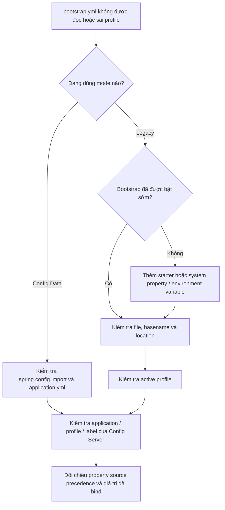

# Bootstrap.yml không được đọc hoặc đọc sai profile

Khi ứng dụng Spring Cloud không nhận được cấu hình mong đợi, một giả định dễ gây nhầm lẫn là Spring Boot luôn tự động đọc `bootstrap.yml`. Từ Spring Boot 2.4, Spring Cloud Config mặc định sử dụng Config Data thông qua `spring.config.import`. Cơ chế bootstrap context cũ vẫn tồn tại để tương thích, nhưng phải được bật rõ ràng bằng starter hoặc thuộc tính khởi động. Vì vậy, file `bootstrap.yml` có thể hợp lệ về cú pháp nhưng không bao giờ được nạp.

Ngay cả khi bootstrap context đã hoạt động, ứng dụng vẫn có thể đọc sai profile, sai application name hoặc sai Config Server label. Một file `bootstrap-prod.yml` chỉ được chọn khi profile `prod` đã được kích hoạt đúng thời điểm và đúng context. Ngoài ra, property source remote từ Config Server và file `bootstrap.yml` local có mức ưu tiên khác nhau; việc file đã được đọc không đồng nghĩa mọi giá trị trong file sẽ thắng.

Bài học thuộc chương **Chẩn đoán sự cố** của **SPRING_CLOUD_CORE**. Nội dung tập trung vào cách xác định ứng dụng đang dùng bootstrap legacy hay Config Data, bật và định vị bootstrap file, xử lý profile, truy vấn Config Server, phân tích property precedence, đọc log và kiểm thử quá trình nạp cấu hình.

## 1. Mục tiêu học tập

Sau bài này, bạn có thể:

- Phân biệt bootstrap context legacy với Spring Boot Config Data.
- Giải thích vì sao `bootstrap.yml` không được đọc mặc định trong cách tích hợp Config Server hiện đại.
- Bật bootstrap legacy đúng thời điểm bằng dependency hoặc system property/environment variable.
- Phân biệt `spring-cloud-starter-config` và `spring-cloud-starter-bootstrap`.
- Xác định tên, vị trí và profile-specific variant của bootstrap file.
- Dùng `spring.cloud.bootstrap.location` và `spring.cloud.bootstrap.additional-location` đúng mục đích.
- Phân biệt `bootstrap-prod.yml` với `application-prod.yml`.
- Xác định profile thực tế mà ứng dụng và Config Server đang sử dụng.
- Kiểm tra `spring.application.name`, `spring.cloud.config.name`, `profile` và `label`.
- Hiểu thứ tự ưu tiên giữa bootstrap local, application config và remote property source.
- Chẩn đoán trường hợp Config Server trả cấu hình mặc định hoặc sai môi trường.
- Phân biệt lỗi không nạp file với lỗi không kết nối Config Server.
- Diễn giải log Config Data và log Config Client.
- Xây dựng bài kiểm thử cho bootstrap legacy và Config Data import.
- Lập quy trình chuyển đổi từ bootstrap legacy sang Config Data.

## 2. Trước tiên: ứng dụng đang dùng cơ chế nạp cấu hình nào?

Đây là bước phân loại quan trọng nhất. Hai cơ chế có cách nạp file và cách kết nối Config Server khác nhau.

| Cơ chế | Cách kích hoạt | File cấu hình liên quan | Config Server |
| --- | --- | --- | --- |
| Bootstrap legacy | `spring-cloud-starter-bootstrap` hoặc `spring.cloud.bootstrap.enabled=true` | `bootstrap.yml`, `bootstrap-{profile}.yml` | Đọc thông tin bootstrap như `spring.cloud.config.uri` |
| Spring Boot Config Data | `spring.config.import=configserver:...` | `application.yml`, `application-{profile}.yml` | Import trực tiếp qua Config Data API |

Spring Boot 2.4 giới thiệu Config Data API và Spring Cloud Config hiện dùng đây làm cách tích hợp mặc định. Với cách này, không cần file `bootstrap.yml`. Cơ chế bootstrap legacy chỉ được dùng khi ứng dụng chủ động bật nó.

Đừng bắt đầu sửa indentation hoặc đổi tên file trước khi xác định mode. Nếu ứng dụng đang dùng Config Data, việc sửa `bootstrap.yml` sẽ không giải quyết được vấn đề.

## 3. Bootstrap legacy không được bật mặc định

Với Spring Boot 2.4 trở lên, nếu ứng dụng chỉ có `spring-cloud-starter-config` và không khai báo `spring.config.import`, file `bootstrap.yml` không tự động được đọc theo cơ chế legacy.

Có hai cách bật bootstrap.

### 3.1. Thêm spring-cloud-starter-bootstrap

Với Maven:

```xml
<dependency>
    <groupId>org.springframework.cloud</groupId>
    <artifactId>spring-cloud-starter-bootstrap</artifactId>
</dependency>
```

Starter này bật bootstrap context legacy. Ứng dụng vẫn cần dependency Config Client nếu muốn lấy cấu hình từ Spring Cloud Config Server:

```xml
<dependency>
    <groupId>org.springframework.cloud</groupId>
    <artifactId>spring-cloud-starter-config</artifactId>
</dependency>
```

Hai dependency có mục đích khác nhau:

- `spring-cloud-starter-config` cung cấp khả năng kết nối Config Server.
- `spring-cloud-starter-bootstrap` kích hoạt bootstrap context legacy.

Không nhầm việc có Config Client trên classpath với việc bootstrap legacy đã được bật.

### 3.2. Bật bằng system property hoặc environment variable

Có thể bật bằng JVM system property:

```bash
java -Dspring.cloud.bootstrap.enabled=true -jar app.jar
```

Hoặc environment variable:

```bash
export SPRING_CLOUD_BOOTSTRAP_ENABLED=true
java -jar app.jar
```

Trong Windows PowerShell:

```powershell
$env:SPRING_CLOUD_BOOTSTRAP_ENABLED = "true"
java -jar app.jar
```

Điểm quan trọng: thuộc tính bật bootstrap phải có trước khi bootstrap context được tạo. Đặt `spring.cloud.bootstrap.enabled=true` bên trong chính file `bootstrap.yml` không giải quyết được vấn đề, vì file đó chỉ được đọc sau khi cơ chế bootstrap đã được kích hoạt.

Không dựa vào tham số ứng dụng `--spring.cloud.bootstrap.enabled=true` sau tên JAR để kích hoạt loader legacy nếu phiên bản đang dùng yêu cầu system property hoặc environment variable. Dùng `-D` trước `-jar` hoặc environment variable để bảo đảm thuộc tính có mặt đủ sớm.

### 3.3. Kiểm tra dependency thực tế

Nếu dùng Maven, kiểm tra dependency tree:

```bash
mvn dependency:tree
```

Xác minh:

- `spring-cloud-starter-config` có trong runtime dependency không.
- `spring-cloud-starter-bootstrap` có được thêm khi dùng legacy mode không.
- Có dependency exclusion loại bỏ starter hoặc module liên quan không.
- Các dependency Spring Cloud có được quản lý bằng đúng BOM/release train không.

Nếu dùng Gradle, kiểm tra runtime classpath:

```bash
./gradlew dependencies --configuration runtimeClasspath
```

Không thêm một phiên bản starter tùy ý để xử lý lỗi. Hãy dùng Spring Cloud BOM tương thích với phiên bản Spring Boot của ứng dụng.

## 4. Cấu hình bootstrap legacy tối thiểu

Khi đã bật bootstrap legacy, file `bootstrap.yml` thường nằm trong `src/main/resources` để được đóng gói vào classpath của ứng dụng.

Ví dụ:

```yaml
spring:
  application:
    name: inventory-service
  profiles:
    active: prod
  cloud:
    config:
      uri: https://config.internal.example
      label: main
```

Các thuộc tính có vai trò:

- `spring.application.name`: tên ứng dụng dùng để yêu cầu cấu hình theo service.
- `spring.profiles.active`: profile cần lấy cấu hình.
- `spring.cloud.config.uri`: địa chỉ Config Server.
- `spring.cloud.config.label`: branch, tag hoặc commit được dùng làm nhãn cấu hình.

Nếu Config Server dùng xác thực, credential cần được cung cấp qua nguồn cấu hình bảo vệ phù hợp. Không ghi password hoặc token production trực tiếp vào file được commit.

### 4.1. Cấu trúc thư mục điển hình

```text
src/
└── main/
    └── resources/
        ├── bootstrap.yml
        ├── bootstrap-prod.yml
        └── application.yml
```

`bootstrap.yml` chứa thông tin cần thiết trong giai đoạn bootstrap. `bootstrap-prod.yml` chứa phần cấu hình bootstrap riêng cho profile `prod`. `application.yml` chứa cấu hình của main application context.

Không đặt file production trong `src/test/resources` nếu muốn nó xuất hiện trong artifact chạy thật. Thư mục test chỉ được đưa vào test classpath.

### 4.2. Kiểm tra file đã được đóng gói

Sau khi build, kiểm tra JAR:

```bash
jar tf target/inventory-service.jar
```

Với executable Spring Boot JAR, file resource thường nằm dưới:

```text
BOOT-INF/classes/bootstrap.yml
BOOT-INF/classes/bootstrap-prod.yml
```

Nếu file chỉ có trong source nhưng không có trong JAR, kiểm tra resource filtering, build profile, cấu hình packaging hoặc vị trí file. Nếu file nằm trong thư mục con, nó không tự động tương đương file ở classpath root.

## 5. Sai tên hoặc sai vị trí bootstrap file

Bootstrap context dùng quy ước tên riêng. Mặc định basename là `bootstrap`, không phải `application`.

### 5.1. Tên file mặc định

Các tên thường dùng:

- `bootstrap.yml`
- `bootstrap.properties`
- `bootstrap-{profile}.yml`
- `bootstrap-{profile}.properties`

Ví dụ với profile `staging`:

```text
bootstrap.yml
bootstrap-staging.yml
```

Tên profile trong file phải khớp với profile thực tế. `bootstrap-stage.yml` sẽ không được chọn nếu profile đang hoạt động là `staging`.

### 5.2. Thay đổi basename

Có thể đổi basename bằng:

`spring.cloud.bootstrap.name`

Ví dụ:

```bash
java -Dspring.cloud.bootstrap.name=service-bootstrap -Dspring.cloud.bootstrap.enabled=true -jar app.jar
```

Khi đó bootstrap loader tìm file theo basename `service-bootstrap` và các biến thể profile tương ứng.

Nếu đã đổi basename nhưng vẫn chỉ có `bootstrap.yml`, file cũ sẽ không còn là tên mà loader đang tìm.

### 5.3. Thay đổi vị trí

Có hai thuộc tính cần phân biệt:

| Property | Tác dụng |
| --- | --- |
| `spring.cloud.bootstrap.location` | Thay thế các vị trí mặc định của bootstrap |
| `spring.cloud.bootstrap.additional-location` | Thêm vị trí ngoài các vị trí mặc định |

Ví dụ:

```bash
java -Dspring.cloud.bootstrap.enabled=true -Dspring.cloud.bootstrap.location=file:/etc/inventory/ -jar app.jar
```

Thư mục ngoài cần chứa file có basename phù hợp, ví dụ `/etc/inventory/bootstrap.yml`.

Nếu muốn bổ sung thư mục mà vẫn giữ vị trí mặc định, dùng:

```bash
java -Dspring.cloud.bootstrap.enabled=true -Dspring.cloud.bootstrap.additional-location=file:/etc/inventory-extra/ -jar app.jar
```

Các thuộc tính này cần được cung cấp đủ sớm để bootstrap context sử dụng khi tìm file.

### 5.4. Không nhầm bootstrap location với config location

`spring.cloud.bootstrap.location` điều khiển vị trí file của bootstrap legacy. `spring.config.location` điều khiển Config Data locations của Spring Boot.

Nếu ứng dụng dùng legacy bootstrap nhưng chỉ thay đổi `spring.config.location`, điều đó không tự động chuyển vị trí tìm `bootstrap.yml`. Ngược lại, trong Config Data mode, `spring.cloud.bootstrap.location` không phải cách để thêm file `application.yml`.

## 6. Profile-specific bootstrap file

Khi bootstrap legacy đã hoạt động, Spring Cloud có thể nạp file theo profile:

```text
bootstrap.yml
bootstrap-dev.yml
bootstrap-staging.yml
bootstrap-prod.yml
```

Nếu active profile là `prod`, file `bootstrap-prod.yml` có thể được nạp cùng với file bootstrap cơ sở.

### 6.1. Kích hoạt profile đủ sớm

Nếu Config Server cần profile cụ thể ngay trong giai đoạn bootstrap, đặt profile trong `bootstrap.yml`:

```yaml
spring:
  application:
    name: inventory-service
  profiles:
    active: prod
  cloud:
    config:
      uri: https://config.internal.example
```

Hoặc cung cấp profile từ environment:

```bash
export SPRING_PROFILES_ACTIVE=prod
java -Dspring.cloud.bootstrap.enabled=true -jar app.jar
```

Trong Windows PowerShell:

```powershell
$env:SPRING_PROFILES_ACTIVE = "prod"
java -Dspring.cloud.bootstrap.enabled=true -jar app.jar
```

Nếu profile chỉ được khai báo trong một nguồn được đọc sau khi Config Client đã gửi request đầu tiên, request ban đầu có thể sử dụng profile mặc định.

### 6.2. Kiểm tra chính xác tên profile

Các tên sau là khác nhau:

- `prod`
- `production`
- `prod-us`
- `prod,region-a`

Spring không tự suy luận `production` tương đương `prod`. Kiểm tra đúng giá trị của `Environment.getActiveProfiles()`.

Ví dụ, nếu active profile là `prod`, file cần tìm là `bootstrap-prod.yml`. File `bootstrap-production.yml` không được chọn chỉ vì tên có ý nghĩa tương tự.

### 6.3. Nhiều profile và thứ tự ghi đè

Nếu nhiều profile được kích hoạt, các profile-specific property source có thể cùng được nạp. Thứ tự profile ảnh hưởng giá trị cuối cùng khi nhiều file khai báo cùng key.

Ví dụ:

```bash
java -Dspring.profiles.active=prod,region-a -jar app.jar
```

Khi đó cần kiểm tra cả `bootstrap-prod.yml` và `bootstrap-region-a.yml`. Không giả định file nào thắng nếu chưa xác minh thứ tự profile và vị trí cấu hình đang dùng.

### 6.4. Không đặt spring.profiles.active trong file profile-specific

Không dùng `spring.profiles.active` trong `bootstrap-prod.yml` để kích hoạt một profile khác. Profile-specific configuration được chọn dựa trên profile đã hoạt động; dùng nó để thay đổi active profile sẽ tạo vòng phụ thuộc hoặc bị Spring Boot từ chối trong Config Data processing.

Hãy đặt profile khởi động trong `bootstrap.yml` (legacy), `application.yml` không gắn profile, environment variable hoặc system property.

## 7. Phân biệt bootstrap-prod.yml và application-prod.yml

Hai file có tên gần giống nhưng thuộc hai cơ chế nạp khác nhau.

| File | Loader | Mục đích |
| --- | --- | --- |
| `bootstrap-prod.yml` | Bootstrap legacy | Cấu hình bootstrap riêng cho profile `prod` |
| `bootstrap.yml` | Bootstrap legacy | Cấu hình nền cho bootstrap context |
| `application-prod.yml` | Spring Boot Config Data | Cấu hình ứng dụng cho profile `prod` |
| `application.yml` | Spring Boot Config Data | Cấu hình nền cho main application context |

Nếu ứng dụng dùng Config Data, file `application-prod.yml` có thể được đọc mà không cần bootstrap legacy. Ngược lại, không nên đổi `application-prod.yml` thành `bootstrap-prod.yml` trừ khi đã chọn bootstrap legacy và thực sự cần cấu hình ở bootstrap phase.

Ví dụ Config Data:

```text
src/main/resources/
├── application.yml
└── application-prod.yml
```

Ví dụ legacy bootstrap:

```text
src/main/resources/
├── bootstrap.yml
├── bootstrap-prod.yml
└── application.yml
```


## 8. Config Server trả sai application hoặc profile

Ngay cả khi bootstrap file được đọc, Config Server vẫn có thể trả về cấu hình không đúng service hoặc môi trường.

Config Server phục vụ property source theo đường dẫn:

```text
/{application}/{profile}/{label}
```

Config Client thường lấy các giá trị tương ứng từ:

| Thành phần request | Nguồn mặc định |
| --- | --- |
| application | `spring.application.name` |
| profile | Active profiles trong Spring Environment |
| label | Giá trị label mặc định/cấu hình của Config Client hoặc server |

Ví dụ request:

```bash
curl https://config.internal.example/inventory-service/prod/main
```

Nếu request trả dữ liệu không như mong đợi, kiểm tra ba thành phần application, profile và label độc lập.

### 8.1. Application name không đúng

Nếu thiếu `spring.application.name`, Config Client có thể dùng tên mặc định `application`. Vì vậy, ứng dụng có thể nhận cấu hình chung thay vì cấu hình riêng của service.

Trong legacy bootstrap, đặt tên ứng dụng trong `bootstrap.yml` nếu nó cần có sẵn ở bootstrap context:

```yaml
spring:
  application:
    name: inventory-service
```

Có thể ghi đè tên yêu cầu Config Server bằng `spring.cloud.config.name`. Không dùng tiền tố reserved `application-` trong application name.

### 8.2. Profile request không đúng

Kiểm tra:

- `spring.profiles.active`.
- `spring.cloud.config.profile` nếu được cấu hình override.
- Environment variable `SPRING_PROFILES_ACTIVE`.
- System property hoặc command-line argument.
- Profile được kích hoạt từ cấu hình remote.
- Profile có thực sự xuất hiện trong log startup không.

Nếu Config Server trả cấu hình của `default`, đừng lập tức sửa tên file remote. Trước tiên hãy xác minh profile mà client đã gửi.

### 8.3. Label hoặc branch không đúng

`spring.cloud.config.label` có thể chỉ branch, tag hoặc commit ID tùy Git backend. Nếu label sai, Config Server có thể trả lỗi hoặc cấu hình từ nhánh khác.

Kiểm tra:

- Label mà client yêu cầu.
- Branch/tag/commit có tồn tại trên backend không.
- Config Server có đang trỏ tới đúng repository không.
- Có cache hoặc bản clone cũ làm kết quả khác với Git hiện tại không.

Ghi lại label trong log triển khai để có thể tái lập cấu hình đã được nạp.

## 9. Config Data mode: không cần bootstrap.yml

Nếu ứng dụng dùng cách tích hợp hiện đại, cấu hình Config Server được khai báo trong `application.yml`:

```yaml
spring:
  application:
    name: inventory-service
  config:
    import: "configserver:https://config.internal.example"
```

Dependency Config Client vẫn cần có trên classpath, nhưng không cần `spring-cloud-starter-bootstrap` chỉ để đọc Config Server bằng Config Data.

Nếu muốn Config Server là nguồn tùy chọn:

```yaml
spring:
  config:
    import: "optional:configserver:https://config.internal.example"
```

Không có tiền tố `optional:` thì ứng dụng sẽ fail startup nếu không lấy được cấu hình từ Config Server. Chỉ dùng optional khi ứng dụng có default an toàn và được thiết kế để chạy mà không có nguồn remote.

### 9.1. Profile trong Config Data mode

Có thể kích hoạt profile qua environment:

```bash
SPRING_PROFILES_ACTIVE=prod
java -jar app.jar
```

Hoặc tham số khởi động:

```bash
java -jar app.jar --spring.profiles.active=prod
```

Spring Boot nạp `application.yml` và file profile-specific `application-prod.yml`. Config Client dùng active profile để yêu cầu cấu hình tương ứng từ Config Server.

### 9.2. Vì sao Config Server nhận nhiều request?

Với `spring.config.import`, Config Data xử lý cấu hình theo hai giai đoạn:

1. Nạp cấu hình với profile `default` để thu thập các property có thể kích hoạt profile khác.
2. Sau khi biết các active profile, nạp thêm cấu hình dành cho những profile đó.

Do đó, log có thể cho thấy nhiều request Config Server trong cùng một lần startup. Đây là hành vi bình thường của Config Data, không tự động có nghĩa Config Client bị lặp hoặc bootstrap file được đọc hai lần.

### 9.3. Đặt Config Server import trong profile-specific file

Có thể khai báo import trong file profile-specific, nhưng cần bảo đảm profile đó đã được kích hoạt từ một nguồn không phụ thuộc vào chính file đang chờ được nạp.

Ví dụ, nếu import chỉ nằm trong `application-prod.yml` mà ứng dụng không kích hoạt `prod`, file đó sẽ không được chọn và Config Server sẽ không được gọi qua import này.

Với cấu hình nền tảng dùng chung cho mọi profile, đặt `spring.config.import` trong `application.yml` thường dễ chẩn đoán hơn.

## 10. Property precedence: file đã đọc nhưng giá trị vẫn sai

Một lỗi thường gặp là nhìn thấy `bootstrap.yml` đã được nạp nhưng giá trị trong đó không xuất hiện trong bean hoặc Environment cuối cùng.

Trong bootstrap legacy, cần phân biệt:

- Property source `bootstrap` chứa cấu hình remote từ các `PropertySourceLocator`. Nguồn remote này có thể có mức ưu tiên cao.
- Property source `bootstrap.yml` chứa giá trị local dùng để cấu hình bootstrap. Nguồn này có mức ưu tiên thấp hơn các property source được main application context thêm vào, chẳng hạn `application.yml`.

Do đó, `application.yml` có thể ghi đè một giá trị được khai báo trong file local `bootstrap.yml`. Điều này không mâu thuẫn với việc remote property source từ Config Server có ưu tiên cao.

### 10.1. Ví dụ

`bootstrap.yml`:

```yaml
payments:
  timeout: 2s
```

`application.yml`:

```yaml
payments:
  timeout: 5s
```

Nếu không có nguồn có ưu tiên cao hơn thay đổi giá trị, ứng dụng có thể nhận `5s` dù `bootstrap.yml` đã được đọc.

### 10.2. Remote property source có precedence riêng

Với bootstrap legacy, các property source được thêm từ bootstrap phase thường có độ ưu tiên cao hơn local config. Chính sách override có thể được điều chỉnh từ remote source bằng `spring.cloud.config.allowOverride` và các cờ liên quan.

Không kết luận rằng remote property bị ghi đè chỉ vì local `bootstrap.yml` không có giá trị mong đợi. Hãy xem tên và thứ tự các property source thực tế.

### 10.3. Config Data mode có thứ tự riêng

Trong Config Data mode, thứ tự phụ thuộc vị trí import, thứ tự các import và các property source của Spring Boot. Không áp dụng các giả định precedence của bootstrap legacy cho Config Data.

## 11. Các nguyên nhân thường khiến bootstrap.yml không được đọc

| Triệu chứng | Nguyên nhân có thể | Cách xử lý |
| --- | --- | --- |
| `bootstrap.yml` bị bỏ qua hoàn toàn | Legacy bootstrap chưa được bật | Thêm starter bootstrap hoặc system property/environment variable |
| Bật `spring.cloud.bootstrap.enabled` trong bootstrap file nhưng không có tác dụng | Thuộc tính được đặt quá muộn | Đặt bằng `-D` hoặc environment variable |
| Có `spring-cloud-starter-config` nhưng bootstrap không chạy | Config Client không tự bật bootstrap legacy trong mode hiện đại | Chọn Config Data import hoặc bật legacy rõ ràng |
| File có trong source nhưng không có trong JAR | Resource không được đóng gói | Kiểm tra `src/main/resources` và artifact |
| File nằm trong thư mục con | Loader không tìm đúng location | Dùng bootstrap location/additional-location |
| File có tên tùy chỉnh nhưng vẫn dùng tên cũ | Basename bị đổi | Kiểm tra `spring.cloud.bootstrap.name` |
| Đã cấu hình `spring.cloud.bootstrap.location` nhưng file mặc định biến mất | Location mới thay thế location mặc định | Dùng additional-location nếu muốn bổ sung |
| `bootstrap-prod.yml` không được nạp | Profile `prod` chưa active hoặc tên không khớp | Kiểm tra active profiles và file name |
| `bootstrap.yml` được đọc nhưng Config Server lấy sai service | `spring.application.name` sai hoặc thiếu | Kiểm tra application name và `spring.cloud.config.name` |
| Config Server trả cấu hình default | Profile chưa được kích hoạt hoặc bị override | Kiểm tra profile request |
| Config Server trả cấu hình branch cũ | Label không đúng | Kiểm tra `spring.cloud.config.label` |
| Giá trị trong bootstrap file không thắng | Main application property source có ưu tiên cao hơn | Kiểm tra precedence và remote property source |
| Local bootstrap hoạt động nhưng remote không có | Config Client dependency, URI hoặc network sai | Kiểm tra starter, URL, TLS, auth và Config Server |
| Ứng dụng không fail khi Config Server down | Import được đánh dấu optional | Bỏ `optional:` nếu nguồn remote bắt buộc |
| Có nhiều request Config Server | Config Data nạp default rồi active profile | Kiểm tra profile phase; đây có thể là hành vi bình thường |
| Hoạt động ở IDE nhưng lỗi khi chạy JAR | Working directory, resource hoặc environment khác | So sánh classpath, file ngoài và environment của process |

## 12. Chẩn đoán theo thứ tự

Khi báo lỗi “bootstrap.yml không được đọc”, thực hiện theo thứ tự sau để không sửa nhầm tầng.

### Bước 1 — Ghi nhận phiên bản và dependency

Xác định Spring Boot, Spring Cloud release train và các starter liên quan. Kiểm tra dependency tree để biết Config Client và bootstrap starter có thực sự nằm trên runtime classpath không.

### Bước 2 — Chọn mode

Tìm `spring.config.import` trong cấu hình và kiểm tra `spring-cloud-starter-bootstrap` hoặc `spring.cloud.bootstrap.enabled`.

- Có Config Data import: ứng dụng đang dùng cơ chế hiện đại; không cần bootstrap.yml cho Config Server.
- Có bootstrap starter hoặc bootstrap enabled: kiểm tra legacy bootstrap.
- Có cả hai: xác định rõ có chủ đích dùng cả hai không; nếu không, hợp nhất về một cơ chế để giảm sự mơ hồ.

### Bước 3 — Xác minh bootstrap đã bật đủ sớm

Nếu dùng legacy, kiểm tra JVM arguments và environment variable của đúng process.

Ví dụ:

```bash
java -Dspring.cloud.bootstrap.enabled=true -jar app.jar
```

Không chỉ nhìn file YAML trong source.

### Bước 4 — Kiểm tra artifact

Kiểm tra JAR có chứa `BOOT-INF/classes/bootstrap.yml` và file profile-specific cần thiết hay không.

### Bước 5 — Kiểm tra basename và location

Đối chiếu `spring.cloud.bootstrap.name`, `spring.cloud.bootstrap.location` và `spring.cloud.bootstrap.additional-location` với vị trí thực tế.

### Bước 6 — Kiểm tra active profile

Đọc danh sách active profiles trong log hoặc Environment. Đảm bảo profile được cung cấp trước giai đoạn cần chọn bootstrap profile-specific file.

### Bước 7 — Kiểm tra Config Server request

Đối chiếu application, profile và label mà client gửi. Thử truy vấn trực tiếp Config Server bằng cùng bộ ba giá trị.

### Bước 8 — Kiểm tra precedence

Nếu file đã được đọc, xác định property source nào đang cung cấp giá trị cuối cùng. Kiểm tra local application config, remote property source, environment variable và command-line.

### Bước 9 — Kiểm tra kết nối và xác thực

Nếu file đã được đọc nhưng remote property source không có, kiểm tra DNS, network, TLS certificate, authentication, authorization và log Config Server.

### Bước 10 — Tạo test tái hiện

Giữ nguyên mode, profile và nguồn cấu hình trong một integration test. Xác minh cả trường hợp đúng profile lẫn profile không tồn tại.



## 13. Bật log để xem Config Data và Config Client

`--debug` chủ yếu hữu ích cho condition evaluation report của Spring Boot. Nó không thay thế log chi tiết của Config Data loader hoặc Config Client.

Có thể bật logger theo package:

```yaml
logging:
  level:
    org.springframework.boot.context.config: TRACE
    org.springframework.cloud.config.client: DEBUG
```

Tên logger và lượng log có thể thay đổi theo phiên bản. Chỉ bật mức chi tiết trong môi trường kiểm thử hoặc trong một khoảng thời gian điều tra có kiểm soát.

### 13.1. Những thông tin cần tìm

Trong log, tìm:

- Config Data location nào được xử lý.
- Config Server import có được nhận diện không.
- Config Client đang yêu cầu application/profile/label nào.
- Có request cho profile `default` và profile đang active không.
- Config Server trả response thành công hay lỗi.
- Có lỗi xác thực, TLS, timeout hoặc repository lookup không.
- Bootstrap initializer/context có được tạo khi dùng legacy không.

Không log credential, token hoặc nội dung secret từ response.

### 13.2. Phân biệt lỗi parse với lỗi không tìm thấy file

Các lỗi khác nhau cần hướng xử lý khác nhau:

- File không được tìm thấy: kiểm tra basename, location và classpath.
- YAML parse error: kiểm tra indentation, dấu nháy, ký tự tab và cấu trúc mapping.
- Config Server connection error: kiểm tra URL, DNS, port, TLS và network.
- HTTP 401/403: kiểm tra credential và authorization.
- Remote profile không đúng: kiểm tra application/profile/label.
- Property có mặt nhưng giá trị cuối sai: kiểm tra precedence.

## 14. Kiểm tra Environment và active profiles

Khi ứng dụng đã khởi động, có thể xem active profile và property source từ Actuator nếu endpoint đã được expose và bảo vệ.

Các endpoint hữu ích:

| Endpoint | Mục đích |
| --- | --- |
| `/actuator/env` | Xem active profiles, property source và origin của property |
| `/actuator/configprops` | Kiểm tra giá trị đã bind vào `@ConfigurationProperties` |
| `/actuator/health` | Xem trạng thái ứng dụng và dependency health indicator |

Không expose `env` hoặc `configprops` công khai. Các endpoint này có thể tiết lộ tên property, đường dẫn, endpoint nội bộ hoặc dữ liệu cấu hình nhạy cảm.

### 14.1. Kiểm tra profile bằng Java

Có thể ghi log danh sách profile và application name mà không ghi secret:

```java
@Component
public class StartupProfileDiagnostic implements ApplicationRunner {

    private static final Logger log =
            LoggerFactory.getLogger(StartupProfileDiagnostic.class);

    private final Environment environment;

    public StartupProfileDiagnostic(Environment environment) {
        this.environment = environment;
    }

    @Override
    public void run(ApplicationArguments args) {
        log.info("Active profiles: {}",
                Arrays.toString(this.environment.getActiveProfiles()));

        log.info("Default profiles: {}",
                Arrays.toString(this.environment.getDefaultProfiles()));

        log.info("Application name: {}",
                this.environment.getProperty("spring.application.name"));
    }
}
```

Các import cần thiết gồm `org.springframework.core.env.Environment`, `org.springframework.boot.ApplicationArguments`, `org.springframework.boot.ApplicationRunner`, `org.springframework.stereotype.Component`, `org.slf4j.Logger`, `org.slf4j.LoggerFactory` và `java.util.Arrays`.

Không log toàn bộ `Environment` hoặc tất cả property source trong production. Hãy chỉ ghi các thông tin chẩn đoán không nhạy cảm.


## 15. Kiểm tra Config Server độc lập với ứng dụng

Nếu nghi ngờ Config Server trả sai profile, truy vấn trực tiếp endpoint môi trường bằng đúng application/profile/label.

Ví dụ:

```bash
curl -i https://config.internal.example/inventory-service/prod/main
```

So sánh response với cấu hình client nhận được.

Nếu response đúng nhưng ứng dụng dùng sai giá trị, tập trung vào client mode, property source precedence và profile đang hoạt động.

Nếu response sai hoặc không có property source mong muốn, kiểm tra repository backend, file naming, label, branch, quyền truy cập và cấu hình Config Server.

### 15.1. Cấu trúc repository Config Server

Một repository đơn giản có thể chứa:

```text
config-repo/
├── application.yml
├── application-prod.yml
├── inventory-service.yml
├── inventory-service-prod.yml
└── inventory-service-staging.yml
```

Các file `application` là cấu hình chung. Các file theo application name chứa cấu hình riêng của service. Hậu tố profile phân tách cấu hình theo môi trường.

Đừng nhầm file trong repository Config Server với file local trong `src/main/resources`. Client lấy remote property source thông qua HTTP; nó không tự đọc trực tiếp thư mục Git của Config Server.

### 15.2. Config Server nhận nhiều tên cấu hình

`spring.cloud.config.name` có thể override `spring.application.name` hoặc chỉ định nhiều tên cấu hình chia sẻ. Nếu property này được đặt, kiểm tra thứ tự các tên vì property source về sau có thể ghi đè property source trước đó.

## 16. Bootstrap context và context hierarchy

Trong legacy mode, bootstrap context là parent context của main application context. Nó dùng để nạp external property source trước khi main context hoàn tất khởi tạo.

Các context chia sẻ hoặc kế thừa property và profile theo quy tắc của Spring. Khi ứng dụng dùng `SpringApplicationBuilder` để tạo parent, child hoặc sibling context, mỗi context có thể có profile và property source riêng.

Điều này có thể tạo ra tình huống:

- Bootstrap context có `spring.application.name` khác với child context.
- Parent và child có remote property source khác nhau.
- Bean trong child nhìn thấy property source của parent nhưng bị property source cùng tên trong child thay thế.
- Sibling context không có cùng active profile.

Khi dùng context hierarchy, hãy xác định context nào đang tạo bean cần điều tra. Không giả định mọi context đều dùng cùng profile chỉ vì chúng nằm trong một JVM.

## 17. Phiên bản Spring Cloud và thay đổi cách nạp cấu hình

Cách nạp cấu hình thay đổi theo thế hệ Spring Boot và Spring Cloud.

### 17.1. Spring Boot 2.4 trở lên

Spring Boot 2.4 giới thiệu Config Data API. Spring Cloud Config hiện dùng `spring.config.import` làm cách mặc định để kết nối Config Server. File `bootstrap.yml` không cần thiết cho cách này.

Nếu muốn giữ bootstrap legacy, cần bật rõ ràng bằng `spring-cloud-starter-bootstrap` hoặc `spring.cloud.bootstrap.enabled=true`.

### 17.2. PropertySourceLocator và Spring Cloud 2022.0.3

Với bootstrap legacy, có thay đổi về thời điểm chạy `PropertySourceLocator`:

- Trước Spring Cloud 2022.0.3, locator có thể chạy trong main application context thay vì bootstrap context.
- Có thể buộc locator chạy trong bootstrap context bằng `spring.cloud.config.initialize-on-context-refresh=true` đặt trong bootstrap properties.
- Từ Spring Cloud 2022.0.3, locator được gọi hai lần: lần đầu không có profile để có cơ hội kích hoạt profile, lần sau với các profile đã active.

Nếu một ứng dụng cũ hoạt động khác sau khi nâng Spring Cloud, hãy kiểm tra phiên bản release train và thời điểm locator được gọi trước khi thay đổi file profile.

### 17.3. Dùng BOM tương thích

Không kết hợp tùy ý Spring Boot và Spring Cloud release train. Dùng Spring Cloud BOM được công bố tương thích với phiên bản Spring Boot tương ứng.

Khi nâng cấp:

- Kiểm tra dependency management.
- Kiểm tra starter bootstrap có còn cần thiết không.
- Xác minh mode Config Data hoặc legacy.
- Kiểm thử profile activation.
- Kiểm tra remote property precedence.
- Kiểm thử trường hợp Config Server không truy cập được.
- Kiểm tra log Config Client và endpoint Env trên staging.

## 18. Chuyển từ bootstrap legacy sang Config Data

Nếu không có custom bootstrap configuration hoặc yêu cầu đặc biệt phụ thuộc bootstrap context, nên cân nhắc chuyển sang Config Data để dùng cách tích hợp hiện hành.

### 18.1. Trước khi chuyển

Ghi lại:

- `spring.application.name`.
- Active profiles.
- Config Server URI.
- Label.
- Credential và TLS settings.
- Các custom `PropertySourceLocator` hoặc `BootstrapConfiguration`.
- Các property đang được đọc từ `bootstrap.yml`.
- Chính sách fail-fast và retry.
- Property override behavior.

### 18.2. Cấu hình sau chuyển đổi

`application.yml`:

```yaml
spring:
  application:
    name: inventory-service
  config:
    import: "configserver:https://config.internal.example"
```

Profile có thể được cung cấp từ deployment environment:

```bash
export SPRING_PROFILES_ACTIVE=prod
```

Nếu muốn Config Server là optional:

```yaml
spring:
  config:
    import: "optional:configserver:https://config.internal.example"
```

### 18.3. Các bước migration

1. Xác định property nào thuộc bootstrap phase và property nào chỉ là application config.
2. Chuyển application name và các property cần thiết sang cấu hình phù hợp với Config Data.
3. Chuyển Config Server URI sang `spring.config.import`.
4. Chuyển active profile sang environment, system property hoặc cấu hình nền không gắn profile.
5. Kiểm tra remote Config Server trả đúng application/profile/label.
6. Loại bỏ bootstrap starter và bootstrap enabled flag nếu không còn dùng legacy.
7. Kiểm tra các custom bootstrap extension; không xóa nếu vẫn cần chức năng riêng.
8. Chạy integration test cho profile, precedence, Config Server outage và security.
9. Rollout trên staging trước production.

Không xóa `bootstrap.yml` trước khi xác nhận mọi property trong file đã được chuyển hoặc không còn cần thiết.


## 19. Kiểm thử profile và Config Server

Một test đơn giản có thể xác minh active profile của ứng dụng:

```java
@SpringBootTest
class ActiveProfileTests {

    @Autowired
    Environment environment;

    @Test
    void usesExpectedProfile() {
        assertThat(environment.getActiveProfiles())
                .contains("prod");
    }
}
```

Để kiểm tra Config Server, nên dùng integration test với Config Server test hoặc stub HTTP tương thích, thay vì chỉ mock một property trong `@TestPropertySource`. Test cần xác minh request chứa đúng application, profile và label.

### 19.1. Ma trận test đề xuất

| Kịch bản | Kỳ vọng |
| --- | --- |
| Legacy bootstrap bật, có bootstrap.yml | Bootstrap properties được nạp |
| Legacy bootstrap tắt, không có Config Data import | bootstrap.yml không được dùng |
| Legacy bootstrap bật với profile prod | bootstrap-prod.yml được xem xét |
| Active profile sai | Không nhận cấu hình profile mong đợi; test phát hiện |
| Application name thiếu | Client dùng default hoặc giá trị được cấu hình khác; test phát hiện |
| Config Server trả đúng profile | Remote property source có giá trị mong đợi |
| Config Server không truy cập được, import bắt buộc | Startup thất bại |
| Config Server không truy cập được, import optional | Startup tiếp tục theo fallback đã thiết kế |
| Local application.yml trùng key với bootstrap.yml | Giá trị cuối theo precedence được xác minh |
| Config Server label sai | Client báo lỗi hoặc nhận kết quả theo fallback đã cấu hình |
| Config Data import với active profile | Có thể có request default và request profile-specific |
| Context hierarchy | Mỗi context nhận đúng profile và property source |

### 19.2. Không chỉ test file có tồn tại

Test cần xác minh giá trị cuối cùng trong Environment hoặc bean đã bind. File có thể tồn tại nhưng:

- Không được loader chọn.
- Profile không active.
- Property source bị nguồn khác ghi đè.
- Config Server trả response cho application khác.
- Binding thất bại vì kiểu dữ liệu hoặc tên property không đúng.

## 20. Ví dụ điều tra hoàn chỉnh

Giả sử service `inventory-service` cần lấy cấu hình `prod` từ Config Server, nhưng log cho thấy nó nhận giá trị mặc định.

### 20.1. Kiểm tra mode

Dependency có `spring-cloud-starter-config` nhưng không có `spring-cloud-starter-bootstrap`, đồng thời `application.yml` không có `spring.config.import`.

Kết luận: ứng dụng chưa bật legacy bootstrap và cũng chưa cấu hình Config Data import. `bootstrap.yml` không được đọc.

### 20.2. Chọn cách sửa

Nếu muốn giữ legacy, thêm `spring-cloud-starter-bootstrap` hoặc bật `spring.cloud.bootstrap.enabled=true` qua system property/environment variable.

Nếu muốn dùng cách hiện hành, thêm:

```yaml
spring:
  application:
    name: inventory-service
  config:
    import: "configserver:https://config.internal.example"
```

Không triển khai cả hai cách chỉ để thử ngẫu nhiên. Chọn một mode và kiểm tra rõ behavior.

### 20.3. Kiểm tra profile

Deployment phải cấp profile:

```bash
export SPRING_PROFILES_ACTIVE=prod
```

Trong legacy mode, nếu Config Server cần profile ngay từ bootstrap phase, có thể đặt `spring.profiles.active` trong `bootstrap.yml`.

### 20.4. Kiểm tra request

Truy vấn Config Server:

```bash
curl -i https://config.internal.example/inventory-service/prod/main
```

Nếu response đúng, tiếp tục kiểm tra client property source và precedence. Nếu response sai, kiểm tra repository, profile file và label.

### 20.5. Xác minh sau sửa

Xác nhận:

- Active profile là `prod`.
- Application name là `inventory-service`.
- Config Server import/legacy bootstrap đã được kích hoạt đúng.
- Remote property source xuất hiện.
- Giá trị đã bind vào bean đúng.
- Startup behavior khi Config Server không truy cập được khớp chính sách.

## 21. Checklist chẩn đoán

- [ ] Đã xác định ứng dụng dùng bootstrap legacy hay Config Data.
- [ ] Đã kiểm tra phiên bản Spring Boot và Spring Cloud release train.
- [ ] Nếu dùng legacy, bootstrap được bật bằng starter hoặc thuộc tính khởi động.
- [ ] Không đặt bootstrap enabled flag trong chính bootstrap.yml.
- [ ] Config Client dependency có trên runtime classpath.
- [ ] File bootstrap được đóng gói trong JAR.
- [ ] Basename đúng với `spring.cloud.bootstrap.name`.
- [ ] Location đúng với `spring.cloud.bootstrap.location` hoặc additional-location.
- [ ] Profile-specific file có tên khớp active profile.
- [ ] Active profile được cung cấp đủ sớm.
- [ ] `spring.application.name` và `spring.cloud.config.name` đúng.
- [ ] `spring.cloud.config.profile` và `spring.cloud.config.label` đúng.
- [ ] Config Server trả đúng application/profile/label.
- [ ] Đã kiểm tra property source precedence.
- [ ] Đã kiểm tra log Config Data và Config Client.
- [ ] Đã bảo vệ Actuator Env/ConfigProps nếu dùng để chẩn đoán.
- [ ] Đã kiểm thử Config Server outage và optional/fail-fast.
- [ ] Đã kiểm tra các custom bootstrap extension trước khi migration.
- [ ] Có integration test cho profile và remote configuration.

## 22. Tổng kết

Khi `bootstrap.yml` không được đọc, nguyên nhân đầu tiên cần kiểm tra là ứng dụng có đang dùng bootstrap legacy hay không. Từ Spring Boot 2.4, Spring Cloud Config mặc định sử dụng Config Data qua `spring.config.import`; cơ chế bootstrap legacy phải được bật rõ ràng. Thuộc tính bật bootstrap phải có trước khi bootstrap context được tạo, vì vậy đặt nó trong chính `bootstrap.yml` là quá muộn.

Nếu bootstrap đã hoạt động, hãy kiểm tra basename, location, profile và application name. `bootstrap-prod.yml` chỉ có ý nghĩa khi profile `prod` được kích hoạt trong đúng giai đoạn. Config Server còn chọn property source theo application, profile và label, nên cần xác minh request và response độc lập.

Cuối cùng, phân biệt file đã được nạp với giá trị cuối cùng trong Environment. Local `bootstrap.yml` và remote bootstrap property source có mức ưu tiên khác nhau; main `application.yml` cũng có thể ghi đè local bootstrap defaults. Một quy trình chẩn đoán hiệu quả bắt đầu bằng mode, tiếp tục qua dependency, file location, profile, Config Server request và kết thúc bằng property precedence cùng integration test.

## 23. Tài liệu tham khảo

- [Spring Cloud Commons — Bootstrap Application Context](https://docs.spring.io/spring-cloud-commons/reference/spring-cloud-commons/application-context-services.html)
- [Spring Cloud Config — Config Client and Config Data Import](https://docs.spring.io/spring-cloud-config/reference/client.html)
- [Spring Boot — Externalized Configuration](https://docs.spring.io/spring-boot/reference/features/external-config.html)
- [Spring Boot — Profile-specific Configuration Files](https://docs.spring.io/spring-boot/reference/features/external-config.html#features.external-config.files.profile-specific)
- [Spring Cloud — Current Reference Documentation](https://docs.spring.io/spring-cloud/docs/current/reference/htmlsingle/)


