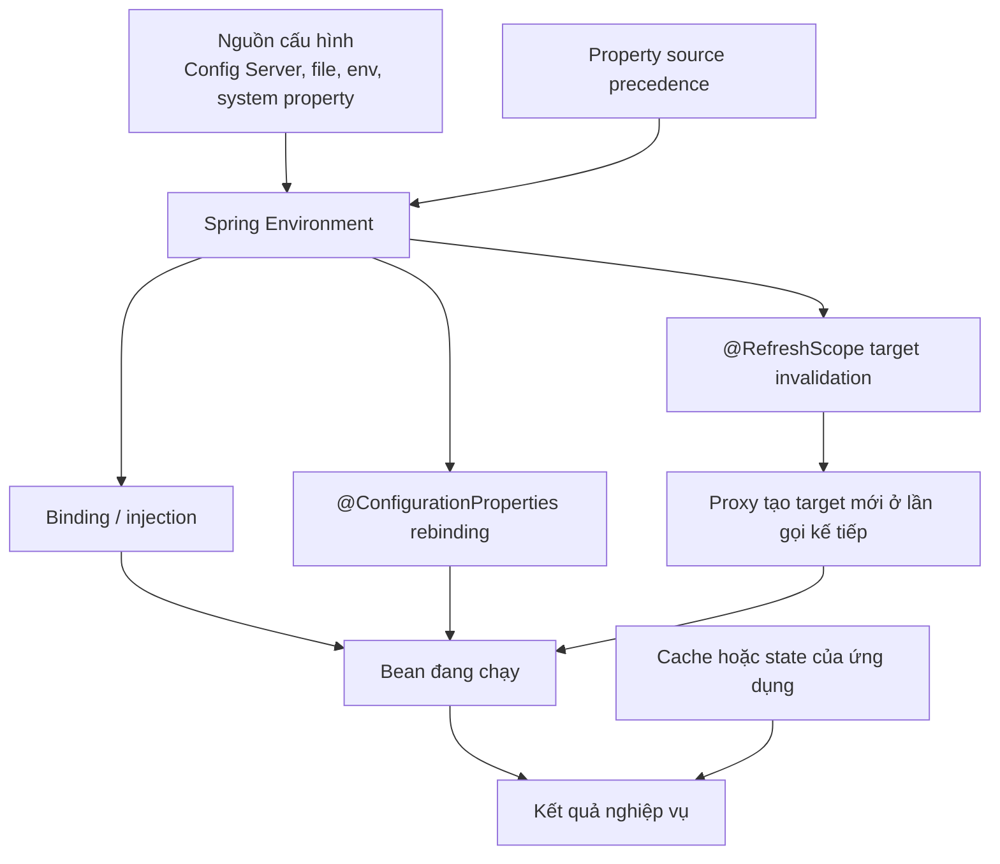
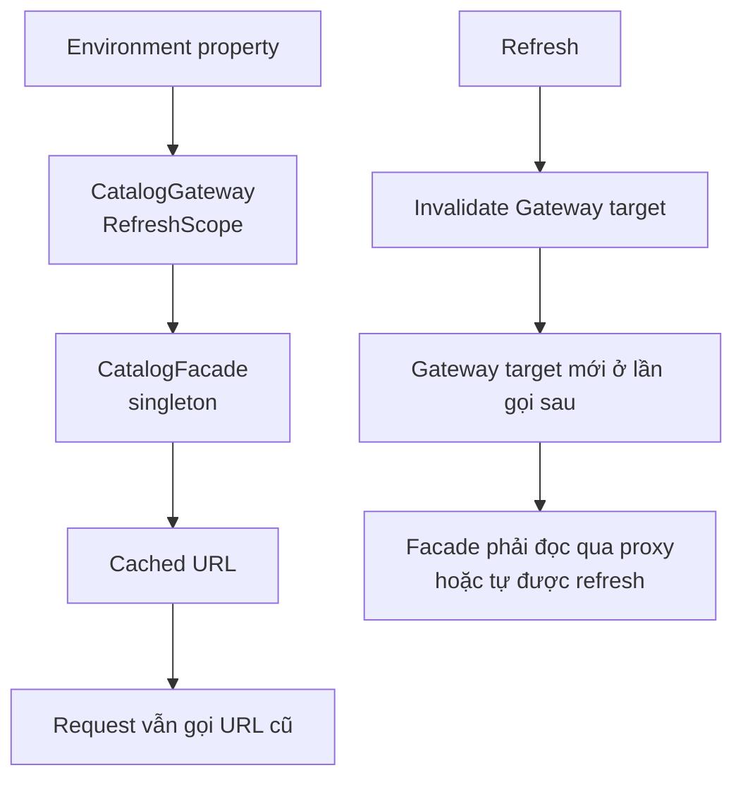

# Refresh trả thành công nhưng bean vẫn giữ giá trị cũ

Một lệnh POST /actuator/refresh có thể hoàn tất và trả về danh sách key thay đổi, nhưng ứng dụng vẫn tiếp tục dùng giá trị cũ. Điều này không nhất thiết có nghĩa endpoint bị lỗi. Spring Cloud xử lý nhiều lớp riêng biệt: cập nhật Environment, rebind ConfigurationProperties, invalidate target của RefreshScope và khởi tạo target mới khi có lần gọi tiếp theo.

Một singleton đã nhận giá trị qua @Value lúc khởi tạo có thể giữ nguyên giá trị đó. Một bean @RefreshScope có thể đã bị invalidate nhưng target mới chưa được tạo cho tới khi có lần truy cập tiếp theo. Một property mới có thể đã được tải nhưng vẫn bị property source có độ ưu tiên cao hơn ghi đè. Một replica có thể đã refresh trong khi replica khác chưa nhận sự kiện.

Bài học thuộc chương **Chẩn đoán sự cố** của module **SPRING_CLOUD_CORE**. Bài hướng dẫn xác định lớp nào chưa cập nhật, kiểm tra nguồn cấu hình và precedence, hiểu hành vi của bean, xử lý cache/dependency graph và xác minh refresh trong hệ thống nhiều instance.

## 1. Mục tiêu học tập

Sau bài học, người học có thể:

- Giải thích ý nghĩa của response từ /actuator/refresh.
- Phân biệt thay đổi trong Environment, rebinding properties và tạo lại bean.
- Kiểm tra property value và nguồn cung cấp bằng Actuator env.
- Kiểm tra giá trị đã bind vào bean bằng configprops.
- Nhận biết vì sao singleton sử dụng @Value giữ giá trị cũ.
- Phân biệt rebind ConfigurationProperties với refresh target của RefreshScope.
- Hiểu target cache của refresh scope được invalidate và khởi tạo lại theo cơ chế lazy.
- Phát hiện property precedence, constructor binding, bean không refreshable và dependency bị cache.
- Xử lý cache tùy chỉnh và trạng thái cần cập nhật qua EnvironmentChangeEvent.
- Đồng bộ refresh trên nhiều replica bằng Spring Cloud Bus hoặc cơ chế điều phối tương đương.
- Thiết kế kiểm thử và quy trình chẩn đoán có thể lặp lại.

## 2. Hiểu response của refresh endpoint

Khi được expose và bảo vệ đúng cách, endpoint được gọi bằng HTTP POST:

```bash
curl -i -X POST http://localhost:8080/actuator/refresh
```

Response thường là một danh sách các property key có giá trị thay đổi trong Environment sau quá trình refresh. Ví dụ:

```json
[
  "catalog.client.base-url",
  "catalog.client.timeout"
]
```

Danh sách này cho biết những key được phát hiện đã thay đổi. Nó **không phải danh sách bean đã được tạo lại**, cũng không chứng minh mọi consumer đã đọc giá trị mới.

Có ba tình huống cần phân biệt:

| Kết quả | Cách hiểu |
| --- | --- |
| Response có key thay đổi | Environment nhận thấy giá trị của các key đó đã đổi; tiếp tục kiểm tra binding và bean |
| Response là danh sách rỗng | Không phát hiện key thay đổi trong lần refresh đó; kiểm tra remote source, property precedence và giá trị trước/sau |
| HTTP request thất bại | Refresh flow có lỗi; đọc status, response body và log để tìm nguyên nhân |

Refresh scope hoạt động như một cache target. Khi refresh xảy ra, target hiện tại bị invalidate; bean target mới được tạo ở lần gọi tiếp theo qua proxy. Vì vậy, không nhất thiết thấy constructor hoặc factory method chạy ngay trong lúc endpoint trả response.

## 3. Ba lớp phải kiểm tra theo đúng thứ tự

Một giá trị cấu hình đi qua ba lớp chính:



Khi bean vẫn dùng giá trị cũ, hãy xác minh lần lượt:

1. Nguồn cấu hình đã trả về giá trị mới chưa?
2. Environment của process có đang resolve ra giá trị mới không?
3. Bean nhận cấu hình qua cơ chế nào: @Value, @ConfigurationProperties hay @RefreshScope?
4. Bean hoặc target có thực sự được rebind/tạo lại không?
5. Có cache, object phụ thuộc hoặc replica khác vẫn giữ state cũ không?

Không bắt đầu bằng cách restart toàn bộ hệ thống. Làm rõ lớp bị lỗi trước để tránh mất dấu nguyên nhân.

## 4. Xác minh giá trị trong Environment

Trước tiên, kiểm tra giá trị mà Spring đang resolve. Nếu Actuator endpoint env đã được expose và người vận hành có quyền truy cập:

```bash
curl -sS \
  http://localhost:8080/actuator/env/catalog.client.base-url
```

Kết quả có thể cung cấp giá trị đã được xử lý, tên property source và thông tin origin tùy phiên bản Spring Boot. Giá trị nhạy cảm có thể được che; không cố mở masking trong môi trường production chỉ để xem secret.

Kiểm tra cả tên key và cách viết. Ví dụ các key sau không phải lúc nào cũng tương đương trong mọi API truy cập:

- catalog.client.base-url
- catalog.client.baseUrl
- CATALOG_CLIENT_BASE_URL

Spring Boot hỗ trợ relaxed binding cho ConfigurationProperties, nhưng khi truy vấn Environment hoặc viết placeholder, hãy dùng đúng tên canonical được khuyến nghị: lowercase kebab case.

### 4.1. So sánh trước và sau refresh

Ghi lại giá trị và nguồn property trước khi refresh, sau đó gọi refresh và kiểm tra lại cùng key.

| Quan sát | Kết luận có thể |
| --- | --- |
| Environment vẫn là giá trị cũ | Remote source chưa cập nhật, Config Client chưa tải lại, hoặc source khác đang ghi đè |
| Environment là giá trị mới nhưng bean cũ | Lỗi nằm ở binding, bean lifecycle, proxy hoặc state cache |
| Environment có giá trị mới nhưng configprops cũ | Kiểm tra đăng ký/rebinding ConfigurationProperties và kiểu binding |
| configprops mới nhưng API vẫn trả dữ liệu cũ | Bean nghiệp vụ hoặc cache downstream đang giữ bản sao cũ |

Nếu env không được expose, có thể kiểm tra qua một diagnostic component có quyền đọc Environment và chỉ xuất key/metadata cần thiết. Không tạo endpoint debug công khai hoặc log toàn bộ Environment.

## 5. Kiểm tra Config Server đã trả đúng cấu hình chưa

Khi dùng Spring Cloud Config, xác minh request tương ứng với đúng:

- Application name, thường lấy từ spring.application.name.
- Active profile, ví dụ dev, staging hoặc prod.
- Config label, có thể là branch, tag hoặc commit ID.
- Property source có chứa key đang kiểm tra.

Config Server phục vụ cấu hình theo dạng:

```text
/{application}/{profile}/{label}
```

Ví dụ có thể kiểm tra trực tiếp endpoint Config Server trong môi trường nội bộ:

```bash
curl -sS \
  http://config-server:8888/orders-service/prod/main
```

Hãy xác nhận response có property mới trong đúng property source. Nếu Config Server trả giá trị cũ, kiểm tra repository backend, branch/label, commit đã được triển khai và cache của backend.

### 5.1. Phân biệt Config Data import và legacy bootstrap

Spring Cloud Config Client có hai cách cấu hình phổ biến:

**Config Data import:**

```yaml
spring:
  application:
    name: orders-service
  config:
    import: "configserver:http://config-server:8888"
```

**Legacy bootstrap:**

```yaml
spring:
  cloud:
    config:
      uri: http://config-server:8888
```

Cách thứ hai cần bật bootstrap context bằng property hoặc starter tương ứng. Không trộn hai cơ chế rồi giả định chúng có cùng thứ tự nạp và refresh.

Với Config Data import, URL ghi trong spring.config.import có độ ưu tiên cao hơn spring.cloud.config.uri. Hãy kiểm tra đúng URL client đang sử dụng và log request thực tế.

Khi khởi động với Config Data, client có thể gửi request cho profile default rồi gửi thêm request cho các active profile. Đây là hành vi bình thường của Config Data, không tự động có nghĩa refresh bị gọi lặp. Khi điều tra một lần refresh, phân biệt request khởi động với request phát sinh từ thao tác refresh.

## 6. Kiểm tra property source precedence

Một giá trị mới từ Config Server có thể đã được nạp nhưng không phải giá trị cuối cùng mà Environment trả về. Spring Boot áp dụng thứ tự ưu tiên giữa các property source; nguồn có ưu tiên cao hơn có thể ghi đè nguồn thấp hơn.

Các nguồn thường cần kiểm tra:

- Command-line arguments.
- Java system properties.
- OS environment variables.
- SPRING_APPLICATION_JSON.
- Config Data files và profile-specific files.
- Remote property sources từ Config Server.
- Property source được ứng dụng hoặc test thêm vào.

Ví dụ Config Server trả:

```yaml
catalog:
  client:
    timeout: 2500
```

Nhưng container có environment variable:

```bash
CATALOG_CLIENT_TIMEOUT=5000
```

Nếu source chứa biến môi trường có precedence cao hơn remote value trong cấu hình hiện tại, ứng dụng vẫn resolve ra 5000. Refresh endpoint có thể chạy bình thường mà kết quả cuối cùng không đổi.

### 6.1. Remote property có thể được phép override hay không?

Trong legacy bootstrap mode, remote property source mặc định có thể được bảo vệ khỏi override cục bộ. Muốn cho local source ghi đè, Config Server cần cấp quyền qua spring.cloud.config.allowOverride=true trong cấu hình remote. Các tùy chọn overrideNone và overrideSystemProperties tiếp tục điều chỉnh vị trí ưu tiên.

Đừng tự thêm các property này ở client rồi giả định chúng thay đổi được quyền override của remote source. Hãy kiểm tra đúng chế độ Config Client và thứ tự property source thực tế trong /actuator/env.

## 7. Singleton dùng @Value thường giữ giá trị cũ

@Value thường được resolve khi bean được tạo. Ví dụ:

```java
@Component
public class CatalogGateway {

    private final String baseUrl;

    public CatalogGateway(
            @Value("${catalog.client.base-url}") String baseUrl) {
        this.baseUrl = baseUrl;
    }

    public String baseUrl() {
        return baseUrl;
    }
}
```

Nếu CatalogGateway là singleton thông thường, field baseUrl không tự thay đổi chỉ vì Environment đã đổi. Spring không chạy lại constructor của singleton đó trong mỗi lần refresh.

Có hai hướng xử lý phổ biến:

- Dùng ConfigurationProperties mutable nếu cần cập nhật cấu hình trên bean được rebind.
- Đặt bean giữ giá trị lúc khởi tạo vào RefreshScope để target được tạo lại sau refresh.

Ví dụ dùng refresh scope:

```java
@Component
@RefreshScope
public class CatalogGateway {

    private final String baseUrl;

    public CatalogGateway(
            CatalogClientProperties properties) {
        this.baseUrl = properties.getBaseUrl().toString();
    }

    public String baseUrl() {
        return baseUrl;
    }
}
```

Khi target bị invalidate, lần gọi tiếp theo qua proxy sẽ tạo target mới và đọc giá trị hiện tại từ properties bean đã được rebind.

Không cần gắn RefreshScope cho mọi singleton. Chỉ áp dụng cho bean có state cần được tạo lại, vì target mới cũng có thể mở kết nối, cấp phát cache hoặc thực hiện logic khởi tạo tốn tài nguyên.

## 8. Kiểm tra ConfigurationProperties đã rebind chưa

Spring Cloud lắng nghe EnvironmentChangeEvent và rebind các bean ConfigurationProperties phù hợp. Cách này khác với việc tạo một bean target mới.

Ví dụ class mutable:

```java
import org.springframework.boot.context.properties.ConfigurationProperties;

import java.net.URI;

@ConfigurationProperties(prefix = "catalog.client")
public class CatalogClientProperties {

    private URI baseUrl;
    private int timeout = 2000;

    public URI getBaseUrl() {
        return baseUrl;
    }

    public void setBaseUrl(URI baseUrl) {
        this.baseUrl = baseUrl;
    }

    public int getTimeout() {
        return timeout;
    }

    public void setTimeout(int timeout) {
        this.timeout = timeout;
    }
}
```

Đăng ký properties class bằng ConfigurationPropertiesScan hoặc EnableConfigurationProperties phù hợp với cấu trúc ứng dụng.

Sau refresh, kiểm tra /actuator/configprops để xác minh giá trị đã bind. Nếu Environment mới nhưng object properties cũ, kiểm tra:

- Class đã được đăng ký như ConfigurationProperties bean chưa?
- Prefix và tên property có đúng không?
- Setter hoặc mutable field có cho phép binding không?
- Có custom binder, converter hoặc nested object nào làm binding thất bại không?
- Bean có bị loại khỏi rebinding bởi cấu hình refresh không?

### 8.1. Constructor binding và Java Record

Các object dùng constructor binding, bao gồm Java Record được đánh dấu ConfigurationProperties, không thể refresh theo cơ chế rebinding thông thường của Spring Cloud.

Ví dụ kiểu sau không phù hợp nếu cần thay đổi giá trị tại runtime:

```java
@ConfigurationProperties(prefix = "catalog.client")
public record CatalogClientProperties(
        URI baseUrl,
        Duration timeout) {
}
```

Nếu cần runtime refresh, cân nhắc một class mutable có no-argument constructor và setter, hoặc đặt một bean phù hợp vào RefreshScope để tạo lại object khi refresh.

### 8.2. Rebinding không thay thế object

Rebinding ConfigurationProperties thường cập nhật field trên cùng một instance. Nó không nhất thiết tạo object mới.

Spring Cloud reset các property về class-level defaults trước khi rebind trong trường hợp class có no-argument constructor là constructor duy nhất; sau đó binding áp dụng giá trị đang có trong Environment. Có các trường hợp constructor và object graph đặc biệt khiến reset không diễn ra.

Việc cập nhật field tại chỗ cũng có nghĩa một thread khác có thể đọc object trong lúc rebinding đang diễn ra. Spring Cloud serialize các lần rebind của cùng bean, nhưng điều đó không làm object an toàn tuyệt đối với các reader chạy đồng thời. Nếu ứng dụng cần một snapshot cấu hình nhất quán trong suốt một thao tác, cân nhắc RefreshScope thay vì đọc một object mutable đang được cập nhật.

## 9. Hiểu target cache của RefreshScope

RefreshScope không tạo bean mới ngay khi endpoint trả response. Bean được expose qua scoped proxy và target được khởi tạo khi có method invocation.

Quy trình:

1. Consumer giữ tham chiếu tới proxy.
2. Proxy chuyển method call tới target hiện tại.
3. Refresh flow invalidate target cache.
4. Target cũ không còn được dùng cho các lần gọi mới qua proxy.
5. Lần gọi tiếp theo tạo target mới từ Environment hiện tại.

RefreshScope.refreshAll() xóa target cache của các bean trong scope. Có thể refresh một bean cụ thể bằng refresh(String beanName) khi gọi API tương ứng.

Điều này giải thích tình huống endpoint trả về thành công nhưng constructor của bean chưa chạy lại: target mới chỉ được tạo khi bean được sử dụng.

### 9.1. Kiểm tra proxy có được sử dụng không

Consumer cần gọi qua bean reference do Spring inject. Tránh:

- Tự tạo instance bằng new CatalogGateway(...).
- Lưu một giá trị scalar từ bean vào field khác tại startup rồi tiếp tục dùng field đó.
- Copy cấu hình vào static field hoặc singleton cache không có cơ chế cập nhật.
- Lưu một object phụ thuộc vào target cũ và tiếp tục dùng object đó sau refresh.

Một bean được đánh dấu RefreshScope không thể tự cập nhật những bản sao dữ liệu đã được các bean khác lưu trước đó.

### 9.2. RefreshScope trên Configuration không bao phủ mọi Bean

Đặt RefreshScope trên một class Configuration không có nghĩa tất cả các bean được khai báo bằng Bean bên trong đều tự động thuộc refresh scope.

Nếu một service phụ thuộc vào bean được tạo từ configuration đó, service vẫn có thể giữ dependency cũ. Khi cần các dependency được tạo lại cùng nhau, phải thiết kế scope cho chính bean phụ thuộc hoặc đặt scope đúng tại từng bean cần refresh.

## 10. Kiểm tra bean có bị loại khỏi refresh scope không

Spring Cloud có các property điều khiển bean không được refresh và bean cần bổ sung vào refresh scope:

```yaml
spring:
  cloud:
    refresh:
      never-refreshable: com.example.LegacyClient
      extra-refreshable: com.example.ImmutableClient
```

Tên class trong ví dụ là minh họa. Hãy dùng đúng tên bean hoặc class được tài liệu của version đang dùng hỗ trợ.

Một trường hợp quan trọng là HikariDataSource: đây là loại mặc định nằm trong nhóm không refreshable của Spring Cloud. Nếu DataSource đang dùng Hikari, đừng kết luận refresh lỗi chỉ vì pool không được tạo lại. Cần chọn chiến lược thay đổi datasource phù hợp, ví dụ khởi tạo lại một abstraction/client ở tầng phù hợp hoặc dùng implementation được hỗ trợ.

Không đưa mọi class vào extra-refreshable. Việc tạo lại một client có thể làm mất connection đang được sử dụng, gây gián đoạn request hoặc tạo nhiều kết nối đồng thời.

## 11. Property bị xóa không tương đương với property đổi giá trị

Một tình huống dễ gây nhầm lẫn là xóa key khỏi Config Server rồi gọi refresh.

Spring Cloud ghi rõ rằng việc xóa một configuration value rồi refresh không tự động cập nhật sự hiện diện của property theo cách mà nhiều ứng dụng mong đợi. Nếu nghiệp vụ cần thay đổi trạng thái, nên dùng một giá trị tường minh.

Ví dụ thay vì xóa:

```yaml
feature:
  catalog:
    enabled: false
```

Hãy thiết kế default và trạng thái absence có chủ đích. Nếu ứng dụng cần nhận biết key không tồn tại, kiểm tra trực tiếp Environment.containsProperty() hoặc dùng một property trạng thái rõ ràng, và viết test cho trường hợp key bị thiếu.

## 12. Bean đã được refresh nhưng cache downstream vẫn cũ

Một bean có thể nhận cấu hình mới nhưng kết quả nghiệp vụ vẫn cũ vì dữ liệu đã được copy hoặc tính toán trước đó.

Ví dụ:

```java
@Service
public class CatalogFacade {

    private final CatalogGateway gateway;
    private final String cachedBaseUrl;

    public CatalogFacade(CatalogGateway gateway) {
        this.gateway = gateway;
        this.cachedBaseUrl = gateway.baseUrl();
    }

    public String endpoint() {
        return cachedBaseUrl;
    }
}
```

Ngay cả khi CatalogGateway được refresh đúng, CatalogFacade vẫn giữ giá trị cũ trong cachedBaseUrl.

Các dạng cache cần rà soát:

- Static field hoặc singleton field lưu property value.
- Cache URL, header, timeout hoặc client options.
- Object DTO được tạo từ cấu hình tại startup.
- Client builder đã tạo một HTTP client bất biến.
- Connection pool hoặc SDK client giữ cấu hình riêng.
- Cache nghiệp vụ không được invalidate khi Environment đổi.

Cách sửa là đọc qua proxy tại thời điểm sử dụng, tạo lại component phụ thuộc bằng refresh scope, hoặc lắng nghe sự kiện thay đổi để cập nhật cache có kiểm soát.

## 13. Cập nhật cache tùy chỉnh qua EnvironmentChangeEvent

Nếu ứng dụng giữ state riêng cần thay đổi khi property đổi, có thể lắng nghe EnvironmentChangeEvent:

```java
import org.springframework.cloud.context.environment.EnvironmentChangeEvent;
import org.springframework.context.event.EventListener;
import org.springframework.core.env.Environment;
import org.springframework.stereotype.Component;

@Component
public class CatalogCacheRefreshListener {

    private final Environment environment;
    private final CatalogCache catalogCache;

    public CatalogCacheRefreshListener(
            Environment environment,
            CatalogCache catalogCache) {
        this.environment = environment;
        this.catalogCache = catalogCache;
    }

    @EventListener
    public void onEnvironmentChange(EnvironmentChangeEvent event) {
        if (event.getKeys().contains("catalog.cache.ttl")) {
            int ttl = environment.getProperty(
                "catalog.cache.ttl",
                Integer.class,
                60
            );
            catalogCache.updateTtl(ttl);
        }
    }
}
```

Ví dụ này chỉ xử lý một key cụ thể. Trong ứng dụng thực tế, cần:

- Chỉ cập nhật khi key liên quan thay đổi.
- Validate giá trị mới trước khi áp dụng.
- Thực hiện update an toàn khi có request đồng thời.
- Không ghi secret hoặc giá trị nhạy cảm vào log.
- Có cơ chế rollback hoặc giữ cấu hình cũ nếu update thất bại.

Không phát một event giả rồi kết luận Config Client đã tải cấu hình mới. Event listener chỉ xử lý sự kiện; nguồn property và quy trình refresh phải được kiểm tra riêng.

## 14. Kiểm tra dependency graph và thứ tự tạo lại

Nếu bean A phụ thuộc bean B, refresh riêng B không đảm bảo A sẽ tính lại state đã copy từ B.

Ví dụ:



Khi điều tra, liệt kê bean trực tiếp nhận property và các bean downstream:

| Thành phần | Nguồn giá trị | Cần kiểm tra |
| --- | --- | --- |
| Properties bean | Environment binding | Prefix, setter, constructor binding, configprops |
| Gateway/client | Constructor hoặc factory | Có RefreshScope không, target có tạo lại không |
| Facade/service | Dependency injection | Có copy property vào field/cache không |
| Cache | Giá trị đã tính | Có listener hoặc invalidate logic không |
| HTTP client/pool | Client builder | Có giữ base URL/timeout cũ không |

Nếu bean B được refresh nhưng bean A cần tái khởi tạo, có thể đặt cả A vào refresh scope hoặc thay đổi A để truy vấn B qua proxy khi cần. Chọn theo lifecycle và chi phí khởi tạo.

## 15. Một lần refresh không tự cập nhật mọi replica

Mỗi instance Spring có ApplicationContext và bean state riêng. Gọi POST /actuator/refresh vào một Pod chỉ refresh context của Pod đó.

Spring Cloud Config Client không tự polling Config Server để phát hiện thay đổi theo mặc định. Với hệ thống nhiều replica, cần broadcast sự kiện hoặc gọi refresh tới từng instance theo cơ chế vận hành.

Spring Cloud Bus cung cấp cơ chế broadcast refresh event. Khi đã cấu hình Bus, có thể dùng endpoint bus refresh tương ứng, thường là /actuator/busrefresh, để gửi sự kiện tới các instance đang tham gia Bus.

Khi điều tra sự cố cluster:

1. Ghi lại Pod/instance ID đã nhận request refresh.
2. Kiểm tra Config Server trả đúng application/profile/label.
3. Kiểm tra event có được broadcast tới các replica không.
4. Đọc Environment và configprops trên từng replica.
5. Kiểm tra target bean sau lần gọi đầu tiên trên từng replica.
6. So sánh config revision/version nếu hệ thống có gắn metadata.

Đừng kiểm tra một Pod rồi kết luận toàn bộ service đã dùng cấu hình mới.

## 16. Dùng Actuator để khoanh vùng

Trong môi trường chẩn đoán có kiểm soát, các endpoint hữu ích gồm:

| Endpoint | Mục đích |
| --- | --- |
| /actuator/refresh | Thực hiện context refresh |
| /actuator/env/{property} | Kiểm tra giá trị và property source |
| /actuator/configprops | Kiểm tra giá trị đã bind vào ConfigurationProperties |
| /actuator/health | Xem health indicator, bao gồm refresh scope nếu được bật |
| /actuator/loggers | Kiểm tra log level khi cần tăng log tạm thời |

Ví dụ expose endpoint cần thiết:

```yaml
management:
  endpoints:
    web:
      exposure:
        include: "health,env,configprops,refresh"
  endpoint:
    health:
      show-details: when-authorized
```

Các endpoint env và configprops có thể tiết lộ cấu hình nội bộ. Chỉ expose trên management network được bảo vệ, yêu cầu xác thực và giới hạn quyền truy cập. Sau khi điều tra, thu hẹp exposure về cấu hình vận hành bình thường.

### 16.1. RefreshScopeHealthIndicator

Spring Cloud cung cấp RefreshScopeHealthIndicator. Nếu bean không thể re-initialize hoặc rebind sau context refresh, indicator có thể chuyển sang DOWN và cung cấp exception details.

Khi health refresh scope là DOWN:

- Tìm bean nào không tạo target mới được.
- Đọc exception gốc, không chỉ nhìn trạng thái tổng hợp.
- Kiểm tra property bắt buộc, constructor, factory method và dependency ngoài.
- Xác định bean lỗi thuộc refresh scope hay là ConfigurationProperties bean đang rebind.

Nếu health indicator là UP nhưng kết quả nghiệp vụ cũ, vẫn cần kiểm tra cache downstream và singleton không refreshable. Health indicator không chứng minh mọi giá trị trong ứng dụng đã được thay thế.

## 17. Bật log để thấy refresh flow

Có thể tăng log level tạm thời cho các package liên quan:

```yaml
logging:
  level:
    org.springframework.cloud.context.refresh: DEBUG
    org.springframework.cloud.context.scope.refresh: DEBUG
    org.springframework.cloud.config.client: DEBUG
```

Tùy version và Config Client mode, package logger cụ thể có thể khác. Hãy xác nhận logger có phát thông tin trong phiên bản đang chạy.

Ghi nhận các mốc:

- Thời điểm bắt đầu request refresh.
- Các property source được tải hoặc cập nhật.
- Danh sách key thay đổi.
- EnvironmentChangeEvent được phát.
- ConfigurationProperties được rebind.
- Refresh scope target cache được invalidate.
- Target mới được tạo ở lần gọi kế tiếp.
- Bean nào lỗi trong quá trình rebind hoặc tạo target.

Không log giá trị secret, password, token hoặc toàn bộ Environment. Khi cần correlation, ghi instance ID, application name, profile, config label/revision và operation ID.

## 18. Kiểm thử refresh theo từng lớp

Một test lớn có thể che khuất lớp bị lỗi. Nên tách test theo câu hỏi.

### 18.1. Test Environment value

Cấp một property source có giá trị cũ, thay bằng giá trị mới và xác nhận Environment resolve đúng giá trị mới. Test này không chứng minh bean đã được cập nhật.

### 18.2. Test ConfigurationProperties rebinding

Khởi tạo context có mutable ConfigurationProperties bean. Thay giá trị trong Environment, chạy đúng refresh flow và xác nhận object được rebind. Kiểm tra thêm trường hợp nested property, default và validation.

Không dùng Java Record hoặc constructor-bound properties làm ví dụ cho test rebind, vì chúng không được refresh theo cơ chế thông thường.

### 18.3. Test RefreshScope target recreation

Có thể kiểm tra target được tạo lại bằng cách thay property trong Environment rồi invalidate target của bean:

```java
@Test
void refreshScopeCreatesTargetWithLatestEnvironmentValue() {
    assertThat(catalogGateway.baseUrl())
        .isEqualTo("https://catalog-old.internal");

    Map<String, Object> values = new HashMap<>();
    values.put(
        "catalog.client.base-url",
        "https://catalog-new.internal"
    );

    environment.getPropertySources().addFirst(
        new MapPropertySource("testOverride", values)
    );

    assertThat(refreshScope.refresh("catalogGateway")).isTrue();

    assertThat(catalogGateway.baseUrl())
        .isEqualTo("https://catalog-new.internal");
}
```

Ví dụ cần có bean catalogGateway được đăng ký với RefreshScope, cùng các dependency test phù hợp như ConfigurableEnvironment, RefreshScope và MapPropertySource. Nó kiểm tra target recreation sau khi Environment đã có giá trị mới; không kiểm tra Config Client có tải được remote property hay không.

Trong test này, bean catalogGateway nên đọc property từ Environment hoặc dùng @Value để lấy giá trị lúc target được tạo. Nếu constructor nhận một ConfigurationProperties bean, test còn phải thực hiện rebinding bean đó trước khi invalidate target; chỉ thay Environment không tự rebind object properties.

### 18.4. Integration test với Config Server

Để kiểm tra toàn bộ đường đi:

1. Dựng Config Server hoặc HTTP fixture có response xác định.
2. Cấu hình application name, profile và label tường minh.
3. Khởi động service với property A.
4. Xác nhận Environment và bean trả về A.
5. Thay response remote thành property B.
6. Gọi refresh qua đúng cơ chế Config Client đang sử dụng.
7. Xác nhận changed keys chứa property liên quan.
8. Xác nhận Environment và ConfigurationProperties trả về B.
9. Gọi bean refresh-scoped và xác nhận target mới trả về B.
10. Kiểm tra consumer/cache downstream không giữ A.

Nếu test chỉ thay Environment trực tiếp, không ghi nhận đó là test Config Server. Nếu test chỉ mock ContextRefresher, không kết luận remote property đã được tải lại.

## 19. Bảng triệu chứng và nguyên nhân thường gặp

| Triệu chứng | Nguyên nhân có thể | Cách xử lý |
| --- | --- | --- |
| Refresh trả danh sách rỗng | Không có property value thay đổi hoặc remote source chưa đổi | Kiểm tra Config Server response, app/profile/label và Environment |
| Environment vẫn là giá trị cũ | Config Client chưa tải source mới hoặc source ưu tiên cao ghi đè | Kiểm tra request logs và /actuator/env/{property} |
| Environment mới nhưng @Value vẫn cũ | Bean là singleton thông thường | Dùng mutable ConfigurationProperties hoặc RefreshScope |
| configprops vẫn cũ | Bean chưa được đăng ký/rebind hoặc dùng constructor binding | Kiểm tra scan, prefix, setter và loại binding |
| RefreshScope bean vẫn cũ | Target chưa bị invalidate, bean không nằm trong scope hoặc caller dùng bản sao cũ | Kiểm tra proxy, scope, bean name và cache downstream |
| Refresh endpoint trả thành công nhưng constructor chưa chạy | Target mới được tạo lazy ở lần gọi tiếp theo | Gọi method qua proxy và kiểm tra log khởi tạo target |
| Bean trong Configuration không đổi | RefreshScope trên configuration không tự bao phủ mọi Bean | Đặt scope đúng cho bean và dependency downstream |
| HikariDataSource không thay đổi | Hikari nằm trong never-refreshable mặc định | Thiết kế datasource/pool lifecycle phù hợp |
| Xóa key nhưng bean vẫn có giá trị | Removal không được phản ánh như một giá trị mới trong refresh flow | Dùng default hoặc trạng thái tường minh |
| RefreshScopeHealthIndicator DOWN | Bean không rebind hoặc target không khởi tạo được | Đọc exception details, property và dependency |
| Một Pod mới, Pod khác cũ | Chỉ một instance được refresh hoặc Bus không broadcast | Gửi refresh tới mọi replica và kiểm tra từng instance |
| Bean mới nhưng API vẫn trả dữ liệu cũ | Cache hoặc derived state ở downstream | Invalidate/recompute cache hoặc bỏ việc copy property lúc startup |

## 20. Quy trình điều tra thực tế

Khi nhận sự cố “refresh thành công nhưng bean vẫn giữ giá trị cũ”, thực hiện theo thứ tự:

1. Ghi nhận instance ID, thời điểm, endpoint và response refresh.
2. Kiểm tra response có key thay đổi hay danh sách rỗng.
3. Truy vấn Config Server đúng application/profile/label để xác nhận giá trị mới.
4. Kiểm tra Config Client logs và cơ chế import đang dùng.
5. Đọc /actuator/env/{property} để xác định giá trị cuối cùng và property source thắng precedence.
6. Đọc /actuator/configprops nếu bean dùng ConfigurationProperties.
7. Xác định bean nhận giá trị qua @Value, ConfigurationProperties hay RefreshScope.
8. Nếu dùng @Value, kiểm tra bean có phải singleton thông thường không.
9. Nếu dùng RefreshScope, kiểm tra proxy, target cache, bean name và lần gọi tạo target mới.
10. Rà soát dependency downstream, static field và cache đã copy giá trị cũ.
11. Kiểm tra never-refreshable, constructor binding và trường hợp property bị xóa.
12. Đọc RefreshScopeHealthIndicator và exception nếu có.
13. Lặp lại kiểm tra trên từng replica hoặc broadcast refresh qua Spring Cloud Bus.
14. Chỉ kết luận hoàn tất khi API nghiệp vụ thực sự dùng giá trị mới.

## 21. Bài tập vận dụng

Một service orders-service lấy cấu hình từ Config Server:

```yaml
catalog:
  client:
    base-url: https://catalog-v1.internal
    timeout: 2000
```

Service có ba thành phần:

- CatalogClientProperties là ConfigurationProperties mutable.
- CatalogGateway inject base-url bằng Value và được đánh dấu RefreshScope.
- OrderFacade là singleton, đọc gateway.baseUrl() trong constructor rồi lưu vào field cachedBaseUrl.

Sau khi thay cấu hình trên Config Server thành catalog-v2.internal và gọi POST /actuator/refresh:

- Response chứa catalog.client.base-url.
- Environment đã có URL mới.
- configprops hiển thị URL mới.
- CatalogGateway tạo target mới khi được gọi.
- API của OrderFacade vẫn trả URL cũ.

Hãy thực hiện:

1. Vẽ dependency graph của ba thành phần.
2. Xác định vì sao Environment và properties đã mới nhưng OrderFacade vẫn cũ.
3. Sửa OrderFacade để truy cập gateway proxy khi cần thay vì lưu scalar value lúc constructor.
4. Viết test xác nhận URL đổi từ v1 sang v2 sau refresh.
5. Thêm một test cho singleton dùng Value không có RefreshScope.
6. Thêm test cho constructor-bound record và giải thích vì sao không rebind.
7. Kiểm tra property precedence bằng hai nguồn cùng khai báo một key.
8. Thử refresh khi key bị xóa và so sánh với trường hợp đặt giá trị trạng thái tường minh.
9. Chạy test với hai replica giả lập và xác nhận mỗi replica nhận refresh.
10. Viết runbook gồm endpoint, log và metric cần xem khi sự cố xảy ra.

**Tiêu chí hoàn thành:** chỉ ra được chính xác lớp giữ giá trị cũ; chứng minh Environment và bean binding đã nhận giá trị mới; xác nhận target refresh scope được tạo lại; và API nghiệp vụ cuối cùng trả giá trị đúng trên mọi replica.

## 22. Ghi nhớ

- HTTP success từ /actuator/refresh không chứng minh mọi bean đã được tạo lại.
- Response refresh liệt kê property key thay đổi, không liệt kê bean đã refresh.
- Kiểm tra Environment trước, rồi configprops, rồi bean và cache downstream.
- Value được inject lúc tạo bean; singleton thông thường giữ giá trị cũ.
- Mutable ConfigurationProperties có thể được rebind; constructor-bound objects và Java Records không refresh theo cơ chế thông thường.
- Rebinding ConfigurationProperties cập nhật object hiện có; không nhất thiết thay instance.
- RefreshScope dùng proxy và target cache; target mới được tạo ở lần gọi tiếp theo.
- RefreshScope trên Configuration không tự đưa mọi Bean vào scope.
- HikariDataSource mặc định nằm trong nhóm never-refreshable.
- Property source có precedence cao hơn có thể che giá trị từ Config Server.
- Xóa key không tương đương với thay đổi giá trị; dùng trạng thái tường minh khi cần.
- Cache, derived fields và singleton downstream có thể giữ dữ liệu cũ.
- Config Client không tự polling theo mặc định; nhiều replica cần cơ chế broadcast hoặc refresh riêng.
- RefreshScopeHealthIndicator giúp phát hiện lỗi rebind/reinitialize, nhưng không thay thế kiểm tra dữ liệu nghiệp vụ.

## 23. Tài liệu tham khảo

- [Spring Cloud Commons — Application Context Services](https://docs.spring.io/spring-cloud-commons/reference/spring-cloud-commons/application-context-services.html): EnvironmentChangeEvent, ConfigurationProperties rebinding, RefreshScope, RefreshScopeHealthIndicator và endpoint refresh.
- [Spring Cloud Config Client](https://docs.spring.io/spring-cloud-config/reference/client.html): Config Data import, legacy bootstrap, application/profile/label và cơ chế kết nối Config Server.
- [Spring Cloud Commons — Configuration Properties](https://docs.spring.io/spring-cloud-commons/reference/configprops.html): never-refreshable, extra-refreshable và các thuộc tính refresh.
- [Spring Boot — Externalized Configuration](https://docs.spring.io/spring-boot/reference/features/external-config.html): PropertySource precedence, Environment, Value và ConfigurationProperties.
- [Spring Framework — Proxying Mechanisms](https://docs.spring.io/spring-framework/reference/core/aop/proxying.html): JDK proxy, CGLIB và giới hạn proxy.
- [Spring Cloud Bus](https://docs.spring.io/spring-cloud-bus/reference/): broadcast EnvironmentChangeEvent tới nhiều instance.

