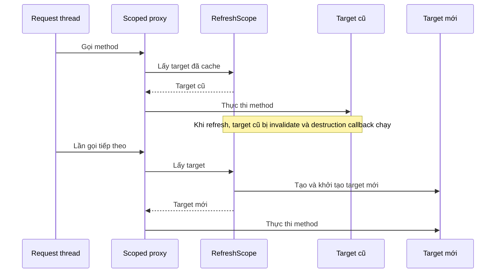

# Refresh làm mất tài nguyên hoặc gây lỗi xử lý đồng thời

## 1. Dấu hiệu và nguyên nhân thường gặp

Sau khi gọi `/actuator/refresh`, một ứng dụng Spring Cloud có thể xuất hiện lỗi như:

- Request đang chạy đột nhiên nhận `ClosedChannelException`, `Connection is closed` hoặc `Pool is closed`.
- Một số request dùng cấu hình mới, số khác vẫn dùng giá trị cũ.
- Latency tăng mạnh đúng lúc refresh; thread xử lý request chờ tại scoped proxy.
- Một tác vụ nền bắt đầu trước refresh nhưng thất bại khi tiếp tục dùng client hoặc stream.
- Health của refresh scope chuyển sang `DOWN` vì bean không thể khởi tạo lại.
- Lỗi chỉ xuất hiện khi có nhiều request đồng thời; chạy test tuần tự lại không tái hiện.

Các hiện tượng này thường xuất phát từ việc refresh thay target bean và chạy destruction callback, trong khi ứng dụng còn công việc phụ thuộc vào tài nguyên do target cũ sở hữu. Một nhóm lỗi khác xuất phát từ việc rebind trực tiếp một bean cấu hình mutable trong khi thread khác đang đọc các field của nó.

Bài học thuộc chương **Chẩn đoán sự cố** của module **SPRING_CLOUD_CORE**. Module giúp người học hiểu Spring Cloud Commons, Spring Cloud Context, cấu hình bên ngoài, refresh scope, discovery, service registry, giao tiếp dịch vụ và cách kiểm thử/vận hành các abstraction chung.

Sau bài này, người học có thể:

- Mô tả vòng đời target của `@RefreshScope` và thời điểm destruction callback được gọi.
- Phân biệt đồng bộ giữa method invocation qua scoped proxy với công việc bất đồng bộ sống lâu hơn method.
- Nhận diện race condition khi `@ConfigurationProperties` bị rebind tại chỗ.
- Chẩn đoán lỗi do resource bị đóng, target khởi tạo lại thất bại hoặc refresh bị chặn bởi request dài.
- Thiết kế cách thay thế cấu hình và tài nguyên có kiểm soát.
- Viết integration test tái hiện refresh khi có request đang chạy.

## 2. RefreshScope thực hiện điều gì?

### 2.1. Target được cache sau scoped proxy

Bean đánh dấu `@RefreshScope` được truy cập thông qua scoped proxy. Proxy giữ tham chiếu đến target do RefreshScope quản lý. Target thường được tạo khi bean được sử dụng lần đầu và được cache theo tên bean.

Khi gọi `RefreshScope.refresh(name)` hoặc `refreshAll()`, Spring Cloud xóa target khỏi scope cache và chạy các lifecycle destruction callback đã đăng ký. Lần gọi method tiếp theo qua proxy sẽ tạo target mới từ bean definition ban đầu. Các property placeholder và expression được đánh giá lại khi target mới được tạo.



Điều này có nghĩa refresh là thao tác thay thế vòng đời của bean. Nó không chỉ thay giá trị một field trong object đang chạy.

### 2.2. Destruction callback có thể đóng tài nguyên

Nếu target triển khai `DisposableBean`, `AutoCloseable`, có method `@PreDestroy` hoặc đăng ký destruction callback, callback đó được gọi khi target bị refresh. Các tài nguyên thường cần đóng gồm:

- HTTP client và connection pool.
- Socket, channel hoặc session.
- File handle, stream và watcher.
- Scheduler, executor hoặc thread do bean sở hữu.
- Consumer hoặc listener đã đăng ký với broker.
- Native resource hoặc thư viện bên thứ ba có lifecycle riêng.

Đóng tài nguyên là việc cần thiết để tránh rò rỉ. Vấn đề xuất hiện khi một phần công việc vẫn còn dùng tài nguyên đó sau thời điểm callback đóng chạy.

### 2.3. Scoped proxy có read/write lock

Trong Spring Cloud Context hiện hành, `GenericScope` dùng lock theo từng bean cho lời gọi qua scoped proxy:

- Method invocation thông thường lấy read lock. Nhiều request có thể cùng giữ read lock và gọi bean đồng thời.
- Thao tác destroy/refresh lấy write lock. Nó phải chờ các method invocation đang giữ read lock kết thúc.
- Trong lúc write lock được giữ, lời gọi method mới tới cùng bean phải chờ.

Cơ chế này ngăn target bị hủy giữa một method invocation đồng bộ đi qua proxy. Nó không làm cho toàn bộ ApplicationContext trở thành một giao dịch refresh nguyên tử, và không tự bảo vệ công việc tiếp tục sau khi method đã trả về.

Do đó, khi thấy request chờ ở `GenericScope.LockedScopedProxyFactoryBean.invoke`, hãy kiểm tra refresh đang chờ method dài kết thúc hay nhiều request đang xếp hàng sau write lock. Đây có thể là độ trễ do đồng bộ hóa, không nhất thiết là deadlock.

Cách triển khai lock có thể thay đổi theo phiên bản Spring Cloud và ScopeCache được cấu hình. Hãy xác minh release train đang chạy trước khi dựa vào chi tiết nội bộ này.

## 3. Vì sao vẫn có thể mất tài nguyên khi có lock?

### 3.1. Method trả về trước khi công việc hoàn tất

Read lock chỉ bao quanh thời gian method được gọi qua proxy. Nếu method khởi chạy công việc nền rồi trả về ngay, lock được nhả trong khi công việc vẫn dùng target cũ.

Ví dụ nguy hiểm:

```java
import java.util.concurrent.CompletableFuture;

import org.springframework.cloud.context.config.annotation.RefreshScope;
import org.springframework.stereotype.Component;

@RefreshScope
@Component
class ReportClient {

    private final RemoteSession session;

    ReportClient(RemoteSession session) {
        this.session = session;
    }

    CompletableFuture<Report> loadReport(String id) {
        return CompletableFuture.supplyAsync(
                () -> session.fetchReport(id)
        );
    }

    @PreDestroy
    void close() {
        session.close();
    }
}
```

Method `loadReport` trả về `CompletableFuture` trước khi `fetchReport` kết thúc. Scoped proxy nhả read lock khi method trả về. Nếu refresh diễn ra sau đó, destruction callback có thể đóng `session` trong lúc tác vụ nền vẫn đang sử dụng nó.

Các kiểu trả về cần đặc biệt xem xét:

- `CompletableFuture` hoặc `CompletionStage`.
- `Mono` hoặc `Flux` mà subscription và việc đọc dữ liệu diễn ra sau khi method trả về.
- `InputStream`, `Reader`, `Iterator` hoặc cursor được tiêu thụ ở tầng gọi.
- Callback, listener, scheduled task hoặc message handler tiếp tục giữ tham chiếu đến target.
- Một handle đại diện cho transaction, connection hoặc session sống lâu hơn method tạo ra nó.

### 3.2. Lưu target hoặc resource ra ngoài proxy

Một thành phần có thể lấy target/resource một lần rồi giữ tham chiếu trực tiếp. Những lời gọi sau đó không đi qua scoped proxy nên không tham gia read/write lock của scope.

Ví dụ thiết kế dễ lỗi:

```java
@Component
class ReportService {

    private final ReportClient reportClient;

    ReportService(ReportClient reportClient) {
        this.reportClient = reportClient;
    }

    void startBackgroundWork() {
        ReportClient target = unwrapOrCacheTarget(reportClient);
        executor.execute(target::runLongTask);
    }
}
```

Không lưu target đã unwrap, object nội bộ của proxy hoặc resource do target sở hữu vào singleton khác. Hãy gọi qua proxy cho từng thao tác có vòng đời đồng bộ, hoặc dùng một cơ chế lease/drain được thiết kế riêng cho tác vụ dài hạn.

### 3.3. Method invocation dài làm refresh bị chờ

Read lock bảo vệ method đồng bộ bằng cách buộc refresh đợi method kết thúc. Nếu method giữ lock trong thời gian dài do:

- Chờ HTTP response với timeout quá lớn.
- Đọc stream không có giới hạn.
- Chờ message hoặc callback.
- Chạy vòng lặp xử lý batch lớn.
- Gọi một dịch vụ bên ngoài đang bị treo.

thì refresh có thể chờ lâu. Trong lúc đó, request mới gọi cùng bean có thể xếp hàng sau write lock. Nếu endpoint refresh được gọi trên cùng hạ tầng thread pool đang quá tải, hàng đợi có thể lan sang các request khác.

Không khắc phục bằng cách giảm timeout một cách mù quáng. Cần đo thời lượng method, giới hạn thời gian I/O, đặt timeout cho tác vụ và tách phần xử lý dài khỏi bean có vòng đời cần thay nóng.

### 3.4. Lock không làm target thread-safe

Read lock cho phép nhiều reader chạy đồng thời. Vì vậy, các request vẫn có thể gọi cùng target cùng lúc. Nếu bean giữ mutable state không thread-safe, refresh lock không bảo vệ những thao tác đồng thời giữa request với request.

Ví dụ, một field `ArrayList` được cập nhật từ nhiều request vẫn có thể gây race condition dù bean nằm trong RefreshScope. Bean dùng chung phải tự đảm bảo thread safety cho trạng thái nội bộ.

## 4. Rebind @ConfigurationProperties cũng có race condition riêng

### 4.1. Bean mutable được cập nhật tại chỗ

Khi nhận `EnvironmentChangeEvent`, Spring Cloud rebind các bean `@ConfigurationProperties`. Với JavaBean mutable, rebinder có thể reset property về default rồi bind lại giá trị mới trên cùng object. Các bước rebind của cùng bean được tuần tự hóa với nhau, nhưng thread đọc bean từ bên ngoài không tự động bị chặn trong suốt quá trình này.

Giả sử cấu hình có hai field liên quan:

```java
@ConfigurationProperties("partner.connection")
public class PartnerConnectionProperties {

    private String host = "partner-v1.internal";
    private int port = 8080;

    public String getHost() { return host; }
    public void setHost(String host) { this.host = host; }

    public int getPort() { return port; }
    public void setPort(int port) { this.port = port; }
}
```

Một thread đọc cấu hình đúng lúc rebind có thể nhìn thấy host đã đổi nhưng port chưa đổi. Nếu hai giá trị phải luôn đi cùng nhau, trạng thái kết hợp đó có thể tạo URL không hợp lệ hoặc trỏ đến endpoint sai.

Ví dụ này không có nghĩa mọi lần refresh đều để lộ trạng thái trung gian; nó chỉ ra rằng việc serialize các lần rebind không đồng nghĩa với việc khóa mọi reader.

### 4.2. Cách giữ một view cấu hình nhất quán

Nếu nhiều property tạo thành một cấu hình logic thống nhất, hãy đọc chúng thành một snapshot duy nhất rồi dùng snapshot đó cho toàn bộ thao tác.

Các lựa chọn thường dùng:

- Đặt consumer cần một view nhất quán trong `@RefreshScope`, để target được thay thế và method invocation qua proxy được đồng bộ với refresh.
- Tạo một immutable settings object mới, validate đầy đủ rồi thay một tham chiếu bằng `AtomicReference`.
- Gom các property liên quan vào một abstraction có thao tác cập nhật nguyên tử, thay vì để nhiều consumer đọc rải rác các field mutable.

Không lấy từng property từ nhiều bean khác nhau ở nhiều thời điểm trong cùng request nếu các giá trị phải cùng một version.

### 4.3. Không phải bean nào cũng được làm mới như nhau

Một số giới hạn cần kiểm tra trước khi chẩn đoán:

- `@RefreshScope` trên class `@Configuration` không tự động đặt tất cả bean được khai báo trong class đó vào refresh scope.
- Bean phụ thuộc vào một bean được refresh cũng không tự động được tạo lại, trừ khi chính dependency chain đó được thiết kế để nhận target mới.
- Constructor-bound `@ConfigurationProperties`, bao gồm Java record, không được rebind như JavaBean mutable.
- `HikariDataSource` nằm trong danh sách `spring.cloud.refresh.never-refreshable` mặc định. Không dùng `extra-refreshable` để ép đóng/mở lại pool nếu chưa có thiết kế lifecycle và kiểm thử riêng.
- Xóa property khỏi nguồn cấu hình rồi refresh có semantics riêng; không giả định sự vắng mặt của property luôn được phản ánh như một giá trị mới.

Nếu một bean không thể được rebind hoặc tạo lại an toàn, rolling restart có thể là cách áp dụng cấu hình đúng hơn.

## 5. Chẩn đoán theo triệu chứng

| Triệu chứng | Cơ chế có thể gây ra | Cách xác minh |
| --- | --- | --- |
| `Connection pool is closed` hoặc `ClosedChannelException` sau refresh | Tác vụ async/stream vẫn dùng resource của target cũ sau khi method qua proxy đã trả về | Ghi timestamp bắt đầu/kết thúc tác vụ và thời điểm `@PreDestroy` chạy |
| Refresh chờ rất lâu | Method đồng bộ giữ read lock lâu; refresh cần write lock để destroy target | Đo duration từng method của scoped bean và xem thread dump |
| Request mới tăng latency trong lúc refresh | Request chờ write lock đang giữ trên cùng bean | Tìm stack có `LockedScopedProxyFactoryBean.invoke` và `ReentrantReadWriteLock` |
| Một request dùng host mới với port cũ | Reader quan sát bean `@ConfigurationProperties` mutable trong lúc rebind | Log version/snapshot cấu hình thay vì log từng field rời |
| Chỉ một số bean được cập nhật | Chỉ một bean được đánh dấu refresh scope hoặc consumer giữ dependency không refreshable | Kiểm tra bean definition, proxy và dependency chain |
| Refresh xong nhưng lần gọi đầu tiên mới lỗi | Target được tạo lazy khi method tiếp theo chạy; constructor hoặc init callback thất bại | Kiểm tra exception ở lần khởi tạo target và RefreshScope health |
| Bean cũ vẫn được dùng sau refresh | Thành phần giữ target/resource đã unwrap hoặc cache trực tiếp | Tìm nơi lưu reference, static field, callback và executor |
| CPU thấp nhưng request treo | Nhiều thread đang chờ lock hoặc I/O không timeout | Thread dump, lock owner, socket timeout và executor queue |
| Lỗi chỉ xảy ra khi chạy nhiều replica | Mỗi instance nhận refresh ở thời điểm khác nhau hoặc chỉ một số instance refresh thành công | Đối chiếu refresh event, config version, health và log theo instance ID |

### 5.1. Thu thập bằng chứng trước khi refresh lại

Khi lỗi vừa xảy ra, thu thập các dữ liệu sau trước khi gọi refresh lần nữa:

1. Thread dump của instance bị ảnh hưởng.
2. Stack trace đầy đủ của request lỗi và exception gốc.
3. Thời điểm bắt đầu refresh, thời điểm destruction callback và thời điểm target mới được khởi tạo.
4. Số lượng request đang chạy, executor queue và connection pool metrics.
5. Config version hoặc hash đã áp dụng trên từng instance.
6. Trạng thái `/actuator/health`, đặc biệt component refresh scope nếu được expose.

Nếu refresh lặp lại liên tục, nó có thể xóa bằng chứng về target/resource đang lỗi và làm hàng đợi request lớn hơn.

### 5.2. Đọc thread dump để nhận diện lock contention

Nếu stack có dạng:

```text
java.util.concurrent.locks.ReentrantReadWriteLock$ReadLock.lock(...)
org.springframework.cloud.context.scope.GenericScope$LockedScopedProxyFactoryBean.invoke(...)
org.springframework.aop.framework.ReflectiveMethodInvocation.proceed(...)
```

thread đang chờ read lock của scoped proxy. Kiểm tra thread giữ write lock hoặc method refresh đang chạy. Nếu thread khác đang giữ read lock quá lâu, tìm method đang chờ I/O, stream hoặc tác vụ đồng bộ dài.

Nếu thread nằm trong `@PreDestroy`, `DisposableBean.destroy()` hoặc `close()`, kiểm tra callback có chờ chính một request đang bị block bởi refresh hay không. Callback không nên chờ vô hạn vào executor hoặc callback phụ thuộc vào bean đang refresh.

Một dạng deadlock có thể xảy ra khi refresh giữ write lock để hủy target, destruction callback chờ một task trong executor, nhưng task đó lại gọi scoped proxy và đang chờ read lock. Callback sẽ không kết thúc cho đến khi task chạy, còn task không thể chạy cho đến khi callback kết thúc. Tránh chờ đồng bộ các task cần gọi lại bean đang được hủy; hãy drain trước khi bắt đầu refresh hoặc thiết kế task cleanup độc lập với proxy đó.

### 5.3. Dùng RefreshScope health indicator

Spring Cloud cung cấp `RefreshScopeHealthIndicator`. Nếu target không thể khởi tạo lại hoặc rebind thất bại, health indicator có thể chuyển sang `DOWN` và hiển thị exception liên quan.

Hãy phân biệt:

- Refresh endpoint nhận yêu cầu và trả kết quả.
- Environment đã chứa giá trị mới.
- Bean đã được rebind hoặc target mới đã khởi tạo thành công.
- Request thật đã sử dụng tài nguyên mới và hoạt động đúng.

Một bước thành công không tự chứng minh tất cả bước còn lại đều thành công.

## 6. Các cách thiết kế để refresh an toàn

### 6.1. Giữ toàn bộ thao tác đồng bộ bên trong method qua proxy

Nếu công việc có thể hoàn tất trong một lời gọi đồng bộ, hãy để method của bean refresh scope sở hữu trọn vòng đời sử dụng resource:

```java
import org.springframework.cloud.context.config.annotation.RefreshScope;
import org.springframework.stereotype.Component;

@Component
@RefreshScope
class PartnerGateway implements AutoCloseable {

    private final RemoteSession session;

    PartnerGateway(RemoteSessionFactory factory,
                   PartnerSettings settings) {
        this.session = factory.open(settings);
    }

    String fetch(String partnerId) {
        // Method chỉ trả về sau khi session hoàn tất thao tác.
        return session.fetchAndReadBody(partnerId);
    }

    @Override
    public void close() {
        session.close();
    }
}
```

Khi request gọi `fetch` qua scoped proxy, read lock được giữ đến khi method trả về. Refresh phải chờ method kết thúc trước khi chạy destruction callback đóng session cũ.

Cách này phù hợp khi method thật sự tiêu thụ response, stream hoặc cursor trước khi trả kết quả. Nếu method trả lại handle để caller dùng tiếp, phần sử dụng bên ngoài không còn nằm trong khoảng thời gian được bảo vệ.

### 6.2. Với async work, dùng lease hoặc reference count

Không giữ một thread-owned read lock rồi kỳ vọng callback ở thread khác có thể nhả lock đó. Với công việc bất đồng bộ, hãy dùng lease có vòng đời rõ ràng:

1. Tác vụ lấy lease trên resource hiện hành.
2. Manager đánh dấu resource cũ là retired khi có cấu hình mới và chuyển request mới sang resource mới.
3. Resource retired vẫn mở trong khi còn lease đang hoạt động.
4. Khi lease cuối cùng được đóng, resource mới được phép đóng.
5. Nếu tác vụ bị hủy hoặc timeout, đường cleanup vẫn phải đóng lease.

Ví dụ cách quản lý lease ở phía caller:

```java
ClientLease lease = clientManager.acquire();

try {
    return lease.client()
            .sendAsync(request)
            .whenComplete((response, error) -> lease.close());
}
catch (RuntimeException ex) {
    lease.close();
    throw ex;
}
```

Manager cần bảo đảm `acquire()` không cấp lease cho resource đã retired, và `close()` của lease chỉ giảm reference count đúng một lần. Khi reference count về 0 trên resource retired, manager mới đóng connection pool hoặc session cũ.

Với Reactor, lease phải được giải phóng khi subscription kết thúc, bị cancel hoặc lỗi, chẳng hạn thông qua `doFinally`. Không giải phóng lease ngay khi tạo `Mono` hoặc `Flux`, vì lúc đó I/O có thể chưa bắt đầu.

### 6.3. Dùng immutable snapshot cho nhóm property liên quan

Nếu nhiều giá trị phải được đọc như một bộ nhất quán, tạo object bất biến rồi thay một tham chiếu:

```java
import java.util.concurrent.atomic.AtomicReference;

import org.springframework.stereotype.Component;

record PartnerSettings(
        URI baseUrl,
        Duration timeout,
        int maxAttempts,
        long version) {
}

@Component
class PartnerSettingsHolder {

    private final AtomicReference<PartnerSettings> current;

    PartnerSettingsHolder(PartnerSettings initial) {
        this.current = new AtomicReference<>(initial);
    }

    PartnerSettings snapshot() {
        return current.get();
    }

    void apply(PartnerSettings next) {
        validate(next);
        current.set(next);
    }

    private void validate(PartnerSettings settings) {
        if (settings.timeout().isNegative()
                || settings.timeout().isZero()
                || settings.maxAttempts() < 1) {
            throw new IllegalArgumentException("Invalid partner settings");
        }
    }
}
```

Consumer đọc snapshot đúng một lần ở đầu thao tác:

```java
PartnerSettings settings = settingsHolder.snapshot();
return client.call(
        settings.baseUrl(),
        settings.timeout(),
        settings.maxAttempts()
);
```

Các field của record không bị thay đổi từng bước trong lúc request đang đọc. Request đã lấy snapshot cũ tiếp tục dùng bộ giá trị cũ; request sau khi `apply` hoàn tất sẽ dùng snapshot mới.

Record ở đây là object snapshot nội bộ. Nếu dùng record trực tiếp làm bean `@ConfigurationProperties`, đừng giả định Spring Cloud rebinder có thể mutate/rebind constructor-bound record. Hãy tạo snapshot mới từ nguồn cấu hình rồi publish nó bằng một thao tác nguyên tử.

### 6.4. Tạo resource mới, xác minh rồi mới đổi con trỏ

Với client hoặc pool có thể tạo song song, hãy chuẩn bị resource mới trước khi chuyển traffic. Một manager đơn giản có thể dùng read/write lock cho thao tác đồng bộ:

```java
import java.util.concurrent.locks.Lock;
import java.util.concurrent.locks.ReentrantReadWriteLock;

class ClientManager implements AutoCloseable {

    private final ReentrantReadWriteLock lifecycle =
            new ReentrantReadWriteLock();

    private ClientHandle current;

    ClientManager(ClientHandle initial) {
        this.current = initial;
    }

    String execute(Request request) {
        Lock read = lifecycle.readLock();
        read.lock();
        try {
            return current.execute(request);
        }
        finally {
            read.unlock();
        }
    }

    void replace(ClientSettings settings) {
        // Tạo và kiểm tra resource mới khi resource cũ vẫn phục vụ.
        ClientHandle replacement = ClientHandle.createAndValidate(settings);

        ClientHandle previous;
        Lock write = lifecycle.writeLock();
        write.lock();
        try {
            previous = current;
            current = replacement;
        }
        finally {
            write.unlock();
        }

        // Write lock chỉ được cấp sau khi các execute cũ kết thúc.
        // Request mới sau swap chỉ nhìn thấy replacement.
        closeQuietly(previous);
    }

    @Override
    public void close() {
        ClientHandle previous;
        Lock write = lifecycle.writeLock();
        write.lock();
        try {
            previous = current;
            current = null;
        }
        finally {
            write.unlock();
        }
        closeQuietly(previous);
    }

    private void closeQuietly(ClientHandle handle) {
        if (handle == null) {
            return;
        }
        try {
            handle.close();
        }
        catch (Exception ex) {
            // Ghi log và metric cleanup failure; không làm mất resource mới.
        }
    }
}
```

Ví dụ này minh họa một lifecycle manager do ứng dụng sở hữu, không phải cách thay thế trực tiếp cho mọi bean `@RefreshScope`. Nếu cần async work, kết hợp với lease/reference count thay vì chỉ giữ read lock trong method tạo `Future`.

### 6.5. Chọn restart khi resource không hỗ trợ thay nóng

Dùng rolling restart nếu resource:

- Không thể tạo instance mới song song với instance cũ.
- Không có cách xác định khi nào mọi consumer đã ngừng dùng instance cũ.
- Có lifecycle phụ thuộc vào process hoặc thread không thể drain an toàn.
- Nằm trong danh sách never-refreshable của Spring Cloud.
- Đòi hỏi thay đổi nhiều bean/resource như một đơn vị nguyên tử mà ứng dụng chưa có cơ chế quản lý riêng.

Không đưa một class vào `spring.cloud.refresh.extra-refreshable` chỉ để bỏ qua giới hạn. Property này thay đổi phạm vi bean được xử lý, nhưng không tự thêm khả năng thread safety, graceful close hoặc resource rotation cho thư viện bên dưới.

## 7. Kiểm thử race condition trước khi đưa refresh vào production

### 7.1. Kiểm thử method đồng bộ đang chạy

Tạo một bean refresh scope có method chờ latch và destruction callback ghi nhận thời điểm bị đóng. Test nên thực hiện:

1. Gọi method qua proxy ở thread thứ nhất.
2. Chờ đến khi method báo đã bắt đầu.
3. Gọi `RefreshScope.refresh("beanName")` ở thread thứ hai.
4. Xác nhận destruction callback chưa chạy trong lúc method vẫn đang giữ read lock.
5. Nhả latch để method kết thúc.
6. Xác nhận refresh hoàn tất và destruction callback chạy.
7. Gọi proxy lần nữa, xác nhận target mới được khởi tạo.

Dùng latch/barrier để điều khiển thứ tự. Tránh chỉ dùng `Thread.sleep` vì test có thể pass hoặc fail tùy tốc độ máy.

### 7.2. Kiểm thử công việc bất đồng bộ vượt qua method boundary

Tạo một method trả `CompletableFuture` ngay sau khi khởi chạy tác vụ nền. Tác vụ nền chờ một latch trước khi dùng resource. Sau khi method trả future:

1. Trigger refresh.
2. Xác nhận destruction callback có thể chạy khi tác vụ nền vẫn chưa hoàn tất.
3. Hoàn tất tác vụ nền và quan sát lỗi nếu nó dùng resource đã đóng.
4. Áp dụng lease/reference-count hoặc cơ chế drain.
5. Lặp lại test và xác nhận resource cũ chỉ đóng sau khi lease cuối cùng kết thúc.

Test này kiểm tra ranh giới thực tế của lock: thời gian method qua proxy, không phải toàn bộ thời gian sống của future.

### 7.3. Kiểm thử cấu hình mutable

Nếu ứng dụng dùng bean `@ConfigurationProperties` mutable, tạo test với hai field có quan hệ với nhau. Cố ý cho reader đọc trong khi rebinder thay cấu hình và xác minh có thể quan sát giá trị không cùng version.

Sau đó kiểm thử giải pháp:

- Dùng một immutable snapshot.
- Validate toàn bộ snapshot trước khi publish.
- Reader lấy snapshot đúng một lần cho mỗi request.
- Không dùng lại field của snapshot cũ lẫn snapshot mới trong cùng thao tác.

### 7.4. Kiểm thử lỗi khởi tạo target mới

Cấu hình để target mới thất bại trong constructor hoặc initialization callback, ví dụ endpoint mới không hợp lệ hoặc không kết nối được. Xác minh:

- Exception được ghi nhận và có thể chẩn đoán.
- RefreshScope health indicator phản ánh trạng thái lỗi.
- Request sau refresh không âm thầm tiếp tục dùng cấu hình cũ nếu target cũ đã bị hủy.
- Sau khi sửa nguồn cấu hình, refresh lại tạo được target mới.
- Tài nguyên của target cũ và target khởi tạo dở dang không bị rò rỉ.

## 8. Các lỗi thiết kế nên tránh

| Cách làm | Vì sao dễ lỗi | Hướng thay thế |
| --- | --- | --- |
| Trả `InputStream` từ method của bean refresh scope rồi đọc ở controller | Scoped proxy nhả read lock khi method trả stream; refresh có thể đóng resource trước khi stream được tiêu thụ xong | Đọc/consume stream bên trong method, hoặc cấp lease cho caller |
| Trả `CompletableFuture` nhưng đóng client trong `@PreDestroy` | Future có thể còn chạy sau khi method đã trả về và lock được nhả | Quản lý reference count đến khi future hoàn tất/cancel |
| Cache target đã unwrap trong singleton khác | Lời gọi sau đó đi vòng qua proxy và lock của scope | Giữ proxy hoặc dùng manager có lifecycle rõ ràng |
| Đặt nhiều cấu hình liên quan ở nhiều bean mutable độc lập | Một request có thể đọc các bean ở các version khác nhau | Dùng một snapshot bất biến có version |
| Đưa toàn bộ service facade vào RefreshScope dù chỉ một client cần đổi | Mọi method trên facade đều đi qua lock của scope; refresh có thể chờ các method không liên quan | Đặt scope ở bean sở hữu resource thực sự cần thay |
| Dùng method dài, không có timeout trong scoped bean | Refresh phải chờ method; request mới có thể bị xếp hàng | Giới hạn I/O, chia nhỏ tác vụ và đặt timeout |
| Coi read lock là bảo vệ thread safety | Nhiều reader vẫn chạy song song | Dùng immutable state, concurrent collection hoặc synchronization cho state nội bộ |
| Đóng executor trong callback nhưng task vẫn phụ thuộc vào bean | Callback có thể làm task bị reject hoặc bị ngắt giữa chừng | Dừng nhận task mới, drain task đang chạy rồi mới đóng executor |
| Đưa HikariDataSource vào extra-refreshable | Cấu hình refresh không tự tạo pool rotation an toàn | Rolling restart hoặc cơ chế datasource rotation riêng đã kiểm thử |
| Refresh đồng thời nhiều bean và giả định toàn context đổi nguyên tử | Lock được quản lý theo từng bean, không phải một transaction toàn context | Gom cấu hình liên quan hoặc dùng một snapshot/version chung |

## 9. Quy trình xử lý sự cố

Khi refresh làm mất resource hoặc request gặp lỗi đồng thời, xử lý theo thứ tự:

1. **Giới hạn phạm vi:** tạm dừng các lần refresh tiếp theo và xác định instance, bean, property source bị ảnh hưởng.
2. **Bảo toàn bằng chứng:** lấy thread dump, exception, log lifecycle và metrics trước khi restart.
3. **Xác định ranh giới công việc:** method đang chạy đồng bộ qua proxy hay đã trả về future/stream/handle?
4. **Xác định owner của resource:** bean nào tạo resource, callback nào đóng nó và thành phần nào còn giữ reference?
5. **Kiểm tra lock contention:** xem request có chờ read lock hoặc refresh có chờ write lock không.
6. **Kiểm tra cấu hình:** đối chiếu config version, Environment, rebind errors và target initialization.
7. **Khôi phục phục vụ:** nếu target mới không khởi tạo được hoặc resource đã hỏng, khôi phục cấu hình hợp lệ và refresh lại có kiểm soát, hoặc rolling restart instance.
8. **Sửa lifecycle:** thêm timeout, consume resource trước khi method trả về, lease/drain hoặc immutable snapshot.
9. **Tái hiện trong test:** viết test đồng bộ và bất đồng bộ riêng để ngăn lỗi quay lại.
10. **Mở rộng từng instance:** chỉ refresh diện rộng sau khi canary và health/behavior xác nhận thành công.

### 9.1. Ma trận chọn cách khắc phục

| Tình huống | Cách xử lý ưu tiên |
| --- | --- |
| Method đồng bộ ngắn, resource được dùng hết trước khi trả về | Giữ thao tác bên trong method qua scoped proxy |
| Method đồng bộ quá dài làm refresh chờ | Rút ngắn method, đặt timeout, chia batch hoặc chuyển tác vụ dài sang worker có lifecycle riêng |
| Future/stream dùng resource sau khi method trả về | Lease/reference count hoặc drain đến khi tác vụ kết thúc |
| Cấu hình nhiều field phải đổi cùng lúc | Immutable snapshot và atomic swap |
| Resource mới cần được kiểm tra trước khi thay resource cũ | Build/validate resource mới, sau đó swap và retire resource cũ |
| Resource không hỗ trợ rotation hoặc không thể drain | Rolling restart |
| Reader thấy giá trị property không cùng version | Thay mutable rebinding trực tiếp bằng snapshot hoặc consumer trong RefreshScope |

## 10. Checklist phòng ngừa

Trước khi đánh dấu một bean là `@RefreshScope`, hãy xác nhận:

1. Bean có thực sự cần được tạo lại khi cấu hình thay đổi không?
2. Tất cả request có gọi bean qua scoped proxy không?
3. Method có giữ resource đến khi thao tác đồng bộ hoàn tất không?
4. Method có trả future, publisher, stream, iterator hoặc handle sống lâu hơn method không?
5. Có callback, executor, listener hoặc scheduled task giữ reference đến target cũ không?
6. Destruction callback có đóng đúng tài nguyên mà bean sở hữu không?
7. Callback có thể chờ chính thread/request đang bị refresh block không?
8. Target có mutable state cần thread safety giữa nhiều request không?
9. Nhiều property có cần được đọc như một snapshot/version duy nhất không?
10. Bean `@ConfigurationProperties` có bị rebind tại chỗ và được đọc đồng thời không?
11. Resource có thuộc `spring.cloud.refresh.never-refreshable` không?
12. Target mới có thể được tạo và validate trước khi chuyển traffic không?
13. Có timeout, metric, log và health check cho refresh duration/initialization failure không?
14. Có test latch cho synchronous invocation và test riêng cho async work không?
15. Có phương án rollback hoặc rolling restart khi refresh thất bại không?

## 11. Tài liệu tham khảo chính thức

- [Spring Cloud Commons — Application Context Services](https://docs.spring.io/spring-cloud-commons/reference/spring-cloud-commons/application-context-services.html): vòng đời `@RefreshScope`, destruction callback, rebind `@ConfigurationProperties`, read/write synchronization và RefreshScope health indicator.
- [Spring Cloud Commons — Configuration Properties](https://docs.spring.io/spring-cloud-commons/reference/configprops.html): `spring.cloud.refresh.never-refreshable`, `spring.cloud.refresh.extra-refreshable` và các thuộc tính liên quan.
- [GenericScope — Spring Cloud Context API](https://javadoc.io/doc/org.springframework.cloud/spring-cloud-context/5.0.1/org/springframework/cloud/context/scope/GenericScope.html): scope implementation, per-bean lock và scoped proxy.
- [RefreshScope — Spring Cloud Context source](https://github.com/spring-cloud/spring-cloud-commons/blob/main/spring-cloud-context/src/main/java/org/springframework/cloud/context/scope/refresh/RefreshScope.java): `refresh(String)`, `refreshAll()` và việc phát `RefreshScopeRefreshedEvent`.
- [ConfigurationPropertiesRebinder — Spring Cloud Context source](https://github.com/spring-cloud/spring-cloud-commons/blob/main/spring-cloud-context/src/main/java/org/springframework/cloud/context/properties/ConfigurationPropertiesRebinder.java): serialize các lần rebind cùng bean và giới hạn khi reader truy cập bean mutable đồng thời.

**Ghi nhớ:** RefreshScope đồng bộ method invocation qua scoped proxy với thao tác hủy target, nhưng phạm vi bảo vệ kết thúc khi method trả về. Công việc async, stream hoặc handle sống lâu hơn method cần lease/drain riêng. Với cấu hình nhiều field, dùng snapshot bất biến để reader luôn thấy một version hoàn chỉnh; với resource không thể thay nóng an toàn, chọn rolling restart.
