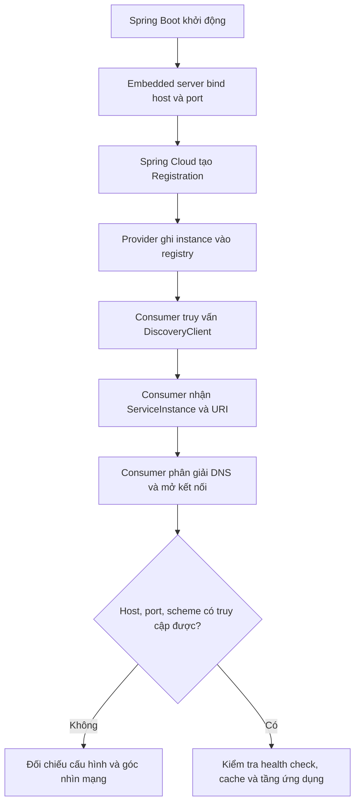

# Đăng ký sai IP, hostname, port hoặc scheme

## Bối cảnh và dấu hiệu

Trong Spring Cloud, service discovery giúp một ứng dụng tìm các instance của dịch vụ khác thông qua một registry như Eureka hoặc Consul. Khi khởi động, ứng dụng có thể tự đăng ký thông tin instance; consumer truy vấn registry, nhận danh sách instance rồi dùng địa chỉ trả về để gọi dịch vụ.

Một bản ghi đăng ký thường chứa service ID, instance ID, host hoặc IP, port, trạng thái bảo mật (HTTP hay HTTPS) và metadata. Spring Cloud Commons cung cấp các abstraction như `DiscoveryClient`, `ServiceInstance`, `ServiceRegistry` và `Registration`; chi tiết tạo bản ghi và tên cấu hình phụ thuộc vào implementation cụ thể.

Sự cố thường xuất hiện dưới các dạng:

- Registry hiển thị `localhost`, `127.0.0.1`, `0.0.0.0`, IP của card mạng Docker hoặc một IP private mà consumer không thể truy cập.
- Hostname đăng ký đúng trên máy chạy ứng dụng nhưng không phân giải được từ container, pod hoặc máy của consumer.
- Consumer nhận port nội bộ của container trong khi chỉ có port publish của host có thể truy cập, hoặc nhận port management thay vì port HTTP của ứng dụng.
- Registry trả về `http://` trong khi endpoint yêu cầu TLS, hoặc trả về `https://` trong khi instance chỉ lắng nghe HTTP.
- Instance có trạng thái `UP` trong registry nhưng request thực tế timeout, connection refused, lỗi DNS hoặc lỗi TLS.

Không nên bắt đầu bằng cách sửa ngẫu nhiên một property. Trước tiên cần xác định địa chỉ nào đang được đăng ký, địa chỉ đó được tạo từ nguồn nào và consumer thực sự gọi từ mạng nào.

## Phân biệt địa chỉ registry với địa chỉ instance

Hai nhóm cấu hình thường bị nhầm lẫn:

| Nhóm | Ví dụ | Ý nghĩa |
| --- | --- | --- |
| Địa chỉ của registry | `eureka.client.serviceUrl.defaultZone`, `spring.cloud.consul.host`, `spring.cloud.consul.port` | Nơi ứng dụng kết nối để đăng ký hoặc truy vấn registry |
| Địa chỉ được quảng bá cho instance | `eureka.instance.*`, `spring.cloud.consul.discovery.*` | Host/IP, port và scheme mà consumer nhận được để gọi ứng dụng |
| Cổng ứng dụng đang lắng nghe | `server.port`, cổng thực tế của embedded server | Cổng mà tiến trình Spring Boot mở trong network namespace của nó |
| Địa chỉ bind | `server.address` hoặc cấu hình tương ứng của server | Địa chỉ local mà embedded server bind vào; không tự động là địa chỉ nên quảng bá |

Ví dụ, `spring.cloud.consul.host=consul.internal` chỉ định Consul agent mà ứng dụng gửi đăng ký đến. Nó không có nghĩa consumer sẽ gọi ứng dụng tại `consul.internal`. Địa chỉ consumer nhận được được quyết định bởi cấu hình discovery của instance và logic đăng ký của Consul.

Luồng cần kiểm tra:



## Quy trình chẩn đoán

### 1. Xác định góc nhìn mạng của consumer

Địa chỉ đúng là địa chỉ mà **consumer có thể truy cập**, không nhất thiết là địa chỉ mà máy host nhìn thấy. Hãy ghi rõ consumer chạy ở đâu: cùng process, cùng máy, cùng Docker network, cùng Kubernetes cluster, khác subnet hay qua gateway/ingress.

Các trường hợp thường gặp:

- Trong cùng Docker network, consumer thường gọi bằng DNS service name và container port. Port publish trên host phục vụ kết nối đi từ bên ngoài Docker network.
- Trong Kubernetes, consumer trong cluster có thể dùng DNS của Kubernetes Service và service port. Pod IP chỉ phù hợp khi kiến trúc chủ động gọi trực tiếp từng pod và các consumer có route đến pod network.
- Với ứng dụng sau ingress hoặc reverse proxy, địa chỉ công khai có thể là hostname và cổng 443; kết nối service-to-service bên trong cluster có thể vẫn phải dùng service DNS, port nội bộ và HTTP.
- Với VM hoặc bare metal, hostname phải phân giải được trong DNS mà consumer sử dụng, và firewall/security group phải cho phép kết nối đến port đã đăng ký.

Không quảng bá `localhost` hoặc `127.0.0.1` cho consumer ở process/máy khác. Địa chỉ loopback luôn trỏ về chính môi trường của consumer. `0.0.0.0` là địa chỉ bind wildcard, không phải địa chỉ đích để client kết nối.

### 2. So sánh port cấu hình với port thực tế

Spring Boot dùng `server.port` để cấu hình cổng HTTP chính; mặc định thường là `8080`. Khi đặt `server.port=0`, hệ điều hành chọn một cổng trống lúc khởi động. Giá trị cấu hình `0` khi đó không phải cổng mà consumer có thể gọi. Có thể đọc cổng thực tế sau khi web server khởi tạo qua log hoặc `WebServerInitializedEvent`.

Ví dụ ghi lại cổng đã bind:

```java
import org.slf4j.Logger;
import org.slf4j.LoggerFactory;
import org.springframework.boot.web.context.WebServerInitializedEvent;
import org.springframework.context.event.EventListener;
import org.springframework.stereotype.Component;

@Component
class BoundPortLogger {
    private static final Logger log =
            LoggerFactory.getLogger(BoundPortLogger.class);

    @EventListener
    void onWebServerInitialized(WebServerInitializedEvent event) {
        log.info("Web server context={} bound port={}",
                event.getApplicationContext().getId(),
                event.getWebServer().getPort());
    }
}
```

Nếu ứng dụng có cổng management riêng, sự kiện có thể xuất hiện cho nhiều web server context. Hãy đối chiếu context và port tương ứng; đừng lấy cổng Actuator làm cổng API chính. Với Consul, tài liệu hiện hành mô tả port đăng ký mặc định được lấy từ `server.port`; khi `management.server.port` khác cổng ứng dụng, Consul có thể đăng ký thêm management service riêng.

Trong môi trường container, phân biệt ba giá trị:

| Giá trị | Ví dụ | Ai sử dụng |
| --- | --- | --- |
| Container port | `8080` | Tiến trình và container network |
| Host published port | `18080` trong ánh xạ `18080:8080` | Client truy cập qua host |
| Kubernetes Service port | `80` trong Service | Client gọi qua DNS Service và port này |

Kubernetes Service chuyển tiếp từ `port: 80` đến `targetPort: 8080`. Nếu consumer gọi trực tiếp Pod IP thì nó phải dùng port mà container đang lắng nghe, thường là `targetPort`; nếu gọi qua Service DNS thì dùng Service port.

Không sao chép host published port vào registry nếu tất cả consumer nằm trong cùng container network và phải gọi trực tiếp container port. Ngược lại, nếu consumer nằm ngoài network đó, container port có thể không có route.

### 3. Kiểm tra IP và hostname được chọn

Spring Cloud Commons có `InetUtils` để hỗ trợ chọn hostname/IP từ các network interface. Các cấu hình quan trọng gồm:

- `spring.cloud.inetutils.ignored-interfaces`: danh sách regex tên network interface cần bỏ qua, ví dụ `docker0` hoặc `veth.*`.
- `spring.cloud.inetutils.preferred-networks`: danh sách regex địa chỉ mạng được ưu tiên, ví dụ các dải IP nội bộ của môi trường triển khai.
- `spring.cloud.inetutils.use-only-site-local-interfaces`: chỉ xét interface có địa chỉ site-local.
- `spring.cloud.inetutils.default-hostname` và `spring.cloud.inetutils.default-ip-address`: giá trị dự phòng khi không xác định được hostname/IP; mặc định lần lượt là `localhost` và `127.0.0.1`.

Ví dụ bỏ qua interface bridge không dùng cho giao tiếp service và ưu tiên dải mạng ứng dụng:

```yaml
spring:
  cloud:
    inetutils:
      ignored-interfaces:
        - 'docker0'
        - 'veth.*'
      preferred-networks:
        - '10\.20\..*'
        - '172\.20\..*'
```

Các giá trị trên là regular expression của Java, không phải CIDR. Hãy thay bằng tên interface và dải địa chỉ thực tế của môi trường. Không bật `use-only-site-local-interfaces` theo thói quen: một địa chỉ site-local vẫn có thể không có route từ consumer, đặc biệt khi có nhiều overlay network hoặc nhiều subnet.

Nếu registry đột nhiên ghi `localhost` hoặc `127.0.0.1`, hãy kiểm tra log phát hiện interface, DNS/hostname của máy và các giá trị dự phòng. `InetUtils` chỉ ảnh hưởng đến nơi provider dùng nó để suy ra địa chỉ; cấu hình host/IP tường minh hoặc custom `Registration` có thể thay thế kết quả này.

### 4. Đọc đúng bản ghi trong registry và kết quả DiscoveryClient

Đối chiếu ít nhất ba lớp:

1. Bản ghi instance trong giao diện hoặc API của Eureka/Consul: host/IP, port, scheme, instance ID, metadata và trạng thái.
2. Giá trị consumer nhận được từ `DiscoveryClient#getInstances(serviceId)`.
3. URI thực tế được LoadBalancer hoặc HTTP client sử dụng khi gửi request.

Có thể thêm log chẩn đoán tạm thời ở consumer:

```java
import org.slf4j.Logger;
import org.slf4j.LoggerFactory;
import org.springframework.cloud.client.ServiceInstance;
import org.springframework.cloud.client.discovery.DiscoveryClient;
import org.springframework.stereotype.Component;

@Component
class DiscoverySnapshot {
    private static final Logger log =
            LoggerFactory.getLogger(DiscoverySnapshot.class);

    private final DiscoveryClient discoveryClient;

    DiscoverySnapshot(DiscoveryClient discoveryClient) {
        this.discoveryClient = discoveryClient;
    }

    void logInstances(String serviceId) {
        for (ServiceInstance instance :
                discoveryClient.getInstances(serviceId)) {
            log.info("serviceId={} host={} port={} secure={} uri={} metadata={}",
                    instance.getServiceId(),
                    instance.getHost(),
                    instance.getPort(),
                    instance.isSecure(),
                    instance.getUri(),
                    instance.getMetadata());
        }
    }
}
```

Gọi `logInstances` từ một luồng chẩn đoán sau khi registry đã đồng bộ. Không mặc định gọi ngay lúc ứng dụng khởi động sẽ thấy bản ghi của chính nó, vì thứ tự khởi tạo và auto-registration phụ thuộc provider.

Spring Cloud Commons cung cấp Actuator endpoint có ID `serviceregistry` nếu ứng dụng bật và expose endpoint này. Với base path mặc định của Actuator, HTTP path là `/actuator/serviceregistry`; nếu ứng dụng đổi `management.endpoints.web.base-path`, path sẽ thay đổi tương ứng. GET endpoint cho biết trạng thái đăng ký; nó không thay thế việc đọc host/port/scheme từ registry hoặc `ServiceInstance`. Hãy bảo vệ Actuator và chỉ expose endpoint chẩn đoán trong phạm vi phù hợp.

Nếu registry đúng nhưng `DiscoveryClient` trả dữ liệu cũ, kiểm tra chu kỳ đồng bộ của provider, cache của client-side load balancer và thời gian lease. Sau khi cập nhật, xác minh lại từ consumer thay vì chỉ nhìn bản ghi mới trong registry.

### 5. Thử kết nối từ đúng môi trường consumer

Thực hiện kiểm tra trong container, pod hoặc máy thực sự gửi request:

```bash
# Kiểm tra hostname có phân giải thành địa chỉ dự kiến không
getent hosts inventory-1.internal

# Kiểm tra TCP port có mở từ consumer không
nc -vz inventory-1.internal 8080

# Kiểm tra HTTP endpoint
curl -sv http://inventory-1.internal:8080/actuator/health

# Nếu instance được quảng bá bằng HTTPS
curl -sv https://inventory-1.internal:8443/actuator/health
```

Nếu môi trường không có `getent` hoặc `nc`, dùng công cụ DNS/TCP tương đương như `nslookup`, `Resolve-DnsName` hoặc `Test-NetConnection`. Khi kiểm tra HTTPS, quan sát hostname của certificate, chain tin cậy và lỗi handshake. Chỉ dùng chế độ bỏ qua xác minh certificate trong thử nghiệm cô lập để phân biệt lỗi certificate; không biến nó thành cấu hình production.

Với Consul, HTTP health check mặc định thường gọi `/actuator/health`. Nếu ứng dụng đổi context path, servlet path hoặc management endpoint path/port, kiểm tra lại URL health check. Một health check chạy từ Consul agent cũng có góc nhìn mạng riêng; việc curl thành công từ laptop không chứng minh agent truy cập được endpoint.

## Cấu hình theo từng provider

### Spring Cloud Netflix Eureka

Eureka dùng nhóm `eureka.instance.*` để mô tả instance. Một cấu hình hostname và port tường minh có thể như sau:

```yaml
server:
  port: 8080

eureka:
  instance:
    hostname: inventory-1.internal
    prefer-ip-address: false
    non-secure-port: 8080
    non-secure-port-enabled: true
    secure-port-enabled: false
```

Nếu consumer cần gọi bằng IP, đặt IP đúng với network có thể định tuyến và bật `prefer-ip-address`:

```yaml
eureka:
  instance:
    ip-address: 10.20.1.15
    prefer-ip-address: true
```

Không bật `prefer-ip-address` chỉ để tránh lỗi DNS nếu IP được chọn là IP bridge/container không thể định tuyến từ consumer. Khi dùng HTTPS trực tiếp trên instance, cấu hình cổng secure đúng với listener và bật cờ secure:

```yaml
eureka:
  instance:
    non-secure-port-enabled: false
    secure-port-enabled: true
    secure-port: 8443
```

Khi bật secure port, Spring Cloud Netflix Eureka DiscoveryClient trả URI có scheme `https`. Vì vậy, chỉ bật khi instance thực sự nhận HTTPS tại địa chỉ và port đã quảng bá. Nếu TLS kết thúc ở proxy nhưng giao tiếp nội bộ đến ứng dụng vẫn là HTTP, consumer nội bộ có thể cần địa chỉ HTTP nội bộ; không tự động quảng bá HTTPS chỉ vì người dùng cuối truy cập qua HTTPS.

### Spring Cloud Consul

Consul có nhóm `spring.cloud.consul.discovery.*` để cấu hình địa chỉ instance. Ví dụ dùng hostname nội bộ:

```yaml
spring:
  cloud:
    consul:
      discovery:
        hostname: inventory-1.internal
        prefer-ip-address: false
        port: 8080
        scheme: http
```

Nếu chọn IP thay hostname, cần khai báo IP và bật tùy chọn tương ứng:

```yaml
spring:
  cloud:
    consul:
      discovery:
        ip-address: 10.20.1.15
        prefer-ip-address: true
        port: 8080
        scheme: http
```

Theo tài liệu Spring Cloud Consul, `ip-address` cần đi cùng `prefer-ip-address`; `port` mặc định lấy từ cổng ứng dụng đang lắng nghe; `scheme` xác định instance được đăng ký là HTTP hay HTTPS. Metadata `secure` được tạo dựa trên việc `scheme` có bằng `https` hay không. Đừng nhầm `spring.cloud.consul.scheme` (scheme để kết nối Consul agent) với `spring.cloud.consul.discovery.scheme` (scheme của service instance).

### SimpleDiscoveryClient

Khi không có implementation DiscoveryClient dựa trên service registry trong classpath, Spring Cloud Commons có thể dùng `SimpleDiscoveryClient` đọc URI từ cấu hình. Ví dụ:

```yaml
spring:
  cloud:
    discovery:
      client:
        simple:
          instances:
            inventory:
              - uri: http://inventory-1.internal:8080
              - uri: http://inventory-2.internal:8080
```

Nếu consumer luôn nhận một URI sai dù không thấy bản ghi tương ứng trên Eureka/Consul, hãy xác minh implementation DiscoveryClient đang hoạt động và kiểm tra `spring.cloud.discovery.client.simple.instances`.

## Proxy, TLS termination và scheme

Khi có reverse proxy hoặc load balancer, request bên ngoài có thể dùng `https://api.example.com` trong khi proxy chuyển tiếp vào ứng dụng bằng `http://10.20.1.15:8080`. Hai URI phục vụ hai đường đi khác nhau:

- Địa chỉ public dành cho browser hoặc client bên ngoài.
- Địa chỉ nội bộ dành cho service-to-service traffic trong mạng private.

Spring Boot hỗ trợ xử lý thông tin request gốc từ header `Forwarded` và các header `X-Forwarded-Host`, `X-Forwarded-Port`, `X-Forwarded-Proto` qua `server.forward-headers-strategy`. `NATIVE` dùng khả năng của web server; `FRAMEWORK` dùng cơ chế của Spring Framework. Cấu hình này giúp ứng dụng tạo URL/redirect phản ánh request bên ngoài. Nó không tự thay thế cấu hình địa chỉ đăng ký của Eureka hoặc Consul.

Chỉ tin forwarded headers do proxy tin cậy ghi đè. Proxy nên loại bỏ header do client tự gửi trước khi thêm giá trị đã xác thực; nếu ứng dụng nhận trực tiếp header giả mạo, host hoặc scheme trong URL được tạo ra có thể sai và có thể phát sinh rủi ro bảo mật.

## Tình huống thực hành: service chạy trong Docker

Giả sử service `inventory` lắng nghe cổng `8080` trong container và Docker publish `18080:8080` trên host:

| Vị trí consumer | Địa chỉ phù hợp trong ví dụ |
| --- | --- |
| Container cùng Docker network | `http://inventory:8080` |
| Tiến trình trên Docker host | `http://localhost:18080` |
| Máy khác trong mạng | Hostname/IP của Docker host cùng port `18080`, nếu firewall cho phép |

Nếu Consul agent và các consumer cùng Docker network, đăng ký `inventory:8080` với hostname mà network đó phân giải được. Nếu consumer ở bên ngoài Docker network, phải thiết kế đường truy cập qua host port hoặc một endpoint có route; không thể giả định tên service nội bộ sẽ phân giải được từ mọi mạng.

Sau khi sửa cấu hình, thực hiện theo thứ tự:

1. Khởi động lại hoặc trigger đăng ký lại theo cơ chế của provider nếu thay đổi không hỗ trợ refresh động.
2. Đọc lại bản ghi trong registry và xác nhận host/IP, port, scheme.
3. Gọi `DiscoveryClient#getInstances("inventory")` từ consumer và xác nhận URI đã cập nhật.
4. Kiểm tra DNS, TCP và HTTP/TLS từ đúng network namespace của consumer.
5. Kiểm tra health check và quan sát request thật qua LoadBalancer.

## Bảng khoanh vùng nhanh

| Hiện tượng | Nơi kiểm tra đầu tiên | Hướng xử lý |
| --- | --- | --- |
| Đăng ký `127.0.0.1` hoặc `localhost` | Giá trị fallback của InetUtils, hostname OS, network interface, cấu hình host/IP provider | Chọn hostname/IP có thể truy cập từ consumer; bỏ qua interface không phù hợp |
| Đăng ký IP bridge hoặc IP container không truy cập được | Docker/Kubernetes network, `preferred-networks`, `ignored-interfaces`, route | Chọn interface/dải IP đúng hoặc dùng DNS Service phù hợp |
| Hostname đúng nhưng DNS thất bại | DNS search domain, namespace, record và resolver của consumer | Tạo record có thể phân giải từ mọi consumer cần gọi |
| Port sai hoặc connection refused | `server.port`, port runtime, mapping container, Service port, `management.server.port`, property provider | Đăng ký đúng port mà consumer có route đến và server đang listen |
| HTTP bị redirect/lỗi handshake hoặc HTTPS không kết nối | Scheme, TLS termination, certificate, secure-port flags, forwarded headers | Đồng bộ scheme với điểm kết thúc TLS thực tế; cấu hình trust/certificate đúng |
| Registry đúng nhưng consumer vẫn gọi URI cũ | DiscoveryClient đang dùng, cache LoadBalancer, chu kỳ refresh/lease | Xác minh dữ liệu consumer và chờ/refresh theo cơ chế của provider |
| Instance `UP` nhưng health check thất bại | Địa chỉ mà registry agent dùng, health-check path, management port, firewall | Thử endpoint từ chính agent/network tương ứng và sửa path/port |

## Lưu ý về cấu hình và phiên bản

- Spring Cloud Commons định nghĩa abstraction chung; các property điều khiển hostname, IP, port và scheme thuộc từng provider. Không giả định property của Eureka có tác dụng với Consul hoặc Kubernetes.
- Tên và hành vi property có thể thay đổi theo phiên bản Spring Cloud. Dùng Spring Cloud BOM/release train tương thích với Spring Boot của ứng dụng, rồi mở đúng tài liệu `configprops` của phiên bản dependency thực tế. Không sao chép cấu hình từ một bài hướng dẫn cũ mà không kiểm tra.
- Các ví dụ trong bài dùng tên property dạng kebab-case. Spring Boot hỗ trợ relaxed binding, nhưng cần giữ đúng prefix và kiểu dữ liệu của property trong provider đang sử dụng.
- `spring.cloud.inetutils.*` chỉ giải quyết việc chọn địa chỉ khi provider cần suy ra địa chỉ từ máy. Nó không sửa DNS, route, firewall, NAT, port mapping hoặc custom registration.
- Sau khi thay đổi property, kiểm tra giá trị hiệu lực theo profile và nguồn cấu hình đang hoạt động. Nếu dùng Actuator `env` hoặc `configprops`, chỉ expose có kiểm soát và bảo vệ endpoint vì chúng có thể tiết lộ thông tin cấu hình.
- Endpoint ID `serviceregistry` phản ánh trạng thái đăng ký (HTTP path mặc định `/actuator/serviceregistry`); bản ghi địa chỉ phải được xác minh bằng API/UI của registry và bằng dữ liệu `ServiceInstance` mà consumer nhận được.

## Tài liệu tham khảo

1. [Spring Cloud Commons – Common Abstractions](https://docs.spring.io/spring-cloud-commons/reference/spring-cloud-commons/common-abstractions.html): DiscoveryClient, ServiceRegistry, auto-registration, SimpleDiscoveryClient và cấu hình network interface.
2. [Spring Cloud Commons – Configuration Properties](https://docs.spring.io/spring-cloud-commons/reference/configprops.html): các property `spring.cloud.inetutils.*` và discovery client.
3. [Spring Cloud Netflix – Configuration Properties](https://docs.spring.io/spring-cloud-netflix/reference/configprops.html): hostname, IP, port thường và port secure của Eureka instance.
4. [Spring Cloud Netflix 5.0.3 – Registering a Secure Application](https://docs.spring.io/spring-cloud-netflix/reference/spring-cloud-netflix.html): cách Eureka quảng bá HTTPS và các URL health/status.
5. [Spring Cloud Consul – Service Discovery](https://docs.spring.io/spring-cloud-consul/reference/discovery.html): địa chỉ instance, port, health check và management service.
6. [Spring Cloud Consul – Configuration Properties](https://docs.spring.io/spring-cloud-consul/docs/current/reference/html/appendix.html): hostname, IP, prefer-ip-address, port và scheme.
7. [Spring Boot – Embedded Web Servers](https://docs.spring.io/spring-boot/how-to/webserver.html): cấu hình `server.port`, port ngẫu nhiên, đọc port thực tế và forwarded headers sau proxy.
8. [Spring Cloud Release Train Reference](https://docs.spring.io/spring-cloud-release/reference/index.html): phiên bản Spring Cloud release train và phiên bản Spring Boot tương thích.
