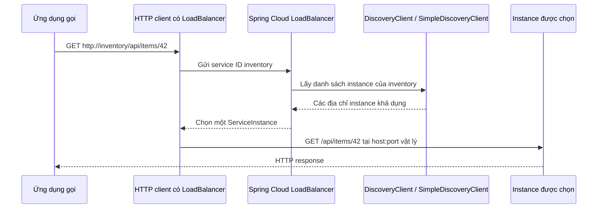

# HTTP client phân giải tên dịch vụ như DNS thông thường

Khi gọi một dịch vụ nội bộ bằng URL như `http://inventory/api/items/42`, ứng dụng có thể gặp lỗi `UnknownHostException: inventory` dù dịch vụ `inventory` đã được đăng ký trong Eureka, Consul hoặc một service registry khác. Nguyên nhân thường nằm ở HTTP client: client đang xử lý `inventory` như hostname cần phân giải qua DNS, trong khi ứng dụng mong muốn Spring Cloud tìm một `ServiceInstance` theo service ID.

Tên dịch vụ trong URL không tự động kích hoạt service discovery. Với `RestClient`, `RestTemplate` và `WebClient`, ứng dụng phải dùng đúng bean/builder đã được tích hợp Spring Cloud LoadBalancer và đánh dấu `@LoadBalanced`. Feign có cơ chế tích hợp riêng được mô tả ở phần sau. Nếu dùng một HTTP client thông thường, Spring Cloud không tự động thay đổi cách client phân giải hostname.

## 1. Phân biệt DNS và service discovery

DNS phân giải hostname thành địa chỉ IP. Ví dụ, khi client gửi request đến `https://api.example.com`, bộ phân giải tên của hệ điều hành/JVM tìm địa chỉ IP tương ứng; HTTP client sau đó kết nối tới địa chỉ đó. DNS không biết ý nghĩa nghiệp vụ của service ID trong Eureka hoặc Consul, trừ khi hệ thống DNS được cấu hình riêng để công bố những tên đó.

Spring Cloud LoadBalancer làm một công việc khác. Nó coi phần host trong URL là tên logic của dịch vụ, tra cứu các instance có service ID tương ứng, chọn một instance rồi chuyển request đến địa chỉ vật lý của instance đó. Nguồn danh sách instance thường là `DiscoveryClient`, chẳng hạn Eureka, Consul hoặc ZooKeeper; khi không có discovery client gắn với registry, `SimpleDiscoveryClient` có thể cung cấp danh sách từ cấu hình.

| Cách gọi | Ý nghĩa của `inventory` | Thành phần tìm địa chỉ đích |
| --- | --- | --- |
| HTTP client thông thường gọi `http://inventory/...` | Hostname trong URL | DNS resolver của hệ điều hành/JVM |
| HTTP client có `@LoadBalanced` gọi `http://inventory/...` | Service ID (virtual host) | Spring Cloud LoadBalancer và nguồn service discovery |
| Client gọi `http://inventory.default.svc.cluster.local/...` trong Kubernetes | DNS name của Kubernetes Service | DNS Kubernetes; sau đó mạng Kubernetes định tuyến tới backend |

Hai cơ chế có thể cùng xuất hiện trong một hệ thống. Sau khi LoadBalancer chọn một `ServiceInstance`, hostname trong URI vật lý của instance vẫn có thể cần DNS phân giải. Điều được thay thế là bước phân giải **service ID** bằng registry và thuật toán chọn instance; LoadBalancer không loại bỏ DNS khỏi toàn bộ đường truyền mạng.

### Luồng xử lý



Nếu client không có LoadBalancer interceptor hoặc filter, bước tra cứu registry trong sơ đồ không diễn ra. HTTP connector nhận URL ban đầu và cố gắng phân giải `inventory` bằng DNS.

## 2. Cấu hình Spring Cloud LoadBalancer

Thêm starter LoadBalancer vào ứng dụng. Nên quản lý phiên bản Spring Cloud bằng BOM của release train tương thích với Spring Boot đang dùng, thay vì tự đặt phiên bản riêng cho từng starter.

```kotlin
dependencies {
    implementation("org.springframework.cloud:spring-cloud-starter-loadbalancer")
}
```

Ứng dụng cũng cần một nguồn instance. Trong môi trường thực tế, nguồn này thường đến từ starter của Eureka, Consul, ZooKeeper hoặc discovery implementation phù hợp với nền tảng triển khai. Với các release hiện đại, chỉ cần discovery implementation có mặt trên classpath; `@EnableDiscoveryClient` không còn là annotation bắt buộc. Để thử nghiệm độc lập, có thể dùng `SimpleDiscoveryClient` và khai báo hai instance trong `application.yml`:

```yaml
spring:
  cloud:
    discovery:
      client:
        simple:
          instances:
            inventory:
              - uri: http://10.20.0.11:8081
              - uri: http://10.20.0.12:8081
```

Ở đây `inventory` là service ID. Hai URI bên dưới là địa chỉ vật lý mà client có thể truy cập từ môi trường chạy ứng dụng. Thay các địa chỉ ví dụ bằng host và port thực tế; nếu host của instance là hostname, hostname đó vẫn phải phân giải và truy cập được từ ứng dụng gọi.

## 3. Dùng RestClient đã tích hợp LoadBalancer

Với ứng dụng đồng bộ mới, có thể dùng `RestClient.Builder` được đánh dấu `@LoadBalanced`. Spring Cloud cấu hình builder này để `BlockingLoadBalancerClient` xử lý service ID trước khi request được gửi qua HTTP connector.

```java
import org.springframework.cloud.client.loadbalancer.LoadBalanced;
import org.springframework.context.annotation.Bean;
import org.springframework.context.annotation.Configuration;
import org.springframework.web.client.RestClient;

@Configuration
class HttpClientConfiguration {

    @Bean
    @LoadBalanced
    RestClient.Builder loadBalancedRestClientBuilder() {
        return RestClient.builder();
    }
}
```

Inject đúng builder đã được đánh dấu và tạo client từ builder đó:

```java
import org.springframework.cloud.client.loadbalancer.LoadBalanced;
import org.springframework.stereotype.Component;
import org.springframework.web.client.RestClient;

@Component
class InventoryClient {

    private final RestClient restClient;

    InventoryClient(@LoadBalanced RestClient.Builder builder) {
        this.restClient = builder.build();
    }

    Item findItem(long id) {
        return restClient.get()
                .uri("http://inventory/api/items/{id}", id)
                .retrieve()
                .body(Item.class);
    }
}
```

```java
// DTO minh họa; cấu trúc thực tế phải khớp response của dịch vụ inventory.
record Item(long id, String name) {}
```

`inventory` trong URL là service ID mà LoadBalancer tra cứu. Sau khi chọn instance, client giữ nguyên path `/api/items/{id}` và gửi request đến host, port cùng scheme của instance được chọn.

Không tạo một client độc lập bằng `RestClient.create()` hoặc `RestClient.builder().build()` rồi kỳ vọng client đó tự hiểu service ID. Những client được tạo ngoài builder đã cấu hình LoadBalancer không tự nhận interceptor của bean `@LoadBalanced`.

## 4. Các HTTP client khác

### RestTemplate trong ứng dụng hiện hữu

`RestTemplate` vẫn có thể dùng với LoadBalancer bằng cách đánh dấu chính bean `RestTemplate` là `@LoadBalanced`:

```java
import org.springframework.cloud.client.loadbalancer.LoadBalanced;
import org.springframework.context.annotation.Bean;
import org.springframework.context.annotation.Configuration;
import org.springframework.web.client.RestTemplate;

@Configuration
class LegacyHttpClientConfiguration {

    @Bean
    @LoadBalanced
    RestTemplate loadBalancedRestTemplate() {
        return new RestTemplate();
    }
}
```

Request dùng bean này có thể gọi `http://inventory/api/items/42`. Nếu ứng dụng có cả `RestTemplate` thường và load-balanced, hãy inject bean có qualifier `@LoadBalanced` vào đúng nơi cần gọi service ID. Có thể đánh dấu bean thường là `@Primary` để tránh nhập nhằng khi inject không qualifier.

### WebClient

Với `WebClient`, thêm `spring-boot-starter-webflux` để có WebClient và Reactor API, sau đó đánh dấu builder là `@LoadBalanced` để Spring Cloud cấu hình filter tích hợp reactive LoadBalancer:

```java
import org.springframework.cloud.client.loadbalancer.LoadBalanced;
import org.springframework.context.annotation.Bean;
import org.springframework.context.annotation.Configuration;
import org.springframework.web.reactive.function.client.WebClient;

@Configuration
class ReactiveHttpClientConfiguration {

    @Bean
    @LoadBalanced
    WebClient.Builder loadBalancedWebClientBuilder() {
        return WebClient.builder();
    }
}
```

Sử dụng builder tương ứng khi tạo request:

```java
import org.springframework.cloud.client.loadbalancer.LoadBalanced;
import org.springframework.stereotype.Component;
import org.springframework.web.reactive.function.client.WebClient;
import reactor.core.publisher.Mono;

@Component
class ReactiveInventoryClient {

    private final WebClient webClient;

    ReactiveInventoryClient(@LoadBalanced WebClient.Builder builder) {
        this.webClient = builder.build();
    }

    Mono<Item> findItem(long id) {
        return webClient.get()
                .uri("http://inventory/api/items/{id}", id)
                .retrieve()
                .bodyToMono(Item.class);
    }
}
```

Trong cấu hình WebFlux, Spring Cloud cung cấp `ReactorLoadBalancerExchangeFilterFunction`. Nếu tự tạo `WebClient` bằng `WebClient.create()` hoặc bỏ filter khỏi builder, request sẽ không đi qua reactive LoadBalancer.

### Spring Cloud OpenFeign

Với Feign, tên trong `@FeignClient` được dùng làm client name và service ID. Khi Spring Cloud LoadBalancer có mặt trên classpath, Feign có thể dùng load-balanced client:

```java
import org.springframework.cloud.openfeign.FeignClient;
import org.springframework.web.bind.annotation.GetMapping;
import org.springframework.web.bind.annotation.PathVariable;

@FeignClient(name = "inventory")
interface InventoryFeignClient {

    @GetMapping("/api/items/{id}")
    Item findItem(@PathVariable("id") long id);
}
```

Kích hoạt quét interface bằng `@EnableFeignClients` trên lớp cấu hình/ứng dụng và thêm `spring-cloud-starter-openfeign`. Starter OpenFeign hỗ trợ `spring-cloud-starter-loadbalancer`, nhưng LoadBalancer là dependency tùy chọn. Hãy khai báo starter LoadBalancer nếu ứng dụng cần chức năng này. Nếu đặt URL cố định trong `@FeignClient(url = "...")` hoặc cấu hình URL cho client bằng properties, Feign gọi URL đó trực tiếp và bỏ qua load balancing theo service ID.

## 5. Chẩn đoán khi tên dịch vụ bị đưa qua DNS

Đọc loại lỗi trước khi thay đổi cấu hình. Các lỗi khác nhau thường cho biết request dừng ở những tầng khác nhau.

| Triệu chứng | Ý nghĩa thường gặp | Cách kiểm tra và xử lý |
| --- | --- | --- |
| `UnknownHostException: inventory` | HTTP connector đang phân giải `inventory` như hostname; LoadBalancer chưa xử lý request, hoặc DNS không có bản ghi đó | Kiểm tra bean được inject có qualifier `@LoadBalanced` không; kiểm tra starter LoadBalancer và cách tạo client; xác minh không gọi nhầm client thường |
| Không tìm thấy instance cho `inventory` hoặc lỗi tương đương từ LoadBalancer | LoadBalancer đã nhận service ID nhưng nguồn discovery không trả về instance phù hợp | Kiểm tra service ID, đăng ký service, trạng thái instance, discovery client và cấu hình `SimpleDiscoveryClient` |
| `ConnectException`, connection refused hoặc timeout tới host/port cụ thể | Đã có địa chỉ instance nhưng không thể thiết lập kết nối | Kiểm tra port lắng nghe, network policy, firewall, route, container network và khả năng truy cập từ chính máy/container của client |
| HTTP `404` | Đã kết nối được một server HTTP nhưng path hoặc route không tồn tại | Kiểm tra context path, mapping endpoint, gateway và path được giữ lại sau khi chọn instance |
| `SSLHandshakeException` | Kết nối TLS tới instance thất bại | Kiểm tra scheme `https`, certificate chain, trust store và cấu hình TLS của instance |

Một quy trình kiểm tra ngắn giúp khoanh vùng vấn đề:

1. **Xác định bean thực tế được inject.** Đặt breakpoint hoặc kiểm tra cấu hình bean để xác nhận request dùng đúng `RestClient.Builder`, `RestTemplate` hay `WebClient.Builder` có `@LoadBalanced`. Annotation ở một bean khác không làm client hiện tại tự động được load-balance.
2. **Xác nhận dependency.** Kiểm tra `spring-cloud-starter-loadbalancer` có trong runtime classpath. Với Feign, nhớ rằng starter LoadBalancer không được kéo vào bắt buộc trong mọi cấu hình.
3. **Xác nhận nguồn discovery.** Kiểm tra discovery implementation đã được nạp, registry đang trả về service ID chính xác và có instance khả dụng. Nếu dùng `SimpleDiscoveryClient`, kiểm tra key dưới `spring.cloud.discovery.client.simple.instances`.
4. **Kiểm tra địa chỉ instance.** Từ đúng container hoặc máy chạy client, thử phân giải hostname và kết nối tới host/port trong URI của instance. Service discovery trả về địa chỉ không đồng nghĩa địa chỉ đó có thể truy cập từ mọi network.
5. **Phân biệt DNS và registry.** Dùng công cụ DNS của môi trường như `nslookup` hoặc `getent hosts` để kiểm tra hostname; đồng thời kiểm tra danh sách instance qua discovery client hoặc công cụ quản trị registry. DNS thành công không chứng minh service ID được LoadBalancer xử lý, và DNS thất bại không chứng minh registry không có instance.

## 6. Các nhầm lẫn thường gặp

- **Cho rằng chỉ cần thêm service registry là mọi HTTP client đều gọi được service ID.** Registry chỉ lưu hoặc cung cấp thông tin instance. HTTP client vẫn cần tích hợp LoadBalancer để tra cứu và chọn instance khi gửi request.
- **Cho rằng `@LoadBalanced` là annotation toàn ứng dụng.** Đây là qualifier để đánh dấu bean client/builder. Phải inject đúng bean đã đánh dấu; một client được tạo riêng không tự thừa hưởng cấu hình của bean khác.
- **Dùng nhầm service ID với hostname vật lý.** Service ID như `inventory` là khóa tra cứu trong registry. Địa chỉ vật lý như `inventory-7f9c:8081` là đích kết nối sau khi chọn instance; hostname vật lý có thể cần DNS riêng.
- **Coi Kubernetes DNS và Spring Cloud LoadBalancer là cùng một cơ chế.** Kubernetes Service DNS thường trả về ClusterIP của Service, rồi mạng Kubernetes phân phối traffic tới Pod. Spring Cloud LoadBalancer thường chọn một `ServiceInstance` phía client. Chọn cơ chế nào cần dựa trên kiến trúc và yêu cầu định tuyến; tránh vô tình áp dụng cả hai tầng cân bằng tải mà không hiểu hệ quả.
- **Gắn URL tĩnh vào Feign rồi mong muốn discovery tiếp tục hoạt động.** URL tĩnh khiến Feign gọi đích đã cấu hình trực tiếp; bỏ URL nếu muốn `name` được dùng làm service ID cho load balancing.

## 7. Lưu ý về phiên bản

Các ví dụ `RestClient.Builder` và `WebClient.Builder` cần được đối chiếu với phiên bản Spring Cloud Commons trong dự án. `RestClient` được Spring Framework bổ sung từ dòng 6.1; ứng dụng dùng Spring Framework cũ hơn có thể cần tiếp tục dùng `RestTemplate` hoặc `WebClient` theo tài liệu của release train tương ứng. Tài liệu Spring Framework hiện hành khuyến nghị `RestClient` cho lời gọi đồng bộ mới và đánh dấu `RestTemplate` là deprecated.

Spring Cloud phát hành theo release train và yêu cầu tương thích với một thế hệ Spring Boot cụ thể. Tại thời điểm cập nhật bài học (18-11-2026), trang Spring Cloud công bố `2025.1.4` là release train ổn định mới nhất; dòng này tương thích Spring Boot `4.0.x` và `4.1.x` (bản `2025.1.4` hỗ trợ Boot `4.0.9` và `4.1.2`). Dòng `2025.0.x` dành cho Spring Boot `3.5.x`, còn `2024.0.x` dành cho Boot `3.4.x`. `2026.0.0-RC2` vẫn là bản thử nghiệm, không phải release ổn định. Hãy chọn BOM `spring-cloud-dependencies` phù hợp với phiên bản Spring Boot của ứng dụng và dùng tài liệu đúng release train; không nâng riêng một module Spring Cloud lên phiên bản khác train.

## 8. Tài liệu tham khảo chính thức

- [Spring Cloud Commons — Spring Cloud LoadBalancer](https://docs.spring.io/spring-cloud-commons/reference/spring-cloud-commons/loadbalancer.html): cơ chế chọn instance, `ServiceInstanceListSupplier`, cache và tích hợp HTTP client.
- [Spring Cloud Commons — Common Abstractions](https://docs.spring.io/spring-cloud-commons/reference/spring-cloud-commons/common-abstractions.html): `DiscoveryClient`, `SimpleDiscoveryClient`, `@LoadBalanced` cho `RestClient`, `RestTemplate` và `WebClient`.
- [Spring Cloud OpenFeign — Features](https://docs.spring.io/spring-cloud-openfeign/reference/spring-cloud-openfeign.html): service ID của `@FeignClient`, dependency LoadBalancer tùy chọn và hành vi khi cấu hình URL.
- [Spring Framework — REST Clients](https://docs.spring.io/spring-framework/reference/integration/rest-clients.html): lựa chọn HTTP client, `RestClient`, `WebClient` và trạng thái của `RestTemplate`.
- [Spring Cloud — Release Trains](https://spring.io/projects/spring-cloud/): bảng tương thích giữa Spring Cloud release train và Spring Boot.

