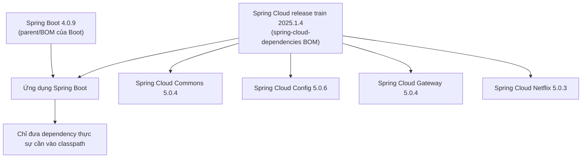
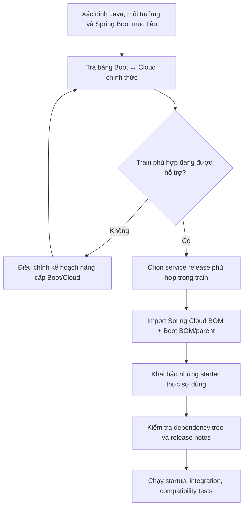

# Release train, phiên bản từng dự án và service release

Khi bắt đầu một dự án Spring Boot sử dụng Spring Cloud, người học rất dễ gặp ba con số không giống nhau:

- Phiên bản **Spring Boot** mà ứng dụng chạy, ví dụ `4.0.9`.
- Phiên bản **Spring Cloud release train**, ví dụ `2025.1.4`.
- Phiên bản **một dự án thuộc Spring Cloud**, ví dụ Spring Cloud Commons `5.0.4` hoặc Spring Cloud Config `5.0.6`.

Ba con số đều có ý nghĩa và **không cần giống nhau**. Nếu chỉ tìm phiên bản mới nhất của từng thư viện rồi ghép vào cùng ứng dụng, các thành phần có thể dùng API hoặc cơ chế cấu hình không tương thích. Nếu ghim cả hệ thống vào một train quá cũ, ứng dụng lại có thể bỏ lỡ bản sửa lỗi hoặc vượt thời hạn hỗ trợ.

Bài này thuộc chương **Phiên bản và phụ thuộc** của mô-đun **SPRING_CLOUD_CORE**. Chúng ta sẽ hiểu cách Spring Cloud phối hợp các dự án độc lập qua release train, cách BOM khóa bộ phụ thuộc, ý nghĩa của **service release (SR)** và cách chọn đúng phiên bản khi làm việc với Spring Cloud Commons, Context, externalized configuration, refresh scope, service discovery, registry, load balancing và kiểm thử vận hành.

> **Mốc dữ liệu:** các số phiên bản cụ thể trong bài được minh họa theo tài liệu Spring công bố đến **18/11/2026**. Chúng giúp giải thích cơ chế; khi tạo hoặc nâng cấp dự án thực tế, luôn kiểm tra [trang Spring Cloud chính thức](https://spring.io/projects/spring-cloud/) và release notes của phiên bản sẽ sử dụng.

## 1. Kết quả học tập

Sau khi học, bạn có thể:

1. Giải thích release train là gì, vì sao Spring Cloud có BOM và tại sao các dự án thành viên không nhất thiết cùng phiên bản.
2. Phân biệt **phiên bản release train**, **phiên bản project/module**, **phiên bản dependency** và **service release**.
3. Chọn release train từ phiên bản Spring Boot dự kiến sử dụng và kiểm tra tình trạng hỗ trợ.
4. Cấu hình dependency management bằng Maven hoặc Gradle mà không phải điền phiên bản cho từng Spring Cloud starter.
5. Điều tra nguyên nhân sai phiên bản trong dependency tree và xác định dependency bị ghi đè.
6. Phân biệt nâng cấp bảo trì trong một train với chuyển sang train khác và lập kế hoạch kiểm thử tương ứng.

## 2. Vì sao Spring Cloud cần release train?

**Spring Cloud không phải một thư viện đơn lẻ.** Đây là một họ dự án phục vụ những vấn đề của hệ thống phân tán. Một ứng dụng có thể dùng đồng thời:

- **Spring Cloud Commons/Context:** các abstraction chung như `DiscoveryClient`, `ServiceInstance`, `ServiceRegistry`; context, cấu hình và refresh scope.
- **Spring Cloud LoadBalancer:** cơ chế chọn instance khi gọi service theo tên logic.
- **Spring Cloud Config:** truy xuất và phân phối cấu hình bên ngoài khi dùng mô hình Config Server/Client.
- **Spring Cloud Netflix:** tích hợp Eureka cho đăng ký và khám phá dịch vụ, nếu kiến trúc chọn Eureka.
- **Spring Cloud Gateway:** định tuyến yêu cầu.
- Các dự án khác như Consul, Kubernetes, Stream, Bus, CircuitBreaker, Vault...

Những dự án này có repository, lịch phát triển, tính năng và bản sửa lỗi riêng. Nếu ứng dụng tự chọn phiên bản từng dự án, số kết hợp có thể tăng nhanh và khó xác nhận đã tương thích với nhau hay với Spring Boot.

**Release train** giải quyết bài toán đó bằng cách phát hành một **tập hợp các phiên bản đã được điều phối**. Spring Cloud công bố một BOM (Bill of Materials) mang phiên bản train. BOM quản lý các phiên bản của những dependency tương ứng; ứng dụng chọn một train rồi thêm các module cần dùng.



**Cần đọc đúng sơ đồ:** BOM **quản lý phiên bản**; nó không tự thêm tất cả dự án Spring Cloud vào ứng dụng. Chỉ những starter/module được khai báo trực tiếp hoặc kéo vào gián tiếp mới có mặt trong dependency graph. Các phiên bản hiển thị là ví dụ từ train `2025.1.4`, không phải quy tắc mọi train đều dùng bản `5.0.x`.

### Một phép so sánh hữu ích

Hình dung release train là **bảng phân công những toa tàu cùng được kiểm tra để chạy chung**. Mỗi toa được bảo trì theo lịch riêng; bảng phân công cho biết dùng phiên bản nào của từng toa. Đổi một toa sang phiên bản khác ngoài bảng có thể vận hành được, nhưng bạn đã rời khỏi tổ hợp mặc định được duy trì cho train đó và phải tự chịu thêm công việc kiểm chứng.

## 3. Bốn cấp phiên bản thường bị nhầm

| Cấp | Ví dụ | Định danh điều gì? | Ai quyết định trong dự án ứng dụng? |
| --- | --- | --- | --- |
| **Spring Boot version** | `4.0.9` | Nền ứng dụng Boot, auto-configuration và bộ dependency nền tương ứng | Nhóm phát triển chọn, căn cứ môi trường và khả năng tương thích |
| **Spring Cloud release train** | `2025.1.4` | Một tập dependency versions được điều phối trên họ dự án Spring Cloud | Nhóm phát triển chọn phù hợp với Boot |
| **Project/module version** | Commons `5.0.4`, Config `5.0.6` | Phiên bản của dự án và artifact phát hành từ dự án đó | Thường để BOM quản lý; chỉ override khi có căn cứ |
| **Service release của train** | `2025.1.4` sau `2025.1.3` | Bản cập nhật bảo trì của một dòng release train | Chọn bản SR phù hợp, ưu tiên bản mới nhất được hỗ trợ sau khi kiểm thử |

Ví dụ: `2025.1.4` không có nghĩa `spring-cloud-commons` mang phiên bản `2025.1.4`. Tương tự, số phiên bản của Config không bắt buộc bằng Commons, vì hai dự án có lịch sửa lỗi khác nhau.

### 3.1. Project khác Maven artifact

Một **project** có thể xuất bản nhiều artifact. Ví dụ, dự án Spring Cloud Commons bao gồm các module liên quan `spring-cloud-commons` và `spring-cloud-context`; các module có chức năng khác nhau nhưng thuộc cùng dòng phát hành của project. Một starter như `spring-cloud-starter-loadbalancer` là artifact giúp kéo vào các dependency cần thiết, không phải chính toàn bộ khả năng load balancing.

Cần phân biệt ba khái niệm:

- **Project:** đơn vị phát triển/phát hành, ví dụ *Spring Cloud Commons*.
- **Artifact:** tọa độ thư viện để hệ thống build tải về, dạng `groupId:artifactId:version`.
- **Starter:** artifact được thiết kế để tập hợp dependency và hỗ trợ auto-configuration cho một chức năng.

Bạn không nên suy ra project version từ tên starter hoặc từ số phiên bản release train. Hãy xem BOM hoặc dependency tree thực tế.

### 3.2. “Service release” không phải bản triển khai một microservice

Trong tài liệu phát hành Spring Cloud, **service release (SR)** là bản bảo trì của **dòng release train**: thường sửa lỗi, cập nhật dependency và có thể bổ sung tính năng tương thích ngược. Từ “service” ở đây **không mang nghĩa** một lần deploy của `order-service` hay `payment-service` do nhóm bạn xây dựng.

Một ứng dụng kinh doanh có thể deploy phiên bản `1.8.7` trong khi sử dụng Spring Boot `4.0.9` và Spring Cloud `2025.1.4`. Ba vòng đời release là khác nhau.

## 4. Đọc một release train trên ví dụ thật

Theo [tài liệu Spring Cloud Train Reference](https://docs.spring.io/spring-cloud-release/reference/index.html) và [thông báo phát hành ngày 23/10/2026](https://spring.io/blog/2026/10/23/spring-cloud-2025-1-4-has-been-released/), train ổn định `2025.1.4` có các phiên bản thành viên sau:

| Thành phần | Phiên bản được train `2025.1.4` công bố | Ý nghĩa |
| --- | --- | --- |
| Spring Cloud release train | **2025.1.4** | Phiên bản BOM điều phối cả train |
| Spring Cloud Commons | **5.0.4** | Abstraction chung và context |
| Spring Cloud Config | **5.0.6** | Công cụ cấu hình phân tán |
| Spring Cloud Gateway | **5.0.4** | Định tuyến/gateway |
| Spring Cloud Netflix | **5.0.3** | Tích hợp các thành phần Netflix OSS được duy trì |
| Spring Cloud Function | **5.0.5** | Mô hình lập trình function |
| Spring Cloud CircuitBreaker | **5.0.3** | Abstraction/tích hợp circuit breaker |

Dữ liệu này thể hiện điều cốt lõi: **không tồn tại quy tắc rằng service release thứ tư của một train phải chứa mọi dự án ở patch version `.4`**. Ở ví dụ trên, Config là `5.0.6` còn Netflix là `5.0.3`. Mỗi thành viên có thể đã phát hành nhiều hoặc ít bản vá hơn trước khi được đưa vào một train.

Tại thời điểm minh họa, tài liệu Spring ghi `2025.1.4` là bản ổn định; `2026.0.0-RC2` là **release candidate**, chưa được coi là stable. Một version có số năm lớn hơn không tự động là lựa chọn production phù hợp hơn.

### 4.1. Cách hiểu dạng version

Với các train dùng kiểu tên theo lịch như `2025.1.4`:

- `2025.1` xác định dòng release train.
- `.0` là bản phát hành đầu tiên của dòng đó theo cách đánh số thông thường.
- `.1`, `.2`, `.3`, `.4` là các đợt cập nhật/bảo trì tiếp theo trong cùng dòng.

Đây là **quy ước số phiên bản của train**, không phải cam kết mọi project sẽ dùng cùng major/minor/patch. Các train cũ còn được gọi theo tên mã như **Hoxton** và sử dụng nhãn `Hoxton.SR5`. Khi đọc tài liệu cũ, đừng cho rằng `SR5` là phiên bản của từng artifact.

### 4.2. Stable, GA, milestone, RC và snapshot

| Loại | Ví dụ | Cách sử dụng |
| --- | --- | --- |
| **GA / stable release** | `2025.1.4` | Ứng viên triển khai sản xuất sau khi kiểm tra compatibility, support và release notes |
| **Milestone** | `2026.0.0-M1` | Đánh giá sớm API/tính năng; chưa có cam kết ổn định tương đương GA |
| **Release candidate** | `2026.0.0-RC2` | Kiểm thử trước GA; vẫn có khả năng thay đổi |
| **Snapshot** | `2026.0.0-SNAPSHOT` | Bản build liên tục có thể thay đổi theo thời điểm |
| **Bản service release** | `2025.1.4` so với `2025.1.3` | Cập nhật bảo trì cùng train; vẫn cần chạy kiểm thử |

Phần mềm build từ milestone, RC hoặc snapshot có thể cần kho artifact bổ sung; điều đó không làm chúng tương đương bản stable. Trong pipeline production, nên cố định một phiên bản phát hành xác định để bảo đảm khả năng tái tạo bản build.

## 5. Chọn Spring Cloud theo Spring Boot trước

Mối quan hệ quan trọng nhất của dependency management trong hệ Spring là **một release train Spring Cloud chỉ hỗ trợ các thế hệ Spring Boot được công bố**. Tên project là thứ cần xem sau khi đã xác định cặp Boot–Cloud.

Bảng dưới đây là trích dẫn phạm vi tương thích từ [trang Spring Cloud](https://spring.io/projects/spring-cloud/) tại ngày 18/11/2026:

| Release train | Spring Boot tương ứng | Ghi chú |
| --- | --- | --- |
| **2025.1.x** | **4.0.x** và **4.1.x từ train 2025.1.2** | Ví dụ `2025.1.4` công bố hỗ trợ Boot `4.0.9` và `4.1.2` |
| **2025.0.x** | **3.5.x** | Dòng cũ; kiểm tra vòng đời hỗ trợ trước khi dùng |
| **2024.0.x** | **3.4.x** | Dòng cũ |
| **2023.0.x** | **3.2.x**, **3.3.x từ train 2023.0.2** | Dòng cũ |
| **2022.0.x** | **3.0.x**, **3.1.x từ train 2022.0.3** | Dòng cũ |

Các dấu chú thích và tình trạng EOL ở trang chính thức có thể thay đổi theo thời gian. Đừng nhầm **“từng tương thích”** với **“đang được hỗ trợ bảo mật/bảo trì”**. Quyết định production phải xem cả **support policy**, phiên bản patch hiện dùng và thông báo lỗ hổng.

### 5.1. Quy trình chọn phiên bản



**Không làm ngược:** đừng chọn một bản Spring Cloud vừa thấy trên Maven Central rồi cố ép Spring Boot hiện tại cho khớp bằng cách override hàng loạt artifact. Cách đó che giấu sự không tương thích và khó bảo trì.

### 5.2. Khi nào chọn service release mới nhất?

Quy tắc thực hành được Spring Cloud khuyến nghị là chọn **service release mới nhất trong release train đã chọn**. Lý do là SR thường mang bản sửa lỗi và cải thiện tương thích. Tuy vậy, trước khi nâng cấp production, vẫn cần xem release notes, security advisories, thay đổi behavior và chạy bộ kiểm thử; “cập nhật trong cùng train” không thay thế việc xác minh hệ thống thực tế.

## 6. Maven: để BOM quản lý version thay vì ghim từng starter

Ví dụ sau dùng cặp phiên bản **Spring Boot `4.0.9` + Spring Cloud `2025.1.4`**, được công bố tương thích trong thông báo phát hành train. Đây là ví dụ `pom.xml` rút gọn cho ứng dụng học tập muốn dùng Spring Cloud LoadBalancer và Config Client:

```xml
<?xml version="1.0" encoding="UTF-8"?>
<project xmlns="http://maven.apache.org/POM/4.0.0"
         xmlns:xsi="http://www.w3.org/2001/XMLSchema-instance"
         xsi:schemaLocation="http://maven.apache.org/POM/4.0.0
                             https://maven.apache.org/xsd/maven-4.0.0.xsd">
    <modelVersion>4.0.0</modelVersion>

    <parent>
        <groupId>org.springframework.boot</groupId>
        <artifactId>spring-boot-starter-parent</artifactId>
        <version>4.0.9</version>
        <relativePath/>
    </parent>

    <groupId>com.example</groupId>
    <artifactId>spring-cloud-core-demo</artifactId>
    <version>0.0.1-SNAPSHOT</version>

    <properties>
        <spring-cloud.version>2025.1.4</spring-cloud.version>
    </properties>

    <dependencyManagement>
        <dependencies>
            <dependency>
                <groupId>org.springframework.cloud</groupId>
                <artifactId>spring-cloud-dependencies</artifactId>
                <version>${spring-cloud.version}</version>
                <type>pom</type>
                <scope>import</scope>
            </dependency>
        </dependencies>
    </dependencyManagement>

    <dependencies>
        <dependency>
            <groupId>org.springframework.cloud</groupId>
            <artifactId>spring-cloud-starter-loadbalancer</artifactId>
        </dependency>
        <dependency>
            <groupId>org.springframework.cloud</groupId>
            <artifactId>spring-cloud-starter-config</artifactId>
        </dependency>
        <dependency>
            <groupId>org.springframework.boot</groupId>
            <artifactId>spring-boot-starter-test</artifactId>
            <scope>test</scope>
        </dependency>
    </dependencies>

    <build>
        <plugins>
            <plugin>
                <groupId>org.springframework.boot</groupId>
                <artifactId>spring-boot-maven-plugin</artifactId>
            </plugin>
        </plugins>
    </build>
</project>
```

Lưu ý về khả năng chạy:

- `spring-boot-starter-parent` cung cấp nền quản lý dependency, cấu hình build và plugin mặc định theo Boot; dự án không dùng parent có thể import `spring-boot-dependencies` BOM tương ứng và quản lý plugin theo cách riêng.
- `spring-cloud-dependencies` là BOM quản lý phiên bản thư viện Spring Cloud; nó **không thay thế** Boot parent/BOM.
- Hai starter Cloud trong `<dependencies>` không có `<version>` vì được quản lý bởi BOM.
- Việc có `spring-cloud-starter-config` trên classpath đòi hỏi cấu hình Config Client phù hợp khi chạy. Để dùng ví dụ thử nghiệm không có Config Server, có thể bỏ dependency Config Client hoặc cấu hình cơ chế import theo yêu cầu của phiên bản đang dùng; BOM không tự tạo server.
- LoadBalancer có thể chọn instance khi được cung cấp nguồn instance (discovery provider, danh sách tĩnh, hoặc tích hợp hạ tầng). Chỉ khai báo starter **không tạo service registry**.

### 6.1. Vì sao dùng `dependencyManagement`?

Trong Maven, `dependencyManagement` cung cấp **phiên bản mặc định và các thông tin dependency được quản lý** cho các dependency xuất hiện trong graph. Nó **không tương đương** khai báo thêm dependency vào `<dependencies>`.

Một lần import BOM có thể quản lý nhiều artifact mà không khiến jar tương ứng được đưa hết vào runtime classpath. Mặt khác, nếu tự khai báo:

```xml
<dependency>
    <groupId>org.springframework.cloud</groupId>
    <artifactId>spring-cloud-context</artifactId>
    <version>5.0.0</version>
</dependency>
```

thì phiên bản tường minh này có thể đi chệch khỏi phiên bản Context mà train đang quản lý. Ví dụ trên **chỉ minh họa một cách override cần tránh**, không phải chỉ dẫn dùng `5.0.0` với `2025.1.4`.

### 6.2. Cần đặt phiên bản cho ứng dụng ở đâu?

Phiên bản `<version>0.0.1-SNAPSHOT</version>` của `spring-cloud-core-demo` là phiên bản **ứng dụng do nhóm bạn phát triển**, hoàn toàn độc lập với phiên bản Boot và Cloud. Khi nhóm triển khai `1.0.0` của ứng dụng, không có quy tắc nào bắt train chuyển sang `1.0.0`.

## 7. Gradle: import cùng một BOM bằng dependency management

Với Gradle Groovy DSL, một lựa chọn phổ biến là dùng plugin `io.spring.dependency-management` cùng Spring Boot plugin:

```groovy
plugins {
    id 'java'
    id 'org.springframework.boot' version '4.0.9'
    id 'io.spring.dependency-management' version '1.1.7'
}

group = 'com.example'
version = '0.0.1-SNAPSHOT'

repositories {
    mavenCentral()
}

ext {
    set('springCloudVersion', '2025.1.4')
}

dependencyManagement {
    imports {
        mavenBom "org.springframework.cloud:spring-cloud-dependencies:${springCloudVersion}"
    }
}

dependencies {
    implementation 'org.springframework.cloud:spring-cloud-starter-loadbalancer'
    testImplementation 'org.springframework.boot:spring-boot-starter-test'
}

tasks.named('test') {
    useJUnitPlatform()
}
```

Điểm quan trọng là cả Maven và Gradle đều truyền **version của release train vào BOM**. Nếu sau đó cần dùng Spring Cloud Config hoặc Eureka, chỉ thêm starter tương ứng, không tự gán version mới cho starter đó.

Gradle cũng có cơ chế native `platform(...)`/dependency constraints. Nhóm phát triển nên thống nhất một cách quản lý version cho dự án và xác minh dependency graph đã resolve. Đừng trộn nhiều cơ chế hoặc nhiều BOM cùng điều khiển một artifact mà không kiểm tra quy tắc ưu tiên.

## 8. Spring Boot BOM và Spring Cloud BOM cùng tồn tại thế nào?

Hãy nhìn thành hai lớp quản lý:

| Lớp | Ví dụ artifact | Trách nhiệm chính |
| --- | --- | --- |
| **Spring Boot** | `spring-boot-dependencies`, Boot parent | Đồng bộ thư viện nền Spring Framework, logging, JSON, HTTP, test và nhiều dependency được Boot quản lý |
| **Spring Cloud** | `spring-cloud-dependencies` | Điều phối các module/project Spring Cloud và các version do train quản lý |
| **Ứng dụng** | `pom.xml`, `build.gradle` | Chọn starter, khai báo dependency đặc thù, cấu hình build và các override thực sự cần thiết |

Spring Cloud BOM không tự đóng vai trò một `spring-boot-starter-parent` mới. Ngược lại, chỉ có Spring Boot BOM thì ứng dụng chưa được cấp bộ phiên bản Spring Cloud đã điều phối.

### 8.1. Những cách vô tình rời khỏi bộ phiên bản đã quản lý

Các tình huống thường gặp:

1. **Dependency có `<version>` tường minh** khiến một artifact Spring Cloud được kéo lên hoặc hạ xuống phiên bản khác với train.
2. **Một BOM khác** cũng quản lý cùng tọa độ và giành quyền ưu tiên theo quy tắc của build tool.
3. **Dependency transitively imported** dẫn đến hai đường kéo một thư viện với phiên bản khác nhau; trình resolver chỉ chọn một phiên bản cho graph phù hợp với quy tắc xung đột.
4. **Plugin build** có phiên bản riêng. BOM dùng cho application dependencies không có nghĩa mọi Gradle/Maven plugin tự được cập nhật.
5. **Ứng dụng nhiều module** khai báo train ở các module con khác nhau, tạo kết quả resolve không giống nhau.

Vì thế, câu “đã import BOM rồi” mới chứng minh **ý định quản lý phiên bản**; phải xem dependency graph thực tế mới biết runtime dùng những jar nào.

### 8.2. Kiểm tra với Maven

```bash
# Xem dependency graph của Spring Cloud trong ứng dụng Maven:
mvn dependency:tree -Dincludes=org.springframework.cloud

# Tìm các phiên bản do parent/BOM/properties tạo nên:
mvn help:effective-pom

# Một ví dụ khoanh vùng artifact:
mvn dependency:tree -Dincludes=org.springframework.cloud:spring-cloud-commons
```

Lệnh `effective-pom` cho biết Maven đã hợp nhất parent, dependency management và cấu hình thế nào; `dependency:tree` cho biết dependency xuất hiện qua đường nào. Nếu thấy một artifact khác version dự kiến, cần truy dấu dependency khai báo trực tiếp, BOM đang import và các override.

### 8.3. Kiểm tra với Gradle

```bash
# Tổng quan dependency runtime:
./gradlew dependencies --configuration runtimeClasspath

# Tìm nguyên nhân Gradle chọn phiên bản spring-cloud-commons:
./gradlew dependencyInsight   --dependency spring-cloud-commons   --configuration runtimeClasspath
```

Trên Windows, dùng `gradlew.bat` tương ứng. `dependencyInsight` hữu ích khi có nhiều đường phụ thuộc tới cùng artifact; nó giúp thấy phiên bản đã chọn và nguyên nhân chọn, thay vì đoán theo phiên bản starter ghi trong file build.

## 9. Ảnh hưởng cụ thể tới Spring Cloud Core

Trong mô-đun **SPRING_CLOUD_CORE**, người học gặp nhiều abstraction xuất hiện cùng nhau nhưng thuộc những package, artifact và đôi khi dự án phát hành khác nhau. Một train giữ chúng ở tổ hợp được phối hợp.

| Năng lực | API/điểm tích hợp | Cần chú ý khi thay version |
| --- | --- | --- |
| Service discovery | `DiscoveryClient`, `ReactiveDiscoveryClient`, `ServiceInstance` | Auto-configuration và adapter với discovery provider có thể đổi theo phiên bản |
| Service registry | `ServiceRegistry`, `Registration` | Không phải mọi discovery implementation đều hỗ trợ tự đăng ký giống nhau |
| Client-side load balancing | `@LoadBalanced`, Spring Cloud LoadBalancer | Tích hợp với `RestClient`/`WebClient`/HTTP client tùy dòng framework và starter |
| Context/refresh | `@RefreshScope`, refresh events | Vòng đời bean, refresh infrastructure và cấu hình endpoint có thể thay đổi |
| Externalized config | Spring Boot `Environment`, `ConfigData`; Cloud Config Client khi sử dụng | Cách import/config location, bootstrap và refresh cần tra đúng phiên bản |
| Compatibility | Boot–Cloud compatibility verifier và điều kiện auto-configuration | Boot nâng phiên bản có thể gây lỗi startup nếu train chưa hỗ trợ |

### 9.1. Commons và Context không phải một Config Server

**Spring Cloud Commons** cung cấp các hợp đồng và cơ sở hạ tầng được dùng chung bởi các dự án Cloud. **Spring Cloud Context** cung cấp các tính năng về application context và refresh như `@RefreshScope`. Những khả năng này có thể xuất hiện qua dependency transitively; không nhất thiết ứng dụng phải tự khai báo cả `spring-cloud-commons` và `spring-cloud-context` bằng tay.

**Spring Cloud Config** là dự án khác, giúp quản lý cấu hình từ một hệ thống bên ngoài qua Config Server/Client. Có `@RefreshScope` không đồng nghĩa bạn đã có Config Server; có Config Server cũng không bảo đảm mọi bean tự làm mới giá trị ngay khi kho cấu hình thay đổi.

Khi một hành vi refresh khác đi sau nâng cấp, phải kiểm tra **Boot config infrastructure + Context/Commons + Config Client + cấu hình deployment**. Chỉ xem version của Config là chưa đủ.

### 9.2. Discovery không đồng nghĩa một registry cụ thể

`DiscoveryClient` là abstraction chung. Eureka, Consul, Kubernetes hoặc nguồn instance tĩnh có thể cung cấp các implementation/adapter khác nhau. Một train tương thích giúp kết hợp phiên bản thư viện đúng, nhưng kiến trúc phải quyết định provider và cách đăng ký, nhận biết readiness, failover, timeout.

Lỗi hay gặp sau nâng cấp là giữ lại starter hoặc cấu hình đã bị thay thế bởi phiên bản mới của provider. Hãy đọc migration notes của chính dự án discovery liên quan, không chỉ release notes chung của train.

## 10. Service release thực sự thay đổi điều gì?

Một **service release** thường xuất hiện khi nhóm Spring Cloud muốn đưa bản sửa lỗi, cập nhật dependency hoặc cải tiến tương thích vào train mà các ứng dụng đang dùng. Nó có thể bao gồm:

- Sửa hành vi của discovery adapter, LoadBalancer hoặc refresh/Config.
- Cập nhật dependency bên dưới và vá lỗ hổng đã công bố.
- Điều chỉnh hỗ trợ một bản vá hoặc minor Spring Boot tương ứng.
- Cập nhật một vài project; những project không có thay đổi không buộc phải tăng phiên bản.

Ví dụ công bố ngày 23/10/2026 cho `2025.1.4` ghi các thành viên khác nhau có patch version khác nhau và công bố hỗ trợ Boot `4.0.9`, `4.1.2`. Điều này minh họa **train là bộ phối hợp phiên bản**, không phải một “siêu jar” duy nhất. Đừng lấy số `.4` của train rồi tự viết `5.0.4` cho tất cả project.

### 10.1. SR có luôn tương thích ngược?

Mục đích thông thường của service release là sửa lỗi và thay đổi giữ tương thích. Tuy nhiên, sửa một bug có thể làm lộ ra giả định sai trong ứng dụng; thay đổi dependency có thể ảnh hưởng runtime; behavior về security, timeout hoặc bean lifecycle có thể được điều chỉnh. **Không có bảo đảm rằng chỉ thay một con số SR thì có thể bỏ qua kiểm thử.**

Cần đọc release notes và diff dependency graph giữa **bản đang dùng** và **bản định dùng**. Đặc biệt khi một dependency liên quan security được cập nhật, hãy kiểm tra cấu hình mặc định và endpoint vận hành, thay vì chỉ kiểm tra ứng dụng còn khởi động.

### 10.2. Phân biệt ba loại nâng cấp

| Đường nâng cấp minh họa | Bản chất | Độ rộng cần kiểm tra |
| --- | --- | --- |
| Cloud `2025.1.3 → 2025.1.4`; Boot giữ ở bản tương thích | Service release trong cùng train | Release notes, dependency graph, startup, hành vi liên quan các project đã đổi |
| Boot `4.0.x → 4.1.x` với Cloud `2025.1.4` | Nâng Boot minor trong phạm vi Cloud đã công bố hỗ trợ | Boot migration notes, Java/build plugin, context/integration tests, behavior |
| Boot `3.5.x → 4.0.x` và Cloud `2025.0.x → 2025.1.x` | Chuyển thế hệ Boot và train Cloud | Lập kế hoạch migration, điều chỉnh API/dependency, test nhiều lớp và rollout thận trọng |

Các ví dụ nâng cấp **không có nghĩa** mọi cặp patch trong mỗi dòng đều tương thích. Hãy tra release notes cụ thể của cả Boot và Cloud trước khi chọn version đích.

## 11. Có nên override phiên bản một project Spring Cloud?

Mặc định là **để BOM của release train chọn**. Override chỉ nên là quyết định có kiểm soát, chẳng hạn khi:

- Có bản vá quan trọng được công bố riêng và **hướng dẫn chính thức** cho biết cách áp dụng nó cùng train đang dùng.
- Cần kiểm chứng một bản sửa lỗi trước khi toàn train phát hành SR tiếp theo.
- Nhóm duy trì đã đánh giá tác động tương thích, ràng buộc runtime và kế hoạch rollback.

Một quy trình tối thiểu:

1. Ghi rõ lý do và tham chiếu issue/release notes.
2. Xác định artifact cụ thể bị override và toàn bộ dependency bị ảnh hưởng.
3. Đọc compatibility notes của project và train; không suy từ major version.
4. Chạy integration tests về hành vi của abstraction liên quan.
5. Đặt điều kiện gỡ override khi train tiếp theo đã chứa bản sửa tương ứng.

Nếu project `spring-cloud-context` được ghim một version còn `spring-cloud-commons` giữ ở version cũ, ngay cả khi cả hai cùng thuộc hệ Spring Cloud, khác biệt API/auto-configuration có thể tạo lỗi khó đoán. Do đó, khi có nhu cầu tách khỏi BOM, phải xét **cả nhóm module được phát hành cùng một project** và những dependency kèm theo.

### Anti-pattern: “nâng Commons để sửa lỗi Context”

Một nhóm thấy lỗi refresh và tự đặt:

```xml
<!-- Minh họa anti-pattern: override riêng lẻ khi chưa xác minh BOM -->
<dependency>
    <groupId>org.springframework.cloud</groupId>
    <artifactId>spring-cloud-context</artifactId>
    <version>5.0.6</version>
</dependency>
```

Không thể kết luận `5.0.6` là phiên bản phù hợp chỉ vì trông mới hơn. Phiên bản minh họa này cũng không đại diện cho khuyến nghị chính thức ở train `2025.1.4`. Cần kiểm tra artifact có tồn tại, dự án Commons phát hành những module nào và train mục tiêu có hỗ trợ tổ hợp đó hay không.

## 12. Quy trình nâng cấp an toàn cho một ứng dụng Spring Cloud

Giả sử ứng dụng `orders-api` đang chạy với một release train cũ và nhóm muốn cập nhật để nhận sửa lỗi discovery/config. Có thể đi theo chu trình sau.

### Bước 1. Chụp trạng thái trước nâng cấp

Ghi nhận phiên bản thực tế của Java, Spring Boot, Spring Cloud BOM, starter và dependency graph; ghi lại các phép đo hiện tại: startup time, rate lỗi gọi downstream, số instance discovery, timeout, p95/p99 latency, lỗi refresh config.

Đặc biệt, hãy kiểm tra artifact trên **runtime classpath**, vì việc một version xuất hiện trong file build chưa chắc là version resolver đã chọn.

### Bước 2. Xác định đích

Tra bảng Boot–Cloud tại [spring.io/projects/spring-cloud](https://spring.io/projects/spring-cloud/) và tìm **bản service release đã công bố ổn định, còn trong vòng đời hỗ trợ**. Đối chiếu migration guides/release notes của Boot, Cloud Commons và mọi project thực sự đang dùng. Nếu cần chuyển sang dòng Boot mới, lập kế hoạch riêng cho thay đổi major/minor.

### Bước 3. Sửa phiên bản tập trung

Thay version của Spring Boot và Spring Cloud BOM ở vị trí quản lý chung. Loại bỏ những version tường minh bị thừa của starter nếu chúng vốn do BOM quản lý. Với ứng dụng nhiều module, bảo đảm tất cả module sử dụng cùng chính sách version.

Chỉ định một phiên bản cụ thể, có thể tái tạo, cho pipeline và artifact phát hành; không dùng dải phiên bản mơ hồ cho phần hạ tầng quan trọng.

### Bước 4. Kiểm tra dependency graph và API

So sánh graph trước/sau, tìm version xung đột, duplicate classpath, module bị loại bỏ, chuyển tên artifact hoặc thay đổi starter. Với Spring Cloud Core, chú ý đặc biệt:

- `DiscoveryClient`/provider implementation và cách load balancing resolve instance.
- `@RefreshScope`, `Environment`, cơ chế import config và xử lý property bị xóa.
- Tên package/API của các integration HTTP client mà ứng dụng đang sử dụng.
- Actuator endpoint, health/readiness và cấu hình security.
- Các dependency của test framework và Java runtime.

### Bước 5. Kiểm thử behavior, không chỉ compile

| Kiểm thử | Kịch bản | Điều kiện đạt |
| --- | --- | --- |
| Context startup | Chạy với cấu hình dev/staging/production mẫu | Bean wiring và auto-configuration hợp lệ |
| Compatibility verification | Ghép Boot–Cloud được công bố hỗ trợ | Không có lỗi compatibility thực; không tắt verifier để che lỗi |
| Discovery | Service xuất hiện, biến mất, danh sách instance rỗng | Client xử lý đúng trạng thái không có instance và phục hồi |
| Load balancing | Nhiều instance, một instance lỗi | Không ghim IP cũ; failover/retry theo chính sách |
| External config | Config nguồn thiếu/sai, cấu hình thay đổi | Fail-fast/fallback đúng thiết kế; không dùng nhầm secret |
| Refresh scope | Kích hoạt refresh với bean được chọn | Bean cần refresh đọc giá trị mới; resource lifecycle an toàn |
| Giao tiếp service | Timeout, 503, mất phản hồi, retry | Không gây retry storm, xử lý idempotency đúng |
| Quan sát | Health, metrics, tracing | Các tín hiệu vẫn được export đúng và có thể kiểm tra |
| Rolling rollout | Chạy đồng thời phiên bản cũ/mới | Hợp đồng API/event/config tương thích trong thời gian chuyển tiếp |

Không phải mọi dự án đều cần toàn bộ testcase. Hãy chọn theo những starter và abstraction mà ứng dụng thực sự dùng, tập trung vào các thay đổi thấy trong release notes.

### Bước 6. Phát hành có đường quay lại

Triển khai trên môi trường phù hợp, theo dõi metrics trước/sau và triển khai cuốn chiếu hoặc canary nếu hạ tầng hỗ trợ. Chuẩn bị cách rollback phiên bản ứng dụng/config. Nếu quá trình nâng cấp đồng thời thay đổi schema dữ liệu, cần có chiến lược schema tương thích; rollback jar đơn thuần có thể không đủ.

## 13. Điều tra lỗi thường gặp khi lệch phiên bản

### 13.1. Khởi động báo Boot/Cloud không tương thích

**Biểu hiện:** application context không khởi động và phần kiểm tra compatibility đưa ra thông báo về cặp version.

**Phân tích:** Boot và Cloud train không thuộc tập được công bố hỗ trợ, hoặc một phiên bản mới chưa được train đang dùng chấp nhận.

**Cách xử lý:** kiểm tra version thực tế; dùng bảng tương thích để chọn train hoặc Boot phù hợp. Không nên tắt compatibility verifier chỉ để tiếp tục chạy, vì lỗi liên quan API hoặc auto-configuration có thể xuất hiện muộn hơn.

### 13.2. `NoSuchMethodError`, `ClassNotFoundException` hoặc `NoClassDefFoundError`

**Biểu hiện:** compile có thể thành công nhưng runtime báo thiếu method/class.

**Phân tích:** một artifact có thể được build dựa trên version khác với version thực được chọn trong runtime graph; hoặc một module không còn hiện diện vì starter/dependency đã thay đổi.

**Cách xử lý:** xem dependency tree và effective POM/dependencyInsight. Tìm dependency tường minh, import BOM trùng, bản library transitively được chọn và thay đổi API trong release notes. Không xử lý bằng cách thêm ngẫu nhiên nhiều phiên bản jar vào classpath.

### 13.3. Discovery chạy nhưng không thấy instance

**Biểu hiện:** `DiscoveryClient` được inject nhưng trả danh sách rỗng; client gọi service ID không xác định được đích.

**Phân tích:** thiếu provider, registry không sẵn sàng, cấu hình registration/discovery không đúng hoặc thay đổi tương thích ở adapter.

**Cách xử lý:** kiểm tra starter provider, version do BOM quản lý, registration/readiness và cấu hình runtime. Phiên bản đã khớp không đảm bảo provider đã được cấu hình.

### 13.4. Property cũ không còn tác dụng sau nâng cấp

**Biểu hiện:** ứng dụng vẫn chạy nhưng timeout, refresh, Config Client hoặc actuator hoạt động khác.

**Phân tích:** config key có thể đổi, cơ chế mặc định hoặc điều kiện auto-configuration thay đổi. Refresh scope và cấu hình bên ngoài có thể có vòng đời khác nhau.

**Cách xử lý:** đọc migration notes của Boot và Cloud project, kiểm tra nguồn `Environment`, log cấu hình an toàn, test nạp lại/refresh từng bean; không tự suy rằng property key cũ luôn được giữ.

### 13.5. “Maven đã tải đúng version train mà app vẫn lỗi”

`spring-cloud-dependencies:2025.1.4` là metadata BOM, không phải phép kiểm tra sức khỏe toàn ứng dụng. Lỗi vẫn có thể đến từ phiên bản Boot không được hỗ trợ, dependency đã bị override, cấu hình sai, provider discovery chưa chạy hoặc lỗi nghiệp vụ. Cần lần theo graph và call path, không chỉ xác nhận BOM có trong cache.

## 14. Quy tắc vận hành dependency theo nhóm

Để tránh lỗi tái diễn, một nhóm phát triển nên có các quy ước:

- **Một nguồn quản lý phiên bản:** tập trung Boot và Cloud train tại parent POM, version catalog hoặc cấu hình Gradle chung được kiểm soát.
- **Không ghim version starter tùy tiện:** ưu tiên BOM, chỉ override khi có lý do đã ghi nhận.
- **Review cập nhật có ngữ cảnh:** mỗi PR nâng version chỉ rõ Boot/Cloud pair, release notes, dependency diff và testcase quan trọng.
- **Kiểm soát vòng đời hỗ trợ:** xác định thời điểm phải rời train hết hỗ trợ và ưu tiên bản sửa bảo mật phù hợp.
- **Build có thể tái tạo:** không dùng snapshot/dynamic versions cho production trừ khi có yêu cầu và cơ chế kiểm soát rõ ràng.
- **Test đúng abstraction:** discovery, refresh/config, load balancing và service-to-service communication cần có kiểm thử thực tế.
- **Giữ tính nhất quán qua các service:** các ứng dụng không nhất thiết cùng phiên bản tại mọi thời điểm, nhưng phải duy trì tương thích API/event/config trong giai đoạn rollout.

### Ví dụ review một PR nâng cấp

Một PR thay `2025.1.3` thành `2025.1.4` nên trả lời được:

1. Tại sao cần nâng? Bản vá/điều chỉnh hành vi nào ảnh hưởng ứng dụng?
2. Spring Boot hiện tại có được `2025.1.4` hỗ trợ không?
3. Những project nào thay version (Commons, Config, Gateway, Netflix...)? Dependency tree runtime có đúng không?
4. Các test khởi động, refresh, discovery và service-to-service đã đi qua chưa?
5. Nếu phát hiện lỗi production, sẽ quay lại bằng cách nào?

Trả lời các câu hỏi này biến việc sửa một con số version thành thay đổi hạ tầng có thể đánh giá được.

## 15. Bài tập thực hành

### Bài tập 1. Đọc bản phát hành thực tế

Từ [Spring Cloud Train Reference](https://docs.spring.io/spring-cloud-release/reference/index.html), hãy xác định:

- Phiên bản release train ổn định đang hiển thị.
- Phiên bản của ít nhất ba project: Commons, Config, Gateway.
- Phiên bản Spring Boot được tài liệu của train đề cập.
- Một điểm chứng minh project versions không bằng release train version.

Sau đó giải thích vì sao không thể lấy phiên bản Config để suy ra phiên bản Commons.

### Bài tập 2. Phát hiện lỗi quản lý dependency

Một dự án có:

```xml
<properties>
    <spring-cloud.version>2025.1.4</spring-cloud.version>
</properties>

<dependencyManagement>
    <dependencies>
        <dependency>
            <groupId>org.springframework.cloud</groupId>
            <artifactId>spring-cloud-dependencies</artifactId>
            <version>${spring-cloud.version}</version>
            <type>pom</type>
            <scope>import</scope>
        </dependency>
    </dependencies>
</dependencyManagement>

<dependencies>
    <dependency>
        <groupId>org.springframework.cloud</groupId>
        <artifactId>spring-cloud-starter-loadbalancer</artifactId>
        <version>5.0.0</version>
    </dependency>
</dependencies>
```

**Yêu cầu:** chỉ ra vì sao phần `<version>5.0.0</version>` cần được xem xét loại bỏ; mô tả câu lệnh tìm version thực của LoadBalancer/Commons và cho biết cách xác nhận đã về tổ hợp được BOM quản lý.

### Bài tập 3. Lập kế hoạch nâng cấp

Một nhóm dùng Spring Boot `3.5.x` với Spring Cloud `2025.0.x` và muốn chuyển sang Boot `4.0.x`. Hãy:

1. Xác định release train đích phù hợp bằng bảng compatibility mới nhất.
2. Phân loại đây là service release nội bộ train hay chuyển train.
3. Liệt kê các thay đổi cần đánh giá ở Commons/Context, Config Client, discovery provider và LoadBalancer.
4. Chọn ít nhất năm kiểm thử quan trọng để xác nhận hệ thống hoạt động đúng sau nâng cấp.

### Câu hỏi tự kiểm tra

1. Spring Cloud BOM có tự thêm mọi thư viện Spring Cloud vào classpath không? Vì sao?
2. Vì sao Commons `5.0.4` và Config `5.0.6` có thể cùng nằm trong train `2025.1.4`?
3. Spring Boot BOM và Spring Cloud BOM quản lý những nhóm dependency nào?
4. “Service release” của Spring Cloud khác gì với deploy một microservice trong hệ thống kinh doanh?
5. Đâu là điểm khác nhau giữa `2025.1.4` và `2026.0.0-RC2` nếu bạn chuẩn bị triển khai production?
6. Khi nhận `NoSuchMethodError` sau nâng cấp, nên đọc thông tin nào của dependency resolver trước khi tự thêm một jar?
7. Tại sao nâng từ Boot `3.5.x` lên `4.0.x` cần xem xét chuyển Spring Cloud release train?
8. Vì sao kiểm thử `@RefreshScope` và discovery sau nâng cấp quan trọng hơn chỉ kiểm tra ứng dụng compile thành công?

## 16. Nguồn tham chiếu và ghi nhớ

**Nguồn chính thức** dùng trong phần ví dụ phiên bản:

- [Spring Cloud project — release train và bảng tương thích với Spring Boot](https://spring.io/projects/spring-cloud/).
- [Spring Cloud Train Reference — các project và version trong train](https://docs.spring.io/spring-cloud-release/reference/index.html).
- [Thông báo Spring Cloud 2025.1.4, ngày 23/10/2026 — BOM, danh sách module và hỗ trợ Spring Boot](https://spring.io/blog/2026/10/23/spring-cloud-2025-1-4-has-been-released/).

Hãy ghi nhớ quy tắc trọng tâm: **chọn Spring Boot mục tiêu → chọn release train Spring Cloud tương thích và còn hỗ trợ → dùng BOM của train để quản lý phiên bản các project → chỉ thêm starter cần thiết → kiểm tra dependency graph → chạy kiểm thử trước khi nâng cấp**. Release train là một bộ phiên bản phối hợp, project có lịch phát hành riêng, còn service release cập nhật bộ phối hợp đó theo từng đợt bảo trì. Hiểu đúng ba lớp này giúp phát triển và vận hành các abstraction chung của Spring Cloud an toàn, có thể nâng cấp và dễ truy vết hơn.
