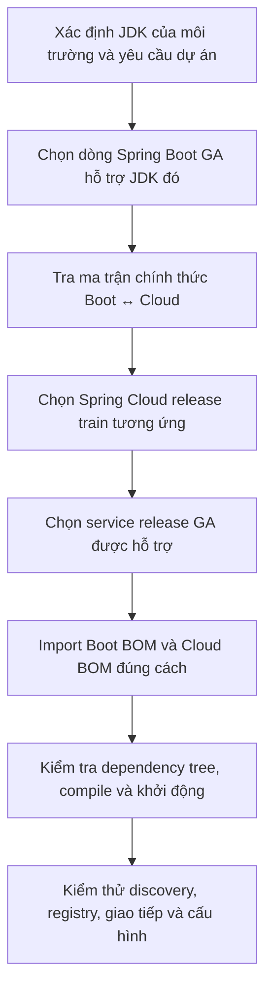

# Chọn Spring Cloud tương thích với Java và Spring Boot

Khi xây dựng ứng dụng phân tán với **SPRING_CLOUD_CORE**, quyết định phiên bản không chỉ là chọn một bản Spring Cloud mới nhất. Ứng dụng còn phụ thuộc vào **Java**, **Spring Boot**, **Spring Framework**, **Spring Cloud release train**, các starter riêng như Commons, Context, Config, Discovery và LoadBalancer, cùng phiên bản công cụ build. Nếu ghép sai những thành phần này, ứng dụng có thể biên dịch nhưng không khởi động được, hoặc chỉ gặp lỗi khi gọi dịch vụ và làm mới cấu hình.

Bài học thuộc chương **Phiên bản và phụ thuộc**. Chúng ta sẽ học cách chọn một tổ hợp được hỗ trợ, thiết lập Maven/Gradle theo BOM, phân tích dependency tree và kiểm chứng bằng những hành vi cốt lõi: discovery, service registry, giao tiếp giữa dịch vụ và refresh scope. Mục tiêu là có một **quy trình lựa chọn và kiểm tra có thể lặp lại**, thay vì đoán phiên bản theo tên hoặc chỉ dựa vào việc build thành công.

> **Mốc tham chiếu:** các ví dụ phiên bản trong bài được đối chiếu với tài liệu chính thức tại ngày **18/11/2026**. Danh sách hỗ trợ và các service release có thể thay đổi; khi áp dụng cho dự án thật, phải kiểm tra lại trang [Spring Cloud](https://spring.io/projects/spring-cloud/) và [Supported Versions](https://github.com/spring-cloud/spring-cloud-release/wiki/Supported-Versions).

## 1. Những kết quả cần đạt

Sau bài học, bạn có thể:

1. Phân biệt yêu cầu Java tối thiểu với phiên bản JDK dùng để build, phiên bản bytecode và JRE/JDK khi chạy.
2. Đọc ma trận tương thích **Spring Cloud release train ↔ Spring Boot** và phân biệt bản GA với milestone/RC.
3. Giải thích tại sao Spring Boot BOM và Spring Cloud BOM phải được quản lý nhất quán.
4. Tạo cấu hình Maven hoặc Gradle mẫu không gán phiên bản thủ công cho từng starter được BOM quản lý.
5. Dùng Maven/Gradle để tìm đúng phiên bản thực tế của các dependency được giải quyết.
6. Phân tích sự cố do không tương thích phiên bản, từ lỗi biên dịch và `UnsupportedClassVersionError` đến lỗi compatibility verifier lúc khởi động.
7. Xây dựng quy trình nâng cấp và kiểm thử các chức năng nền tảng của Spring Cloud trong hệ thống phân tán.

## 2. Hiểu bốn lớp phiên bản trước khi lựa chọn

Một ứng dụng Spring Cloud thông thường có ít nhất bốn lớp liên quan:

| Thành phần | Trách nhiệm | Ai quyết định phiên bản? |
| --- | --- | --- |
| Java/JDK | Biên dịch và chạy bytecode, cung cấp API của nền tảng Java | Nhóm phát triển và môi trường triển khai |
| Spring Boot | Tự cấu hình ứng dụng, starter, quản lý nhiều thư viện nền qua Boot BOM | Phiên bản Boot trong parent/POM hoặc Gradle plugin/BOM |
| Spring Cloud release train | Phối hợp các phiên bản của nhiều dự án Spring Cloud | Phiên bản của `spring-cloud-dependencies` BOM |
| Starter/thư viện cụ thể | Bổ sung chức năng như Commons, Context, Discovery, LoadBalancer, Config, Bus | Thông thường nhận phiên bản từ BOM tương ứng |

Ví dụ, `2025.1.4` là **phiên bản release train Spring Cloud**, không phải số phiên bản của mọi thư viện bên trong. Trong train đó, Spring Cloud Commons và Spring Cloud Config có thể có những số phiên bản module khác nhau. BOM chịu trách nhiệm ánh xạ các module về tổ hợp đã được phát hành cùng nhau.

### 2.1. Ba câu hỏi độc lập về Java

- **JDK dùng để chạy Gradle/Maven:** công cụ build phải khởi chạy trên một Java mà phiên bản công cụ đó hỗ trợ.
- **Java toolchain/target dùng để biên dịch:** quyết định cấp ngôn ngữ, API và/hoặc target bytecode của ứng dụng.
- **JRE/JDK của container hoặc máy chủ:** phải chạy được bytecode đã tạo và đáp ứng yêu cầu tối thiểu của Spring Boot cũng như thư viện phụ thuộc.

Ví dụ: dự án dùng JDK 21 để biên dịch thành bytecode Java 21 thì môi trường chỉ có Java 17 không thể chạy file `.class` đó. Ngược lại, chạy Java 21 không khiến một tổ hợp Spring Boot và Spring Cloud vốn không tương thích trở nên hợp lệ.

**Phân biệt yêu cầu tối thiểu và sự hỗ trợ được kiểm chứng:** Spring Boot 3.5 và Spring Boot 4.1 đều yêu cầu **tối thiểu Java 17** theo tài liệu hệ thống. Tuy nhiên, việc dùng một bản Java mới hơn còn phụ thuộc mức hỗ trợ của đúng dòng Boot, thư viện bên thứ ba, agent giám sát và công cụ build. Không suy ra rằng “chạy trên Java mới nhất” luôn an toàn chỉ vì nó lớn hơn 17.

### 2.2. Spring Framework và Jakarta là lớp phụ thuộc gián tiếp

Spring Boot quản lý phiên bản Spring Framework, các starter và nhiều thư viện nền. Trong các dòng đang xét:

- Spring Boot **3.5.x** thuộc thế hệ **Spring Framework 6.x**.
- Spring Boot **4.0/4.1** thuộc thế hệ **Spring Framework 7.x**.
- Nâng từ Boot 3 sang Boot 4 có thể kéo theo thay đổi API, starter, module và yêu cầu Jakarta/Servlet. Đây là một **nâng cấp nền tảng**, không chỉ là thay số phiên bản Cloud trong BOM.

Không nên tự nâng riêng `spring-core`, `spring-context`, `spring-web` hoặc các module Spring Framework khác lên số phiên bản tùy ý khi Boot BOM đang quản lý chúng, trừ khi có lý do đã kiểm chứng và quy trình kiểm thử tương ứng.

## 3. Đọc ma trận Spring Cloud ↔ Spring Boot

Spring Cloud phát hành theo **release train**, ví dụ `2025.1.x`. Một train gom nhiều dự án có quan hệ tương thích như Spring Cloud Commons, Config, Consul, Netflix, Gateway, Kubernetes và LoadBalancer. Một *service release* như `2025.1.4` là bản vá/cải tiến trong train `2025.1`.

### 3.1. Ma trận tham chiếu tại ngày 18/11/2026

| Spring Cloud release train | Dòng Spring Boot phù hợp | Ý nghĩa khi lựa chọn |
| --- | --- | --- |
| **2025.1.x (Oakwood)** | **4.0.x**; **4.1.x từ Cloud 2025.1.2 trở đi** | Dòng GA phù hợp cho ví dụ Boot 4 hiện tại; chọn service release mới nhất được hỗ trợ |
| 2025.0.x (Northfields) | 3.5.x | Dòng cũ, trang dự án đã đánh dấu hết hỗ trợ OSS; cần xem chính sách hỗ trợ trước khi chọn cho dự án mới |
| 2024.0.x (Moorgate) | 3.4.x | Dòng cũ, đã hết hỗ trợ OSS |
| 2023.0.x (Leyton) | 3.2.x; 3.3.x từ Cloud 2023.0.2 | Dòng cũ, đã hết hỗ trợ OSS |
| 2022.0.x (Kilburn) | 3.0.x; 3.1.x từ Cloud 2022.0.3 | Dòng cũ, đã hết hỗ trợ OSS |
| **2026.0.0-RC2 (Paddington)** | **4.2.0-RC2** | Chỉ là **release candidate** tại thời điểm tham chiếu; dùng cho đánh giá trước phát hành, không coi là GA |

**Ví dụ tổ hợp GA cụ thể:** bản phát hành [Spring Cloud 2025.1.4 ngày 23/10/2026](https://spring.io/blog/2026/10/23/spring-cloud-2025-1-4-has-been-released/) công bố được xây dựng trên **Spring Boot 4.0.9** và hỗ trợ **Spring Boot 4.1.2**. Vì vậy, **Java 21 + Boot 4.1.2 + Cloud 2025.1.4** là một tổ hợp minh họa hợp lý để học bài này.

**Ví dụ chưa phải GA:** [Spring Cloud 2026.0.0-RC2 ngày 05/11/2026](https://spring.io/blog/2026/11/05/spring-cloud-2026-0-0-RC2-has-been-released/) dựa trên Boot `4.2.0-RC2`. Khi cần ổn định vận hành, tránh nâng thẳng ứng dụng sản xuất sang một cặp RC chỉ vì số phiên bản của chúng mới hơn.

> **Không đọc bảng theo phép so sánh số đơn giản.** `2025.0.x` và `2025.1.x` thuộc hai release train khác nhau, tương ứng các thế hệ Boot khác nhau; `2025.1.1` cũng không có cùng phạm vi hỗ trợ Boot 4.1 như `2025.1.2+`.

### 3.2. Quy trình chọn phiên bản từ dưới lên



Trong trường hợp dự án đã chạy Spring Boot, quy trình bắt đầu từ **phiên bản Boot hiện tại**, sau đó tra Cloud phù hợp. Trong dự án hoàn toàn mới, thường chọn **JDK được tổ chức hỗ trợ** rồi **dòng Boot GA được hỗ trợ**, sau đó mới chọn Cloud.

### 3.3. Ba tình huống ra quyết định

| Nhu cầu thực tế | Phương án tham khảo | Lý do |
| --- | --- | --- |
| Viết ứng dụng mới với Java 21, cần discovery và load-balancing | Boot `4.1.2` + Cloud `2025.1.4` | Cặp phiên bản GA được công bố tương thích; Java 21 đáp ứng mức tối thiểu |
| Duy trì ứng dụng đang chạy Boot 3.5.x | Cloud `2025.0.x`, đồng thời lập kế hoạch chuyển sang dòng còn hỗ trợ | Đúng thế hệ tương thích nhưng cần kiểm tra trạng thái hỗ trợ/vá lỗi |
| Dự án còn Java 11 và Boot 2.x | Lập kế hoạch nâng Java và Boot trước khi dùng Cloud hiện đại | Không thể lắp release train Boot 4 vào hệ nền Java 11 |

Không chuyển một ứng dụng từ Boot 3.5 lên Boot 4.1 chỉ bằng cách thay `spring-cloud.version`. Phải cập nhật **Boot parent/plugin/BOM**, cấu hình build, mã sử dụng API thay đổi và cả đường triển khai.

## 4. BOM là gì và tại sao cần hai BOM?

**BOM (Bill of Materials)** trong Maven là một POM chứa các ràng buộc/khuyến nghị phiên bản để trình quản lý phụ thuộc giải quyết nhất quán. Hai BOM phổ biến:

- `org.springframework.boot:spring-boot-dependencies` quản lý thư viện Spring Boot, Spring Framework và nhiều thư viện nền.
- `org.springframework.cloud:spring-cloud-dependencies` quản lý các dự án và starter Spring Cloud trong một release train.

Nếu dùng `spring-boot-starter-parent` của Maven, cấu hình parent đó đã cung cấp dependency management của Boot. Khi dùng Cloud, nhập thêm Cloud BOM dưới `<dependencyManagement>`. Với Gradle, cần khai báo cơ chế quản lý BOM một cách rõ ràng; chỉ thêm Spring Boot plugin **không mặc nhiên** tương đương với việc đã import cả hai BOM khi sử dụng Gradle native platforms.

### 4.1. Những gì BOM làm và không làm

| BOM giúp | BOM không bảo đảm |
| --- | --- |
| Giảm việc ghi phiên bản cho từng dependency được quản lý | Tự cài đặt registry, Config Server hoặc Gateway |
| Phối hợp các phiên bản module cùng release train | Mọi thư viện của bên thứ ba đều tương thích với ứng dụng |
| Cho phép nâng bản vá tập trung qua một property | Cấu hình ứng dụng và API runtime vẫn đúng sau nâng cấp lớn |
| Giúp tái lập dependency graph khi giữ cố định phiên bản | Không có override gây xung đột trong parent, plugin hoặc dependency transitively |

Ví dụ, cùng thuộc train `2025.1.4`, module Spring Cloud Commons được phát hành với phiên bản `5.0.4` còn Spring Cloud Config với phiên bản `5.0.6`. Đây là điều bình thường; **không ép mọi `spring-cloud-*` thành phiên bản `2025.1.4`**.

### 4.2. Khác nhau giữa starter và BOM

Khai báo sau **chỉ quản lý phiên bản**, không đưa toàn bộ thư viện Cloud vào classpath:

```xml
<dependencyManagement>
    <dependencies>
        <dependency>
            <groupId>org.springframework.cloud</groupId>
            <artifactId>spring-cloud-dependencies</artifactId>
            <version>2025.1.4</version>
            <type>pom</type>
            <scope>import</scope>
        </dependency>
    </dependencies>
</dependencyManagement>
```

Muốn dùng tính năng cụ thể, vẫn phải khai báo starter trong `<dependencies>`, ví dụ `spring-cloud-starter-loadbalancer`, `spring-cloud-starter-consul-discovery` hoặc `spring-cloud-starter-config` theo nhu cầu. Tránh thêm đồng thời nhiều provider chỉ vì muốn “có đủ Spring Cloud”: mỗi starter có thể kích hoạt auto-configuration và tác động đến ứng dụng.

## 5. Cấu hình Maven minh họa: Java 21 + Boot 4.1.2 + Cloud 2025.1.4

Ví dụ này sử dụng **Spring MVC** và **Spring Cloud LoadBalancer** để minh họa quản lý phụ thuộc. Nó **không yêu cầu Consul/Eureka** khi chỉ thực hiện build; tích hợp discovery thật sẽ được bổ sung khi cần. Đặt nội dung sau trong `pom.xml` của một dự án Maven có mã nguồn ứng dụng Spring Boot:

```xml
<?xml version="1.0" encoding="UTF-8"?>
<project xmlns="http://maven.apache.org/POM/4.0.0"
         xmlns:xsi="http://www.w3.org/2001/XMLSchema-instance"
         xsi:schemaLocation="http://maven.apache.org/POM/4.0.0
             https://maven.apache.org/xsd/maven-4.0.0.xsd">
    <modelVersion>4.0.0</modelVersion>

    <parent>
        <groupId>org.springframework.boot</groupId>
        <artifactId>spring-boot-starter-parent</artifactId>
        <version>4.1.2</version>
        <relativePath/>
    </parent>

    <groupId>com.example</groupId>
    <artifactId>cloud-version-demo</artifactId>
    <version>0.0.1-SNAPSHOT</version>

    <properties>
        <java.version>21</java.version>
        <spring-cloud.version>2025.1.4</spring-cloud.version>
    </properties>

    <dependencyManagement>
        <dependencies>
            <dependency>
                <groupId>org.springframework.cloud</groupId>
                <artifactId>spring-cloud-dependencies</artifactId>
                <version>${spring-cloud.version}</version>
                <type>pom</type>
                <scope>import</scope>
            </dependency>
        </dependencies>
    </dependencyManagement>

    <dependencies>
        <dependency>
            <groupId>org.springframework.boot</groupId>
            <artifactId>spring-boot-starter-webmvc</artifactId>
        </dependency>
        <dependency>
            <groupId>org.springframework.cloud</groupId>
            <artifactId>spring-cloud-starter-loadbalancer</artifactId>
        </dependency>
        <dependency>
            <groupId>org.springframework.boot</groupId>
            <artifactId>spring-boot-starter-test</artifactId>
            <scope>test</scope>
        </dependency>
    </dependencies>

    <build>
        <plugins>
            <plugin>
                <groupId>org.springframework.boot</groupId>
                <artifactId>spring-boot-maven-plugin</artifactId>
            </plugin>
        </plugins>
    </build>
</project>
```

**Giải thích chính xác các dòng quan trọng:**

1. `<parent>` chọn **Spring Boot 4.1.2**, đồng thời nhận quản lý dependency và mặc định plugin từ Boot.
2. `<java.version>21</java.version>` chọn mức Java cho build theo quy ước parent. JDK/Java runtime thực tế vẫn phải được cài và cấu hình.
3. `<spring-cloud.version>2025.1.4</spring-cloud.version>` là phiên bản train, tách khỏi phiên bản Boot.
4. `<scope>import</scope>` trong `<dependencyManagement>` yêu cầu Maven nhập ràng buộc phiên bản từ Cloud BOM.
5. Các starter **không có `<version>` riêng** vì được các BOM quản lý.
6. `spring-boot-starter-webmvc` là tên starter dành cho Spring MVC ở Boot 4; tên cũ `spring-boot-starter-web` đã được đánh dấu deprecated trong quá trình chuyển từ Boot 3 lên Boot 4.

Nếu bổ sung Spring Cloud Config Client, có thể thêm dependency sau, **không tự gán phiên bản**:

```xml
<dependency>
    <groupId>org.springframework.cloud</groupId>
    <artifactId>spring-cloud-starter-config</artifactId>
</dependency>
```

Lúc đó cần cấu hình nguồn config tương ứng, ví dụ `spring.config.import`, và xác định hành vi khi Config Server không sẵn sàng. Thêm starter thành công không có nghĩa ứng dụng đã có cấu hình bên ngoài hợp lệ.

### 5.1. Lệnh kiểm tra Maven

```bash
java -version
./mvnw -version
./mvnw help:effective-pom
./mvnw dependency:tree
./mvnw dependency:tree -Dincludes=org.springframework.cloud
./mvnw test
```

Nếu không có Maven Wrapper, dùng lệnh `mvn` tương ứng. `help:effective-pom` giúp đọc mô hình POM sau khi kết hợp parent/BOM; `dependency:tree` cho biết **phiên bản thực sự được chọn** và nguồn phụ thuộc bắc cầu. Phải đọc kết quả, không chỉ nhìn `pom.xml` rồi suy đoán.

## 6. Cấu hình Gradle minh họa: hai BOM bằng native platform

Một cách đơn giản với Gradle là dùng **Gradle native BOM support**. Ví dụ `build.gradle` (Groovy DSL) sau đặt hai BOM tường minh trong `dependencies`:

```groovy
plugins {
    id 'java'
    id 'org.springframework.boot' version '4.1.2'
}

group = 'com.example'
version = '0.0.1-SNAPSHOT'

java {
    toolchain {
        languageVersion = JavaLanguageVersion.of(21)
    }
}

repositories {
    mavenCentral()
}

dependencies {
    implementation platform('org.springframework.boot:spring-boot-dependencies:4.1.2')
    implementation platform('org.springframework.cloud:spring-cloud-dependencies:2025.1.4')

    implementation 'org.springframework.boot:spring-boot-starter-webmvc'
    implementation 'org.springframework.cloud:spring-cloud-starter-loadbalancer'

    testImplementation platform('org.springframework.boot:spring-boot-dependencies:4.1.2')
    testImplementation 'org.springframework.boot:spring-boot-starter-test'
}

tasks.named('test') {
    useJUnitPlatform()
}
```

Điểm cần nhớ:

- Spring Boot Gradle plugin cung cấp tác vụ build/repackage và tích hợp Boot; với **native platform**, các ràng buộc phiên bản được khai báo bằng `platform(...)`.
- Ví dụ import cả Boot BOM và Cloud BOM cho `implementation`. Cấu hình `testImplementation` có Boot BOM riêng để quản lý dependency test khi cần; trong dự án thật có thể dùng các cấu hình hoặc dependency management theo convention của tổ chức.
- Có thể thay cách trên bằng plugin `io.spring.dependency-management` và `mavenBom 'org.springframework.cloud:spring-cloud-dependencies:2025.1.4'`. Chọn **một chiến lược quản lý nhất quán** trong repository để tránh override khó hiểu.
- `toolchain` giúp Gradle chọn JDK 21 để biên dịch/chạy tác vụ hỗ trợ toolchain; phiên bản Java mà Gradle daemon dùng để khởi chạy và mức hỗ trợ của Gradle vẫn phải kiểm tra riêng.

### 6.1. Lệnh kiểm tra Gradle

```bash
java -version
./gradlew --version
./gradlew dependencies --configuration runtimeClasspath
./gradlew dependencyInsight --dependency spring-cloud-commons --configuration runtimeClasspath
./gradlew dependencyInsight --dependency spring-core --configuration runtimeClasspath
./gradlew test
```

`dependencyInsight` hữu ích khi cùng một thư viện được yêu cầu bởi nhiều starter hoặc BOM và bạn cần biết **lý do** một version được chọn. Nếu nghi ngờ conflict, kiểm tra cả runtime và test classpath tùy điểm lỗi.

## 7. Tránh những cách phối phiên bản dễ sai

### 7.1. Đặt phiên bản cho từng starter riêng lẻ

**Cấu hình nên tránh:**

```xml
<dependencies>
    <dependency>
        <groupId>org.springframework.cloud</groupId>
        <artifactId>spring-cloud-starter-config</artifactId>
        <version>4.1.0</version>
    </dependency>
    <dependency>
        <groupId>org.springframework.cloud</groupId>
        <artifactId>spring-cloud-starter-loadbalancer</artifactId>
        <version>5.0.4</version>
    </dependency>
</dependencies>
```

Ví dụ trên có nguy cơ trộn các thế hệ module Cloud, ngay cả khi Maven tải được tất cả artifact. Khi đã import BOM phù hợp, nên bỏ `<version>` của starter do BOM quản lý. Một trường hợp override có chủ đích phải kèm lý do, vấn đề cần vá và kiểm thử tương thích.

### 7.2. Chỉ nâng Cloud nhưng giữ Boot quá cũ

Ví dụ: dự án dùng Boot `3.5.x`, bạn đổi `spring-cloud-dependencies` thành `2025.1.4`. Cloud train này hướng tới Boot **4.0/4.1**, nên đây không phải một nâng cấp hợp lệ theo ma trận. Cần chọn Cloud thuộc dòng Boot 3.5 hoặc nâng toàn bộ nền Boot trước.

### 7.3. Chỉ kiểm tra Java bằng `java -version`

Trong CI hoặc máy phát triển có nhiều JDK, lệnh `java -version` chưa bảo đảm Maven/Gradle và Java toolchain đang dùng cùng bản Java; phải xem `mvn -version`/`gradlew --version`, cấu hình toolchain và cả Java runtime trong container triển khai.

### 7.4. Nhầm artifact version với release train

Đừng thấy module Commons `5.0.4` rồi viết `<spring-cloud.version>5.0.4</spring-cloud.version>`. Phần version của **Cloud BOM** là `2025.1.4`; phần version của **module** bên trong là số riêng được BOM chọn.

### 7.5. Trộn GA với milestone, RC hoặc snapshot

Hậu tố `-M1`, `-RC2`, `-SNAPSHOT` thể hiện trạng thái phát hành khác GA. Các bản preview có thể cần repository riêng và có thay đổi API trước GA. Không nên coi `2026.0.0-RC2` và `2025.1.4` tương đương về mức ổn định chỉ vì chúng cùng xuất hiện trong các trang release.

## 8. Spring Cloud compatibility verifier

Spring Cloud Commons có cơ chế **compatibility verification** nhằm phát hiện một số tổ hợp không phù hợp khi ứng dụng khởi động. Theo tài liệu Spring Cloud Commons, cơ chế này **kiểm tra phiên bản Spring Boot trên classpath** và có thể khiến ứng dụng không khởi động nếu không tương thích với release train.

Một thông báo tiêu biểu có dạng:

```text
APPLICATION FAILED TO START

Your project setup is incompatible with our requirements due to:
- Spring Boot [x.y.z] is not compatible with this Spring Cloud release train

Action:
Consider changing Spring Boot to a compatible version.
```

Đây là thông báo **minh họa**; câu chữ và danh sách phiên bản gợi ý thay đổi theo release. Cách khắc phục có trách nhiệm:

1. Xem Boot version thực tế đang được resolved, không chỉ property khai báo.
2. Đối chiếu với ma trận và release notes của Cloud train.
3. Chọn một cặp GA phù hợp và đồng bộ parent/plugin/BOM.
4. Kiểm tra dependency tree để phát hiện override hoặc classpath xung đột.
5. Build, khởi động và chạy lại các phép thử tích hợp.

Tài liệu cũng mô tả thuộc tính `spring.cloud.compatibility-verifier.enabled` có thể tắt bộ kiểm tra và `spring.cloud.compatibility-verifier.compatible-boot-versions` có thể thay đổi danh sách chấp nhận. **Đây không phải biện pháp sửa tính không tương thích.** Tắt hoặc override verifier chỉ làm thay đổi bước kiểm tra lúc khởi động; nó không sửa API, bytecode hoặc hành vi runtime giữa các phiên bản.

## 9. Kiểm chứng kỹ thuật theo ba cấp độ

Một cặp phiên bản đúng ma trận mới là **điều kiện cần**. Hệ thống phân tán còn phải có chức năng chính vận hành đúng.

| Cấp độ | Việc kiểm tra | Phát hiện được loại lỗi nào? |
| --- | --- | --- |
| **Dependency/build** | BOM, `effective-pom`, `dependency:tree`/`dependencyInsight`, Java toolchain, compile và test | Resolve version, Java bytecode, classpath, API lúc compile |
| **Khởi động ứng dụng** | Tạo Spring context, auto-configuration, compatibility verifier, Actuator health | Thiếu bean, class/method không khớp, cấu hình sai, provider không sẵn sàng |
| **Tích hợp vận hành** | Discovery, service registration, HTTP load-balancing, config import và refresh scope | Lỗi thường chỉ xuất hiện khi gọi thực tế, chuyển trạng thái, refresh hoặc scale |

### 9.1. Kiểm thử discovery và registry

Giả sử ứng dụng sử dụng `DiscoveryClient` hoặc `ReactiveDiscoveryClient` và một adapter Consul/Eureka:

- Kiểm tra bean discovery có xuất hiện trong ApplicationContext khi starter và cấu hình đúng.
- Tạo hai instance của một service; xác nhận discovery trả đúng service ID, URI, port và metadata mong đợi.
- Ngừng một instance hoặc làm health check fail; quan sát độ trễ trước khi instance bị loại khỏi kết quả.
- Kiểm tra auto-registration và deregistration theo cơ chế của provider; không giả định mọi provider dùng chung heartbeat.

Chỉ thấy một lớp `DiscoveryClient` trên classpath chưa chứng minh đã kết nối được tới registry.

### 9.2. Kiểm thử giao tiếp giữa dịch vụ

Với HTTP client được cấu hình theo tên dịch vụ và Spring Cloud LoadBalancer:

1. Tạo service ID `inventory-service` có ít nhất một endpoint đang chạy.
2. Gửi request thông qua `WebClient`, `RestClient` hoặc client phù hợp với phiên bản đang sử dụng.
3. Xác nhận request đến địa chỉ do discovery cung cấp, thay vì phụ thuộc vào hostname vật lý được ghi cứng.
4. Mô phỏng không có instance, timeout và instance dừng đột ngột; xác minh cách client báo lỗi, retry và bảo toàn hành vi nghiệp vụ.

Nếu ứng dụng chỉ thêm `spring-cloud-starter-loadbalancer` nhưng không có nguồn instance, request theo service ID vẫn có thể thất bại. **Tương thích phiên bản không thay thế cấu hình hạ tầng.**

### 9.3. Kiểm thử cấu hình ngoài và refresh scope

Nếu dùng Spring Cloud Context và Spring Cloud Config:

- Kiểm tra property ban đầu có được nạp từ đúng `PropertySource` và theo thứ tự ưu tiên mong muốn.
- Tạo một bean có `@RefreshScope`, cập nhật property tại nguồn và kích hoạt cơ chế refresh được hỗ trợ.
- Xác minh giá trị mới xuất hiện sau khi refresh; xác minh các bean không refresh được xử lý theo thiết kế.
- Thử tình huống Config Server/nguồn config không sẵn sàng, nhiều replica có cấu hình khác nhau và việc bảo vệ endpoint quản trị.

Những bài test này giúp phát hiện thay đổi hành vi khi nâng Commons/Context/Config mà bài test compile đơn thuần không thể thấy.

## 10. Chẩn đoán lỗi sau khi đổi phiên bản

| Triệu chứng | Nguyên nhân cần xem xét | Cách xác minh và xử lý |
| --- | --- | --- |
| `UnsupportedClassVersionError` | JDK runtime không đọc được bytecode | Xem phiên bản Java khi build và khi chạy; căn chỉnh toolchain/target/runtime |
| `NoClassDefFoundError`/`ClassNotFoundException` | Thiếu dependency hoặc module bị thay đổi | Kiểm tra runtimeClasspath, starter đang dùng và release notes |
| `NoSuchMethodError` | Các module thư viện không cùng bộ API/binary tương thích | Đọc dependency tree, tìm phiên bản bị override hoặc trùng |
| Compatibility verifier từ chối khởi động | Boot nằm ngoài phạm vi Cloud train chấp nhận | Đối chiếu ma trận chính thức và chọn lại cả Boot + Cloud |
| Thiếu `DiscoveryClient`/bean load-balancer | Starter, điều kiện auto-configuration hoặc cấu hình không phù hợp | Kiểm tra dependency, điều kiện bean và cấu hình discovery |
| HTTP `503` khi gọi service ID | Không có instance đủ điều kiện hoặc tầng phía sau lỗi | Kiểm tra registry, health, URI, cache, timeout và log của downstream |
| Đổi Config Server nhưng bean không nhận giá trị mới | Chưa phát hiện/refresh cấu hình hoặc bean không hỗ trợ rebind | Kiểm tra import nguồn config, refresh event/scope và đời sống bean |
| Unit test pass nhưng deploy fail | Khác JDK, mạng, registry, profile, secrets hoặc runtime classpath | Tái hiện trên môi trường tích hợp gần production |

Không nên chữa lỗi `NoSuchMethodError` bằng cách thêm ngẫu nhiên một phiên bản `spring-core` vào `pom.xml`. Đây thường là dấu hiệu cần nhìn **toàn bộ đồ thị phụ thuộc** và khôi phục một bộ đã được quản lý thống nhất.

## 11. Nâng cấp có kiểm soát: Boot 3.5/Cloud 2025.0 sang Boot 4.1/Cloud 2025.1

Đây là một ví dụ về **nâng cấp nền tảng thực sự**, không phải thay Cloud patch version:

1. **Chốt hiện trạng:** ghi lại JDK, Boot, Cloud BOM, starter đang dùng, provider registry, cấu hình bên ngoài, bộ test và phiên bản build tool.
2. **Đọc migration guide của Boot 4:** kiểm tra thay đổi module, API, starter cũ, yêu cầu Spring Framework/Jakarta và các phần deprecated bị xóa.
3. **Chọn cặp được công bố hỗ trợ:** ví dụ Boot `4.1.2`, Cloud `2025.1.4`, Java `21` (hoặc phiên bản Java khác được tài liệu hỗ trợ).
4. **Đổi dependency management tập trung:** cập nhật Boot parent/plugin/BOM và Cloud BOM; loại bỏ các version override không còn cần thiết.
5. **Sửa mã và cấu hình:** thay những starter/API đã đổi, kiểm tra auto-configuration và các property đã đổi tên hoặc bị xóa.
6. **Xác minh bằng công cụ build:** resolve dependency tree, compile, test và khởi động; sửa lỗi do thực sự thiếu API/bean.
7. **Kiểm thử các hành vi phân tán:** đăng ký và tìm service, load-balancing, retry, cấu hình ngoài và refresh scope.
8. **Triển khai theo giai đoạn:** theo dõi lỗi startup, tỷ lệ request thành công, độ trễ discovery và trạng thái registry; có phương án khôi phục bản trước khi cần.

**Lưu ý về hỗ trợ:** nếu ứng dụng đang ở một release train đã hết thời hạn OSS, việc “không đổi gì” cũng là một quyết định vận hành có rủi ro bảo trì và bảo mật. Cần cân nhắc chính sách hỗ trợ thương mại nếu chưa thể nâng ngay.

### 11.1. Checklist trước khi chấp nhận một tổ hợp

- [ ] Java bản dùng để build và Java runtime thỏa yêu cầu của Boot/Cloud và môi trường.
- [ ] Spring Boot là bản GA được hỗ trợ trong thời gian vận hành dự kiến.
- [ ] Spring Cloud release train và **service release** phù hợp với dòng Boot thực tế.
- [ ] Boot BOM và Cloud BOM được import đúng; không trộn các module Cloud tùy tiện.
- [ ] Maven/Gradle và plugin build hỗ trợ JDK cùng thế hệ Boot đã chọn.
- [ ] Dependency tree không chứa override không giải thích được hoặc xung đột classpath.
- [ ] Khởi động Spring context qua compatibility verifier và các bean cần thiết được tạo.
- [ ] Tích hợp discovery, registry, load-balancing, Config và `@RefreshScope` (nếu sử dụng) được kiểm thử.
- [ ] Các adapter ngoài như Consul, Eureka, Kubernetes, driver và agent giám sát tương thích với runtime mục tiêu.
- [ ] Đã có bằng chứng CI/staging và kế hoạch rollback cho lần nâng cấp.

## 12. Tình huống thực hành phân tích

Một nhóm có ứng dụng `order-service` với các thông số:

```text
Java runtime: 17
Spring Boot: 3.5.x
Spring Cloud BOM: 2025.1.4
Discovery: Eureka
Triệu chứng: compatibility verifier báo không tương thích
```

**Phân tích:** Java 17 không phải nguyên nhân đầu tiên vì nó đáp ứng mức Java tối thiểu của Boot 3.5/4.1. Vấn đề là **Boot 3.5.x không thuộc phạm vi hỗ trợ của Cloud 2025.1.x**. Đổi JDK sang 21 một mình sẽ không giải quyết được mâu thuẫn này.

Hai hướng xử lý có căn cứ:

- **Giữ Boot 3.5 trong giai đoạn chuyển tiếp:** chọn Cloud thuộc train `2025.0.x` dành cho Boot 3.5, đánh giá tình trạng hỗ trợ, vá lỗi và lập kế hoạch nâng cấp.
- **Nâng nền tảng:** chuyển Boot sang dòng được Cloud `2025.1.4` hỗ trợ (ví dụ `4.1.2`), kiểm tra migration guide và kiểm thử lại Eureka, Web client, config/refresh, startup và Java runtime.

Giải pháp `spring.cloud.compatibility-verifier.enabled=false` chỉ ẩn cảnh báo chặn khởi động; không chứng minh được mã ứng dụng an toàn khi chạy và không phải phương án để kết thúc bài toán.

## 13. Nguyên tắc ghi nhớ

Khi chọn Spring Cloud cho một hệ thống phân tán, thứ tự tư duy phù hợp là:

**Môi trường Java → Spring Boot GA tương thích → Spring Cloud release train tương ứng → service release được hỗ trợ → BOM → các starter cần dùng → kiểm tra thực tế.**

Hãy nhớ năm điểm cốt lõi:

1. **Release train Spring Cloud là đơn vị chọn phiên bản ở cấp hệ thống**, còn mỗi module Commons, Context, Config, Consul hay LoadBalancer có số phiên bản riêng.
2. **BOM quản lý phụ thuộc, starter cung cấp chức năng**; không nhầm việc import BOM với việc đã kích hoạt discovery hay Config Server.
3. **Java 17 là mức tối thiểu của các dòng Boot 3.5 và 4.1** trong ví dụ; JDK build, bytecode và runtime phải được kiểm tra đồng thời.
4. **Compatibility verifier chỉ là một lớp kiểm tra**, không thay thế ma trận tương thích hay bài test vận hành.
5. **Tương thích không đồng nghĩa hệ thống hoạt động đúng**: cần kiểm chứng discovery, service registry, giao tiếp dịch vụ, cấu hình bên ngoài và refresh scope trên đúng môi trường triển khai.

## 14. Nguồn tra cứu chính thức

Các liên kết sau dùng để **kiểm tra lại phiên bản mới nhất trước khi áp dụng**, vì trạng thái hỗ trợ thay đổi theo thời gian:

- [Spring Cloud — bảng tương thích release train với Spring Boot](https://spring.io/projects/spring-cloud/)
- [Spring Cloud Supported Versions — vòng đời và phiên bản module](https://github.com/spring-cloud/spring-cloud-release/wiki/Supported-Versions)
- [Spring Cloud 2025.1.4 — thông báo phát hành ngày 23/10/2026](https://spring.io/blog/2026/10/23/spring-cloud-2025-1-4-has-been-released/)
- [Spring Cloud 2026.0.0-RC2 — thông báo phát hành ngày 05/11/2026](https://spring.io/blog/2026/11/05/spring-cloud-2026-0-0-RC2-has-been-released/)
- [Spring Boot 4.1 — System Requirements](https://docs.spring.io/spring-boot/4.1/system-requirements.html)
- [Spring Boot 3.5 — System Requirements](https://docs.spring.io/spring-boot/3.5/system-requirements.html)
- [Spring Boot — Managing Dependencies with Gradle](https://docs.spring.io/spring-boot/gradle-plugin/managing-dependencies.html)
- [Spring Cloud Commons — Compatibility Verification](https://docs.spring.io/spring-cloud-commons/reference/spring-cloud-commons/common-abstractions.html)
- [Spring Initializr — tạo dự án với các dependency tương thích](https://start.spring.io/)
