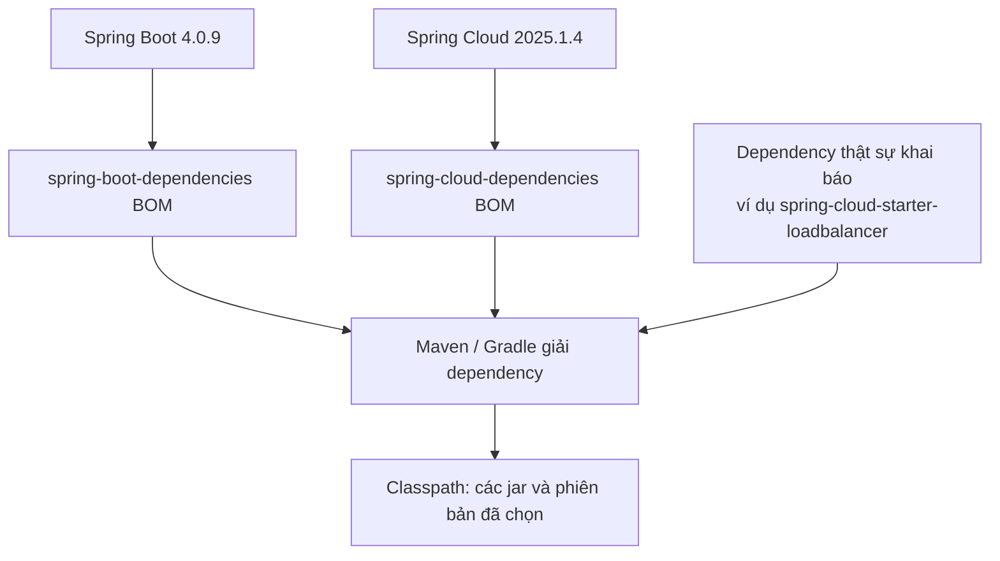
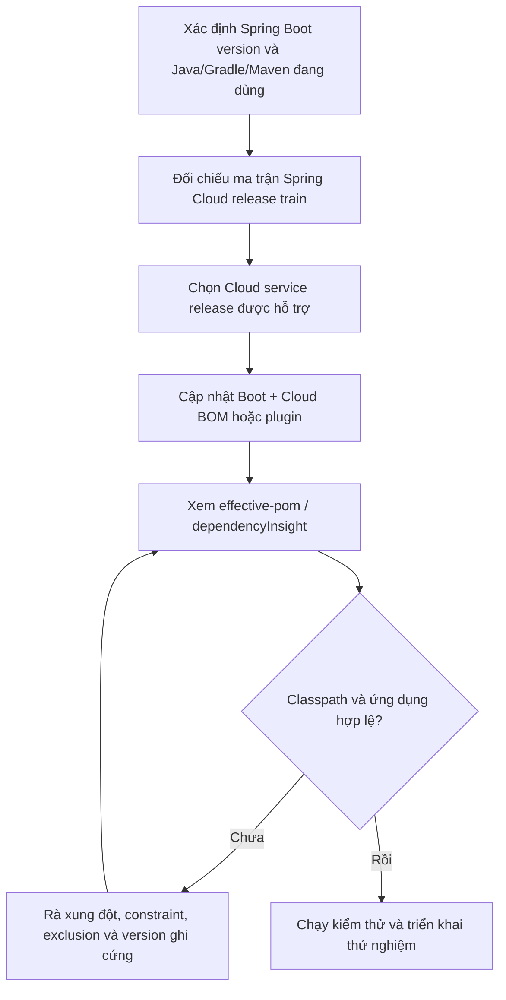

# Nhập BOM trong Maven và Gradle

## 1. Mục tiêu và vị trí của bài học

Trong học phần **SPRING_CLOUD_CORE**, người học sử dụng Spring Cloud Commons, Context và các abstraction phục vụ hệ thống phân tán như discovery, service registry, giao tiếp dịch vụ, cấu hình bên ngoài và refresh scope. Những thành phần này được phát hành theo **Spring Cloud release train**, trong khi ứng dụng chạy trên **Spring Boot**. Nếu khai báo phiên bản từng thư viện một cách rời rạc, dự án dễ gặp lỗi tương thích, lỗi class/method lúc chạy, hoặc phụ thuộc bắc cầu bị kéo về phiên bản ngoài dự kiến.

Bài học thuộc chương **Phiên bản và phụ thuộc** và giải quyết câu hỏi cụ thể: **Làm thế nào nhập Spring Cloud BOM vào Maven hoặc Gradle để quản lý phiên bản dependency tập trung và có thể kiểm tra lại kết quả?**

Sau bài này, bạn có thể:

1. Giải thích **BOM** là gì, nó giải quyết vấn đề nào và nó không tự làm gì.
2. Phân biệt Spring Boot BOM với Spring Cloud BOM và chọn release train phù hợp.
3. Nhập BOM trong Maven bằng `dependencyManagement`, kể cả khi dùng hoặc không dùng Spring Boot parent.
4. Nhập BOM trong Gradle bằng **native `platform()`** hoặc **plugin `io.spring.dependency-management`**, cho cả Kotlin DSL và Groovy DSL.
5. Xác minh phiên bản thực tế, hiểu thứ tự ưu tiên giữa các BOM và xử lý lỗi dependency phổ biến.

## 2. BOM là gì và tại sao Spring Cloud cần BOM?

**BOM (Bill of Materials)** trong hệ sinh thái Java là tập khai báo các phiên bản dependency đã được phối hợp. Trong Maven, một BOM thông thường là POM có `dependencyManagement` và được nhập với `<type>pom</type>`, `<scope>import</scope>`. Gradle có thể dùng cùng BOM đó như một *platform*.

Ví dụ: một phiên bản Spring Cloud release train quản lý các phiên bản tương ứng của `spring-cloud-commons`, `spring-cloud-context`, `spring-cloud-starter-loadbalancer`, `spring-cloud-starter-config` và các dự án Spring Cloud liên quan. Khi dự án chọn một release train, những module được BOM quản lý có thể khai báo **không ghi số phiên bản riêng**.



Cần phân biệt hai việc:

| Công việc | Câu hỏi | Cú pháp minh họa |
| --- | --- | --- |
| **Quản lý phiên bản** | Nếu dự án sử dụng thư viện X thì chọn phiên bản nào? | Maven `dependencyManagement`; Gradle `platform(...)` hoặc `dependencyManagement { ... }` |
| **Khai báo sử dụng** | Ứng dụng có thực sự cần đưa thư viện X vào classpath không? | Maven `<dependencies>`; Gradle `dependencies { implementation(...) }` |

**Nhập BOM không tự cài tất cả thư viện trong BOM.** Nếu chỉ nhập Spring Cloud BOM mà không khai báo một starter hoặc thư viện Cloud cụ thể, bạn chưa mặc nhiên có service discovery, Config Client hoặc LoadBalancer trên classpath. BOM cũng **không** thay thế cấu hình `application.yml`, code nghiệp vụ hay thiết lập registry/Config Server.

### 2.1. Hai BOM với hai trách nhiệm

| BOM | Tọa độ Maven | Quản lý chủ yếu |
| --- | --- | --- |
| **Spring Boot BOM** | `org.springframework.boot:spring-boot-dependencies` | Dependency trong hệ sinh thái Boot, Spring Framework và nhiều thư viện bên thứ ba |
| **Spring Cloud BOM** | `org.springframework.cloud:spring-cloud-dependencies` | Các phiên bản dự án và starter Spring Cloud thuộc cùng release train |

BOM quản lý **dependency của ứng dụng**; nó không mặc nhiên quản lý phiên bản *build plugin*. Ví dụ `org.springframework.boot` trong `plugins` Gradle, `spring-boot-maven-plugin` và Gradle Wrapper vẫn cần được quản lý phù hợp theo cách riêng.

### 2.2. Chọn cặp Spring Boot và Spring Cloud tương thích

Tại thời điểm **18/11/2026**, trang chính thức của Spring Cloud hiển thị release train ổn định **2025.1.4**, tài liệu train này ghi **Supported Boot Version: 4.0.9**. Vì vậy bài học dùng cặp **Spring Boot 4.0.9 / Spring Cloud 2025.1.4** cho các ví dụ nhất quán. Đây là **cặp minh họa đã đối chiếu tài liệu**, không phải hướng dẫn chọn phiên bản cố định cho mọi dự án về sau.

| Dòng Spring Boot | Spring Cloud release train phù hợp theo bảng Spring | Lưu ý |
| --- | --- | --- |
| **4.0.x** | **2025.1.x** | Cặp minh họa: Boot 4.0.9 + Cloud 2025.1.4 |
| **4.1.x** | **2025.1.x** | Hỗ trợ từ Cloud 2025.1.2 trở đi; đối chiếu service release cụ thể |
| **3.5.x** | **2025.0.x** | Dòng release khác; cần kiểm tra trạng thái hỗ trợ hiện tại |
| **3.4.x** | **2024.0.x** | Dòng release khác; cần kiểm tra trạng thái hỗ trợ hiện tại |

Không suy ra rằng “Boot nào cũng chạy được với Cloud mới nhất”. Khi khởi tạo dự án mới, có thể dùng [Spring Initializr](https://start.spring.io/) để chọn Boot và starter Cloud; nó sẽ sinh cấu hình BOM tương thích. Với dự án hiện có, luôn kiểm tra [bảng release train chính thức](https://spring.io/projects/spring-cloud/) cùng [tài liệu của phiên bản đang chọn](https://docs.spring.io/spring-cloud-release/reference/index.html).

## 3. Maven: nhập Spring Cloud BOM khi dùng Spring Boot parent

Đây là cách phổ biến cho ứng dụng Spring Boot. Parent `spring-boot-starter-parent` kế thừa `spring-boot-dependencies`, giúp quản lý phiên bản dependency Boot. Ta chỉ cần **nhập thêm Spring Cloud BOM** vào `dependencyManagement`.

### 3.1. Ví dụ `pom.xml` hoàn chỉnh ở mức cấu hình dependency

```xml
<?xml version="1.0" encoding="UTF-8"?>
<project xmlns="http://maven.apache.org/POM/4.0.0"
         xmlns:xsi="http://www.w3.org/2001/XMLSchema-instance"
         xsi:schemaLocation="http://maven.apache.org/POM/4.0.0 https://maven.apache.org/xsd/maven-4.0.0.xsd">
    <modelVersion>4.0.0</modelVersion>

    <parent>
        <groupId>org.springframework.boot</groupId>
        <artifactId>spring-boot-starter-parent</artifactId>
        <version>4.0.9</version>
        <relativePath/>
    </parent>

    <groupId>com.example</groupId>
    <artifactId>spring-cloud-core-demo</artifactId>
    <version>0.0.1-SNAPSHOT</version>

    <properties>
        <java.version>17</java.version>
        <spring-cloud.version>2025.1.4</spring-cloud.version>
    </properties>

    <dependencyManagement>
        <dependencies>
            <dependency>
                <groupId>org.springframework.cloud</groupId>
                <artifactId>spring-cloud-dependencies</artifactId>
                <version>${spring-cloud.version}</version>
                <type>pom</type>
                <scope>import</scope>
            </dependency>
        </dependencies>
    </dependencyManagement>

    <dependencies>
        <dependency>
            <groupId>org.springframework.boot</groupId>
            <artifactId>spring-boot-starter</artifactId>
        </dependency>
        <dependency>
            <groupId>org.springframework.cloud</groupId>
            <artifactId>spring-cloud-starter-loadbalancer</artifactId>
        </dependency>
    </dependencies>

    <build>
        <plugins>
            <plugin>
                <groupId>org.springframework.boot</groupId>
                <artifactId>spring-boot-maven-plugin</artifactId>
            </plugin>
        </plugins>
    </build>
</project>
```

**Giải thích từng điểm:**

- `<parent>` chọn Spring Boot 4.0.9 và kế thừa dependency/plugin management, nên `spring-boot-starter` không cần tự ghi version.
- `spring-cloud.version` chứa **version release train**, không phải version của một jar `spring-cloud-commons`.
- `<type>pom</type>` và `<scope>import</scope>` bảo Maven **nhập các mục được quản lý** từ Cloud BOM vào `dependencyManagement` hiện tại.
- `spring-cloud-starter-loadbalancer` trong `<dependencies>` mới là thành phần thực sự được dùng; BOM cho Maven biết version của starter và các thành phần Cloud thuộc train.
- `spring-boot-maven-plugin` phục vụ đóng gói/chạy ứng dụng Boot; phiên bản plugin được quản lý theo parent, **khác vai trò của Cloud BOM**.

Việc bỏ version khỏi dependency chỉ đúng khi dependency đó được một BOM/parent đang có hiệu lực quản lý. Với thư viện không nằm trong danh sách managed, bạn vẫn phải chỉ định version hoặc bổ sung cơ chế quản lý tương ứng.

### 3.2. Tách biến phiên bản giúp nâng cấp an toàn

Một thay đổi như sau chỉ nâng release train Spring Cloud:

```xml
<spring-cloud.version>2025.1.4</spring-cloud.version>
```

Khi nâng Boot sang dòng khác, phải kiểm tra ma trận tương thích rồi mới chọn lại `spring-cloud.version`. Việc sửa cả hai giá trị trong cùng một thay đổi, chạy build và kiểm tra dependency tree giúp giảm rủi ro vô tình trộn các phiên bản.

## 4. Maven: nhập cả Boot BOM và Cloud BOM khi không kế thừa Boot parent

Một số tổ chức có parent POM riêng và không thể sử dụng `spring-boot-starter-parent`. Khi đó, có thể nhập **cả hai BOM**. Đoạn dưới đặt trong `pom.xml` của dự án có parent khác hoặc không có parent Boot:

```xml
<properties>
    <maven.compiler.release>17</maven.compiler.release>
    <spring-boot.version>4.0.9</spring-boot.version>
    <spring-cloud.version>2025.1.4</spring-cloud.version>
</properties>

<dependencyManagement>
    <dependencies>
        <dependency>
            <groupId>org.springframework.boot</groupId>
            <artifactId>spring-boot-dependencies</artifactId>
            <version>${spring-boot.version}</version>
            <type>pom</type>
            <scope>import</scope>
        </dependency>
        <dependency>
            <groupId>org.springframework.cloud</groupId>
            <artifactId>spring-cloud-dependencies</artifactId>
            <version>${spring-cloud.version}</version>
            <type>pom</type>
            <scope>import</scope>
        </dependency>
    </dependencies>
</dependencyManagement>

<dependencies>
    <dependency>
        <groupId>org.springframework.boot</groupId>
        <artifactId>spring-boot-starter</artifactId>
    </dependency>
    <dependency>
        <groupId>org.springframework.cloud</groupId>
        <artifactId>spring-cloud-starter-loadbalancer</artifactId>
    </dependency>
</dependencies>
```

**Lưu ý:** nhập `spring-boot-dependencies` **không tương đương** với kế thừa `spring-boot-starter-parent`. Bạn nhận dependency management nhưng **không tự nhận** mọi plugin management, cấu hình compiler, resource filtering và mặc định build từ parent. Nếu cần đóng gói ứng dụng, phải cấu hình `spring-boot-maven-plugin` thích hợp, gồm version/plugin execution khi parent hiện tại chưa quản lý.

### 4.1. Khi hai BOM cùng quản lý một thư viện

Theo quy tắc Maven, trong cùng `dependencyManagement`, **BOM import trước có ưu tiên** khi hai BOM nhập cùng quản lý một dependency mà POM hiện tại không khai báo managed entry riêng. Mục managed trực tiếp trong POM hiện tại có thể ghi đè mục import; mục managed ở POM con cũng có độ ưu tiên so với parent.

Tức là **thứ tự import trong Maven có tác dụng**. Ví dụ trên import Boot trước, Cloud sau để trình bày rõ hai tầng quản lý. Nếu dự án thật gặp thư viện trùng giữa hai BOM, phải xem **effective POM và dependency tree** chứ không suy đoán chỉ từ tên release train.

## 5. Gradle: cách A — nhập BOM bằng native `platform()`

Gradle có hỗ trợ BOM Maven trực tiếp qua cơ chế **platform**. Đây là lựa chọn đơn giản khi cần sử dụng dependency constraints mà không muốn thêm plugin quản lý dependency theo kiểu Maven.

> Các cấu hình sau sử dụng Spring Boot Gradle Plugin và *native platform*. Vì vậy **phải nhập Boot BOM và Cloud BOM rõ ràng** trong `dependencies`; chỉ áp dụng `org.springframework.boot` plugin không có nghĩa Gradle tự thêm các platform dependency này.

### 5.1. Kotlin DSL — `build.gradle.kts`

```kotlin
plugins {
    java
    id("org.springframework.boot") version "4.0.9"
}

repositories {
    mavenCentral()
}

java {
    toolchain {
        languageVersion = JavaLanguageVersion.of(17)
    }
}

dependencies {
    implementation(platform("org.springframework.boot:spring-boot-dependencies:4.0.9"))
    implementation(platform("org.springframework.cloud:spring-cloud-dependencies:2025.1.4"))

    implementation("org.springframework.boot:spring-boot-starter")
    implementation("org.springframework.cloud:spring-cloud-starter-loadbalancer")

    testImplementation("org.springframework.boot:spring-boot-starter-test")
}
```

Hai `implementation(platform(...))` tạo **ràng buộc phiên bản** áp dụng cho các dependency trong cấu hình `implementation` và những cấu hình kế thừa phù hợp. Chúng không tải toàn bộ jar từ BOM.

### 5.2. Groovy DSL — `build.gradle`

```groovy
plugins {
    id 'java'
    id 'org.springframework.boot' version '4.0.9'
}

repositories {
    mavenCentral()
}

java {
    toolchain {
        languageVersion = JavaLanguageVersion.of(17)
    }
}

dependencies {
    implementation platform('org.springframework.boot:spring-boot-dependencies:4.0.9')
    implementation platform('org.springframework.cloud:spring-cloud-dependencies:2025.1.4')

    implementation 'org.springframework.boot:spring-boot-starter'
    implementation 'org.springframework.cloud:spring-cloud-starter-loadbalancer'

    testImplementation 'org.springframework.boot:spring-boot-starter-test'
}
```

**Điểm quan trọng khi dùng native platform:**

- `platform(...)` đưa các phiên bản trong BOM thành **constraints**. Khác với khóa cứng: phiên bản thực tế có thể bị nâng lên khi dependency khác yêu cầu phiên bản cao hơn theo quy tắc giải dependency Gradle.
- `enforcedPlatform(...)` tạo constraints mạnh hơn, có thể ép cả graph và lan sang project tiêu thụ; không nên dùng chỉ để “chắc chắn BOM thắng” khi chưa hiểu tác động.
- `implementation(platform(...))` cần được khai báo trong **mỗi Gradle project/configuration cần áp dụng**. Một multi-module build không tự lan BOM từ module A sang module B chỉ vì chúng ở chung repository.
- `testImplementation` thông thường kế thừa constraints từ `implementation` trong dự án Java, nhưng configuration tùy biến có thể cần import platform riêng.
- Khi Boot plugin và native `platform` cùng được dùng, **không nhất thiết** phải áp dụng thêm `io.spring.dependency-management`. Trộn hai chiến lược có thể làm việc tìm nguồn version khó hiểu hơn.

### 5.3. Nếu có nhiều BOM trong native Gradle

Gradle native `platform` **không dùng quy tắc “BOM import trước thắng” của Maven**. Các phiên bản từ platform tham gia vào **dependency resolution**, bao gồm quy tắc chọn phiên bản và các version constraints khác. Vì vậy nếu Boot BOM và Cloud BOM cùng đưa ra constraint cho một tọa độ, không nên kết luận rằng BOM đứng sau chắc chắn thắng. Hãy dùng `dependencyInsight` để xem phiên bản nào được chọn và lý do.

## 6. Gradle: cách B — plugin `io.spring.dependency-management`

Plugin này cung cấp cú pháp gần giống Maven, đặc biệt hữu ích khi dự án muốn dùng `dependencyManagement { imports { mavenBom(...) } }`. Khi **đồng thời áp dụng Spring Boot Gradle Plugin và dependency-management plugin**, Spring Boot plugin tự nhập **Boot BOM cùng phiên bản Boot plugin**. Ta chỉ cần khai báo **Cloud BOM** thêm.

### 6.1. Groovy DSL — `build.gradle`

```groovy
plugins {
    id 'java'
    id 'org.springframework.boot' version '4.0.9'
    id 'io.spring.dependency-management' version '1.1.7'
}

repositories {
    mavenCentral()
}

ext {
    springCloudVersion = '2025.1.4'
}

dependencyManagement {
    imports {
        mavenBom "org.springframework.cloud:spring-cloud-dependencies:${springCloudVersion}"
    }
}

dependencies {
    implementation 'org.springframework.boot:spring-boot-starter'
    implementation 'org.springframework.cloud:spring-cloud-starter-loadbalancer'
    testImplementation 'org.springframework.boot:spring-boot-starter-test'
}
```

Ở đây **không cần** khai báo thêm `implementation platform('org.springframework.boot:spring-boot-dependencies:...')` vì Boot BOM đã được Spring Boot plugin nhập thông qua dependency-management plugin.

### 6.2. Kotlin DSL — `build.gradle.kts`

```kotlin
plugins {
    java
    id("org.springframework.boot") version "4.0.9"
    id("io.spring.dependency-management") version "1.1.7"
}

repositories {
    mavenCentral()
}

val springCloudVersion = "2025.1.4"

dependencyManagement {
    imports {
        mavenBom("org.springframework.cloud:spring-cloud-dependencies:$springCloudVersion")
    }
}

dependencies {
    implementation("org.springframework.boot:spring-boot-starter")
    implementation("org.springframework.cloud:spring-cloud-starter-loadbalancer")
    testImplementation("org.springframework.boot:spring-boot-starter-test")
}
```

Với cơ chế plugin này, nếu **nhiều BOM được import trong DSL của plugin**, mục quản lý từ **BOM import sau** được ưu tiên khi trùng tọa độ — **khác với quy tắc BOM import trước thắng của Maven**. Trong các project không áp dụng Spring Boot plugin, bạn cần tự cấu hình cách nhập Boot BOM nếu muốn dùng dependency management của Boot.

**Tương thích công cụ:** Spring Boot 4.0.9 hỗ trợ Gradle **8.14+ trong dòng 8.x và dòng 9.x**. Tài liệu plugin `io.spring.dependency-management` bản 1.1.7 hiện liệt kê Gradle 6.8+, 7.x, 8.x trong phần yêu cầu. Nếu dự án dùng Gradle 9, nên cân nhắc **native `platform()`** hoặc xác minh phiên bản plugin quản lý dependency có hỗ trợ đầy đủ Gradle đang dùng trước khi áp dụng.

## 7. So sánh Maven và hai cách làm với Gradle

| Tiêu chí | Maven | Gradle native platform | Gradle dependency-management plugin |
| --- | --- | --- | --- |
| Cách nhập | `dependencyManagement` + `type=pom` + `scope=import` | `implementation(platform("group:artifact:version"))` | `dependencyManagement { imports { mavenBom(...) } }` |
| Boot BOM được quản lý ở đâu? | Kế thừa Boot parent hoặc import riêng | Import rõ ràng bằng `platform` | Boot plugin tự nhập Boot BOM khi dùng cùng dependency-management plugin |
| Cloud BOM được quản lý ở đâu? | `dependencyManagement` trong POM | `platform` trong configuration cần dùng | `mavenBom` trong plugin DSL |
| Xử lý trùng phiên bản từ BOM | BOM import trước ưu tiên trong cùng POM | Theo quy tắc dependency/constraint resolution của Gradle | Trong plugin DSL, BOM import sau ưu tiên |
| Công cụ xem kết quả | `effective-pom`, `dependency:tree` | `dependencies`, `dependencyInsight` | `dependencyManagement`, `dependencies`, `dependencyInsight` |
| Khi nào chọn? | Dự án Maven | Muốn dùng dependency management chuẩn Gradle, ít plugin bổ sung | Dự án Gradle đang dùng mô hình Spring dependency-management |

Các cách trên chỉ là **lựa chọn quản lý dependency**. Chúng không quyết định dịch vụ có cấu hình discovery, registry, Config Server hoặc refresh scope hay không. Đó là các bước cấu hình ứng dụng và tích hợp module tương ứng.

## 8. Thực hành kiểm tra các phiên bản đã giải

Đọc cấu hình build chưa đủ để xác nhận phiên bản jar **thật sự xuất hiện** trên classpath. Cần hỏi Maven/Gradle về kết quả resolution.

### 8.1. Maven

Tại thư mục chứa `pom.xml`, chạy:

```bash
mvn help:effective-pom
mvn dependency:tree
mvn dependency:tree -Dincludes=org.springframework.cloud
```

- `help:effective-pom` cho biết cấu hình POM sau khi kế thừa parent và áp dụng dependency management; dùng để tìm mục quản lý được nhập.
- `dependency:tree` hiển thị dependency thật, gồm dependency bắc cầu và version Maven đã chọn.
- `-Dincludes=org.springframework.cloud` giới hạn theo group để dễ kiểm tra Cloud, sau đó có thể xem thêm `org.springframework.boot`, `org.springframework` hoặc một artifact cụ thể.

Để xem effective POM bằng file (chỉ dùng khi bạn thực sự muốn xuất file):

```bash
mvn help:effective-pom -Doutput=effective-pom.xml
```

Không nên nhầm dòng `spring-cloud-dependencies` trong `dependencyManagement` với một jar chạy tại runtime; BOM là POM dùng để quản lý version.

### 8.2. Gradle

Nếu dùng wrapper, ở Linux/macOS:

```bash
./gradlew dependencies --configuration runtimeClasspath
./gradlew dependencyInsight --dependency spring-cloud-commons --configuration runtimeClasspath
```

Ở Windows PowerShell:

```powershell
.\gradlew.bat dependencies --configuration runtimeClasspath
.\gradlew.bat dependencyInsight --dependency spring-cloud-commons --configuration runtimeClasspath
```

Với plugin `io.spring.dependency-management`, có thể xem danh sách dependency được quản lý:

```bash
./gradlew dependencyManagement
```

- `dependencies` cho thấy dependency graph và version đang được chọn.
- `dependencyInsight` giải thích vì sao một phiên bản cụ thể được chọn, rất hữu ích khi native `platform` gặp các constraint cạnh tranh.
- `dependencyManagement` liệt kê các managed versions do **plugin** quản lý; đây không phải command chung để kiểm tra native `platform` nếu không áp dụng plugin đó.

Một tập lệnh build thành công vẫn có thể chứa phiên bản không như dự kiến; hãy kiểm tra đặc biệt các module `spring-cloud-commons`, `spring-cloud-context`, thư viện HTTP, Spring Framework và logging nếu ứng dụng có dấu hiệu xung đột.

### 8.3. Quy trình nâng cấp tối thiểu



## 9. Các lỗi và nhầm lẫn thường gặp

### Lỗi 1: “Tôi đã nhập BOM, tại sao không có `DiscoveryClient`?”

Vì BOM chỉ quản lý version. Ứng dụng vẫn cần **starter/implementation phù hợp** để triển khai discovery (chẳng hạn Eureka hoặc Consul) hoặc `SimpleDiscoveryClient` thông qua cấu hình tĩnh khi có các thành phần cần thiết. Tương tự, muốn gọi HTTP bằng service ID với client-side load balancing cần starter `spring-cloud-starter-loadbalancer` và cấu hình client thích hợp.

### Lỗi 2: “`spring-cloud-dependencies` đã ghi phiên bản, sao Maven vẫn yêu cầu `<version>`?”

Kiểm tra bốn khả năng:

1. Dependency đó **không thuộc danh sách** do Boot/Cloud BOM hiện tại quản lý.
2. BOM được đặt nhầm vào `<dependencies>` thông thường thay vì `<dependencyManagement>`.
3. Thiếu `<type>pom</type>` hoặc `<scope>import</scope>`.
4. Nhập BOM ở một module khác nhưng module đang build không kế thừa/không nhập dependency management tương ứng.

### Lỗi 3: “Cấu hình Gradle đúng mà version vẫn bị nâng lên”

Khi dùng native `platform`, version trong BOM là constraint, không phải lệnh ép tuyệt đối. Một dependency khác có thể khiến Gradle chọn phiên bản cao hơn. Hãy chạy `dependencyInsight` để đọc lý do, rồi xử lý dependency xung đột hoặc ràng buộc tương ứng; đừng mặc định chuyển tất cả sang `enforcedPlatform`.

Nếu dùng `io.spring.dependency-management`, kiểm tra thứ tự import BOM và các override ở `dependencyManagement`. Với Maven, kiểm tra thứ tự BOM cùng cấp và các managed entry trực tiếp.

### Lỗi 4: “Ứng dụng báo không tương thích Spring Boot”

Ví dụ cảnh báo của Spring Cloud **Compatibility Verifier** có thể nêu Spring Boot không tương thích release train hiện tại. Cách xử lý đúng là chọn **cặp phiên bản được hỗ trợ**, xác nhận starter bên thứ ba, rồi chạy lại kiểm thử. Có tùy chọn cấu hình `spring.cloud.compatibility-verifier.enabled` để thay đổi hành vi verifier trong một số phiên bản, nhưng tắt kiểm tra **không làm các API trở nên tương thích**.

### Lỗi 5: “Nhập BOM rồi có thể dùng phiên bản plugin nào cũng được?”

Không. BOM chủ yếu quản lý dependency **dự án**, trong khi phiên bản Java, Maven, Gradle Wrapper, Spring Boot build plugin và plugin bên thứ ba có yêu cầu tương thích riêng. Đặc biệt Spring Boot 4.0.9 yêu cầu Java 17+ và Gradle 8.14+ (trong dòng 8.x) hoặc Gradle 9.x. Không nên ép phiên bản Spring Framework, Jackson, Netty, Reactor hoặc các thư viện cốt lõi khác tách khỏi bộ dependency đã được Boot/Cloud kiểm chứng mà không có lý do và kiểm thử cụ thể.

### Lỗi 6: “Một BOM ở root Gradle đủ cho tất cả subproject”

Gradle multi-project không tự chia sẻ mọi dependency declaration giữa các subproject. Nếu `service-a` và `service-b` đều có dependency riêng, cần bảo đảm mỗi module nhận các `platform` hoặc cấu hình plugin tương ứng, thường qua **convention plugin** chung. Với Maven multi-module, kiểm tra quan hệ parent inheritance và nơi khai báo `dependencyManagement`.

## 10. Bài tập thực hành

**Bối cảnh:** bạn xây một `order-service` trong hệ thống phân tán, dự định dùng Spring Cloud Commons/Context cùng Spring Cloud LoadBalancer. Cặp Spring Boot/Cloud được chọn theo ví dụ: **4.0.9 / 2025.1.4**.

1. Tạo project Maven dùng Boot parent; nhập Cloud BOM và khai báo `spring-cloud-starter-loadbalancer` **không ghi version**.
2. Đổi sang project Gradle Kotlin DSL với `platform()`; khai báo hai BOM Boot/Cloud và cùng starter.
3. Thực hiện bài tập tương tự với `io.spring.dependency-management` (chọn Gradle được plugin hỗ trợ); so sánh vị trí nhập Cloud BOM.
4. Dùng `dependency:tree` hoặc `dependencyInsight` để tìm phiên bản của `spring-cloud-commons`. Ghi nhận phiên bản đã resolved và lý do phiên bản ấy xuất hiện.
5. Thử bỏ dòng **khai báo dependency starter** nhưng giữ BOM; quan sát sự khác biệt trong dependency graph.
6. Thử thêm một dependency có version ghi cứng không tương thích trong một project thử nghiệm, sau đó điều tra bằng các lệnh trên và khôi phục lại cấu hình đúng.

**Tiêu chí đạt:** phân biệt chính xác managed dependency với declared dependency; giải thích được vì sao Cloud BOM cần đi cùng Boot version tương thích; nhận diện được nơi áp dụng constraint và đọc được phiên bản thực tế sau resolution.

## 11. Tóm lược và ghi nhớ

- **Spring Boot BOM** quản lý bộ dependency Boot; **Spring Cloud BOM** quản lý release train của các thành phần Cloud.
- **Maven:** nhập Spring Cloud BOM bằng `dependencyManagement`, `type=pom` và `scope=import`. Khi dùng Boot parent, thường không cần nhập lại Boot BOM.
- **Gradle native:** khai báo `implementation(platform("org.springframework.boot:spring-boot-dependencies:..."))` và `implementation(platform("org.springframework.cloud:spring-cloud-dependencies:..."))`, sau đó thêm dependency thực sự sử dụng.
- **Gradle dependency-management plugin:** dùng `mavenBom(...)`; Boot BOM được tự nhập khi plugin phối hợp với Spring Boot Gradle Plugin.
- **BOM không tự thêm starter, không cấu hình registry hoặc refresh scope, và không quản lý toàn bộ build plugin.**
- **Luôn kiểm tra phiên bản thực tế** bằng `dependency:tree` hoặc `dependencyInsight` trước khi kết luận đã giải xong lỗi dependency.

## 12. Tài liệu tham khảo chính thức

1. [Spring Cloud — release train, bảng tương thích và ví dụ BOM](https://spring.io/projects/spring-cloud/).
2. [Spring Cloud Release Train Reference — phiên bản và dự án thuộc train](https://docs.spring.io/spring-cloud-release/reference/index.html).
3. [Spring Boot — Build Systems và dependency management](https://docs.spring.io/spring-boot/reference/using/build-systems.html).
4. [Spring Boot Gradle Plugin — Managing Dependencies](https://docs.spring.io/spring-boot/4.0/gradle-plugin/managing-dependencies.html).
5. [Spring Boot 4.0 — System Requirements](https://docs.spring.io/spring-boot/4.0/system-requirements.html).
6. [Gradle — Platforms, importing BOMs và enforcedPlatform](https://docs.gradle.org/current/userguide/platforms.html).
7. [Spring Dependency Management Plugin — tài liệu chính thức](https://docs.spring.io/dependency-management-plugin/docs/current/reference/html/).
8. [Apache Maven — Introduction to the Dependency Mechanism](https://maven.apache.org/guides/introduction/introduction-to-dependency-mechanism.html).

*Thông tin phiên bản được đối chiếu tại thời điểm viết 18/11/2026. Trước khi nâng cấp hoặc triển khai production, cần tra cứu lại release train, trạng thái hỗ trợ và các yêu cầu công cụ ở đúng phiên bản.*
