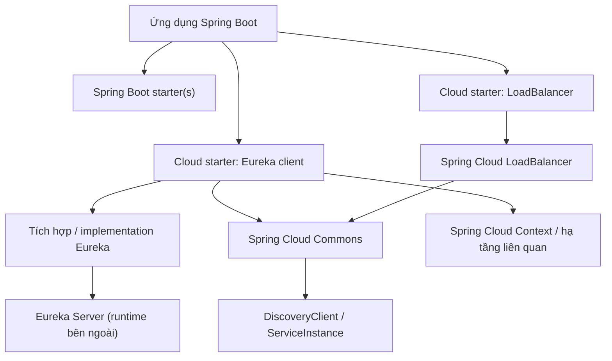
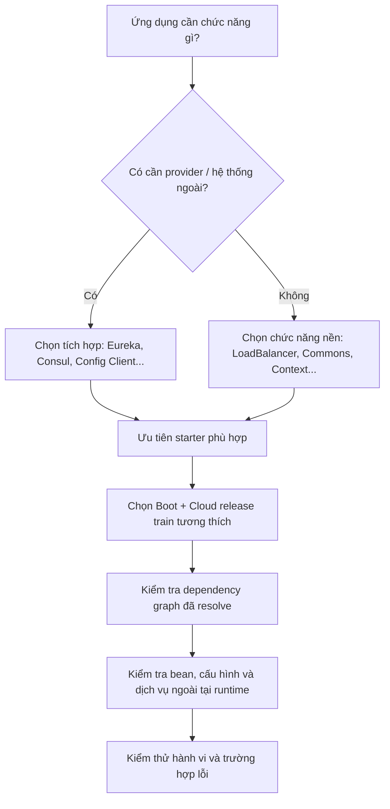

# Phân biệt starter, thư viện lõi và implementation

Khi bắt đầu với **Spring Cloud**, người học thường thấy những tên dependency có vẻ gần giống nhau: `spring-cloud-starter-loadbalancer`, `spring-cloud-loadbalancer`, `spring-cloud-commons` hoặc `spring-cloud-starter-netflix-eureka-client`. Nếu không hiểu vai trò của mỗi loại, ứng dụng dễ thiếu thành phần thực thi, kéo vào nhiều thư viện không cần thiết hoặc phát sinh lỗi tương thích với Spring Boot.

Bài học thuộc chương **Phiên bản và phụ thuộc** của module **SPRING_CLOUD_CORE**. Mục tiêu là hiểu cách Spring Cloud Commons, Spring Cloud Context và các tích hợp discovery, service registry, load balancing, cấu hình bên ngoài phối hợp với nhau qua hệ thống dependency. Cùng một chức năng có thể bao gồm lớp API chung, một hoặc nhiều cách triển khai, starter để sử dụng thuận tiện và BOM để quản lý phiên bản.

## 1. Bốn khái niệm cần tách bạch

| Thành phần | Câu hỏi mà thành phần trả lời | Vai trò chính | Ví dụ trong hệ sinh thái |
| --- | --- | --- | --- |
| **Starter** | “Cần khai báo dependency nào để bắt đầu dùng tính năng?” | Gom những dependency thường đi cùng nhau và kích hoạt đường tích hợp/autoconfiguration phù hợp | `spring-cloud-starter-loadbalancer`, `spring-cloud-starter-netflix-eureka-client` |
| **Thư viện lõi / abstraction** | “Hệ thống thống nhất API và hành vi nền tảng bằng cách nào?” | Cung cấp kiểu dữ liệu, giao diện, infrastructure dùng chung hoặc chức năng nền | `spring-cloud-commons`, `spring-cloud-context` |
| **Implementation / provider** | “Ai thực sự thực hiện hành vi cụ thể?” | Hiện thực thuật toán, giao tiếp hệ thống ngoài hoặc cung cấp bean triển khai API | Module Eureka client, Consul discovery, `spring-cloud-loadbalancer` |
| **BOM (Bill of Materials)** | “Những phiên bản dependency nào nên đi cùng nhau?” | Quản lý phiên bản cho tập hợp artifact thông qua dependency management | `spring-cloud-dependencies` |

**Lưu ý:** đây là các **vai trò**, không phải bốn kiểu artifact phân chia tuyệt đối. Một module lõi có thể chứa implementation mặc định; một starter có thể kéo implementation và các module chung; một provider có thể sở hữu cả thư viện và starter. Việc phân loại nên dựa trên tác dụng trong dependency graph và ở runtime, không chỉ dựa vào tiền tố tên artifact.

Ví dụ, `spring-cloud-starter-loadbalancer` là điểm khai báo tiện lợi; `spring-cloud-loadbalancer` chứa logic cân bằng tải phía client; `spring-cloud-commons` có các abstraction chung liên quan đến dịch vụ và khám phá dịch vụ. Cả ba có thể hiện diện trong cùng một ứng dụng mà không bị trùng vai trò.

## 2. Starter là gì và tại sao nên dùng?

**Starter** là một artifact được thiết kế như **điểm vào của một tính năng**. Thay vì bắt người phát triển nhớ mọi thư viện cần thiết và tự ghép cấu hình ban đầu, starter khai báo các phụ thuộc đi kèm mà dự án Spring Boot/Spring Cloud cần để sử dụng tính năng trong cấu hình phổ biến.

Ví dụ, khi cần khả năng chọn một instance theo Service ID:

```xml
<dependency>
    <groupId>org.springframework.cloud</groupId>
    <artifactId>spring-cloud-starter-loadbalancer</artifactId>
</dependency>
```

Khai báo này đưa các thành phần liên quan đến Spring Cloud LoadBalancer vào dependency graph theo phiên bản đã được quản lý. Trong quá trình khởi động, Spring Boot/Spring Cloud có thể áp dụng **autoconfiguration** khi điều kiện phù hợp: class cần thiết có mặt, bean chưa bị thay thế, thuộc tính cấu hình cho phép, v.v.

Starter **không tự bảo đảm tính năng hoạt động trong mọi môi trường**. Chẳng hạn:

- Có LoadBalancer nhưng không có bất kỳ nguồn danh sách instance nào thì không thể chọn endpoint hợp lệ.
- Có starter Eureka client nhưng registry chưa chạy, chưa cấu hình đúng hoặc client không kết nối được thì việc đăng ký/tra cứu vẫn thất bại.
- Có starter Config Client nhưng chưa thiết lập nguồn cấu hình theo cách ứng dụng đang dùng thì không tự có các property cần thiết.
- Với HTTP client, cách khai báo bean hoặc cơ chế tích hợp quyết định tên dịch vụ có được LoadBalancer phân giải hay chỉ được coi là hostname thông thường.

Starter giúp **ghép phụ thuộc**, còn **cấu hình và trạng thái runtime** quyết định các thành phần làm việc ra sao.

### Starter của Spring Boot và starter của Spring Cloud

Hai nhóm thường xuất hiện đồng thời:

```text
org.springframework.boot:spring-boot-starter-web
org.springframework.cloud:spring-cloud-starter-loadbalancer
org.springframework.cloud:spring-cloud-starter-netflix-eureka-client
```

`spring-boot-starter-web` cung cấp điểm vào cho stack ứng dụng web servlet của Spring Boot. Các starter có group `org.springframework.cloud` bổ sung khả năng liên quan hệ thống phân tán. Một starter Spring Cloud không thay thế toàn bộ nền tảng Spring Boot; ứng dụng vẫn cần các module Boot/framework thích hợp.

## 3. Thư viện lõi: API chung và hạ tầng nền tảng

Trong Spring Cloud, “thư viện lõi” là tên gọi mang tính kiến trúc. Hai artifact tiêu biểu là:

### 3.1. Spring Cloud Commons

`org.springframework.cloud:spring-cloud-commons` cung cấp nhiều abstraction dùng chung giữa các dự án Spring Cloud. Ví dụ:

- `DiscoveryClient`: tra cứu các dịch vụ và danh sách instance theo Service ID.
- `ServiceInstance`: biểu diễn một instance với ID dịch vụ, host, port, URI và metadata.
- `ServiceRegistry` và `Registration`: các abstraction liên quan đến đăng ký dịch vụ khi provider hỗ trợ.

Ví dụ code chỉ phụ thuộc vào API chung:

```java
import java.util.List;
import org.springframework.cloud.client.ServiceInstance;
import org.springframework.cloud.client.discovery.DiscoveryClient;
import org.springframework.stereotype.Service;

@Service
public class ServiceDirectory {
    private final DiscoveryClient discoveryClient;

    public ServiceDirectory(DiscoveryClient discoveryClient) {
        this.discoveryClient = discoveryClient;
    }

    public List<ServiceInstance> getInstances(String serviceId) {
        return discoveryClient.getInstances(serviceId);
    }
}
```

`ServiceDirectory` không nhắc tên Eureka hay Consul. Tính độc lập này có ý nghĩa khi đổi môi trường triển khai: logic nghiệp vụ làm việc với `DiscoveryClient`, còn cách lấy dữ liệu instance do một implementation tương thích đảm nhận.

Tuy nhiên, **giao diện có mặt trên classpath không đồng nghĩa đã có provider mong muốn**. Ứng dụng cần một bean `DiscoveryClient` thích hợp; lựa chọn phụ thuộc starter, autoconfiguration và cơ chế discovery hiện tại. Nếu chỉ có một implementation tĩnh/local, nó không đột nhiên trở thành registry động.

### 3.2. Spring Cloud Context

`org.springframework.cloud:spring-cloud-context` chứa các cơ chế liên quan tới vòng đời context và cấu hình trong Spring Cloud. Hai ví dụ dễ nhận diện:

- `@RefreshScope`: hỗ trợ tạo lại bean thuộc refresh scope để đọc các giá trị cấu hình mới trong điều kiện sử dụng phù hợp.
- `EnvironmentChangeEvent`: sự kiện liên quan tới sự thay đổi giá trị trong `Environment` và quá trình cập nhật các bean/cấu hình liên quan.

Ví dụ:

```java
import org.springframework.beans.factory.annotation.Value;
import org.springframework.cloud.context.config.annotation.RefreshScope;
import org.springframework.stereotype.Component;

@Component
@RefreshScope
public class BannerSettings {
    @Value("${app.banner:Welcome}")
    private String banner;

    public String getBanner() {
        return banner;
    }
}
```

Đoạn mã minh họa annotation và bean sử dụng refresh scope, **không phải toàn bộ quy trình cập nhật cấu hình**. Để giá trị thực sự đổi, ứng dụng cần nguồn cấu hình mới và cơ chế kích hoạt refresh phù hợp; hành vi cụ thể còn phụ thuộc phiên bản, loại property và loại bean.

`spring-cloud-context` không phải một Config Server hay một registry. Nó mang khả năng nền tảng; các hệ thống lưu trữ hoặc phân phối cấu hình nằm ở các thành phần khác, chẳng hạn Spring Cloud Config Client/Server.

### 3.3. Không phải mọi thư viện lõi đều chỉ chứa interface

Một thư viện nền tảng có thể cung cấp class tiện ích, cơ chế lựa chọn hoặc xử lý mặc định bên cạnh abstraction. Ví dụ `spring-cloud-loadbalancer` có logic thực thi cân bằng tải phía client và các thành phần cung cấp danh sách instance. Vì vậy, không nên hiểu sai rằng “core = chỉ API, implementation = luôn ở artifact khác”.

## 4. Implementation và provider: chức năng thực chạy ở đâu?

**Implementation** là đoạn mã hiện thực một hành vi. **Provider** thường được dùng để chỉ thành phần cung cấp hành vi cho một abstraction, nhất là khi có nhiều lựa chọn khác nhau.

Với service discovery:

```text
Giao diện dùng chung:
  DiscoveryClient / ServiceInstance
          |
          +-- Eureka integration   --> trao đổi với Eureka Server
          |
          +-- Consul integration   --> trao đổi với Consul
          |
          +-- SimpleDiscoveryClient --> danh sách instance khai báo bằng cấu hình
```

Các triển khai này hướng tới cùng nhu cầu “tìm instance theo Service ID” nhưng cách lấy thông tin, cập nhật và vận hành khác nhau. Không phải hệ thống nào cũng cần Eureka hoặc Consul: một môi trường có thể dùng DNS của Kubernetes Service, hoặc dùng discovery do nền tảng cung cấp.

Với **load balancing**, Spring Cloud LoadBalancer vừa là thành phần thực thi lựa chọn instance, vừa tiêu thụ danh sách từ nguồn thích hợp. Nó **không phải registry lưu thông tin instance**. Việc lắp một bộ chọn nhưng chưa có danh sách endpoint là một lỗi cấu hình/kiến trúc thường gặp.

Với **externalized configuration**, Spring Cloud Context cung cấp hạ tầng refresh; Spring Cloud Config Client là client làm việc với hệ thống cấu hình; Config Server là dịch vụ phục vụ dữ liệu cấu hình. Một ứng dụng có `@RefreshScope` không đồng nghĩa nó đã kết nối Config Server.

### Ví dụ chuỗi phụ thuộc thực tế



Sơ đồ thể hiện **vai trò khái niệm và quan hệ phụ thuộc tổng quát**, không cam kết mọi cạnh là một dependency trực tiếp trong tất cả các phiên bản. Dependency graph chính xác phải kiểm tra từ công cụ build. Eureka Server trong sơ đồ là dịch vụ bên ngoài tại runtime, không phải artifact được starter client tự khởi động.

## 5. Ví dụ chọn dependency theo nhu cầu

| Nhu cầu | Dependency điểm vào thường gặp | Điều còn phải chuẩn bị |
| --- | --- | --- |
| Xây dựng ứng dụng REST servlet | `spring-boot-starter-web` | Controller, cấu hình và HTTP server phù hợp |
| Gọi theo Service ID và chọn instance phía client | `spring-cloud-starter-loadbalancer` | Danh sách instance và HTTP client tích hợp LoadBalancer |
| Tìm/đăng ký instance với Eureka | `spring-cloud-starter-netflix-eureka-client` | Eureka Server, cấu hình kết nối và Service ID |
| Tìm/đăng ký instance với Consul | `spring-cloud-starter-consul-discovery` | Consul agent/server và cấu hình discovery |
| Lấy cấu hình từ Spring Cloud Config Server | `spring-cloud-starter-config` | Config Server, nguồn cấu hình và cách import/kết nối phù hợp |
| Khai báo HTTP client bằng interface Feign | `spring-cloud-starter-openfeign` | `@EnableFeignClients`, client interface, URL hay Service ID và thành phần discovery/load balancing nếu gọi theo tên logic |
| Dùng `DiscoveryClient` / `ServiceInstance` API | `spring-cloud-commons` (thường được kéo transitively) | Bean triển khai và nguồn dữ liệu instance |
| Dùng `@RefreshScope` | `spring-cloud-context` (thường được kéo transitively) | Nguồn cấu hình thay đổi và tác nhân kích hoạt refresh |

Không phải các hàng trên đều là “chọn một trong các lựa chọn”. Một ứng dụng gọi instance qua Eureka thường cần cả **nguồn discovery** lẫn **cơ chế phân phối request**. Ngược lại, ứng dụng truy cập một Kubernetes Service qua DNS ổn định có thể không cần client-side discovery hoặc Spring Cloud LoadBalancer.

Một điểm quan trọng: chỉ thêm `spring-cloud-starter-netflix-eureka-client` không làm một Eureka Server xuất hiện. Client starter chạy **ở ứng dụng client**; registry server cần một tiến trình và cấu hình riêng.

## 6. BOM quản lý phiên bản; starter cung cấp dependency

Trong hệ sinh thái Spring, dependency được quản lý ở hai lớp thường gặp:

1. **Spring Boot** quản lý nhiều phiên bản dependency của nền tảng Spring Boot và thư viện nền.
2. **Spring Cloud release train** gom các phiên bản module Spring Cloud được phát hành để hoạt động cùng nhau và cung cấp BOM `spring-cloud-dependencies`.

Khi dùng Maven, ta thường khai báo BOM Spring Cloud trong `dependencyManagement`, trong khi phiên bản dependency Spring Boot được quản lý bằng Spring Boot parent hoặc cơ chế BOM tương đương.

Ví dụ rút gọn của một `pom.xml` **đã được cấu hình Spring Boot parent tương thích**:

```xml
<properties>
    <!-- Thay bằng release train được tài liệu chính thức xác nhận
         là tương thích với phiên bản Spring Boot của dự án -->
    <spring-cloud.version>CLOUD_RELEASE_TRAIN</spring-cloud.version>
</properties>

<dependencyManagement>
    <dependencies>
        <dependency>
            <groupId>org.springframework.cloud</groupId>
            <artifactId>spring-cloud-dependencies</artifactId>
            <version>${spring-cloud.version}</version>
            <type>pom</type>
            <scope>import</scope>
        </dependency>
    </dependencies>
</dependencyManagement>

<dependencies>
    <dependency>
        <groupId>org.springframework.boot</groupId>
        <artifactId>spring-boot-starter-web</artifactId>
    </dependency>
    <dependency>
        <groupId>org.springframework.cloud</groupId>
        <artifactId>spring-cloud-starter-loadbalancer</artifactId>
    </dependency>
    <dependency>
        <groupId>org.springframework.cloud</groupId>
        <artifactId>spring-cloud-starter-netflix-eureka-client</artifactId>
    </dependency>
</dependencies>
```

`CLOUD_RELEASE_TRAIN` là **placeholder**, không phải phiên bản dùng để build trực tiếp. Dự án thực cần chọn release train dựa trên **ma trận tương thích Boot–Cloud chính thức của phiên bản đang sử dụng** và khai báo parent/BOM của Spring Boot. Không được suy đoán rằng Boot và Cloud có cùng số phiên bản hay rằng phiên bản cao nhất của từng nhóm sẽ tương thích.

**BOM không tự đưa bất kỳ tính năng runtime nào vào ứng dụng**: nó chỉ chi phối phiên bản của những dependency thực sự được khai báo hoặc được kéo theo từ dependency khác. Tương tự, starter có thể kéo thư viện mà không trực tiếp quản lý phiên bản release train; hai cơ chế bổ sung cho nhau.

### Với Gradle

Dự án Gradle đã có quản lý phiên bản Spring Boot có thể dùng BOM Spring Cloud theo cơ chế dependency management phù hợp. Ví dụ khi sử dụng Gradle platform:

```groovy
dependencies {
    implementation platform(
        "org.springframework.cloud:spring-cloud-dependencies:CLOUD_RELEASE_TRAIN"
    )

    implementation "org.springframework.boot:spring-boot-starter-web"
    implementation "org.springframework.cloud:spring-cloud-starter-loadbalancer"
    implementation "org.springframework.cloud:spring-cloud-starter-netflix-eureka-client"
}
```

Đây cũng là cấu hình minh họa; thay placeholder bằng bản release train tương thích, và đảm bảo dependency management/Gradle plugin của Spring Boot trong dự án đã được thiết lập.

### Một phiên bản được chọn như thế nào?

```text
Khai báo starter trong ứng dụng
         |
         v
Maven/Gradle đọc dependency + BOM/constraint
         |
         v
Giải quyết phiên bản của starter và transitives
         |
         v
Tạo runtime classpath với các module lõi và implementation
         |
         v
Spring Boot autoconfiguration đăng ký bean nếu đủ điều kiện
```

Nếu BOM sai, ứng dụng có thể gặp lỗi khi build hoặc khởi động. Nếu artifact cần thiết không có trong graph, autoconfiguration sẽ không thể tạo hành vi tương ứng. Nếu bean không được kích hoạt hoặc registry không sẵn sàng, dù dependency đủ, chức năng vẫn không hoạt động như kỳ vọng.

## 7. Cách đọc dependency graph thay vì đoán qua tên

Giả sử `order-service` phụ thuộc starter Eureka Client và LoadBalancer. Để biết những thư viện nào thực sự xuất hiện, cần kiểm tra dependency graph đã được resolve.

Maven:

```bash
./mvnw dependency:tree
```

Có thể lọc một nhóm liên quan:

```bash
./mvnw dependency:tree -Dincludes=org.springframework.cloud
```

Gradle:

```bash
./gradlew dependencies --configuration runtimeClasspath
```

Để xem nguyên nhân chọn một phiên bản Gradle:

```bash
./gradlew dependencyInsight --dependency spring-cloud-commons --configuration runtimeClasspath
```

Các lệnh trên chỉ là **hướng dẫn tự kiểm tra trong dự án ví dụ**, không phải bước cần chạy để đọc bài học. Kết quả thực tế phụ thuộc POM/build script, phiên bản và những starter khác mà ứng dụng đã khai báo.

Khi đọc cây phụ thuộc, hãy hỏi lần lượt:

- **Dependency trực tiếp** nào được ứng dụng khai báo? Nó là starter, module lõi hay provider?
- **Dependency bắc cầu (transitive)** nào được kéo vào? Nếu module Commons/Context đã có qua starter, có cần khai báo thêm trực tiếp không?
- **Phiên bản nào được chọn cuối cùng?** Có bản nào bị ghi đè từ nơi khác hay không?
- **Classpath có implementation phù hợp không?** Có hai provider discovery cùng xuất hiện ngoài ý muốn không?
- **Bean tại runtime có được tạo không?** Cần phân biệt thư viện xuất hiện trên classpath với bean đang hoạt động.

Nếu dùng class của Commons trực tiếp trong mã nguồn, khai báo trực tiếp thư viện sở hữu API có thể giúp thể hiện phụ thuộc biên dịch rõ ràng. Tuy vậy, khi cấu hình theo tính năng, starter thường vẫn là cách đưa các thành phần runtime liên quan vào ứng dụng. Không nên thêm mọi thư viện lõi chỉ vì thấy một ví dụ import một interface.

## 8. Những tổ hợp dễ nhầm và cách giải thích đúng

### Tình huống A: Có `spring-cloud-commons` nhưng không tìm thấy instance

Commons cung cấp `DiscoveryClient` và các kiểu dữ liệu liên quan. Nó không mặc nhiên bảo đảm ứng dụng đã được cấu hình kết nối registry thực. Cần kiểm tra bean `DiscoveryClient` được tạo từ đâu, provider nào đang hoạt động, Service ID có đúng hay không và nguồn instance có dữ liệu hay không.

### Tình huống B: Có LoadBalancer nhưng không tự khám phá instance mới

LoadBalancer chọn endpoint từ nguồn danh sách nó nhận được. Nếu dùng `SimpleDiscoveryClient` với các URI cấu hình thủ công, danh sách đó mang tính tĩnh cho môi trường demo/test. Khi instance động được tạo mới, cần provider discovery thích hợp hoặc hạ tầng định tuyến có khả năng tự cập nhật endpoint.

### Tình huống C: Có Eureka client nhưng request theo tên vẫn lỗi

Eureka có thể cung cấp thông tin instance, song HTTP client muốn gọi `http://inventory-service` theo nghĩa Service ID còn phải được tích hợp cơ chế lựa chọn/giải quyết instance thích hợp. Với một HTTP client thông thường không được tích hợp, tên này có thể được đưa đi giải quyết bằng DNS và báo lỗi `UnknownHostException`.

### Tình huống D: Có `@RefreshScope` nhưng giá trị cấu hình không đổi

`@RefreshScope` mô tả cách bean được tạo lại khi refresh scope được kích hoạt. Nó không tự tải cấu hình từ mọi hệ thống ngoài hoặc tự quyết định khi nào refresh. Cần kiểm tra nơi lưu cấu hình, luồng làm mới Environment và cách kích hoạt refresh theo phiên bản/hạ tầng đang dùng.

### Tình huống E: Tự ghi phiên bản cho từng artifact Spring Cloud

Nếu ghi cứng phiên bản của một số starter/module, đồng thời dùng BOM của release train khác, có nguy cơ kéo tới API hoặc implementation không đồng bộ. Những lỗi như `NoSuchMethodError` hoặc `ClassNotFoundException` có thể phản ánh xung đột classpath (dù cũng có nguyên nhân khác). Cần xem dependency graph đã resolve và lựa chọn ma trận Boot–Cloud phù hợp trước khi thay đổi từng module đơn lẻ.

## 9. Quy trình ra quyết định khi thêm một Spring Cloud dependency



Cách áp dụng với `order-service` cần gọi `inventory-service`:

1. Xác định hệ thống phân giải instance: Eureka/Consul, `SimpleDiscoveryClient` ở local, hay Kubernetes Service/DNS.
2. Chọn starter tương ứng khi dùng client-side discovery; bổ sung LoadBalancer nếu cần tự chọn instance ở phía client.
3. Dùng BOM Spring Cloud phù hợp phiên bản Spring Boot của ứng dụng.
4. Kiểm tra dependency graph để biết module API, implementation và các transitive dependency đã có.
5. Tạo HTTP client đúng cơ chế, chạy thực nghiệm nhiều instance và kiểm tra trường hợp instance mất kết nối.
6. Quan sát log, health/readiness, lỗi mạng và trạng thái registry để xác nhận hành vi thực tế.

Tách các bước này giúp phân biệt rõ **sai dependency**, **sai phiên bản**, **thiếu provider**, **thiếu cấu hình** và **sự cố vận hành**. Mỗi loại có hướng xử lý khác nhau.

## 10. Câu hỏi tự kiểm tra

**Câu 1.** Một ứng dụng đã khai báo `spring-cloud-starter-loadbalancer` nhưng không có Eureka hay Consul. Có phải dependency đang sai?

Không nhất thiết. LoadBalancer có thể nhận danh sách instance từ `SimpleDiscoveryClient` hoặc một nguồn cung cấp khác. Cần xác định nguồn instance thực tế; starter LoadBalancer không bắt buộc phụ thuộc Eureka.

**Câu 2.** Muốn dùng `DiscoveryClient` thì có bắt buộc thêm `spring-cloud-commons` trực tiếp vào POM không?

Không bắt buộc nếu Commons đã được kéo vào qua starter và có trên compile classpath. Tuy nhiên, khai báo trực tiếp dependency cho API được mã nguồn dùng có thể làm hợp đồng biên dịch tường minh hơn. Điều cốt lõi là phân biệt **API có mặt** với **provider khả dụng**.

**Câu 3.** Thêm `spring-cloud-dependencies` BOM có khiến Eureka client tự chạy không?

Không. BOM chỉ quản lý phiên bản; cần khai báo starter/module runtime, cấu hình kết nối và có hệ thống registry thực tế nếu dùng Eureka.

**Câu 4.** Spring Cloud Context có phải là một Config Server không?

Không. Context cung cấp các cơ chế hạ tầng như refresh scope. Config Server là thành phần phục vụ cấu hình riêng; Config Client là thành phần ứng dụng dùng để lấy cấu hình từ đó.

**Câu 5.** Vì sao không nên tự lấy phiên bản Spring Boot mới nhất kết hợp tùy ý với Spring Cloud cũ?

Spring Cloud được phát hành theo release train và hỗ trợ các dải phiên bản Spring Boot nhất định. Tổ hợp ngoài ma trận hỗ trợ có thể không tương thích ở API, autoconfiguration hoặc thư viện nền. Cần chọn theo tài liệu tương thích chính thức.

## Ghi nhớ

Khi đọc dependency Spring Cloud, hãy tách **starter để đưa khả năng vào ứng dụng**, **Commons/Context và các thư viện nền để cung cấp abstraction/cơ chế chung**, **implementation/provider để thực thi hành vi cụ thể**, và **BOM để quản lý phiên bản tương thích**. Những lớp này thường xuất hiện cùng nhau, nhưng giải quyết các câu hỏi khác nhau. Hiểu sự khác biệt giúp chọn đúng phụ thuộc, kiểm tra đúng lỗi và vận hành ổn định các ứng dụng Spring Cloud dựa trên Spring Boot.
