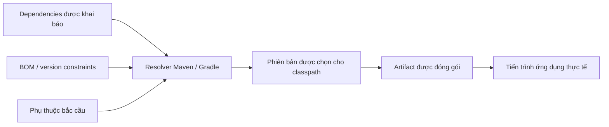

# Kiểm tra phiên bản thực tế bằng dependency tree

Trong một dự án **Spring Cloud Core**, khai báo phiên bản Spring Boot và Spring Cloud trong `pom.xml` hoặc `build.gradle` mới chỉ cho biết **ý định quản lý phụ thuộc**. Ứng dụng thực tế sử dụng các thư viện đã được Maven hoặc Gradle **giải quyết phiên bản (dependency resolution)**, đưa vào classpath và đóng gói để chạy. Hai kết quả này có thể khác điều người phát triển hình dung, nhất là khi phụ thuộc bắc cầu, BOM, plugin và module con cùng tham gia.

**Dependency tree** là công cụ đầu tiên để trả lời các câu hỏi rất cụ thể:

- Ứng dụng cuối cùng chọn phiên bản nào của `spring-cloud-commons`, `spring-cloud-context`, Spring Framework và các starter liên quan?
- Thư viện đó được kéo vào từ dependency trực tiếp hay dependency bắc cầu nào?
- Tại sao một phiên bản được chọn thay vì phiên bản khác?
- Có sự lệch phiên bản giữa các module, classpath kiểm thử và classpath chạy thật không?
- Phiên bản được chọn có nằm trong tổ hợp **Spring Boot – Spring Cloud release train** được hỗ trợ không?

Bài học thuộc chương **Phiên bản và phụ thuộc** của module `SPRING_CLOUD_CORE`. Mục tiêu là biết **kiểm chứng kết quả giải quyết phụ thuộc**, sau đó đối chiếu với cơ chế quản lý phiên bản và môi trường chạy. Từ đó, người học có cơ sở chẩn đoán lỗi tương thích trước khi tìm hiểu sâu hơn về Spring Cloud Commons, Context, cấu hình bên ngoài, `@RefreshScope`, discovery, service registry và giao tiếp dịch vụ.

## 1. Những gì cần phân biệt trước khi đọc cây phụ thuộc

| Khái niệm | Ý nghĩa | Nguồn kiểm tra thích hợp |
| --- | --- | --- |
| **Phiên bản khai báo** (*declared*) | Phiên bản viết trực tiếp hoặc thông qua biến/property trong cấu hình build | `pom.xml`, `build.gradle(.kts)`, cấu hình parent/module |
| **Phiên bản được quản lý** (*managed*) | Phiên bản do BOM, `dependencyManagement`, platform hoặc constraint quy định | Maven effective POM; Gradle dependency constraints và insight |
| **Phiên bản được chọn** (*resolved/selected*) | Artifact/version mà build tool thực sự chọn cho một cấu hình phụ thuộc | Maven `dependency:tree`; Gradle `dependencies` và `dependencyInsight` |
| **Classpath biên dịch/kiểm thử/chạy** | Tập thư viện được dùng ở từng giai đoạn; có thể khác nhau | `compileClasspath`, `runtimeClasspath`, `testRuntimeClasspath`; Maven scope và bản đóng gói |
| **Phiên bản được đóng gói** (*packaged*) | Tệp JAR thư viện được đưa vào ứng dụng phân phối, nếu đóng gói kiểu executable JAR/WAR | Liệt kê nội dung artifact đã build |
| **Phiên bản thực tế được tải khi chạy** (*runtime loaded*) | Lớp/thư viện được classloader của tiến trình thực sự nạp | Kiểm tra artifact triển khai, startup/classpath và điều kiện vận hành |

Ví dụ, một service khai báo `spring-cloud-starter-loadbalancer` **không ghi version**. Việc không ghi version có thể hoàn toàn đúng khi BOM Spring Cloud được nhập hợp lệ. Trong trường hợp này, phiên bản dùng để chạy đến từ quá trình resolution, chứ không thể được xác định chỉ bằng cách nhìn vào dependency của starter.



Sơ đồ biểu diễn đường đi thông thường. **Dependency tree** chứng minh kết quả resolution của một project/configuration; để khẳng định tiến trình sản xuất đã dùng đúng các phiên bản ấy, còn phải kiểm tra artifact và cách triển khai.

## 2. Vì sao phiên bản Spring Cloud dễ bị hiểu nhầm?

### 2.1. Spring Cloud release train không phải phiên bản chung của mọi JAR

Spring Cloud phát hành theo **release train**. Một BOM như `org.springframework.cloud:spring-cloud-dependencies` quản lý tập phiên bản cho các dự án Spring Cloud liên quan. Số phiên bản **release train** của BOM không bắt buộc trùng số phiên bản của `spring-cloud-commons`, `spring-cloud-context`, `spring-cloud-loadbalancer` hay các starter.

Ví dụ về cách diễn đạt **không gắn với release cụ thể**:

```text
Spring Boot version:         <boot-version>
Spring Cloud release train:  <cloud-train-version>
spring-cloud-commons:        <resolved-commons-version>
spring-cloud-context:        <resolved-context-version>
spring-cloud-loadbalancer:   <resolved-loadbalancer-version>
```

Không được kết luận rằng một thư viện sai phiên bản chỉ vì ba chuỗi bên trên khác nhau. Cần đối chiếu **từng artifact/version thực tế** với BOM và bảng tương thích chính thức của **dòng Spring Boot – Spring Cloud** mà dự án đang dùng.

### 2.2. BOM quản lý phiên bản, không tự đưa mọi thư viện vào ứng dụng

Khi dùng Maven, một đoạn cấu hình phổ biến là:

```xml
<!-- Trích đoạn pom.xml; spring-cloud.version được khai báo ở properties/parent. -->
<dependencyManagement>
    <dependencies>
        <dependency>
            <groupId>org.springframework.cloud</groupId>
            <artifactId>spring-cloud-dependencies</artifactId>
            <version>${spring-cloud.version}</version>
            <type>pom</type>
            <scope>import</scope>
        </dependency>
    </dependencies>
</dependencyManagement>

<dependencies>
    <dependency>
        <groupId>org.springframework.cloud</groupId>
        <artifactId>spring-cloud-starter-loadbalancer</artifactId>
    </dependency>
</dependencies>
```

`spring-cloud-dependencies` trong `dependencyManagement` cung cấp **quy tắc chọn phiên bản**; nó không đồng nghĩa project đã phụ thuộc trực tiếp vào mọi module Spring Cloud. Artifact nào thực sự có mặt vẫn phụ thuộc vào dependency được khai báo, đường truyền bắc cầu và cấu hình scope.

Tương tự, ở Gradle có thể nhập BOM bằng platform. Ví dụ Groovy DSL, với property `springCloudVersion` đã được khai báo trong `gradle.properties` hoặc cơ chế tương đương:

```groovy
def springCloudVersion = providers.gradleProperty("springCloudVersion").get()

dependencies {
    implementation platform("org.springframework.cloud:spring-cloud-dependencies:${springCloudVersion}")
    implementation "org.springframework.cloud:spring-cloud-starter-loadbalancer"
}
```

Đoạn này minh họa **native Gradle platform**. Dự án sử dụng plugin `io.spring.dependency-management` có thể nhập BOM theo cú pháp khác; phải kiểm tra cơ chế thật của project. BOM Spring Boot và Spring Cloud giải quyết những tập dependency có liên quan nhưng khác vai trò; một project cần nhất quán trong cách quản lý **cả hai**, tránh tự ghi đè khi không cần thiết.

### 2.3. Các nguồn có thể tác động đến phiên bản được chọn

Một version xuất hiện ở runtime có thể chịu ảnh hưởng bởi:

1. Phiên bản viết trực tiếp ở dependency của module ứng dụng.
2. Parent POM, `dependencyManagement` hoặc BOM được import trong Maven.
3. Gradle platform, constraint, version catalog, dependency management plugin, lockfile và resolution rule.
4. Dependency bắc cầu từ starter hoặc thư viện tích hợp.
5. Quy tắc giải quyết xung đột phiên bản của từng build tool.
6. Module đang được build, profile đang kích hoạt, scope/configuration được truy vấn và artifact đã đóng gói.

Vì vậy, nhìn thấy `spring-cloud.version` trong một properties file **chưa đủ** để xác nhận tất cả các module đều dùng bộ thư viện theo BOM đó.

## 3. Quy trình kiểm tra bằng Maven

Ví dụ dưới đây giả định project Maven. Lệnh chỉ mang tính hướng dẫn: chạy trong **thư mục có POM của module cần khảo sát**, hoặc chỉ định đúng module trong dự án nhiều module. Không cần có quyền kết nối đến hệ thống sản xuất để kiểm tra resolution của bản build tại máy phát triển, nhưng cần các artifact của project có thể được giải quyết từ local repository hoặc repository đã cấu hình.

### Bước 1 — Xem toàn bộ dependency tree

```bash
mvn dependency:tree
```

Lệnh hiển thị cấu trúc bắc cầu và thường bao gồm tọa độ dạng:

```text
groupId:artifactId:type:version:scope
```

Ví dụ kết quả **minh họa định dạng, không phải BOM được xác nhận của một release cụ thể**:

```text
[INFO] com.example:catalog-service:jar:1.0.0
[INFO] +- org.springframework.cloud:spring-cloud-context:jar:<resolved-version-A>:compile
[INFO] \- org.springframework.cloud:spring-cloud-commons:jar:<resolved-version-B>:compile
```

Điều cần đọc là `groupId`, `artifactId`, **version đã chọn**, **scope** và cấp thụt dòng để biết thư viện nào kéo vào thư viện nào. Tree có thể chỉ hiện đường dẫn được giữ lại sau khi Maven phân giải xung đột; không nên dựa vào việc một version khác không xuất hiện để kết luận rằng không có thư viện nào từng yêu cầu version ấy.

### Bước 2 — Lọc các thư viện Spring Cloud cần quan sát

```bash
mvn dependency:tree '-Dincludes=org.springframework.cloud:*'
```

Trích dẫn đơn giúp giữ nguyên ký tự `*` trong shell thông dụng như Bash và PowerShell; trên Windows Command Prompt có thể dùng dấu nháy kép theo cú pháp shell. Truy vấn này hỗ trợ tập trung vào nhóm `org.springframework.cloud`. Khi cần biết **ai kéo một artifact vào**, hãy bỏ bộ lọc để thấy toàn bộ đường đi nếu đầu ra bị rút gọn khó hiểu.

Ví dụ truy vấn một artifact cụ thể:

```bash
mvn dependency:tree '-Dincludes=org.springframework.cloud:spring-cloud-commons'
```

Không nên chỉ lọc group Spring Cloud nếu lỗi xuất phát từ `org.springframework:spring-core`, `org.springframework.boot:spring-boot`, logging hoặc thư viện của bên thứ ba. Dependency tree đầy đủ vẫn là nguồn đối chiếu chính.

### Bước 3 — Kiểm tra scope và cơ chế bỏ qua xung đột

```bash
mvn dependency:tree -Dverbose
mvn dependency:tree -Dscope=runtime
```

Tùy phiên bản `maven-dependency-plugin`, `-Dverbose` có thể bổ sung thông tin về các node bị bỏ qua do trùng lặp hoặc xung đột. Mức chi tiết và định dạng output thay đổi theo plugin; đừng phụ thuộc vào một mẫu dòng duy nhất để tự động phân tích mọi dự án.

Maven dùng các quy tắc quản lý phiên bản và chọn dependency phù hợp, trong đó **dependency mediation** có khái niệm đường đi gần hơn (*nearest definition*) và thứ tự khai báo khi cùng độ sâu. Phần quản lý phiên bản (`dependencyManagement`) có thể ảnh hưởng phiên bản được chọn; version chỉ định trực tiếp ở dependency cũng cần được kiểm tra. Khi có xung đột, hãy xem cả *nguồn yêu cầu version* và *nguồn khiến version cuối được chọn*.

### Bước 4 — Đối chiếu với effective POM

```bash
mvn help:effective-pom
```

**Effective POM** là cấu hình Maven sau khi kết hợp parent, profile, thuộc tính và các phần quản lý phụ thuộc áp dụng cho module. So sánh nó với `dependency:tree` để trả lời hai câu hỏi khác nhau:

| Cần xác minh | Công cụ |
| --- | --- |
| `spring-cloud-dependencies` đã import với train version nào? | Effective POM và cấu hình parent/module |
| Module cụ thể đã resolve `spring-cloud-commons` thành version nào? | `dependency:tree` |
| Version cụ thể đến từ dependencyManagement hay khai báo trực tiếp? | Đối chiếu effective POM, POM gốc và dependency tree |
| Dependency đó ở compile, runtime hay test? | Phân tích scope trong tree và artifact thực tế |

**Lưu ý:** Nếu dependency chưa được dùng, bản ghi version trong `dependencyManagement` **không chứng minh JAR hiện diện trên classpath**. Ngược lại, nếu dependency hiện diện ở tree, cần kiểm tra classpath tương ứng trước khi quy kết lỗi runtime.

### Bước 5 — Chọn đúng module trong dự án Maven nhiều module

```bash
# Ví dụ nếu artifactId của module ứng dụng là catalog-service.
mvn -pl :catalog-service dependency:tree

# Khi cần build cùng các module liên quan trong reactor:
mvn -pl :catalog-service -am dependency:tree
```

`:catalog-service` chỉ là tên minh họa; phải thay bằng `artifactId` thực tế. `-am` mở rộng reactor sang các module phụ thuộc, vì vậy output có thể chứa cây của **nhiều module**. Đọc đúng cây của module đóng gói và chạy ứng dụng; không lấy dependency tree của module thư viện rồi coi đó là runtime classpath của toàn service.

## 4. Quy trình kiểm tra bằng Gradle

Gradle quản lý phụ thuộc theo **configuration**. Cùng một artifact có thể được yêu cầu trong `compileClasspath`, `runtimeClasspath` hoặc `testRuntimeClasspath` với các kết quả khác nhau. Vì thế, lệnh hỏi **đúng configuration** rất quan trọng.

### Bước 1 — Xem tree của classpath chạy ứng dụng

Trên Linux/macOS:

```bash
./gradlew dependencies --configuration runtimeClasspath
```

Trên Windows PowerShell/CMD:

```powershell
.\gradlew.bat dependencies --configuration runtimeClasspath
```

Với dự án nhiều module, chọn task có đường dẫn đầy đủ của module ứng dụng:

```bash
./gradlew :catalog-service:dependencies --configuration runtimeClasspath
```

Trong báo cáo của Gradle, ký hiệu `requested-version -> selected-version` cho biết Gradle đã chọn một version khác yêu cầu ở đường phụ thuộc đó. Dòng `(*)` thường biểu thị nhánh đã được hiển thị ở nơi khác; một dòng là constraint hoặc platform có thể được ghi chú theo quy ước riêng. Xem legend cuối báo cáo của phiên bản Gradle đang dùng.

Ví dụ **có số giả định chỉ để giải thích ký hiệu, không dùng làm cặp version khuyến nghị**:

```text
+--- com.example:some-library:1.0
|    \--- org.springframework.cloud:spring-cloud-commons:4.2.0 -> 4.2.1
\--- org.springframework.cloud:spring-cloud-commons:4.2.1
```

Ở đây `4.2.0` là version một đường phụ thuộc đã **yêu cầu**, còn `4.2.1` là version **được chọn** cho configuration đang xem. Điều đó chưa chứng minh `4.2.1` tương thích với phiên bản Boot của project; kiểm chứng tương thích là bước riêng.

### Bước 2 — Dùng dependencyInsight để truy nguyên một artifact

```bash
./gradlew dependencyInsight --dependency spring-cloud-commons --configuration runtimeClasspath
```

Với module riêng:

```bash
./gradlew :catalog-service:dependencyInsight --dependency spring-cloud-context --configuration runtimeClasspath
```

`dependencyInsight` giúp quan sát **lý do chọn version**, các phiên bản được yêu cầu qua từng nhánh và constraint có liên quan. Tùy cơ chế resolution, báo cáo có thể nhắc đến conflict resolution, constraint, forced version hoặc selection rule. Đọc điều kiện thực tế của báo cáo thay vì mặc định rằng “Gradle luôn chọn bản mới nhất”: các constraint `strictly`, version locking, force và `enforcedPlatform` có thể thay đổi kết quả.

### Bước 3 — So sánh những classpath có khả năng khác nhau

```bash
./gradlew dependencies --configuration compileClasspath
./gradlew dependencies --configuration runtimeClasspath
./gradlew dependencies --configuration testRuntimeClasspath
```

Các configuration trên điển hình với Java/JVM plugin; tên có thể khác nếu dự án dùng plugin hoặc source set khác. Khi lỗi chỉ xuất hiện ở test, `testRuntimeClasspath` có thể chứa dependency bổ sung. Khi lỗi chỉ xuất hiện khi chạy thật, cần tập trung vào `runtimeClasspath` và artifact deploy thay vì chỉ nhìn kết quả compile.

### Bước 4 — Kiểm tra cơ chế quản lý phiên bản Gradle đang dùng

Gradle có thể nhận version từ `platform(...)`, `enforcedPlatform(...)`, version catalog, `constraints`, plugin quản lý dependency, `resolutionStrategy` hoặc lockfile. Không kết luận một BOM bị bỏ qua chỉ vì cây thể hiện version đã chọn khác một khai báo bắc cầu; hãy dùng `dependencyInsight` và xem các quy tắc áp dụng cho cấu hình đó.

Đặc biệt, **plugin Spring Boot** và **BOM quản lý dependency** là hai vai trò khác nhau. Việc bật plugin đóng gói/chạy Spring Boot không tự chứng minh mọi thư viện Spring Cloud đang được quản lý bởi release train phù hợp. Cần kiểm tra cụ thể cách nhập BOM Spring Boot, BOM Spring Cloud và mọi override trong project.

## 5. Maven và Gradle: chọn công cụ nào để trả lời câu hỏi nào?

| Câu hỏi | Maven | Gradle |
| --- | --- | --- |
| Toàn bộ dependency đã chọn của module? | `mvn dependency:tree` | `./gradlew dependencies --configuration runtimeClasspath` |
| Chỉ tập thư viện Spring Cloud? | `-Dincludes=org.springframework.cloud:*` | Tree + `dependencyInsight` cho artifact liên quan |
| Tại sao version được chọn? | Tree (có thể thêm `-Dverbose`) + effective POM | `dependencyInsight` + constraints/platform |
| Version quản lý đến từ đâu? | Parent, imported BOM, effective POM | Platform/BOM/plugin, constraints, version catalog, lockfile |
| Kiểm tra module cụ thể? | `-pl :artifactId` | `:module:dependencies` hoặc `:module:dependencyInsight` |
| Có đúng classpath chạy? | Kiểm tra scope và tệp đóng gói | `runtimeClasspath` và tệp `bootJar`/`bootWar` |

Các lệnh cung cấp **góc nhìn của build tool**. Không thể dùng riêng một câu lệnh ở bảng trên để chứng minh trạng thái của container sản xuất nếu container được tạo từ bản build cũ hoặc bổ sung thư viện bằng cách khác.

## 6. Kiểm tra artifact đã đóng gói và runtime thực tế

Giả sử tree ở máy phát triển đúng, nhưng service vẫn báo `NoSuchMethodError` trên môi trường triển khai. Có thể ứng dụng đang chạy artifact khác, một phụ thuộc bị đóng gói lệch, hoặc classloader nạp lớp từ nguồn ngoài dự kiến. Vì vậy cần thêm bước đối chiếu sau build.

Với **Spring Boot executable JAR** sử dụng layout chuẩn, các thư viện thường nằm trong `BOOT-INF/lib/`. Trên PowerShell, giả sử tên output đã biết:

```powershell
jar tf .\target\catalog-service.jar | Select-String 'BOOT-INF/lib/(spring-cloud|spring-boot|spring-core)'
```

Trong một bản build Gradle, artifact có thể nằm ở `build/libs/` thay vì `target/`; hãy thay đúng đường dẫn và tên file. Lệnh `jar tf` dùng ở đây để **liệt kê file trong JAR**, không chạy ứng dụng. Với WAR, thin JAR, custom packaging, container image hoặc deployment sử dụng classpath ngoài, vị trí thư viện có thể khác; cần xem cách đóng gói tương ứng.

Một quy trình đối chiếu có đủ bằng chứng là:

1. Ghi lại **commit/tag**, module build, profile và tham số build.
2. Lưu version Boot và Cloud release train được cấu hình trong đúng build.
3. Lấy **resolved dependency tree** của classpath cần kiểm tra.
4. Xác nhận tên/version các JAR đã nằm trong artifact giao đi.
5. Đối chiếu checksum hoặc định danh artifact/container image đã được deploy.
6. Khi vẫn nghi ngờ, kiểm tra classpath/classloader, startup log và thư viện thực tế tiến trình nạp.

Trong hệ thống sử dụng nhiều instance, mỗi instance có thể đang chạy **image/tag khác nhau** trong rolling deployment. Dependency tree tại cùng một commit không chứng minh mọi instance hiện đang nạp đúng cùng một bộ JAR. Thông tin build version, image digest và trạng thái rollout rất hữu ích khi phân tích hành vi khác nhau giữa các node.

### Không đánh đồng phiên bản lúc test với lúc chạy

Một test có thể thành công nhờ thư viện chỉ thuộc `testImplementation`, `testRuntimeOnly` hoặc `test` scope. Nếu thư viện đó vắng ở runtime của ứng dụng, startup mới thất bại. Chiều ngược lại, thư viện bị loại khỏi test tree có thể xuất hiện qua một cấu hình khác khi đóng gói. Hãy tái hiện lỗi trên classpath tương ứng thay vì chỉ nhìn cây `test`.

## 7. Phân tích tình huống xung đột thực tế

### Tình huống A — Starter không khai báo version nhưng vẫn sai tổ hợp

Một service Spring Cloud dùng starter không ghi version. Dependency tree cho thấy các JAR Spring Cloud được resolve thành công, nhưng startup báo tổ hợp Spring Boot/Spring Cloud không tương thích.

**Cách điều tra:** xác minh version Boot, Cloud release train, cách import BOM và mọi override ở module ứng dụng. Sau đó đối chiếu tổ hợp với **bảng tương thích Spring Cloud chính thức** dành cho release train đó. Khả năng resolve một dependency **không tương đương** với khả năng chạy tương thích. Nếu cơ chế compatibility verifier của Spring Cloud báo lỗi, xử lý lựa chọn phiên bản phù hợp thay vì tắt kiểm tra để che nguyên nhân.

### Tình huống B — Thư viện phụ thuộc bắc cầu yêu cầu version khác

Project có thư viện tích hợp của bên thứ ba yêu cầu `spring-cloud-commons` tại version X, trong khi BOM hoặc constraint chọn version Y.

**Cách điều tra:** dùng Maven tree hoặc Gradle dependencyInsight để xác định đường yêu cầu X và lý do chọn Y. Kiểm tra hỗ trợ chính thức của thư viện tích hợp với tổ hợp Boot/Cloud, tránh tự ép lên version cao nhất nếu chưa có bằng chứng tương thích. Nên ưu tiên cập nhật thư viện tích hợp tương thích hoặc bỏ override không cần thiết; những quyết định ép version cần có lý do và kiểm thử hồi quy.

### Tình huống C — Chỉ một module con bị lệch

Monorepo có module `api`, `service` và `shared`. `shared` được build bằng BOM khác, trong khi `service` là module chạy thực tế.

**Cách điều tra:** lấy dependency tree của `service`, lần theo các nhánh liên quan đến `shared` và so sánh effective POM hoặc platform/constraints của từng module. Nếu chỉ kiểm tra tree của `shared`, ta có thể bỏ sót phiên bản được chọn **khi `service` tiêu thụ** module đó. Bản đóng gói của `service` là bằng chứng tiếp theo.

### Tình huống D — Lỗi chỉ xuất hiện khi chạy `@RefreshScope`

Build thành công, nhưng ứng dụng báo `NoSuchMethodError`, `ClassNotFoundException` hoặc lỗi khởi tạo bean khi chức năng refresh được kích hoạt.

**Cách điều tra:** kiểm tra version của `spring-cloud-context`, `spring-cloud-commons`, Spring Boot, Spring Framework và các thư viện liên quan; xác minh artifact đang chạy có đúng classpath đã kiểm tra không. Stack trace cho biết lớp/phương thức nào gặp lỗi; dependency tree cho biết JAR nào được chọn. **Không thể kết luận nguyên nhân chỉ từ tên exception**: còn có vấn đề cấu hình, sử dụng API không phù hợp hoặc lỗi runtime khác.

### Tình huống E — Hai instance xử lý discovery/load balancing khác nhau

Trong đợt triển khai cuốn chiếu, A hoạt động nhưng B báo lỗi liên quan service discovery hoặc load balancer. Chỉ so sánh source code có thể chưa đủ.

**Cách điều tra:** ghi image digest và build version của A/B; so sánh `spring-cloud-commons`, `spring-cloud-context`, module discovery/load balancer và phiên bản Boot được đóng gói. Đồng thời kiểm tra cấu hình ngoài và môi trường startup. Nếu hai node chạy khác phiên bản trong giai đoạn rollout, phải xác định khả năng tương thích hành vi giữa các phiên bản đang cùng tồn tại.

### Tình huống F — CI và máy cá nhân ra kết quả khác nhau

Một build dùng dynamic version/range, snapshot, repository khác nhau hoặc cache metadata khác nhau có thể chọn dependency khác. Maven và Gradle cũng có các cách quản lý cache và resolution riêng.

**Cách điều tra:** đối chiếu revision, tham số build, JDK, Gradle/Maven và plugin version, repository, trạng thái lockfile và tree của **hai môi trường**. Ưu tiên version cố định, cơ chế khóa dependency phù hợp và artifact có thể truy vết. Làm mới dependency cache có thể giúp chẩn đoán metadata cũ, nhưng **không thay thế** việc xác định và khóa phiên bản đúng.

## 8. Cách đọc một dependency tree mà không chẩn đoán nhầm

Hãy thực hiện lần lượt các phép kiểm tra sau trên **đúng module** và **đúng classpath**:

1. **Ghi câu hỏi cần trả lời.** Ví dụ: “Version `spring-cloud-context` trong runtime của `catalog-service` là gì?”.
2. **Xác định output cần xem.** Maven là dependency tree với scope phù hợp; Gradle là `runtimeClasspath`.
3. **Tìm artifact chính xác.** Phân biệt `spring-cloud-commons`, `spring-cloud-context`, starter, implementation module, và các thư viện cùng họ nhưng khác group/artifact.
4. **Đọc version được chọn**, không chỉ version được yêu cầu trong một nhánh bắc cầu.
5. **Truy ngược nguồn chọn version.** Với Maven, so sánh parent/BOM/effective POM; với Gradle, dùng `dependencyInsight`, constraint/platform.
6. **Đối chiếu với cặp Boot/Cloud được hỗ trợ.** Số version trong BOM không cần bằng số version của từng module.
7. **Kiểm tra tệp chạy thật** nếu lỗi xuất hiện sau khi deploy hoặc khác giữa các instance.
8. **Ghi kết quả có bằng chứng.** Cần đủ thông tin để đồng nghiệp chạy lại cùng một kiểm tra.

### Biểu mẫu ghi nhận kết quả

```text
Project/module:             <module-dang-chay>
Revision:                   <commit-or-tag>
Build tool/version:         <maven-or-gradle-version>
JDK:                        <jdk-version>
Build profile/parameters:   <profile-and-flags>
Spring Boot (managed):      <boot-version>
Spring Cloud release train: <cloud-train-version>
Examined configuration:     <runtime-classpath-or-scope>

Selected artifacts:
  spring-cloud-commons:     <resolved-version>
  spring-cloud-context:     <resolved-version>
  spring-cloud-loadbalancer:<resolved-version-or-not-present>

Resolution evidence:        <tree-or-insight-command-and-output>
Packaging evidence:         <artifact-name-and-contents>
Deployed artifact/image:    <build-id-or-digest>
Compatibility source:       <official-release-train-compatibility-entry>
Conclusion/action:          <verified-finding-and-next-step>
```

Khi viết báo cáo lỗi, nên dùng câu kiểu **“Trong `runtimeClasspath` của module X tại commit Y, Gradle chọn `spring-cloud-context` version Z theo constraint W”**. Câu này có thể kiểm chứng. Câu **“Đã khai báo BOM nên chắc chắn đúng hết”** bỏ qua kết quả resolution và không giúp tái hiện vấn đề.

## 9. Liên hệ với các abstraction của Spring Cloud Core

Việc kiểm tra dependency tree có ý nghĩa khác nhau tùy phần hệ thống đang được dùng:

| Tính năng | Artifact/nhóm nên để ý | Vì sao cần kiểm tra |
| --- | --- | --- |
| Abstraction dùng chung | `spring-cloud-commons` | Liên quan abstraction chung như discovery, service instances và các thành phần hỗ trợ |
| Context/refresh | `spring-cloud-context` | Liên quan chức năng context và refresh scope; lỗi có thể chỉ lộ khi chạy chức năng tương ứng |
| Cân bằng tải phía client | `spring-cloud-loadbalancer` và starter liên quan | Phụ thuộc theo module được khai báo/được kéo vào, không hiện diện chỉ vì project có Spring Cloud BOM |
| Discovery và service registry | Module tích hợp theo nhà cung cấp, cùng các abstraction chung | Triển khai thực tế còn phụ thuộc implementation được chọn, không chỉ API trong Commons |
| Nguồn cấu hình ngoài | Các module cấu hình Spring Cloud được sử dụng | Cần đúng dependency để tính năng config được kích hoạt, và đúng tổ hợp phiên bản với Boot |
| Giao tiếp dịch vụ | HTTP client, declarative client hoặc thư viện liên quan do dự án chọn | Các starter, integration và transitive dependencies có thể mang thêm version constraint |
| Testing và operations | Spring Boot test/actuator và thư viện quan sát theo cấu hình | Test classpath và runtime classpath có thể chứa các artifact khác nhau |

Bảng trên là **định hướng truy vấn**, không phải danh sách dependency bắt buộc cho mọi ứng dụng. Dự án chỉ cần những tích hợp tương ứng với chức năng thật sự sử dụng. Với `DiscoveryClient` chẳng hạn, một module có abstraction chung vẫn cần **implementation** phù hợp mới có thể tương tác với hệ thống discovery mong muốn.

## 10. Thực hành có kiểm chứng

Hãy chọn một service Spring Boot có tích hợp Spring Cloud, rồi làm bài tập sau. Không cần sửa phiên bản ngay; trước tiên ghi nhận trạng thái đúng của project.

**Bài tập 1 — Ghi lại phiên bản đã resolve**

1. Xác định project dùng Maven hay Gradle và module nào tạo artifact chạy.
2. Chạy dependency tree của module đó.
3. Tìm `spring-cloud-commons`, `spring-cloud-context` và một thư viện Spring Cloud mà service thật sự dùng.
4. Ghi **selected version**, đường dependency mang tới artifact và scope/configuration.
5. Đối chiếu version với BOM/import/constraint của project.

**Bài tập 2 — Khảo sát xung đột trong môi trường thí nghiệm**

Trong **một nhánh thử nghiệm riêng**, thêm một dependency có version khác hoặc một constraint có chủ đích, rồi chạy lại tree/insight. Quan sát liệu version được chọn có đổi và có lý do selection được hiển thị hay không. Hoàn tác thay đổi thử nghiệm khi kết thúc. Không lấy một kết quả resolve thành công làm bằng chứng rằng tổ hợp đó hoạt động ở runtime.

**Bài tập 3 — Đối chiếu bản đóng gói**

Build executable JAR, liệt kê thư viện được đóng gói, rồi so sánh với runtime dependency tree. Ghi bất kỳ khác biệt nào về phạm vi, tên artifact hoặc version. Nếu service được triển khai dưới dạng container, so sánh build ID/image digest để biết artifact đang chạy có cùng nguồn với bản vừa kiểm tra không.

### Câu hỏi tự kiểm tra

1. Vì sao chỉ nhìn `spring-cloud.version` trong POM không đủ để biết version `spring-cloud-context` dùng ở runtime?
2. BOM `spring-cloud-dependencies` có tự kéo `spring-cloud-loadbalancer` vào project không?
3. Khi Gradle in `4.2.0 -> 4.2.1`, version nào là version đã chọn trong configuration đang xem?
4. Dependency tree của `shared` có tự đại diện cho classpath chạy thật của `service` phụ thuộc vào nó không?
5. Khi tree đúng nhưng startup trên container vẫn lỗi, cần thêm bằng chứng gì?
6. Một release train và các JAR Spring Cloud có buộc dùng cùng số version không?

**Đáp án gợi ý:** (1) Vì BOM/parent, override và transitive resolution có thể tác động đến version được chọn; (2) Không, BOM chủ yếu quản lý phiên bản; (3) `4.2.1`; (4) Không, cần tree của module chạy; (5) Artifact/image đã deploy, thư viện đóng gói và classpath thực tế; (6) Không, cần đối chiếu mapping do BOM quản lý.

## 11. Những nguyên tắc cần nhớ

- **Khai báo không đồng nghĩa với kết quả.** Luôn dùng Maven `dependency:tree` hoặc Gradle `dependencies`/`dependencyInsight` để xem version được chọn cho classpath cần kiểm tra.
- **Version của release train khác version của từng module.** Kiểm chứng theo BOM Spring Cloud và bảng tương thích Spring Boot/Spring Cloud của dòng phát hành đang dùng.
- **Lọc đúng module, đúng classpath, đúng artifact.** Tránh nhầm version của dependency bị yêu cầu ở một nhánh với version thực sự được chọn.
- **Cây phụ thuộc là bằng chứng từ build.** Với lỗi vận hành, phải đối chiếu tiếp JAR đã đóng gói, container image và tiến trình thực tế.
- **Khắc phục xung đột bằng nguyên nhân có bằng chứng.** Ưu tiên BOM/constraint nhất quán, thư viện tích hợp tương thích và build có thể tái lập thay vì ép version theo cảm tính.

Kỹ năng đọc dependency tree giúp xác minh nền tảng của các chủ đề tiếp theo trong `SPRING_CLOUD_CORE`: cấu hình bên ngoài, refresh context, discovery/registry, giao tiếp dịch vụ, testing và vận hành. Khi biết chính xác bộ JAR nào đang tham gia, người học mới có cơ sở phân biệt lỗi phiên bản với lỗi cấu hình hoặc lỗi logic phân tán.
