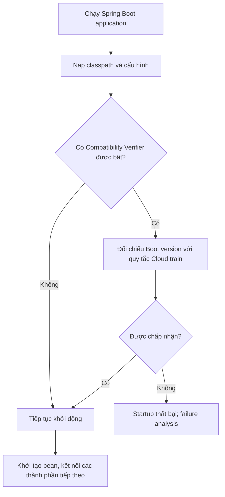
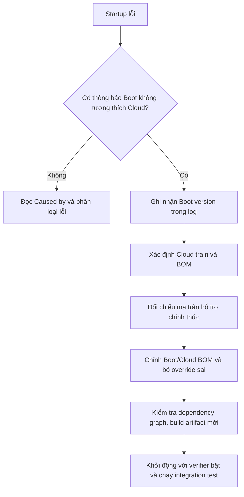

# Compatibility Verifier và thông báo không tương thích

> **Chương:** Phiên bản và phụ thuộc  
> **Module:** `SPRING_CLOUD_CORE` — các nền tảng cốt lõi của Spring Cloud trong hệ thống phân tán: Spring Cloud Commons, Context, cấu hình bên ngoài, discovery, service registry, giao tiếp dịch vụ và quản lý tương thích với Spring Boot.  
> **Mục tiêu:** Hiểu vì sao ứng dụng Spring Cloud có thể không khởi động khi dùng sai cặp phiên bản, cách đọc thông báo Compatibility Verifier và cách xử lý nguyên nhân từ dependency management.

## 1. Tình huống đặt vấn đề

Giả sử `order-service` là ứng dụng Spring Boot có tích hợp Spring Cloud Commons, Spring Cloud Context và Spring Cloud LoadBalancer. Nhóm phát triển nâng Spring Boot để nhận bản vá bảo mật, nhưng vẫn sử dụng một Spring Cloud release train cũ. Lệnh biên dịch và đóng gói có thể thành công, song khi chạy JAR, ứng dụng dừng với thông báo tương tự:

```text
***************************
APPLICATION FAILED TO START
***************************

Description:

Your project setup is incompatible with our requirements
due to following reasons:

- Spring Boot [3.4.2] is not compatible with this Spring Cloud release train

Action:

Consider applying the following actions:

- Change Spring Boot version to one of the following versions [3.2.x, 3.3.x].
- Check Spring Cloud release train compatibility information.
- To disable the check:
  spring.cloud.compatibility-verifier.enabled=false
```

Đây là **ví dụ minh họa** về cấu trúc thông báo; các nhánh phiên bản `3.2.x`, `3.3.x` và `3.4.2` chỉ dùng để dựng tình huống. Danh sách tương thích thật phụ thuộc Spring Cloud release train đang chạy và có thể thay đổi qua các bản phát hành.

Câu hỏi cần trả lời là: **Lỗi xuất phát từ cấu hình phiên bản nào, làm thế nào tìm ra phiên bản được nạp thực tế, và nên sửa ở đâu?**

### Kết quả học tập

Sau bài này, người học có thể:

1. phân biệt Spring Boot version, Spring Cloud release train, BOM và Compatibility Verifier;
2. xác định điều kiện khiến verifier làm startup thất bại và cách đọc thông báo;
3. sửa cặp Boot/Cloud thông qua Maven hoặc Gradle dependency management;
4. sử dụng dependency tree hoặc effective POM để phân tích trường hợp version bị ghi đè;
5. giải thích tác dụng và giới hạn của `enabled`, `compatible-boot-versions`;
6. xác minh phiên bản trong CI, container và môi trường sử dụng externalized configuration.

## 2. Nền tảng tương thích phiên bản trong Spring Cloud Core

### 2.1. Vì sao Boot và Cloud phải đi theo một ma trận?

**Spring Boot** cung cấp nền tảng khởi động, auto-configuration, quản lý dependency, Spring Framework và cơ chế vận hành. **Spring Cloud** phát triển các abstraction và tích hợp cho ứng dụng phân tán, như `DiscoveryClient`, `ServiceInstance`, `ServiceRegistry`, Spring Cloud Context/RefreshScope và Spring Cloud LoadBalancer.

Các module Spring Cloud sử dụng API và behavior của Spring Boot/Spring Framework. Khi Boot thay đổi API, điều kiện auto-configuration, vòng đời bean hoặc dependency nền tảng, một thế hệ Spring Cloud cũ có thể không còn tương thích. Do đó không thể suy rằng **mọi phiên bản Spring Cloud đều chạy được với mọi phiên bản Spring Boot**, ngay cả khi Java compiler không báo lỗi.

Spring Cloud phát hành theo **release train**: một tập phiên bản Cloud được điều phối và kiểm thử cùng nhau. Danh sách Boot version được hỗ trợ phải được xem trong tài liệu phát hành chính thức, thay vì chọn chỉ dựa trên số major/minor giống nhau.

Tên release train có thể có dạng `2024.0.x`, `2025.0.x`. Đây là ví dụ về cách đặt tên; không có nghĩa mọi Boot version phát hành cùng năm sẽ tương thích.

### 2.2. BOM giải quyết việc gì?

BOM (*Bill of Materials*) quản lý các phiên bản dependency. Khi import `spring-cloud-dependencies` của một release train, dự án để BOM chọn phiên bản phù hợp cho `spring-cloud-commons`, `spring-cloud-context`, `spring-cloud-starter-loadbalancer` và các thành phần thuộc phạm vi BOM.

Spring Boot thường được quản lý qua `spring-boot-starter-parent`, `spring-boot-dependencies` hoặc cơ chế quản lý tương ứng của Gradle.

| Thành phần | Trách nhiệm | Ví dụ |
| --- | --- | --- |
| Spring Boot parent/BOM | Quản lý các thư viện nền tảng Boot | Spring Boot starter, thư viện Spring và các dependency do Boot quản lý |
| Spring Cloud release train/BOM | Quản lý phiên bản nhóm module Cloud | Commons, Context, LoadBalancer, starter Cloud |
| Compatibility Verifier | Kiểm tra một số quy tắc tương thích khi startup | Boot version có thuộc danh sách được chấp nhận bởi Cloud train không? |
| Build tool/dependency graph | Resolve dependency thành các artifact cụ thể | Phiên bản thực tế được đưa vào runtimeClasspath |
| Kiểm thử tích hợp | Xác minh hành vi ứng dụng | Discovery, registry, refresh scope và giao tiếp HTTP hoạt động đúng |

**BOM không tự khẳng định cặp Boot/Cloud tương thích.** Dự án có thể import BOM Cloud nhất quán nhưng chọn Boot version sai. Ngược lại, verifier có thể chấp nhận Boot version trong khi một dependency khác bị override gây lỗi runtime.

### 2.3. Java runtime là lớp tương thích khác

Ngoài Boot và Cloud, JVM phải đáp ứng yêu cầu Java của Spring Boot và bytecode được biên dịch. Lỗi `UnsupportedClassVersionError` thường nói về Java runtime quá cũ so với class, chứ không phải thông báo Compatibility Verifier.

Vì vậy cần kiểm tra ít nhất ba tầng: **Java runtime → Spring Boot → Spring Cloud release train**. Compatibility Verifier chủ yếu giúp nhận biết một số ràng buộc Boot/Cloud; không nên coi nó là công cụ xác minh mọi tầng này.

## 3. Spring Cloud Compatibility Verifier hoạt động ra sao?

### 3.1. Mục đích và phạm vi

Spring Cloud Commons cung cấp cơ chế Compatibility Verifier để phát hiện sớm cấu hình phiên bản không nằm trong tập được Spring Cloud kỳ vọng. Ở các thế hệ Spring Cloud Commons phổ biến, một kiểm tra trọng tâm là **phiên bản Spring Boot** mà ứng dụng đang sử dụng.

Khi cấu hình được xác định là không tương thích, verifier có thể khiến quá trình khởi động Spring context thất bại. Spring Boot sau đó hiển thị phân tích lỗi giúp người dùng biết phiên bản bị từ chối và các nhánh phiên bản được đề xuất.

Cơ chế này có ba giới hạn quan trọng:

- **Nó không tải hoặc nâng cấp JAR.** Bộ kiểm tra chỉ phát hiện một số điều kiện và đưa ra kết luận.
- **Nó không kiểm tra mọi thư viện trên classpath.** Các xung đột transitively kéo vào hoặc code gọi API không tồn tại vẫn có thể gây `NoSuchMethodError` và các lỗi khác.
- **Nó không chứng minh nghiệp vụ đúng khi kiểm tra pass.** Ứng dụng vẫn phải được kiểm thử với Config Data, registry, load balancing, HTTP client, retry và vận hành thực tế.

Việc cơ chế có chạy hay không còn tùy ứng dụng có nạp thành phần Spring Cloud liên quan, cấu hình auto-configuration và property bật/tắt kiểm tra.

### 3.2. Thời điểm phát hiện lỗi



Sơ đồ mô tả logic để học, không cam kết một thứ tự chính xác giữa mọi bean trong mọi phiên bản. Về mặt chẩn đoán, nếu verifier đã chặn startup thì không nên vội gán lỗi cho discovery server, service registry hay mạng nội bộ: ứng dụng còn chưa đạt trạng thái sẵn sàng.

### 3.3. Vì sao build vẫn có thể thành công?

Biên dịch xác minh cú pháp và một phần tương thích nhị phân của các class được sử dụng tại thời điểm build. Một số điều kiện trong Spring context chỉ được kiểm tra khi khởi động; một số nhánh code chỉ được chạy sau đó.

Do vậy:

- `mvn package` hoặc `gradle build` có thể thành công khi bài kiểm thử không khởi tạo context thực tế;
- startup có thể thất bại vì verifier;
- startup có thể thành công sau khi tắt verifier nhưng thất bại ở một bean hoặc API khác;
- startup và verifier đều thành công vẫn không bảo đảm mọi downstream đang hoạt động.

## 4. Đọc thông báo không tương thích đúng cách

Thông báo thường có phần `APPLICATION FAILED TO START`, `Description` và `Action`. Nội dung chính cần nhận diện là một câu có dạng:

```text
Spring Boot [x.y.z] is not compatible with this Spring Cloud release train
```

| Thành phần trong log | Ý nghĩa | Cần làm gì |
| --- | --- | --- |
| `Spring Boot [x.y.z]` | Boot version mà verifier nhận diện | So sánh với phiên bản đang được resolve trên runtime classpath |
| `this Spring Cloud release train` | Quy tắc từ thế hệ Spring Cloud hiện diện trong ứng dụng | Tìm phiên bản `spring-cloud-dependencies` và module Cloud thực tế |
| `Change Spring Boot version ...` | Nhánh Boot mà kiểm tra hiện hành chấp nhận | Đối chiếu ma trận hỗ trợ và vòng đời phát hành trước khi đổi |
| `compatibility-verifier.enabled=false` | Cách bỏ qua kiểm tra | Không dùng làm cách sửa xung đột dependency mặc định |
| `APPLICATION FAILED TO START` | Khởi động đã dừng | Đọc lý do cụ thể, không suy tất cả lỗi startup đều do verifier |

Định dạng log có thể thay đổi theo phiên bản. Danh sách gợi ý trong log giúp định hướng nhưng **không thay cho ma trận tương thích và trạng thái hỗ trợ chính thức ở thời điểm nâng cấp**.

### 4.1. Đọc nguyên nhân đầu tiên, không chỉ exception cuối

Spring Boot có thể bọc lỗi gốc trong `BeanCreationException` hoặc chuỗi `Caused by`. Khi chẩn đoán:

1. tìm `APPLICATION FAILED TO START` và phần `Description`;
2. xác nhận có dòng Boot version *not compatible* với Cloud release train hay không;
3. ghi Boot version và tập phiên bản được đề xuất;
4. xác định Cloud BOM/release train đang nạp;
5. nếu không có dấu hiệu cụ thể của verifier, đọc `Caused by` và phân loại theo lỗi class, bean, cấu hình hoặc network.

Không nên sửa property verifier nếu lỗi thực tế là `ClassNotFoundException`, thiếu bean hoặc không kết nối được registry.

## 5. Các nguyên nhân phổ biến gây không tương thích

### 5.1. Nâng Boot, giữ Cloud train cũ

Một nhóm muốn nâng Spring Boot để nhận bản vá bảo mật hoặc tính năng mới, nhưng chưa nâng `spring-cloud-dependencies`. Kết quả là một phiên bản Boot nằm ngoài tập mà Cloud train cũ hỗ trợ.

Cách giải quyết: xác minh train nào hỗ trợ Boot mong muốn, rồi nâng cả nhóm Cloud nếu cần. Nếu chưa có cặp được hỗ trợ, phải xem lại kế hoạch nâng cấp thay vì chỉnh tùy tiện danh sách phiên bản trong verifier.

### 5.2. Nâng Cloud, giữ Boot quá cũ

Trường hợp ngược lại cũng có thể xảy ra. Đổi BOM sang release train mới nhưng parent hoặc plugin Boot vẫn giữ nhánh cũ. Dù các starter có thể được resolve, startup có thể bị chặn.

Cách giải quyết giống trường hợp trên: chọn **cặp Boot/Cloud** chứ không chọn từng version độc lập.

### 5.3. Version override bỏ qua BOM

Một module tự khai báo:

```xml
<!-- Minh họa rủi ro: thay phiên bản Cloud bằng giá trị riêng -->
<dependency>
    <groupId>org.springframework.cloud</groupId>
    <artifactId>spring-cloud-commons</artifactId>
    <version>VERSION_KHAC_BOM</version>
</dependency>
```

Version tường minh có thể thắng version dependency management. Khi nhiều module hoặc thư viện kéo về các thế hệ Cloud khác nhau, verifier có thể chạy theo một tập version không như dự kiến; và ngay cả khi pass, runtime vẫn có thể lỗi liên kết class.

Hướng xử lý: bỏ version override không cần thiết, xác nhận dependency graph và để BOM tương thích quản lý các module Cloud.

### 5.4. Nhiều BOM, nhiều parent hoặc nhiều module

Dự án lớn có thể sử dụng parent POM, `spring-boot-dependencies`, `spring-cloud-dependencies`, một BOM riêng của tổ chức và dependency trực tiếp. Gradle cũng có thể dùng plugin dependency-management, native platform và version catalog.

Version ghi trong một file cấu hình **chưa chắc là version được resolve cuối cùng**. Phải xem effective POM hoặc runtime dependency graph của đúng module chạy ứng dụng.

### 5.5. Chạy nhầm artifact hoặc khác môi trường

CI có thể build phiên bản mới nhưng container vẫn dùng image cũ. Hai môi trường có thể nạp profile khác nhau hoặc property tắt verifier từ environment variable.

Khi local chạy được còn server thất bại, cần so sánh **artifact, image digest, runtime classpath, Java runtime và property hiệu lực**, không chỉ so sánh commit hash.

## 6. Sửa cặp phiên bản trong Maven

### 6.1. Quy tắc sửa

Một cách quản lý dependency rõ ràng là:

- xác định Spring Boot version tại parent/BOM của Boot;
- import Spring Cloud BOM `spring-cloud-dependencies` thuộc release train tương thích;
- để BOM quyết định version của các Spring Cloud starter;
- hạn chế version override tại từng dependency;
- kiểm tra phiên bản thực tế đã resolve trước khi triển khai.

### 6.2. POM minh họa

Đoạn sau là **khung cấu hình**; các giá trị viết hoa phải được thay bằng phiên bản thực, đã đối chiếu tài liệu tương thích.

```xml
<project xmlns="http://maven.apache.org/POM/4.0.0"
         xmlns:xsi="http://www.w3.org/2001/XMLSchema-instance"
         xsi:schemaLocation="http://maven.apache.org/POM/4.0.0
                             https://maven.apache.org/xsd/maven-4.0.0.xsd">
    <modelVersion>4.0.0</modelVersion>

    <parent>
        <groupId>org.springframework.boot</groupId>
        <artifactId>spring-boot-starter-parent</artifactId>
        <version>BOOT_VERSION_DUOC_HO_TRO</version>
        <relativePath/>
    </parent>

    <groupId>example</groupId>
    <artifactId>order-service</artifactId>
    <version>1.0.0-SNAPSHOT</version>

    <properties>
        <java.version>JAVA_VERSION_PHU_HOP</java.version>
        <spring-cloud.version>CLOUD_RELEASE_TRAIN_TUONG_THICH</spring-cloud.version>
    </properties>

    <dependencyManagement>
        <dependencies>
            <dependency>
                <groupId>org.springframework.cloud</groupId>
                <artifactId>spring-cloud-dependencies</artifactId>
                <version>CLOUD_RELEASE_TRAIN_TUONG_THICH</version>
                <type>pom</type>
                <scope>import</scope>
            </dependency>
        </dependencies>
    </dependencyManagement>

    <dependencies>
        <dependency>
            <groupId>org.springframework.boot</groupId>
            <artifactId>spring-boot-starter-web</artifactId>
        </dependency>

        <dependency>
            <groupId>org.springframework.cloud</groupId>
            <artifactId>spring-cloud-starter-loadbalancer</artifactId>
        </dependency>
    </dependencies>
</project>
```

Để giảm lặp lại, thực tế có thể dùng property `spring-cloud.version` ở vị trí BOM version. Khung dùng lại giá trị minh họa để tránh phụ thuộc cách nội suy trong ví dụ.

`spring-boot-starter-parent` giúp quản lý nền tảng Boot; `spring-cloud-dependencies` quản lý bộ Cloud. Phiên bản Spring Cloud starter không được ghi riêng vì BOM sẽ chọn. Nếu ứng dụng không dùng Boot parent, cần cấu hình Boot dependency management tương đương.

Để kiểm tra cấu hình Maven sau khi resolve:

```bash
mvn help:effective-pom
mvn dependency:tree
```

Ở dự án nhiều module, chạy lệnh đối với đúng module chứa `main` của ứng dụng; kiểm tra version của `org.springframework.boot`, `org.springframework.cloud` và các thư viện transitively kéo vào.

## 7. Cách tiếp cận tương đương với Gradle

Dự án Gradle có thể dùng plugin quản lý dependency và import Spring Cloud BOM:

```groovy
plugins {
    id 'java'
    id 'org.springframework.boot' version 'BOOT_PLUGIN_VERSION'
    id 'io.spring.dependency-management' version 'DEPENDENCY_MANAGEMENT_PLUGIN_VERSION'
}

repositories {
    mavenCentral()
}

dependencyManagement {
    imports {
        mavenBom "org.springframework.cloud:spring-cloud-dependencies:CLOUD_RELEASE_TRAIN_TUONG_THICH"
    }
}

dependencies {
    implementation 'org.springframework.boot:spring-boot-starter-web'
    implementation 'org.springframework.cloud:spring-cloud-starter-loadbalancer'
}
```

Đây là mẫu minh họa vị trí cấu hình, chưa phải file có thể build nguyên xi. Cần bổ sung phiên bản thật, cấu hình Java toolchain, project metadata và các thành phần theo nhu cầu. Với Gradle native platform, cách viết khác nhưng nguyên tắc vẫn là **quản lý version tập trung và kiểm tra runtimeClasspath**.

Các lệnh kiểm tra:

```bash
./gradlew dependencies --configuration runtimeClasspath
./gradlew dependencyInsight --configuration runtimeClasspath --dependency spring-cloud-commons
./gradlew dependencyInsight --configuration runtimeClasspath --dependency spring-boot
```

Trên Windows có thể chạy `gradlew.bat` thay `./gradlew`. `dependencyInsight` hữu ích khi cần biết vì sao một version cụ thể được chọn hoặc bị ghi đè. Với multi-project build, chọn đúng subproject ứng dụng và configuration cần kiểm tra.

## 8. Các property của Compatibility Verifier

Hai property thường được dùng để điều khiển hành vi kiểm tra trong Spring Cloud Commons là:

- `spring.cloud.compatibility-verifier.enabled`;
- `spring.cloud.compatibility-verifier.compatible-boot-versions`.

Cần đối chiếu với tài liệu của phiên bản Spring Cloud đang chạy để xác nhận default và các giá trị chấp nhận.

### 8.1. Tắt kiểm tra bằng `enabled=false`

Ví dụ trong `application.yml`:

```yaml
spring:
  cloud:
    compatibility-verifier:
      enabled: false
```

Tương đương trong `application.properties`:

```properties
spring.cloud.compatibility-verifier.enabled=false
```

Khi tắt, ứng dụng **bỏ qua bước kiểm tra đó** nếu cấu hình được nạp đúng. Nó **không đổi phiên bản JAR**, không sửa API đã thay đổi, không nâng Cloud BOM và không bảo đảm Spring context sẽ chạy được.

Tắt verifier có thể được sử dụng trong thử nghiệm có kiểm soát để đánh giá một tổ hợp phiên bản, kèm test thích hợp. Trong production hoặc CI chung, giữ kiểm tra bật là lựa chọn hợp lý để phát hiện lệch phiên bản sớm.

### 8.2. Ghi đè tập Boot version được chấp nhận

Ví dụ cú pháp:

```properties
# Giá trị minh họa trong môi trường thử nghiệm, không phải ma trận chính thức
spring.cloud.compatibility-verifier.compatible-boot-versions=3.4.x
```

Property này thay đổi tiêu chí mà verifier sử dụng để nhận diện Boot version chấp nhận được. Mẫu `3.4.x` chỉ thể hiện cách khai báo một nhánh phiên bản trong tình huống giả định, **không xác nhận một Cloud train bất kỳ hỗ trợ Boot 3.4.x**.

Cần hiểu sự khác biệt:

| Hành động | Thay đổi gì? | Không thay đổi gì? |
| --- | --- | --- |
| Nâng Boot đúng ma trận | Thay phiên bản Boot và dependency được resolve | Không tự sửa logic nghiệp vụ |
| Nâng Spring Cloud BOM | Thay bộ version Cloud được quản lý | Không tự nâng Java runtime |
| Đặt `enabled=false` | Bỏ một bước kiểm tra khởi động | Không sửa classpath |
| Đặt `compatible-boot-versions` | Thay danh sách Boot version verifier chấp nhận | Không biến một tổ hợp thư viện chưa được kiểm chứng thành tương thích |

Không nên dùng hai property cuối như biện pháp “chữa cháy” lâu dài khi phiên bản đã bị tài liệu chính thức xác nhận là không tương thích.

### 8.3. Cấu hình ngoài có thể ghi đè property

Spring Boot có cơ chế externalized configuration; ứng dụng Spring Cloud có thể lấy dữ liệu từ nhiều nguồn, tùy cấu hình:

- `application.yml`, `application.properties` và profile;
- environment variable, command-line argument;
- Config Data và các nguồn cấu hình từ xa nếu được tích hợp;
- các cơ chế legacy bootstrap hoặc Spring Cloud Context theo phiên bản ứng dụng.

Kết quả là property trong source có thể khác **giá trị hiệu lực lúc khởi động**. Nếu local không báo lỗi nhưng CI bị chặn, nên kiểm tra từng nguồn cấu hình và profile đang được bật. Không suy từ một dòng YAML đơn lẻ rằng verifier đã bật hay tắt ở runtime.

**RefreshScope không thay đổi những JAR đang được nạp.** Làm mới một số bean/cấu hình không thay thế việc build lại artifact sau khi đổi Boot hoặc Cloud BOM.

## 9. Phân biệt verifier với các nhóm lỗi khác

| Dấu hiệu | Nguyên nhân thường cần điều tra | Cách kiểm tra |
| --- | --- | --- |
| `Spring Boot [x] is not compatible...` | Spring Cloud Compatibility Verifier từ chối Boot version | So sánh Boot version, Cloud train và ma trận hỗ trợ |
| `NoSuchMethodError` | Lệch API giữa class được compile và dependency thực tế | Dependency tree, version override và runtime classpath |
| `NoClassDefFoundError`/`ClassNotFoundException` | Class không có trong classpath khi chạy | Scope, starter, artifact và phiên bản dependency |
| `UnsupportedClassVersionError` | JVM quá cũ so với class/bytecode | Kiểm tra Java runtime và toolchain |
| `BeanCreationException` | Bean không thể khởi tạo; exception bao ngoài | Tìm `Caused by` sâu nhất, điều kiện auto-configuration |
| `UnsatisfiedDependencyException` | Không có bean đáp ứng dependency | Starter, profile, bean condition và cấu hình |
| Không kết nối được registry | Registry, TLS, xác thực hoặc network | Kiểm tra URL, port, secret, health và network |
| Không có service instance | Discovery hoặc load balancer không tìm ra đích | Kiểm tra tên dịch vụ, registration và supplier/cache |

Nếu chỉ thấy `APPLICATION FAILED TO START` mà không có thông điệp tương thích, không đủ cơ sở để kết luận verifier là nguyên nhân.

### 9.1. Tại sao thông báo của verifier có giá trị?

Ví dụ, khi một ứng dụng không khởi động sau khi nâng Boot, đội ngũ có thể mất nhiều thời gian kiểm tra Eureka, Consul, gateway hoặc load balancer. Nhưng nếu log cho biết Boot version không thuộc tập được Cloud train hỗ trợ, nên sửa **dependency management trước**. Các kiểm tra network trở nên có ý nghĩa sau khi ứng dụng có thể khởi động và thực sự thực hiện lời gọi.

## 10. Hai ca xử lý thực tế

### Ca A — Nâng Boot nhưng Cloud BOM chưa theo kịp

**Bối cảnh:** Một service dùng Spring Cloud Commons và LoadBalancer, cần nâng Boot lên nhánh mới. Sau khi thay Boot parent, service dừng ở startup.

**Cách điều tra:**

1. Ghi phiên bản Boot trong log.
2. Đọc cấu hình `spring-cloud-dependencies` đang được import.
3. Tìm tập Boot version được train này hỗ trợ theo tài liệu phát hành.
4. Nếu cần Boot mới, chọn train Cloud tương ứng; nếu chưa có cặp hỗ trợ, điều chỉnh kế hoạch nâng.
5. Xác minh effective POM/dependency tree để bảo đảm đúng version đã được resolve.
6. Build lại và chạy startup test, sau đó kiểm thử chức năng Cloud service đang dùng.

**Không nên:** chỉ thêm `enabled=false` rồi đưa lên production. Điều này làm mất dấu hiệu cảnh báo nhưng không chứng minh các module Cloud có thể làm việc với Boot mới.

### Ca B — Local chạy, CI thất bại

**Bối cảnh:** Cùng một mã nguồn nhưng trên máy cá nhân ứng dụng khởi động, còn CI báo không tương thích.

**Những câu hỏi quan trọng:**

- Runtime Boot version trong hai log có giống nhau không?
- Cloud BOM và dependency graph có giống nhau không?
- Artifact được chạy có thực sự từ cùng build không?
- Local có profile hoặc environment variable tắt verifier không?
- CI có dùng image cũ, dependency lock hoặc configuration khác không?

Nếu local vô hiệu hóa verifier, kết quả “local chạy được” không đủ bằng chứng cho mức độ hỗ trợ chính thức. Nếu dependency graph khác nhau, hãy sửa quy trình quản lý và tạo artifact để kết quả nhất quán.

## 11. Kiểm thử và vận hành trong hệ thống phân tán

### 11.1. Những thứ cần ghi nhận khi nâng phiên bản

Một service sử dụng Spring Cloud Core nên có hồ sơ version rõ ràng:

| Thông tin | Mục đích |
| --- | --- |
| Boot version hiệu lực | Xác định nền tảng khởi động |
| Cloud release train/BOM | Xác định quy tắc tương thích và thư viện Cloud |
| Java runtime | Tránh lỗi JVM/bytecode |
| Version các Cloud starter | Phát hiện override ngoài BOM |
| Artifact hoặc container image digest | Chứng minh đúng bản build được triển khai |
| Trạng thái verifier và cấu hình hiệu lực | Biết một kiểm tra có bị vô hiệu hóa không |
| Startup log và kết quả smoke test | Có bằng chứng trước/sau nâng cấp |

### 11.2. Kiểm thử đúng phạm vi Spring Cloud Core

Khi thay Boot/Cloud train, một bộ kiểm tra có ý nghĩa nên gồm:

1. **Resolve dependency:** kiểm tra effective POM hoặc runtimeClasspath, phát hiện override ngoài ý muốn.
2. **Startup smoke test:** khởi động một Spring context đủ đại diện với verifier được bật.
3. **Discovery và registry:** nếu ứng dụng dùng chúng, xác nhận đăng ký/tra cứu instance hoạt động.
4. **Giao tiếp dịch vụ:** gọi thử downstream qua HTTP client, LoadBalancer và chính sách resilience đang sử dụng.
5. **Cấu hình bên ngoài:** xác nhận Config Data/profiles đọc được giá trị cần thiết.
6. **Context và refresh:** nếu ứng dụng có RefreshScope, kiểm thử các bean có thể làm mới theo thiết kế.
7. **Quan sát:** kiểm tra health, log, tracing và metric sau nâng cấp.

Một bản nâng patch nhỏ có thể chỉ cần tập smoke test gọn; khi đổi cả release train, cần mở rộng kiểm thử theo những abstraction có thay đổi. **Verifier pass là điều kiện hữu ích nhưng chưa đủ để kết luận an toàn triển khai.**

### 11.3. Vai trò của CI

Pipeline nên giữ version Boot/Cloud ở nơi quản lý tập trung, kiểm tra dependency graph và chạy startup test với verifier bật. Khi xuất hiện lỗi không tương thích, CI cần chặn build/deploy cho đến khi cặp phiên bản và hành vi tích hợp đã được xác minh.

Không nên đưa `enabled=false` vào cấu hình CI chỉ để làm pipeline xanh: như vậy bỏ qua chính tín hiệu mà verifier cung cấp.

## 12. Những hiểu lầm cần tránh

**“Build thành công thì Boot/Cloud đã tương thích.”**  
Không hẳn. Một số ràng buộc chỉ được phát hiện lúc tạo Spring context hoặc khi thực hiện lời gọi runtime.

**“BOM sẽ tự điều chỉnh Boot version cho hợp Cloud.”**  
Không. Spring Cloud BOM quản lý bộ Cloud; Boot version có nguồn quản lý riêng. Phải chọn đúng cặp theo tài liệu hỗ trợ.

**“Chỉ cần cùng major version là đủ.”**  
Không. Release train áp dụng tập Boot version cụ thể. Không nên suy tương thích chỉ bằng cách so chuỗi version.

**“Verifier pass nghĩa là không thể có lỗi dependency.”**  
Không. Nó không kiểm tra toàn bộ classpath, các provider registry, HTTP client và mọi API runtime.

**“`enabled=false` sửa được tính tương thích.”**  
Không. Nó chỉ bỏ một bước kiểm tra; các thư viện vẫn là những phiên bản cũ.

**“`compatible-boot-versions` nâng cấp Spring Cloud.”**  
Không. Property chỉ chỉnh tập điều kiện chấp nhận của verifier.

**“Mọi microservice phải dùng cùng Boot patch.”**  
Không phải yêu cầu mặc định. Mỗi service có thể nâng cấp độc lập khi hợp đồng giao tiếp và chính sách hỗ trợ cho phép; nhưng **bên trong mỗi service** phải chọn một tập Boot/Cloud/dependency phù hợp.

## 13. Bài tập ứng dụng

### Bài tập 1 — Xác định nguyên nhân

Một log startup ghi:

```text
Spring Boot [x.y.z] is not compatible with this Spring Cloud release train
```

Hãy nêu thông tin phiên bản cần lấy từ log, POM và dependency tree. Vì sao cần kiểm tra runtime classpath thay vì chỉ đọc Boot plugin version?

### Bài tập 2 — Thực hành quản lý BOM

Dự án có `spring-cloud-dependencies` nhưng module con tự ghi version riêng cho `spring-cloud-context`. Hãy giải thích nguy cơ, sửa cấu hình để BOM quản lý, rồi nêu cách xác nhận bằng `mvn dependency:tree` hoặc Gradle `dependencyInsight`.

### Bài tập 3 — Đánh giá biện pháp tắt kiểm tra

Một nhóm định đặt `spring.cloud.compatibility-verifier.enabled=false` sau khi startup thất bại. Phân tích điều gì thay đổi, điều gì không thay đổi và bằng chứng cần có trước khi đưa một tổ hợp phiên bản chưa được xác nhận lên production.

### Bài tập 4 — Xử lý khác biệt môi trường

Local khởi động được, CI không khởi động. Xây dựng checklist điều tra Boot version, Cloud BOM, runtime dependency graph, artifact, image digest và external configuration để tìm ra khác biệt.

### Câu hỏi tự kiểm tra

1. Compatibility Verifier thường kiểm tra ràng buộc gì? **Tập phiên bản Boot được Spring Cloud train hỗ trợ.**
2. Vì sao BOM và verifier không thay thế nhau? **BOM quản lý version dependency; verifier đánh giá một số điều kiện khi startup.**
3. Có thể kết luận toàn hệ thống tương thích nếu verifier pass không? **Không, còn cần kiểm thử runtime và tích hợp.**
4. Tắt verifier có sửa các JAR không? **Không.**
5. Nguồn đáng tin cậy để chọn cặp Boot/Cloud là gì? **Ma trận hỗ trợ chính thức và tài liệu release train ở thời điểm nâng cấp.**

## 14. Quy trình chẩn đoán nhanh



Khi đọc log “Spring Boot không tương thích với Spring Cloud release train”, hãy xử lý theo chuỗi **phiên bản thực tế → release train → BOM → dependency graph → startup test**. Đây là cách giải quyết tận gốc thay vì chỉ che thông báo lỗi.

**Tài liệu tham khảo:** [Spring Cloud](https://spring.io/projects/spring-cloud), [Spring Cloud Commons Reference](https://docs.spring.io/spring-cloud-commons/reference/), [Spring Boot](https://spring.io/projects/spring-boot) và [Spring Initializr](https://start.spring.io/). Tính tương thích và trạng thái hỗ trợ có thể thay đổi theo release train; luôn xem tài liệu tương ứng với phiên bản dự án đang sử dụng.
