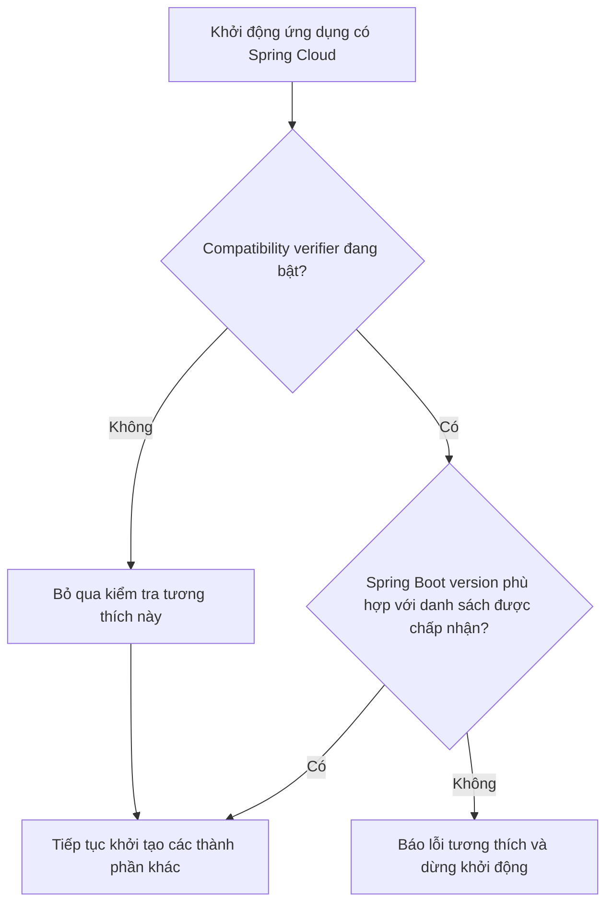
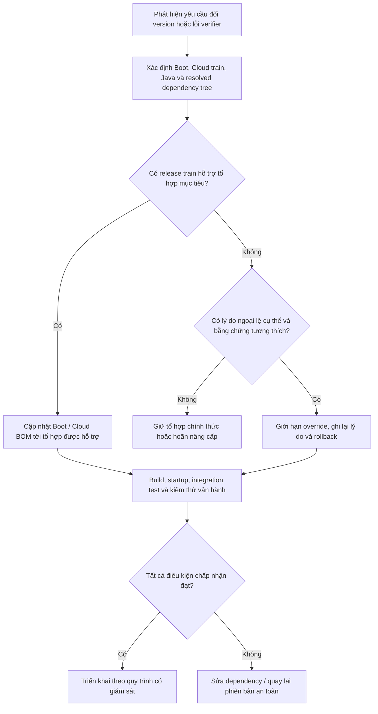

# Điều kiện ghi đè phiên bản và giới hạn tắt compatibility verifier

## 1. Vì sao quản lý phiên bản là một phần của thiết kế Spring Cloud?

Trong hệ thống phân tán, dịch vụ Spring Boot thường kết hợp nhiều thành phần: Spring Cloud Commons và Context, Config Client, Discovery Client, Service Registry, LoadBalancer, OpenFeign hoặc các thư viện giao tiếp giữa dịch vụ. Các thành phần này cùng dựa vào API, vòng đời bean, cấu hình tự động và dependency của Spring Boot/Spring Framework. **Một phiên bản biên dịch thành công chưa chắc tạo nên một tổ hợp chạy đúng**.

Spring Cloud sử dụng **release train** và **Bill of Materials (BOM)** để cung cấp tập phiên bản đã được phối hợp. Thông thường, dự án chọn một phiên bản Spring Boot được Spring Cloud hỗ trợ và nhập BOM của release train tương ứng. Khi đó, phần lớn dependency Spring Cloud được khai báo *không cần phiên bản riêng*.

Tuy vậy, có những yêu cầu thực tế: vá lỗ hổng bảo mật, tránh một regression, tích hợp thư viện chưa kịp phát hành phiên bản tương thích, hoặc nâng cấp có kiểm soát. Việc **ghi đè phiên bản** có thể cần thiết, nhưng là quyết định ảnh hưởng đến toàn bộ đồ thị dependency. Spring Cloud còn cung cấp **compatibility verifier** để kiểm tra một số điều kiện tương thích khi ứng dụng khởi động. Tắt bộ kiểm tra này chỉ thay đổi một bước kiểm tra, **không làm thư viện trở nên tương thích**.

Bài thuộc chương **Phiên bản và phụ thuộc** của mô-đun **SPRING_CLOUD_CORE**. Mục tiêu là biết khi nào được ghi đè phiên bản, khi nào một ngoại lệ đối với verifier có thể chấp nhận trong phạm vi hẹp, và cách kiểm tra ảnh hưởng đến Spring Cloud Commons, Context, cấu hình ngoài, refresh scope, discovery, service registry và giao tiếp giữa dịch vụ.

Sau bài học, người học có thể:

1. Phân biệt phiên bản Spring Boot, Spring Cloud release train và phiên bản từng artifact.
2. Nhận diện khi nào một version override có cơ sở, khi nào phải từ chối.
3. Hiểu điều kiện mà Spring Cloud compatibility verifier kiểm tra và những gì nó **không** kiểm tra.
4. Biết cách bật/tắt verifier, hoặc thay đổi danh sách Spring Boot version được chấp nhận, đúng phạm vi.
5. Xác minh dependency resolution, startup và các luồng nghiệp vụ quan trọng trước khi vận hành.

## 2. Ba cấp độ phiên bản cần phân biệt

| Cấp độ | Ví dụ về đối tượng | Vai trò | Rủi ro khi ghi đè |
| --- | --- | --- | --- |
| **Spring Boot** | Spring Boot parent/BOM hoặc Gradle plugin | Cung cấp auto-configuration, dependency management và tích hợp với Spring Framework | Ảnh hưởng rộng đến API và vòng đời khởi tạo của toàn bộ ứng dụng. |
| **Spring Cloud release train** | BOM `spring-cloud-dependencies` | Quản lý tập phiên bản Spring Cloud phối hợp với nhau và với Boot | Chọn sai train có thể khiến nhiều module cùng không tương thích. |
| **Artifact riêng lẻ** | `spring-cloud-commons`, `spring-cloud-context`, Config Client, LoadBalancer… | Cài đặt một phần chức năng cụ thể | Có thể làm lệch hợp đồng giữa Commons/Context và các module Cloud còn lại. |

Spring Boot còn quản lý nhiều thư viện nền như Spring Framework, Reactor, Micrometer, Jackson, Netty và các starter. Spring Cloud dựa vào những phiên bản nền đó. Vì vậy, ghi đè một thư viện transitive cũng có thể tác động đến Spring Cloud dù dự án không thay đổi BOM Cloud.

Đặc biệt cần phân biệt:

- **Release train** là tập phát hành; tên train không đồng nghĩa với phiên bản của từng JAR.
- **BOM** xác định version được *quản lý*; còn **dependency resolution** quyết định version cuối cùng xuất hiện ở classpath sau khi áp dụng parent, BOM, constraint và quy tắc build tool.
- **Version override** là thao tác chủ động thay một version mặc định trong đồ thị dependency.
- **Compatibility verifier** là kiểm tra trong ứng dụng khi khởi động; nó không thay BOM, không tự thay dependency và không thay quy tắc Maven/Gradle.

Ví dụ, ứng dụng có thể nhập BOM Spring Cloud được chọn đúng nhưng trực tiếp ép `spring-cloud-context` sang một phiên bản thuộc train khác. Maven vẫn có thể resolve các JAR hợp lệ và biên dịch; lỗi liên kết API hoặc hành vi chỉ xuất hiện lúc startup, lúc refresh hoặc dưới tải thực tế.

## 3. Điều kiện chấp nhận một version override

Không nên dùng một quy tắc đơn giản như "chọn phiên bản mới nhất" hay "chỉ cần build pass". Một override cần đáp ứng **đồng thời** các điều kiện sau.

### 3.1. Có lý do cụ thể và phạm vi nhỏ nhất

Mỗi override nên gắn với một lý do có thể kiểm chứng:

- Bản vá bảo mật đã công bố ảnh hưởng đúng artifact và phiên bản đang sử dụng.
- Bug hoặc regression đã được xác nhận, có issue/changelog và một bản vá phù hợp.
- Yêu cầu tương thích bắt buộc của một dependency, đã phân tích đường đi phụ thuộc.
- Giai đoạn chuyển đổi có thời hạn để unblock thử nghiệm, với kế hoạch quay lại tổ hợp chính thức.

Không nên ghi đè đồng thời nhiều artifact chỉ vì chúng có version mới hơn. Nếu cần đổi cả nhóm thành phần Spring Cloud, **nâng cấp nguyên release train** thường dễ kiểm soát hơn việc kéo từng module từ những train khác nhau.

### 3.2. Không vượt ra ngoài tổ hợp tương thích mà không có bằng chứng

Trước tiên đối chiếu **bảng tương thích chính thức của Spring Cloud với Spring Boot** tại thời điểm triển khai. Đừng suy ra tương thích từ số version gần nhau. Kiểm tra cả yêu cầu Java runtime, Spring Framework và những giới hạn được nêu trong release notes.

Nếu muốn dùng một Spring Boot version chưa được release train hiện tại hỗ trợ, cách ưu tiên là chọn **Spring Cloud release train hỗ trợ phiên bản Boot đó**. Đổi Boot mà giữ nguyên train Cloud chỉ vì muốn tránh nâng cấp nhiều dependency là rủi ro hệ thống.

Trong tình huống một bản vá artifact được nhà cung cấp xác nhận tương thích trong cùng nhánh và không đổi hợp đồng API, ghi đè một artifact có thể là quyết định hợp lý. Tuy nhiên, chỉ kết luận sau khi xem phiên bản **thực sự được resolve** và chạy các kiểm thử phù hợp.

### 3.3. Đã kiểm tra tác động tới dependency liên quan

Một thay đổi ở `spring-cloud-commons` có thể ảnh hưởng đến discovery, service registry và load-balancing abstraction; thay đổi ở `spring-cloud-context` có thể ảnh hưởng bootstrap, `EnvironmentChangeEvent` hoặc `@RefreshScope`. Config Client, Gateway và HTTP client cũng có thể dùng các API tương ứng.

Phải xác minh ít nhất:

1. Artifact nào được thay đổi và bản vá đó thuộc release train nào.
2. Những module Spring Cloud nào cùng phụ thuộc vào nó.
3. Có dependency nào bị kéo lùi hoặc nâng quá xa khỏi BOM không.
4. Có xung đột Spring Framework, Reactor, Jackson, Netty, Micrometer hoặc `jakarta.*`/`javax.*` không.
5. Các cách cấu hình startup, Config Data và bootstrap có thay đổi hành vi không.

Với dependency chứa API được module khác sử dụng, chỉ một lỗi `NoSuchMethodError`, `NoClassDefFoundError` hoặc `BeanCreationException` đã đủ khiến một bản nâng cấp thất bại dù tất cả source code của ứng dụng biên dịch.

### 3.4. Có bằng chứng kiểm thử và đường quay lại

Ghi nhận version cũ/mới, lý do, phạm vi ứng dụng chịu ảnh hưởng, bản ghi kết quả test và cách rollback. Với patch quan trọng, cần smoke test trên môi trường gần production, bao gồm startup, liên lạc giữa dịch vụ, nạp cấu hình, discovery và refresh nếu ứng dụng dùng các tính năng đó.

**Quy tắc quyết định:** một override là ngoại lệ có chứng cứ, không phải mặc định mới của toàn bộ tổ chức. Hết lý do ngoại lệ hoặc khi BOM chính thức đã chứa bản sửa phù hợp, nên trở về quản lý phiên bản bằng BOM.

## 4. Cách khai báo phiên bản an toàn trong Maven

Đoạn ví dụ sau là **mẫu cấu hình**. Các giá trị viết hoa là placeholder cần thay bằng các version thực đã kiểm tra với bảng tương thích; không copy nguyên để build.

```xml
<parent>
    <groupId>org.springframework.boot</groupId>
    <artifactId>spring-boot-starter-parent</artifactId>
    <version>BOOT_VERSION_DA_XAC_MINH</version>
    <relativePath/>
</parent>

<properties>
    <java.version>JAVA_VERSION_DUOC_HO_TRO</java.version>
    <spring-cloud.version>CLOUD_TRAIN_VERSION_DA_XAC_MINH</spring-cloud.version>
</properties>

<dependencyManagement>
    <dependencies>
        <dependency>
            <groupId>org.springframework.cloud</groupId>
            <artifactId>spring-cloud-dependencies</artifactId>
            <version>${spring-cloud.version}</version>
            <type>pom</type>
            <scope>import</scope>
        </dependency>
    </dependencies>
</dependencyManagement>

<dependencies>
    <dependency>
        <groupId>org.springframework.cloud</groupId>
        <artifactId>spring-cloud-starter-config</artifactId>
    </dependency>
    <dependency>
        <groupId>org.springframework.cloud</groupId>
        <artifactId>spring-cloud-starter-loadbalancer</artifactId>
    </dependency>
</dependencies>
```

Các dependency ở cuối **không khai báo `version`**, để BOM quyết định. Đây là trạng thái nền nên hướng tới trước khi cân nhắc override.

### 4.1. Nếu bắt buộc phải ghi đè đúng một artifact

Giả sử dự án đã xác nhận một bản vá `spring-cloud-context` phù hợp. Trong POM của ứng dụng, có thể khai báo dependency management trực tiếp cho đúng tọa độ artifact:

```xml
<dependencyManagement>
    <dependencies>
        <!-- Ngoại lệ đã kiểm chứng: ghi rõ issue, ngày rà soát và kế hoạch rollback -->
        <dependency>
            <groupId>org.springframework.cloud</groupId>
            <artifactId>spring-cloud-context</artifactId>
            <version>CONTEXT_PATCH_VERSION_DA_XAC_MINH</version>
        </dependency>
        <dependency>
            <groupId>org.springframework.cloud</groupId>
            <artifactId>spring-cloud-dependencies</artifactId>
            <version>${spring-cloud.version}</version>
            <type>pom</type>
            <scope>import</scope>
        </dependency>
    </dependencies>
</dependencyManagement>
```

Trong Maven, khai báo quản lý trực tiếp trong POM hiện tại có ưu tiên so với version nhập từ BOM cho cùng tọa độ. Đoạn trên minh họa cách **override có chủ đích**; không có nghĩa mọi bản vá `spring-cloud-context` đều an toàn để ghép với BOM hiện tại. Phải kiểm tra effective POM và resolved dependency tree. Không thêm đồng thời hai block `dependencyManagement` tách rời trong một POM thật: hãy gộp cấu hình minh họa vào block đang có.

### 4.2. Xem version đã được chọn

```bash
./mvnw help:effective-pom
./mvnw dependency:tree -Dincludes=org.springframework.cloud
./mvnw dependency:tree -Dverbose
```

Tùy phiên bản Maven Dependency Plugin, cách hiện conflict/omitted dependency ở chế độ verbose có thể khác nhau. Điều quan trọng là **xem classpath và effective dependency management**, không chỉ kiểm tra văn bản khai báo trong `pom.xml`. Các lệnh trên là ví dụ để người học chạy trong dự án của mình; chúng không phải kết quả kiểm thử đã được thực hiện.

## 5. Với Gradle: kiểm soát platform, constraint và resolution

Trong Gradle, dự án có thể quản lý dependency bằng BOM theo `platform(...)` hoặc plugin `io.spring.dependency-management`, tùy cấu hình hiện tại. Chọn một cách nhất quán và biết rõ quy tắc ưu tiên. Ví dụ với native Gradle platform:

```groovy
dependencies {
    implementation platform(
        "org.springframework.cloud:spring-cloud-dependencies:CLOUD_TRAIN_VERSION_DA_XAC_MINH"
    )

    implementation "org.springframework.cloud:spring-cloud-starter-config"
}
```

Dependency Spring Boot cũng cần được quản lý phù hợp bởi cấu hình build hiện có, chẳng hạn Boot BOM. Ví dụ trên chỉ minh họa **phần Spring Cloud**.

Khi cần một ngoại lệ cụ thể, `constraints` có thể mô tả version và lý do; ví dụ dưới đây sử dụng `strictly` nên sẽ **báo lỗi nếu các ràng buộc khác không thể thỏa mãn**, thay vì âm thầm chấp nhận version khác:

```groovy
dependencies {
    constraints {
        implementation("org.springframework.cloud:spring-cloud-context") {
            version {
                strictly("CONTEXT_PATCH_VERSION_DA_XAC_MINH")
            }
            because("Bản vá đã kiểm chứng cho issue đã ghi nhận")
        }
    }
}
```

`strictly` không bảo đảm runtime tương thích; nó chỉ biểu diễn ràng buộc resolution. Tránh dùng `resolutionStrategy.force(...)` tràn lan, vì force có thể che khuất xung đột cần được phát hiện.

Đối chiếu resolved version bằng:

```bash
./gradlew dependencies --configuration runtimeClasspath
./gradlew dependencyInsight --dependency spring-cloud-context --configuration runtimeClasspath
```

Khi một constraint xung đột với BOM hoặc một dependency transitive, cần giải thích **vì sao** và quyết định rõ cách sửa. Không giải quyết bằng cách tắt kiểm tra hoặc thêm force một cách máy móc.

## 6. Spring Cloud compatibility verifier kiểm tra gì?

**Spring Cloud compatibility verifier** là kiểm tra an toàn ở giai đoạn startup do Spring Cloud cung cấp qua các thành phần Commons. Một kiểm tra quan trọng là xác định **phiên bản Spring Boot đang dùng** có nằm trong những phiên bản được Spring Cloud release train hiện hành xem là tương thích hay không.

Nếu tổ hợp không được chấp nhận, ứng dụng có thể không khởi động và hiển thị thông báo giải thích rằng phiên bản Spring Boot hiện tại không tương thích với Spring Cloud release train, kèm gợi ý chọn phiên bản Boot hoặc Cloud phù hợp.

Sơ đồ quyết định:



**Cần hiểu đúng phạm vi:** verifier là *một hàng rào sớm*, không phải bộ kiểm định đầy đủ cho mọi artifact.

| Verifier giúp phát hiện | Verifier không bảo đảm |
| --- | --- |
| Một số tổ hợp Spring Boot ↔ Spring Cloud không nằm trong danh sách được chấp nhận | Mọi module Spring Cloud đều thuộc cùng BOM hoặc không bị override |
| Một số điều kiện tương thích được các verifier có mặt trong ứng dụng kiểm tra | Không có xung đột API/ABI, classpath hay transitive dependency |
| Lỗi tương thích có thể nhận diện ngay khi startup | Refresh scope, Config Data, discovery, registry, HTTP client và business flow đều chạy đúng |
| Cảnh báo trước khi chạy ứng dụng với tổ hợp bị từ chối | Tính bảo mật, hiệu năng, tính nhất quán đa instance hoặc hỗ trợ chính thức |

Một ứng dụng **qua verifier vẫn có thể lỗi runtime**, và một ứng dụng **tắt verifier có thể tiếp tục chạy đến khi gặp lỗi khó hơn**. Do đó, không dùng trạng thái của verifier làm bằng chứng duy nhất về tương thích.

## 7. Cấu hình verifier: bật, tắt và danh sách Boot version

Thông thường verifier được bật khi phần tích hợp tương ứng hiện diện. Thuộc tính cấu hình Spring Cloud được sử dụng là:

```yaml
spring:
  cloud:
    compatibility-verifier:
      enabled: true
```

Để **tắt bộ kiểm tra** trong phạm vi thử nghiệm có kiểm soát:

```yaml
spring:
  cloud:
    compatibility-verifier:
      enabled: false
```

Tương đương trong file `application.properties`:

```properties
spring.cloud.compatibility-verifier.enabled=false
```

Lựa chọn khác là thay danh sách **Spring Boot version được verifier xem là phù hợp** thông qua:

```properties
spring.cloud.compatibility-verifier.compatible-boot-versions=BOOT_MAJOR.MINOR.x
```

Đây là **placeholder mô tả cú pháp**, không phải giá trị được xác thực để sử dụng nguyên văn. Tùy phiên bản Spring Cloud, thuộc tính này hỗ trợ danh sách giá trị phân tách bằng dấu phẩy và pattern version theo cú pháp được tài liệu phiên bản đó cho phép. Việc thêm Boot version vào danh sách chỉ **thay điều kiện chấp nhận của verifier**, không thay BOM, JAR, API hoặc mức độ hỗ trợ chính thức.

Điểm quan trọng là phải phân biệt hai kiểu nới lỏng:

- `enabled=false` bỏ qua **toàn bộ cơ chế kiểm tra tương thích này** trong phiên bản đang chạy.
- `compatible-boot-versions=...` thay đổi danh sách phiên bản Boot mà bộ kiểm tra so khớp; nó có thể khiến một tổ hợp chưa được xác minh vượt qua kiểm tra.

Nếu một ngoại lệ là không thể tránh khỏi, việc giới hạn danh sách chấp nhận có thể rõ mục tiêu hơn tắt toàn bộ verifier, nhưng **cả hai đều cần bằng chứng**. Không có cấu hình nào trong số đó được xem là cách sửa xung đột dependency.

## 8. Khi nào *có thể* tạm tắt verifier?

Trường hợp hợp lý thường có **phạm vi hẹp**, **mục đích chẩn đoán** hoặc **bằng chứng độc lập** cho thấy kiểm tra đang chặn một tổ hợp cần đánh giá. Ví dụ:

1. **Điều tra lỗi startup:** tắt trong một môi trường phát triển cô lập để xác định phần ứng dụng nào tiếp tục lỗi sau cảnh báo phiên bản; sau khi chẩn đoán phải khôi phục kiểm tra.
2. **Xác thực một compatibility metadata có thể chưa được cập nhật:** đã có tài liệu hoặc xác nhận từ bên duy trì về tổ hợp cần dùng, nhưng verifier của artifact hiện tại chưa phản ánh thay đổi; cần ghi lại nguồn xác nhận, phạm vi áp dụng và kiểm thử.
3. **Thử nghiệm nâng cấp có kiểm soát:** CI hoặc môi trường staging chạy một candidate chưa được hỗ trợ chính thức, có người chịu trách nhiệm và điều kiện dừng thử nghiệm rõ ràng.

Ngay cả trong các trường hợp trên, **đề xuất vận hành mặc định** vẫn là chọn tổ hợp Boot/Cloud chính thức tương thích và bật verifier. Tắt kiểm tra chỉ phục vụ khảo sát hoặc ngoại lệ đã được đánh giá; nó không tự cấp phép triển khai production.

### Khi nào không nên tắt?

- Chỉ vì ứng dụng báo Boot version không hợp lệ, nhưng chưa tra compatibility matrix.
- Để dùng một Spring Boot major/minor mới hơn trong khi release train Cloud chưa hỗ trợ và không có bằng chứng tương thích.
- Để né lỗi `NoSuchMethodError`, `ClassNotFoundException`, `BeanCreationException`, lỗi Config Data hoặc lỗi service discovery; đây là những lỗi phải điều tra trực tiếp.
- Để che sự khác nhau giữa dependency mà BOM chọn và dependency bị `force` hoặc override.
- Để vượt qua pipeline CI đang phát hiện lỗi mà không có giải thích, bằng chứng thử nghiệm và thời hạn thu hồi ngoại lệ.

**Tình huống phản ví dụ:** một ứng dụng dùng Boot version B và Cloud train T bị verifier từ chối. Nhóm phát triển đặt `spring.cloud.compatibility-verifier.enabled=false`; dịch vụ chạy tới bước tạo bean Config Client rồi lỗi liên kết phương thức. Kết luận đúng không phải "verifier gây lỗi", mà là **tổ hợp dependency chưa tương thích**; bỏ qua chốt kiểm tra đầu tiên chỉ chuyển lỗi sang bước sau.

## 9. Quy trình quyết định khi gặp lỗi phiên bản



### Bước 1. Chụp hiện trạng

Ghi nhận phiên bản Spring Boot, Spring Cloud BOM, Java runtime và JAR thực tế được resolve. Lưu effective POM hoặc dependency report để có thể tái hiện lỗi. Nếu lỗi chỉ xuất hiện trên một môi trường, kiểm tra profile, classpath, container image và các biến cấu hình khác với CI.

### Bước 2. Chọn đường sửa ít rủi ro

Ưu tiên dùng release train tương thích hoặc nâng cấp patch theo hướng dẫn của bên duy trì. Nếu chỉ một artifact bị lỗi, xem có bản sửa trong cùng train hoặc bản cập nhật BOM hay không. Chỉ xem xét version override riêng lẻ khi phần khác của tổ hợp vẫn nhất quán và có bằng chứng đủ mạnh.

### Bước 3. Giữ verifier trong các test đại diện

Kiểm thử không chỉ bằng lệnh compile. Cần có ít nhất một bài test startup với **verifier bật** cho tổ hợp định triển khai. Nếu thử nghiệm cần tắt verifier, dùng **profile hoặc cấu hình riêng cho môi trường thử**, đừng vô tình làm tất cả môi trường thừa hưởng thuộc tính này.

Ví dụ cấu hình được truyền **chỉ vào tiến trình thử nghiệm** để chẩn đoán:

```bash
java -jar app.jar --spring.cloud.compatibility-verifier.enabled=false
```

Lệnh trên minh họa phạm vi process; không nên đưa thẳng tham số đó vào script production khi chưa có phê duyệt và bằng chứng tương thích.

### Bước 4. Kiểm thử những abstraction thực sự được sử dụng

| Vùng chức năng | Kiểm tra tối thiểu cần thiết |
| --- | --- |
| ApplicationContext / auto-configuration | Startup thành công, các bean quan trọng được khởi tạo, không có lỗi liên kết API. |
| Spring Cloud Context | `Environment` nhận cấu hình đúng; sự kiện và `@RefreshScope` hoạt động nếu được dùng. |
| Config Client / cấu hình ngoài | Kết nối Config Server hoặc nguồn tương ứng; kiểm tra cấu hình profile, import và ưu tiên property. |
| Commons, discovery, service registry | Instance đăng ký/được tìm thấy, xử lý tình huống registry không sẵn sàng và cập nhật trạng thái hợp lý. |
| LoadBalancer / giao tiếp giữa dịch vụ | Tìm service ID, chọn instance, timeout/retry và xử lý lỗi kết nối theo thiết kế. |
| Actuator / vận hành | Health, metrics, log, readiness và bảo mật endpoint phù hợp; không lộ thông tin nhạy cảm. |
| Nhiều instance | Cấu hình và hành vi nhất quán theo thiết kế; nhận biết instance chưa được refresh. |

Các test phải phản ánh tính năng **thực sự dùng** trong dự án: không cần cài thêm một registry chỉ để test khi ứng dụng không dùng discovery; nhưng không thể bỏ qua các luồng Config/Refresh nếu đó là mục đích nâng cấp.

### Bước 5. Chấp nhận hoặc rollback có kiểm soát

Định nghĩa trước điều kiện dừng: startup lỗi, tăng tỷ lệ HTTP 5xx, timeout tăng bất thường, lỗi đăng ký dịch vụ, Config Data không nạp được hoặc refresh trả giá trị sai. Khi một tiêu chí thất bại, rollback về bản build và BOM đã biết hoạt động tốt; không tiếp tục tắt thêm cơ chế kiểm tra để né cảnh báo.

## 10. Tình huống thực hành

**Bối cảnh:** dịch vụ `order-service` dùng Spring Boot B, Spring Cloud release train T và Spring Cloud Config Client. Nhóm muốn cập nhật Boot lên B' để lấy tính năng mới; sau nâng cấp, compatibility verifier báo rằng B' không nằm trong danh sách được Cloud T hỗ trợ. Dự án vẫn biên dịch.

**Phân tích đúng hướng:**

1. Xem bản Cloud train nào chính thức hỗ trợ B' theo compatibility matrix tương ứng; kiểm tra Java và những phụ thuộc liên quan.
2. Nếu có train hỗ trợ, thay BOM theo train đó, bỏ các override không còn cần thiết và chạy lại kiểm thử.
3. Nếu chưa có train hỗ trợ, cân nhắc giữ Boot B, hoãn nâng cấp B', hoặc thực hiện thử nghiệm có phạm vi và chứng cứ rõ ràng.
4. Chỉ dùng `enabled=false` trong quá trình điều tra khi thực sự cần vượt qua chốt phiên bản để quan sát vấn đề tiếp theo.
5. Chạy startup test, gọi Config Server, thử refresh một bean, kiểm tra service discovery/HTTP flow mà ứng dụng sử dụng, và so sánh với bản trước.

**Sai lầm thường gặp:** chuyển `enabled=false` thành cấu hình mặc định, thấy service chạy trong vài phút rồi kết luận B' và T tương thích. Việc đó chưa kiểm tra các đường chạy hiếm như mất registry, refresh cấu hình, kết nối lỗi hoặc tải cao.

**Tình huống thứ hai:** một bản vá bảo mật cho `spring-cloud-context` đã có trong cùng nhánh được bên duy trì xác nhận. Nhóm có thể cân nhắc override artifact này để áp dụng sớm, nhưng cần ghi issue và version, kiểm tra các module Cloud liên quan và thử luồng `@RefreshScope` / Config Client. Khi BOM chính thức cập nhật bản vá, bỏ override để tránh phát sinh nợ phụ thuộc.

## 11. Checklist trước khi chấp nhận ngoại lệ

Một thay đổi version nên có bản ghi ngắn nhưng đủ để reviewer ra quyết định:

| Câu hỏi | Bằng chứng mong đợi |
| --- | --- |
| Tại sao phải đổi? | Issue, CVE, regression hoặc yêu cầu kỹ thuật cụ thể. |
| Phạm vi nhỏ nhất là gì? | Danh sách artifact/version và lý do không dùng BOM mặc định. |
| Boot/Cloud/Java có nằm trong phạm vi hỗ trợ? | Kết quả đối chiếu tài liệu tương thích đúng release. |
| Dependency thực tế là gì? | Effective POM hoặc Gradle dependency insight đã lưu. |
| Verifier có bật trên tổ hợp đích? | Log startup và kết quả test với cấu hình production tương đương. |
| Nếu có tắt verifier, ai chịu trách nhiệm và đến khi nào? | Phạm vi thử nghiệm, căn cứ ngoại lệ, thời hạn và điều kiện bật lại. |
| Những khả năng Cloud nào đã được kiểm tra? | Test report cho Context, Config, discovery/registry, giao tiếp và vận hành theo thực tế sử dụng. |
| Có phương án quay lại? | Bản build/BOM trước thay đổi và thao tác rollback được xác minh. |

## 12. Câu hỏi tự kiểm tra

1. Vì sao BOM của Spring Cloud có giá trị hơn việc tự chỉ định version mới nhất cho mỗi starter?
2. Trong trường hợp nào có thể ghi đè một patch version cho `spring-cloud-context`, và cần kiểm tra điều gì với Commons/Config Client?
3. `spring.cloud.compatibility-verifier.enabled=false` khác gì với việc thay Spring Cloud release train?
4. Điều gì xảy ra nếu chỉ sửa `compatible-boot-versions` để chấp nhận một Spring Boot minor chưa được train hỗ trợ?
5. Vì sao một ứng dụng biên dịch thành công và vượt qua verifier vẫn có thể lỗi khi gọi service hoặc refresh cấu hình?
6. Hãy mô tả cách kiểm tra Maven/Gradle đã chọn artifact version nào và quy trình rollback sau một override thất bại.

---

**Ghi nhớ:** release train và BOM là điểm xuất phát để có tổ hợp Spring Boot/Spring Cloud nhất quán. Ghi đè phiên bản chỉ nên thực hiện khi có lý do rõ ràng, phạm vi giới hạn và bằng chứng kiểm thử. Compatibility verifier là cảnh báo sớm về những tổ hợp không được chấp nhận; tắt nó **chỉ bỏ chốt kiểm tra**, không sửa sự không tương thích trong classpath hay hành vi runtime. Khi nghi ngờ, ưu tiên trở về tập phiên bản được hỗ trợ và tái lập kiểm thử.
