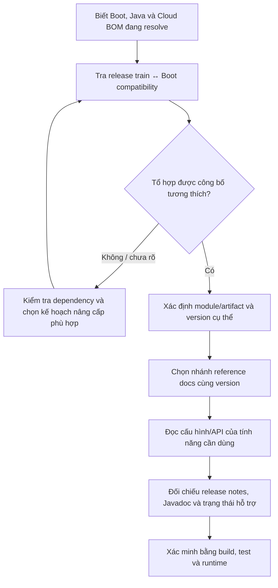
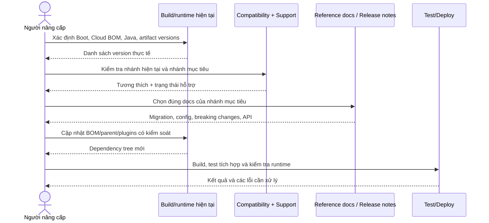

# Đọc tài liệu và trạng thái hỗ trợ đúng nhánh phiên bản Spring Cloud

## 1. Vì sao phải đọc đúng nhánh phiên bản?

Khi phát triển một hệ thống phân tán bằng Spring Boot và Spring Cloud, việc tìm thấy một bài hướng dẫn có cú pháp Java, YAML hoặc tên annotation quen thuộc **chưa đủ để xác nhận hướng dẫn đó áp dụng cho dự án**. Một ví dụ trên trang tài liệu hiện tại có thể mô tả API hoặc quy tắc cấu hình của release train mới hơn, trong khi ứng dụng đang chạy một nhánh đã cũ. Ngược lại, một bài blog vài năm trước có thể yêu cầu một cơ chế đã được thay thế.

Giả sử nhóm đang duy trì `order-service` và `inventory-service`. Cả hai dùng Spring Boot, Spring Cloud Commons/Context để tổ chức abstraction chung, Service Discovery để tìm instance và Config Client để nạp cấu hình. Một người đọc tài liệu mới nhất rồi thay cấu hình khởi động, nâng một starter hoặc dùng `RestClient` theo ví dụ mới. Kết quả có thể là build lỗi, bean không được tạo, cấu hình không nạp, hoặc ứng dụng không khởi động vì Spring Boot và Spring Cloud không tương thích.

Vì vậy, khi đọc tài liệu, cần trả lời **bốn câu hỏi theo thứ tự**:

1. **Dự án đang thực sự dùng phiên bản nào?** Phiên bản khai báo trong build và phiên bản được resolve có thể khác nhau.
2. **Các phiên bản đó có thuộc một tổ hợp tương thích được hỗ trợ không?** Phải đối chiếu Spring Boot với **Spring Cloud release train**, cùng Java và những thành phần hạ tầng liên quan.
3. **Đang đọc tài liệu cho đúng sản phẩm, module và nhánh nào?** Trang tài liệu mặc định có thể trỏ tới phiên bản mới nhất, không phải phiên bản của dự án.
4. **Nhánh đó hiện được hỗ trợ ở mức nào?** Trạng thái phát hành, việc còn nhận bản vá cộng đồng và hỗ trợ thương mại là những khái niệm khác nhau.

Đích của bài học là tạo ra một quy trình xác minh có thể lặp lại mỗi khi triển khai, sửa lỗi, nghiên cứu `@RefreshScope`, `DiscoveryClient`, `ServiceRegistry`, Spring Cloud LoadBalancer hoặc nâng phiên bản của cả hệ thống.

## 2. Bốn lớp phiên bản cần phân biệt

Spring Cloud là một hệ sinh thái nhiều dự án, không phải một thư viện Java duy nhất. Các lớp phiên bản thường xuất hiện cùng nhau:

| Lớp | Ví dụ tên | Ý nghĩa | Cần tìm ở đâu? |
| --- | --- | --- | --- |
| **Java/JDK** | Java 17, Java 21 | Runtime và mức ngôn ngữ/JVM mà ứng dụng sử dụng | Cấu hình build, `java -version`, image runtime |
| **Spring Boot** | `spring-boot`, `spring-boot-starter-web` | Nền tảng khởi động, auto-configuration và quản lý nhiều dependency | Boot parent/BOM/plugin, dependency resolution |
| **Spring Cloud release train** | `spring-cloud-dependencies` với version dạng `YYYY.N.patch` | Bộ phiên bản được phối hợp của nhiều dự án Spring Cloud | BOM hoặc dependency management, bảng tương thích chính thức |
| **Spring Cloud project/module** | `spring-cloud-commons`, `spring-cloud-context`, `spring-cloud-config-client`, `spring-cloud-loadbalancer` | Implementation hoặc API thực tế đi vào classpath | Maven/Gradle dependency tree, release notes và reference docs của module |

**Release train không đồng nghĩa với phiên bản jar.** Ví dụ mang tính lịch sử, một release train có số phiên bản dạng `2024.0.x` có thể quản lý các artifact Spring Cloud Commons với số `4.2.x`. Vì vậy không thể nhìn thấy `spring-cloud-commons:4.x` rồi tự kết luận dự án đang chạy release train nào chỉ dựa vào việc so số.

Ngoài ra, `spring-boot-starter-*` và `spring-cloud-starter-*` đều là **starter**, tức tập dependency giúp bật một khả năng. Starter có thể kéo nhiều thư viện và phiên bản transitive khác nhau. Muốn biết mã thật đang chạy, phải xem dependency đã được resolve, không dừng ở tên starter.

### 2.1. Ba trục tương thích

Một thay đổi về phiên bản có thể ảnh hưởng đồng thời đến ba trục:

- **Boot ↔ Cloud:** release train Spring Cloud được công bố tương thích với một hoặc một nhóm phiên bản Spring Boot. Không tự ghép Boot và Cloud chỉ vì từng thư viện có phiên bản phát hành mới.
- **JDK ↔ Boot/Cloud:** phiên bản Java tối thiểu, phiên bản được kiểm thử và cấu hình toolchain phải thỏa yêu cầu của Boot cùng các dependency khác.
- **API/implementation ↔ cách cấu hình:** annotation, bean, cách cấu hình Spring Cloud Config, HTTP client, LoadBalancer và cơ chế bootstrap có thể thay đổi theo nhánh.

Ngoài ba trục này, dự án có thể có tương thích riêng cho Eureka Server, Consul, Spring Cloud Gateway, Spring Security, Spring Framework và các thư viện bên thứ ba. Phải kiểm tra theo thành phần **thực sự đang được dùng**.

## 3. Thu thập chứng cứ phiên bản trước khi tra cứu

Không nên mở trang “current” đầu tiên rồi mới cố điều chỉnh dự án theo ví dụ trên đó. Trước hết hãy lập một bản ghi nhỏ về trạng thái build:

| Thông tin | Cần ghi lại | Lý do |
| --- | --- | --- |
| Spring Boot | Version parent/BOM/plugin và version runtime | Quyết định hệ nền tảng, API Framework và auto-configuration |
| Spring Cloud | Version của `spring-cloud-dependencies` BOM | Xác định release train cần tra compatibility và tài liệu |
| Module Spring Cloud | Version **đã resolve** của Commons, Context, Config, LoadBalancer, discovery starter | Gắn đoạn tài liệu/Javadoc với đúng mã đang chạy |
| Java | Toolchain, compiler target và JVM deploy | Tránh trường hợp build bằng một JDK, deploy bằng JDK khác |
| Build tool | Maven/Gradle và phiên bản plugin | Ảnh hưởng cách nhập BOM và giải quyết dependency |
| Runtime | Image/container, environment, profile | Bảo đảm bản chạy thực tế cùng dependency/cấu hình đang nghiên cứu |

### 3.1. Dự án Maven

Các lệnh đọc trạng thái phổ biến:

```bash
# Phiên bản Maven và Java được Maven sử dụng
mvn -version

# POM hiệu lực sau khi kế thừa parent, profile và dependency management
mvn help:effective-pom

# Cây dependency thực tế của ứng dụng
mvn dependency:tree

# Có thể lọc theo nhóm Spring Cloud khi cần tập trung điều tra
mvn dependency:tree -Dincludes=org.springframework.cloud
```

Với dự án đa module, chạy tại module chứa ứng dụng hoặc dùng tham số Maven chọn module phù hợp. `effective-pom` cho biết cơ chế quản lý version; `dependency:tree` cho biết phiên bản artifact được chọn sau khi Maven xử lý dependency mediation.

**Không nhầm** phiên bản “đã khai báo” với phiên bản “đã resolve”. Một direct dependency có gắn version riêng, BOM import sai thứ tự hoặc override trong parent/profile có thể khiến một module Spring Cloud không còn nằm trên tập phiên bản dự kiến.

### 3.2. Dự án Gradle

Các lệnh tương tự:

```bash
./gradlew --version

# Đọc các dependency đã resolve cho cấu hình runtime
./gradlew dependencies --configuration runtimeClasspath

# Xác minh một dependency cụ thể đến từ đâu, chọn version nào
./gradlew dependencyInsight --dependency spring-cloud-commons --configuration runtimeClasspath
```

Trên Windows, thường chạy `gradlew.bat` thay cho `./gradlew`. Nếu dự án có nhiều subproject, chọn đúng đường dẫn task của subproject. Có thể có dependency khác nhau giữa `compileClasspath`, `runtimeClasspath` và `testRuntimeClasspath`; hãy kiểm tra cấu hình tương ứng với lỗi cần điều tra.

### 3.3. Còn cần đối chiếu phiên bản runtime

POM hoặc Gradle có thể đã đổi nhưng hệ thống deploy vẫn chạy image cũ. Nếu nghi ngờ:

1. Kiểm tra version/image tag và thông tin build của bản deploy.
2. Đối chiếu commit và dependency lockfile/build artifact.
3. Kiểm tra log khởi động hoặc metadata build khi ứng dụng có phát hành thông tin đó.
4. Chỉ dùng Actuator `/actuator/info` hoặc endpoint quản trị nếu môi trường đã cấu hình và có quyền truy cập; không giả định mọi phiên bản đều tự hiển thị chính xác bộ dependency ở đây.

Một log lỗi có đường dẫn jar `spring-cloud-context-...jar` hoặc `spring-boot-autoconfigure-...jar` là dấu hiệu hữu ích để đối chiếu version tại runtime, nhưng không thay thế cho dependency tree và metadata deploy.

## 4. Đúng nguồn tài liệu: sản phẩm, nhánh và trang

Không có một URL duy nhất đủ bao phủ Spring Boot, toàn bộ Spring Cloud, mọi module và mọi release train. Mỗi nguồn có mục đích riêng.

| Nguồn nên ưu tiên | Trả lời câu hỏi gì? | Cách sử dụng |
| --- | --- | --- |
| [Spring Cloud project](https://spring.io/projects/spring-cloud) | Release train, quan hệ với Boot, tài liệu và thông tin phát hành | Xác minh release train đúng cho Boot đang dùng |
| [Spring Boot project](https://spring.io/projects/spring-boot) | Phát hành, yêu cầu và tài liệu Boot | Xác minh nhánh Boot và yêu cầu nền tảng |
| [Spring Cloud Commons reference](https://docs.spring.io/spring-cloud-commons/reference/) | `DiscoveryClient`, `ServiceRegistry`, LoadBalancer và Context | Chọn reference version khớp artifact/module đang dùng |
| [Spring Cloud Config reference](https://docs.spring.io/spring-cloud-config/reference/) | Config Server/Client, Config Data và refresh | Chọn nhánh cùng release train và kiểm tra cơ chế bootstrapping |
| [Spring Cloud Netflix reference](https://docs.spring.io/spring-cloud-netflix/reference/) | Tích hợp Eureka và các khả năng Netflix được hỗ trợ | Chỉ tra khi dự án thực sự dùng implementation này |
| [Spring Framework reference](https://docs.spring.io/spring-framework/reference/) | API nền như `RestClient`, bean lifecycle, HTTP/WebFlux | Chọn version Framework mà Boot quản lý, tránh nhầm với Cloud |
| [Spring support policy](https://spring.io/support) | Chính sách bảo trì, mức hỗ trợ và thời hạn | Xác minh hỗ trợ Open Source hoặc thương mại tại thời điểm quyết định |
| Release notes/changelog và Javadoc **của version cụ thể** | API nào thêm, đổi, deprecated hoặc bị xóa? | Đối chiếu khi ví dụ trong reference docs khác mã nguồn đang chạy |

Các liên kết reference ở trên là **điểm bắt đầu**. Chúng có thể hiển thị hoặc chuyển tới tài liệu phiên bản hiện hành. Phải kiểm tra bộ chọn phiên bản (version selector), banner và đường dẫn hiện tại trên website, sau đó điều hướng tới **nhánh phù hợp với ứng dụng**. Không suy rằng chữ “current”, “latest” hay một URL không chứa version chính là nhánh đang deploy.

### 4.1. Thứ tự tra cứu được khuyến nghị



Mỗi bước trả lời một câu hỏi khác nhau. **Bảng tương thích không thay thế reference docs; reference docs không thay thế chính sách hỗ trợ; và chính sách hỗ trợ không chứng minh ứng dụng của bạn đã chạy đúng.**

### 4.2. Kiểm tra dấu hiệu của một tài liệu đúng nhánh

Trước khi sao chép một đoạn cấu hình hoặc code, cần nhìn vào:

- **Tên sản phẩm:** đó là Spring Cloud Commons, Context, Config, Netflix hay Spring Boot? Một property của Config Server không nhất thiết có nghĩa trong một dịch vụ chỉ dùng Commons.
- **Version hiển thị:** tài liệu đang nói về phiên bản artifact, nhánh release hay chỉ ghi `current`? Đối chiếu với dependency tree.
- **Đối tượng áp dụng:** chú thích về minimum Java, Boot, Spring Framework hoặc các starter cần thiết.
- **Điều kiện kích hoạt:** tài liệu có yêu cầu một annotation, bean, dependency, profile hay endpoint được expose không?
- **Điểm thay đổi:** phần migration, release notes, deprecation, removal, breaking changes và những thay đổi mặc định.
- **Tính xác thực:** reference docs/Javadoc của nhánh tương ứng có ưu tiên hơn các ví dụ không ghi version trên blog hoặc Stack Overflow.

Trường hợp docs mới không có lựa chọn nhánh cũ ở thanh điều hướng, có thể tìm release notes/tag hoặc Javadoc theo **đúng artifact version**. Nếu không tìm thấy nguồn phù hợp, hãy ghi nhận khoảng trống đó và kiểm tra mã/đặc tả trong build thực tế thay vì giả định ví dụ mới chắc chắn tương thích ngược.

## 5. “Đã phát hành”, “ổn định” và “được hỗ trợ” khác nhau thế nào?

Một dependency có thể download được từ Maven Central nhưng không còn nhận bản vá theo chính sách hiện tại. Cần tách ba lớp: **trạng thái phát hành**, **trạng thái bảo trì** và **điều khoản hỗ trợ**.

| Nhãn / khái niệm | Ý nghĩa thực tế | Không nên tự suy ra |
| --- | --- | --- |
| Snapshot (`-SNAPSHOT`) | Bản build phát triển, có thể thay đổi | Phù hợp production hoặc được bảo đảm tương thích |
| Milestone (`M1`, `M2`...) | Mốc thử nghiệm của nhánh đang phát triển | Đã có cam kết ổn định API |
| Release Candidate (`RC`) | Bản ứng viên trước khi phát hành chính thức | Chính sách hỗ trợ như bản GA |
| GA / stable release | Bản phát hành chính thức của version cụ thể | Nhánh đó sẽ được bảo trì mãi |
| Maintenance / patch release | Bản vá trong một nhánh version | Mọi lỗi hay bảo mật đều được vá trong nhánh cũ |
| End of Open Source Support / EOL | Hết hỗ trợ/bảo trì theo chính sách được công bố | Artifact sẽ biến mất khỏi repository hoặc không còn chạy |
| Commercial / enterprise support | Quyền lợi hỗ trợ theo nhà cung cấp và hợp đồng | Mọi người dùng miễn phí đều có cùng thời hạn hỗ trợ |
| Deprecated API | API còn tồn tại nhưng được khuyến nghị chuyển khỏi | API bị xóa ngay trong version hiện tại |
| Removed / breaking change | Hành vi hoặc API cũ không còn tương thích | Có thể tiếp tục dùng code cũ mà không cần migration |

**Một trạng thái cần gắn với thời điểm kiểm tra.** Tại thời điểm nhóm chuẩn bị phát hành, hãy xem chính sách hỗ trợ hiện hành, ngày kết thúc của nhánh Spring Boot và release train Spring Cloud liên quan, rồi lưu ngày, đường dẫn nguồn và kết luận vào tài liệu nâng cấp. Các mốc hỗ trợ thay đổi theo chính sách và loại hỗ trợ; không nên cố định chúng từ một bài viết không được cập nhật.

### 5.1. Bốn điều cần xác minh để tuyên bố “còn được hỗ trợ”

1. **Đúng sản phẩm:** Spring Boot hay một dự án Spring Cloud cụ thể? Chính sách có thể khác nhau.
2. **Đúng version line:** bản `major.minor` hoặc release train nào? Bản patch cao hơn chưa chắc kéo dài thời hạn hỗ trợ của cả nhánh.
3. **Đúng hình thức hỗ trợ:** cộng đồng/OSS, hỗ trợ thương mại hoặc điều khoản từ vendor nào?
4. **Đúng ngày hiệu lực:** chính sách và bảng vòng đời tại thời điểm đánh giá, không phải tại ngày phát hành của một bài blog cũ.

Trạng thái “không còn được hỗ trợ” không đồng nghĩa mã ngừng chạy ngay, nhưng tác động đến khả năng nhận bản sửa lỗi và rủi ro vận hành, đặc biệt khi phải xử lý lỗ hổng bảo mật. Nếu một nhánh hết hỗ trợ OSS nhưng còn hỗ trợ thương mại, quyết định tiếp tục dùng phải dựa vào điều khoản thực tế của tổ chức.

## 6. Chọn Spring Cloud release train tương thích với Spring Boot

Spring Boot và Spring Cloud có chu kỳ phát hành riêng. Cách đáng tin cậy để chọn tổ hợp là đối chiếu **compatibility matrix chính thức của Spring Cloud** tại thời điểm nâng cấp. Không suy từ ngày công bố, thứ tự version hay tên train.

Ví dụ **minh họa lịch sử, không phải khuyến nghị chọn phiên bản mới cho dự án**: dòng Spring Cloud `2024.0.x` được thiết kế cho dòng Spring Boot `3.4.x`. Điều này chỉ giúp thấy hình thức ghép hai nhánh; khi đưa vào dự án thực tế, vẫn phải kiểm tra patch cụ thể, Java, trạng thái hỗ trợ và thông tin chính thức hiện hành.

Một bản ghi quyết định tương thích nên có mẫu:

| Trường | Giá trị cần điền |
| --- | --- |
| Ngày xác minh | YYYY-MM-DD |
| Spring Boot đang dùng | Version chính xác, ví dụ `B.M.P` |
| Spring Cloud BOM | Release train + patch chính xác |
| Java runtime | Version trong môi trường production |
| Nguồn xác minh | URL compatibility matrix và thời điểm đọc |
| Trạng thái hỗ trợ | OSS/commercial, ngày EOL nếu nguồn có công bố |
| Các module rủi ro | Config, Commons/Context, LoadBalancer, discovery và module khác đang dùng |
| Quyết định | Giữ bản hiện tại, lên patch hoặc nâng theo release train; người phụ trách |

Không có bản ghi này, rất khó phân biệt “vẫn build được” với “đang dùng tổ hợp nằm trong phạm vi hỗ trợ”.

### 6.1. Quản lý phiên bản trong Maven bằng BOM

Trong Maven, `spring-cloud-dependencies` là Bill of Materials được import trong `dependencyManagement` để quản lý các version Spring Cloud tương ứng với một release train:

```xml
<!-- Đặt spring-cloud.version ở properties của dự án/parent;
     giá trị phải lấy từ compatibility matrix chính thức. -->
<dependencyManagement>
    <dependencies>
        <dependency>
            <groupId>org.springframework.cloud</groupId>
            <artifactId>spring-cloud-dependencies</artifactId>
            <version>${spring-cloud.version}</version>
            <type>pom</type>
            <scope>import</scope>
        </dependency>
    </dependencies>
</dependencyManagement>

<dependencies>
    <dependency>
        <groupId>org.springframework.cloud</groupId>
        <artifactId>spring-cloud-starter-loadbalancer</artifactId>
    </dependency>
</dependencies>
```

Mẫu này giả định dự án đã quản lý Spring Boot qua parent hoặc BOM phù hợp. Sau khi import đúng Cloud BOM, thông thường **không cần gắn version cho từng starter Spring Cloud**. Nếu dự án có override cần thiết, hãy ghi lại lý do và kiểm thử riêng vì override có thể phá vỡ tổ hợp do BOM quản lý.

**Không đưa nguyên chuỗi `${spring-cloud.version}` vào dự án mà quên khai báo property.** Trong ví dụ, đó là biến Maven phải được định nghĩa bằng một release train/patch đã được xác minh.

### 6.2. Quản lý phiên bản trong Gradle

Một mẫu dùng Gradle Kotlin DSL và Spring dependency BOM dưới dạng platform:

```kotlin
// gradle.properties chứa springCloudVersion đúng với Boot đang dùng.
val springCloudVersion: String by project

dependencies {
    implementation(platform(
        "org.springframework.cloud:spring-cloud-dependencies:$springCloudVersion"
    ))

    implementation("org.springframework.cloud:spring-cloud-starter-loadbalancer")
}
```

Mẫu trên chỉ minh họa dependency management; dự án phải khai báo plugin, repository và Spring Boot theo cấu hình build của mình. Nếu dùng Gradle version catalog, Spring dependency-management plugin hoặc quy tắc BOM khác, cần xác minh cách các version constraint và override phối hợp. Dù dùng Maven hay Gradle, **dependencyInsight/dependency tree mới cho biết version cuối cùng được chọn**.

### 6.3. Tránh ba cách “sửa lỗi” làm mất an toàn phiên bản

- **Chỉ nâng một starter lên version mới nhất** khi các artifact còn lại nằm trên release train cũ. Điều này có thể tạo tổ hợp không được công bố tương thích.
- **Tắt compatibility verifier để bỏ qua lỗi khởi động** mà chưa xác minh yêu cầu Boot/Cloud. Nếu ứng dụng báo incompatibility, hãy xem đó là tín hiệu cần điều tra và chọn tổ hợp đúng.
- **Copy dependency version từ blog** mà không xác định blog nhắm vào Java, Boot, Cloud release train và module nào.

Compatibility verifier là một hàng rào kiểm tra một số trường hợp sai tổ hợp, **không phải bằng chứng đầy đủ** rằng tất cả module và thư viện thứ ba chắc chắn tương thích. Build thành công cũng chưa đủ; vẫn phải kiểm tra hành vi runtime.

## 7. Đọc đúng nhánh tài liệu theo từng abstraction Spring Cloud

Sau khi đã biết version, hãy đưa câu hỏi về đúng module. Những chủ đề trong Spring Cloud Core dễ bị nhầm vì API chung, cách tích hợp và sản phẩm phía dưới nằm ở các tài liệu khác nhau.

### 7.1. Spring Cloud Commons: DiscoveryClient, ServiceRegistry và LoadBalancer

Nếu cần biết “làm sao ứng dụng tìm instance theo service ID”, hãy bắt đầu từ **Spring Cloud Commons reference** ở version phù hợp:

- `DiscoveryClient`: giao diện tra cứu danh sách `ServiceInstance`.
- `ServiceRegistry` và `Registration`: hợp đồng đăng ký/hủy đăng ký ở implementation có hỗ trợ; không phải mọi discovery mechanism đều hỗ trợ giống nhau.
- Spring Cloud LoadBalancer: cơ chế chọn instance và các tích hợp client như `@LoadBalanced`.

Nếu cần biết **Eureka** có cấu hình `eureka.client.serviceUrl.defaultZone` hay lease/heartbeat ra sao, hãy chuyển sang tài liệu **Spring Cloud Netflix** ứng với nhánh đó. Commons giải thích hợp đồng chung; tài liệu implementation giải thích cách Eureka thực hiện hợp đồng.

Đặc biệt, ví dụ `@LoadBalanced RestClient.Builder` gắn với các nhánh Spring Framework/Spring Boot hỗ trợ `RestClient` và Spring Cloud LoadBalancer tương ứng. Một ứng dụng trên thế hệ cũ có thể phải dùng cơ chế HTTP client khác. Tra version Framework do Boot quản lý trước khi sao chép mã.

### 7.2. Spring Cloud Context: Environment và RefreshScope

Khi nghiên cứu “cấu hình đổi khi runtime thì bean có nhận giá trị mới không”, tra **Spring Cloud Context** theo nhánh đang dùng:

- `Environment` và Spring Boot Config Data: nguồn thuộc tính và thứ tự ưu tiên.
- `@RefreshScope`: bean được khởi tạo lại theo cơ chế refresh khi được hỗ trợ.
- `EnvironmentChangeEvent` và các cơ chế refresh: sự kiện và vòng đời bean.

Cần đọc đúng tài liệu để biết **điều gì kích hoạt refresh**, bean nào nhận thay đổi, thuộc tính nào không hỗ trợ refresh trực tiếp, và khi nào phải restart. Việc thay một file trong Config Server không tự động biến mọi bean hiện tại thành giá trị mới.

### 7.3. Spring Cloud Config: Config Data và bootstrap

Đây là ví dụ rõ nhất về nguy cơ đọc nhầm nhánh. Trong các thế hệ Spring Boot/Spring Cloud khác nhau, cách nạp cấu hình từ Config Server có thể dùng **Config Data import** hoặc cơ chế **bootstrap context** kiểu cũ. Đọc tài liệu hiện hành rồi thêm `bootstrap.yml` vào một dự án mới, hoặc sao chép `spring.config.import` vào dự án rất cũ mà không kiểm tra, có thể dẫn đến hành vi ngoài mong đợi.

Ví dụ cấu hình **theo cơ chế Config Data trên nhánh có hỗ trợ**:

```yaml
spring:
  application:
    name: order-service
  config:
    import: "optional:configserver:http://localhost:8888"
```

Ý nghĩa chính của `optional:` là cho phép bỏ qua lỗi không truy cập được nguồn cấu hình thuộc import đó trong những trường hợp phù hợp. Khi cấu hình tập trung là bắt buộc để ứng dụng chạy an toàn, cần chọn chính sách fail-fast/validation được tài liệu nhánh đó hỗ trợ. Mức độ ưu tiên property, profile, label, retry, Spring Cloud Bus và Actuator refresh cũng phải được kiểm tra cùng version Config Client.

### 7.4. Spring Boot/Framework: tính năng không thuộc Spring Cloud

Không nên tìm đáp án cho mọi lỗi ở Spring Cloud. Ví dụ:

- `RestClient`, `WebClient`, HTTP request factory và timeout có phần API nền ở Spring Framework.
- Spring Boot `application.yml`, Config Data, auto-configuration và Actuator có tài liệu tương ứng trong Spring Boot.
- Discovery integration, `ServiceInstance` và client-side LoadBalancer mới là các abstraction thuộc Spring Cloud Commons.

Xác định **ai sở hữu API** là bước quan trọng để tìm đúng reference docs và release notes.

## 8. Tình huống thực hành: hai lời khuyên tài liệu mâu thuẫn

Giả sử nhóm cần bật cấu hình tập trung cho `order-service`, đang có một hệ thống chạy ổn định nhưng mới gặp yêu cầu đổi đường dẫn API mà không restart.

Một bài blog cũ yêu cầu viết `bootstrap.yml`. Một trang tài liệu mới yêu cầu `spring.config.import=configserver:` và giới thiệu cách dùng `@RefreshScope`. Không nên chọn theo ngày xuất bản duy nhất. Hãy làm như sau:

1. **Ghi nhận hiện trạng:** dependency tree cho thấy Boot, Cloud BOM và `spring-cloud-config-client` thực tế.
2. **Kiểm tra compatibility:** xác nhận release train ứng với Boot, Java runtime và trạng thái hỗ trợ.
3. **Chọn đúng nhánh docs:** từ tài liệu Config Client cùng nhánh, tìm mục import/legacy bootstrap, thứ tự property source và điều kiện refresh.
4. **Đối chiếu cách cấu hình:** nếu dự án đã dùng Config Data, áp dụng hướng dẫn Config Data của nhánh đó; nếu đang dùng cơ chế bootstrap cũ, phải xem migration và những dependency/flag cần thiết trước khi thay đổi.
5. **Kiểm thử hành vi:** chạy thử với Config Server sẵn sàng và không sẵn sàng, đổi `stock-path` rồi kích hoạt đúng refresh mechanism, xác nhận bean thực sự dùng giá trị mới.
6. **Ghi chú quyết định:** lưu link docs, version, ngày đọc và lý do chọn cơ chế để thành viên khác không vô tình pha trộn hai thế hệ.

Tương tự, nếu một bài hướng dẫn nói phải dùng `RestTemplate` nhưng tài liệu khác dùng `RestClient`, hãy kiểm tra version Spring Framework và khả năng tích hợp load balancer trên đúng release train; **không có chuyện một ví dụ phù hợp cho mọi thế hệ Spring Cloud**.

## 9. Khi nâng phiên bản: đọc tài liệu theo thứ tự nào?

Nâng phiên bản là một **chuỗi quyết định tương thích**. Cần làm rõ đích đến trước khi thay đổi build.



Các bước cụ thể:

1. **Khóa đường cơ sở (baseline).** Ghi version/runtime, dependency tree, profile/config và test hiện tại trước khi thay đổi.
2. **Chọn đích cùng hệ tương thích.** Dựa vào release train compatibility và thời hạn hỗ trợ, đồng thời kiểm tra yêu cầu Java/JDK.
3. **Đọc release notes của từng bước nâng cấp.** Với thay đổi lớn, đọc cả hướng dẫn migration của Spring Boot, Spring Framework và những dự án Spring Cloud được dùng.
4. **Cập nhật nguồn quản lý version.** Nâng Boot parent/plugin/BOM và Cloud BOM theo tổ hợp đã chọn. Tránh nhiều override không cần thiết.
5. **Xác nhận dependency thực tế.** Chạy dependency tree/insight; kiểm tra duplicate, conflict và các dependency ngoài BOM.
6. **Đọc lại config theo nhánh mới.** Kiểm tra `spring.config.import`, cấu hình Eureka, `@RefreshScope`, `@LoadBalanced`, actuator exposure, các tên property bị đổi/xóa.
7. **Kiểm thử chức năng liên dịch vụ.** Xác minh config tải đúng, registry trả đúng instance, load balancer chọn endpoint, HTTP client xử lý lỗi, timeout và retry đúng kỳ vọng.
8. **Theo dõi rollout.** Quan sát startup failure, 4xx/5xx, kết nối registry, latency và các chỉ số khác trong môi trường thử nghiệm trước khi áp dụng rộng.

Một bước nâng phiên bản lớn có thể đòi hỏi thay đổi code, YAML hoặc cả hạ tầng. Bảng compatibility nói rằng **tổ hợp được thiết kế để dùng chung**; nó không bảo đảm tự động mọi đoạn code nghiệp vụ hay integration bên thứ ba tiếp tục chạy.

## 10. Xử lý tình huống “tài liệu có, nhưng ứng dụng không chạy”

| Triệu chứng | Giả thuyết liên quan đến nhánh | Cách kiểm tra |
| --- | --- | --- |
| Startup báo Boot/Cloud incompatibility | Ghép Boot với release train không phù hợp | So version từ effective POM/tree với compatibility matrix; chọn tổ hợp được hỗ trợ |
| Không tìm thấy class hoặc method | Tài liệu cho API ở version khác; dependency thiếu hoặc bị override | Kiểm tra jar thực tế, Javadoc của version, compile classpath |
| `@LoadBalanced` không hoạt động | Thiếu starter, bean tạo sai, khác cơ chế client của nhánh | Đọc LoadBalancer reference đúng version, kiểm tra bean và các starter |
| Không nạp được Config Server | Dùng hướng dẫn bootstrap khác nhánh hoặc sai `spring.config.import` | Đối chiếu Config Client reference và dependency đã resolve |
| `@RefreshScope` không thấy giá trị mới | Chưa có refresh event, bean/thuộc tính không nằm trong cơ chế hỗ trợ | Đọc Context reference đúng nhánh, log và thử nghiệm refresh |
| Discovery trả danh sách trống | Sai service ID, implementation chưa đăng ký hoặc khác property cấu hình | Kiểm tra Commons contract và tài liệu Eureka/Consul tương ứng |
| Trên máy dev chạy, production lỗi | Runtime Java, image hoặc dependency deploy khác bản kiểm thử | So build metadata, container và version runtime |
| CI cảnh báo dependency cũ có CVE | Nhánh có thể đã hết hỗ trợ, BOM giữ bản transitive cũ | Xác minh advisory, nhánh được bảo trì và đường nâng cấp |
| Blog nói thuộc tính X nhưng runtime bỏ qua | Thuộc tính thuộc version/implementation khác hoặc đã được đổi tên | Kiểm tra configuration metadata và docs theo version |

Một thao tác như “tắt compatibility verifier”, “ép version mới nhất cho một jar” hoặc “copy property từ Google” chỉ làm mất triệu chứng trước mắt trong vài trường hợp, không giải quyết căn nguyên nếu tổ hợp version không tương thích.

### 10.1. Đọc ngoại lệ theo lớp

Khi gặp lỗi, xác định nó xuất hiện ở đâu trước:

```text
Build/compile       → version/API và dependency management
Application startup → auto-configuration, Config Data, bean, verifier
Service registry    → discovery implementation, service ID, network
HTTP invocation     → client integration, instance selection, timeout
Runtime refresh     → Environment, Context, RefreshScope, event
```

Sau đó mở đúng tài liệu của lớp và **đúng version**. Ví dụ lỗi `NoClassDefFoundError` thường cần xem classpath/version trước khi kiểm tra registry; lỗi 404 từ API đích có thể do mapping/path, không nhất thiết do release train.

## 11. Bài tập tự kiểm tra và tiêu chí hoàn thành

### Bài tập A: lập “hồ sơ phiên bản”

Chọn một ứng dụng Spring Boot có ít nhất một dependency Spring Cloud. Dùng Maven hoặc Gradle lấy version thực tế của Boot, Cloud BOM, Commons, Context, và nếu có thì Config Client/LoadBalancer. Ghi Java runtime và cách deploy. Trình bày bằng một bảng ngắn kèm đường dẫn tới compatibility matrix đã tra.

**Đạt yêu cầu** khi có thể giải thích vì sao version của release train khác version jar và chứng minh các artifact thực tế nằm trong dependency tree.

### Bài tập B: đối chiếu một ví dụ tài liệu

Tìm tài liệu tương ứng với `@RefreshScope`, `DiscoveryClient` hoặc `@LoadBalanced`. Ghi rõ tên module, version docs, version dependency dự án, dependency cần có và điều kiện để ví dụ chạy. Nếu docs hiện tại khác nhánh của ứng dụng, tìm đúng nhánh hoặc ghi rõ rằng thông tin còn cần xác minh.

**Đạt yêu cầu** khi biết phân biệt tài liệu Spring Framework/Boot với Spring Cloud Commons/Context và tài liệu discovery implementation.

### Bài tập C: quyết định duy trì hay nâng cấp

Giả sử dự án đang nằm trên một release train cũ. Tra thời hạn hỗ trợ Open Source của Boot/Cloud tại ngày đánh giá và kiểm tra có hỗ trợ thương mại phù hợp hay không. Lập một quyết định ngắn: giữ bản hiện tại, nâng patch trong cùng nhánh, hay nâng sang release train mới cùng Boot/Java tương thích; ghi các migration bắt buộc cần kiểm thử.

**Đạt yêu cầu** khi không kết luận chỉ từ việc artifact còn tải được và không xem bản stable là được hỗ trợ vô thời hạn.

## 12. Checklist dùng trước khi áp dụng ví dụ lên dự án

- [ ] Biết chính xác Boot, Cloud BOM, Java và version artifact đã resolve trong môi trường liên quan.
- [ ] Đã tra compatibility matrix chính thức tại thời điểm quyết định.
- [ ] Đã mở **đúng sản phẩm và đúng nhánh** tài liệu; không dùng `latest/current` theo quán tính.
- [ ] Đã đọc release notes/migration nếu ví dụ hoặc property được thay đổi giữa hai nhánh.
- [ ] Đã xác minh trạng thái hỗ trợ OSS/thương mại và ngày hiệu lực của nhánh đang dùng.
- [ ] Đã xem dependency tree/insight sau khi cập nhật BOM, parent hoặc plugin.
- [ ] Đã kiểm thử tính năng cụ thể: config, refresh, discovery, registry, load balancer và HTTP client nếu dự án sử dụng.
- [ ] Đã lưu link tài liệu, ngày tra cứu, version mục tiêu và kết quả kiểm thử để người khác tái hiện được quyết định.

## 13. Những nguyên tắc ghi nhớ

**Đúng nhánh là kết quả của kiểm tra chứng cứ**, không phải việc chọn trang có giao diện mới nhất. Với Spring Cloud Core, tối thiểu cần ghép bốn nguồn thông tin: **dependency/runtime thực tế → compatibility matrix Boot–Cloud → reference docs đúng version/module → chính sách hỗ trợ và release notes**.

Cùng một nhiệm vụ “đọc tài liệu”, cách tra `@RefreshScope` sẽ khác cách tra Eureka hoặc `RestClient` vì mỗi API thuộc một lớp khác nhau. Khi đã xác định đúng chủ sở hữu API, nhánh phiên bản và tình trạng hỗ trợ, người học có thể viết cấu hình, chọn starter, thiết kế kiểm thử và ra quyết định nâng cấp với căn cứ rõ ràng. Tài liệu tra cứu luôn phải gắn với phiên bản và ngày kiểm tra, đặc biệt ở các hệ thống phân tán cần duy trì ổn định trong thời gian dài.
