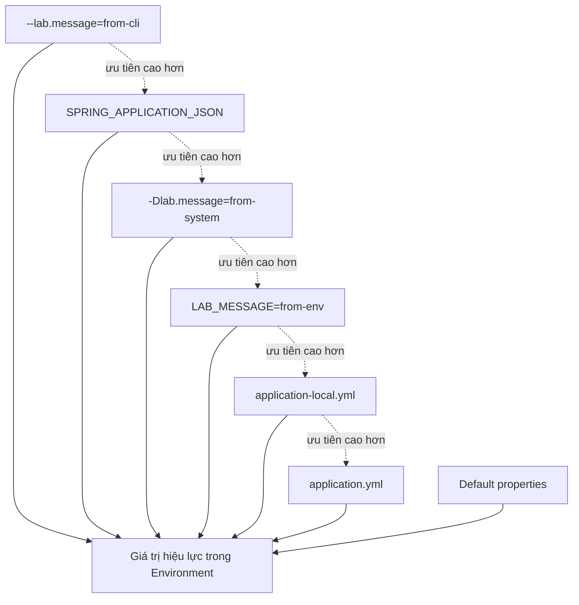

# Đối chiếu cùng thuộc tính từ tệp, biến môi trường và dòng lệnh

## 1. Mục tiêu bài thực hành

Trong ứng dụng Spring Boot, cùng một thuộc tính có thể được khai báo ở nhiều nguồn: tệp `application.yml`, tệp theo profile, biến môi trường, Java system property và tham số dòng lệnh. Spring Boot hợp nhất các nguồn này thành một `Environment` và chọn giá trị theo thứ tự ưu tiên.

Trong bài thực hành này, bạn xây dựng một REST application nhỏ để quan sát trực tiếp giá trị hiệu lực của cùng một property khi thay đổi từng nguồn. Ứng dụng có hai thuộc tính:

- `lab.message`: thông điệp được trả về qua API.
- `lab.timeout-seconds`: thời gian chờ minh họa, tính bằng giây.

Bạn sẽ kiểm tra các trường hợp:

1. Chỉ có giá trị trong `application.yml`.
2. Profile `local` ghi đè tệp cơ sở.
3. Biến môi trường ghi đè các giá trị từ tệp.
4. Java system property ghi đè biến môi trường.
5. Tham số dòng lệnh ghi đè system property.
6. Actuator hiển thị PropertySource và origin của giá trị.
7. Mở rộng bài tập để nhận cấu hình từ Spring Cloud Config Server.

Bài thực hành dùng Spring Boot `4.1.2` và Spring Cloud BOM `2025.1.4`. Boot 4.1.2 yêu cầu Java 17 trở lên; Cloud BOM được khai báo để phần mở rộng Config Client sử dụng đúng release train. Bạn có thể dùng Maven 3.6.3 trở lên hoặc Maven Wrapper.

## 2. Hiểu thứ tự ưu tiên trước khi chạy

Trong các nguồn được dùng ở bài này, thứ tự ưu tiên từ cao xuống thấp là:

| Thứ tự | Nguồn | Ví dụ |
| --- | --- | --- |
| 1 | Command-line arguments | `--lab.message=from-cli` |
| 2 | `SPRING_APPLICATION_JSON` | JSON trong environment variable hoặc system property |
| 3 | Java system properties | `-Dlab.message=from-system` |
| 4 | OS environment variables | `LAB_MESSAGE=from-env` |
| 5 | Config Data | `application-local.yml`, `application.yml` |
| 6 | `@PropertySource` | Property được thêm qua annotation |
| 7 | Default properties | Giá trị mặc định trong `SpringApplication` |

Bảng trên tập trung vào các nguồn cần quan sát trong project. Spring Boot còn có những nguồn khác như test properties, servlet parameters, JNDI và Devtools global settings; vị trí của chúng phụ thuộc môi trường chạy.

Hai điểm cần nhớ:

- `application-local.yml` được nạp khi profile `local` đang active và có thể ghi đè `application.yml` trong nhóm Config Data.
- Biến môi trường và tham số dòng lệnh có độ ưu tiên cao hơn các tệp Config Data. Vì vậy, sửa `application.yml` nhưng vẫn giữ `LAB_MESSAGE` trong terminal sẽ không làm giá trị API thay đổi.



Spring Boot tra cứu property từ PropertySource có độ ưu tiên cao trước. Khi tìm thấy giá trị phù hợp, đó là giá trị mà `Environment.getProperty(...)` và cơ chế binding sử dụng.

## 3. Chuẩn bị môi trường

Cài đặt và xác nhận:

- JDK 17 trở lên.
- Maven 3.6.3 trở lên hoặc Maven Wrapper.
- Một terminal PowerShell trên Windows hoặc Bash trên Linux/macOS.
- `curl` hoặc `curl.exe` để gọi REST endpoint.

Kiểm tra version:

```bash
java -version
mvn -version
```

Nếu dùng Maven Wrapper:

```bash
./mvnw -version
```

Trên Windows PowerShell, dùng `mvnw.cmd` thay cho `./mvnw`.

## 4. Tạo cấu trúc project

Tạo project Maven tên `property-precedence-lab` với cấu trúc:

```text
property-precedence-lab/
├── pom.xml
└── src/
    ├── main/
    │   ├── java/
    │   │   └── vn/example/configlab/
    │   │       ├── PropertyPrecedenceApplication.java
    │   │       ├── config/
    │   │       │   └── LabProperties.java
    │   │       └── web/
    │   │           └── ConfigController.java
    │   └── resources/
    │       ├── application.yml
    │       └── application-local.yml
    └── test/
        └── java/
            └── vn/example/configlab/config/
                └── LabPropertiesTests.java
```

Các package con nằm dưới package chính `vn.example.configlab`, nhờ vậy component scan và configuration properties scan có thể tìm thấy các class của project.

## 5. Khai báo Maven và Spring Cloud BOM

Tạo `pom.xml`:

```xml
<project xmlns="http://maven.apache.org/POM/4.0.0"
         xmlns:xsi="http://www.w3.org/2001/XMLSchema-instance"
         xsi:schemaLocation="http://maven.apache.org/POM/4.0.0 https://maven.apache.org/xsd/maven-4.0.0.xsd">
    <modelVersion>4.0.0</modelVersion>

    <parent>
        <groupId>org.springframework.boot</groupId>
        <artifactId>spring-boot-starter-parent</artifactId>
        <version>4.1.2</version>
        <relativePath/>
    </parent>

    <groupId>vn.example</groupId>
    <artifactId>property-precedence-lab</artifactId>
    <version>0.0.1-SNAPSHOT</version>
    <name>property-precedence-lab</name>
    <description>Compare Spring Boot property sources</description>

    <properties>
        <java.version>17</java.version>
        <spring-cloud.version>2025.1.4</spring-cloud.version>
    </properties>

    <dependencyManagement>
        <dependencies>
            <dependency>
                <groupId>org.springframework.cloud</groupId>
                <artifactId>spring-cloud-dependencies</artifactId>
                <version>${spring-cloud.version}</version>
                <type>pom</type>
                <scope>import</scope>
            </dependency>
        </dependencies>
    </dependencyManagement>

    <dependencies>
        <dependency>
            <groupId>org.springframework.boot</groupId>
            <artifactId>spring-boot-starter-webmvc</artifactId>
        </dependency>

        <dependency>
            <groupId>org.springframework.boot</groupId>
            <artifactId>spring-boot-starter-actuator</artifactId>
        </dependency>

        <dependency>
            <groupId>org.springframework.boot</groupId>
            <artifactId>spring-boot-configuration-processor</artifactId>
            <optional>true</optional>
        </dependency>

        <dependency>
            <groupId>org.springframework.boot</groupId>
            <artifactId>spring-boot-starter-test</artifactId>
            <scope>test</scope>
        </dependency>
    </dependencies>

    <profiles>
        <profile>
            <id>with-config-client</id>
            <dependencies>
                <dependency>
                    <groupId>org.springframework.cloud</groupId>
                    <artifactId>spring-cloud-starter-config</artifactId>
                </dependency>
            </dependencies>
        </profile>
    </profiles>

    <build>
        <plugins>
            <plugin>
                <groupId>org.springframework.boot</groupId>
                <artifactId>spring-boot-maven-plugin</artifactId>
            </plugin>
        </plugins>
    </build>
</project>
```

`spring-boot-starter-webmvc` cung cấp Spring MVC và embedded Tomcat. `spring-boot-starter-actuator` cung cấp endpoint chẩn đoán. Spring Cloud BOM quản lý version module Cloud; dependency Config Client chỉ được thêm khi kích hoạt Maven profile `with-config-client`.

Cách tách profile này giúp project cơ sở chạy độc lập. Khi làm phần mở rộng Config Server, bạn mới thêm Config Client vào runtime classpath.

## 6. Tạo lớp khởi động

Tạo `PropertyPrecedenceApplication.java`:

```java
package vn.example.configlab;

import org.springframework.boot.SpringApplication;
import org.springframework.boot.autoconfigure.SpringBootApplication;
import org.springframework.boot.context.properties.ConfigurationPropertiesScan;

@SpringBootApplication
@ConfigurationPropertiesScan
public class PropertyPrecedenceApplication {

    public static void main(String[] args) {
        SpringApplication.run(PropertyPrecedenceApplication.class, args);
    }
}
```

`@ConfigurationPropertiesScan` đăng ký các class mang annotation `@ConfigurationProperties` trong package hiện tại và các package con.

## 7. Khai báo nhóm thuộc tính có kiểu dữ liệu

Tạo `LabProperties.java`:

```java
package vn.example.configlab.config;

import org.springframework.boot.context.properties.ConfigurationProperties;

@ConfigurationProperties(prefix = "lab")
public record LabProperties(
        String message,
        int timeoutSeconds
) {
}
```

Spring Boot bind hai property `lab.message` và `lab.timeout-seconds` vào record. Dùng kiểu `int` giúp bạn quan sát việc chuyển đổi từ chuỗi trong YAML, environment variable hoặc command line thành số nguyên.

Với record, Spring Boot dùng constructor binding. Bạn không cần viết setter cho từng field.

## 8. Tạo REST endpoint để đọc giá trị hiệu lực

Tạo `ConfigController.java`:

```java
package vn.example.configlab.web;

import org.springframework.web.bind.annotation.GetMapping;
import org.springframework.web.bind.annotation.RequestMapping;
import org.springframework.web.bind.annotation.RestController;
import vn.example.configlab.config.LabProperties;

@RestController
@RequestMapping("/api/config")
public class ConfigController {

    private final LabProperties properties;

    public ConfigController(LabProperties properties) {
        this.properties = properties;
    }

    @GetMapping
    public ConfigResponse currentConfiguration() {
        return new ConfigResponse(
                properties.message(),
                properties.timeoutSeconds()
        );
    }

    public record ConfigResponse(
            String message,
            int timeoutSeconds
    ) {
    }
}
```

Endpoint `/api/config` trả về giá trị sau khi Spring đã giải quyết thứ tự ưu tiên và bind vào `LabProperties`. Controller không cần biết giá trị đến từ YAML, environment hay command line.

## 9. Khai báo giá trị trong application.yml

Tạo `src/main/resources/application.yml`:

```yaml
spring:
  application:
    name: property-precedence-lab

lab:
  message: "Giá trị từ application.yml"
  timeout-seconds: 3
```

Đây là nguồn cấu hình cơ sở được đóng gói trong classpath của ứng dụng. Khi không có nguồn nào ưu tiên cao hơn, API trả về:

```json
{
  "message": "Giá trị từ application.yml",
  "timeoutSeconds": 3
}
```

## 10. Thêm profile local để quan sát Config Data

Tạo `src/main/resources/application-local.yml`:

```yaml
lab:
  message: "Giá trị từ application-local.yml"
  timeout-seconds: 5

server:
  address: 127.0.0.1

management:
  endpoints:
    web:
      exposure:
        include: health,env
  endpoint:
    env:
      show-values: always
```

Khi profile `local` active, `application-local.yml` được nạp cùng `application.yml`. Giá trị trong tệp profile cụ thể ghi đè giá trị tương ứng trong tệp cơ sở.

Trong profile này, Actuator `env` endpoint được bật để xem PropertySource và origin của `lab.message`. `show-values: always` chỉ được cấu hình cho bài lab local. Server chỉ bind vào loopback `127.0.0.1`, giúp endpoint chẩn đoán không lộ ra mạng bên ngoài trong lúc thực hành.

Không đưa cấu hình hiển thị toàn bộ giá trị Environment vào production. Endpoint `env` có thể tiết lộ thông tin cấu hình và chỉ nên được expose trong môi trường được kiểm soát, có xác thực và phân quyền phù hợp.

## 11. Kiểm thử binding của Configuration Properties

Tạo `LabPropertiesTests.java`:

```java
package vn.example.configlab.config;

import static org.assertj.core.api.Assertions.assertThat;

import org.junit.jupiter.api.Test;
import org.springframework.beans.factory.annotation.Autowired;
import org.springframework.boot.test.context.SpringBootTest;

@SpringBootTest(properties = {
        "lab.message=from-test",
        "lab.timeout-seconds=7"
})
class LabPropertiesTests {

    @Autowired
    private LabProperties properties;

    @Test
    void bindsValuesFromTestProperties() {
        assertThat(properties.message()).isEqualTo("from-test");
        assertThat(properties.timeoutSeconds()).isEqualTo(7);
    }
}
```

Test properties được khai báo trong `@SpringBootTest` có ưu tiên cao trong test context. Test này xác nhận record được bind đúng kiểu dữ liệu và controller dependency có thể được khởi tạo. Phần so sánh thứ tự giữa tệp, environment và command line sẽ được thực hiện bằng cách chạy process thật ở các bước tiếp theo.

Chạy test:

```bash
mvn clean test
```

Kết quả mong đợi là toàn bộ test thành công.

## 12. Đóng gói và khởi chạy ứng dụng

Đóng gói executable JAR:

```bash
mvn clean package
```

Artifact được tạo tại:

```text
target/property-precedence-lab-0.0.1-SNAPSHOT.jar
```

Bạn có thể chạy bằng Maven:

```bash
mvn spring-boot:run
```

Hoặc chạy JAR:

```bash
java -jar target/property-precedence-lab-0.0.1-SNAPSHOT.jar
```

Để xem cấu hình profile local và Actuator `env`, khởi chạy ứng dụng với profile `local`.

PowerShell:

```powershell
$env:SPRING_PROFILES_ACTIVE = "local"
java -jar target/property-precedence-lab-0.0.1-SNAPSHOT.jar
```

Bash:

```bash
SPRING_PROFILES_ACTIVE=local java -jar target/property-precedence-lab-0.0.1-SNAPSHOT.jar
```

Gọi API ở terminal thứ hai:

```bash
curl http://127.0.0.1:8080/api/config
```

Kết quả mong đợi:

```json
{
  "message": "Giá trị từ application-local.yml",
  "timeoutSeconds": 5
}
```

Profile `local` đã ghi đè giá trị cơ sở trong `application.yml`.

## 13. Thử ghi đè bằng biến môi trường

Spring Boot hỗ trợ relaxed binding cho environment variables. Quy tắc chuyển đổi tên property canonical thành tên biến môi trường là:

1. Thay dấu chấm `.` bằng dấu gạch dưới `_`.
2. Bỏ dấu gạch ngang `-`.
3. Chuyển toàn bộ tên thành chữ hoa.

Với hai property của bài lab:

| Property | Environment variable |
| --- | --- |
| `lab.message` | `LAB_MESSAGE` |
| `lab.timeout-seconds` | `LAB_TIMEOUTSECONDS` |

Lưu ý tên biến thứ hai không phải `LAB_TIMEOUT_SECONDS`: dấu gạch ngang trong tên property được bỏ khi chuyển sang dạng environment variable.

### 13.1. PowerShell

Mở terminal mới hoặc dừng process cũ, sau đó chạy:

```powershell
$env:SPRING_PROFILES_ACTIVE = "local"
$env:LAB_MESSAGE = "from-env"
$env:LAB_TIMEOUTSECONDS = "8"
java -jar target/property-precedence-lab-0.0.1-SNAPSHOT.jar
```

Gọi API:

```powershell
curl.exe http://127.0.0.1:8080/api/config
```

Kết quả:

```json
{
  "message": "from-env",
  "timeoutSeconds": 8
}
```

Environment variables có ưu tiên cao hơn Config Data, nên cả hai giá trị từ `application-local.yml` đều bị ghi đè.

### 13.2. Bash

Chạy ứng dụng với các biến môi trường chỉ áp dụng cho process đó:

```bash
SPRING_PROFILES_ACTIVE=local LAB_MESSAGE=from-env LAB_TIMEOUTSECONDS=8 \
java -jar target/property-precedence-lab-0.0.1-SNAPSHOT.jar
```

Kết quả ở endpoint giống trường hợp PowerShell.

## 14. Thử ghi đè bằng Java system property

Java system property được truyền bằng tham số `-D`. Tham số này phải nằm trước `-jar`:

```bash
java -Dlab.message=from-system \
     -Dlab.timeout-seconds=10 \
     -jar target/property-precedence-lab-0.0.1-SNAPSHOT.jar
```

Nếu profile local đang active và `LAB_MESSAGE`/`LAB_TIMEOUTSECONDS` cũng được khai báo, system properties sẽ thắng environment variables.

Ví dụ kết quả:

```json
{
  "message": "from-system",
  "timeoutSeconds": 10
}
```

Nếu bạn đặt `-D` sau tên JAR, Java sẽ không xem nó là JVM system property nữa; phần đó có thể bị truyền vào `main(String[] args)` dưới dạng đối số ứng dụng và không có ý nghĩa tương đương.

## 15. Thử ghi đè bằng tham số dòng lệnh của Spring Boot

Spring Boot nhận command-line property theo dạng `--key=value`.

Chạy:

```bash
java -Dlab.message=from-system \
     -Dlab.timeout-seconds=10 \
     -jar target/property-precedence-lab-0.0.1-SNAPSHOT.jar \
     --lab.message=from-cli \
     --lab.timeout-seconds=12
```

Kết quả:

```json
{
  "message": "from-cli",
  "timeoutSeconds": 12
}
```

Command-line arguments có ưu tiên cao hơn system properties, environment variables và Config Data. Vì thế, giá trị `from-cli` thắng `from-system`, `from-env` và các giá trị trong YAML.

Trên PowerShell, có thể chạy cùng một lệnh trên một dòng:

```powershell
java -Dlab.message=from-system -Dlab.timeout-seconds=10 -jar target/property-precedence-lab-0.0.1-SNAPSHOT.jar --lab.message=from-cli --lab.timeout-seconds=12
```

## 16. Đối chiếu nhiều nguồn cùng lúc

Thực hiện phép thử sau khi profile `local` đã active:

- `application.yml` đặt message là `Giá trị từ application.yml`.
- `application-local.yml` đặt message là `Giá trị từ application-local.yml`.
- `LAB_MESSAGE` đặt message là `from-env`.
- `-Dlab.message=from-system` đặt message là `from-system`.
- `--lab.message=from-cli` đặt message là `from-cli`.

Giá trị API phải là `from-cli`.

Bảng kết quả:

| Nguồn | Giá trị `lab.message` | Có thắng không? |
| --- | --- | --- |
| Command line | `from-cli` | Có |
| Java system property | `from-system` | Không |
| Environment variable | `from-env` | Không |
| `application-local.yml` | `Giá trị từ application-local.yml` | Không |
| `application.yml` | `Giá trị từ application.yml` | Không |

Thay đổi lệnh để bỏ `--lab.message=from-cli`. Giá trị lúc này phải là `from-system`. Tiếp tục bỏ `-Dlab.message=from-system`, kết quả phải là `from-env`. Cuối cùng xóa biến `LAB_MESSAGE`, kết quả quay về `application-local.yml`.

Đây là cách kiểm tra từng lớp mà không cần thay đổi source code.

## 17. Xem PropertySource và origin bằng Actuator

Khi chạy profile `local`, gọi:

```bash
curl http://127.0.0.1:8080/actuator/env/lab.message
```

Trên PowerShell dùng `curl.exe`:

```powershell
curl.exe http://127.0.0.1:8080/actuator/env/lab.message
```

Response của Actuator `env` chứa property hiệu lực và danh sách các PropertySource có khai báo property đó. Tùy nguồn, response có thể hiển thị origin như file, dòng hoặc nguồn cung cấp giá trị.

Hãy quan sát các tên nguồn thường gặp:

| PropertySource | Ý nghĩa |
| --- | --- |
| `commandLineArgs` | Đối số `--lab.message=...` |
| `systemProperties` | Java `-Dlab.message=...` |
| `systemEnvironment` | Environment variable `LAB_MESSAGE` |
| Config resource `application-local.yml` | Tệp cấu hình profile |
| Config resource `application.yml` | Tệp cấu hình cơ sở |

Danh sách có thể chứa thêm PropertySource nội bộ hoặc tên resource khác tùy cách chạy. Hãy xem thứ tự thực tế trong response của chính ứng dụng.

Actuator hữu ích khi ứng dụng có nhiều file cấu hình hoặc được triển khai với nhiều nguồn override. Nó giúp trả lời hai câu hỏi: property đang lấy giá trị nào và nguồn nào cung cấp giá trị đó.

## 18. Thử thay đổi profile và khôi phục giá trị

Profile cũng là một phần của Config Data. Thử các trường hợp:

- Không đặt `SPRING_PROFILES_ACTIVE`: `application.yml` cung cấp giá trị.
- Đặt `SPRING_PROFILES_ACTIVE=local`: `application-local.yml` ghi đè `application.yml`.
- Đặt thêm `LAB_MESSAGE=from-env`: environment ghi đè cả hai file.
- Đặt thêm `--lab.message=from-cli`: command line ghi đè tất cả nguồn thấp hơn.

PowerShell để xóa các biến sau khi thử:

```powershell
Remove-Item Env:LAB_MESSAGE -ErrorAction SilentlyContinue
Remove-Item Env:LAB_TIMEOUTSECONDS -ErrorAction SilentlyContinue
Remove-Item Env:SPRING_PROFILES_ACTIVE -ErrorAction SilentlyContinue
```

Sau khi dừng và chạy lại ứng dụng, xác nhận giá trị đã quay về cấu hình cơ sở. Một process đang chạy không tự nhận mọi thay đổi environment của terminal sau khi process được tạo; cần khởi động process mới để thử lại.

## 19. Mở rộng: thêm Spring Cloud Config Client

Spring Cloud Config Client đưa remote configuration vào hệ thống Config Data. Khi có Config Server, một số giá trị có thể được lấy từ server theo application name, profile và label.

BOM Cloud đã được khai báo trong `pom.xml`. Kích hoạt Maven profile `with-config-client` để thêm starter:

```bash
mvn -Pwith-config-client clean package
```

Thêm tệp `src/main/resources/application-cloud.yml` cho profile `cloud`:

```yaml
spring:
  config:
    import: "optional:configserver:http://localhost:8888"
```

Khởi chạy đồng thời hai profile `local` và `cloud`:

```bash
java -jar target/property-precedence-lab-0.0.1-SNAPSHOT.jar \
     --spring.profiles.active=local,cloud
```

Nếu Config Server không chạy, prefix `optional:` cho phép ứng dụng tiếp tục dùng cấu hình local. Nếu server chạy và trả về `lab.message`, hãy quan sát PropertySource mới trong `/actuator/env/lab.message`.

Config Data import được chèn ngay dưới document khai báo import. Trong bài lab, document đó là `application-cloud.yml`; vì vậy remote source có thể ghi đè cấu hình profile local được nạp trước nó. Command-line arguments, `SPRING_APPLICATION_JSON`, system properties và environment variables vẫn có ưu tiên cao hơn Config Data.

Ví dụ nếu Config Server trả `lab.message=from-config-server`:

| Nguồn | Giá trị |
| --- | --- |
| Command line | `from-cli` |
| Environment | `from-env` |
| Config Server | `from-config-server` |
| Profile file | `Giá trị từ application-local.yml` |
| Base file | `Giá trị từ application.yml` |

Khi không truyền CLI hoặc environment variable, remote Config Server có thể cung cấp giá trị hiệu lực. Khi truyền `LAB_MESSAGE` hoặc `--lab.message`, các nguồn local có độ ưu tiên cao hơn sẽ thắng.

Không đặt password hoặc token của Config Server trực tiếp trong command line của môi trường production. Dùng secret manager, mounted secret hoặc cơ chế xác thực phù hợp; command line trong bài chỉ dùng cho giá trị minh họa không nhạy cảm.

## 20. Chẩn đoán lỗi trong quá trình thực hành

| Triệu chứng | Nguyên nhân có thể | Cách kiểm tra |
| --- | --- | --- |
| Sửa `application.yml` nhưng API không đổi | Environment hoặc CLI đang ghi đè | Kiểm tra `LAB_MESSAGE`, `-D` và `--lab.message` |
| Profile local không có hiệu lực | `SPRING_PROFILES_ACTIVE` chưa được đặt hoặc sai tên | Kiểm tra active profiles trong startup log và Actuator |
| Environment variable không bind | Tên biến sai quy tắc relaxed binding | Dùng `LAB_MESSAGE`, `LAB_TIMEOUTSECONDS` |
| Giá trị timeout không chuyển thành số | Giá trị không phải số nguyên | Dùng giá trị như `8`, không dùng `eight` |
| `-D` không có tác dụng | Đặt `-D` sau `-jar` | Chuyển system property lên trước `-jar` |
| CLI không ghi đè | Thiếu hai dấu gạch ngang hoặc sai key | Dùng `--lab.message=from-cli` |
| Không truy cập được `/actuator/env` | Chưa bật profile local hoặc chưa expose endpoint | Kiểm tra `SPRING_PROFILES_ACTIVE=local` |
| Actuator không hiện giá trị | `show-values` chưa được bật trong local profile | Kiểm tra `management.endpoint.env.show-values` |
| Config Client báo thiếu `spring.config.import` | Chưa truyền import khi bật Maven profile Config Client | Thêm `--spring.config.import=optional:configserver:http://localhost:8888` |
| Config Server không truy cập được | Server chưa chạy hoặc sai địa chỉ | Kiểm tra host, port, network và startup log |

## 21. Bài tập mở rộng

Sau khi hoàn thành phần chính, thực hiện thêm các yêu cầu:

1. Thêm `lab.banner` và khai báo ở cả `application.yml`, `application-local.yml`, environment và command line.
2. Thêm property boolean `lab.feature-enabled`; kiểm tra relaxed binding từ `LAB_FEATUREENABLED`.
3. Dùng `SPRING_APPLICATION_JSON` để đặt `lab.message`, sau đó so sánh với system property và command line.
4. Dùng `--spring.config.additional-location` để nạp một tệp YAML bên ngoài classpath.
5. Thêm profile `staging` và tạo `application-staging.yml`.
6. Kích hoạt phần mở rộng Config Client và so sánh origin của local file với remote Config Server.
7. Viết một integration test riêng khởi chạy ứng dụng với environment variables và command-line arguments khác nhau.

Ghi lại kết quả từng lần chạy, gồm lệnh đã dùng, giá trị API trả về và PropertySource cung cấp giá trị hiệu lực.

## 22. Tiêu chí hoàn thành

- [ ] Project build thành công với Spring Boot `4.1.2`.
- [ ] `LabProperties` bind được `lab.message` và `lab.timeout-seconds`.
- [ ] API `/api/config` trả đúng giá trị từ cấu hình.
- [ ] `application-local.yml` ghi đè `application.yml` khi profile local active.
- [ ] `LAB_MESSAGE` ghi đè giá trị từ các file.
- [ ] `-Dlab.message` ghi đè environment variable.
- [ ] `--lab.message` ghi đè Java system property.
- [ ] Actuator `/actuator/env/lab.message` cho biết PropertySource tương ứng trong môi trường local.
- [ ] Đã giải thích được vì sao giá trị API không thay đổi khi một nguồn ưu tiên cao hơn vẫn còn tồn tại.
- [ ] Phần mở rộng Config Client có thể được bật bằng Maven profile mà không bắt buộc phải có Config Server khi dùng `optional:`.

## 23. Câu hỏi tự kiểm tra

1. Vì sao command-line arguments có thể ghi đè giá trị trong `application.yml`?
2. `LAB_MESSAGE` ánh xạ tới property canonical nào?
3. Vì sao `lab.timeout-seconds` ánh xạ thành `LAB_TIMEOUTSECONDS`?
4. `-Dlab.message=...` phải được đặt ở vị trí nào trong lệnh `java -jar`?
5. `application-local.yml` được nạp khi nào và có quan hệ ưu tiên ra sao với `application.yml`?
6. Actuator `env` endpoint giúp tìm nguồn của property như thế nào?
7. Vì sao nên expose endpoint `env` chỉ trong profile local?
8. Khi Config Client import remote Config Data, environment variable và command line còn ghi đè được không?
9. Vì sao một thay đổi environment variable trong terminal không tự cập nhật process đang chạy?
10. Khi nào nên dùng Config Server thay cho việc truyền nhiều giá trị qua command line?

## 24. Tài liệu tham khảo chính thức

- [Spring Boot — Externalized Configuration](https://docs.spring.io/spring-boot/reference/features/external-config.html) — thứ tự ưu tiên PropertySource, Config Data, environment variables, command-line arguments và `SPRING_APPLICATION_JSON`.
- [Spring Boot — Type-safe Configuration Properties](https://docs.spring.io/spring-boot/reference/features/external-config.html) — `@ConfigurationProperties`, relaxed binding và chuyển đổi kiểu dữ liệu.
- [Spring Boot — Actuator Endpoints](https://docs.spring.io/spring-boot/reference/actuator/endpoints.html) — expose endpoint `env`, bảo vệ endpoint và hiển thị giá trị.
- [Spring Boot — Build Systems and Starters](https://docs.spring.io/spring-boot/reference/using/build-systems.html) — starter Web MVC, dependency management và build.
- [Spring Boot — System Requirements](https://docs.spring.io/spring-boot/system-requirements.html) — Java và Maven/Gradle tương thích với Spring Boot 4.1.2.
- [Spring Cloud — Release Train Compatibility](https://spring.io/projects/spring-cloud/) — ghép Spring Cloud release train với Spring Boot.
- [Spring Cloud Config — Config Client](https://docs.spring.io/spring-cloud-config/reference/client.html) — `spring.config.import`, Config Data và remote property source.
- [Spring Cloud Config — Property Overrides](https://docs.spring.io/spring-cloud-config/reference/server/environment-repository/property-overrides.html) — cách Config Server cung cấp property override cho client.

*Tài liệu thực hành giúp quan sát trực tiếp cách Spring Boot chọn giá trị hiệu lực từ nhiều nguồn cấu hình. Khi debug một ứng dụng Spring Cloud, hãy kiểm tra PropertySource và origin trước khi kết luận rằng file cấu hình hoặc Config Server không được đọc.*
