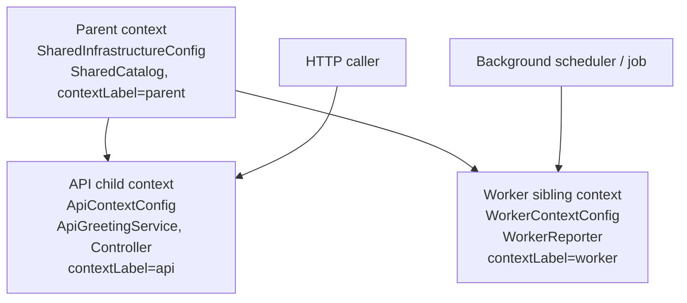
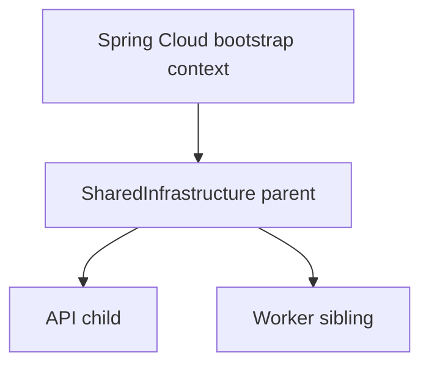

# Thực nghiệm context cha, con và sibling

Bài thực hành này xây dựng một ứng dụng gồm ba Spring ApplicationContext: một context cha giữ hạ tầng dùng chung, một context con chạy HTTP API và một context sibling chạy tác vụ nền. Ta sẽ quan sát thứ tự khởi tạo, phạm vi nhìn thấy bean, cách child che bean cùng tên ở parent, việc các sibling dùng chung bean từ parent và cách đóng context an toàn.

Đây là bài thực nghiệm về **Spring ApplicationContext hierarchy** trong Spring Boot, đồng thời liên hệ với Spring Cloud Context. Context hierarchy là khả năng của Spring Framework được Spring Boot hỗ trợ qua `SpringApplicationBuilder`. Spring Cloud có thể bổ sung bootstrap context, remote property source và refresh scope vào từng context trong hệ thống đó.

Kết quả mong đợi:

- Parent tạo một bean `SharedCatalog` duy nhất.
- API child và worker sibling cùng truy cập đúng instance `SharedCatalog` đó.
- Parent có bean `contextLabel=parent`; API và worker định nghĩa bean cùng tên với giá trị riêng.
- API chỉ nhìn thấy bean của chính nó và bean từ parent; worker chỉ nhìn thấy bean của nó và bean từ parent.
- Parent không nhìn thấy bean được khai báo trong child.
- API và worker có cùng parent, nhưng không nhìn thấy bean riêng của nhau.
- Khi shutdown, đóng các child trước rồi mới đóng parent.

## 1. Bài toán và sơ đồ context

Giả sử một ứng dụng cần dùng chung catalog cache và cấu hình kết nối, nhưng muốn tách HTTP API khỏi một worker chạy nền. Ta có thể đặt các bean dùng chung vào parent context, còn bean giao tiếp HTTP và bean xử lý batch nằm trong hai context con độc lập.



Parent là context gốc của ứng dụng trong bài thực hành. API và worker là hai context sibling vì chúng cùng có một parent. Sibling không phải một loại class riêng; đó là quan hệ giữa các context có cùng parent.

Các quan hệ cần kiểm tra:

| Quan hệ | Kết quả |
| --- | --- |
| Parent → child | Child có thể tìm bean local trước, sau đó tìm bean trong parent |
| Child → parent | Parent không tìm thấy bean được khai báo trong child |
| API ↔ worker | Hai sibling không tự nhìn thấy bean local của nhau |
| Parent → cả hai child | Bean singleton trong parent được dùng chung bởi cả hai child |
| Child bean trùng tên parent bean | Child dùng bean local của mình; parent vẫn giữ bean riêng |
| Đóng parent | Các child mất context cha và không thể tiếp tục dùng các bean được cung cấp từ parent |

## 2. Chuẩn bị dự án

Tạo một Maven project có cấu trúc:

```text
context-hierarchy-lab/
├── pom.xml
└── src/
    ├── main/
    │   └── java/
    │       └── com/example/contextlab/
    │           ├── ContextHierarchyApplication.java
    │           ├── shared/
    │           │   ├── SharedInfrastructureConfig.java
    │           │   └── SharedCatalog.java
    │           ├── api/
    │           │   ├── ApiContextConfig.java
    │           │   ├── ApiGreetingService.java
    │           │   └── ApiController.java
    │           └── worker/
    │               ├── WorkerContextConfig.java
    │               └── WorkerReporter.java
    └── test/
        └── java/
            └── com/example/contextlab/
                └── ContextHierarchyTest.java
```

### 2.1. Dependency và BOM

Sử dụng một cặp Spring Boot và Spring Cloud release train được công bố tương thích trong compatibility matrix tại thời điểm thực hiện. Các version dưới đây được truyền qua Maven properties để không khóa bài thực hành vào một release train cụ thể.

```xml
<project xmlns="http://maven.apache.org/POM/4.0.0"
         xmlns:xsi="http://www.w3.org/2001/XMLSchema-instance"
         xsi:schemaLocation="http://maven.apache.org/POM/4.0.0
         https://maven.apache.org/xsd/maven-4.0.0.xsd">
    <modelVersion>4.0.0</modelVersion>

    <groupId>com.example</groupId>
    <artifactId>context-hierarchy-lab</artifactId>
    <version>1.0.0-SNAPSHOT</version>

    <properties>
        <java.version>17</java.version>
        <maven.compiler.release>17</maven.compiler.release>
        <project.build.sourceEncoding>UTF-8</project.build.sourceEncoding>
    </properties>

    <dependencyManagement>
        <dependencies>
            <dependency>
                <groupId>org.springframework.boot</groupId>
                <artifactId>spring-boot-dependencies</artifactId>
                <version>${boot.version}</version>
                <type>pom</type>
                <scope>import</scope>
            </dependency>
            <dependency>
                <groupId>org.springframework.cloud</groupId>
                <artifactId>spring-cloud-dependencies</artifactId>
                <version>${cloud.version}</version>
                <type>pom</type>
                <scope>import</scope>
            </dependency>
        </dependencies>
    </dependencyManagement>

    <dependencies>
        <dependency>
            <groupId>org.springframework.boot</groupId>
            <artifactId>spring-boot-starter-web</artifactId>
        </dependency>

        <dependency>
            <groupId>org.springframework.cloud</groupId>
            <artifactId>spring-cloud-context</artifactId>
        </dependency>

        <dependency>
            <groupId>org.springframework.boot</groupId>
            <artifactId>spring-boot-starter-test</artifactId>
            <scope>test</scope>
        </dependency>
    </dependencies>

    <build>
        <plugins>
            <plugin>
                <groupId>org.apache.maven.plugins</groupId>
                <artifactId>maven-compiler-plugin</artifactId>
                <version>3.14.1</version>
                <configuration>
                    <release>${maven.compiler.release}</release>
                </configuration>
            </plugin>
            <plugin>
                <groupId>org.apache.maven.plugins</groupId>
                <artifactId>maven-surefire-plugin</artifactId>
                <version>3.5.4</version>
            </plugin>
            <plugin>
                <groupId>org.springframework.boot</groupId>
                <artifactId>spring-boot-maven-plugin</artifactId>
                <version>${boot.version}</version>
            </plugin>
        </plugins>
    </build>
</project>
```

`spring-cloud-context` được quản lý version bởi Cloud BOM. Project dùng `spring-boot-starter-web` để chạy API child và `spring-boot-starter-test` để kiểm tra hierarchy. Không cần thêm Eureka hoặc Config Server vì mục tiêu chính là quan sát quan hệ context trong cùng một JVM.

Thay `boot.version` và `cloud.version` bằng version cụ thể từ compatibility matrix. Giữ JDK/toolchain phù hợp với yêu cầu của Spring Boot version đã chọn. Nếu Boot target yêu cầu Java cao hơn 17, cập nhật `maven.compiler.release` và JDK chạy Maven tương ứng.

Ví dụ lệnh build:

```bash
mvn -Dboot.version=YOUR_BOOT_VERSION -Dcloud.version=YOUR_CLOUD_TRAIN_VERSION clean test
```

## 3. Tạo bean dùng chung trong parent context

Parent context chứa `SharedCatalog`. Đây là một singleton được tạo một lần trong parent và được cả API lẫn worker sử dụng.

### 3.1. Lớp SharedCatalog

File `src/main/java/com/example/contextlab/shared/SharedCatalog.java`:

```java
package com.example.contextlab.shared;

import java.util.UUID;

public class SharedCatalog {

    private final String instanceId = UUID.randomUUID().toString();

    public String instanceId() {
        return instanceId;
    }

    public String describe() {
        return "shared-catalog@" + instanceId;
    }
}
```

ID ngẫu nhiên giúp ta nhận biết các child có đang dùng cùng một object hay không. Nếu parent tạo singleton đúng một lần, mọi lần truy cập bean này từ API hoặc worker đều trả về cùng instance.

### 3.2. Cấu hình parent

File `src/main/java/com/example/contextlab/shared/SharedInfrastructureConfig.java`:

```java
package com.example.contextlab.shared;

import org.springframework.context.annotation.Bean;
import org.springframework.context.annotation.Configuration;

@Configuration(proxyBeanMethods = false)
public class SharedInfrastructureConfig {

    @Bean
    SharedCatalog sharedCatalog() {
        return new SharedCatalog();
    }

    @Bean(name = "contextLabel")
    String parentContextLabel() {
        return "parent";
    }
}
```

Parent cung cấp hai bean:

- `sharedCatalog`: tài nguyên dùng chung.
- `contextLabel`: giá trị mặc định để minh họa việc child định nghĩa bean cùng tên.

Parent không khai báo controller, servlet, scheduler hoặc bean phụ thuộc vào một child cụ thể. Một parent nên chứa các thành phần có thể được nhiều child dùng mà không phụ thuộc ngược vào child.

## 4. Tạo API child context

API child có bean nghiệp vụ riêng và một REST controller. Child này sẽ ghi đè bean tên `contextLabel` ở phạm vi của chính nó.

### 4.1. API service

File `src/main/java/com/example/contextlab/api/ApiGreetingService.java`:

```java
package com.example.contextlab.api;

import com.example.contextlab.shared.SharedCatalog;

import java.util.Map;

public class ApiGreetingService {

    private final SharedCatalog sharedCatalog;
    private final String contextLabel;

    public ApiGreetingService(
            SharedCatalog sharedCatalog,
            String contextLabel) {
        this.sharedCatalog = sharedCatalog;
        this.contextLabel = contextLabel;
    }

    public Map<String, String> describe() {
        return Map.of(
                "context", contextLabel,
                "sharedCatalogId", sharedCatalog.instanceId(),
                "sharedCatalog", sharedCatalog.describe()
        );
    }
}
```

Constructor nhận `SharedCatalog` từ parent và `contextLabel` từ API child. Khi child tìm bean theo tên, bean local của child được ưu tiên trước bean cùng tên trong parent.

### 4.2. REST controller

File `src/main/java/com/example/contextlab/api/ApiController.java`:

```java
package com.example.contextlab.api;

import org.springframework.web.bind.annotation.GetMapping;
import org.springframework.web.bind.annotation.RequestMapping;
import org.springframework.web.bind.annotation.RestController;

import java.util.Map;

@RestController
@RequestMapping("/api")
public class ApiController {

    private final ApiGreetingService greetingService;

    public ApiController(ApiGreetingService greetingService) {
        this.greetingService = greetingService;
    }

    @GetMapping("/context")
    public Map<String, String> context() {
        return greetingService.describe();
    }
}
```

### 4.3. API context configuration

File `src/main/java/com/example/contextlab/api/ApiContextConfig.java`:

```java
package com.example.contextlab.api;

import com.example.contextlab.shared.SharedCatalog;
import org.springframework.beans.factory.annotation.Qualifier;
import org.springframework.boot.autoconfigure.EnableAutoConfiguration;
import org.springframework.context.annotation.Bean;
import org.springframework.context.annotation.Configuration;

@Configuration(proxyBeanMethods = false)
@EnableAutoConfiguration
public class ApiContextConfig {

    @Bean(name = "contextLabel")
    String apiContextLabel() {
        return "api";
    }

    @Bean
    ApiGreetingService apiGreetingService(
            SharedCatalog sharedCatalog,
            @Qualifier("contextLabel") String contextLabel) {
        return new ApiGreetingService(sharedCatalog, contextLabel);
    }

    @Bean
    ApiController apiController(ApiGreetingService greetingService) {
        return new ApiController(greetingService);
    }
}
```

`@EnableAutoConfiguration` bật các cấu hình cần thiết cho web server và Spring MVC. Ta dùng `@Configuration` thay cho `@SpringBootApplication` để không quét component toàn bộ package. Các bean được đăng ký tường minh, giúp nhìn rõ bean nào thuộc context nào.

## 5. Tạo worker sibling context

Worker là một context độc lập có cùng parent với API. Worker sử dụng `SharedCatalog` từ parent nhưng có service và bean `contextLabel` riêng.

### 5.1. Worker reporter

File `src/main/java/com/example/contextlab/worker/WorkerReporter.java`:

```java
package com.example.contextlab.worker;

import com.example.contextlab.shared.SharedCatalog;

public class WorkerReporter {

    private final SharedCatalog sharedCatalog;
    private final String contextLabel;

    public WorkerReporter(
            SharedCatalog sharedCatalog,
            String contextLabel) {
        this.sharedCatalog = sharedCatalog;
        this.contextLabel = contextLabel;
    }

    public String report() {
        return "context=" + contextLabel
                + ", sharedCatalogId=" + sharedCatalog.instanceId();
    }
}
```

### 5.2. Worker context configuration

File `src/main/java/com/example/contextlab/worker/WorkerContextConfig.java`:

```java
package com.example.contextlab.worker;

import com.example.contextlab.shared.SharedCatalog;
import org.springframework.beans.factory.annotation.Qualifier;
import org.springframework.context.annotation.Bean;
import org.springframework.context.annotation.Configuration;

@Configuration(proxyBeanMethods = false)
public class WorkerContextConfig {

    @Bean(name = "contextLabel")
    String workerContextLabel() {
        return "worker";
    }

    @Bean
    WorkerReporter workerReporter(
            SharedCatalog sharedCatalog,
            @Qualifier("contextLabel") String contextLabel) {
        return new WorkerReporter(sharedCatalog, contextLabel);
    }
}
```

Worker không khai báo web server. Nó chỉ chứa bean phục vụ công việc nền. Vì `SharedCatalog` không được khai báo lại trong worker, bean factory của worker tìm tiếp lên parent để lấy bean đó.

## 6. Dựng parent, child và sibling bằng SpringApplicationBuilder

`SpringApplicationBuilder` cung cấp các method `parent()`, `child()` và `sibling()` để dựng context hierarchy. Trong bài thực hành này:

1. Tạo builder gốc với `SharedInfrastructureConfig`.
2. Tạo API child từ builder gốc.
3. Chạy API child trước.
4. Gọi `sibling()` trên builder API để tạo worker có cùng parent.
5. Chạy worker sibling.
6. Quan sát bean và quan hệ parent.

File `src/main/java/com/example/contextlab/ContextHierarchyApplication.java`:

```java
package com.example.contextlab;

import com.example.contextlab.api.ApiContextConfig;
import com.example.contextlab.api.ApiGreetingService;
import com.example.contextlab.shared.SharedCatalog;
import com.example.contextlab.shared.SharedInfrastructureConfig;
import com.example.contextlab.worker.WorkerContextConfig;
import com.example.contextlab.worker.WorkerReporter;
import org.springframework.boot.WebApplicationType;
import org.springframework.boot.builder.SpringApplicationBuilder;
import org.springframework.context.ConfigurableApplicationContext;

public class ContextHierarchyApplication {

    public static void main(String[] args) {
        SpringApplicationBuilder rootBuilder =
                new SpringApplicationBuilder(SharedInfrastructureConfig.class)
                        .web(WebApplicationType.NONE)
                        .registerShutdownHook(false);

        SpringApplicationBuilder apiBuilder =
                rootBuilder.child(ApiContextConfig.class)
                        .web(WebApplicationType.SERVLET)
                        .properties(
                                "spring.application.name=api-context",
                                "server.port=8081"
                        )
                        .registerShutdownHook(false);

        ConfigurableApplicationContext apiContext =
                apiBuilder.run(args);

        ConfigurableApplicationContext workerContext;
        try {
            SpringApplicationBuilder workerBuilder =
                    apiBuilder.sibling(WorkerContextConfig.class)
                            .web(WebApplicationType.NONE)
                            .properties("spring.application.name=worker-context")
                            .registerShutdownHook(false);

            workerContext = workerBuilder.run(args);
        } catch (RuntimeException startupFailure) {
            apiContext.close();
            closeParent(apiContext);
            throw startupFailure;
        }

        ConfigurableApplicationContext parentContext =
                (ConfigurableApplicationContext) apiContext.getParent();

        printDiagnostics(parentContext, apiContext, workerContext);

        Runtime.getRuntime().addShutdownHook(new Thread(() -> {
            closeIfActive(workerContext);
            closeIfActive(apiContext);
            closeIfActive(parentContext);
        }, "context-hierarchy-shutdown"));
    }

    private static void printDiagnostics(
            ConfigurableApplicationContext parent,
            ConfigurableApplicationContext api,
            ConfigurableApplicationContext worker) {

        SharedCatalog parentCatalog = parent.getBean(SharedCatalog.class);
        SharedCatalog apiCatalog = api.getBean(SharedCatalog.class);
        SharedCatalog workerCatalog = worker.getBean(SharedCatalog.class);

        System.out.println("parent.label="
                + parent.getBean("contextLabel"));
        System.out.println("api.label="
                + api.getBean("contextLabel"));
        System.out.println("worker.label="
                + worker.getBean("contextLabel"));

        System.out.println("api.parent.sameAs.worker.parent="
                + (api.getParent() == worker.getParent()));

        System.out.println("sharedCatalog.sameInstance="
                + (parentCatalog == apiCatalog
                && apiCatalog == workerCatalog));

        System.out.println("api.hasLocalSharedCatalog="
                + api.getBeanFactory().containsLocalBean("sharedCatalog"));

        System.out.println("parent.hasApiGreetingService="
                + parent.containsBean("apiGreetingService"));

        System.out.println("api.hasWorkerReporter="
                + api.containsBean("workerReporter"));

        System.out.println("worker.hasApiGreetingService="
                + worker.containsBean("apiGreetingService"));

        System.out.println("api.response="
                + api.getBean(ApiGreetingService.class).describe());

        System.out.println("worker.report="
                + worker.getBean(WorkerReporter.class).report());
    }

    private static void closeParent(
            ConfigurableApplicationContext child) {
        if (child.getParent() instanceof ConfigurableApplicationContext parent) {
            closeIfActive(parent);
        }
    }

    private static void closeIfActive(
            ConfigurableApplicationContext context) {
        if (context != null && context.isActive()) {
            context.close();
        }
    }
}
```

### 6.1. Vì sao phải chạy API trước khi gọi sibling?

`sibling()` tạo một application mới có cùng parent với builder hiện tại. API của Spring Boot quy định một side effect của method này là application hiện tại và parent sẽ được khởi động nếu chúng chưa chạy. Nếu cần truyền command-line arguments cho lần khởi động đó, có overload `sibling(Class[], String...)`.

Trong ví dụ, API child đã được chạy bằng `apiBuilder.run(args)` trước khi tạo worker sibling. Vì vậy, việc gọi `sibling()` không khởi động API và parent với một bộ arguments rỗng ngoài ý muốn.

### 6.2. Vì sao parent dùng WebApplicationType.NONE?

Parent chỉ giữ bean dùng chung, không chứa controller hoặc servlet component. API child là nơi duy nhất khởi tạo web server. Cách tổ chức này giữ web-specific infrastructure ở context cần nó và tránh tạo server trong parent.

Worker sibling cũng dùng `WebApplicationType.NONE` vì nó chỉ xử lý công việc nền. Nếu muốn có thêm một web sibling, hãy gán port riêng và kiểm tra lifecycle của từng web server.

### 6.3. Vì sao tắt shutdown hook mặc định?

Bài thực hành quản lý ba context có quan hệ cha-con. Ta tắt shutdown hook riêng của các builder và đăng ký một hook duy nhất để đóng theo thứ tự:

1. Worker sibling.
2. API child.
3. Parent.

Đóng parent trước sẽ làm các child mất bean dùng chung trong khi chúng có thể vẫn đang xử lý request hoặc job. Trong ứng dụng thật, hãy để lifecycle manager hoặc process owner chịu trách nhiệm đóng hierarchy một lần và theo thứ tự rõ ràng.

## 7. Chạy ứng dụng và quan sát kết quả

Chạy ứng dụng:

```bash
mvn -Dboot.version=YOUR_BOOT_VERSION -Dcloud.version=YOUR_CLOUD_TRAIN_VERSION -Dspring-boot.run.main-class=com.example.contextlab.ContextHierarchyApplication spring-boot:run
```

Gọi endpoint API:

```bash
curl http://localhost:8081/api/context
```

Response có dạng:

```json
{
  "context": "api",
  "sharedCatalogId": "a-random-uuid",
  "sharedCatalog": "shared-catalog@a-random-uuid"
}
```

ID được sinh ngẫu nhiên ở mỗi lần chạy. So sánh ID trong response với dòng `worker.report` và `sharedCatalog.sameInstance` trong log. API và worker phải dùng cùng ID vì chúng cùng truy cập singleton ở parent.

Output chẩn đoán có dạng:

```text
parent.label=parent
api.label=api
worker.label=worker
api.parent.sameAs.worker.parent=true
sharedCatalog.sameInstance=true
api.hasLocalSharedCatalog=false
parent.hasApiGreetingService=false
api.hasWorkerReporter=false
worker.hasApiGreetingService=false
api.response={context=api, sharedCatalogId=..., sharedCatalog=shared-catalog@...}
worker.report=context=worker, sharedCatalogId=...
```

Các dòng này xác nhận:

- Bean `contextLabel` được resolve từ context local của từng application.
- API và worker có cùng object parent.
- API không tạo local bean `sharedCatalog`.
- Parent không biết `apiGreetingService`.
- API không biết `workerReporter`.
- Worker không biết `apiGreetingService`.

## 8. Thêm JUnit test để kiểm chứng hierarchy

Không nên chỉ dựa vào log. Ta sẽ kiểm tra quan hệ context và bean bằng một test tự khởi tạo hierarchy.

File `src/test/java/com/example/contextlab/ContextHierarchyTest.java`:

```java
package com.example.contextlab;

import com.example.contextlab.api.ApiContextConfig;
import com.example.contextlab.shared.SharedCatalog;
import com.example.contextlab.shared.SharedInfrastructureConfig;
import com.example.contextlab.worker.WorkerContextConfig;
import org.junit.jupiter.api.Test;
import org.springframework.boot.WebApplicationType;
import org.springframework.boot.builder.SpringApplicationBuilder;
import org.springframework.context.ConfigurableApplicationContext;

import static org.assertj.core.api.Assertions.assertThat;

class ContextHierarchyTest {

    @Test
    void parentChildAndSiblingHaveExpectedBeanVisibility() {
        SpringApplicationBuilder rootBuilder =
                new SpringApplicationBuilder(SharedInfrastructureConfig.class)
                        .web(WebApplicationType.NONE)
                        .registerShutdownHook(false);

        SpringApplicationBuilder apiBuilder =
                rootBuilder.child(ApiContextConfig.class)
                        .web(WebApplicationType.NONE)
                        .registerShutdownHook(false);

        ConfigurableApplicationContext api =
                apiBuilder.run("--spring.main.banner-mode=off");

        ConfigurableApplicationContext parent =
                (ConfigurableApplicationContext) api.getParent();

        ConfigurableApplicationContext worker = null;

        try {
            SpringApplicationBuilder workerBuilder =
                    apiBuilder.sibling(WorkerContextConfig.class)
                            .web(WebApplicationType.NONE)
                            .registerShutdownHook(false);

            worker = workerBuilder.run("--spring.main.banner-mode=off");

            assertThat(api.getParent()).isSameAs(worker.getParent());

            assertThat(parent.getBean("contextLabel"))
                    .isEqualTo("parent");
            assertThat(api.getBean("contextLabel"))
                    .isEqualTo("api");
            assertThat(worker.getBean("contextLabel"))
                    .isEqualTo("worker");

            SharedCatalog parentCatalog =
                    parent.getBean(SharedCatalog.class);
            SharedCatalog apiCatalog =
                    api.getBean(SharedCatalog.class);
            SharedCatalog workerCatalog =
                    worker.getBean(SharedCatalog.class);

            assertThat(apiCatalog).isSameAs(parentCatalog);
            assertThat(workerCatalog).isSameAs(parentCatalog);

            assertThat(parent.getBeanFactory()
                    .containsLocalBean("sharedCatalog")).isTrue();
            assertThat(api.getBeanFactory()
                    .containsLocalBean("sharedCatalog")).isFalse();
            assertThat(worker.getBeanFactory()
                    .containsLocalBean("sharedCatalog")).isFalse();

            assertThat(parent.containsBean("apiGreetingService"))
                    .isFalse();
            assertThat(api.containsBean("workerReporter"))
                    .isFalse();
            assertThat(worker.containsBean("apiGreetingService"))
                    .isFalse();
        } finally {
            if (worker != null && worker.isActive()) {
                worker.close();
            }
            if (api.isActive()) {
                api.close();
            }
            if (parent.isActive()) {
                parent.close();
            }
        }
    }
}
```

Chạy test:

```bash
mvn -Dboot.version=YOUR_BOOT_VERSION -Dcloud.version=YOUR_CLOUD_TRAIN_VERSION clean test
```

Test không khởi động web server vì cả hai child được cấu hình `WebApplicationType.NONE`. API config vẫn có thể chứa controller bean; test tập trung vào bean factory hierarchy.

## 9. Thử nghiệm bean visibility và shadowing

### 9.1. Child tìm bean local trước parent

Cả parent và API đều định nghĩa bean tên contextLabel. Khi API gọi getBean("contextLabel"), Spring trả về giá trị api. Bean cùng tên trong parent không bị xóa hoặc thay đổi; khi parent tự gọi getBean("contextLabel"), kết quả vẫn là parent.

Đây là shadowing theo context hierarchy. Hai bean cùng tên tồn tại trong hai bean factory khác nhau, do đó không phải hai bean definition xung đột trong cùng một context.

### 9.2. Parent không thể inject bean từ child

Parent được khởi tạo trước child. Bean factory của parent không tìm xuống các child để giải quyết dependency.

Ví dụ parent không thể inject ApiGreetingService vì service này chỉ tồn tại trong API child. Nếu một bean dùng chung cần gọi nghiệp vụ API, hãy thiết kế một interface ở module dùng chung và để child gọi thông qua một boundary phù hợp; không tạo dependency ngược từ parent tới child.

### 9.3. Sibling không nhìn thấy bean của nhau

API và worker có cùng parent nhưng không có quan hệ cha-con với nhau. Khi API gọi containsBean("workerReporter"), kết quả là false. Worker cũng không tìm thấy apiGreetingService.

Nếu hai sibling cần giao tiếp, hãy dùng một boundary rõ ràng như HTTP, message broker, event bus hoặc một service được đặt ở parent nếu logic đó thực sự dùng chung. Không dùng context hierarchy như một cơ chế gọi chéo sibling.

### 9.4. Singleton của parent được chia sẻ

SharedCatalog được tạo trong parent. Khi API và worker resolve bean từ parent, chúng nhận cùng object reference.

Điều này có ý nghĩa về concurrency: nếu parent cung cấp mutable singleton, nhiều child có thể gọi nó đồng thời. Bean dùng chung phải thread-safe, có cơ chế đồng bộ phù hợp và có lifecycle không phụ thuộc một child cụ thể.

## 10. Thực nghiệm Environment và profile

Bean visibility và property source là hai khía cạnh khác nhau. Parent-child hierarchy cho phép child tra cứu bean từ parent; điều đó không có nghĩa mọi context nhất thiết dùng cùng một object Environment.

Spring Cloud Context lưu ý SpringApplicationBuilder có khả năng chia sẻ Environment cho cả hierarchy, nhưng việc chia sẻ không phải mặc định trong mô hình được tài liệu mô tả. Builder cũng cung cấp method environment(ConfigurableEnvironment) để gán Environment cho application.

Kiểm tra trong runtime:

```java
System.out.println(
    "api and worker share Environment object: "
        + (api.getEnvironment() == worker.getEnvironment())
);
```

Không viết test cố định kết quả identity nếu dự án chưa chủ động quy định cách tạo Environment. Kết quả phụ thuộc cách builder được cấu hình và version nền tảng đang sử dụng.

Nếu cần chia sẻ cùng một Environment object, tạo một ConfigurableEnvironment và gán rõ ràng cho các builder có chủ đích:

```java
import org.springframework.core.env.ConfigurableEnvironment;
import org.springframework.core.env.StandardEnvironment;

ConfigurableEnvironment sharedEnvironment =
        new StandardEnvironment();

SpringApplicationBuilder apiBuilder =
        new SpringApplicationBuilder(ApiContextConfig.class)
                .parent(parentContext)
                .environment(sharedEnvironment)
                .web(WebApplicationType.NONE);

SpringApplicationBuilder workerBuilder =
        new SpringApplicationBuilder(WorkerContextConfig.class)
                .parent(parentContext)
                .environment(sharedEnvironment)
                .web(WebApplicationType.NONE);
```

Đây là ví dụ về cách gán Environment tường minh. Trong hierarchy thật, cần gắn mỗi builder với cùng parent context và kiểm tra property source ordering sau khi refresh.

Khi chia sẻ Environment, thay đổi property source ở một context có thể ảnh hưởng context khác vì chúng đang dùng chung object. Nếu cần mỗi sibling có profile hoặc remote configuration riêng, hãy giữ Environment riêng và xác nhận cách property source được merge theo version đang dùng.

### 10.1. Property source của child có thể override parent

Spring Cloud Context mô tả quy tắc property resolution trong hierarchy: property của child có thể override property từ parent. Nếu child có property source trùng tên với parent, property source cùng tên ở parent không được đưa vào child như một source độc lập.

Điều này quan trọng khi mỗi context nhận cấu hình từ một Config Server. Không chỉ so sánh key/value; cần xem cả tên property source, application name và profile.

### 10.2. Tách profile theo vai trò

Có thể dùng profile riêng cho API và worker khi builder được cấu hình tương ứng. Tuy nhiên, profile được thêm ở builder có thể được truyền tới parent hoặc child tùy method và cách dựng hierarchy. Hãy xác nhận active profiles của từng context:

```java
System.out.println(
    "api profiles: "
        + String.join(",", api.getEnvironment().getActiveProfiles())
);

System.out.println(
    "worker profiles: "
        + String.join(",", worker.getEnvironment().getActiveProfiles())
);
```

Không giả định hai sibling có cùng profile chỉ vì chúng dùng chung parent. Cũng không giả định chúng tách biệt hoàn toàn nếu builder đang chia sẻ Environment.

## 11. Mở rộng với Spring Cloud bootstrap và Config Server

Context hierarchy của Spring Boot có thể hoạt động mà không cần Config Server. Khi bật legacy Spring Cloud bootstrap, Spring Cloud thêm một bootstrap context làm parent của context gốc do ứng dụng tạo.



Bootstrap context chịu trách nhiệm nạp một số property source bên ngoài và thiết lập cấu hình bootstrap. Cần phân biệt:

- Hierarchy parent/API/worker do ứng dụng tạo bằng SpringApplicationBuilder.
- Bootstrap context do cơ chế legacy bootstrap của Spring Cloud tạo.
- Config Data import là cơ chế nạp cấu hình khác; không nên coi nó luôn tạo thêm bootstrap context như legacy mode.

Nếu muốn bật legacy bootstrap trong project, thêm dependency `org.springframework.cloud:spring-cloud-starter-bootstrap` với version do Cloud BOM quản lý. Dependency này không nằm trong POM cơ sở của bài thực hành; chỉ thêm khi chủ động thử bootstrap hierarchy. Trong hierarchy, mỗi context có bootstrap property source riêng (có thể rỗng). Child có thể có `spring.application.name` và remote property source riêng. Property source của child có thể override property source của parent; nếu tên property source trùng nhau, source cùng tên ở parent không được đưa vào child như một source riêng.

### 11.1. Mỗi context có thể có cấu hình remote riêng

Khi dùng Config Server với context hierarchy, mỗi context có thể có một spring.application.name khác nhau và nhận remote property source tương ứng. Ví dụ:

| Context | Application name | Cấu hình có thể phục vụ |
| --- | --- | --- |
| Parent | shared-infrastructure | Endpoint dùng chung, connection policy |
| API child | catalog-api | HTTP, pagination, API feature flags |
| Worker sibling | catalog-worker | Batch size, schedule, retry policy |

Đây là cách tách cấu hình theo vai trò. Tránh để worker nhận nhầm profile hoặc application name của API chỉ vì hai context được dựng từ một builder chain.

### 11.2. Kiểm tra property source theo từng context

Khi cấu hình remote không đúng, kiểm tra từng context:

- Application name thực tế.
- Active profile.
- Config Server label.
- Danh sách property source và thứ tự.
- Property key trùng nhau giữa parent và child.
- Source name trùng nhau giữa các context.
- Environment object có được chia sẻ hay không.

Không chỉ kiểm tra endpoint /actuator/env ở API rồi suy ra worker dùng cùng cấu hình. Nếu mỗi context có management endpoint riêng, bảo vệ và truy cập đúng endpoint của từng context.

### 11.3. Lưu ý khi dùng sibling()

Method sibling() tạo application có cùng parent với builder hiện tại. Nếu builder hiện tại chưa chạy, method có thể khởi động nó và parent mà không có command-line arguments; dùng overload có arguments khi cần kiểm soát lần khởi động này.

Khi có Config Server, hãy truyền application name/profile phù hợp cho từng builder và xác nhận request Config Server thực tế. Không dùng chung một remote configuration chỉ vì hai context cùng có một parent.

## 12. Mở rộng với Spring Cloud RefreshScope

RefreshScope tạo một proxy lazy cho bean có cấu hình cần làm mới. Khi refresh, target hiện tại bị loại khỏi cache; lần gọi method kế tiếp tạo lại target bằng cấu hình hiệu lực mới.

Trong hierarchy, cần xác định bean thuộc context nào:

| Vị trí bean | Context sở hữu bean | Ảnh hưởng khi refresh |
| --- | --- | --- |
| SharedCatalog trong parent | Parent | Các child cùng truy cập bean parent/proxy đó |
| ApiGreetingService trong API | API child | Refresh scope ở API tác động bean thuộc API |
| WorkerReporter trong worker | Worker sibling | Refresh scope ở worker tác động bean thuộc worker |
| Bean local trùng tên ở child | Child tương ứng | Refresh bean local không thay bean cùng tên trong parent |

Nếu đặt một bean có annotation RefreshScope trong parent và cả API/worker đều dùng bean parent đó, việc refresh target tại parent có thể ảnh hưởng cả hai child vì chúng cùng truy cập một proxy của parent. Nếu bean được tạo riêng trong từng child, phải làm mới context tương ứng.

Context sở hữu bean phải có RefreshScope infrastructure được đăng ký. Trong project cơ sở, API child có `@EnableAutoConfiguration`; nếu chuyển một refresh-scoped bean vào parent, hãy bật auto-configuration hoặc đăng ký RefreshScope infrastructure trong parent đó. Không giả định scope được bật ở một child sẽ tự động đăng ký scope trong mọi context khác.

Ví dụ một bean cấu hình có thể đặt trong API child:

```java
import java.time.Duration;

import org.springframework.beans.factory.annotation.Value;
import org.springframework.cloud.context.config.annotation.RefreshScope;
import org.springframework.context.annotation.Bean;
import org.springframework.context.annotation.Configuration;

@Configuration(proxyBeanMethods = false)
public class ApiRefreshConfig {

    @Bean
    @RefreshScope
    ApiEndpointPolicy apiEndpointPolicy(
            @Value("${catalog.api.timeout:2s}") Duration timeout) {
        return new ApiEndpointPolicy(timeout);
    }
}

record ApiEndpointPolicy(Duration timeout) {
}
```

Đăng ký cấu hình này trong API child bằng `@Import(ApiRefreshConfig.class)` hoặc thêm ApiRefreshConfig vào sources của builder. Để dùng ví dụ, cần kích hoạt auto-configuration của Spring Cloud Context trong context chứa bean và có dependency quản lý version phù hợp. Nếu muốn gọi endpoint refresh qua HTTP, cần Actuator, exposure policy và security phù hợp. Không expose refresh endpoint công khai không có kiểm soát.

Lưu ý:

- Refresh chỉ làm mới bean thuộc scope/context tương ứng.
- Thay đổi Environment, property source và bean target là các bước liên quan nhưng không đồng nhất.
- Không giả định refresh API child tự động refresh worker sibling.
- Bean được tạo ở parent và dùng chung cần được refresh tại parent nếu muốn cả hai child nhìn thấy target mới.
- Không phải mọi bean hoặc resource đều có thể refresh an toàn; kiểm tra lifecycle và thread-safety.

## 13. Những lỗi thường gặp

| Triệu chứng | Nguyên nhân thường gặp | Cách kiểm tra |
| --- | --- | --- |
| API không inject được SharedCatalog | Parent config chưa được thêm vào hierarchy hoặc bean không được đăng ký | Kiểm tra api.getParent() và bean trong parent |
| Parent không tìm thấy ApiGreetingService | Đang tìm bean child từ parent | Đưa dependency dùng chung lên parent hoặc đổi boundary giao tiếp |
| Worker không thấy ApiGreetingService | Sibling không nhìn thấy bean local của sibling khác | Dùng API/message/event boundary |
| API nhận contextLabel=parent | Child không đăng ký bean cùng tên hoặc qualifier sai | Kiểm tra bean local và qualifier |
| Hai child có SharedCatalog ID khác nhau | Mỗi child tạo bean riêng hoặc không dùng cùng parent | Kiểm tra cấu hình parent và local bean |
| Parent khởi tạo web server | Parent tự detect web type từ classpath | Đặt parent WebApplicationType.NONE |
| Worker mở thêm HTTP port | Sibling kế thừa web type của API hoặc chưa set NONE | Đặt WebApplicationType.NONE trên worker builder |
| Sibling không cùng parent | Gọi sibling trên builder khác hoặc tự tạo parent khác | So sánh parent của API và worker |
| Sibling chạy với arguments rỗng | Gọi sibling() khi application hiện tại chưa chạy | Chạy builder trước hoặc dùng overload có arguments |
| Context shutdown gây lỗi | Parent đóng trước child hoặc shared resource bị đóng quá sớm | Đóng sibling, child rồi parent |
| Config Server trả cấu hình sai | Application name/profile/label không đúng ở một context | Kiểm tra từng context và request remote |
| Refresh chỉ tác động một phần ứng dụng | Bean nằm ở context khác hoặc scope không được đăng ký tại context đó | Xác định context sở hữu bean và RefreshScope |

## 14. Checklist thực hành

### Trước khi chạy

- [ ] Chọn cặp Spring Boot/Spring Cloud version tương thích.
- [ ] Dùng đúng JDK cho Boot target.
- [ ] Parent config không component-scan toàn bộ package.
- [ ] Parent chỉ chứa bean dùng chung.
- [ ] API config bật auto-configuration cho web.
- [ ] Worker config không khởi tạo web server.
- [ ] Mỗi context có bean name và trách nhiệm rõ ràng.

### Khi khởi tạo

- [ ] Parent được tạo trước API child.
- [ ] API child được chạy trước khi gọi sibling().
- [ ] Worker sibling dùng đúng parent của API.
- [ ] WebApplicationType của từng context được đặt rõ.
- [ ] Không để sibling khởi động parent với arguments ngoài ý muốn.

### Khi kiểm tra bean

- [ ] API và worker cùng lấy một SharedCatalog instance.
- [ ] Bean cùng tên trong child che bean parent trong phạm vi child.
- [ ] Parent không nhìn thấy bean API.
- [ ] API không nhìn thấy bean worker.
- [ ] Worker không nhìn thấy bean API.
- [ ] Không có dependency ngược từ parent xuống child.

### Khi kết thúc

- [ ] Dừng nhận công việc mới ở các child.
- [ ] Đóng worker sibling.
- [ ] Đóng API child.
- [ ] Đóng parent sau cùng.
- [ ] Không đóng shared resource khi child khác vẫn đang sử dụng.

## 15. Thử thách mở rộng

Sau khi test cơ bản chạy thành công, thực hiện các thử nghiệm sau.

### Thử thách 1 — Thay đổi bean cùng tên

Đổi giá trị contextLabel ở API thành api-v2, chạy lại test và xác nhận API nhận api-v2, worker vẫn nhận worker, parent vẫn nhận parent. Giải thích vì sao thay đổi ở API không tác động bean cùng tên trong hai context còn lại.

### Thử thách 2 — Đưa một service lên parent

Tạo SharedClock trong parent và inject vào cả API lẫn worker. So sánh object identity. Sau đó thử đưa một bean chỉ phục vụ API vào parent và giải thích vì sao cách tổ chức đó làm parent phụ thuộc vào chi tiết của child.

### Thử thách 3 — Thêm worker sibling thứ hai

Tạo AuditWorkerConfig và gọi sibling(AuditWorkerConfig.class) từ builder API hoặc worker đã được cấu hình cùng parent. Xác nhận cả ba child cùng nhìn thấy SharedCatalog nhưng không nhìn thấy bean local của nhau.

Chú ý method sibling() tạo context có cùng parent với builder đang gọi. Nếu gọi trên một builder không cùng nhánh, kết quả hierarchy có thể khác dự định.

### Thử thách 4 — Tách Environment

Ghi active profiles và giá trị một property trong parent, API và worker. Thử gán cùng một ConfigurableEnvironment vào hai builder, sau đó thay đổi một property source. Quan sát context nào nhìn thấy thay đổi.

Lặp lại với Environment riêng. Ghi lại kết quả và giải thích ảnh hưởng của việc chia sẻ Environment tới property source và profile.

### Thử thách 5 — Thêm Config Server

Cấu hình application name riêng cho API và worker. Đặt hai giá trị khác nhau cho cùng một property trong repository Config Server, sau đó kiểm tra giá trị hiệu lực tại từng context.

Nếu dùng legacy bootstrap, bật bootstrap theo tài liệu của release train đang dùng và xác định bootstrap context nằm ở đâu trong hierarchy.

### Thử thách 6 — Làm mới bean

Tạo một bean RefreshScope trong parent và một bean khác trong API child. Thay đổi property source rồi refresh parent/API theo từng bước. Ghi lại bean nào được tạo lại và context nào nhận giá trị mới.

## 16. Câu hỏi tự kiểm tra

1. Context sibling là gì?
2. Vì sao child có thể tìm bean của parent?
3. Vì sao parent không thể tìm bean của child?
4. Hai sibling có thể inject trực tiếp bean local của nhau không?
5. Khi parent và child có bean cùng tên, child nhận bean nào?
6. Vì sao SharedCatalog chỉ được tạo một lần trong parent?
7. Khi nào nên đặt bean vào parent?
8. Vì sao parent nên dùng WebApplicationType.NONE trong dự án này?
9. Method sibling() có side effect gì nếu builder hiện tại chưa chạy?
10. Vì sao phải đóng child trước parent?
11. Bean visibility và Environment sharing có giống nhau không?
12. Khi dùng Spring Cloud bootstrap, bootstrap context nằm ở đâu?
13. Mỗi child có thể có spring.application.name và remote property source riêng không?
14. Refresh bean trong API có tự động refresh bean local trong worker không?
15. Làm thế nào để các sibling giao tiếp với nhau mà vẫn giữ ranh giới rõ ràng?

**Gợi ý đáp án:** (1) Hai context có cùng parent; (2) BeanFactory của child tìm local trước rồi tra parent; (3) Quan hệ lookup không đi từ parent xuống child; (4) Không, chúng không nằm trong cùng bean factory hierarchy; (5) Bean local của child che bean cùng tên trong parent khi lookup từ child; (6) Parent sở hữu singleton và cả hai child tra cứu cùng instance; (7) Khi bean thực sự dùng chung, không phụ thuộc vào một child; (8) Để web infrastructure chỉ được tạo trong API child; (9) Nó có thể khởi động application hiện tại và parent mà không có arguments nếu chúng chưa chạy; (10) Để shared bean/resource không bị đóng khi child vẫn còn hoạt động; (11) Không, bean lookup và Environment là hai cơ chế riêng; (12) Là parent của context gốc do ứng dụng tạo trong legacy bootstrap; (13) Có thể, nếu cấu hình bootstrap/Config Client được thiết lập tương ứng; (14) Không, refresh phải nhắm đúng context sở hữu bean; (15) Dùng HTTP, message broker, event bus hoặc một boundary giao tiếp được thiết kế rõ.

## 17. Nguyên tắc thiết kế rút ra

- Đặt bean dùng chung vào parent; giữ bean nghiệp vụ riêng trong child phù hợp.
- Xem parent-child như một chiều tra cứu bean: child có thể dùng parent, parent không dùng child.
- Hai sibling chia sẻ parent, không chia sẻ bean local của sibling khác.
- Bean cùng tên ở child có thể che bean parent mà không xóa bean parent.
- Singleton ở parent được nhiều child dùng chung; phải thread-safe và có lifecycle phù hợp.
- Đặt web server và servlet-specific component ở child web.
- Tránh component scan rộng trong parent làm mất ranh giới giữa các context.
- Không mặc định mọi context dùng cùng Environment object; chủ động cấu hình và kiểm tra identity.
- Khi bật legacy bootstrap, tính bootstrap context vào sơ đồ hierarchy.
- Xác định context sở hữu mỗi RefreshScope bean và refresh đúng nơi.
- Đóng sibling/child trước parent để bảo toàn shared resource trong lúc shutdown.

Thực nghiệm hoàn tất khi test chứng minh được ba điều: parent cung cấp tài nguyên dùng chung, child giữ phạm vi bean riêng, và sibling chỉ chia sẻ những gì được đặt ở parent hoặc được truyền qua một boundary có chủ đích. Đây là nền tảng để quyết định khi nào một ứng dụng cần nhiều context, khi nào chỉ cần một context duy nhất và cách giữ cấu hình/lifecycle dễ kiểm soát khi dùng Spring Cloud.

## Tài liệu tham khảo

- [Spring Boot — SpringApplicationBuilder và Fluent Builder API](https://docs.spring.io/spring-boot/reference/features/spring-application.html)
- [Spring Boot — SpringApplicationBuilder Javadoc](https://docs.spring.io/spring-boot/api/java/org/springframework/boot/builder/SpringApplicationBuilder.html)
- [Spring Cloud Commons — Application Context Services và Context Hierarchies](https://docs.spring.io/spring-cloud-commons/reference/spring-cloud-commons/application-context-services.html)
- [Spring Cloud — Spring Cloud Context: Application Context Services](https://docs.spring.io/spring-cloud/docs/current/reference/htmlsingle/#spring-cloud-context-application-context-services)
- [Spring Framework — IoC Container and BeanFactory Hierarchy](https://docs.spring.io/spring-framework/reference/core/beans/basics.html)
