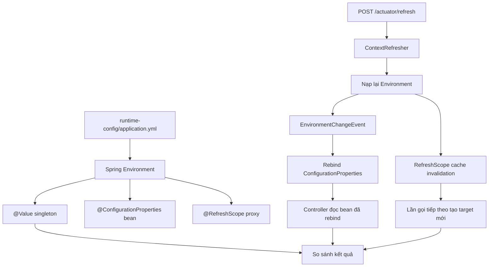

# So sánh @Value, ConfigurationProperties rebind và Refresh Scope

## 1. Mục tiêu dự án

Trong Spring Cloud Context, có ba cách thường gặp để đưa cấu hình vào bean:

- **@Value trên singleton thông thường:** giá trị được inject khi bean được tạo. Khi Environment thay đổi, field hoặc constructor argument đã nhận giá trị cũ không tự được inject lại.
- **@ConfigurationProperties:** Spring Cloud Context có thể rebind bean khi nhận EnvironmentChangeEvent. Bean được cập nhật trên cùng instance; không cần tạo lại toàn bộ ApplicationContext.
- **@RefreshScope:** bean được bọc bởi proxy có cache target. Khi refresh scope bị invalidate, lần gọi method tiếp theo tạo target mới và inject cấu hình hiện tại.

Dự án này tạo một ứng dụng nhỏ có cùng property được đọc theo cả ba cách. Người học thay đổi file cấu hình ngoài JAR, gọi endpoint refresh và quan sát:

1. Bean dùng @Value thông thường vẫn giữ snapshot lúc khởi tạo.
2. Bean @ConfigurationProperties được cập nhật trên cùng instance.
3. Bean @RefreshScope được tạo target mới và nhận giá trị mới.

Bài thuộc chương **Thực hành tổng hợp** của mô-đun **SPRING_CLOUD_CORE**. Mô-đun giúp người học hiểu Spring Cloud Commons, Spring Cloud Context, cấu hình bên ngoài và tương thích Spring Boot; đồng thời thực hành refresh scope, discovery, service registry, giao tiếp dịch vụ, kiểm thử và vận hành các abstraction chung.

Sau dự án, người học có thể:

- Tạo một ứng dụng Spring Boot có Spring Cloud Context.
- Inject cùng một cấu hình qua @Value, @ConfigurationProperties và @RefreshScope.
- Cập nhật cấu hình trong lúc ứng dụng đang chạy.
- Phân biệt rebind tại chỗ với việc tạo lại target bean.
- Kiểm tra kết quả bằng REST endpoint và JUnit.
- Chọn cơ chế phù hợp với lifecycle và tính nhất quán của từng bean.

## 2. Kiến trúc và phiên bản sử dụng

Lab dùng cấu hình file bên ngoài để người học nhìn thấy rõ thời điểm thay đổi. Không cần dựng Config Server hoặc message broker; Spring Cloud Context vẫn cung cấp cơ chế refresh và rebind cho ứng dụng.

| Thành phần | Phiên bản |
| --- | --- |
| Java | 17 |
| Spring Boot | 4.1.2 |
| Spring Cloud release train | 2025.1.4 |
| Spring Cloud Context | Version do Spring Cloud BOM quản lý |
| Build | Maven |

Boot 4.1.x được Spring Cloud 2025.1.x hỗ trợ từ train 2025.1.2. Dùng một BOM duy nhất để đồng bộ các module Spring Cloud.

Sơ đồ xử lý:



## 3. Tạo project

Tạo thư mục:

```text
refresh-comparison-lab/
├── pom.xml
├── runtime-config/
│   └── application.yml
└── src/
    ├── main/
    │   ├── java/
    │   │   └── com/example/refreshlab/
    │   │       ├── RefreshComparisonApplication.java
    │   │       ├── config/
    │   │       │   ├── DemoProperties.java
    │   │       │   ├── ValueSettings.java
    │   │       │   └── RefreshScopedSettings.java
    │   │       └── web/
    │   │           └── ComparisonController.java
    │   └── resources/
    │       └── application.yml
    └── test/
        └── java/
            └── com/example/refreshlab/
                └── RefreshBehaviorTests.java
```

### 3.1. Maven dependencies

Tạo file `pom.xml`:

```xml
<?xml version="1.0" encoding="UTF-8"?>
<project xmlns="http://maven.apache.org/POM/4.0.0"
         xmlns:xsi="http://www.w3.org/2001/XMLSchema-instance"
         xsi:schemaLocation="http://maven.apache.org/POM/4.0.0
         https://maven.apache.org/xsd/maven-4.0.0.xsd">
    <modelVersion>4.0.0</modelVersion>

    <parent>
        <groupId>org.springframework.boot</groupId>
        <artifactId>spring-boot-starter-parent</artifactId>
        <version>4.1.2</version>
        <relativePath/>
    </parent>

    <groupId>com.example</groupId>
    <artifactId>refresh-comparison-lab</artifactId>
    <version>1.0.0</version>
    <name>refresh-comparison-lab</name>

    <properties>
        <java.version>17</java.version>
        <spring-cloud.version>2025.1.4</spring-cloud.version>
    </properties>

    <dependencyManagement>
        <dependencies>
            <dependency>
                <groupId>org.springframework.cloud</groupId>
                <artifactId>spring-cloud-dependencies</artifactId>
                <version>${spring-cloud.version}</version>
                <type>pom</type>
                <scope>import</scope>
            </dependency>
        </dependencies>
    </dependencyManagement>

    <dependencies>
        <dependency>
            <groupId>org.springframework.boot</groupId>
            <artifactId>spring-boot-starter-webmvc</artifactId>
        </dependency>
        <dependency>
            <groupId>org.springframework.boot</groupId>
            <artifactId>spring-boot-starter-actuator</artifactId>
        </dependency>
        <dependency>
            <groupId>org.springframework.cloud</groupId>
            <artifactId>spring-cloud-context</artifactId>
        </dependency>
        <dependency>
            <groupId>org.springframework.boot</groupId>
            <artifactId>spring-boot-starter-test</artifactId>
            <scope>test</scope>
        </dependency>
    </dependencies>

    <build>
        <plugins>
            <plugin>
                <groupId>org.springframework.boot</groupId>
                <artifactId>spring-boot-maven-plugin</artifactId>
            </plugin>
        </plugins>
    </build>
</project>
```

Spring Cloud BOM quản lý version của spring-cloud-context. Không khai báo version riêng cho artifact này.

### 3.2. Cấu hình mặc định trong JAR

Tạo `src/main/resources/application.yml`:

```yaml
server:
  address: 127.0.0.1
  port: 8080

demo:
  banner: packaged-v1
  routing:
    timeout: 2s

management:
  endpoints:
    web:
      exposure:
        include: health,refresh
```

Ứng dụng chỉ bind vào loopback để lab không mở endpoint refresh ra mạng. File trong JAR cung cấp giá trị dự phòng ban đầu.

### 3.3. Cấu hình ngoài JAR

Tạo `runtime-config/application.yml`:

```yaml
demo:
  banner: external-v1
  routing:
    timeout: 3s
```

File này sẽ được nạp bổ sung và có ưu tiên cao hơn file cấu hình mặc định trong JAR.

## 4. Viết ba bean để so sánh

Ba bean cùng đọc hai key:

- `demo.banner`
- `demo.routing.timeout`

### 4.1. Bean dùng @Value thông thường

Tạo `ValueSettings.java`:

```java
package com.example.refreshlab.config;

import java.time.Duration;
import java.util.concurrent.atomic.AtomicLong;

import org.springframework.beans.factory.annotation.Value;
import org.springframework.stereotype.Component;

@Component
public class ValueSettings {

    private static final AtomicLong IDS = new AtomicLong();

    private final String banner;
    private final Duration timeout;
    private final long instanceId = IDS.incrementAndGet();

    public ValueSettings(
            @Value("${demo.banner:default-banner}") String banner,
            @Value("${demo.routing.timeout:2s}") Duration timeout) {
        this.banner = banner;
        this.timeout = timeout;
    }

    public String getBanner() {
        return banner;
    }

    public Duration getTimeout() {
        return timeout;
    }

    public long instanceId() {
        return instanceId;
    }
}
```

Bean này là singleton thông thường. Spring resolve placeholder khi tạo bean và truyền giá trị vào constructor. Sau khi constructor hoàn tất, các field final giữ snapshot đó. Environment thay đổi không tự gọi lại constructor.

Nếu cần dùng @Value nhưng muốn bean nhận cấu hình mới, có thể đặt chính bean đó trong @RefreshScope. Lab sẽ minh họa điều này ở bean thứ ba.

### 4.2. Bean dùng @ConfigurationProperties

Tạo `DemoProperties.java`:

```java
package com.example.refreshlab.config;

import java.time.Duration;
import java.util.concurrent.atomic.AtomicLong;

import org.springframework.boot.context.properties.ConfigurationProperties;

@ConfigurationProperties(prefix = "demo")
public class DemoProperties {

    private static final AtomicLong IDS = new AtomicLong();

    private String banner = "default-banner";
    private Routing routing = new Routing();
    private final long instanceId = IDS.incrementAndGet();

    public String getBanner() {
        return banner;
    }

    public void setBanner(String banner) {
        this.banner = banner;
    }

    public Routing getRouting() {
        return routing;
    }

    public void setRouting(Routing routing) {
        this.routing = routing;
    }

    public long instanceId() {
        return instanceId;
    }

    public static class Routing {

        private Duration timeout = Duration.ofSeconds(2);

        public Duration getTimeout() {
            return timeout;
        }

        public void setTimeout(Duration timeout) {
            this.timeout = timeout;
        }
    }
}
```

Đây là JavaBean mutable dùng setter binding. Spring Cloud Context có thể rebind các bean @ConfigurationProperties khi EnvironmentChangeEvent được phát. Việc rebind cập nhật field trên cùng instance, không thay object bằng một instance khác.

Các getter/setter và default value giúp Binder tạo object, chuyển kiểu Duration và áp dụng lại giá trị. Không chuyển lớp này thành Java record hoặc constructor-bound configuration trong bài lab: constructor-bound/record @ConfigurationProperties không thể được refresh theo cơ chế rebinding này.

### 4.3. Bean dùng @RefreshScope và @Value

Tạo `RefreshScopedSettings.java`:

```java
package com.example.refreshlab.config;

import java.time.Duration;
import java.util.concurrent.atomic.AtomicLong;

import org.springframework.beans.factory.annotation.Value;
import org.springframework.cloud.context.config.annotation.RefreshScope;
import org.springframework.stereotype.Component;

@Component
@RefreshScope
public class RefreshScopedSettings {

    private static final AtomicLong IDS = new AtomicLong();

    private final String banner;
    private final Duration timeout;
    private final long instanceId = IDS.incrementAndGet();

    public RefreshScopedSettings(
            @Value("${demo.banner:default-banner}") String banner,
            @Value("${demo.routing.timeout:2s}") Duration timeout) {
        this.banner = banner;
        this.timeout = timeout;
    }

    public String getBanner() {
        return banner;
    }

    public Duration getTimeout() {
        return timeout;
    }

    public long instanceId() {
        return instanceId;
    }
}
```

Bean được inject vào các thành phần khác dưới dạng proxy. Target thực được tạo lười khi method được gọi lần đầu. Khi refresh scope bị invalidate, target cũ bị loại khỏi cache; lần gọi kế tiếp tạo target mới và constructor nhận giá trị mới từ Environment.

Trong ví dụ này, @Value vẫn chỉ inject một lần cho mỗi target. Điểm làm nó nhận giá trị mới là target mới được tạo bởi Refresh Scope.

## 5. Đăng ký cấu hình và tạo endpoint so sánh

### 5.1. Application class

Tạo `RefreshComparisonApplication.java`:

```java
package com.example.refreshlab;

import org.springframework.boot.SpringApplication;
import org.springframework.boot.autoconfigure.SpringBootApplication;
import org.springframework.boot.context.properties.ConfigurationPropertiesScan;

@SpringBootApplication
@ConfigurationPropertiesScan
public class RefreshComparisonApplication {

    public static void main(String[] args) {
        SpringApplication.run(RefreshComparisonApplication.class, args);
    }
}
```

`@ConfigurationPropertiesScan` đăng ký `DemoProperties` làm bean trong ApplicationContext.

### 5.2. REST endpoint

Tạo `ComparisonController.java`:

```java
package com.example.refreshlab.web;

import java.time.Duration;

import com.example.refreshlab.config.DemoProperties;
import com.example.refreshlab.config.RefreshScopedSettings;
import com.example.refreshlab.config.ValueSettings;
import org.springframework.web.bind.annotation.GetMapping;
import org.springframework.web.bind.annotation.RequestMapping;
import org.springframework.web.bind.annotation.RestController;

@RestController
@RequestMapping("/demo")
public class ComparisonController {

    private final ValueSettings valueSettings;
    private final DemoProperties demoProperties;
    private final RefreshScopedSettings refreshScopedSettings;

    public ComparisonController(
            ValueSettings valueSettings,
            DemoProperties demoProperties,
            RefreshScopedSettings refreshScopedSettings) {
        this.valueSettings = valueSettings;
        this.demoProperties = demoProperties;
        this.refreshScopedSettings = refreshScopedSettings;
    }

    @GetMapping("/comparison")
    public ComparisonResponse comparison() {
        return new ComparisonResponse(
                snapshot(valueSettings.getBanner(), valueSettings.getTimeout(),
                        valueSettings.instanceId()),
                snapshot(demoProperties.getBanner(),
                        demoProperties.getRouting().getTimeout(),
                        demoProperties.instanceId()),
                snapshot(refreshScopedSettings.getBanner(),
                        refreshScopedSettings.getTimeout(),
                        refreshScopedSettings.instanceId()));
    }

    private BeanSnapshot snapshot(String banner, Duration timeout, long instanceId) {
        return new BeanSnapshot(banner, timeout.toString(), instanceId);
    }

    public record BeanSnapshot(String banner, String timeout, long instanceId) {
    }

    public record ComparisonResponse(
            BeanSnapshot value,
            BeanSnapshot configurationProperties,
            BeanSnapshot refreshScope) {
    }
}
```

Endpoint `GET /demo/comparison` trả về ba snapshot cùng lúc. Trường `instanceId` dùng identity của object để phân biệt rebind tại chỗ với việc tạo target mới.

## 6. Chạy ứng dụng

Từ thư mục gốc project:

```bash
mvn clean package
java -jar target/refresh-comparison-lab-1.0.0.jar --spring.config.additional-location=file:./runtime-config/
```

Tham số `spring.config.additional-location` thêm thư mục cấu hình ngoài vào các vị trí mặc định. Working directory phải là thư mục gốc project để đường dẫn tương đối `./runtime-config/` trỏ đúng file.

Kiểm tra:

```bash
curl http://127.0.0.1:8080/actuator/health
curl http://127.0.0.1:8080/demo/comparison
```

Response đầu tiên có dạng:

```json
{
  "value": {
    "banner": "external-v1",
    "timeout": "PT3S",
    "instanceId": 1
  },
  "configurationProperties": {
    "banner": "external-v1",
    "timeout": "PT3S",
    "instanceId": 1
  },
  "refreshScope": {
    "banner": "external-v1",
    "timeout": "PT3S",
    "instanceId": 1
  }
}
```

Các số instanceId chỉ minh họa. Ba bean có thể có identity khác nhau ngay từ đầu; điều cần quan sát là identity của từng bean trước và sau refresh.

## 7. Thay đổi file và refresh

### 7.1. Ghi nhận trạng thái ban đầu

Gọi `GET /demo/comparison` và lưu ba giá trị:

| Bean | Banner | Timeout | Identity |
| --- | --- | --- | --- |
| ValueSettings | external-v1 | PT3S | value-id |
| DemoProperties | external-v1 | PT3S | properties-id |
| RefreshScopedSettings | external-v1 | PT3S | refresh-id |

### 7.2. Thay đổi cấu hình ngoài JAR

Giữ ứng dụng đang chạy và sửa `runtime-config/application.yml`:

```yaml
demo:
  banner: external-v2
  routing:
    timeout: 5s
```

Chỉ lưu file chưa làm các bean đang chạy tự đổi. File mới cần được nạp vào Environment bằng cơ chế refresh.

### 7.3. Gọi Refresh Endpoint

Trong terminal khác:

```bash
curl -X POST http://127.0.0.1:8080/actuator/refresh
```

Spring Cloud Context làm mới Environment, phát sự kiện thay đổi và xử lý refresh scope. Response thường chứa danh sách các key thay đổi, chẳng hạn demo.banner và demo.routing.timeout; danh sách cụ thể phụ thuộc các property thực sự thay đổi.

Gọi lại:

```bash
curl http://127.0.0.1:8080/demo/comparison
```

Kết quả mong đợi:

| Bean | Banner sau refresh | Timeout sau refresh | Identity |
| --- | --- | --- | --- |
| ValueSettings (@Value singleton) | external-v1 | PT3S | Không đổi |
| DemoProperties (@ConfigurationProperties) | external-v2 | PT5S | Không đổi |
| RefreshScopedSettings (@RefreshScope) | external-v2 | PT5S | Thay đổi |

Đây là điểm chính của dự án:

- @Value singleton vẫn giữ snapshot đã inject khi khởi tạo.
- @ConfigurationProperties được rebind trên cùng bean instance.
- @RefreshScope invalidates target cache; lần gọi method sau đó tạo target mới và inject giá trị hiện tại.

## 8. Kiểm tra rebind bằng JUnit

Ngoài kiểm thử qua HTTP, có thể kiểm tra trực tiếp hai cơ chế Spring Cloud Context bằng EnvironmentChangeEvent và RefreshScope.

Tạo `RefreshBehaviorTests.java`:

```java
package com.example.refreshlab;

import java.time.Duration;
import java.util.Map;
import java.util.Set;

import com.example.refreshlab.config.DemoProperties;
import com.example.refreshlab.config.RefreshScopedSettings;
import com.example.refreshlab.config.ValueSettings;
import org.junit.jupiter.api.Test;
import org.springframework.beans.factory.annotation.Autowired;
import org.springframework.boot.test.context.SpringBootTest;
import org.springframework.cloud.context.environment.EnvironmentChangeEvent;
import org.springframework.cloud.context.scope.refresh.RefreshScope;
import org.springframework.context.ApplicationEventPublisher;
import org.springframework.core.env.ConfigurableEnvironment;
import org.springframework.core.env.MapPropertySource;

import static org.assertj.core.api.Assertions.assertThat;

@SpringBootTest
class RefreshBehaviorTests {

    @Autowired
    ConfigurableEnvironment environment;

    @Autowired
    ApplicationEventPublisher eventPublisher;

    @Autowired
    DemoProperties demoProperties;

    @Autowired
    ValueSettings valueSettings;

    @Autowired
    RefreshScopedSettings refreshScopedSettings;

    @Autowired
    RefreshScope refreshScope;

    @Test
    void comparesValueInjectionRebindingAndRefreshScope() {
        String originalBanner = environment.getProperty("demo.banner");
        long propertiesIdentity = demoProperties.instanceId();
        long valueIdentity = valueSettings.instanceId();
        long refreshIdentity = refreshScopedSettings.instanceId();
        String valueSnapshot = valueSettings.getBanner();

        MapPropertySource override = new MapPropertySource(
                "testOverride",
                Map.of(
                        "demo.banner", "test-v2",
                        "demo.routing.timeout", "7s"));

        try {
            environment.getPropertySources().addFirst(override);
            eventPublisher.publishEvent(new EnvironmentChangeEvent(
                    Set.of("demo.banner", "demo.routing.timeout")));

            assertThat(demoProperties.getBanner()).isEqualTo("test-v2");
            assertThat(demoProperties.getRouting().getTimeout())
                    .isEqualTo(Duration.ofSeconds(7));
            assertThat(demoProperties.instanceId()).isEqualTo(propertiesIdentity);

            assertThat(valueSettings.getBanner()).isEqualTo(valueSnapshot);
            assertThat(valueSettings.instanceId()).isEqualTo(valueIdentity);

            refreshScope.refreshAll();

            assertThat(refreshScopedSettings.getBanner()).isEqualTo("test-v2");
            assertThat(refreshScopedSettings.getTimeout())
                    .isEqualTo(Duration.ofSeconds(7));
            assertThat(refreshScopedSettings.instanceId()).isNotEqualTo(refreshIdentity);
        }
        finally {
            environment.getPropertySources().remove("testOverride");
            eventPublisher.publishEvent(new EnvironmentChangeEvent(
                    Set.of("demo.banner", "demo.routing.timeout")));
            refreshScope.refreshAll();
        }

        assertThat(demoProperties.getBanner()).isEqualTo(originalBanner);
    }
}
```

Test chủ động thêm PropertySource có ưu tiên cao nhất vào Environment, sau đó phát EnvironmentChangeEvent để kích hoạt rebind. Tiếp theo, test gọi refreshAll để xóa target cache của Refresh Scope. Các assertion xác nhận:

1. DemoProperties nhận giá trị mới nhưng identity không đổi.
2. ValueSettings giữ giá trị và identity ban đầu.
3. RefreshScopedSettings nhận giá trị mới và target identity thay đổi.
4. Khối finally dọn PropertySource test và phục hồi giá trị ban đầu để tránh ảnh hưởng test khác.

Chạy test:

```bash
mvn test
```

## 9. So sánh ba cơ chế

| Tiêu chí | @Value singleton | @ConfigurationProperties rebind | @RefreshScope |
| --- | --- | --- | --- |
| Cách nhận cấu hình | Inject khi bean được tạo | Binder bind vào bean | Target nhận cấu hình khi được tạo |
| Sau EnvironmentChangeEvent | Không tự cập nhật | Rebind field trên cùng instance | Chưa nhất thiết đổi nếu chưa invalidate scope |
| Sau refresh scope invalidation | Không đổi nếu bean không ở scope | Không cần thay instance | Target mới được tạo ở lần gọi tiếp theo |
| Identity bean/target | Giữ nguyên | Giữ nguyên | Target thay đổi; proxy được inject vẫn ổn định |
| Cách tổ chức | Placeholder ở field/constructor | POJO có prefix, kiểu dữ liệu và cấu trúc rõ | Bean được bọc bởi refresh-scoped proxy |
| Phù hợp | Giá trị ổn định trong vòng đời bean | Nhóm cấu hình có cấu trúc, cần rebind | Bean stateful cần tái tạo nhất quán khi refresh |
| Điểm cần lưu ý | Không tự cập nhật | Rebind mutate in-place | Target tạo lười; cần bean không final và method có thể proxy |

### 9.1. Rebind không phải là tạo bean mới

Spring Cloud Context dùng ConfigurationPropertiesRebinder để cập nhật bean @ConfigurationProperties. Rebind diễn ra trên cùng object và cập nhật các thuộc tính của nó. Điều này làm identity giữ nguyên, nhưng một thread khác có thể quan sát trạng thái trung gian khi nhiều field đang được cập nhật.

Nếu ứng dụng cần các lần đọc có một snapshot nhất quán trong suốt quá trình refresh, @RefreshScope phù hợp hơn: scope đồng bộ việc đọc với refresh của target bean.

### 9.2. Refresh Scope là proxy có cache

@RefreshScope không tạo lại toàn bộ ApplicationContext. Proxy giữ target trong scope cache. Refresh xóa target đã cache; khi proxy nhận lời gọi method tiếp theo, target mới được khởi tạo.

Điều này giúp các thao tác đang sử dụng target cũ có cơ hội hoàn tất trước khi target mới được tạo cho lần sử dụng tiếp theo. Tuy nhiên, dependency giữ reference trực tiếp tới object bên trong target hoặc bean khác không nằm trong refresh scope không tự động được xây dựng lại.

### 9.3. @Value có thể dùng cùng Refresh Scope

@Value không có cơ chế rebind độc lập. Nhưng nếu bean chứa @Value được đánh dấu @RefreshScope, target mới sẽ chạy quá trình inject lại khi được tạo. Bean thứ ba trong lab minh họa chính trường hợp này.

## 10. Các giới hạn cần biết

- **Constructor binding và Java record:** các bean @ConfigurationProperties dùng constructor binding, gồm Java record, không được refresh bằng cơ chế rebind thông thường. Với cấu hình cần cập nhật động, dùng JavaBean mutable có setter hoặc thiết kế một bean refresh-scoped phù hợp.
- **Xóa property:** khi rebind `@ConfigurationProperties`, Spring Cloud reset bean về class-level defaults trước khi bind lại nên giá trị đã bị loại khỏi Environment không tiếp tục tồn tại ngoài ý muốn. Với `@RefreshScope`, tài liệu lưu ý việc xóa một property rồi refresh không tự bảo đảm trạng thái hiện diện của property thay đổi như mong muốn. Hãy biểu diễn absence bằng default hoặc sentinel value rõ ràng và kiểm thử riêng hai cơ chế.
- **Bean không thể tạo lại:** một số bean có tài nguyên hoặc lifecycle đặc biệt không phù hợp để refresh. Kiểm tra danh sách never-refreshable và extra-refreshable trước khi áp dụng.
- **Cấu hình class không đồng nghĩa mọi bean trong class được refresh:** gắn @RefreshScope lên một @Configuration class không tự động đưa tất cả bean do class đó tạo vào refresh scope.
- **AOT và native image:** Context Refresh không được hỗ trợ cho Spring AOT transformations và native images; cần xem yêu cầu của phiên bản Spring Cloud đang dùng trước khi thiết kế runtime refresh.
- **Endpoint quản trị:** /actuator/refresh có thể làm thay đổi hành vi của instance. Chỉ expose trên mạng quản trị, bảo vệ bằng authentication/authorization và audit thao tác.
- **Nhiều instance:** gọi /actuator/refresh chỉ refresh instance nhận request. Với nhiều replica, cần cơ chế broadcast như Spring Cloud Bus hoặc orchestration có kiểm soát.

## 11. Bài tập mở rộng

1. Thêm property demo.routing.enabled kiểu boolean và so sánh hành vi của ba bean.
2. Thêm một nested object vào DemoProperties, ví dụ demo.retry.max-attempts và demo.retry.backoff.
3. Ghi lại instanceId trước/sau nhiều lần refresh liên tiếp để xác nhận Refresh Scope chỉ tạo target mới khi target tiếp theo được gọi.
4. Thử thay đổi chỉ banner, sau đó chỉ timeout; xác minh danh sách changed keys mà endpoint trả về.
5. Thử xóa một property khỏi file ngoài và quan sát hành vi sau refresh.
6. Thêm một service khác inject DemoProperties và kiểm tra nó thấy giá trị sau rebind.
7. Thêm một bean thường giữ reference tới một object cấu hình khác, rồi xác định khi nào reference đó được cập nhật.
8. Viết test song song đọc cấu hình trong lúc refresh để quan sát lý do cần snapshot nhất quán.
9. Thử gọi refresh hai lần mà không thay đổi file; so sánh changed keys và instance identity.
10. Thiết kế endpoint health/readiness để chỉ báo instance đã nhận cấu hình mong muốn.

## 12. Tiêu chí hoàn thành

| Tiêu chí | Bằng chứng |
| --- | --- |
| Project dùng một Spring Cloud BOM | Maven POM import Cloud 2025.1.4 |
| Cấu hình ngoài JAR được nạp | Initial response có external-v1 |
| @Value singleton được so sánh | Giá trị và identity giữ nguyên sau refresh |
| ConfigurationProperties được rebind | Giá trị đổi, identity giữ nguyên |
| Refresh Scope target được tạo lại | Giá trị đổi và target identity thay đổi |
| Endpoint refresh hoạt động | POST /actuator/refresh trả về các key thay đổi |
| Kiểm thử tự động | JUnit assertion cho cả ba cơ chế |
| Endpoint được giới hạn | Server bind vào 127.0.0.1 trong lab |

## 13. Tài liệu tham khảo chính thức

- [Spring Cloud Commons — Application Context Services and Refresh Scope](https://docs.spring.io/spring-cloud-commons/reference/spring-cloud-commons/application-context-services.html)
- [Spring Cloud Commons — Environment Changes](https://docs.spring.io/spring-cloud-commons/reference/spring-cloud-commons/application-context-services.html#environment-changes)
- [Spring Cloud Bus — Bus Refresh Endpoint](https://docs.spring.io/spring-cloud-bus/reference/spring-cloud-bus/bus-endpoints.html)
- [Spring Boot 4.1 — Build Systems and Application Starters](https://docs.spring.io/spring-boot/reference/using/build-systems.html)
- [Spring Boot — Externalized Configuration](https://docs.spring.io/spring-boot/reference/features/external-config.html)
- [Spring Boot — Actuator Endpoints](https://docs.spring.io/spring-boot/reference/actuator/endpoints.html)

Dự án hoàn tất khi người học quan sát được ba hành vi khác nhau trên cùng một Environment: @Value singleton giữ snapshot, @ConfigurationProperties rebind trên cùng instance và @RefreshScope tạo target mới khi được gọi sau refresh. Đây là cơ sở để chọn cơ chế cấu hình động theo lifecycle và yêu cầu nhất quán của từng bean.
