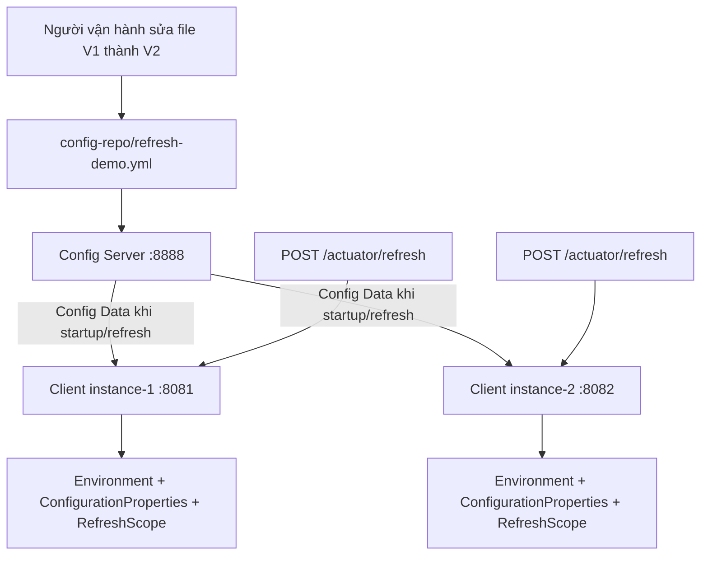

# Đổi cấu hình trên hai instance và kiểm chứng phạm vi refresh

> **Chương:** Thực hành tổng hợp
> **Module:** `SPRING_CLOUD_CORE` — hiểu các nền tảng cốt lõi của Spring Cloud trong hệ thống phân tán, đặc biệt Spring Cloud Commons, Context, cấu hình bên ngoài và tương thích phiên bản với Spring Boot. Người học tìm hiểu refresh scope, discovery, service registry, giao tiếp dịch vụ và cách kiểm thử, vận hành các abstraction chung.
> **Trọng tâm:** Xây dựng Config Server và hai instance của cùng một Config Client. Thay đổi property ở nguồn cấu hình tập trung, refresh lần lượt từng instance, rồi so sánh ConfigurationProperties, RefreshScope và singleton giữ Value ban đầu. Qua đó xác minh refresh diễn ra trong ApplicationContext của từng instance.

## 1. Mục tiêu của dự án

Trong hệ thống phân tán, nhiều instance của một service thường dùng chung cấu hình nghiệp vụ. Khi một property thay đổi, nhóm vận hành cần biết instance nào đã nhận giá trị mới, instance nào vẫn đang dùng giá trị cũ và bean nào trong mỗi instance đã được cập nhật.

Dự án dựng một Config Server và hai tiến trình Config Client chạy cùng application name nhưng khác port. Config Server đọc cấu hình từ thư mục local để có thể thay đổi file trong lúc ứng dụng đang chạy.

Bạn sẽ quan sát ba cách đọc cùng một cấu hình:

- **ConfigurationProperties:** bean cấu hình mutable được Spring Cloud rebind khi refresh.
- **RefreshScope:** bean nằm sau scoped proxy; target hiện tại bị hủy khi refresh và được tạo lại ở lần truy cập tiếp theo.
- **Singleton giữ Value lúc khởi tạo:** giá trị đã được đưa vào object lúc startup tiếp tục giữ giá trị cũ nếu bean không có cơ chế cập nhật riêng.

Sau khi thay đổi file cấu hình, bạn chỉ gọi POST /actuator/refresh trên instance thứ nhất. Kết quả mong đợi là instance thứ nhất cập nhật, còn instance thứ hai vẫn giữ cấu hình cũ. Khi gọi refresh trên instance thứ hai, cả hai mới cùng hiển thị giá trị mới.

Đây là refresh trực tiếp từng instance. Bài lab không dùng Spring Cloud Bus, vì vậy không có thông điệp broadcast tự động tới các replica.

### Kết quả cần đạt

1. Khởi động Config Server phục vụ application name refresh-demo.
2. Chạy hai Config Client instance trên port 8081 và 8082.
3. Đọc cùng một cấu hình ban đầu từ hai instance.
4. Thay đổi remote property mà không build lại client.
5. Refresh riêng instance thứ nhất và chứng minh instance thứ hai chưa thay đổi.
6. Refresh instance thứ hai và xác nhận hai instance đã đồng bộ.
7. Phân biệt ConfigurationProperties, RefreshScope và singleton giữ giá trị ban đầu.
8. Giải thích vì sao refresh một ApplicationContext không tự refresh ApplicationContext khác.

## 2. Kiến trúc và luồng hoạt động



Cả hai client dùng chung application name refresh-demo, profile default, Config Server http://localhost:8888 và nguồn cấu hình config-repo/refresh-demo.yml.

Mỗi tiến trình có ApplicationContext và bean registry riêng. Vì vậy, refresh endpoint của instance 1 chỉ làm mới context của instance 1. Instance 2 chỉ nhận cấu hình mới khi chính nó refresh hoặc khi một cơ chế broadcast như Spring Cloud Bus được triển khai.

## 3. Chuẩn bị môi trường

### 3.1. Yêu cầu

- JDK được Spring Boot release bạn chọn hỗ trợ; ví dụ lab dùng Java 21.
- Maven 3.9 trở lên.
- Spring Boot và Spring Cloud release train tương thích.
- Hai port trống: 8081, 8082; thêm port 8888 cho Config Server.
- Một terminal cho Config Server và hai terminal cho hai client.

```bash
java -version
mvn -version
```

Chọn Spring Boot version và Spring Cloud BOM theo bảng tương thích chính thức. Không tự ghép version Config Server, Config Client và Spring Cloud Commons từ các release train khác nhau.

### 3.2. Cấu trúc thư mục

Tạo Maven multi-module project:

```text
refresh-lab/
├── pom.xml
├── config-repo/
│   └── refresh-demo.yml
├── config-server/
│   ├── pom.xml
│   └── src/main/
│       ├── java/com/example/configserver/ConfigServerApplication.java
│       └── resources/application.yml
└── demo-client/
    ├── pom.xml
    └── src/main/
        ├── java/com/example/refreshdemo/
        │   ├── DemoClientApplication.java
        │   ├── config/DemoConfiguration.java
        │   ├── config/DemoProperties.java
        │   ├── model/RefreshableGreeting.java
        │   ├── model/StartupSnapshot.java
        │   └── web/DemoController.java
        └── resources/application.yml
```

Chạy lệnh Maven tại thư mục gốc refresh-lab. Config Server dùng native profile để đọc file trong config-repo; bạn có thể sửa property trực tiếp mà không cần commit vào Git.

## 4. Khai báo Maven dependencies

### 4.1. POM gốc

Tạo pom.xml ở thư mục gốc. Thay hai giá trị version mẫu bằng một cặp version tương thích lấy từ release train matrix:

```xml
<project xmlns="http://maven.apache.org/POM/4.0.0"
         xmlns:xsi="http://www.w3.org/2001/XMLSchema-instance"
         xsi:schemaLocation="http://maven.apache.org/POM/4.0.0 https://maven.apache.org/xsd/maven-4.0.0.xsd">
    <modelVersion>4.0.0</modelVersion>
    <groupId>com.example</groupId>
    <artifactId>refresh-lab</artifactId>
    <version>1.0.0-SNAPSHOT</version>
    <packaging>pom</packaging>
    <modules>
        <module>config-server</module>
        <module>demo-client</module>
    </modules>
    <properties>
        <java.version>21</java.version>
        <maven.compiler.release>${java.version}</maven.compiler.release>
        <spring-boot.version>REPLACE_WITH_COMPATIBLE_BOOT_VERSION</spring-boot.version>
        <spring-cloud.version>REPLACE_WITH_COMPATIBLE_CLOUD_TRAIN</spring-cloud.version>
    </properties>
    <dependencyManagement>
        <dependencies>
            <dependency>
                <groupId>org.springframework.boot</groupId>
                <artifactId>spring-boot-dependencies</artifactId>
                <version>${spring-boot.version}</version>
                <type>pom</type>
                <scope>import</scope>
            </dependency>
            <dependency>
                <groupId>org.springframework.cloud</groupId>
                <artifactId>spring-cloud-dependencies</artifactId>
                <version>${spring-cloud.version}</version>
                <type>pom</type>
                <scope>import</scope>
            </dependency>
        </dependencies>
    </dependencyManagement>
    <build>
        <pluginManagement>
            <plugins>
                <plugin>
                    <groupId>org.springframework.boot</groupId>
                    <artifactId>spring-boot-maven-plugin</artifactId>
                    <version>${spring-boot.version}</version>
                    <executions>
                        <execution>
                            <goals>
                                <goal>repackage</goal>
                            </goals>
                        </execution>
                    </executions>
                </plugin>
                <plugin>
                    <groupId>org.apache.maven.plugins</groupId>
                    <artifactId>maven-compiler-plugin</artifactId>
                    <version>3.13.0</version>
                    <configuration>
                        <release>${java.version}</release>
                    </configuration>
                </plugin>
            </plugins>
        </pluginManagement>
    </build>
</project>
```

Hai BOM giữ version dependency đồng bộ. Các module con kế thừa dependency management từ POM gốc và không cần chỉ định version riêng cho starter.

### 4.2. Config Server module

Tạo config-server/pom.xml:

```xml
<project xmlns="http://maven.apache.org/POM/4.0.0"
         xmlns:xsi="http://www.w3.org/2001/XMLSchema-instance"
         xsi:schemaLocation="http://maven.apache.org/POM/4.0.0 https://maven.apache.org/xsd/maven-4.0.0.xsd">
    <modelVersion>4.0.0</modelVersion>
    <parent>
        <groupId>com.example</groupId>
        <artifactId>refresh-lab</artifactId>
        <version>1.0.0-SNAPSHOT</version>
        <relativePath>../pom.xml</relativePath>
    </parent>
    <artifactId>config-server</artifactId>
    <dependencies>
        <dependency>
            <groupId>org.springframework.cloud</groupId>
            <artifactId>spring-cloud-config-server</artifactId>
        </dependency>
        <dependency>
            <groupId>org.springframework.boot</groupId>
            <artifactId>spring-boot-starter-web</artifactId>
        </dependency>
    </dependencies>
    <build>
        <plugins>
            <plugin>
                <groupId>org.springframework.boot</groupId>
                <artifactId>spring-boot-maven-plugin</artifactId>
            </plugin>
        </plugins>
    </build>
</project>
```

### 4.3. Config Client module

Tạo demo-client/pom.xml:

```xml
<project xmlns="http://maven.apache.org/POM/4.0.0"
         xmlns:xsi="http://www.w3.org/2001/XMLSchema-instance"
         xsi:schemaLocation="http://maven.apache.org/POM/4.0.0 https://maven.apache.org/xsd/maven-4.0.0.xsd">
    <modelVersion>4.0.0</modelVersion>
    <parent>
        <groupId>com.example</groupId>
        <artifactId>refresh-lab</artifactId>
        <version>1.0.0-SNAPSHOT</version>
        <relativePath>../pom.xml</relativePath>
    </parent>
    <artifactId>demo-client</artifactId>
    <dependencies>
        <dependency>
            <groupId>org.springframework.cloud</groupId>
            <artifactId>spring-cloud-starter-config</artifactId>
        </dependency>
        <dependency>
            <groupId>org.springframework.boot</groupId>
            <artifactId>spring-boot-starter-web</artifactId>
        </dependency>
        <dependency>
            <groupId>org.springframework.boot</groupId>
            <artifactId>spring-boot-starter-actuator</artifactId>
        </dependency>
    </dependencies>
    <build>
        <plugins>
            <plugin>
                <groupId>org.springframework.boot</groupId>
                <artifactId>spring-boot-maven-plugin</artifactId>
            </plugin>
        </plugins>
    </build>
</project>
```

Config Client starter cung cấp tích hợp Config Data và Spring Cloud Context. Actuator cung cấp endpoint quản trị; dependency này cần thiết để expose endpoint refresh trong bài lab.

## 5. Xây dựng Config Server

### 5.1. Main class

Tạo ConfigServerApplication.java:

```java
package com.example.configserver;

import org.springframework.boot.SpringApplication;
import org.springframework.boot.autoconfigure.SpringBootApplication;
import org.springframework.cloud.config.server.EnableConfigServer;

@SpringBootApplication
@EnableConfigServer
public class ConfigServerApplication {

    public static void main(String[] args) {
        SpringApplication.run(ConfigServerApplication.class, args);
    }
}
```

### 5.2. Cấu hình native repository

Tạo config-server/src/main/resources/application.yml:

```yaml
server:
  port: 8888
spring:
  application:
    name: config-server
  profiles:
    active: native
  cloud:
    config:
      server:
        native:
          search-locations: "file:${user.dir}/config-repo"
```

user.dir là thư mục làm việc hiện tại của JVM. Hãy khởi động Config Server từ thư mục gốc refresh-lab để đường dẫn trỏ tới refresh-lab/config-repo.

Native backend phù hợp cho bài lab local. Trong hệ thống thật, có thể thay bằng Git hoặc backend được tổ chức quản lý. Không dùng native file backend làm kho cấu hình production nếu chưa có cơ chế kiểm soát version, phân quyền, audit và phân phối an toàn.

### 5.3. Tạo cấu hình phiên bản đầu tiên

Tạo config-repo/refresh-demo.yml:

```yaml
demo:
  message: "Xin chào từ cấu hình V1"
  limit: 10
```

Tên file khớp application name refresh-demo. Khi client yêu cầu profile default, Config Server sẽ kết hợp các file cấu hình chung và file theo application/profile phù hợp.

Kiểm tra Config Server bằng URL:

```text
http://localhost:8888/refresh-demo/default
```

Response là Environment JSON có danh sách property source. Xác nhận response chứa demo.message là Xin chào từ cấu hình V1 và demo.limit là 10 trước khi chạy client.

## 6. Xây dựng Config Client

### 6.1. Main class và Config Data import

Tạo DemoClientApplication.java:

```java
package com.example.refreshdemo;

import org.springframework.boot.SpringApplication;
import org.springframework.boot.autoconfigure.SpringBootApplication;
import org.springframework.boot.context.properties.ConfigurationPropertiesScan;

@SpringBootApplication
@ConfigurationPropertiesScan
public class DemoClientApplication {

    public static void main(String[] args) {
        SpringApplication.run(DemoClientApplication.class, args);
    }
}
```

Tạo demo-client/src/main/resources/application.yml:

```yaml
spring:
  application:
    name: refresh-demo
  config:
    import: "configserver:http://localhost:8888"

management:
  endpoints:
    web:
      exposure:
        include: health,info,refresh
```

Import không có tiền tố optional: nên client sẽ fail startup nếu Config Server không thể cung cấp cấu hình bắt buộc. Đây là lựa chọn có chủ đích cho lab: hai instance cần nhận cấu hình remote ngay khi khởi động.

Endpoint refresh được expose để gọi trong môi trường local. Không expose endpoint này công khai trong production; hãy bảo vệ bằng authentication, authorization, network policy và management interface riêng.

### 6.2. Tạo bean ConfigurationProperties

Tạo config/DemoProperties.java:

```java
package com.example.refreshdemo.config;

import org.springframework.boot.context.properties.ConfigurationProperties;

@ConfigurationProperties(prefix = "demo")
public class DemoProperties {

    private String message;
    private int limit;

    public String getMessage() {
        return message;
    }

    public void setMessage(String message) {
        this.message = message;
    }

    public int getLimit() {
        return limit;
    }

    public void setLimit(int limit) {
        this.limit = limit;
    }
}
```

ConfigurationPropertiesScan trên main class đăng ký bean này. Spring Cloud có thể rebind bean cấu hình mutable khi Environment thay đổi.

### 6.3. Tạo bean refresh-scoped

Tạo model/RefreshableGreeting.java:

```java
package com.example.refreshdemo.model;

public class RefreshableGreeting {

    private final String message;
    private final int limit;

    public RefreshableGreeting(String message, int limit) {
        this.message = message;
        this.limit = limit;
    }

    public String getMessage() {
        return message;
    }

    public int getLimit() {
        return limit;
    }
}
```

Tạo config/DemoConfiguration.java:

```java
package com.example.refreshdemo.config;

import com.example.refreshdemo.model.RefreshableGreeting;
import com.example.refreshdemo.model.StartupSnapshot;
import org.springframework.beans.factory.annotation.Value;
import org.springframework.cloud.context.config.annotation.RefreshScope;
import org.springframework.context.annotation.Bean;
import org.springframework.context.annotation.Configuration;

@Configuration(proxyBeanMethods = false)
public class DemoConfiguration {

    @Bean
    @RefreshScope
    RefreshableGreeting refreshableGreeting(DemoProperties properties) {
        return new RefreshableGreeting(
                properties.getMessage(),
                properties.getLimit()
        );
    }

    @Bean
    StartupSnapshot startupSnapshot(
            @Value("${demo.message}") String message,
            @Value("${demo.limit}") int limit) {
        return new StartupSnapshot(message, limit);
    }
}
```

RefreshableGreeting được tạo qua proxy của RefreshScope. Khi refresh xảy ra, target cũ bị invalidate. Lần gọi tiếp theo qua proxy sẽ tạo target mới từ DemoProperties hiện hành.

StartupSnapshot là singleton thông thường. Các tham số Value được giải quyết khi bean được tạo lần đầu. Spring Cloud không tự tạo lại singleton này khi refresh scope được làm mới, nên snapshot tiếp tục giữ V1. Đây là đối chứng để quan sát phạm vi refresh.

### 6.4. Tạo startup snapshot

Tạo model/StartupSnapshot.java:

```java
package com.example.refreshdemo.model;

public record StartupSnapshot(String message, int limit) {
}
```

Record này giữ lại giá trị tại startup. Không gắn RefreshScope cho bean này vì mục tiêu là quan sát singleton không được refresh.

### 6.5. Tạo endpoint quan sát

Tạo web/DemoController.java:

```java
package com.example.refreshdemo.web;

import com.example.refreshdemo.config.DemoProperties;
import com.example.refreshdemo.model.RefreshableGreeting;
import com.example.refreshdemo.model.StartupSnapshot;
import java.util.Map;
import org.springframework.core.env.Environment;
import org.springframework.web.bind.annotation.GetMapping;
import org.springframework.web.bind.annotation.RequestMapping;
import org.springframework.web.bind.annotation.RestController;

@RestController
@RequestMapping("/demo")
public class DemoController {

    private final DemoProperties properties;
    private final RefreshableGreeting greeting;
    private final StartupSnapshot startupSnapshot;
    private final Environment environment;

    public DemoController(
            DemoProperties properties,
            RefreshableGreeting greeting,
            StartupSnapshot startupSnapshot,
            Environment environment) {
        this.properties = properties;
        this.greeting = greeting;
        this.startupSnapshot = startupSnapshot;
        this.environment = environment;
    }

    @GetMapping("/state")
    public Map<String, Object> state() {
        return Map.of(
                "instanceId", environment.getProperty("app.instance-id", "unknown"),
                "port", environment.getProperty("server.port", "unknown"),
                "configurationPropertiesMessage", properties.getMessage(),
                "configurationPropertiesLimit", properties.getLimit(),
                "refreshScopeMessage", greeting.getMessage(),
                "refreshScopeLimit", greeting.getLimit(),
                "startupSnapshotMessage", startupSnapshot.message(),
                "startupSnapshotLimit", startupSnapshot.limit()
        );
    }
}
```

Endpoint GET /demo/state trả về ba góc nhìn của cùng một cấu hình, kèm instance ID và port. Các giá trị này giúp so sánh hai process độc lập.

## 7. Build và khởi động ba tiến trình

### 7.1. Build project

Tại thư mục gốc refresh-lab:

```bash
mvn clean package -DskipTests
```

Kiểm tra hai executable JAR được tạo:

- config-server/target/config-server-1.0.0-SNAPSHOT.jar;
- demo-client/target/demo-client-1.0.0-SNAPSHOT.jar.

Nếu artifact name/version của bạn khác, dùng đúng tên file được Maven tạo ra.

### 7.2. Terminal A — Config Server

Mở terminal tại thư mục gốc project và chạy:

```bash
java -jar config-server/target/config-server-1.0.0-SNAPSHOT.jar
```

Đợi log báo ứng dụng đã khởi động. Kiểm tra endpoint cấu hình:

```bash
curl http://localhost:8888/refresh-demo/default
```

Response phải chứa hai key:

```json
{
  "name": "refresh-demo",
  "profiles": ["default"],
  "propertySources": [
    {
      "name": "...",
      "source": {
        "demo.message": "Xin chào từ cấu hình V1",
        "demo.limit": 10
      }
    }
  ]
}
```

Đây là response minh họa; metadata và số lượng property source có thể khác theo version Config Server.

### 7.3. Terminal B — instance thứ nhất

Mở terminal thứ hai, vẫn ở thư mục gốc project:

```bash
java -jar demo-client/target/demo-client-1.0.0-SNAPSHOT.jar --server.port=8081 --app.instance-id=instance-1
```

Client sẽ kết nối Config Server và nhận V1 khi startup.

### 7.4. Terminal C — instance thứ hai

Mở terminal thứ ba:

```bash
java -jar demo-client/target/demo-client-1.0.0-SNAPSHOT.jar --server.port=8082 --app.instance-id=instance-2
```

Hai instance có cùng application name và profile, nhưng mỗi instance dùng port và instance ID riêng.

Nếu một client không khởi động, kiểm tra Config Server đã sẵn sàng, URL import, active profile và response của endpoint /refresh-demo/default.

## 8. Đo trạng thái ban đầu trên hai instance

Gọi endpoint trên instance 1:

```bash
curl http://localhost:8081/demo/state
```

Gọi endpoint trên instance 2:

```bash
curl http://localhost:8082/demo/state
```

Nếu dùng Windows PowerShell, có thể đọc JSON bằng:

```powershell
Invoke-RestMethod http://localhost:8081/demo/state | ConvertTo-Json -Depth 5
Invoke-RestMethod http://localhost:8082/demo/state | ConvertTo-Json -Depth 5
```

Kết quả kỳ vọng:

| Trường | Instance 1 | Instance 2 |
| --- | --- | --- |
| instanceId | instance-1 | instance-2 |
| port | 8081 | 8082 |
| configurationPropertiesMessage | Xin chào từ cấu hình V1 | Xin chào từ cấu hình V1 |
| configurationPropertiesLimit | 10 | 10 |
| refreshScopeMessage | Xin chào từ cấu hình V1 | Xin chào từ cấu hình V1 |
| refreshScopeLimit | 10 | 10 |
| startupSnapshotMessage | Xin chào từ cấu hình V1 | Xin chào từ cấu hình V1 |
| startupSnapshotLimit | 10 | 10 |

Lưu response ban đầu để so sánh sau mỗi bước. Cả ba loại bean đều đọc V1 vì chúng được tạo hoặc bind trong lúc hai client khởi động.

## 9. Thay đổi cấu hình tập trung từ V1 sang V2

Mở config-repo/refresh-demo.yml và thay nội dung:

```yaml
demo:
  message: "Xin chào từ cấu hình V2"
  limit: 25
```

Lưu file. Không build lại hoặc restart ba tiến trình.

Trước khi refresh client, gọi lại Config Server:

```bash
curl http://localhost:8888/refresh-demo/default
```

Xác nhận response hiện có demo.message là Xin chào từ cấu hình V2 và demo.limit là 25.

Sau khi file thay đổi, Config Server có thể trả V2 cho request mới, nhưng hai client đang chạy vẫn giữ Environment V1 cho đến khi được refresh. Thay đổi nguồn cấu hình không tự đẩy property mới tới các process đang hoạt động.

### 9.1. Nếu Config Server vẫn trả V1

Kiểm tra:

- file có đúng tên refresh-demo.yml không;
- file nằm trong đúng thư mục config-repo mà Config Server đang đọc không;
- JVM Config Server được khởi chạy từ thư mục gốc project không;
- profile và application name trong URL có đúng không;
- file đã được lưu hoàn toàn trước khi gọi endpoint chưa.

Chỉ tiếp tục khi Config Server xác nhận V2. Điều này tách lỗi nguồn cấu hình khỏi lỗi refresh phía client.

## 10. Refresh riêng instance thứ nhất

Gọi endpoint refresh trên port 8081:

```bash
curl -X POST http://localhost:8081/actuator/refresh
```

Trong PowerShell có thể dùng:

```powershell
Invoke-RestMethod -Method Post -Uri http://localhost:8081/actuator/refresh
```

Response thường là danh sách các key đã thay đổi, ví dụ demo.message và demo.limit. Danh sách chính xác phụ thuộc property source và version.

Kiểm tra lại instance 1:

```bash
curl http://localhost:8081/demo/state
```

Kết quả kỳ vọng trên instance 1:

| Trường | Giá trị sau refresh |
| --- | --- |
| configurationPropertiesMessage | Xin chào từ cấu hình V2 |
| configurationPropertiesLimit | 25 |
| refreshScopeMessage | Xin chào từ cấu hình V2 |
| refreshScopeLimit | 25 |
| startupSnapshotMessage | Xin chào từ cấu hình V1 |
| startupSnapshotLimit | 10 |

Hai nhóm đầu tiên cho thấy Environment đã được cập nhật và ConfigurationProperties được rebind. Bean RefreshScope được tạo lại khi proxy được gọi. StartupSnapshot vẫn giữ V1 vì nó là singleton bình thường được khởi tạo một lần.

### 10.1. Kiểm tra instance thứ hai chưa refresh

Gọi endpoint trên port 8082:

```bash
curl http://localhost:8082/demo/state
```

Tất cả giá trị của instance 2 vẫn kỳ vọng là V1. Đây là bằng chứng refresh ở instance 1 không tự thay đổi Environment hoặc bean trong ApplicationContext của instance 2.

## 11. Refresh instance thứ hai và xác minh đồng bộ

Gọi refresh riêng instance 2:

```bash
curl -X POST http://localhost:8082/actuator/refresh
```

Hoặc PowerShell:

```powershell
Invoke-RestMethod -Method Post -Uri http://localhost:8082/actuator/refresh
```

Gọi lại hai endpoint:

```bash
curl http://localhost:8081/demo/state
curl http://localhost:8082/demo/state
```

Bây giờ cả hai instance phải có:

| Trường | Instance 1 | Instance 2 |
| --- | --- | --- |
| configurationPropertiesMessage | V2 | V2 |
| configurationPropertiesLimit | 25 | 25 |
| refreshScopeMessage | V2 | V2 |
| refreshScopeLimit | 25 | 25 |
| startupSnapshotMessage | V1 | V1 |
| startupSnapshotLimit | 10 | 10 |

Hai instance đã cập nhật cấu hình theo cùng một version, nhưng singleton snapshot vẫn giữ giá trị lúc khởi tạo. Muốn cập nhật snapshot, phải thiết kế bean có khả năng cập nhật hoặc tái tạo theo lifecycle phù hợp; refresh scope không tự thay mọi singleton.

## 12. Phân tích phạm vi refresh

### 12.1. RefreshScope là phạm vi bean trong một ApplicationContext

RefreshScope tạo proxy cho bean và quản lý target instance trong refresh scope. Khi refresh scope bị invalidate, target đang được cache bị hủy. Lần gọi tiếp theo qua proxy sẽ tạo target mới.

Trong bài lab:

- RefreshableGreeting được tạo lại trong instance 1 khi instance 1 refresh;
- target RefreshableGreeting ở instance 2 vẫn tồn tại cho đến khi instance 2 refresh;
- hai proxy nằm trong hai ApplicationContext riêng biệt.

Do đó, refresh scope nói về vòng đời target bean trong một ApplicationContext. Nó không phải một cơ chế đồng bộ cấu hình giữa tất cả replica.

### 12.2. ConfigurationProperties được rebind

DemoProperties là bean mutable đã đăng ký bằng ConfigurationProperties. Khi EnvironmentChangeEvent được phát hành, Spring Cloud rebind bean này theo cơ chế configuration properties rebinding.

Đây là lý do configurationPropertiesMessage và configurationPropertiesLimit đổi sang V2 ngay sau khi instance tương ứng refresh.

Một bean cấu hình constructor-bound hoặc immutable cần được xem xét riêng vì không phải mọi kiểu binding đều có thể rebind như bean mutable trong ví dụ này.

### 12.3. Singleton giữ Value không tự cập nhật

StartupSnapshot nhận hai giá trị qua tham số Value trong lúc bean được tạo. Sau đó nó không có setter, listener hoặc lifecycle cập nhật. Vì vậy, object vẫn giữ V1.

Nếu muốn một singleton cập nhật theo EnvironmentChangeEvent, hãy chủ động thiết kế listener hoặc cơ chế đồng bộ trạng thái phù hợp. Không giả định mọi trường đã inject bằng Value sẽ tự thay đổi sau refresh.

### 12.4. Bảng tổng kết

| Thành phần | Sau khi một instance refresh | Phạm vi |
| --- | --- | --- |
| Environment của instance đó | Được cập nhật từ nguồn cấu hình có thể reload | ApplicationContext hiện tại |
| Mutable ConfigurationProperties | Được rebind theo Environment mới | Bean trong context hiện tại |
| Target RefreshScope | Bị invalidate và tạo lại khi được gọi | RefreshScope của context hiện tại |
| Singleton giữ Value lúc startup | Giữ giá trị cũ nếu không có cơ chế riêng | Vòng đời singleton |
| Instance khác | Không tự thay đổi | ApplicationContext độc lập |

## 13. Kiểm chứng bằng log và Actuator

### 13.1. Log refresh

Khi gọi refresh, quan sát log client để tìm thông tin về Environment change, changed keys và quá trình refresh scope. Log cụ thể thay đổi theo release train và logging level.

Không log toàn bộ property source trong môi trường thật vì chúng có thể chứa password, token hoặc thông tin nhạy cảm.

### 13.2. Health endpoint

Kiểm tra health của từng instance:

```bash
curl http://localhost:8081/actuator/health
curl http://localhost:8082/actuator/health
```

Health UP chỉ cho biết các health contributor được cấu hình đang đáp ứng điều kiện. Nó không chứng minh mọi property hoặc bean đã mang giá trị mong muốn. Endpoint /demo/state trong lab mới là phép đo trực tiếp ba nhóm bean.

### 13.3. Refresh endpoint không phải broadcast

POST /actuator/refresh chạy trong process nhận request. Nếu gửi request tới port 8081, chỉ context của instance 1 được refresh.

Trong production, không nên expose endpoint quản trị này qua public ingress. Có thể giới hạn management port, bảo vệ bằng Spring Security, network policy và quyền vận hành riêng.

## 14. Thực hành mở rộng: đổi V2 sang V3

Thay file Config Server:

```yaml
demo:
  message: "Xin chào từ cấu hình V3"
  limit: 50
```

Sau đó chỉ refresh instance 2 trước:

1. Kiểm tra Config Server trả V3.
2. Gọi POST refresh ở port 8082.
3. Gọi /demo/state ở cả hai port.
4. Ghi lại instance 1 vẫn V2 và instance 2 đã V3.
5. Refresh instance 1.
6. Xác nhận cả hai cùng V3.
7. So sánh startup snapshot vẫn giữ V1 ở cả hai.

Bài mở rộng này cho thấy trong một khoảng thời gian, các replica có thể chạy với các phiên bản cấu hình khác nhau. Nếu cấu hình ảnh hưởng contract hoặc dữ liệu dùng chung, cần có chiến lược rollout và compatibility để tránh hai instance xử lý nghiệp vụ không nhất quán.

## 15. Tùy chọn: broadcast refresh bằng Spring Cloud Bus

Trong hệ thống có nhiều instance, gọi refresh endpoint thủ công trên từng replica có thể không thuận tiện. Spring Cloud Bus có thể phát một refresh event qua broker được hỗ trợ, chẳng hạn RabbitMQ hoặc Kafka, để các instance tham gia bus cùng nhận sự kiện.

Ở mức khái niệm:

- direct refresh: gửi request tới từng instance; mỗi request chỉ refresh context nhận request;
- bus refresh: phát một event qua broker; các instance đã kết nối bus xử lý refresh event theo cấu hình và topology;
- bus không tự sửa nguồn cấu hình; Config Server vẫn cần trả về dữ liệu mới;
- broker, bảo mật, định tuyến event và quyền gọi endpoint bus phải được vận hành đúng.

Nếu mở rộng lab bằng Bus, thêm starter tương ứng với broker, chạy broker local, cấu hình từng client tham gia bus và dùng endpoint bus refresh theo tài liệu của release đang dùng. Không dùng Bus trong phần thực hành chính để giữ rõ kết quả refresh trực tiếp từng instance.

## 16. Troubleshooting

| Triệu chứng | Nguyên nhân có thể | Cách xử lý |
| --- | --- | --- |
| Client fail startup | Config Server chưa sẵn sàng hoặc import URL sai | Khởi động server trước, gọi /refresh-demo/default, kiểm tra URL |
| Config Server trả 404 | Sai application name, profile hoặc file name | Xác nhận refresh-demo.yml và endpoint /refresh-demo/default |
| Config Server vẫn trả V1 sau khi sửa file | Sai search location hoặc file chưa được lưu | Kiểm tra user.dir, đường dẫn config-repo và nội dung file |
| POST refresh trả 404 | Actuator thiếu hoặc endpoint chưa được expose | Kiểm tra starter Actuator và management.endpoints.web.exposure.include |
| POST refresh trả 401/403 | Endpoint bị bảo vệ bởi security | Dùng credentials/quyền quản trị được cấp cho môi trường lab |
| Instance 1 đổi nhưng instance 2 không đổi | Đây là hành vi local refresh dự kiến | Gọi refresh riêng instance 2 |
| ConfigurationProperties vẫn V1 | Bean chưa được đăng ký/rebind hoặc key không đổi trong Environment | Kiểm tra ConfigurationPropertiesScan, changed keys và bean binding |
| RefreshScope vẫn V1 | Bean không đi qua refresh-scoped proxy hoặc proxy chưa được gọi lại | Kiểm tra annotation và cách khai báo bean |
| StartupSnapshot vẫn V1 | Singleton giữ giá trị Value lúc startup | Đây là kết quả dự kiến; thiết kế cơ chế cập nhật riêng nếu cần |
| Hai instance dùng port giống nhau | Thiếu tham số --server.port riêng | Khởi động lại mỗi process với port 8081 và 8082 |
| Hai instance dùng instance ID giống nhau | Thiếu tham số --app.instance-id | Gán ID riêng cho từng process |
| Refresh endpoint không thấy key changed | File chưa đổi hoặc Config Server trả cùng property | Kiểm tra response Config Server trước khi refresh |
| Một instance không thể nhận V2 | Process không gọi được Config Server hoặc refresh thất bại | Kiểm tra log, network, health và endpoint Config Server |

## 17. Checklist hoàn thành

- [ ] Root Maven project import Spring Boot BOM và Spring Cloud BOM tương thích.
- [ ] Config Server có EnableConfigServer.
- [ ] Config Server dùng native profile và đọc đúng thư mục config-repo.
- [ ] File refresh-demo.yml trả V1 ở startup.
- [ ] Hai client cùng application name refresh-demo.
- [ ] Hai client chạy độc lập trên port 8081 và 8082.
- [ ] Cả hai endpoint state ban đầu đều hiển thị V1.
- [ ] Config Server trả V2 sau khi file được sửa.
- [ ] Chỉ instance 1 đổi sang V2 sau lần refresh đầu tiên.
- [ ] Instance 2 vẫn V1 cho tới khi được refresh riêng.
- [ ] Sau lần refresh thứ hai, cả hai instance đều hiển thị V2.
- [ ] ConfigurationProperties và RefreshScope đều có giá trị mới.
- [ ] StartupSnapshot vẫn giữ V1.
- [ ] Đã giải thích vì sao một ApplicationContext refresh không tác động context còn lại.
- [ ] Endpoint refresh chỉ được expose trong lab local hoặc được bảo vệ thích hợp.

## 18. Câu hỏi và bài tập đánh giá

### Bài tập 1 — Chứng minh refresh là local

Chỉ gọi POST /actuator/refresh trên port 8081. Lưu response của cả hai instance trước và sau refresh. Giải thích tại sao port 8082 không đổi dù Config Server đã có V2.

### Bài tập 2 — Phân tích ba kiểu bean

Với cùng một property, giải thích vì sao DemoProperties được rebind, RefreshableGreeting được tạo target mới, còn StartupSnapshot giữ giá trị cũ. Chỉ ra cơ chế tương ứng của Spring Cloud Context.

### Bài tập 3 — Thiết kế refresh cho singleton

Giả sử một singleton quản lý endpoint HTTP và giữ connection pool. Property endpoint thay đổi sau refresh. Hãy đề xuất cách cập nhật client, đóng tài nguyên cũ và tạo tài nguyên mới mà không để request sử dụng trạng thái nửa cũ nửa mới.

### Bài tập 4 — Xử lý cấu hình không tương thích giữa hai instance

Instance 1 đã nhận V3 nhưng instance 2 vẫn V2 trong lúc rollout. Property mới thay đổi format mà code V2 không hiểu. Hãy đề xuất chiến lược deploy/config rollout để hai phiên bản có thể cùng hoạt động an toàn trong khoảng chuyển tiếp.

### Bài tập 5 — Mở rộng bằng Spring Cloud Bus

Bổ sung broker và Spring Cloud Bus để một event refresh được phát tới cả hai instance. Mô tả dependency, cấu hình broker, endpoint broadcast và cách xác minh mỗi instance đã xử lý event. So sánh với việc gọi trực tiếp từng refresh endpoint.

### Bài tập 6 — Khôi phục sau refresh lỗi

Giả sử Config Server trả một endpoint không hợp lệ khiến target RefreshScope không khởi tạo được. Hãy mô tả cách phát hiện lỗi, giữ instance khỏi traffic, sửa cấu hình và refresh lại hoặc restart theo quy trình vận hành.

## 19. Tự kiểm tra nhanh

1. Hai client có cùng application name để làm gì? **Để Config Server trả cùng nhóm cấu hình ứng dụng cho cả hai.**
2. Vì sao mỗi client cần port khác nhau? **Mỗi instance là một process độc lập trên cùng máy local.**
3. Sửa file Config Server có tự cập nhật Environment client không? **Không; client cần refresh hoặc cơ chế event phù hợp.**
4. POST refresh trên instance 1 có refresh instance 2 không? **Không.**
5. ConfigurationProperties mutable được xử lý thế nào? **Được rebind theo Environment mới.**
6. RefreshScope làm gì? **Invalidate target bean và tạo target mới khi proxy được gọi tiếp.**
7. Vì sao StartupSnapshot vẫn V1? **Nó là singleton giữ giá trị được inject lúc khởi tạo.**
8. Refresh scope có phải scope toàn cluster không? **Không, nó thuộc ApplicationContext của từng instance.**
9. Làm sao refresh nhiều replica qua một event? **Triển khai Spring Cloud Bus với broker phù hợp và bảo vệ endpoint/event.**
10. Health UP có chứng minh mọi bean đã nhận V2 không? **Không; phải kiểm tra property và hành vi bean cụ thể.**

**Thông điệp cốt lõi:** Một thay đổi ở Config Server chỉ trở thành trạng thái mới trong một client khi client đó tải lại cấu hình. Refresh được thực hiện trong ApplicationContext của instance nhận lệnh; ConfigurationProperties được rebind, target RefreshScope được tạo lại, còn singleton thông thường giữ trạng thái cũ nếu không có cơ chế riêng. Khi vận hành nhiều replica, hãy xác minh từng instance đã nhận cùng version cấu hình trước khi xem rollout là hoàn tất.

**Tài liệu tham khảo:**

- [Spring Cloud Config — Config Client và Refresh](https://docs.spring.io/spring-cloud-config/reference/client.html)
- [Spring Cloud Config — Native Environment Repository](https://docs.spring.io/spring-cloud-config/reference/server/environment-repository/native-backend.html)
- [Spring Cloud Commons — Refresh Scope](https://docs.spring.io/spring-cloud-commons/reference/spring-cloud-commons/application-context-services.html)
- [Spring Boot — Externalized Configuration](https://docs.spring.io/spring-boot/reference/features/external-config.html)
- [Spring Boot — Actuator Endpoints](https://docs.spring.io/spring-boot/reference/actuator/endpoints.html)
- [Spring Cloud Bus — Broadcasting Configuration Changes](https://docs.spring.io/spring-cloud-bus/reference/)

Tên property, endpoint access policy và cách cấu hình phụ thuộc release train. Đối chiếu tài liệu Spring Boot/Spring Cloud tương ứng với version đã chọn trong POM trước khi áp dụng ngoài môi trường local.
