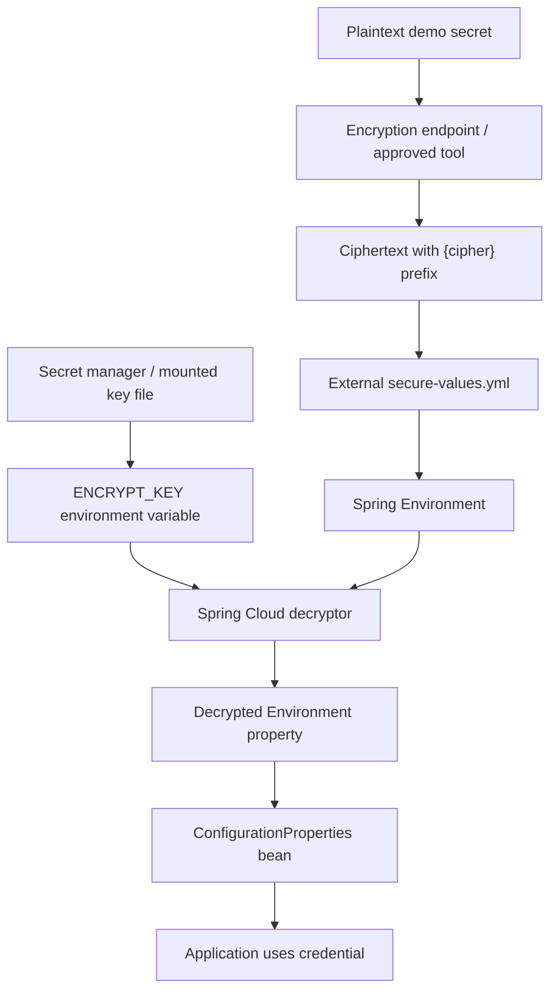

# Giải mã cấu hình cục bộ với khóa bên ngoài ứng dụng

Spring Cloud có thể giải mã property được mã hóa ngay trong quá trình chuẩn bị Environment. Ứng dụng đọc cấu hình chứa giá trị có tiền tố {cipher}, dùng khóa được cấp từ bên ngoài để giải mã, rồi đưa giá trị rõ vào Environment trước khi các bean nghiệp vụ nhận cấu hình.

Bài thực hành xây dựng một ứng dụng Spring Boot đọc file cấu hình nằm ngoài JAR. File chỉ chứa ciphertext; khóa đối xứng được cấp qua biến môi trường ENCRYPT_KEY từ secret file hoặc secret manager. Ứng dụng dùng ConfigurationProperties để nhận giá trị sau giải mã và kiểm thử rằng cấu hình đã được xử lý trước khi bean được tạo.

Bài học thuộc chương **Thực hành tổng hợp** của module **SPRING_CLOUD_CORE**. Trọng tâm là vị trí lưu ciphertext, vị trí cấp khóa, bootstrap decryption, cách xác minh kết quả, lỗi thường gặp và cách mở rộng sang giải mã phía client khi dùng Spring Cloud Config Server.

## 1. Mục tiêu thực hành

Hoàn thành bài này, người học có thể:

- Giải thích luồng giải mã cục bộ của Spring Cloud Context.
- Tách ciphertext khỏi khóa giải mã và khỏi artifact ứng dụng.
- Cấu hình file YAML bên ngoài JAR bằng Spring Boot Config Data.
- Bật bootstrap processing để Spring Cloud chạy bước giải mã Environment.
- Cấp khóa đối xứng qua biến môi trường ENCRYPT_KEY.
- Dùng spring-security-rsa để kích hoạt các thành phần mã hóa/giải mã của Spring Cloud.
- Bind giá trị đã giải mã vào bean ConfigurationProperties.
- Kiểm thử mà không ghi secret ra log hoặc endpoint công khai.
- Phân tích lỗi do sai khóa, sai ciphertext, thiếu dependency hoặc bootstrap chưa bật.
- Mở rộng sang RSA keystore và mô hình Config Server gửi ciphertext cho client tự giải mã.

## 2. Kiến trúc của bài lab

Ta tách ba thành phần:

1. **Ciphertext** nằm trong file cấu hình bên ngoài JAR. File có thể được quản lý trong kho cấu hình hoặc triển khai cùng workload, nhưng không chứa khóa.
2. **Khóa giải mã** được lưu trong secret file hoặc secret manager và được đưa vào process dưới tên biến môi trường ENCRYPT_KEY.
3. **Ứng dụng Spring Boot** dùng Spring Cloud Context để giải mã property trước khi bind vào bean.

Luồng xử lý:



Khóa không nằm trong source code, file cấu hình được commit hoặc JAR. Ứng dụng chỉ nhận khóa lúc chạy từ môi trường triển khai.

## 3. Phân biệt mã hóa và giải mã cục bộ

Mã hóa cấu hình giúp giữ giá trị bí mật ở dạng ciphertext khi lưu trữ. Giải mã cục bộ có nghĩa ứng dụng client nhận ciphertext và giải mã trước khi cấu hình được sử dụng.

Spring Cloud Context cung cấp một bộ tiền xử lý Environment. Nó nhận property có dạng {cipher}..., dùng cấu hình encrypt.* để tìm khóa, rồi đưa giá trị đã giải mã vào Environment trước khi main application context sử dụng cấu hình.

Đây là cơ chế của Spring Cloud; Spring Boot thuần không tự giải mã giá trị {cipher}. Ứng dụng cần Spring Cloud Context, dependency spring-security-rsa và cơ chế bootstrap/legacy processing phù hợp.

Không nhầm ba tình huống:

| Tình huống | Ai giải mã? | Khóa ở đâu? |
| --- | --- | --- |
| Config Server giải mã mặc định | Config Server trước khi trả response | Config Server |
| Client giải mã cấu hình nhận từ Config Server | Ứng dụng client | Bên ngoài từng client hoặc secret manager của client |
| Client giải mã file cấu hình cục bộ | Ứng dụng client khi khởi tạo Environment | Bên ngoài ứng dụng, ví dụ biến môi trường hoặc keystore được mount |

Bài lab chính dùng tình huống thứ ba. Config Server chỉ có thể được dùng như một công cụ tạo ciphertext; ứng dụng không cần kết nối Config Server khi chạy.

## 4. Chuẩn bị dự án và dependency

Dùng Spring Boot và Spring Cloud release train tương thích theo ma trận tương thích chính thức. Quản lý version bằng Spring Cloud BOM; không chọn ngẫu nhiên version của Spring Cloud Context hoặc Spring Security RSA.

Khai báo property spring-cloud.version trong POM theo release train tương thích với Spring Boot đang dùng. Không sao chép một version minh họa từ dự án khác nếu chưa kiểm tra ma trận tương thích.

Các dependency cần thiết cho bài lab:

```xml
<dependencyManagement>
    <dependencies>
        <dependency>
            <groupId>org.springframework.cloud</groupId>
            <artifactId>spring-cloud-dependencies</artifactId>
            <version>${spring-cloud.version}</version>
            <type>pom</type>
            <scope>import</scope>
        </dependency>
    </dependencies>
</dependencyManagement>

<dependencies>
    <dependency>
        <groupId>org.springframework.boot</groupId>
        <artifactId>spring-boot-starter</artifactId>
    </dependency>

    <dependency>
        <groupId>org.springframework.cloud</groupId>
        <artifactId>spring-cloud-starter-bootstrap</artifactId>
    </dependency>

    <dependency>
        <groupId>org.springframework.security</groupId>
        <artifactId>spring-security-rsa</artifactId>
    </dependency>

    <dependency>
        <groupId>org.springframework.boot</groupId>
        <artifactId>spring-boot-starter-test</artifactId>
        <scope>test</scope>
    </dependency>
</dependencies>
```

spring-cloud-starter-bootstrap bật bootstrap context. Có thể dùng property spring.cloud.bootstrap.enabled=true thay cho starter trong một số cấu hình, nhưng phải cung cấp property này đủ sớm qua system property hoặc environment variable. Với bài lab, dùng starter để cấu hình rõ ràng.

spring-security-rsa cung cấp các thành phần mã hóa/giải mã mà Spring Cloud Context cần. Kiểm tra dependency tree nếu dự án đã có thư viện này thông qua dependency khác.

## 5. Tạo cấu trúc file

Tạo một ứng dụng tên local-encryption-lab với cấu trúc:

```text
local-encryption-lab/
├── src/
│   └── main/
│       ├── java/
│       │   └── com/example/encryption/
│       │       ├── LocalEncryptionApplication.java
│       │       └── ApiCredentials.java
│       └── resources/
│           ├── application.yml
│           └── bootstrap.yml
├── config/
│   └── secure-values.yml
└── pom.xml
```

Thư mục config/ nằm cạnh JAR khi chạy. Không đặt file secure-values.yml bên trong src/main/resources nếu mục tiêu là thay đổi ciphertext mà không build lại artifact.

Có thể mount config/ từ volume read-only trong môi trường container. Đường dẫn phải tồn tại khi ứng dụng khởi động.

## 6. Cấu hình bootstrap và file import

Trong src/main/resources/bootstrap.yml, khai báo tham chiếu tới khóa bên ngoài:

```yaml
encrypt:
  key: ${ENCRYPT_KEY}
  fail-on-error: true
```

encrypt.key lấy giá trị từ biến môi trường ENCRYPT_KEY. File bootstrap chỉ chứa tên biến tham chiếu, không chứa giá trị khóa.

encrypt.fail-on-error: true yêu cầu quá trình khởi tạo báo lỗi nếu không giải mã được ciphertext. Nhờ đó, ứng dụng không tiếp tục chạy với credential chưa được giải mã.

Trong src/main/resources/application.yml, khai báo file cấu hình cục bộ:

```yaml
spring:
  application:
    name: local-encryption-lab
  config:
    import: "file:./config/secure-values.yml"
```

Không thêm tiền tố optional: cho file chứa credential bắt buộc. Nếu file bị thiếu, ứng dụng nên dừng với lỗi cấu hình thay vì khởi động trong trạng thái thiếu secret.

spring.config.import là cơ chế Config Data của Spring Boot để nạp file bên ngoài. Bootstrap starter cung cấp giai đoạn bootstrap và bộ giải mã của Spring Cloud để xử lý property đã mã hóa.

## 7. Tạo ciphertext cho một giá trị mẫu

Trong bài lab, dùng một chuỗi giả lập, ví dụ:

```text
demo-token-123
```

Có thể dùng endpoint /encrypt của một Config Server được cấu hình với cùng khóa đối xứng để tạo ciphertext. Config Server cần nhận khóa qua secret/environment giống cách cấp khóa cho client. Endpoint này phải được bảo vệ và chỉ cho phép người có quyền mã hóa cấu hình truy cập.

Ví dụ với curl:

```bash
curl --fail --silent --show-error \
  -H "Content-Type: text/plain" \
  --data-binary "demo-token-123" \
  http://localhost:8888/encrypt
```

Lệnh trả về ciphertext. Dùng kết quả đó thay cho placeholder trong file secure-values.yml. Khi plaintext có ký tự đặc biệt như dấu cộng, tài liệu Spring Cloud khuyến nghị dùng --data-urlencode với giá trị được prefix bằng dấu bằng hoặc gửi đúng Content-Type: text/plain để tránh curl biến đổi dữ liệu.

Không đưa secret production vào command line hoặc shell history. Chuỗi ở ví dụ chỉ là dữ liệu giả để kiểm thử. Trong môi trường thật, dùng quy trình mã hóa được kiểm soát, không ghi request body hoặc response plaintext vào log.

### 7.1. Nội dung file secure-values.yml

Sau khi có ciphertext, file config/secure-values.yml có dạng:

```yaml
demo:
  api:
    username: lab-user
    token: '{cipher}CIPHERTEXT_FROM_ENCRYPT_ENDPOINT'
```

Thay CIPHERTEXT_FROM_ENCRYPT_ENDPOINT bằng ciphertext thực được tạo ở bước trước. Giữ nguyên tiền tố {cipher}.

Trong YAML, đặt giá trị mã hóa trong dấu nháy đơn để parser xem toàn bộ chuỗi là scalar. Nếu lưu bằng .properties, giá trị {cipher}... không được bọc trong dấu nháy; nếu không, quy tắc giải mã của Config Server/Cloud có thể không nhận diện đúng giá trị.

Không commit khóa, secret file hoặc plaintext vào repository. Ciphertext có thể được lưu cùng cấu hình nếu chính sách của dự án cho phép.

## 8. Cấp khóa bên ngoài ứng dụng

Trên máy local, lưu khóa trong một file riêng nằm ngoài thư mục dự án hoặc trong secret manager. Ví dụ đường dẫn minh họa:

```text
C:\secure\local-encryption-lab\encrypt-key.txt
```

Khi chạy bằng PowerShell, đọc file và đặt giá trị vào environment của process:

```powershell
$env:ENCRYPT_KEY = (
    Get-Content -Raw -LiteralPath 'C:\secure\local-encryption-lab\encrypt-key.txt'
).Trim()

java -jar .\target\local-encryption-lab.jar
```

Nếu chạy từ IDE, cấu hình ENCRYPT_KEY trong Run Configuration hoặc dùng secret integration của IDE. Không ghi giá trị khóa trực tiếp vào Run Configuration được chia sẻ hoặc file cấu hình được commit.

Trong Kubernetes, có thể lấy khóa từ Secret:

```yaml
env:
  - name: ENCRYPT_KEY
    valueFrom:
      secretKeyRef:
        name: local-encryption-key
        key: encrypt-key
```

Secret phải được tạo và quản lý riêng bởi quy trình triển khai. Giới hạn quyền đọc Secret và chỉ cấp cho workload cần giải mã.

Biến môi trường không phải kho bí mật tuyệt đối: process cùng quyền hoặc công cụ quản trị có thể đọc environment của process. Với yêu cầu bảo mật cao, cân nhắc mounted secret/keystore có quyền truy cập hẹp hoặc tích hợp secret manager chuyên dụng.

## 9. Tạo bean nhận cấu hình sau giải mã

Tạo class ApiCredentials:

```java
package com.example.encryption;

import org.springframework.boot.context.properties.ConfigurationProperties;

@ConfigurationProperties(prefix = "demo.api")
public class ApiCredentials {

    private String username;
    private String token;

    public String getUsername() {
        return username;
    }

    public void setUsername(String username) {
        this.username = username;
    }

    public String getToken() {
        return token;
    }

    public void setToken(String token) {
        this.token = token;
    }
}
```

Đăng ký class bằng ConfigurationPropertiesScan trên application:

```java
package com.example.encryption;

import org.springframework.boot.SpringApplication;
import org.springframework.boot.autoconfigure.SpringBootApplication;
import org.springframework.boot.context.properties.ConfigurationPropertiesScan;

@SpringBootApplication
@ConfigurationPropertiesScan
public class LocalEncryptionApplication {

    public static void main(String[] args) {
        SpringApplication.run(LocalEncryptionApplication.class, args);
    }
}
```

Khi Spring bind demo.api.token, bộ giải mã đã thay ciphertext bằng plaintext trong Environment. Bean nhận giá trị đã giải mã như một property thông thường; không cần gọi API decrypt trong service hoặc tự viết TextEncryptor cho luồng cơ bản.

### 9.1. Không log credential

Nếu muốn xác nhận ứng dụng đã nhận cấu hình, chỉ log trạng thái có/không:

```java
import org.springframework.boot.ApplicationRunner;
import org.springframework.context.annotation.Bean;
import org.springframework.context.annotation.Configuration;
import org.springframework.util.StringUtils;

@Configuration
public class CredentialStartupCheck {

    @Bean
    ApplicationRunner credentialCheck(ApiCredentials credentials) {
        return args -> {
            boolean configured = StringUtils.hasText(credentials.getToken());
            System.out.println("API credential configured: " + configured);
        };
    }
}
```

Không log credentials.getToken(), không đưa token vào exception message và không trả token từ REST endpoint. Việc giải mã thành công không làm plaintext trở nên an toàn để ghi log.

## 10. Kiểm thử giải mã trước khi bind

Tạo integration test để xác nhận bean nhận plaintext mẫu:

```java
package com.example.encryption;

import org.junit.jupiter.api.Test;
import org.springframework.beans.factory.annotation.Autowired;
import org.springframework.boot.test.context.SpringBootTest;

import static org.assertj.core.api.Assertions.assertThat;

@SpringBootTest
class ApiCredentialsIntegrationTest {

    @Autowired
    private ApiCredentials credentials;

    @Test
    void decryptsExternalConfigurationBeforeBinding() {
        assertThat(credentials.getUsername()).isEqualTo("lab-user");
        assertThat(credentials.getToken()).isEqualTo("demo-token-123");
    }
}
```

Test cần chạy trong môi trường có:

- File config/secure-values.yml chứa ciphertext được mã hóa từ đúng chuỗi mẫu.
- Biến môi trường ENCRYPT_KEY có cùng khóa đã dùng khi mã hóa.
- Bootstrap processing và spring-security-rsa đã được bật.

Test xác minh giá trị mà bean nhận được, không cần in plaintext ra console. Nếu test chạy trong CI, cấp khóa bằng secret store của CI và không echo environment variable.

## 11. Kiểm tra ứng dụng sau khi chạy

Sau khi chạy ứng dụng, xác minh:

1. Process khởi động thành công.
2. File cấu hình ngoài JAR đã được nạp.
3. Property demo.api.token đã được giải mã.
4. Bean ApiCredentials nhận giá trị đúng.
5. Log chỉ hiển thị trạng thái credential đã cấu hình.
6. JAR không chứa file khóa hoặc plaintext.
7. Repository không chứa khóa thật.

Có thể kiểm tra nội dung JAR bằng công cụ archive để chắc chắn file config/secure-values.yml và khóa không bị đóng gói nhầm. Nếu cấu hình được import từ đường dẫn tương đối, chạy ứng dụng từ working directory đúng hoặc dùng đường dẫn file tuyệt đối phù hợp với môi trường.

Không bật Actuator env chỉ để in secret. Nếu phải dùng endpoint chẩn đoán, giới hạn quyền truy cập và giữ nguyên masking mặc định của các giá trị nhạy cảm.

## 12. Vì sao cần bootstrap processing?

Spring Cloud dùng bootstrap context và các initializer để chuẩn bị property source. Bộ giải mã môi trường chỉ chạy khi bootstrap/legacy processing phù hợp được bật. Nếu ứng dụng không bật bootstrap processing, property {cipher}... có thể vẫn còn nguyên hoặc quá trình khởi tạo báo lỗi do không tìm thấy encryptor.

Bài lab dùng spring-cloud-starter-bootstrap để kích hoạt bootstrap context. Có thể dùng biến môi trường hoặc system property spring.cloud.bootstrap.enabled=true trong trường hợp không dùng starter, nhưng property này phải có sẵn đủ sớm để bootstrap listener đọc được; đặt nó trong file application chỉ được nạp sau đó là quá muộn.

encrypt.key cũng phải sẵn sàng ở bootstrap phase. Vì vậy, tham chiếu khóa trong bootstrap.yml tới ENCRYPT_KEY và cấp environment variable trước khi chạy JVM.

## 13. Biến thể: dùng keystore RSA thay cho khóa đối xứng

Khóa đối xứng đơn giản cho bài lab vì bên mã hóa và bên giải mã dùng chung một key. Đổi lại, cả hai bên đều phải bảo vệ cùng một bí mật.

Với RSA, Config Server hoặc công cụ mã hóa chỉ cần public key; ứng dụng client giữ private key để giải mã. Private key không cần rời khỏi môi trường client. Đây là lựa chọn phù hợp khi chỉ một số ít client được phép đọc secret và không muốn Config Server giữ private key giải mã.

Spring Cloud hỗ trợ cấu hình keystore qua các property:

| Property | Ý nghĩa |
| --- | --- |
| encrypt.key-store.location | Resource location của keystore |
| encrypt.key-store.password | Mật khẩu mở keystore |
| encrypt.key-store.alias | Alias của key/certificate cần sử dụng |
| encrypt.key-store.type | Loại keystore; mặc định là JKS |

Ví dụ client tham chiếu private keystore được mount ngoài JAR:

```yaml
encrypt:
  key-store:
    location: file:/run/secrets/client-decrypt.p12
    password: ${ENCRYPT_KEYSTORE_PASSWORD}
    alias: client-decrypt
    type: PKCS12
  fail-on-error: true
```

Keystore và mật khẩu phải được cấp từ secret volume/secret manager. Với PKCS12, dùng cấu hình mật khẩu key và store tương thích với JDK đang chạy; các JDK hiện đại thường yêu cầu hai mật khẩu này giống nhau.

Ở phía mã hóa, keystore của server có thể chỉ chứa public certificate. Ở phía client, keystore chứa private key tương ứng. Cả hai phải dùng đúng alias và thuật toán tương thích. Không đưa private keystore của client vào image hoặc repository của Config Server.

## 14. Biến thể: Config Server gửi ciphertext để client giải mã

Mặc định, Spring Cloud Config Server giải mã các property có tiền tố {cipher} trước khi gửi chúng qua HTTP. Nếu muốn client tự giải mã, cấu hình Config Server:

```yaml
spring:
  cloud:
    config:
      server:
        encrypt:
          enabled: false
```

Property này phải được đặt trong bootstrap.yml hoặc bootstrap.properties của Config Server theo hướng dẫn Spring Cloud Config. Khi encrypt.* vẫn được cấu hình, endpoint /encrypt và /decrypt vẫn có thể hoạt động; cờ trên điều khiển việc giải mã các property outgoing.

Ở phía client:

- Có dependency spring-cloud-starter-config để kết nối Config Server.
- Có spring-security-rsa và bootstrap/decryption processing.
- Có khóa giải mã qua encrypt.key hoặc keystore encrypt.key-store.*.
- Config Server trả property source còn ciphertext; client giải mã trong môi trường của nó trước khi bean sử dụng.

Với khóa đối xứng, server và client phải chia sẻ cùng key. Với RSA, server chỉ cần public key để mã hóa và client giữ private key. Mô hình RSA giảm số nơi có private key, nhưng yêu cầu quản lý certificate, alias và vòng đời key chặt chẽ.

Không đặt spring.cloud.config.server.encrypt.enabled=false trên client; đây là property cấu hình hành vi outgoing của Config Server.

## 15. Xử lý lỗi khi giải mã

Khi ứng dụng không thể giải mã property, kiểm tra theo thứ tự:

1. Biến ENCRYPT_KEY có được cấp trước khi JVM khởi động không?
2. encrypt.key có resolve ra giá trị không rỗng trong bootstrap context không?
3. Khóa có đúng khóa đã dùng để tạo ciphertext không?
4. Ciphertext có bị cắt, đổi ký tự hoặc dính ký tự xuống dòng khi copy không?
5. File YAML có giữ đúng tiền tố {cipher} và dấu nháy không?
6. Dependency spring-security-rsa có trong runtime classpath không?
7. Bootstrap starter hoặc bootstrap-enabled property có thực sự hoạt động không?
8. Nếu dùng RSA, alias, keystore password và private/public key có khớp không?
9. Nếu gặp lỗi thuật toán hoặc key size, JDK có hỗ trợ chính sách mật mã cần thiết không?

Với encrypt.fail-on-error: true, lỗi giải mã phải làm quá trình khởi tạo thất bại. Đây là hành vi nên giữ cho credential bắt buộc để ứng dụng không vô tình chạy với cấu hình chưa giải mã.

Không thay ciphertext bằng plaintext để “chữa cháy” trong repository. Hãy sửa key provisioning hoặc mã hóa lại giá trị bằng key đang được quản lý.

## 16. Bảng triệu chứng và nguyên nhân

| Triệu chứng | Nguyên nhân có thể | Cách xử lý |
| --- | --- | --- |
| Ứng dụng báo không có encryptor | Thiếu spring-security-rsa hoặc không có encrypt.key/keystore | Kiểm tra runtime dependency và bootstrap properties |
| Property vẫn còn chuỗi {cipher} | Bootstrap/legacy processing chưa bật hoặc initializer không chạy | Thêm bootstrap starter hoặc bật bootstrap sớm |
| Lỗi giải mã khi startup | Sai khóa, ciphertext hỏng hoặc thuật toán không tương thích | Tạo lại ciphertext bằng đúng key/algorithm |
| ENCRYPT_KEY resolve thành rỗng | Secret chưa được mount hoặc env chưa truyền vào process | Kiểm tra secret reference và process environment |
| File secure-values không được nạp | Sai working directory hoặc import path | Kiểm tra spring.config.import và file location |
| YAML parse error ở {cipher} | Giá trị chưa được quote | Dùng dấu nháy đơn quanh ciphertext |
| Secret không bind vào bean | Prefix, property name hoặc scan sai | Kiểm tra ConfigurationPropertiesScan và prefix |
| Config Server trả plaintext dù muốn client decrypt | Server vẫn bật outgoing decryption | Đặt spring.cloud.config.server.encrypt.enabled=false trong bootstrap config của server |
| RSA decrypt báo không tìm thấy key | Alias hoặc private keystore sai | Kiểm tra alias, certificate và keystore path |

## 17. Vận hành khóa và xoay vòng khóa

Khóa giải mã là một tài sản bảo mật độc lập với ciphertext. Khi vận hành:

- Cấp khóa từ secret manager hoặc secret volume.
- Giới hạn workload và tài khoản được phép đọc khóa.
- Không lưu khóa trong source, JAR, container image, Docker build argument hoặc CI log.
- Thay khóa theo quy trình có kiểm thử và khả năng rollback.
- Theo dõi thời điểm ciphertext được mã hóa, key version và ứng dụng nào cần key đó.
- Thu hồi key cũ sau khi tất cả ciphertext và client đã chuyển đổi.
- Bảo vệ backup chứa keystore như backup chứa credential.

Với một khóa đối xứng duy nhất, cần mã hóa lại các giá trị bằng khóa mới và triển khai đồng bộ ciphertext cùng key mới. Nếu cần giai đoạn chuyển tiếp nhiều key, dùng keystore với alias và cơ chế định danh key phù hợp. Spring Cloud Config hỗ trợ định dạng {cipher}{key:alias}CIPHERTEXT để locator chọn key tương ứng; mọi client liên quan phải có alias cần thiết trước khi chuyển cấu hình.

Xoay vòng key cần có kế hoạch rollback. Không xóa key cũ trước khi xác nhận mọi môi trường đã dùng ciphertext mới.

## 18. Bảo vệ plaintext sau khi giải mã

Giải mã cục bộ bảo vệ cấu hình khi lưu trữ; sau khi giải mã, plaintext nằm trong Environment và có thể được truy cập bởi bean trong ứng dụng.

Do đó:

- Chỉ cấp quyền truy cập process cho workload cần secret.
- Dùng TLS khi gọi API bên ngoài.
- Không log Environment, credential, request header hoặc exception chứa secret.
- Hạn chế heap dump và thread dump; chúng có thể chứa plaintext.
- Giới hạn quyền Actuator env, configprops và các endpoint chẩn đoán.
- Không expose /encrypt hoặc /decrypt công khai; chúng cần authentication và network policy.
- Dùng Vault hoặc secret manager khi cần quản lý secret động, audit, lease và rotation thay vì tự duy trì file mã hóa.

Mã hóa ciphertext trong repository không thay thế kiểm soát truy cập vào khóa hoặc bảo vệ dữ liệu sau giải mã.

## 19. Bài tập mở rộng

Sau khi hoàn thành bài lab đối xứng, hãy thực hiện các bài tập:

1. Đổi tên property thành demo.api.client-secret và xác nhận binding vẫn hoạt động.
2. Chạy ứng dụng khi không cấp ENCRYPT_KEY; xác nhận startup thất bại với fail-on-error.
3. Cấp một khóa sai và quan sát exception. Không log giá trị khóa.
4. Sửa ciphertext bằng cách bỏ một phần ký tự và xác nhận lỗi giải mã.
5. Di chuyển secure-values.yml sang một thư mục khác rồi cập nhật spring.config.import.
6. Viết integration test xác nhận bean nhận plaintext giả lập.
7. Dùng RSA key pair, giữ private keystore bên ngoài JAR và cấu hình public key cho công cụ mã hóa.
8. Cấu hình Config Server trả ciphertext bằng spring.cloud.config.server.encrypt.enabled=false và xác nhận client giải mã.
9. Thử xoay vòng key bằng alias mới, mã hóa lại property và triển khai client với key tương ứng.
10. Kiểm tra JAR, container image, log và repository để xác nhận không có khóa hoặc plaintext ngoài ý muốn.

**Tiêu chí hoàn thành:** ứng dụng đọc được cấu hình ngoài JAR, giải mã property bằng khóa được cấp từ bên ngoài, bind plaintext vào bean, kiểm thử thành công, dừng khi key không hợp lệ và không ghi secret vào log.

## 20. Ghi nhớ

- Spring Cloud Context giải mã property {cipher}... trong Environment trước khi main application context sử dụng.
- Cần dependency spring-security-rsa và bootstrap/legacy processing phù hợp.
- File cấu hình có thể chứa ciphertext; khóa được cấp riêng qua ENCRYPT_KEY hoặc keystore.
- encrypt.key là cấu hình khóa đối xứng; encrypt.key-store.* dùng keystore cho RSA.
- Với YAML, đặt ciphertext trong dấu nháy đơn; với .properties, không bọc ciphertext trong dấu nháy.
- spring.config.import có thể nạp file cấu hình ngoài JAR.
- encrypt.fail-on-error=true giúp ứng dụng dừng khi không giải mã được credential bắt buộc.
- Config Server mặc định giải mã outgoing properties; spring.cloud.config.server.encrypt.enabled=false chuyển việc giải mã sang client.
- RSA cho phép server giữ public key và client giữ private key.
- Không log plaintext, không đóng gói key và không expose endpoint mã hóa/giải mã công khai.
- Xoay vòng key phải đi cùng quy trình mã hóa lại ciphertext và triển khai client tương ứng.

## 21. Tài liệu tham khảo

- [Spring Cloud Commons — Application Context Services](https://docs.spring.io/spring-cloud-commons/reference/spring-cloud-commons/application-context-services.html): Environment pre-processor, bootstrap context, local decryption, encrypt properties và yêu cầu spring-security-rsa.
- [Spring Cloud Config — Key Management](https://docs.spring.io/spring-cloud-config/reference/server/key-management.html): khóa đối xứng, RSA key pair và keystore properties.
- [Spring Cloud Config — Encryption and Decryption](https://docs.spring.io/spring-cloud-config/reference/server/encryption-and-decryption.html): tiền tố {cipher}, endpoint encrypt/decrypt và cách lưu ciphertext.
- [Spring Cloud Config — Serving Encrypted Properties](https://docs.spring.io/spring-cloud-config/reference/server/serving-encrypted-properties.html): tắt server-side decryption để client giải mã.
- [Spring Cloud Config — Using Multiple Keys and Key Rotation](https://docs.spring.io/spring-cloud-config/reference/server/using-multiple-keys-and-key-rotation.html): key alias và quy trình chuyển đổi nhiều khóa.
- [Spring Boot — Externalized Configuration](https://docs.spring.io/spring-boot/reference/features/external-config.html): Config Data import và file cấu hình bên ngoài.

