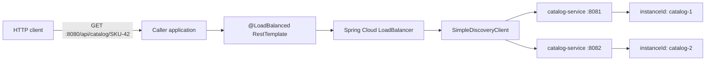

# Gọi dịch vụ theo tên bằng HTTP client có @LoadBalanced

## 1. Mục tiêu dự án

Trong hệ thống phân tán, một service thường có nhiều instance. Nếu client gọi thẳng `http://localhost:8081`, code đã gắn với một địa chỉ vật lý. Khi instance chuyển máy, đổi port hoặc tăng số lượng replica, client phải biết và cập nhật danh sách địa chỉ.

Spring Cloud LoadBalancer cho phép client gọi bằng service ID, ví dụ `http://catalog-service`, rồi chọn một instance từ nguồn discovery. Annotation `@LoadBalanced` đánh dấu HTTP client bean cần được tích hợp với LoadBalancer.

Trong lab này, chúng ta xây dựng một ứng dụng Spring Boot có hai vai trò:

- **Catalog provider:** chạy hai instance trên cổng `8081` và `8082`, mỗi instance trả về mã nhận diện riêng.
- **Caller:** chạy trên cổng `8080`, nhận request từ người dùng và gọi `catalog-service` qua một `RestTemplate` có `@LoadBalanced`.

Để tập trung vào cơ chế định tuyến, caller dùng `SimpleDiscoveryClient` với hai URI cấu hình tĩnh. Lab không cần dựng Eureka hoặc Consul. Khi chuyển sang registry thật, ta thay nguồn discovery bằng starter tương ứng; URI service ID trong code gọi HTTP vẫn giữ nguyên.

Sau khi hoàn thành, bạn sẽ:

1. Khai báo Spring Cloud LoadBalancer trong dự án.
2. Cấu hình danh sách instance cho một service ID.
3. Tạo bean `RestTemplate` có `@LoadBalanced`.
4. Inject client vào service bằng constructor.
5. Gửi request tới service ID thay vì địa chỉ vật lý.
6. Quan sát LoadBalancer phân phối request đến nhiều instance.
7. Kiểm thử discovery configuration và xử lý các lỗi thường gặp.

## 2. Kiến trúc lab



Luồng xử lý:

1. Client gửi request tới caller ở cổng `8080`.
2. `CatalogGateway` gọi `http://catalog-service/catalog/{sku}`.
3. Interceptor của LoadBalancer nhận service ID `catalog-service`.
4. LoadBalancer lấy danh sách instance từ discovery client.
5. Chiến lược chọn instance chọn một URI vật lý, ví dụ `http://localhost:8082`.
6. Request được gửi tới provider đã chọn và kết quả được trả về caller.

Trong lab, `SimpleDiscoveryClient` đọc hai URI từ cấu hình caller. Hai provider không tự đăng ký vào một registry bên ngoài.

## 3. Chuẩn bị project và dependency

### 3.1. Cấu trúc thư mục

Tạo một Maven project với package `com.example.loadbalancedlab`:

```text
loadbalanced-lab/
├── pom.xml
└── src/
    ├── main/
    │   ├── java/com/example/loadbalancedlab/
    │   │   ├── LoadBalancedLabApplication.java
    │   │   ├── CatalogItem.java
    │   │   ├── catalog/
    │   │   │   └── CatalogController.java
    │   │   └── caller/
    │   │       ├── LoadBalancedClientConfiguration.java
    │   │       ├── CatalogGateway.java
    │   │       └── CatalogProxyController.java
    │   └── resources/
    │       ├── application.yml
    │       ├── application-catalog.yml
    │       └── application-caller.yml
    └── test/
        └── java/com/example/loadbalancedlab/
            └── LoadBalancedClientConfigurationTests.java
```

Một project và một JAR có thể chạy nhiều process với profile khác nhau. Profile `catalog` chỉ tạo provider controller; profile `caller` chỉ tạo HTTP client và controller chuyển tiếp.

### 3.2. Khai báo dependency

Dùng Spring Boot parent/BOM của dự án và import Spring Cloud BOM tương thích với phiên bản Spring Boot đã chọn. Không tự đặt version riêng cho từng Spring Cloud starter.

Ví dụ phần property và dependency management trong `pom.xml`:

```xml
<properties>
    <java.version>17</java.version>
    <!-- Chọn release train tương thích với Spring Boot của dự án. -->
    <spring-cloud.version>YOUR_COMPATIBLE_RELEASE_TRAIN</spring-cloud.version>
</properties>

<dependencyManagement>
    <dependencies>
        <dependency>
            <groupId>org.springframework.cloud</groupId>
            <artifactId>spring-cloud-dependencies</artifactId>
            <version>${spring-cloud.version}</version>
            <type>pom</type>
            <scope>import</scope>
        </dependency>
    </dependencies>
</dependencyManagement>
```

Thay `YOUR_COMPATIBLE_RELEASE_TRAIN` bằng release train được công bố tương thích với Spring Boot parent/BOM đang dùng. Giữ Spring Boot và Spring Cloud trên cùng một ma trận tương thích.

Thêm dependency cho ứng dụng MVC, LoadBalancer và test:

```xml
<dependencies>
    <dependency>
        <groupId>org.springframework.boot</groupId>
        <artifactId>spring-boot-starter-webmvc</artifactId>
    </dependency>

    <dependency>
        <groupId>org.springframework.cloud</groupId>
        <artifactId>spring-cloud-starter-loadbalancer</artifactId>
    </dependency>

    <dependency>
        <groupId>org.springframework.boot</groupId>
        <artifactId>spring-boot-starter-test</artifactId>
        <scope>test</scope>
    </dependency>
</dependencies>
```

Với Spring Boot 3.x, dùng `spring-boot-starter-web` cho ứng dụng Spring MVC thay cho `spring-boot-starter-webmvc`. Phần code `RestTemplate` và Spring Cloud LoadBalancer không thay đổi chỉ vì tên starter web khác nhau.

`spring-cloud-starter-loadbalancer` cung cấp integration cần thiết để `@LoadBalanced RestTemplate` phân giải service ID. Không cần thêm Eureka/Consul cho bài thực hành này vì caller dùng `SimpleDiscoveryClient`.

### 3.3. Cấu hình chung

Tạo `application.yml`:

```yaml
spring:
  application:
    name: loadbalanced-lab
```

Các file `application-catalog.yml` và `application-caller.yml` sẽ ghi đè những property riêng cho từng vai trò.

## 4. Tạo ứng dụng Spring Boot

### 4.1. Lớp main

Tạo `LoadBalancedLabApplication.java`:

```java
package com.example.loadbalancedlab;

import org.springframework.boot.SpringApplication;
import org.springframework.boot.autoconfigure.SpringBootApplication;

@SpringBootApplication
public class LoadBalancedLabApplication {

    public static void main(String[] args) {
        SpringApplication.run(LoadBalancedLabApplication.class, args);
    }
}
```

Không cần thêm `@EnableDiscoveryClient` chỉ để bật discovery. Trong lab này, dependency Spring Cloud Commons/LoadBalancer và cấu hình `SimpleDiscoveryClient` cung cấp nguồn instance cho LoadBalancer.

### 4.2. DTO dùng chung

Tạo `CatalogItem.java`:

```java
package com.example.loadbalancedlab;

public record CatalogItem(
        String sku,
        String description,
        String instanceId
) {
}
```

Trường `instanceId` giúp quan sát provider nào đã xử lý request. Trong ứng dụng thật, response DTO có thể không cần công khai thông tin instance này.

## 5. Xây dựng Catalog provider

Provider nhận SKU và trả về dữ liệu cùng mã instance. Tạo `catalog/CatalogController.java`:

```java
package com.example.loadbalancedlab.catalog;

import com.example.loadbalancedlab.CatalogItem;
import org.springframework.beans.factory.annotation.Value;
import org.springframework.context.annotation.Profile;
import org.springframework.web.bind.annotation.GetMapping;
import org.springframework.web.bind.annotation.PathVariable;
import org.springframework.web.bind.annotation.RequestMapping;
import org.springframework.web.bind.annotation.RestController;

@RestController
@RequestMapping("/catalog")
@Profile("catalog")
public class CatalogController {

    private final String instanceId;

    public CatalogController(
            @Value("${demo.instance-id:catalog-unknown}") String instanceId) {
        this.instanceId = instanceId;
    }

    @GetMapping("/{sku}")
    public CatalogItem find(@PathVariable String sku) {
        return new CatalogItem(
                sku,
                "Item " + sku,
                instanceId
        );
    }
}
```

`@Profile("catalog")` chỉ đăng ký controller này khi profile `catalog` active. Hai process sẽ dùng cùng code nhưng nhận `instanceId` khác nhau qua cấu hình.

Tạo `application-catalog.yml`:

```yaml
server:
  port: 8081

demo:
  instance-id: catalog-1
```

Process thứ hai sẽ ghi đè port và instance ID bằng command line khi khởi động.

## 6. Cấu hình HTTP client có @LoadBalanced

### 6.1. Khai báo RestTemplate bean

Tạo `caller/LoadBalancedClientConfiguration.java`:

```java
package com.example.loadbalancedlab.caller;

import org.springframework.cloud.client.loadbalancer.LoadBalanced;
import org.springframework.context.annotation.Bean;
import org.springframework.context.annotation.Configuration;
import org.springframework.context.annotation.Profile;
import org.springframework.web.client.RestTemplate;

@Configuration(proxyBeanMethods = false)
@Profile("caller")
public class LoadBalancedClientConfiguration {

    @Bean
    @LoadBalanced
    RestTemplate loadBalancedRestTemplate() {
        return new RestTemplate();
    }
}
```

Ba chi tiết cần có:

- Phương thức `@Bean` đăng ký `RestTemplate` vào Spring container.
- `@LoadBalanced` đánh dấu bean cần được tích hợp với Spring Cloud LoadBalancer.
- `spring-cloud-starter-loadbalancer` phải có trên runtime classpath.

Spring Boot không tự tạo `RestTemplate` bean chỉ vì có Spring Web. Nếu muốn inject client qua constructor, ứng dụng phải khai báo bean như trên.

`@LoadBalanced` là qualifier, không phải địa chỉ registry và cũng không phải annotation bật Eureka/Consul. Nó cho Spring Cloud biết client bean nào cần interceptor để xử lý URI chứa service ID.

### 6.2. Inject client vào CatalogGateway

Tạo `caller/CatalogGateway.java`:

```java
package com.example.loadbalancedlab.caller;

import com.example.loadbalancedlab.CatalogItem;
import org.springframework.cloud.client.loadbalancer.LoadBalanced;
import org.springframework.context.annotation.Profile;
import org.springframework.stereotype.Service;
import org.springframework.web.client.RestOperations;

@Service
@Profile("caller")
public class CatalogGateway {

    private final RestOperations restOperations;

    public CatalogGateway(
            @LoadBalanced RestOperations restOperations) {
        this.restOperations = restOperations;
    }

    public CatalogItem find(String sku) {
        return restOperations.getForObject(
                "http://catalog-service/catalog/{sku}",
                CatalogItem.class,
                sku
        );
    }
}
```

Ở đây constructor nhận `RestOperations`, interface mà `RestTemplate` triển khai. Cách inject qua interface cũng tránh một số vấn đề kiểu proxy có thể gặp khi inject trực tiếp concrete class `RestTemplate`.

Điểm quan trọng nhất là URI:

```text
http://catalog-service/catalog/{sku}
```

`catalog-service` là service ID logic. Không ghi `localhost:8081` trong code gọi HTTP. LoadBalancer sẽ lấy một `ServiceInstance` cho ID này và thay host logic bằng URI vật lý của instance được chọn.

### 6.3. Tạo endpoint cho caller

Tạo `caller/CatalogProxyController.java`:

```java
package com.example.loadbalancedlab.caller;

import com.example.loadbalancedlab.CatalogItem;
import org.springframework.context.annotation.Profile;
import org.springframework.web.bind.annotation.GetMapping;
import org.springframework.web.bind.annotation.PathVariable;
import org.springframework.web.bind.annotation.RequestMapping;
import org.springframework.web.bind.annotation.RestController;

@RestController
@RequestMapping("/api/catalog")
@Profile("caller")
public class CatalogProxyController {

    private final CatalogGateway catalogGateway;

    public CatalogProxyController(CatalogGateway catalogGateway) {
        this.catalogGateway = catalogGateway;
    }

    @GetMapping("/{sku}")
    public CatalogItem find(@PathVariable String sku) {
        return catalogGateway.find(sku);
    }
}
```

Caller chỉ biết `CatalogGateway`; controller không biết provider chạy ở port nào và cũng không tự chọn instance.

## 7. Cấu hình SimpleDiscoveryClient

Tạo `application-caller.yml`:

```yaml
server:
  port: 8080

spring:
  application:
    name: catalog-caller
  cloud:
    discovery:
      client:
        simple:
          instances:
            catalog-service:
              - uri: http://localhost:8081
              - uri: http://localhost:8082
```

Property prefix là `spring.cloud.discovery.client.simple.instances`. Key `catalog-service` chính là service ID được dùng trong URI của `CatalogGateway`. Mỗi phần tử trong danh sách là một instance có URI vật lý.

`SimpleDiscoveryClient` được dùng khi không có `DiscoveryClient` dựa trên service registry trong classpath. Vì lab chỉ thêm Spring Cloud LoadBalancer starter, danh sách instance được lấy từ cấu hình tĩnh này.

Nếu service ID trong URI là `catalog-service` nhưng YAML lại khai báo `catalog`, LoadBalancer sẽ không tìm thấy instance. Hai tên phải trùng khớp chính xác.

## 8. Build và chạy ba process

### 8.1. Build project

Tại thư mục gốc:

```bash
./mvnw clean package
```

Trên Windows PowerShell, dùng:

```powershell
.\mvnw.cmd clean package
```

Đảm bảo đã thay placeholder release train trong `pom.xml` bằng phiên bản tương thích trước khi build.

### 8.2. Chạy Catalog instance thứ nhất

Mở terminal thứ nhất:

```bash
java -jar target/loadbalanced-lab-0.0.1-SNAPSHOT.jar \
  --spring.profiles.active=catalog \
  --server.port=8081 \
  --demo.instance-id=catalog-1
```

Trên PowerShell, có thể chạy toàn bộ lệnh trên một dòng:

```powershell
java -jar target/loadbalanced-lab-0.0.1-SNAPSHOT.jar --spring.profiles.active=catalog --server.port=8081 --demo.instance-id=catalog-1
```

### 8.3. Chạy Catalog instance thứ hai

Mở terminal thứ hai:

```bash
java -jar target/loadbalanced-lab-0.0.1-SNAPSHOT.jar \
  --spring.profiles.active=catalog \
  --server.port=8082 \
  --demo.instance-id=catalog-2
```

Trên PowerShell:

```powershell
java -jar target/loadbalanced-lab-0.0.1-SNAPSHOT.jar --spring.profiles.active=catalog --server.port=8082 --demo.instance-id=catalog-2
```

Hai process cùng chạy profile `catalog`, nhưng có port và instance ID riêng.

### 8.4. Chạy caller

Mở terminal thứ ba:

```bash
java -jar target/loadbalanced-lab-0.0.1-SNAPSHOT.jar \
  --spring.profiles.active=caller
```

Trên PowerShell:

```powershell
java -jar target/loadbalanced-lab-0.0.1-SNAPSHOT.jar --spring.profiles.active=caller
```

Profile `caller` nạp `application-caller.yml`, tạo `RestTemplate` load-balanced và controller proxy. Profile `catalog` không được active nên provider controller không xuất hiện trong process caller.

## 9. Gửi request và quan sát LoadBalancer

### 9.1. Gọi trực tiếp từng provider

Xác nhận hai provider hoạt động độc lập:

```bash
curl http://localhost:8081/catalog/SKU-42
curl http://localhost:8082/catalog/SKU-42
```

Kết quả có dạng:

```json
{
  "sku": "SKU-42",
  "description": "Item SKU-42",
  "instanceId": "catalog-1"
}
```

Request tới cổng `8082` trả về `instanceId` là `catalog-2`.

### 9.2. Gọi qua service ID

Gọi caller:

```bash
curl -i http://localhost:8080/api/catalog/SKU-42
```

Caller gửi request nội bộ tới URI logic `http://catalog-service/catalog/SKU-42`. Response cuối cùng chứa `instanceId` của provider được LoadBalancer chọn.

Gửi request nhiều lần:

```bash
for i in {1..8}; do
  curl -s http://localhost:8080/api/catalog/SKU-42
  echo
done
```

Trong Windows PowerShell, dùng:

```powershell
for ($i = 0; $i -lt 8; $i++) {
    curl.exe -s http://localhost:8080/api/catalog/SKU-42
}
```

Với cấu hình mặc định, Spring Cloud LoadBalancer dùng chiến lược round-robin. Khi cả hai instance đều khả dụng, nhiều request liên tiếp sẽ được phân phối qua các instance. Không phụ thuộc vào việc request đầu tiên phải đến `catalog-1` hay `catalog-2`; thứ tự có thể thay đổi nếu có cấu hình LoadBalancer khác.

### 9.3. So sánh với URL vật lý

Hai cách gọi có ý nghĩa khác nhau:

| URI | Ý nghĩa |
| --- | --- |
| `http://localhost:8081/catalog/SKU-42` | Gọi trực tiếp một instance cụ thể |
| `http://catalog-service/catalog/SKU-42` | Gọi service ID để LoadBalancer chọn instance |

Code nghiệp vụ nên dùng service ID khi muốn định tuyến qua discovery và LoadBalancer. URL vật lý phù hợp cho kiểm tra trực tiếp hoặc endpoint bên ngoài không thuộc registry nội bộ.

## 10. Kiểm thử cấu hình discovery và client bean

Tạo `LoadBalancedClientConfigurationTests.java`:

```java
package com.example.loadbalancedlab;

import java.net.URI;
import java.util.List;

import org.junit.jupiter.api.Test;
import org.springframework.beans.factory.annotation.Autowired;
import org.springframework.boot.test.context.SpringBootTest;
import org.springframework.cloud.client.ServiceInstance;
import org.springframework.cloud.client.discovery.DiscoveryClient;
import org.springframework.cloud.client.loadbalancer.LoadBalanced;
import org.springframework.test.context.ActiveProfiles;
import org.springframework.web.client.RestOperations;

import static org.assertj.core.api.Assertions.assertThat;

@SpringBootTest(
        classes = LoadBalancedLabApplication.class,
        webEnvironment = SpringBootTest.WebEnvironment.NONE
)
@ActiveProfiles("caller")
class LoadBalancedClientConfigurationTests {

    @Autowired
    DiscoveryClient discoveryClient;

    @Autowired
    @LoadBalanced
    RestOperations restOperations;

    @Test
    void simpleDiscoveryContainsBothCatalogInstances() {
        List<ServiceInstance> instances =
                discoveryClient.getInstances("catalog-service");

        assertThat(instances).hasSize(2);
        assertThat(instances.stream()
                .map(ServiceInstance::getUri)
                .toList())
                .containsExactlyInAnyOrder(
                        URI.create("http://localhost:8081"),
                        URI.create("http://localhost:8082")
                );
    }

    @Test
    void loadBalancedRestOperationsBeanIsAvailable() {
        assertThat(restOperations).isNotNull();
    }
}
```

Test dùng profile `caller`, do đó Spring nạp danh sách hai instance trong `application-caller.yml`. Nó xác nhận nguồn discovery trả đúng hai URI và bean có qualifier `@LoadBalanced` được inject thành công.

Đây là test cấu hình context; nó chưa chứng minh request HTTP đã được gửi đến provider thật. Phần kiểm tra định tuyến end-to-end được thực hiện bằng ba process và request ở mục 9. Có thể nâng cấp test bằng cách khởi động provider trên random port và cấp URI tương ứng vào test property source.

## 11. Mở rộng từ SimpleDiscoveryClient sang registry thật

Trong lab, danh sách instance nằm trong file cấu hình caller. Khi provider thay đổi địa chỉ hoặc replica tăng/giảm, danh sách tĩnh cần được cập nhật.

Trong production, có thể thay `SimpleDiscoveryClient` bằng discovery implementation như Eureka hoặc Consul:

1. Thêm starter discovery tương ứng vào caller và provider.
2. Cấu hình địa chỉ registry và thông tin đăng ký cho từng ứng dụng.
3. Để provider đăng ký instance với registry theo lifecycle của integration.
4. Bỏ danh sách `spring.cloud.discovery.client.simple.instances` khỏi caller.
5. Giữ nguyên `@LoadBalanced RestTemplate` và URI `http://catalog-service/...`.

Khi có discovery client dựa trên registry, Spring Cloud LoadBalancer lấy instance từ `DiscoveryClient` đang có trên classpath. Phần code nghiệp vụ không cần biết registry đang là Eureka hay Consul.

## 12. Lỗi thường gặp

| Triệu chứng | Nguyên nhân có thể | Cách xử lý |
| --- | --- | --- |
| `NoSuchBeanDefinitionException` với `RestOperations` | Chưa khai báo `RestTemplate` bean hoặc profile `caller` chưa active | Kiểm tra `LoadBalancedClientConfiguration` và profile |
| `UnknownHostException: catalog-service` | Request dùng client thường, không có LoadBalancer interceptor | Inject đúng bean có qualifier `@LoadBalanced` |
| `No servers available for service: catalog-service` | Service ID sai hoặc danh sách instance rỗng | So khớp host trong URI với key YAML |
| Caller trả `503` hoặc lỗi kết nối | Provider dừng, sai port hoặc không truy cập được | Kiểm tra log và gọi trực tiếp provider |
| Chỉ một provider nhận request | Chỉ khai báo một instance hoặc một process không chạy | Kiểm tra hai URI và gọi trực tiếp từng port |
| Hai bean `RestTemplate` gây lỗi inject mơ hồ | Có client thường và load-balanced nhưng injection thiếu qualifier | Dùng `@LoadBalanced` ở injection point hoặc `@Primary` cho bean mặc định |
| Thêm Eureka nhưng SimpleDiscoveryClient không còn được chọn | Registry-backed `DiscoveryClient` đã có trên classpath | Kiểm tra instance trong registry và thứ tự discovery client |
| Request vẫn gọi một instance sau khi thay YAML | Caller chưa restart hoặc LoadBalancer đang dùng cache instance list | Khởi động lại caller trong lab; xem TTL/cache khi dùng registry thật |
| Provider trả `catalog-unknown` | Thiếu `demo.instance-id` | Truyền `--demo.instance-id` hoặc khai báo trong profile |

## 13. Bài tập mở rộng

Sau khi lab chạy thành công, hãy thử:

1. Tắt provider ở cổng `8081` và quan sát request tới caller. Phân biệt lỗi kết nối với việc discovery đã loại instance khỏi danh sách.
2. Thêm instance thứ ba ở cổng `8083` và cập nhật cấu hình `SimpleDiscoveryClient`.
3. Thay đổi strategy của LoadBalancer sang random bằng custom `ReactorLoadBalancer` configuration.
4. Thêm một client thường để gọi URL vật lý bên ngoài, đồng thời giữ client load-balanced cho `catalog-service`.
5. Thay `RestTemplate` bằng `RestClient.Builder` có `@LoadBalanced` nếu baseline Spring Framework của dự án hỗ trợ.
6. Thay `SimpleDiscoveryClient` bằng Eureka hoặc Consul và xác nhận `CatalogGateway` không phải thay đổi.
7. Thêm timeout, retry có kiểm soát và quan sát tác động khi một instance lỗi.

Khi thử retry, không mặc định mọi HTTP method đều an toàn để retry. Với request ghi dữ liệu, cần idempotency key hoặc cơ chế bảo đảm thao tác không bị thực hiện lặp.

## 14. Tiêu chí hoàn thành

- [ ] Project build thành công với Spring Boot/Spring Cloud BOM tương thích.
- [ ] Hai provider chạy độc lập trên cổng `8081` và `8082`.
- [ ] Caller chạy trên cổng `8080` với profile `caller`.
- [ ] `SimpleDiscoveryClient` trả về hai instance của `catalog-service`.
- [ ] Spring context tạo được bean `RestTemplate` có qualifier `@LoadBalanced`.
- [ ] `CatalogGateway` gọi bằng URI `http://catalog-service/...`.
- [ ] Request qua caller trả về `instanceId` của provider đã xử lý.
- [ ] Nhiều request được phân phối qua các instance theo chiến lược LoadBalancer.
- [ ] Test cấu hình xác nhận danh sách instance và client bean.
- [ ] Có thể giải thích cách thay nguồn discovery tĩnh bằng registry thật.

## 15. Tài liệu tham khảo

- [Spring Cloud Commons — Common Abstractions](https://docs.spring.io/spring-cloud-commons/reference/spring-cloud-commons/common-abstractions.html): `SimpleDiscoveryClient`, `DiscoveryClient`, `@LoadBalanced RestTemplate` và cách dùng service ID.
- [Spring Cloud LoadBalancer](https://docs.spring.io/spring-cloud-commons/reference/spring-cloud-commons/loadbalancer.html): thuật toán chọn instance, tích hợp với HTTP client và cache.
- [Spring Boot — Build Systems](https://docs.spring.io/spring-boot/reference/using/build-systems.html): starter và dependency management.
- [Spring Cloud Release Train Reference](https://docs.spring.io/spring-cloud-release/reference/index.html): chọn Spring Cloud release train tương thích với Spring Boot.

Trong lab này, provider không cần biết caller gọi bằng địa chỉ nào. Caller chỉ phụ thuộc service ID `catalog-service`; `SimpleDiscoveryClient` cung cấp danh sách instance và Spring Cloud LoadBalancer chọn địa chỉ vật lý cho từng request. Đó là lợi ích chính của việc kết hợp discovery với HTTP client có `@LoadBalanced`.
