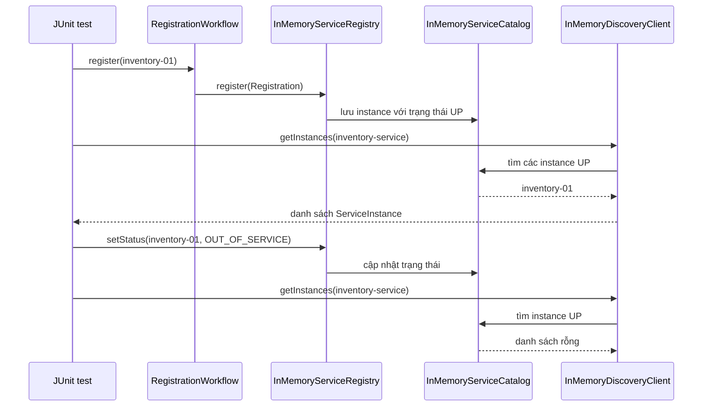

# Thử nghiệm ServiceRegistry với implementation giả lập

Khi xây dựng một tích hợp service registry, bạn thường muốn kiểm tra cách ứng dụng đăng ký, cập nhật trạng thái và hủy đăng ký một service instance trước khi kết nối tới Eureka, Consul, ZooKeeper hoặc một registry thật. Nếu đưa registry thật vào mọi bài test, test sẽ phụ thuộc network, container, cấu hình bảo mật và thời gian khởi động của hạ tầng bên ngoài.

Spring Cloud Commons cung cấp hợp đồng `ServiceRegistry` để chuẩn hóa các thao tác đăng ký. Ta có thể tạo một implementation giả lập lưu dữ liệu trong bộ nhớ, inject nó vào Spring context và kiểm tra hành vi một cách xác định. Bài thực hành này còn tạo một `DiscoveryClient` giả lập dùng chung kho dữ liệu để quan sát cách instance đã đăng ký xuất hiện trong kết quả discovery.

Điểm cần giữ rõ trong suốt bài: `ServiceRegistry` quản lý ghi nhận và vòng đời registration; `DiscoveryClient` cung cấp truy vấn service ID và instance. Hai abstraction có liên quan nhưng không phải cùng một interface. Implementation giả lập giúp kiểm tra hợp đồng và luồng ứng dụng, còn việc tương thích giao thức, heartbeat, TTL, phân vùng mạng và tính bền vững phải được kiểm tra với provider thật.

## 1. Mục tiêu thực hành

Hoàn thành bài này, bạn sẽ:

- Đọc và giải thích hợp đồng `ServiceRegistry<R extends Registration>`.
- Tạo một kiểu `Registration` chứa instance ID, service ID, host, port, scheme và metadata.
- Viết `InMemoryServiceRegistry` để thực hiện register, deregister, setStatus, getStatus và close.
- Lưu registration bằng một kho dữ liệu trong bộ nhớ có đồng bộ truy cập.
- Tạo `DiscoveryClient` giả lập để truy vấn các instance đang ở trạng thái khả dụng.
- Đăng ký implementation giả lập thành Spring bean và inject qua interface.
- Viết test cho đăng ký, cập nhật trạng thái, discovery, hủy đăng ký và đóng registry.
- Nhận biết phần nào thuộc hợp đồng Spring Cloud và phần nào là chính sách riêng của implementation mẫu.
- Biết giới hạn của fake registry và cách thay nó bằng implementation của một provider thật.

## 2. Kết quả mong đợi

Ta mô phỏng một ứng dụng có tên `inventory-service` với hai instance:

| Instance ID | Service ID | Host | Port | Trạng thái ban đầu |
| --- | --- | --- | ---: | --- |
| `inventory-01` | `inventory-service` | `10.10.0.11` | 8081 | UP |
| `inventory-02` | `inventory-service` | `10.10.0.12` | 8081 | UP |

Sau khi đăng ký, `DiscoveryClient` giả lập phải trả về hai instance. Khi chuyển `inventory-02` sang `OUT_OF_SERVICE`, instance đó không còn xuất hiện trong kết quả discovery của bài thực hành. Khi chuyển lại `UP`, instance xuất hiện trở lại. Khi deregister, instance bị xóa khỏi kho dữ liệu.

Luồng kiểm tra:



## 3. Hiểu hợp đồng trước khi viết implementation

Trong Spring Cloud Commons, `ServiceRegistry` là interface generic nhận một kiểu `R` kế thừa `Registration`. Hợp đồng hiện hành có năm phương thức:

| Phương thức | Vai trò |
| --- | --- |
| `register(R registration)` | Đăng ký một instance |
| `deregister(R registration)` | Hủy đăng ký instance |
| `close()` | Đóng registry; đây là phương thức vòng đời |
| `setStatus(R registration, String status)` | Cập nhật trạng thái registration |
| `getStatus(R registration)` | Lấy trạng thái của registration |

Dạng rút gọn của interface:

```java
public interface ServiceRegistry<R extends Registration> {

    void register(@Nullable R registration);

    void deregister(@Nullable R registration);

    void close();

    void setStatus(R registration, String status);

    <T> T getStatus(R registration);
}
```

Hai điểm cần chú ý:

- Tham số của `register` và `deregister` được đánh dấu nullable trong API hiện hành. Provider có thể có chính sách riêng cho trường hợp không có registration; implementation mẫu bên dưới chọn bỏ qua giá trị null.
- `getStatus` là phương thức generic. Kiểu trả về cụ thể do implementation quyết định. Fake registry sẽ trả chuỗi như `UP` hoặc `OUT_OF_SERVICE`; provider khác có thể biểu diễn trạng thái theo cách riêng.

`Registration` là marker interface mở rộng `ServiceInstance`. Nó không thêm trường hay phương thức riêng, mà đánh dấu một service instance được dùng trong thao tác đăng ký.

`ServiceInstance` cung cấp thông tin mô tả instance:

| Getter | Ý nghĩa |
| --- | --- |
| `getInstanceId()` | ID duy nhất của instance |
| `getServiceId()` | Tên logic của service |
| `getHost()` | Host hoặc địa chỉ của instance |
| `getPort()` | Cổng phục vụ |
| `isSecure()` | Instance dùng HTTPS hay không |
| `getUri()` | URI vật lý của instance |
| `getMetadata()` | Metadata dạng key/value |
| `getScheme()` | Scheme nếu implementation cung cấp |

`ServiceRegistry` không định nghĩa `getServices()` hoặc `getInstances(serviceId)`. Các thao tác đọc này thuộc `DiscoveryClient`. Trong bài thực hành, hai implementation dùng chung một kho dữ liệu để registration vừa được ghi nhận, vừa có thể được truy vấn qua discovery.

## 4. Phân biệt ba thành phần

| Thành phần | Trách nhiệm | Trong bài thực hành |
| --- | --- | --- |
| `Registration` | Mô tả một instance cần đăng ký | `DemoRegistration` |
| `ServiceRegistry` | Ghi, cập nhật, xóa registration và quản lý vòng đời registry | `InMemoryServiceRegistry` |
| `DiscoveryClient` | Trả về service ID và danh sách instance | `InMemoryDiscoveryClient` |

Một registry thật thường có hai mặt tích hợp: ghi registration vào hệ thống lưu trữ của provider và đọc danh sách instance từ cùng hệ thống đó. Spring Cloud tách hai mặt thành các abstraction để client ứng dụng không phụ thuộc trực tiếp vào Eureka, Consul hay ZooKeeper.

Fake registry cần mô phỏng mối quan hệ dữ liệu này. Nếu chỉ viết `ServiceRegistry` mà không có cách đọc dữ liệu, bạn vẫn có thể kiểm tra register/deregister bằng trạng thái nội bộ, nhưng chưa kiểm tra được instance xuất hiện trong discovery.

## 5. Chuẩn bị project

Dùng Java 17 trở lên và chọn Spring Cloud release train tương thích với phiên bản Spring Boot của project. Quản lý dependency bằng Spring Cloud BOM; không gán một phiên bản Commons tùy ý khác release train.

Ví dụ dependency Gradle khi BOM đã được import trong cấu hình dependency management:

```kotlin
dependencies {
    implementation(platform("org.springframework.boot:spring-boot-dependencies:<boot-version>"))
    implementation(platform("org.springframework.cloud:spring-cloud-dependencies:<compatible-release-train>"))
    implementation("org.springframework.cloud:spring-cloud-commons")

    testImplementation("org.junit.jupiter:junit-jupiter")
    testImplementation("org.assertj:assertj-core")
}

tasks.test {
    useJUnitPlatform()
}
```

Nếu project chưa import BOM, thêm `spring-cloud-dependencies` tương thích với Spring Boot hiện tại vào dependency management. `spring-cloud-commons` cung cấp các abstraction và API cần dùng trong bài; test dùng JUnit 5 và AssertJ.

Cấu trúc package:

```text
src/
├── main/
│   └── java/
│       └── com/example/registrydemo/
│           ├── DemoRegistration.java
│           ├── DemoStatus.java
│           ├── InMemoryServiceCatalog.java
│           ├── InMemoryServiceRegistry.java
│           ├── InMemoryDiscoveryClient.java
│           ├── RegistrationWorkflow.java
│           └── RegistryDemoConfiguration.java
└── test/
    └── java/
        └── com/example/registrydemo/
            └── InMemoryServiceRegistryTests.java
```

Các ví dụ dùng package `com.example.registrydemo`. Hãy giữ package nhất quán giữa các file.

## 6. Tạo DemoRegistration

Tạo file `DemoRegistration.java`. Record này triển khai `Registration` và giữ dữ liệu mô tả instance.

```java
package com.example.registrydemo;

import java.net.URI;
import java.util.Map;
import java.util.Objects;

import org.springframework.cloud.client.ServiceInstance;
import org.springframework.cloud.client.serviceregistry.Registration;

public record DemoRegistration(
        String instanceId,
        String serviceId,
        String host,
        int port,
        boolean secure,
        Map<String, String> metadata
) implements Registration {

    public DemoRegistration {
        instanceId = requireText(instanceId, "instanceId");
        serviceId = requireText(serviceId, "serviceId");
        host = requireText(host, "host");

        if (port < 1 || port > 65535) {
            throw new IllegalArgumentException(
                    "port must be between 1 and 65535");
        }

        metadata = metadata == null ? Map.of() : Map.copyOf(metadata);
    }

    @Override
    public String getInstanceId() {
        return instanceId;
    }

    @Override
    public String getServiceId() {
        return serviceId;
    }

    @Override
    public String getHost() {
        return host;
    }

    @Override
    public int getPort() {
        return port;
    }

    @Override
    public boolean isSecure() {
        return secure;
    }

    @Override
    public URI getUri() {
        return ServiceInstance.createUri(this);
    }

    @Override
    public Map<String, String> getMetadata() {
        return metadata;
    }

    @Override
    public String getScheme() {
        return secure ? "https" : "http";
    }

    private static String requireText(String value, String field) {
        Objects.requireNonNull(value, field + " must not be null");

        if (value.isBlank()) {
            throw new IllegalArgumentException(
                    field + " must not be blank");
        }

        return value;
    }
}
```

Record tự tạo accessor như `instanceId()`, nhưng `ServiceInstance` yêu cầu các getter theo dạng `getInstanceId()`, `getServiceId()` và tương tự. Vì vậy lớp cần triển khai các getter này.

Constructor kiểm tra ID, host và port trước khi instance được đưa vào registry. Metadata được sao chép thành map bất biến để caller không thể thay đổi dữ liệu registration sau khi đã tạo.

`ServiceInstance.createUri(this)` tạo URI từ host, port và cờ secure. Ví dụ instance không secure sẽ có URI `http://10.10.0.11:8081`.

## 7. Khai báo trạng thái của fake registry

Tạo file `DemoStatus.java`:

```java
package com.example.registrydemo;

enum DemoStatus {
    UP,
    DOWN,
    OUT_OF_SERVICE,
    UNKNOWN
}
```

Các trạng thái này được chọn cho bài thực hành để dễ mô phỏng instance khả dụng và không khả dụng. Chúng không phải danh sách trạng thái bắt buộc cho mọi provider. Ví dụ, tài liệu Spring Cloud nêu Eureka hỗ trợ `UP`, `DOWN`, `OUT_OF_SERVICE` và `UNKNOWN`; provider khác có thể có quy ước riêng.

Fake discovery client sẽ chỉ trả instance có trạng thái `UP`. Đây là chính sách của implementation mẫu, không phải quy tắc chung được `ServiceRegistry` áp đặt.

## 8. Tạo kho dữ liệu dùng chung

Tạo file `InMemoryServiceCatalog.java`. Lớp này lưu registration và trạng thái trong một map. Cả fake registry và fake discovery client đều truy cập cùng một catalog.

```java
package com.example.registrydemo;

import java.util.Comparator;
import java.util.HashMap;
import java.util.List;
import java.util.Locale;
import java.util.Map;
import java.util.Objects;

import org.jspecify.annotations.Nullable;

final class InMemoryServiceCatalog {

    private final Map<RegistryKey, Entry> entries = new HashMap<>();

    private boolean closed;

    synchronized void register(@Nullable DemoRegistration registration) {
        ensureOpen();

        if (registration == null) {
            return;
        }

        RegistryKey key = keyOf(registration);
        Entry current = entries.get(key);

        DemoStatus status = current == null
                ? DemoStatus.UP
                : current.status();

        entries.put(key, new Entry(registration, status));
    }

    synchronized void deregister(@Nullable DemoRegistration registration) {
        ensureOpen();

        if (registration == null) {
            return;
        }

        entries.remove(keyOf(registration));
    }

    synchronized void setStatus(
            DemoRegistration registration,
            String status) {

        ensureOpen();
        Objects.requireNonNull(registration, "registration must not be null");

        DemoStatus nextStatus = parseStatus(status);
        RegistryKey key = keyOf(registration);
        Entry current = entries.get(key);

        if (current == null) {
            throw new IllegalStateException(
                    "Registration does not exist: " + key);
        }

        entries.put(key, new Entry(current.registration(), nextStatus));
    }

    synchronized String getStatus(DemoRegistration registration) {
        Objects.requireNonNull(registration, "registration must not be null");

        Entry entry = entries.get(keyOf(registration));

        if (entry == null) {
            throw new IllegalStateException(
                    "Registration does not exist: " + keyOf(registration));
        }

        return entry.status().name();
    }

    synchronized List<DemoRegistration> findAvailableInstances(
            String serviceId) {

        if (closed || serviceId == null) {
            return List.of();
        }

        return entries.values().stream()
                .filter(entry -> entry.status() == DemoStatus.UP)
                .map(Entry::registration)
                .filter(registration ->
                        registration.getServiceId().equals(serviceId))
                .sorted(Comparator.comparing(
                        DemoRegistration::getInstanceId))
                .toList();
    }

    synchronized List<String> findAvailableServices() {
        if (closed) {
            return List.of();
        }

        return entries.values().stream()
                .filter(entry -> entry.status() == DemoStatus.UP)
                .map(entry -> entry.registration().getServiceId())
                .distinct()
                .sorted()
                .toList();
    }

    synchronized void close() {
        if (!closed) {
            entries.clear();
            closed = true;
        }
    }

    private void ensureOpen() {
        if (closed) {
            throw new IllegalStateException(
                    "In-memory service catalog is closed");
        }
    }

    private static DemoStatus parseStatus(String status) {
        if (status == null || status.isBlank()) {
            throw new IllegalArgumentException(
                    "status must not be null or blank");
        }

        try {
            return DemoStatus.valueOf(status.trim().toUpperCase(Locale.ROOT));
        }
        catch (IllegalArgumentException ex) {
            throw new IllegalArgumentException(
                    "Unsupported demo status: " + status, ex);
        }
    }

    private static RegistryKey keyOf(DemoRegistration registration) {
        return new RegistryKey(
                registration.getServiceId(),
                registration.getInstanceId());
    }

    private record RegistryKey(String serviceId, String instanceId) {
    }

    private record Entry(
            DemoRegistration registration,
            DemoStatus status) {
    }
}
```

### 8.1. Vì sao dùng khóa gồm service ID và instance ID?

Một service có thể có nhiều instance. ID của instance cần duy nhất trong phạm vi service để registry có thể cập nhật hoặc xóa đúng bản ghi.

Catalog dùng cặp `serviceId` và `instanceId` làm khóa. Nếu đăng ký lại cùng cặp khóa, implementation cập nhật metadata của registration và giữ trạng thái hiện tại. Nếu đây là lần đầu đăng ký, trạng thái khởi tạo là `UP`.

Đây là quy tắc upsert do fake registry chọn. Provider thật có thể xử lý đăng ký lặp theo semantics khác.

### 8.2. Vì sao các phương thức được synchronized?

Bài thực hành dùng `HashMap` và đồng bộ các thao tác đọc/ghi để bảo đảm một test không quan sát trạng thái map đang được thay đổi giữa chừng. Cách này dễ hiểu và đủ cho một fake registry nhỏ.

Trong production, lựa chọn đồng bộ phải dựa trên tải, tính nhất quán và cơ chế lưu trữ của provider. Không dùng catalog này như một registry phân tán hiệu năng cao.

### 8.3. Vì sao discovery chỉ thấy UP?

Catalog giữ cả instance `DOWN` hoặc `OUT_OF_SERVICE` để có thể xem và thay đổi trạng thái. Nhưng `findAvailableInstances` chỉ trả những instance có trạng thái `UP`.

Điều này giúp test thể hiện rõ sự khác nhau giữa “đã đăng ký” và “được xem là khả dụng để gọi”. Provider thật có thể có thêm health check, TTL, heartbeat hoặc trạng thái riêng khi quyết định trả instance.

## 9. Triển khai InMemoryServiceRegistry

Tạo file `InMemoryServiceRegistry.java`:

```java
package com.example.registrydemo;

import org.jspecify.annotations.Nullable;
import org.springframework.cloud.client.serviceregistry.ServiceRegistry;

public final class InMemoryServiceRegistry
        implements ServiceRegistry<DemoRegistration> {

    private final InMemoryServiceCatalog catalog;

    public InMemoryServiceRegistry(InMemoryServiceCatalog catalog) {
        this.catalog = catalog;
    }

    @Override
    public void register(@Nullable DemoRegistration registration) {
        catalog.register(registration);
    }

    @Override
    public void deregister(@Nullable DemoRegistration registration) {
        catalog.deregister(registration);
    }

    @Override
    public void close() {
        catalog.close();
    }

    @Override
    public void setStatus(
            DemoRegistration registration,
            String status) {
        catalog.setStatus(registration, status);
    }

    @Override
    @SuppressWarnings("unchecked")
    public <T> T getStatus(DemoRegistration registration) {
        return (T) catalog.getStatus(registration);
    }
}
```

Implementation này ủy quyền toàn bộ thao tác cho catalog. Lớp không biết cách discovery client truy vấn dữ liệu và không phụ thuộc vào HTTP, Eureka hay Consul.

### 9.1. Vì sao getStatus cần cast?

Interface khai báo `<T> T getStatus(R registration)`. Fake registry chọn lưu trạng thái dưới dạng `String`, vì vậy catalog trả chuỗi. Implementation phải cast chuỗi đó về kiểu generic `T` theo hợp đồng.

Khi sử dụng, hãy nhận kết quả bằng đúng kiểu mà fake registry cung cấp:

```java
String status = registry.getStatus(registration);
```

Nếu caller yêu cầu một kiểu không tương thích, lỗi cast có thể xảy ra. Provider thật có thể trả về kiểu khác; không viết logic ứng dụng phụ thuộc vào kiểu trạng thái của fake registry.

## 10. Tạo InMemoryDiscoveryClient

Tạo file `InMemoryDiscoveryClient.java`:

```java
package com.example.registrydemo;

import java.util.List;

import org.springframework.cloud.client.ServiceInstance;
import org.springframework.cloud.client.discovery.DiscoveryClient;

public final class InMemoryDiscoveryClient implements DiscoveryClient {

    private final InMemoryServiceCatalog catalog;

    public InMemoryDiscoveryClient(InMemoryServiceCatalog catalog) {
        this.catalog = catalog;
    }

    @Override
    public String description() {
        return "In-memory demo discovery client";
    }

    @Override
    public List<ServiceInstance> getInstances(String serviceId) {
        return catalog.findAvailableInstances(serviceId)
                .stream()
                .map(registration -> (ServiceInstance) registration)
                .toList();
    }

    @Override
    public List<String> getServices() {
        return catalog.findAvailableServices();
    }
}
```

Discovery client đọc cùng catalog với service registry. Nhờ vậy, khi registry đăng ký instance hoặc thay đổi trạng thái, kết quả discovery thay đổi theo cùng dữ liệu.

`DiscoveryClient` còn có phương thức `probe()` mặc định trong các phiên bản hiện hành; mặc định này có thể kiểm tra khả năng truy vấn bằng `getServices()`. Implementation mẫu không cần override phương thức đó.

## 11. Tạo workflow dùng interface

Tạo file `RegistrationWorkflow.java`:

```java
package com.example.registrydemo;

import java.util.Map;

import org.springframework.cloud.client.serviceregistry.ServiceRegistry;

public final class RegistrationWorkflow {

    private final ServiceRegistry<DemoRegistration> serviceRegistry;

    public RegistrationWorkflow(
            ServiceRegistry<DemoRegistration> serviceRegistry) {
        this.serviceRegistry = serviceRegistry;
    }

    public DemoRegistration register(
            String instanceId,
            String serviceId,
            String host,
            int port) {

        DemoRegistration registration = new DemoRegistration(
                instanceId,
                serviceId,
                host,
                port,
                false,
                Map.of(
                        "environment", "test",
                        "registered-by", "manual-workflow"));

        serviceRegistry.register(registration);

        return registration;
    }

    public void markOutOfService(DemoRegistration registration) {
        serviceRegistry.setStatus(registration, "OUT_OF_SERVICE");
    }

    public void markUp(DemoRegistration registration) {
        serviceRegistry.setStatus(registration, "UP");
    }

    public void deregister(DemoRegistration registration) {
        serviceRegistry.deregister(registration);
    }
}
```

Workflow chỉ phụ thuộc vào `ServiceRegistry<DemoRegistration>`. Nó không biết bean cụ thể là `InMemoryServiceRegistry`. Khi thay implementation bằng registry của provider, workflow có thể giữ nguyên nếu kiểu registration và semantics trạng thái tương thích.

## 12. Đăng ký bean trong Spring context

Tạo file `RegistryDemoConfiguration.java`:

```java
package com.example.registrydemo;

import org.springframework.cloud.client.serviceregistry.ServiceRegistry;
import org.springframework.context.annotation.Bean;
import org.springframework.context.annotation.Configuration;

@Configuration(proxyBeanMethods = false)
public class RegistryDemoConfiguration {

    @Bean
    InMemoryServiceCatalog inMemoryServiceCatalog() {
        return new InMemoryServiceCatalog();
    }

    @Bean(destroyMethod = "close")
    InMemoryServiceRegistry inMemoryServiceRegistry(
            InMemoryServiceCatalog catalog) {
        return new InMemoryServiceRegistry(catalog);
    }

    @Bean
    InMemoryDiscoveryClient inMemoryDiscoveryClient(
            InMemoryServiceCatalog catalog) {
        return new InMemoryDiscoveryClient(catalog);
    }

    @Bean
    RegistrationWorkflow registrationWorkflow(
            ServiceRegistry<DemoRegistration> serviceRegistry) {
        return new RegistrationWorkflow(serviceRegistry);
    }
}
```

Spring tạo một catalog, một service registry, một discovery client và một workflow. Bean workflow được inject qua interface generic `ServiceRegistry<DemoRegistration>`.

Thuộc tính `destroyMethod = "close"` yêu cầu Spring gọi `close()` trên registry khi context đóng. Đây là điểm để kiểm tra lifecycle method trong hợp đồng ServiceRegistry.

### 12.1. Vì sao không inject trực tiếp InMemoryServiceRegistry?

Inject qua interface giúp code nghiệp vụ phụ thuộc vào abstraction của Spring Cloud. Nếu workflow inject trực tiếp lớp giả lập, khi thay provider bạn phải sửa cả workflow và test.

Trong test, vẫn có thể lấy bean concrete `InMemoryServiceRegistry` để kiểm tra chi tiết riêng của fake. Trong code nghiệp vụ, tiếp tục dùng interface.

## 13. Viết test đăng ký và discovery

Tạo file `InMemoryServiceRegistryTests.java`:

```java
package com.example.registrydemo;

import org.junit.jupiter.api.Test;
import org.springframework.context.annotation.AnnotationConfigApplicationContext;

import static org.assertj.core.api.Assertions.assertThat;
import static org.assertj.core.api.Assertions.assertThatThrownBy;

class InMemoryServiceRegistryTests {

    @Test
    void registrationCanBeDiscovered() {
        try (var context = new AnnotationConfigApplicationContext(
                RegistryDemoConfiguration.class)) {

            RegistrationWorkflow workflow =
                    context.getBean(RegistrationWorkflow.class);

            InMemoryDiscoveryClient discovery =
                    context.getBean(InMemoryDiscoveryClient.class);

            InMemoryServiceRegistry registry =
                    context.getBean(InMemoryServiceRegistry.class);

            DemoRegistration registration = workflow.register(
                    "inventory-01",
                    "inventory-service",
                    "10.10.0.11",
                    8081);

            String status = registry.getStatus(registration);

            assertThat(status).isEqualTo("UP");
            assertThat(discovery.getServices())
                    .containsExactly("inventory-service");
            assertThat(discovery.getInstances("inventory-service"))
                    .containsExactly(registration);
        }
    }
}
```

Test khởi tạo Spring context thật nhưng không cần chạy Eureka, Consul hoặc server HTTP. Nó kiểm tra cả wiring bean lẫn hành vi của hai abstraction.

Kết quả mong đợi:

- Workflow gọi `register` trên interface.
- Registry lưu registration trong catalog.
- Trạng thái ban đầu là `UP`.
- Discovery client trả đúng service ID.
- Discovery client trả đúng instance.

## 14. Kiểm tra chuyển trạng thái

Thêm test sau vào cùng lớp:

```java
@Test
void outOfServiceInstanceIsNotReturnedByDiscovery() {
    try (var context = new AnnotationConfigApplicationContext(
            RegistryDemoConfiguration.class)) {

        RegistrationWorkflow workflow =
                context.getBean(RegistrationWorkflow.class);

        InMemoryDiscoveryClient discovery =
                context.getBean(InMemoryDiscoveryClient.class);

        InMemoryServiceRegistry registry =
                context.getBean(InMemoryServiceRegistry.class);

        DemoRegistration registration = workflow.register(
                "inventory-02",
                "inventory-service",
                "10.10.0.12",
                8081);

        workflow.markOutOfService(registration);

        assertThat(registry.getStatus(registration))
                .isEqualTo("OUT_OF_SERVICE");

        assertThat(discovery.getInstances("inventory-service"))
                .isEmpty();

        workflow.markUp(registration);

        assertThat(registry.getStatus(registration))
                .isEqualTo("UP");

        assertThat(discovery.getInstances("inventory-service"))
                .containsExactly(registration);
    }
}
```

Test này xác minh hai hành vi tách biệt:

1. Registration vẫn tồn tại trong catalog và có thể đọc status.
2. Discovery client chỉ trả instance có status `UP` theo chính sách của fake.

Đây là cách mô phỏng việc một instance đã đăng ký nhưng tạm thời không nên nhận traffic.

## 15. Kiểm tra deregister

Thêm test:

```java
@Test
void deregisterRemovesInstanceFromRegistryAndDiscovery() {
    try (var context = new AnnotationConfigApplicationContext(
            RegistryDemoConfiguration.class)) {

        RegistrationWorkflow workflow =
                context.getBean(RegistrationWorkflow.class);

        InMemoryDiscoveryClient discovery =
                context.getBean(InMemoryDiscoveryClient.class);

        InMemoryServiceRegistry registry =
                context.getBean(InMemoryServiceRegistry.class);

        DemoRegistration registration = workflow.register(
                "inventory-03",
                "inventory-service",
                "10.10.0.13",
                8081);

        workflow.deregister(registration);

        assertThatThrownBy(() -> registry.getStatus(registration))
                .isInstanceOf(IllegalStateException.class);
        assertThat(discovery.getInstances("inventory-service"))
                .isEmpty();
        assertThat(discovery.getServices()).isEmpty();
    }
}
```

Deregister xóa khóa gồm service ID và instance ID. Khi không còn instance khả dụng cho service, fake discovery client không trả service ID đó trong `getServices()`.

Trong registry thật, hủy đăng ký có thể gửi request tới server từ xa hoặc xóa node trong một kho dữ liệu phân tán. Test này chỉ kiểm tra kết quả của catalog trong bộ nhớ.

## 16. Kiểm tra nhiều instance và nhiều service

Một service thường có nhiều instance. Thêm test:

```java
@Test
void discoveryReturnsAllAvailableInstancesForService() {
    try (var context = new AnnotationConfigApplicationContext(
            RegistryDemoConfiguration.class)) {

        RegistrationWorkflow workflow =
                context.getBean(RegistrationWorkflow.class);

        InMemoryDiscoveryClient discovery =
                context.getBean(InMemoryDiscoveryClient.class);

        DemoRegistration first = workflow.register(
                "inventory-01",
                "inventory-service",
                "10.10.0.11",
                8081);

        DemoRegistration second = workflow.register(
                "inventory-02",
                "inventory-service",
                "10.10.0.12",
                8081);

        workflow.register(
                "billing-01",
                "billing-service",
                "10.10.1.11",
                8090);

        assertThat(discovery.getServices())
                .containsExactly("billing-service", "inventory-service");

        assertThat(discovery.getInstances("inventory-service"))
                .containsExactly(first, second);

        assertThat(discovery.getInstances("billing-service"))
                .hasSize(1);
    }
}
```

Catalog sắp xếp service ID và instance ID để test có kết quả ổn định. Spring Cloud không yêu cầu mọi DiscoveryClient phải trả kết quả theo thứ tự này; thứ tự chỉ là tiện ích của fake.

## 17. Kiểm tra status không hợp lệ

Fake registry chỉ chấp nhận những giá trị trong `DemoStatus`. Thêm test:

```java
@Test
void unsupportedStatusIsRejected() {
    try (var context = new AnnotationConfigApplicationContext(
            RegistryDemoConfiguration.class)) {

        RegistrationWorkflow workflow =
                context.getBean(RegistrationWorkflow.class);

        InMemoryServiceRegistry registry =
                context.getBean(InMemoryServiceRegistry.class);

        DemoRegistration registration = workflow.register(
                "inventory-04",
                "inventory-service",
                "10.10.0.14",
                8081);

        assertThatThrownBy(() ->
                registry.setStatus(registration, "MAINTENANCE"))
                .isInstanceOf(IllegalArgumentException.class);

        assertThat(registry.getStatus(registration))
                .isEqualTo("UP");
    }
}
```

Kiểm tra này bảo đảm trạng thái không hợp lệ không làm thay đổi trạng thái hiện tại. Khi làm việc với provider thật, hãy dùng các status được tài liệu provider hỗ trợ thay vì áp dụng enum của fake.

## 18. Kiểm tra đóng registry

Phương thức `close()` là một phần của vòng đời `ServiceRegistry`. Fake catalog sẽ xóa dữ liệu và từ chối thao tác ghi mới sau khi đóng.

Thêm test:

```java
@Test
void closeClearsCatalogAndRejectsNewRegistrations() {
    try (var context = new AnnotationConfigApplicationContext(
            RegistryDemoConfiguration.class)) {

        RegistrationWorkflow workflow =
                context.getBean(RegistrationWorkflow.class);

        InMemoryServiceRegistry registry =
                context.getBean(InMemoryServiceRegistry.class);

        InMemoryDiscoveryClient discovery =
                context.getBean(InMemoryDiscoveryClient.class);

        DemoRegistration registration = workflow.register(
                "inventory-05",
                "inventory-service",
                "10.10.0.15",
                8081);

        registry.close();

        assertThat(discovery.getServices()).isEmpty();

        assertThatThrownBy(() -> registry.register(registration))
                .isInstanceOf(IllegalStateException.class);
    }
}
```

Test đóng registry trực tiếp để kiểm tra hành vi. Khi context đóng, Spring cũng gọi destroy method `close`; implementation mẫu làm thao tác close idempotent để lần gọi thứ hai không gây lỗi.

## 19. Chạy bộ kiểm thử

Với Gradle:

```bash
./gradlew test
```

Với Maven:

```bash
./mvnw test
```

Các test không cần cài hoặc khởi động registry server. Nếu một test thất bại, kiểm tra theo thứ tự:

1. Spring context có tạo được các bean không?
2. Workflow có inject đúng `ServiceRegistry<DemoRegistration>` không?
3. Registration có chứa instance ID và service ID hợp lệ không?
4. Registry có lưu đúng khóa service ID/instance ID không?
5. Status có được cập nhật như mong đợi không?
6. Discovery client có dùng cùng catalog với registry không?
7. Test có vô tình đóng context hoặc registry trước khi assertion không?

## 20. Quan sát dữ liệu trong lúc debug

Có thể đặt breakpoint tại:

- `InMemoryServiceRegistry.register`.
- `InMemoryServiceRegistry.setStatus`.
- `InMemoryServiceRegistry.deregister`.
- `InMemoryServiceCatalog.findAvailableInstances`.
- `InMemoryDiscoveryClient.getInstances`.

Theo dõi ba thông tin chính:

| Dữ liệu | Câu hỏi cần trả lời |
| --- | --- |
| Registration | Instance ID, service ID, host, port có đúng không? |
| Status | Instance hiện ở trạng thái nào? |
| Discovery result | Instance nào được trả về cho service ID đã truy vấn? |

Một registration có thể tồn tại nhưng không xuất hiện trong discovery do status không phải `UP`. Nếu registration không tồn tại, hãy kiểm tra key dùng để register và key dùng để deregister có cùng service ID và instance ID không.

## 21. Những điểm quan trọng về auto-registration

Bài thực hành gọi workflow một cách tường minh để kiểm soát thời điểm đăng ký. Nó không triển khai `AutoServiceRegistration` và không tự động đăng ký server khi ứng dụng khởi động.

Trong tích hợp provider thật, Spring Cloud thường có implementation quản lý vòng đời đăng ký. Các implementation này có thể đăng ký khi web server đã khởi động và deregister khi ứng dụng dừng. Spring Cloud Commons cung cấp `AbstractAutoServiceRegistration` để hỗ trợ phần lifecycle chung.

Mặc định, implementation service registry có thể tự đăng ký ứng dụng đang chạy. Có thể tắt hành vi đó bằng cấu hình:

```yaml
spring:
  cloud:
    service-registry:
      auto-registration:
        enabled: false
```

Hoặc dùng `@EnableDiscoveryClient(autoRegister = false)` trong trường hợp ứng dụng sử dụng annotation này. Trong các phiên bản hiện hành, `@EnableDiscoveryClient` không còn là annotation bắt buộc nếu implementation `DiscoveryClient` đã có trên classpath.

Khi thử nghiệm với provider thật, hãy xác định rõ ứng dụng đang dùng đăng ký thủ công hay auto-registration. Nếu cả hai cùng ghi một instance, có thể phát sinh đăng ký trùng hoặc trạng thái không như mong đợi.

## 22. ServiceRegistry Actuator endpoint

Spring Cloud Commons cung cấp endpoint Actuator `/serviceregistry` để đọc hoặc cập nhật status của registration hiện tại. Endpoint dựa vào một bean `Registration` trong Spring ApplicationContext.

Khi dùng Actuator với management base path mặc định, endpoint thường được truy cập dưới `/actuator/serviceregistry`. GET trả về status; POST nhận JSON có field `status` để cập nhật trạng thái. Giá trị hợp lệ phụ thuộc implementation registry.

Fake registry trong bài không tự tạo bean `Registration` đại diện cho local server và cũng không tự bật Actuator. Vì vậy, endpoint này không phải điều kiện để chạy test. Có thể mở rộng project bằng cách expose registration hiện tại thành bean và thêm Spring Boot Actuator nếu muốn thử endpoint quản trị.

Không expose endpoint thay đổi trạng thái ra mạng công khai. Hãy bảo vệ bằng authentication, authorization và network policy phù hợp.

## 23. Kiểm tra các trường hợp biên

Sau khi test các luồng chính, hãy thử thêm các trường hợp sau:

| Trường hợp | Chính sách của fake | Điều cần quan sát |
| --- | --- | --- |
| Register cùng service ID và instance ID lần thứ hai | Upsert registration, giữ status hiện tại | Không tạo bản ghi trùng |
| Register cùng instance ID nhưng service ID khác | Tạo khóa khác | Hai service không ghi đè nhau |
| Deregister registration không tồn tại | Không thay đổi dữ liệu | Thao tác lặp không làm hỏng registry |
| Deregister với null | Bỏ qua | Không phát sinh exception |
| Register với null | Bỏ qua | Không tạo bản ghi |
| Get status cho registration không tồn tại | Ném `IllegalStateException` | Caller nhận biết instance đã bị xóa hoặc chưa từng đăng ký |
| Set status cho registration chưa đăng ký | Ném `IllegalStateException` | Không tạo status cho bản ghi không tồn tại |
| Set status không hợp lệ | Ném `IllegalArgumentException` | Status cũ vẫn được giữ |
| Register sau close | Ném `IllegalStateException` | Registry không nhận thao tác mới |
| Query sau close | Trả danh sách rỗng | Không trả dữ liệu cũ |

Đây là semantics do implementation mẫu quy định. Khi viết adapter cho Eureka, Consul hoặc provider khác, hãy kiểm tra semantics thực tế thay vì mặc định các trường hợp biên giống nhau.

## 24. Giới hạn của implementation giả lập

Fake registry có ích cho test logic và wiring, nhưng không thay thế được registry phân tán.

| Fake registry mô phỏng | Fake registry không mô phỏng |
| --- | --- |
| Hợp đồng register/deregister/status/close | HTTP/gRPC protocol của provider |
| Dữ liệu instance và metadata | Heartbeat và TTL |
| Trạng thái khả dụng theo chính sách demo | Health check và eviction của server |
| Nhiều instance trong một process | Nhiều node và dữ liệu chia sẻ giữa process |
| Thứ tự truy vấn xác định | Network partition, retry và timeout |
| Spring bean injection | Authentication, TLS và authorization của provider |
| Lifecycle close | Replication, persistence và consistency của registry |

Không dùng fake để kết luận provider thật có độ sẵn sàng, độ trễ hoặc semantics nhất quán như vậy. Hãy dùng integration test với container hoặc môi trường thử nghiệm của provider trước khi phát hành adapter.

## 25. Mở rộng bài thực hành

Sau khi hoàn thành phần cơ bản, có thể mở rộng theo các hướng:

1. **Thêm metadata filter:** chỉ trả instance có metadata phù hợp với region hoặc version.
2. **Thêm trạng thái DRAINING:** ngừng nhận request mới trước khi deregister.
3. **Thêm TTL:** tự loại instance không gửi heartbeat trong khoảng thời gian quy định.
4. **Thêm event:** phát event khi register, status thay đổi hoặc deregister.
5. **Thêm metric:** đếm số instance theo service và status.
6. **Thêm persistence:** thay map bằng repository hoặc database trong môi trường test.
7. **Viết contract test:** chạy cùng bộ kiểm thử cho fake và adapter provider thật.
8. **Thử provider thật:** thay bean giả lập bằng Eureka, Consul hoặc ZooKeeper và xác minh discovery từ một ứng dụng khác.

Nếu bổ sung TTL hoặc heartbeat, cần dùng clock có thể điều khiển trong test để tránh test phụ thuộc thời gian thực. Nếu bổ sung event, chỉ phát event sau khi thay đổi dữ liệu thành công để subscriber quan sát trạng thái nhất quán.

## 26. Checklist hoàn thành

- [ ] Dependency Spring Cloud Commons được quản lý qua BOM tương thích.
- [ ] `DemoRegistration` triển khai đầy đủ `Registration`.
- [ ] Registration xác thực instance ID, service ID, host và port.
- [ ] `InMemoryServiceCatalog` lưu dữ liệu theo service ID và instance ID.
- [ ] `InMemoryServiceRegistry` triển khai đủ năm phương thức của interface.
- [ ] Status được kiểm tra theo enum của fake.
- [ ] `InMemoryDiscoveryClient` đọc từ cùng catalog.
- [ ] Discovery chỉ trả instance có status `UP` theo chính sách demo.
- [ ] Spring context inject workflow qua `ServiceRegistry<DemoRegistration>`.
- [ ] Test đăng ký và discovery thành công.
- [ ] Test chuyển trạng thái và khôi phục trạng thái.
- [ ] Test deregister xóa instance.
- [ ] Test nhiều instance và nhiều service.
- [ ] Test status không hợp lệ.
- [ ] Test close và thao tác sau close.
- [ ] Hiểu fake registry không mô phỏng heartbeat, TTL, network hoặc persistence.
- [ ] Đã xác định chính sách auto-registration khi tích hợp provider thật.

## 27. Tổng kết

`ServiceRegistry` cung cấp hợp đồng chung để đăng ký, hủy đăng ký, cập nhật trạng thái và đóng registry. `Registration` mô tả service instance thông qua `ServiceInstance`. `DiscoveryClient` cung cấp các thao tác đọc service ID và danh sách instance.

Trong bài thực hành, `InMemoryServiceRegistry` lưu registration vào catalog trong bộ nhớ, còn `InMemoryDiscoveryClient` đọc từ cùng catalog. Cách tổ chức này cho phép kiểm tra toàn bộ vòng đời registration mà không cần chạy registry server. Workflow chỉ phụ thuộc vào interface nên có thể thay implementation giả lập bằng adapter provider khi cần.

Fake registry là công cụ kiểm tra logic và hợp đồng. Trước khi triển khai production, vẫn cần integration test với provider thật để xác minh heartbeat, TTL, health check, network failure, bảo mật và tính nhất quán giữa các node.

## 28. Tài liệu tham khảo

- [Spring Cloud Commons — Common Abstractions](https://docs.spring.io/spring-cloud-commons/reference/spring-cloud-commons/common-abstractions.html): hợp đồng `ServiceRegistry`, auto-registration, events và Actuator endpoint.
- [Spring Cloud Commons — ServiceRegistry.java](https://github.com/spring-cloud/spring-cloud-commons/blob/main/spring-cloud-commons/src/main/java/org/springframework/cloud/client/serviceregistry/ServiceRegistry.java): chữ ký API hiện hành của `ServiceRegistry`.
- [Spring Cloud Commons — ServiceInstance.java](https://github.com/spring-cloud/spring-cloud-commons/blob/main/spring-cloud-commons/src/main/java/org/springframework/cloud/client/ServiceInstance.java): các trường mô tả service instance.
- [Spring Cloud Commons — DiscoveryClient.java](https://github.com/spring-cloud/spring-cloud-commons/blob/main/spring-cloud-commons/src/main/java/org/springframework/cloud/client/discovery/DiscoveryClient.java): hợp đồng truy vấn service và instance.
- [Spring Cloud Commons — DefaultServiceInstance.java](https://github.com/spring-cloud/spring-cloud-commons/blob/main/spring-cloud-commons/src/main/java/org/springframework/cloud/client/DefaultServiceInstance.java): implementation mặc định của `ServiceInstance`.

