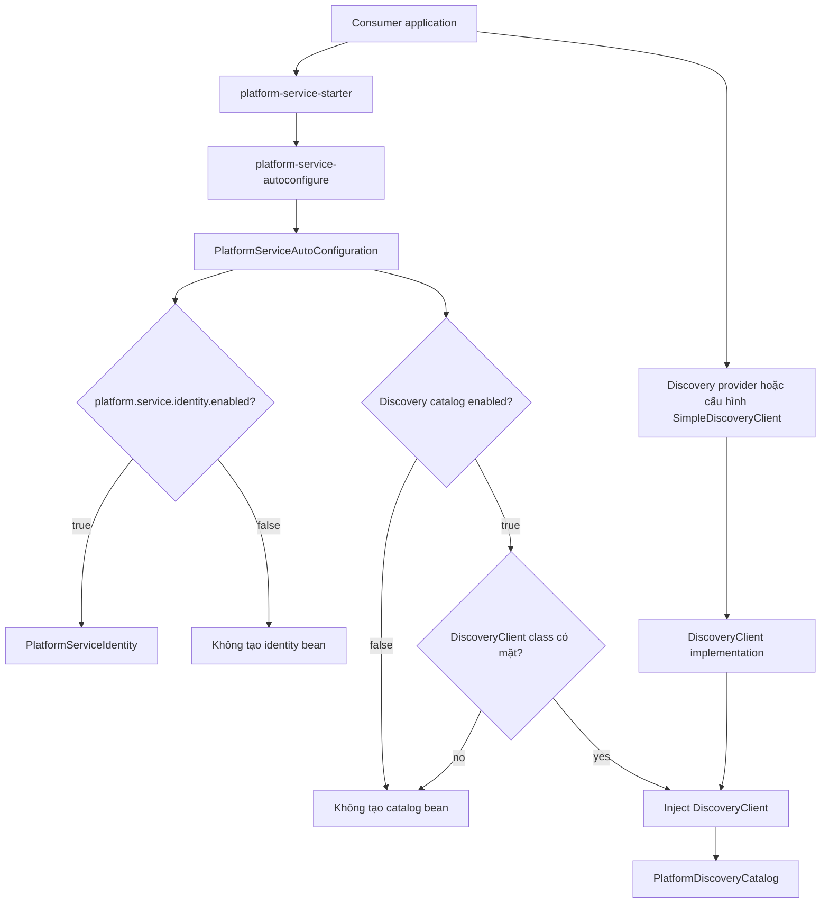

# Đóng gói starter nền tảng và kiểm thử auto-configuration

Trong hệ thống microservice, nhiều ứng dụng thường lặp lại cùng một cấu hình nền tảng: nhận diện service, đọc metadata triển khai, truy vấn danh sách instance và cung cấp tiện ích dùng chung. Nếu mỗi service tự khai báo các bean và cấu hình này, việc sửa lỗi hoặc thay đổi quy ước sẽ phải thực hiện ở nhiều repository.

Spring Boot cho phép đóng gói cấu hình mặc định thành **auto-configuration** và phân phối qua một **starter**. Ứng dụng chỉ cần thêm một dependency để nhận các bean mặc định; điều kiện classpath, property và bean người dùng quyết định tính năng nào được kích hoạt. Spring Cloud Commons cung cấp các abstraction như `DiscoveryClient`, `ServiceInstance`, `Registration` và `ServiceRegistry` để phần dùng chung không phải phụ thuộc trực tiếp vào Eureka hoặc Consul.

Trong dự án này, chúng ta xây một starter nền tảng có hai khả năng:

- Cung cấp `PlatformServiceIdentity` từ cấu hình typed dưới namespace riêng `platform.*`.
- Cung cấp `PlatformDiscoveryCatalog` làm facade đọc `DiscoveryClient` khi ứng dụng chủ động bật tính năng và có discovery provider.

Starter không tự tạo registration hoặc gọi `ServiceRegistry.register()`. Discovery provider vẫn quản lý vòng đời đăng ký instance của nó. Cách phân chia này giúp starter dùng được với nhiều provider và tránh đăng ký trùng.

Bài học thuộc chương **Thực hành tổng hợp** của **SPRING_CLOUD_CORE**. Người học sẽ tạo module auto-configure, module starter, cấu hình `AutoConfiguration.imports`, viết test bằng `ApplicationContextRunner`, kiểm tra điều kiện classpath và bean override, rồi chạy một consumer nhỏ để xác nhận starter được phát hiện từ JAR đã đóng gói.

## 1. Kết quả cần đạt

Hoàn thành dự án khi có thể:

1. Phân biệt module API/auto-configuration với module starter chỉ tập hợp dependency.
2. Tạo `@ConfigurationProperties` có namespace riêng và metadata hỗ trợ IDE.
3. Tạo bean mặc định bằng `@AutoConfiguration`, `@ConditionalOnProperty` và `@ConditionalOnMissingBean`.
4. Bảo đảm tính năng discovery chỉ được nạp khi `DiscoveryClient` có trên classpath.
5. Đăng ký auto-configuration bằng `META-INF/spring/org.springframework.boot.autoconfigure.AutoConfiguration.imports`.
6. Để ứng dụng ghi đè bean mặc định mà không phải fork starter.
7. Kiểm thử trường hợp property tắt, property bật, thiếu class, thiếu provider và bean tùy chỉnh.
8. Kiểm tra JAR starter có kéo đúng dependency và auto-configuration được Spring Boot phát hiện.
9. Xác nhận starter không thay thế cơ chế auto-registration của Eureka, Consul hoặc provider khác.

## 2. Bài toán và kiến trúc

Giả sử nhiều service của nền tảng đều cần biết service name, instance ID, zone và metadata triển khai. Một số service cần truy vấn service catalog qua Spring Cloud `DiscoveryClient`; một số service dùng registry như Eureka/Consul, trong khi service khác có thể dùng `SimpleDiscoveryClient` với danh sách instance tĩnh.

Nếu starter luôn yêu cầu một provider hoặc luôn khởi tạo mọi bean, nó sẽ kéo dependency không cần thiết và có thể làm ứng dụng không khởi động được. Ta thiết kế hai tính năng độc lập, mỗi tính năng có property bật riêng:

| Tính năng | Property bật | Điều kiện bổ sung |
| --- | --- | --- |
| Service identity | `platform.service.identity.enabled=true` | Không cần discovery provider |
| Discovery catalog | `platform.discovery.catalog.enabled=true` | `DiscoveryClient` có trên classpath và có bean implementation; có thể là registry-backed client hoặc `SimpleDiscoveryClient` |

Khi property không được khai báo, cả hai tính năng đều tắt. Ứng dụng thêm starter có thể bật riêng phần identity mà không phải kết nối Eureka hoặc Consul.



`PlatformServiceIdentity` là dữ liệu mô tả service mà code nghiệp vụ có thể inject. `PlatformDiscoveryCatalog` chỉ là facade đọc dữ liệu discovery. Nó không thay thế LoadBalancer, không tự gửi HTTP request và không tự thay đổi registration trong registry.

## 3. Tạo cấu trúc multi-module

Tạo một Maven reactor với hai module thư viện và một ứng dụng consumer dùng để kiểm tra đóng gói:

```text
platform-foundation/
├── pom.xml
├── platform-service-autoconfigure/
│   ├── pom.xml
│   └── src/
│       ├── main/
│       │   ├── java/com/example/platform/service/
│       │   │   ├── PlatformServiceIdentity.java
│       │   │   ├── PlatformServiceIdentityProperties.java
│       │   │   ├── discovery/PlatformDiscoveryCatalog.java
│       │   │   └── autoconfigure/PlatformServiceAutoConfiguration.java
│       │   └── resources/META-INF/spring/
│       │       └── org.springframework.boot.autoconfigure.AutoConfiguration.imports
│       └── test/java/com/example/platform/service/autoconfigure/
│           └── PlatformServiceAutoConfigurationTests.java
├── platform-service-starter/
│   └── pom.xml
└── sample-consumer/
    ├── pom.xml
    └── src/
        ├── main/java/com/example/sample/InventoryApplication.java
        └── test/java/com/example/sample/StarterPackagingTests.java
```

Tên module dùng namespace của tổ chức, không đặt tên bắt đầu bằng `spring-boot`. `platform-service-autoconfigure` chứa code và điều kiện auto-configuration. `platform-service-starter` là JAR tập hợp dependency. `sample-consumer` xác nhận JAR đã đóng gói hoạt động khi được một ứng dụng khác sử dụng.

## 4. Khai báo phiên bản ở parent POM

Dự án minh họa dùng Spring Boot `4.1.2` và Spring Cloud `2025.1.4`. Spring Cloud 2025.1.4 hỗ trợ Spring Boot 4.1.2. Trong dự án thực tế, hãy thay bằng patch version được tổ chức phê duyệt và luôn đối chiếu compatibility matrix trước khi nâng.

Parent POM quản lý dependency version tập trung:

```xml
<project xmlns="http://maven.apache.org/POM/4.0.0"
         xmlns:xsi="http://www.w3.org/2001/XMLSchema-instance"
         xsi:schemaLocation="http://maven.apache.org/POM/4.0.0 https://maven.apache.org/xsd/maven-4.0.0.xsd">
    <modelVersion>4.0.0</modelVersion>

    <parent>
        <groupId>org.springframework.boot</groupId>
        <artifactId>spring-boot-starter-parent</artifactId>
        <version>4.1.2</version>
        <relativePath/>
    </parent>

    <groupId>com.example.platform</groupId>
    <artifactId>platform-foundation</artifactId>
    <version>1.0.0-SNAPSHOT</version>
    <packaging>pom</packaging>

    <properties>
        <java.version>17</java.version>
        <spring-cloud.version>2025.1.4</spring-cloud.version>
    </properties>

    <dependencyManagement>
        <dependencies>
            <dependency>
                <groupId>org.springframework.cloud</groupId>
                <artifactId>spring-cloud-dependencies</artifactId>
                <version>${spring-cloud.version}</version>
                <type>pom</type>
                <scope>import</scope>
            </dependency>
        </dependencies>
    </dependencyManagement>

    <modules>
        <module>platform-service-autoconfigure</module>
        <module>platform-service-starter</module>
        <module>sample-consumer</module>
    </modules>
</project>
```

Spring Boot parent quản lý các dependency Spring Boot. Spring Cloud BOM quản lý `spring-cloud-commons` và các provider nếu consumer chọn thêm. Không khai báo version riêng cho từng Spring Cloud module.

## 5. Cấu hình module autoconfigure

`platform-service-autoconfigure/pom.xml` khai báo những thư viện cần để biên dịch auto-configuration:

```xml
<project xmlns="http://maven.apache.org/POM/4.0.0"
         xmlns:xsi="http://www.w3.org/2001/XMLSchema-instance"
         xsi:schemaLocation="http://maven.apache.org/POM/4.0.0 https://maven.apache.org/xsd/maven-4.0.0.xsd">
    <modelVersion>4.0.0</modelVersion>

    <parent>
        <groupId>com.example.platform</groupId>
        <artifactId>platform-foundation</artifactId>
        <version>1.0.0-SNAPSHOT</version>
    </parent>

    <artifactId>platform-service-autoconfigure</artifactId>

    <dependencies>
        <dependency>
            <groupId>org.springframework.boot</groupId>
            <artifactId>spring-boot-autoconfigure</artifactId>
        </dependency>

        <dependency>
            <groupId>org.springframework.cloud</groupId>
            <artifactId>spring-cloud-commons</artifactId>
            <optional>true</optional>
        </dependency>

        <dependency>
            <groupId>org.springframework.boot</groupId>
            <artifactId>spring-boot-configuration-processor</artifactId>
            <optional>true</optional>
        </dependency>

        <dependency>
            <groupId>org.springframework.boot</groupId>
            <artifactId>spring-boot-autoconfigure-processor</artifactId>
            <optional>true</optional>
        </dependency>

        <dependency>
            <groupId>org.springframework.boot</groupId>
            <artifactId>spring-boot-starter-test</artifactId>
            <scope>test</scope>
        </dependency>
    </dependencies>

    <build>
        <plugins>
            <plugin>
                <groupId>org.apache.maven.plugins</groupId>
                <artifactId>maven-compiler-plugin</artifactId>
                <configuration>
                    <annotationProcessorPaths>
                        <path>
                            <groupId>org.springframework.boot</groupId>
                            <artifactId>spring-boot-autoconfigure-processor</artifactId>
                        </path>
                        <path>
                            <groupId>org.springframework.boot</groupId>
                            <artifactId>spring-boot-configuration-processor</artifactId>
                        </path>
                    </annotationProcessorPaths>
                </configuration>
            </plugin>
        </plugins>
    </build>
</project>
```

`spring-cloud-commons` được đánh dấu optional ở module autoconfigure. Ứng dụng chỉ dùng phần identity có thể sử dụng module này mà không phải kéo Spring Cloud Commons theo cách bắt buộc. Phần discovery được đặt trong nested configuration có `@ConditionalOnClass`, nên sẽ không được nạp nếu `DiscoveryClient` không có trên classpath.

Hai annotation processor có nhiệm vụ khác nhau:

- `spring-boot-configuration-processor` sinh `spring-configuration-metadata.json` để IDE hỗ trợ property.
- `spring-boot-autoconfigure-processor` sinh metadata điều kiện auto-configuration để Spring Boot lọc cấu hình không phù hợp sớm hơn.

## 6. Tạo typed configuration properties

Tạo `PlatformServiceIdentityProperties.java`:

```java
package com.example.platform.service;

import java.util.Map;

import org.springframework.boot.context.properties.ConfigurationProperties;

/**
 * Properties that control the optional platform service identity bean.
 *
 * @param enabled Whether the identity bean is enabled.
 * @param serviceName Service name to expose; falls back to spring.application.name.
 * @param instanceId Instance identifier supplied by the deployment environment.
 * @param zone Deployment zone associated with the instance.
 * @param metadata Metadata labels owned by the platform application.
 */
@ConfigurationProperties(prefix = "platform.service.identity")
public record PlatformServiceIdentityProperties(
        boolean enabled,
        String serviceName,
        String instanceId,
        String zone,
        Map<String, String> metadata) {

    public PlatformServiceIdentityProperties {
        metadata = metadata == null ? Map.of() : Map.copyOf(metadata);
    }
}
```

Record giúp cấu hình trở thành dữ liệu bất biến sau khi bind. Spring Boot hỗ trợ constructor binding cho record có một canonical constructor. `@EnableConfigurationProperties` ở auto-configuration sẽ đăng ký record này mà không cần `@ConfigurationPropertiesScan` trong ứng dụng tiêu thụ.

Các property thuộc namespace `platform.*` do starter sở hữu. Không đặt property riêng của thư viện vào namespace `spring.*`, `server.*` hoặc `management.*`, vì những namespace đó thuộc Spring Boot và Spring Cloud.

### 6.1. Tạo service identity bất biến

Tạo `PlatformServiceIdentity.java`:

```java
package com.example.platform.service;

import java.util.Map;

import org.springframework.util.Assert;

public record PlatformServiceIdentity(
        String serviceName,
        String instanceId,
        String zone,
        Map<String, String> metadata) {

    public PlatformServiceIdentity {
        Assert.hasText(serviceName, "serviceName must not be blank");
        metadata = Map.copyOf(metadata);
    }
}
```

Bean này không chứa connection đến registry. Nó chỉ mô tả danh tính mà service muốn công bố cho code nội bộ. `instanceId`, `zone` có thể vắng mặt nếu môi trường chưa cung cấp; metadata được sao chép thành map không thể thay đổi.

Không đưa password, token, credential hoặc dữ liệu bí mật vào metadata. Nếu sau này cần chuyển các trường này sang registration provider, hãy dùng cấu hình bảo mật riêng và không công bố chúng cho discovery client.

## 7. Tạo facade đọc DiscoveryClient

Tạo `PlatformDiscoveryCatalog.java`:

```java
package com.example.platform.service.discovery;

import java.util.List;

import org.springframework.cloud.client.ServiceInstance;
import org.springframework.cloud.client.discovery.DiscoveryClient;
import org.springframework.util.Assert;

public class PlatformDiscoveryCatalog {

    private final DiscoveryClient discoveryClient;

    public PlatformDiscoveryCatalog(DiscoveryClient discoveryClient) {
        this.discoveryClient = discoveryClient;
    }

    public List<String> getServices() {
        return List.copyOf(discoveryClient.getServices());
    }

    public List<ServiceInstance> getInstances(String serviceId) {
        Assert.hasText(serviceId, "serviceId must not be blank");
        return List.copyOf(discoveryClient.getInstances(serviceId));
    }
}
```

Facade giữ API mà code nền tảng có thể sử dụng, đồng thời không để nhiều module inject và gọi trực tiếp provider. `List.copyOf` tạo snapshot không thể sửa từ phía caller. Lỗi kết nối registry được giữ nguyên để caller quyết định retry, fallback hoặc ghi nhận lỗi.

`ServiceInstance` có một số trường tùy chọn, ví dụ instance ID, scheme hoặc metadata có thể null tùy provider. Consumer phải xử lý các trường đó theo contract của Spring Cloud Commons. Danh sách service hoặc instance không có kết quả phải được xử lý như danh sách rỗng.

## 8. Viết auto-configuration

Tạo `PlatformServiceAutoConfiguration.java`:

```java
package com.example.platform.service.autoconfigure;

import org.springframework.boot.autoconfigure.AutoConfiguration;
import org.springframework.boot.autoconfigure.condition.ConditionalOnClass;
import org.springframework.boot.autoconfigure.condition.ConditionalOnMissingBean;
import org.springframework.boot.autoconfigure.condition.ConditionalOnProperty;
import org.springframework.boot.context.properties.EnableConfigurationProperties;
import org.springframework.context.annotation.Bean;
import org.springframework.context.annotation.Configuration;
import org.springframework.core.env.Environment;
import org.springframework.util.StringUtils;

import com.example.platform.service.PlatformServiceIdentity;
import com.example.platform.service.PlatformServiceIdentityProperties;
import com.example.platform.service.discovery.PlatformDiscoveryCatalog;

@AutoConfiguration
@EnableConfigurationProperties(PlatformServiceIdentityProperties.class)
public class PlatformServiceAutoConfiguration {

    @Bean
    @ConditionalOnProperty(
            prefix = "platform.service.identity",
            name = "enabled",
            havingValue = "true")
    @ConditionalOnMissingBean
    PlatformServiceIdentity platformServiceIdentity(
            PlatformServiceIdentityProperties properties,
            Environment environment) {

        String serviceName = properties.serviceName();

        if (!StringUtils.hasText(serviceName)) {
            serviceName = environment.getProperty("spring.application.name");
        }

        if (!StringUtils.hasText(serviceName)) {
            throw new IllegalStateException(
                    "Set platform.service.identity.service-name "
                    + "or spring.application.name");
        }

        return new PlatformServiceIdentity(
                serviceName,
                properties.instanceId(),
                properties.zone(),
                properties.metadata());
    }

    @Configuration(proxyBeanMethods = false)
    @ConditionalOnClass(
            name = "org.springframework.cloud.client.discovery.DiscoveryClient")
    @ConditionalOnProperty(
            prefix = "platform.discovery.catalog",
            name = "enabled",
            havingValue = "true")
    static class DiscoveryCatalogConfiguration {

        @Bean
        @ConditionalOnMissingBean
        PlatformDiscoveryCatalog platformDiscoveryCatalog(
                org.springframework.cloud.client.discovery.DiscoveryClient discoveryClient) {

            return new PlatformDiscoveryCatalog(discoveryClient);
        }
    }
}
```

Có bốn quyết định cần chú ý:

1. `@AutoConfiguration` đánh dấu cấu hình do Spring Boot tự nạp.
2. `@EnableConfigurationProperties` đăng ký typed configuration.
3. `@ConditionalOnProperty` chỉ tạo identity hoặc discovery catalog khi người dùng bật tính năng.
4. `@ConditionalOnMissingBean` cho phép ứng dụng thay bean mặc định bằng implementation riêng.

Nested configuration cô lập phần phụ thuộc `DiscoveryClient`. Nếu class này không có trên classpath, Spring Boot bỏ qua nested configuration trước khi xử lý bean method. Nếu class có mặt, property discovery được bật nhưng context không có bất kỳ bean `DiscoveryClient` nào, context sẽ báo lỗi rõ ràng. Trong ứng dụng Spring Cloud Commons thông thường, `SimpleDiscoveryClient` có thể được tự cấu hình khi không có registry-backed provider; vì vậy không có Eureka/Consul không đồng nghĩa thiếu `DiscoveryClient`.

### 8.1. Vì sao không dùng component scanning?

Không đặt `@ComponentScan` trong auto-configuration. Auto-configuration phải được nạp qua metadata imports. Package của thư viện nên riêng biệt để tránh component scan của ứng dụng tự tạo bean trùng với auto-configuration.

Nếu cần thêm cấu hình con, dùng nested `@Configuration` hoặc `@Import` rõ ràng. Điều này làm cho điều kiện bật/tắt và thứ tự nạp dễ kiểm tra hơn.

## 9. Đăng ký AutoConfiguration.imports

Tạo file:

```text
platform-service-autoconfigure/
└── src/main/resources/
    └── META-INF/spring/
        └── org.springframework.boot.autoconfigure.AutoConfiguration.imports
```

Nội dung file chỉ gồm tên đầy đủ của lớp auto-configuration, một lớp trên mỗi dòng:

```text
com.example.platform.service.autoconfigure.PlatformServiceAutoConfiguration
```

Spring Boot đọc file này trong JAR để tìm auto-configuration. Không đăng ký lớp này bằng `@ComponentScan` hoặc tạo thêm một `spring.factories` entry theo cách cũ của auto-configuration Boot 2. File `AutoConfiguration.imports` là cơ chế cần dùng cho Spring Boot hiện đại.

## 10. Tạo module starter

`platform-service-starter/pom.xml` chỉ tập hợp dependency cần thiết:

```xml
<project xmlns="http://maven.apache.org/POM/4.0.0"
         xmlns:xsi="http://www.w3.org/2001/XMLSchema-instance"
         xsi:schemaLocation="http://maven.apache.org/POM/4.0.0 https://maven.apache.org/xsd/maven-4.0.0.xsd">
    <modelVersion>4.0.0</modelVersion>

    <parent>
        <groupId>com.example.platform</groupId>
        <artifactId>platform-foundation</artifactId>
        <version>1.0.0-SNAPSHOT</version>
    </parent>

    <artifactId>platform-service-starter</artifactId>

    <dependencies>
        <dependency>
            <groupId>com.example.platform</groupId>
            <artifactId>platform-service-autoconfigure</artifactId>
            <version>1.0.0-SNAPSHOT</version>
        </dependency>

        <dependency>
            <groupId>org.springframework.boot</groupId>
            <artifactId>spring-boot-starter</artifactId>
        </dependency>

        <dependency>
            <groupId>org.springframework.cloud</groupId>
            <artifactId>spring-cloud-commons</artifactId>
        </dependency>
    </dependencies>
</project>
```

Starter module không cần chứa Java class. Nó cung cấp auto-configuration JAR, Spring Boot core starter và Spring Cloud Commons API. Nó không kéo Eureka hoặc Consul vào mọi ứng dụng.

Ứng dụng nào cần registry thật sẽ tự thêm provider starter tương ứng, ví dụ `spring-cloud-starter-consul-discovery` hoặc `spring-cloud-starter-netflix-eureka-client`. Chỉ chọn provider mà ứng dụng đang dùng.

## 11. Cấu hình ứng dụng tiêu thụ

Trong ứng dụng `inventory-api`, thêm dependency `platform-service-starter`:

```xml
<dependency>
    <groupId>com.example.platform</groupId>
    <artifactId>platform-service-starter</artifactId>
    <version>1.0.0-SNAPSHOT</version>
</dependency>
```

Cấu hình `application.yml`:

```yaml
spring:
  application:
    name: inventory-api

platform:
  service:
    identity:
      enabled: true
      service-name: inventory-api
      instance-id: inventory-api-01
      zone: zone-a
      metadata:
        team: supply-chain
        tier: backend
  discovery:
    catalog:
      enabled: false
```

Ứng dụng đã có `PlatformServiceIdentity` mà không cần discovery provider. Nếu muốn bật catalog, thêm provider starter và đổi `platform.discovery.catalog.enabled` thành `true`.

Ví dụ nếu dùng Consul, dependency provider được khai báo trong consumer:

```xml
<dependency>
    <groupId>org.springframework.cloud</groupId>
    <artifactId>spring-cloud-starter-consul-discovery</artifactId>
</dependency>
```

Cấu hình kết nối Consul và đăng ký service vẫn thuộc provider. Starter nền tảng không tự tạo `ConsulRegistration` và không gọi `ServiceRegistry.register()`.

## 12. Viết test cơ bản với ApplicationContextRunner

`ApplicationContextRunner` tạo một ApplicationContext nhỏ chỉ với những auto-configuration được chọn. Nó giúp kiểm tra điều kiện và bean mà không phải khởi động web server, registry hoặc toàn bộ ứng dụng.

Tạo `PlatformServiceAutoConfigurationTests.java`:

```java
package com.example.platform.service.autoconfigure;

import org.junit.jupiter.api.Test;

import org.springframework.boot.autoconfigure.AutoConfigurations;
import org.springframework.boot.test.context.runner.ApplicationContextRunner;
import org.springframework.context.annotation.Bean;
import org.springframework.context.annotation.Configuration;

import com.example.platform.service.PlatformServiceIdentity;

import static org.assertj.core.api.Assertions.assertThat;

class PlatformServiceAutoConfigurationTests {

    private final ApplicationContextRunner contextRunner =
            new ApplicationContextRunner()
                    .withConfiguration(
                            AutoConfigurations.of(
                                    PlatformServiceAutoConfiguration.class));

    @Test
    void identityIsDisabledByDefault() {
        contextRunner.run(context ->
                assertThat(context)
                        .doesNotHaveBean(PlatformServiceIdentity.class));
    }

    @Test
    void createsIdentityFromPlatformProperties() {
        contextRunner
                .withPropertyValues(
                        "platform.service.identity.enabled=true",
                        "platform.service.identity.service-name=inventory-api",
                        "platform.service.identity.instance-id=inventory-01",
                        "platform.service.identity.zone=zone-a",
                        "platform.service.identity.metadata.team=warehouse")
                .run(context -> {
                    assertThat(context)
                            .hasSingleBean(PlatformServiceIdentity.class);

                    PlatformServiceIdentity identity =
                            context.getBean(PlatformServiceIdentity.class);

                    assertThat(identity.serviceName())
                            .isEqualTo("inventory-api");
                    assertThat(identity.instanceId())
                            .isEqualTo("inventory-01");
                    assertThat(identity.zone()).isEqualTo("zone-a");
                    assertThat(identity.metadata())
                            .containsEntry("team", "warehouse");
                });
    }

    @Test
    void fallsBackToSpringApplicationName() {
        contextRunner
                .withPropertyValues(
                        "platform.service.identity.enabled=true",
                        "spring.application.name=stock-service")
                .run(context -> {
                    PlatformServiceIdentity identity =
                            context.getBean(PlatformServiceIdentity.class);

                    assertThat(identity.serviceName())
                            .isEqualTo("stock-service");
                });
    }

    @Test
    void customIdentityOverridesDefaultBean() {
        contextRunner
                .withUserConfiguration(CustomIdentityConfiguration.class)
                .withPropertyValues(
                        "platform.service.identity.enabled=true",
                        "spring.application.name=inventory-api")
                .run(context -> {
                    assertThat(context)
                            .hasSingleBean(PlatformServiceIdentity.class);

                    assertThat(context.getBean(PlatformServiceIdentity.class)
                            .serviceName())
                            .isEqualTo("custom-inventory");
                });
    }

    @Configuration(proxyBeanMethods = false)
    static class CustomIdentityConfiguration {

        @Bean
        PlatformServiceIdentity customPlatformServiceIdentity() {
            return new PlatformServiceIdentity(
                    "custom-inventory",
                    "inventory-custom-01",
                    "zone-custom",
                    java.util.Map.of("owner", "inventory-team"));
        }
    }
}
```

Các test này xác nhận:

- Property mặc định tắt tính năng.
- Property bật sẽ tạo đúng một bean.
- `service-name` được bind.
- `spring.application.name` là fallback.
- Bean do ứng dụng khai báo được ưu tiên hơn bean mặc định.

## 13. Kiểm thử discovery catalog với provider giả

Không cần khởi động Eureka hoặc Consul để kiểm tra điều kiện auto-configuration. Ta có thể cung cấp một `DiscoveryClient` giả trong test. Tạo `PlatformDiscoveryCatalogAutoConfigurationTests.java`:

```java
package com.example.platform.service.autoconfigure;

import java.util.List;

import org.junit.jupiter.api.Test;

import org.springframework.boot.autoconfigure.AutoConfigurations;
import org.springframework.boot.test.context.runner.ApplicationContextRunner;
import org.springframework.cloud.client.ServiceInstance;
import org.springframework.cloud.client.discovery.DiscoveryClient;
import org.springframework.context.annotation.Bean;
import org.springframework.context.annotation.Configuration;

import com.example.platform.service.discovery.PlatformDiscoveryCatalog;

import static org.assertj.core.api.Assertions.assertThat;

class PlatformDiscoveryCatalogAutoConfigurationTests {

    private final ApplicationContextRunner contextRunner =
            new ApplicationContextRunner()
                    .withConfiguration(AutoConfigurations.of(
                            PlatformServiceAutoConfiguration.class));

    @Test
    void createsCatalogOnlyWhenEnabledAndDiscoveryClientExists() {
        contextRunner
                .withUserConfiguration(StubDiscoveryConfiguration.class)
                .withPropertyValues("platform.discovery.catalog.enabled=true")
                .run(context -> {
                    assertThat(context)
                            .hasSingleBean(PlatformDiscoveryCatalog.class);

                    PlatformDiscoveryCatalog catalog =
                            context.getBean(PlatformDiscoveryCatalog.class);

                    assertThat(catalog.getServices())
                            .containsExactly("inventory-api", "order-api");
                    assertThat(catalog.getInstances("inventory-api"))
                            .isEmpty();
                });
    }

    @Test
    void catalogIsDisabledByDefault() {
        contextRunner
                .withUserConfiguration(StubDiscoveryConfiguration.class)
                .run(context ->
                        assertThat(context)
                                .doesNotHaveBean(PlatformDiscoveryCatalog.class));
    }

    @Test
    void enablingCatalogWithoutDiscoveryClientBeanFailsFastInIsolatedContext() {
        contextRunner
                .withPropertyValues("platform.discovery.catalog.enabled=true")
                .run(context -> assertThat(context).hasFailed());
    }

    @Configuration(proxyBeanMethods = false)
    static class StubDiscoveryConfiguration {

        @Bean
        DiscoveryClient discoveryClient() {
            return new DiscoveryClient() {
                @Override
                public String description() {
                    return "Stub discovery";
                }

                @Override
                public List<ServiceInstance> getInstances(String serviceId) {
                    return List.of();
                }

                @Override
                public List<String> getServices() {
                    return List.of("inventory-api", "order-api");
                }
            };
        }
    }
}
```

Test cuối mô phỏng một ApplicationContextRunner chỉ nạp auto-configuration của starter nhưng không cung cấp bean `DiscoveryClient`; khi bật catalog, context phải báo thiếu dependency. Đây không đồng nghĩa ứng dụng production luôn phải có Eureka hoặc Consul: Spring Cloud Commons có thể cung cấp `SimpleDiscoveryClient` khi không có registry-backed provider. Nếu dùng discovery tĩnh, khai báo instance qua property `spring.cloud.discovery.client.simple.instances`.

Ví dụ consumer dùng catalog mà không cần registry server:

```yaml
spring:
  cloud:
    discovery:
      client:
        simple:
          instances:
            order-api:
              - uri: http://order-1.internal:8080
              - uri: http://order-2.internal:8080

platform:
  discovery:
    catalog:
      enabled: true
```

Trong cấu hình này, `SimpleDiscoveryClient` là bean `DiscoveryClient` mà `PlatformDiscoveryCatalog` sử dụng. Khi có Eureka hoặc Consul provider, implementation registry-backed sẽ đảm nhiệm việc truy vấn instance.

## 14. Kiểm thử khi DiscoveryClient không có trên classpath

`@ConditionalOnClass` cần được kiểm tra bằng classloader lọc. Spring Boot cung cấp `FilteredClassLoader` cho trường hợp này:

Thêm import và test method sau vào `PlatformDiscoveryCatalogAutoConfigurationTests` ở mục trước:

```java
import org.springframework.boot.test.context.FilteredClassLoader;

@Test
void discoveryConfigurationIsSkippedWhenCommonsIsAbsent() {
    contextRunner
            .withClassLoader(new FilteredClassLoader(DiscoveryClient.class))
            .withPropertyValues("platform.discovery.catalog.enabled=true")
            .run(context ->
                    assertThat(context)
                            .doesNotHaveBean(PlatformDiscoveryCatalog.class));
}
```

Điểm quan trọng là cấu hình có tham chiếu `DiscoveryClient` nằm trong nested class được bảo vệ bằng `@ConditionalOnClass(name = "...")`. Nếu đưa type tùy chọn này trực tiếp vào method của auto-configuration bên ngoài, JVM có thể phải nạp type trước khi condition có cơ hội loại cấu hình.

Đây là lý do nên tách phần tích hợp phụ thuộc optional library thành nested configuration hoặc auto-configuration class riêng.

## 15. Kiểm thử bean override của discovery catalog

Ứng dụng cũng cần có khả năng thay facade mặc định. Ví dụ một service muốn thêm cache hoặc metric riêng:

Các đoạn dưới đây được thêm vào class test `PlatformDiscoveryCatalogAutoConfigurationTests` ở mục trước. Vì `PlatformDiscoveryCatalog` là class có thể mở rộng, test có thể dùng subclass để bổ sung metric:

```java
import java.util.concurrent.atomic.AtomicInteger;

static class AuditedPlatformDiscoveryCatalog extends PlatformDiscoveryCatalog {

    private final AtomicInteger reads = new AtomicInteger();

    AuditedPlatformDiscoveryCatalog(DiscoveryClient discoveryClient) {
        super(discoveryClient);
    }

    @Override
    public List<String> getServices() {
        reads.incrementAndGet();
        return super.getServices();
    }

    int readCount() {
        return reads.get();
    }
}

@Configuration(proxyBeanMethods = false)
static class CustomCatalogConfiguration {

    @Bean
    PlatformDiscoveryCatalog platformDiscoveryCatalog(
            DiscoveryClient discoveryClient) {
        return new AuditedPlatformDiscoveryCatalog(discoveryClient);
    }
}

@Test
void customCatalogOverridesDefaultBean() {
    contextRunner
            .withUserConfiguration(
                    StubDiscoveryConfiguration.class,
                    CustomCatalogConfiguration.class)
            .withPropertyValues("platform.discovery.catalog.enabled=true")
            .run(context -> {
                assertThat(context).hasSingleBean(PlatformDiscoveryCatalog.class);
                assertThat(context.getBean(PlatformDiscoveryCatalog.class))
                        .isInstanceOf(AuditedPlatformDiscoveryCatalog.class);
            });
}
```

Trong dự án thực tế, catalog tùy chỉnh có thể kế thừa facade hoặc triển khai một interface catalog do nền tảng định nghĩa. Khi dùng `@ConditionalOnMissingBean`, auto-configuration sẽ lùi lại nếu bean tùy chỉnh đã tồn tại.

Không nên tạo bean mặc định với tên cố định rồi yêu cầu người dùng loại bỏ nó bằng `@Primary`. Back-off condition làm rõ ý định hơn và tránh giữ hai bean cùng loại trong context.

## 16. Kiểm tra JAR đã đóng gói bằng consumer smoke test

`ApplicationContextRunner` gọi trực tiếp lớp auto-configuration nên chưa chứng minh file `AutoConfiguration.imports` được đóng gói và Spring Boot tự phát hiện.

Để kiểm tra toàn bộ đường đi, tạo một ứng dụng consumer có dependency `platform-service-starter`.

`InventoryApplication.java`:

```java
package com.example.sample;

import org.springframework.boot.SpringApplication;
import org.springframework.boot.autoconfigure.SpringBootApplication;

@SpringBootApplication
public class InventoryApplication {

    public static void main(String[] args) {
        SpringApplication.run(InventoryApplication.class, args);
    }
}
```

`StarterPackagingTests.java`:

```java
package com.example.sample;

import org.junit.jupiter.api.Test;

import org.springframework.beans.factory.annotation.Autowired;
import org.springframework.boot.test.context.SpringBootTest;

import com.example.platform.service.PlatformServiceIdentity;

import static org.assertj.core.api.Assertions.assertThat;

@SpringBootTest(properties = {
        "spring.application.name=inventory-api",
        "platform.service.identity.enabled=true"
})
class StarterPackagingTests {

    @Autowired
    private PlatformServiceIdentity identity;

    @Test
    void starterAutoConfigurationIsDiscoveredFromJar() {
        assertThat(identity.serviceName()).isEqualTo("inventory-api");
    }
}
```

`sample-consumer/pom.xml` cần dependency starter và test support:

```xml
<dependencies>
    <dependency>
        <groupId>com.example.platform</groupId>
        <artifactId>platform-service-starter</artifactId>
        <version>1.0.0-SNAPSHOT</version>
    </dependency>
    <dependency>
        <groupId>org.springframework.boot</groupId>
        <artifactId>spring-boot-starter-test</artifactId>
        <scope>test</scope>
    </dependency>
</dependencies>
```

Test này không gọi `AutoConfigurations.of`. Nó khởi động consumer như một ứng dụng thông thường, để Spring Boot đọc `AutoConfiguration.imports` trong dependency JAR và tạo bean.

Nếu unit test pass nhưng smoke test fail, hãy kiểm tra nội dung JAR, dependency graph và file metadata đã được đưa vào artifact chưa.

## 17. Kiểm tra dependency và metadata của artifact

Sau khi build, kiểm tra JAR auto-configure có file imports:

```bash
jar tf platform-service-autoconfigure/target/platform-service-autoconfigure-1.0.0-SNAPSHOT.jar
```

Trong kết quả phải có:

```text
META-INF/spring/org.springframework.boot.autoconfigure.AutoConfiguration.imports
```

Mở file trong JAR để xác nhận tên lớp khớp package thực tế. Nếu file rỗng, sai tên hoặc nằm sai thư mục, Spring Boot sẽ không phát hiện cấu hình.

Kiểm tra thêm file metadata property:

```text
META-INF/spring-configuration-metadata.json
```

File này giúp IDE gợi ý các key như:

- `platform.service.identity.enabled`
- `platform.service.identity.service-name`
- `platform.service.identity.instance-id`
- `platform.service.identity.zone`
- `platform.service.identity.metadata`
- `platform.discovery.catalog.enabled`

Nếu metadata không được sinh, kiểm tra `spring-boot-configuration-processor` có nằm trong annotation processor path và class properties có được khai báo đúng annotation không.

## 18. Chạy build và kiểm thử

Từ thư mục gốc `platform-foundation`, chạy toàn bộ reactor:

```bash
mvn clean verify
```

Hoặc chỉ build starter cùng dependency nội bộ:

```bash
mvn -pl platform-service-starter -am clean install
```

Chạy riêng smoke test ở consumer sau khi các module starter được build:

```bash
mvn -pl sample-consumer -am test
```

Các kết quả cần quan sát:

| Kiểm tra | Kết quả mong đợi |
| --- | --- |
| Identity property mặc định tắt | Không có `PlatformServiceIdentity` |
| Identity bật, có service name | Có đúng một bean identity |
| Identity bật, chỉ có `spring.application.name` | Bean dùng tên ứng dụng |
| Người dùng khai báo identity riêng | Auto-configuration back off |
| Discovery catalog mặc định tắt | Không có catalog bean |
| Discovery catalog bật, có DiscoveryClient | Có catalog bean |
| Discovery class không có trên classpath | Nested configuration bị bỏ qua |
| Catalog bật nhưng provider không có bean | Context báo lỗi cấu hình |
| Consumer smoke test | Starter được phát hiện qua JAR metadata |

## 19. Không để starter sở hữu vòng đời registration

Spring Cloud Commons cung cấp `ServiceRegistry` với các thao tác `register`, `deregister` và `setStatus`. Mỗi provider có implementation `Registration` riêng, ví dụ Eureka, Consul hoặc Zookeeper.

Trong ứng dụng dùng auto-registration mặc định, provider tự đăng ký service khi web server sẵn sàng và quản lý deregistration khi context đóng. Starter nền tảng không nên tự gọi `register()` lần nữa cho cùng instance.

Nếu một yêu cầu nền tảng thực sự cần đăng ký thủ công, hãy thiết kế thành module tích hợp provider riêng, nhận đúng loại `Registration`, tắt auto-registration có chủ đích và kiểm thử lifecycle. Không đưa logic đó vào starter dùng chung nếu chưa có hợp đồng thống nhất giữa các provider.

`PlatformServiceIdentity` cũng không tự động trở thành metadata trong Eureka hoặc Consul. Nếu muốn công bố zone, team hoặc version vào registry, hãy ánh xạ sang cấu hình metadata mà provider hỗ trợ hoặc dùng extension point riêng của provider. Việc chỉ tạo identity bean không thay đổi bản ghi đăng ký.

## 20. Các lỗi thường gặp

| Triệu chứng | Nguyên nhân | Cách xử lý |
| --- | --- | --- |
| Starter có trong dependency tree nhưng không tạo bean | Thiếu hoặc sai `AutoConfiguration.imports` | Kiểm tra đường dẫn và fully qualified class name trong JAR |
| Bean được tạo hai lần | Auto-config class bị component scan hoặc thiếu `@ConditionalOnMissingBean` | Chỉ nạp qua imports metadata và thêm back-off condition |
| Identity không được bind | Thiếu `@EnableConfigurationProperties` hoặc sai prefix | Kiểm tra annotation và namespace `platform.service.identity` |
| Ứng dụng khởi động lỗi khi bật identity | Không có `service-name` hoặc `spring.application.name` | Cấu hình một trong hai giá trị |
| Thiếu DiscoveryClient gây lỗi linkage | Type optional nằm ngoài nested class có class condition | Cô lập tích hợp bằng `@ConditionalOnClass` |
| Catalog bật nhưng không có bean DiscoveryClient | Discovery auto-configuration chưa được nạp hoặc test context chưa cung cấp client | Kiểm tra Commons/provider configuration; nếu dùng SimpleDiscoveryClient, khai báo static instances |
| Catalog chỉ trả danh sách rỗng khi không dùng registry | Chưa khai báo `spring.cloud.discovery.client.simple.instances` | Khai báo URI cho từng service hoặc thêm registry-backed provider |
| Auto-config ghi đè bean của ứng dụng | Thiếu hoặc sai `@ConditionalOnMissingBean` | Thêm condition trên bean mặc định |
| Property không có gợi ý IDE | Configuration processor chưa chạy | Kiểm tra annotation processor path và JAR metadata |
| Registry ghi nhận hai instance bất thường | Starter và provider cùng gọi register | Để provider quản lý auto-registration hoặc thiết kế một owner duy nhất |
| Unit test pass nhưng consumer không thấy bean | Test gọi trực tiếp `AutoConfigurations.of` nên chưa kiểm tra JAR imports | Thêm consumer smoke test |
| Discovery catalog trả dữ liệu cũ | Provider hoặc client có cache | Kiểm tra cache/refresh policy của provider và LoadBalancer |

## 21. Checklist trước khi phát hành starter

- [ ] Tên module và package dùng namespace của tổ chức.
- [ ] Auto-configuration nằm trong module riêng nếu có optional integration.
- [ ] Starter module chỉ tập hợp dependency cần thiết.
- [ ] Dependency provider không bị kéo vào nếu consumer không chọn.
- [ ] Property có prefix riêng, Javadoc và configuration metadata.
- [ ] Tính năng mặc định tắt hoặc có default được cân nhắc rõ.
- [ ] Bean mặc định dùng `@ConditionalOnMissingBean`.
- [ ] Tích hợp optional dùng nested `@ConditionalOnClass`.
- [ ] Auto-configuration được liệt kê trong `AutoConfiguration.imports`.
- [ ] Không dùng component scan để nạp auto-configuration.
- [ ] Test property binding và fallback.
- [ ] Test user bean override.
- [ ] Test classpath thiếu optional library.
- [ ] Test property bật nhưng thiếu provider.
- [ ] Consumer smoke test xác nhận metadata JAR.
- [ ] Không gọi register/deregister trùng với provider.
- [ ] Không expose discovery catalog hoặc metadata nhạy cảm qua HTTP ngoài ý muốn.
- [ ] Dependency tree và Spring Cloud BOM đã được kiểm tra.

## 22. Bài tập mở rộng

### Bài tập 1. Thêm PlatformServiceInfoContributor

Tạo một module Actuator integration tùy chọn để đưa service name, instance ID và zone vào `/actuator/info`. Dùng `@ConditionalOnClass(InfoContributor.class)` và `@ConditionalOnProperty` để ứng dụng không có Actuator vẫn khởi động bình thường.

### Bài tập 2. Thêm provider-specific metadata adapter

Tạo module riêng cho Eureka hoặc Consul để ánh xạ `PlatformServiceIdentity.metadata` sang metadata registration của provider. Kiểm tra rằng chỉ có một thành phần sở hữu registration lifecycle.

### Bài tập 3. Tạo starter test

Tạo `platform-service-starter-test` cung cấp test fixture và `@TestConfiguration` dùng chung. Không đưa test dependency vào starter production.

### Bài tập 4. Kiểm tra condition report

Dùng `ConditionEvaluationReportLoggingListener` trong `ApplicationContextRunner` để hiển thị lý do auto-configuration match hoặc không match. Viết test cho trường hợp property bị tắt và class optional bị thiếu.

### Bài tập 5. Kiểm tra native image

Đánh giá reflection, configuration binding và auto-configuration metadata khi đóng gói native image. Chạy kiểm thử native riêng vì `ApplicationContextRunner` không hỗ trợ chạy bên trong native image.

## 23. Câu hỏi tự kiểm tra

1. Vì sao nên tách autoconfigure module khỏi starter module?
2. Starter module có cần chứa Java class không?
3. `@AutoConfiguration` khác `@Configuration` thông thường ở mục đích sử dụng nào?
4. Spring Boot tìm auto-configuration trong JAR qua file nào?
5. Vì sao không nên component-scan package auto-configuration?
6. `@ConditionalOnClass` giải quyết vấn đề gì với optional dependency?
7. `@ConditionalOnMissingBean` hỗ trợ người dùng tùy biến starter ra sao?
8. Vì sao property của thư viện cần namespace riêng?
9. Configuration processor và autoconfigure processor tạo metadata gì?
10. `ApplicationContextRunner` kiểm thử những tổ hợp điều kiện nào?
11. Vì sao cần `FilteredClassLoader` trong test?
12. Tại sao cần consumer smoke test bên cạnh unit test auto-configuration?
13. Spring Cloud Commons `DiscoveryClient` khác `ServiceRegistry` như thế nào?
14. Vì sao starter không nên tự register cùng instance với provider?
15. Khi nào nên tách provider-specific integration thành module riêng?

## 24. Nguồn tham khảo

- [Spring Boot 4.1 — Creating Your Own Auto-configuration](https://docs.spring.io/spring-boot/reference/features/developing-auto-configuration.html): `@AutoConfiguration`, condition annotations, imports metadata, cấu trúc starter và dependency optional.
- [Spring Boot — Testing Auto-configuration](https://docs.spring.io/spring-boot/reference/features/developing-auto-configuration.html#features.developing-auto-configuration.testing): `ApplicationContextRunner`, `AutoConfigurations`, bean override, classpath filtering và condition report.
- [Spring Cloud Commons — Common Abstractions](https://docs.spring.io/spring-cloud-commons/reference/spring-cloud-commons/common-abstractions.html): `DiscoveryClient`, `ServiceRegistry`, auto-registration và provider-specific registration.
- [DiscoveryClient.java — Spring Cloud Commons source](https://github.com/spring-cloud/spring-cloud-commons/blob/main/spring-cloud-commons/src/main/java/org/springframework/cloud/client/discovery/DiscoveryClient.java): contract truy vấn service, probe và order.
- [Spring Cloud Compatibility Matrix](https://spring.io/projects/spring-cloud/): mapping release train với Spring Boot.
- [Spring Cloud 2025.1.4 release announcement](https://spring.io/blog/2026/10/23/spring-cloud-2025-1-4-has-been-released/): xác nhận release train 2025.1.4 tương thích Spring Boot 4.1.2.

## Ghi nhớ

Một starter nền tảng tốt cung cấp mặc định hữu ích nhưng để ứng dụng kiểm soát việc bật tính năng và thay bean khi cần. Module autoconfigure chứa typed properties, điều kiện và bean mặc định; module starter tập hợp dependency; file `AutoConfiguration.imports` giúp Spring Boot tìm cấu hình trong JAR. `ApplicationContextRunner` kiểm tra từng điều kiện nhanh, còn consumer smoke test xác nhận artifact thật được phát hiện. Với Spring Cloud, hãy để discovery provider sở hữu registration lifecycle và dùng `DiscoveryClient` như abstraction đọc service catalog; không đăng ký cùng instance lần thứ hai trong starter.

