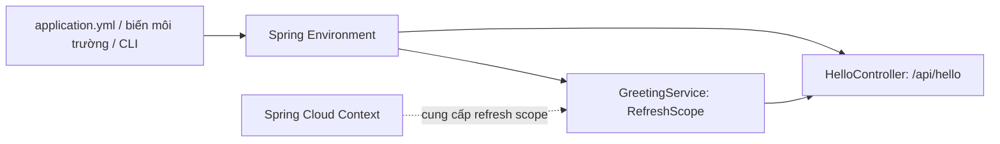
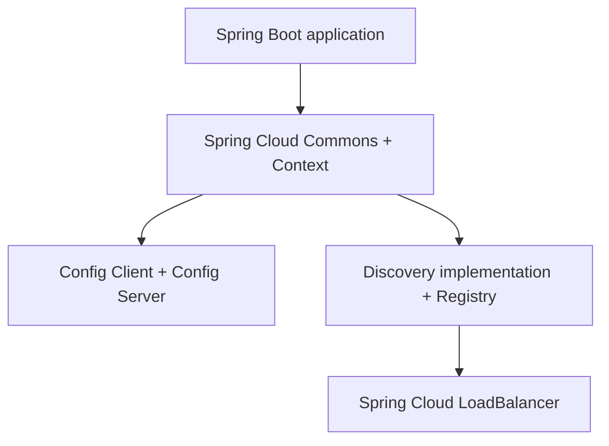

# Tạo ứng dụng Spring Boot tối thiểu có Spring Cloud

Trong hệ thống phân tán, Spring Boot giúp tạo một ứng dụng Java có thể khởi động, phục vụ HTTP, nạp cấu hình và cung cấp khả năng quan sát. Spring Cloud mở rộng nền tảng đó bằng các abstraction dùng chung như `DiscoveryClient`, `ServiceRegistry`, `Environment` được tích hợp với cấu hình Cloud, `@RefreshScope` và các thành phần hỗ trợ tương tác giữa dịch vụ. Trước khi bổ sung Config Server, registry hay API Gateway, ta cần tạo được **một dịch vụ Spring Boot nhỏ có Spring Cloud trên classpath, khởi động được và có thể kiểm tra hành vi**.

Bài học thuộc chương **Khởi tạo** của module **SPRING_CLOUD_CORE**. Ví dụ tập trung vào phần nền tảng Spring Cloud Commons/Context, cách quản lý phiên bản tương thích với Spring Boot, cấu hình bên ngoài, khả năng chuẩn bị cho refresh, và kiểm thử/vận hành. Không cần dựng cả hệ thống microservice để hoàn thành bước đầu này.

## 1. Kết quả cần đạt

Sau khi làm theo bài, người học có thể:

- Tạo một project Maven với Spring Boot, Spring Cloud starter và Actuator.
- Hiểu cách dùng Spring Boot parent, Spring Cloud BOM và lý do không tự gắn phiên bản riêng cho từng Cloud dependency.
- Viết một HTTP endpoint sử dụng cấu hình lấy từ Spring `Environment` và một bean sử dụng `@RefreshScope` từ Spring Cloud Context.
- Khởi động ứng dụng, gọi API, xem health check và đổi cấu hình bằng biến môi trường hoặc tham số khởi động.
- Phân biệt ứng dụng có thư viện Spring Cloud với ứng dụng đã kết nối thật tới Config Server, service registry hoặc load balancer.
- Xác định những bước kiểm tra cần thiết trước khi mở rộng thành một dịch vụ chạy trong hệ thống phân tán.

Ví dụ có tên `spring-cloud-core-demo` và cung cấp:

```text
GET http://localhost:8080/api/hello
GET http://localhost:8080/actuator/health
```

Phản hồi minh họa của `/api/hello`:

```json
{
  "service": "spring-cloud-core-demo",
  "message": "Xin chào từ Spring Cloud Core"
}
```

## 2. Chuẩn bị công cụ và hiểu giới hạn của ví dụ

Máy phát triển cần có:

- **JDK 17 trở lên**, kiểm tra bằng `java -version`.
- **Apache Maven** phù hợp với bản Spring Boot đã chọn, kiểm tra bằng `mvn -version`. Có thể dùng Maven Wrapper (`mvnw`) nếu project được tạo kèm wrapper.
- Trình soạn thảo Java và công cụ gửi HTTP request như `curl`, Postman hoặc `Invoke-RestMethod` của PowerShell.
- Quyền truy cập Maven repository lần đầu để tải dependency.

**Cặp phiên bản minh họa:** Spring Boot `3.4.2` và Spring Cloud `2024.0.0`. Đây là một cặp thuộc hai dòng phát hành tương thích để diễn giải cấu trúc project, **không phải khẳng định đó là phiên bản mới nhất**. Trong dự án thực tế, hãy kiểm tra bảng tương thích chính thức của Spring Cloud tại thời điểm tạo project, chọn bản vá được hỗ trợ, rồi cập nhật cả cặp phiên bản và chạy kiểm thử. Spring Boot 3.x sử dụng các package Jakarta như `jakarta.servlet`, `jakarta.validation`; khi nâng sang thế hệ lớn khác có thể phải đổi API hoặc cấu hình.

### Spring Boot và Spring Cloud có vai trò khác nhau

| Thành phần | Vai trò trong ví dụ | Có bắt buộc ở bước này? |
| --- | --- | --- |
| `spring-boot-starter-web` | Tạo HTTP API với Spring MVC và embedded server | Có |
| `spring-cloud-starter` | Bổ sung nền tảng Spring Cloud, gồm các thành phần Commons/Context phù hợp với BOM | Có, để minh họa Cloud Core |
| `spring-boot-starter-actuator` | Cung cấp health check phục vụ quan sát | Có trong hướng dẫn |
| `spring-boot-starter-test` | Cung cấp JUnit, Spring Test và MockMvc | Dùng cho bước kiểm thử |
| Spring Cloud Config Client | Đọc cấu hình từ Config Server | Chưa cần |
| Eureka/Consul/Zookeeper Discovery Client | Đăng ký hoặc tìm instance qua registry | Chưa cần |
| Spring Cloud LoadBalancer | Chọn instance đích khi gọi một service theo tên logic | Chưa cần |

Tên `spring-cloud-starter` không đồng nghĩa ứng dụng tự có Config Server hay registry đang hoạt động. Các tính năng đó cần starter, backend và cấu hình phù hợp.

## 3. Tạo cấu trúc dự án

Có thể tạo skeleton với Spring Initializr rồi chỉnh Maven theo phần dưới, hoặc tự tạo các file như sau. Khi dùng Initializr, chọn Maven, Java, Spring Boot phù hợp và dependency Spring Web, Actuator; sau đó bổ sung Cloud BOM và `spring-cloud-starter` trong `pom.xml`.

```text
spring-cloud-core-demo/
├── pom.xml
└── src/
    ├── main/
    │   ├── java/
    │   │   └── com/example/cloudcore/
    │   │       ├── SpringCloudCoreApplication.java
    │   │       ├── GreetingService.java
    │   │       └── HelloController.java
    │   └── resources/
    │       └── application.yml
    └── test/
        └── java/
            └── com/example/cloudcore/
                └── HelloControllerTest.java
```

Đặt lớp có `@SpringBootApplication` ở package gốc `com.example.cloudcore` để cơ chế component scanning mặc định tìm thấy controller và service trong cùng package hoặc package con.

## 4. Khai báo Maven với Spring Cloud BOM

Tạo `pom.xml`:

```xml
<?xml version="1.0" encoding="UTF-8"?>
<project xmlns="http://maven.apache.org/POM/4.0.0"
         xmlns:xsi="http://www.w3.org/2001/XMLSchema-instance"
         xsi:schemaLocation="http://maven.apache.org/POM/4.0.0
                             https://maven.apache.org/xsd/maven-4.0.0.xsd">
    <modelVersion>4.0.0</modelVersion>

    <parent>
        <groupId>org.springframework.boot</groupId>
        <artifactId>spring-boot-starter-parent</artifactId>
        <version>3.4.2</version>
        <relativePath/>
    </parent>

    <groupId>com.example</groupId>
    <artifactId>spring-cloud-core-demo</artifactId>
    <version>0.0.1-SNAPSHOT</version>
    <name>spring-cloud-core-demo</name>
    <description>Minimal Spring Boot with Spring Cloud Core</description>

    <properties>
        <java.version>17</java.version>
        <spring-cloud.version>2024.0.0</spring-cloud.version>
    </properties>

    <dependencyManagement>
        <dependencies>
            <dependency>
                <groupId>org.springframework.cloud</groupId>
                <artifactId>spring-cloud-dependencies</artifactId>
                <version>${spring-cloud.version}</version>
                <type>pom</type>
                <scope>import</scope>
            </dependency>
        </dependencies>
    </dependencyManagement>

    <dependencies>
        <dependency>
            <groupId>org.springframework.boot</groupId>
            <artifactId>spring-boot-starter-web</artifactId>
        </dependency>
        <dependency>
            <groupId>org.springframework.cloud</groupId>
            <artifactId>spring-cloud-starter</artifactId>
        </dependency>
        <dependency>
            <groupId>org.springframework.boot</groupId>
            <artifactId>spring-boot-starter-actuator</artifactId>
        </dependency>
        <dependency>
            <groupId>org.springframework.boot</groupId>
            <artifactId>spring-boot-starter-test</artifactId>
            <scope>test</scope>
        </dependency>
    </dependencies>

    <build>
        <plugins>
            <plugin>
                <groupId>org.springframework.boot</groupId>
                <artifactId>spring-boot-maven-plugin</artifactId>
            </plugin>
        </plugins>
    </build>
</project>
```

**Vì sao cấu hình theo cách này?**

1. `spring-boot-starter-parent` quản lý phiên bản nhiều thư viện của Spring Boot, plugin Maven và thiết lập build thông dụng.
2. `spring-cloud-dependencies` là **Bill of Materials (BOM)** của một Spring Cloud release train. Import bằng `dependencyManagement` giúp Maven thống nhất phiên bản những module Cloud nằm trong release train.
3. Mỗi dependency Spring Cloud không phải tự khai báo `<version>`. Maven sẽ lấy phiên bản phù hợp từ BOM.
4. Không gán một phiên bản Spring Cloud tùy ý chỉ vì nó mới hơn Spring Boot. Hai dự án phát hành độc lập; bản không tương thích có thể dẫn tới lỗi khởi tạo context, thiếu class hoặc bị cơ chế compatibility verifier chặn khởi động.

Có thể kiểm tra dependency tree sau khi Maven tải xong:

```bash
mvn dependency:tree
```

Tìm các module từ `org.springframework.cloud` (đặc biệt `spring-cloud-commons` và `spring-cloud-context`) cùng Spring Boot. Nếu dependency tree có nhiều phiên bản của cùng module do override/transitive dependency, cần rà soát BOM trước khi mở rộng.

## 5. Viết lớp khởi động Spring Boot

Tạo `src/main/java/com/example/cloudcore/SpringCloudCoreApplication.java`:

```java
package com.example.cloudcore;

import org.springframework.boot.SpringApplication;
import org.springframework.boot.autoconfigure.SpringBootApplication;

@SpringBootApplication
public class SpringCloudCoreApplication {

    public static void main(String[] args) {
        SpringApplication.run(SpringCloudCoreApplication.class, args);
    }
}
```

`@SpringBootApplication` kết hợp cấu hình ứng dụng, component scanning và auto-configuration. Spring Boot sẽ phát hiện các dependency hiện có trên classpath và tự cấu hình thành phần phù hợp. Những auto-configuration của Spring Cloud cũng có thể tham gia khi starter Cloud được bổ sung.

Chưa cần `@EnableDiscoveryClient`, `@EnableConfigServer` hay viết một `ApplicationContext` bằng tay: ứng dụng này chưa triển khai registry hoặc Config Server.

## 6. Tạo bean sử dụng Spring Cloud Context

Tạo `src/main/java/com/example/cloudcore/GreetingService.java`:

```java
package com.example.cloudcore;

import org.springframework.beans.factory.annotation.Value;
import org.springframework.cloud.context.config.annotation.RefreshScope;
import org.springframework.stereotype.Component;

@Component
@RefreshScope
public class GreetingService {

    private final String message;

    public GreetingService(
            @Value("${demo.message:Xin chào mặc định}") String message) {
        this.message = message;
    }

    public String message() {
        return message;
    }
}
```

Ở đây:

- `@Component` đăng ký lớp với Spring container.
- `@Value` lấy khóa `demo.message` từ `Environment`. Đoạn sau dấu hai chấm là giá trị dự phòng khi property không tồn tại.
- `@RefreshScope` là annotation của **Spring Cloud Context**, minh họa một bean có thể được tạo lại sau khi môi trường cấu hình được làm mới bằng cơ chế refresh phù hợp.

**Lưu ý về refresh:** annotation không khiến ứng dụng tự theo dõi và cập nhật mọi thay đổi của file YAML hoặc biến môi trường. Trong ví dụ tối thiểu, khi thay đổi biến môi trường, ta sẽ **khởi động lại tiến trình** để thấy giá trị mới. Nếu về sau tích hợp Config Server và một tác nhân refresh được bảo vệ, refresh scope mới phát huy vai trò đầy đủ. Không nên suy luận rằng mọi bean, cache hoặc connection pool sẽ được làm mới tự động.

## 7. Tạo HTTP endpoint

Tạo `src/main/java/com/example/cloudcore/HelloController.java`:

```java
package com.example.cloudcore;

import java.util.Map;

import org.springframework.core.env.Environment;
import org.springframework.web.bind.annotation.GetMapping;
import org.springframework.web.bind.annotation.RequestMapping;
import org.springframework.web.bind.annotation.RestController;

@RestController
@RequestMapping("/api")
public class HelloController {

    private final GreetingService greetingService;
    private final Environment environment;

    public HelloController(
            GreetingService greetingService,
            Environment environment) {
        this.greetingService = greetingService;
        this.environment = environment;
    }

    @GetMapping("/hello")
    public Map<String, String> hello() {
        return Map.of(
            "service", environment.getProperty(
                "spring.application.name", "unknown"),
            "message", greetingService.message()
        );
    }
}
```

Lớp `HelloController` sử dụng constructor injection để nhận các dependency được Spring quản lý. `Environment` là abstraction từ Spring Framework được Spring Boot và Spring Cloud cùng sử dụng. Điều này cho phép controller lấy tên ứng dụng từ nguồn cấu hình hiệu lực; `GreetingService` cung cấp thông điệp.

Sơ đồ luồng trong ứng dụng:



Trong dự án có nhiều cấu hình, nên dùng `@ConfigurationProperties` để bind và validate theo nhóm. Với đúng một property minh họa, `@Value` giúp ví dụ ngắn gọn.

## 8. Cấu hình ứng dụng

Tạo `src/main/resources/application.yml`:

```yaml
spring:
  application:
    name: spring-cloud-core-demo

server:
  port: 8080

demo:
  message: Xin chào từ Spring Cloud Core

management:
  endpoints:
    web:
      exposure:
        include: health,info
```

Các khóa quan trọng:

| Khóa | Ý nghĩa |
| --- | --- |
| `spring.application.name` | Tên logic của ứng dụng; sau này còn dùng khi lấy cấu hình từ Config Server hoặc tham gia service discovery |
| `server.port` | Cổng HTTP cục bộ; mặc định của embedded server thường là `8080`, khai báo để dễ quan sát |
| `demo.message` | Giá trị được đưa vào `GreetingService` |
| `management.endpoints.web.exposure.include` | Chỉ cho phép công khai trên HTTP các endpoint Actuator được liệt kê, ở đây là health/info |

Không bật tất cả endpoint Actuator để thử cho nhanh. Các endpoint chẩn đoán cấu hình, refresh hoặc bean có thể tiết lộ thông tin hệ thống hoặc thay đổi hành vi ứng dụng; chỉ mở khi có nhu cầu, kèm xác thực và giới hạn mạng phù hợp.

## 9. Chạy ứng dụng và xác minh kết quả

Mở terminal trong thư mục `spring-cloud-core-demo`:

```bash
java -version
mvn -version
mvn spring-boot:run
```

Khi khởi động thành công, log thường hiển thị embedded web server đã chạy trên cổng `8080` và tên ứng dụng đã được nạp. Mở terminal thứ hai:

```bash
curl -i http://localhost:8080/api/hello
curl -i http://localhost:8080/actuator/health
```

Với Windows PowerShell, có thể dùng:

```powershell
Invoke-RestMethod http://localhost:8080/api/hello
Invoke-RestMethod http://localhost:8080/actuator/health
```

Kết quả mong đợi:

- `GET /api/hello` trả HTTP `200 OK`, JSON có `service=spring-cloud-core-demo` và `message=Xin chào từ Spring Cloud Core`.
- `GET /actuator/health` trả trạng thái tổng thể `UP` nếu các health indicator đang hoạt động bình thường. Khi có lỗi thực tế, giá trị và HTTP status có thể khác.

Sau khi kiểm thử, dừng tiến trình bằng `Ctrl+C`.

### Đóng gói và chạy file JAR

```bash
mvn clean package
java -jar target/spring-cloud-core-demo-0.0.1-SNAPSHOT.jar
```

Lệnh `mvn clean package` chạy các kiểm thử Maven được cấu hình và tạo executable JAR nhờ `spring-boot-maven-plugin`. Việc chuyển JAR sang máy khác chỉ cần đảm bảo runtime Java và các cấu hình/phụ thuộc môi trường cần thiết.

## 10. Thay đổi cấu hình mà không sửa mã nguồn

Giữ nguyên file `application.yml`, đổi thông điệp thông qua biến môi trường trước khi khởi động.

PowerShell:

```powershell
$env:DEMO_MESSAGE = 'Xin chào từ môi trường staging'
mvn spring-boot:run
```

Bash:

```bash
DEMO_MESSAGE="Xin chào từ môi trường staging" mvn spring-boot:run
```

Gọi lại `/api/hello` sẽ thấy trường `message` nhận giá trị từ biến môi trường. Spring Boot hỗ trợ tên property dạng môi trường như `DEMO_MESSAGE` cho khóa `demo.message` thông qua cơ chế cấu hình bên ngoài và relaxed binding phù hợp.

Một cách khác là truyền tham số cho file JAR:

```bash
java -jar target/spring-cloud-core-demo-0.0.1-SNAPSHOT.jar --demo.message="Thông điệp từ CLI"
```

Trong trường hợp thông thường, tham số dòng lệnh có ưu tiên cao hơn biến môi trường và file `application.yml`. Điều quan trọng khi chẩn đoán là **giá trị cuối cùng được ứng dụng nhận và nguồn nào cung cấp giá trị đó**.

Những điều cần nhớ:

1. Biến môi trường được tiến trình nhận khi khởi động. Đổi biến ở terminal khác khi JVM vẫn chạy không mặc nhiên làm giá trị trong bean thay đổi.
2. Nếu biến đã được đặt trong phiên terminal hiện tại, lần chạy sau có thể tiếp tục dùng nó. Trong PowerShell có thể gỡ bằng `Remove-Item Env:DEMO_MESSAGE`; trong Bash dùng `unset DEMO_MESSAGE`.
3. Đối với secret thật (mật khẩu, API token), không ghi trực tiếp vào YAML trong source control; hãy dùng secret manager hoặc cơ chế secret injection của nền tảng triển khai.

### Dùng profile cho nhiều môi trường

Khi cần phân chia môi trường, có thể bổ sung những file profile (đây là **ví dụ cấu trúc cho người học tạo trong project mẫu**, không phải các file cần tạo ngoài bài học hiện tại):

```text
src/main/resources/
  application.yml
  application-dev.yml
  application-prod.yml
```

Nội dung minh họa của `application-dev.yml`:

```yaml
demo:
  message: Xin chào từ dev
```

Nội dung minh họa của `application-prod.yml`:

```yaml
demo:
  message: Xin chào từ prod
```

Chạy JAR với profile `dev`:

```bash
java -jar target/spring-cloud-core-demo-0.0.1-SNAPSHOT.jar --spring.profiles.active=dev
```

Spring Boot sẽ nạp cấu hình chung và cấu hình dành cho profile đang hoạt động. Không dùng profile như cơ chế bảo mật; khác biệt production còn cần kiểm soát kết nối, secret, quyền hạn, cấu hình mạng và khả năng quan sát.

## 11. Viết bài kiểm thử tối thiểu

Tạo `src/test/java/com/example/cloudcore/HelloControllerTest.java`:

```java
package com.example.cloudcore;

import static org.springframework.test.web.servlet.request.MockMvcRequestBuilders.get;
import static org.springframework.test.web.servlet.result.MockMvcResultMatchers.jsonPath;
import static org.springframework.test.web.servlet.result.MockMvcResultMatchers.status;

import org.junit.jupiter.api.Test;
import org.springframework.beans.factory.annotation.Autowired;
import org.springframework.boot.test.autoconfigure.web.servlet.AutoConfigureMockMvc;
import org.springframework.boot.test.context.SpringBootTest;
import org.springframework.test.web.servlet.MockMvc;

@SpringBootTest(properties = "demo.message=hello-from-test")
@AutoConfigureMockMvc
class HelloControllerTest {

    @Autowired
    private MockMvc mvc;

    @Test
    void shouldReturnApplicationNameAndConfiguredMessage() throws Exception {
        mvc.perform(get("/api/hello"))
            .andExpect(status().isOk())
            .andExpect(jsonPath("$.service").value("spring-cloud-core-demo"))
            .andExpect(jsonPath("$.message").value("hello-from-test"));
    }
}
```

`@SpringBootTest` khởi động Spring application context; `@AutoConfigureMockMvc` cung cấp client giả lập HTTP trong test mà không cần tự chạy server thật. Giá trị `demo.message=hello-from-test` được đặt riêng cho test nên tránh phụ thuộc biến môi trường bên ngoài.

Chạy:

```bash
mvn test
```

Kiểm thử này phát hiện lỗi đăng ký bean, bind giá trị và mapping endpoint. Nó **không** chứng minh ứng dụng có thể khám phá dịch vụ, gọi Config Server hoặc refresh trên nhiều instance; những tính năng đó cần kiểm thử riêng khi được bổ sung.

## 12. Khi nào cần bổ sung các thành phần Spring Cloud khác?

Ứng dụng hiện tại dùng Spring Boot để phục vụ HTTP và dùng Spring Cloud Context cho refresh scope. Các khả năng phân tán còn lại chỉ xuất hiện khi có dependency và hệ thống đích tương ứng.

### 12.1. Spring Cloud Config

Khi nhiều dịch vụ cần cùng chính sách quản lý cấu hình, bổ sung Config Client trong `pom.xml`:

```xml
<dependency>
    <groupId>org.springframework.cloud</groupId>
    <artifactId>spring-cloud-starter-config</artifactId>
</dependency>
```

Sau đó có thể thêm vào `application.yml`, khi thực sự có Config Server ở địa chỉ tương ứng:

```yaml
spring:
  config:
    import: "configserver:http://localhost:8888"
```

Với Config Server bắt buộc, nếu server không truy cập được khi khởi động, client thường dừng với lỗi cấu hình. Cú pháp `optional:configserver:...` có thể cho phép tiếp tục với nguồn cấu hình còn lại, nhưng chỉ hợp lý khi ứng dụng vẫn vận hành an toàn với các giá trị đó.

Đừng thêm `spring-cloud-starter-config` một cách vô thức chỉ để “có Spring Cloud”: tùy phiên bản, thiếu khai báo import có thể dẫn đến cảnh báo/lỗi về nguồn Config Server, trong khi ví dụ cơ bản không cần máy chủ này.

### 12.2. Discovery và Service Registry

Spring Cloud Commons định nghĩa những abstraction như `DiscoveryClient` và `ServiceRegistry`. Muốn thực sự khám phá instance, cần chọn một hiện thực tương thích, chẳng hạn Eureka hoặc Consul, rồi cấu hình kết nối đến registry. Việc thêm `spring-cloud-starter` **không tự tạo một danh sách service instance**.



Sơ đồ thể hiện các hướng mở rộng có thể có, không phải chuỗi dependency bắt buộc. LoadBalancer có thể dùng với những nguồn `ServiceInstance` khác mà không nhất thiết phải có một registry ngoài.

### 12.3. Giao tiếp dịch vụ và khả năng chịu lỗi

Giao tiếp HTTP giữa các dịch vụ có thể bắt đầu với `RestClient` hoặc `WebClient` của Spring Framework. Khi cần gọi bằng tên service thay vì host cố định, mới cân nhắc Spring Cloud LoadBalancer. Retry và circuit breaker đòi hỏi chính sách riêng: timeout hợp lý, giới hạn số lần retry, phân loại lỗi có thể retry và bảo vệ thao tác không idempotent. Không bật retry cho mọi request mà chưa xác định hậu quả nghiệp vụ.

## 13. Khắc phục các lỗi thường gặp

| Triệu chứng | Nguyên nhân cần kiểm tra | Cách xử lý |
| --- | --- | --- |
| Maven không tìm thấy Cloud dependency hoặc báo missing version | Chưa import BOM, sai artifact hoặc thiếu repository | Kiểm tra `spring-cloud-dependencies` và dependency tree |
| App dừng với thông báo Spring Boot/Spring Cloud incompatible | Chọn release train không phù hợp | Đối chiếu compatibility matrix, cập nhật cặp phiên bản và chạy lại test |
| Lỗi `ClassNotFoundException` hoặc `NoSuchMethodError` | Dependency bị override hoặc có bản transitive không tương thích | Kiểm tra `mvn dependency:tree`, loại bỏ override sai |
| Port `8080` đã được sử dụng | Dịch vụ khác đang nghe cổng đó | Dừng dịch vụ kia hoặc dùng `--server.port=8081` |
| `GET /api/hello` trả 404 | Sai đường dẫn, sai package scanning, controller không được đăng ký | Kiểm tra `@RequestMapping`, `@GetMapping` và vị trí class |
| Thông điệp không đổi sau khi sửa biến môi trường | Đổi biến khi JVM đang chạy, hoặc bị nguồn ưu tiên cao hơn ghi đè | Khởi động lại và kiểm tra giá trị/nội dung args thực tế |
| `/actuator/health` không truy cập được | Chưa thêm Actuator, sai base path, cổng management khác hoặc bị security chặn | Kiểm tra dependency, endpoint exposure và cấu hình bảo mật |
| Tưởng `@RefreshScope` tự cập nhật khi sửa YAML | Chưa có nguồn cấu hình được refresh và sự kiện refresh thích hợp | Dùng restart trong ví dụ cơ bản; thiết kế refresh có kiểm soát khi mở rộng |
| Config Client báo không có `spring.config.import` | Đã thêm starter Config nhưng chưa cấu hình cách nạp nguồn | Khai báo import hợp lệ hoặc bỏ dependency khi chưa dùng |
| Thử gọi discovery nhưng không tìm thấy instance | Chưa có discovery implementation/backend hoặc sai service name | Bổ sung và cấu hình registry/nguồn instance trước khi gọi |

Nếu không xác định được nguyên nhân, hãy đi từ lỗi khởi động đầu tiên trong log và cặp phiên bản dependency. Không ghi giá trị secret hoặc nội dung môi trường nhạy cảm vào log chẩn đoán.

## 14. Bài tập tự thực hành

1. Tự dựng project `spring-cloud-core-demo` theo cấu trúc trên, chạy `mvn test` rồi `mvn spring-boot:run`.
2. Gọi `/api/hello` và `/actuator/health`, lưu lại HTTP status và JSON nhận được.
3. Đặt biến `DEMO_MESSAGE`, restart ứng dụng và xác nhận thông điệp thay đổi. Sau đó chạy với `--demo.message=...` để thấy thứ tự ưu tiên của nguồn cấu hình.
4. Thêm `application-dev.yml` với thông điệp mới, chạy `--spring.profiles.active=dev`; giải thích nguồn nào quyết định nếu CLI cũng cung cấp cùng khóa.
5. Kiểm tra `mvn dependency:tree` và chỉ ra artifact nào cung cấp `@RefreshScope`. Giải thích vì sao ví dụ vẫn chưa phải một hệ thống có service discovery thực tế.
6. Thử thay `server.port` thành `8081`; kiểm tra endpoint trên cổng mới và mô tả cách cấu hình health check của nền tảng triển khai phải thay đổi theo.

**Tiêu chí hoàn thành:** Build và test thành công; hai API trả đúng dữ liệu; có thể thay đổi giá trị cấu hình giữa các lần khởi động mà không chỉnh Java; phân biệt rõ Spring Boot runtime với các abstraction của Spring Cloud và nêu được lý do chọn BOM tương thích.

## 15. Tóm tắt kiến thức

- Bước đầu tiên của **SPRING_CLOUD_CORE** là chạy một Spring Boot app có Spring Cloud Commons/Context trên classpath và xác minh bean, cấu hình, endpoint hoạt động.
- **Spring Boot parent + Spring Cloud BOM** là nền tảng quản lý dependency; cặp phiên bản phải theo bảng tương thích thay vì tự ghép tùy ý.
- `spring-cloud-starter` cung cấp hạ tầng chung; Config Server, service discovery, load balancing và các chức năng phân tán khác cần lựa chọn và cấu hình thêm.
- `Environment` thống nhất các nguồn cấu hình; `@RefreshScope` hỗ trợ refresh bean khi có cơ chế cập nhật phù hợp, nhưng không tự phát hiện mọi thay đổi.
- Một dịch vụ có thể dùng cùng artifact cho nhiều môi trường nhờ cấu hình bên ngoài, profile và cơ chế triển khai; cần kiểm thử, health check và quản lý secret trước khi vận hành thật.

