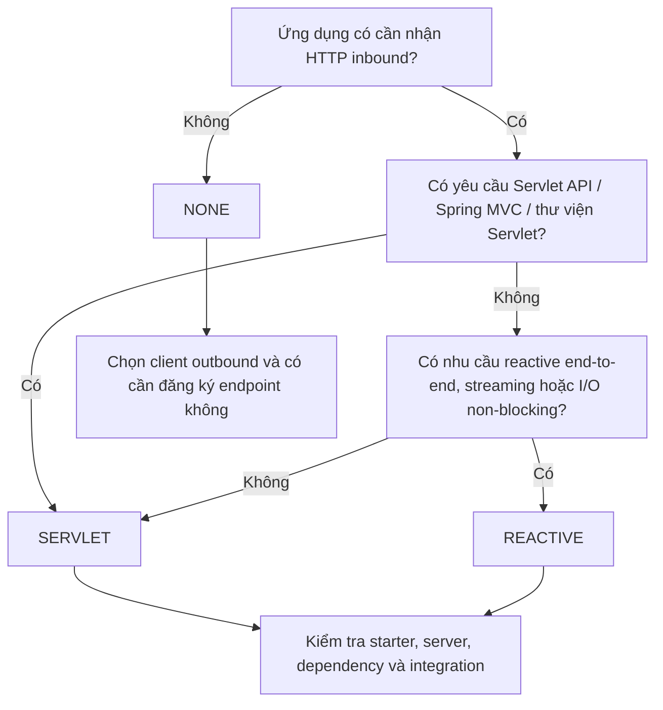

# Chọn ứng dụng Servlet, Reactive hoặc không có web server

## 1. Vì sao cần chọn đúng kiểu ứng dụng?

Khi khởi tạo một ứng dụng Spring Boot, một quyết định kiến trúc quan trọng là ứng dụng có cần nhận HTTP request hay không và nếu có thì chạy theo mô hình Servlet hay Reactive. Lựa chọn này ảnh hưởng đến loại application context, web server được cấu hình tự động, mô hình xử lý request, các thư viện được đưa vào classpath và cách kiểm thử.

Trong hệ sinh thái **SPRING_CLOUD_CORE**, quyết định này còn liên quan đến cách tích hợp discovery, service registry và giao tiếp giữa dịch vụ. Spring Cloud cung cấp các abstraction chung để ứng dụng tìm và gọi dịch vụ; nó không tự quyết định mọi ứng dụng phải dùng Servlet hoặc Reactive. Người phát triển cần hiểu nền tảng Spring Boot trước khi thêm các tích hợp Cloud phù hợp.

Sau bài học, người học có thể:

- Phân biệt ba giá trị `WebApplicationType.SERVLET`, `WebApplicationType.REACTIVE` và `WebApplicationType.NONE`.
- Giải thích cách Spring Boot suy luận kiểu ứng dụng từ classpath và cách cấu hình tường minh.
- Chọn đúng dependency, application context và web server cho từng nhu cầu.
- Hiểu tác động của lựa chọn này đến Spring Cloud Commons, discovery, load balancing, cấu hình ngoài và kiểm thử.
- Tránh đưa một HTTP server vào ứng dụng worker hoặc chọn Reactive chỉ vì cho rằng nó luôn nhanh hơn Servlet.

## 2. Ba kiểu ứng dụng của Spring Boot

Spring Boot biểu diễn loại ứng dụng web bằng enum `WebApplicationType`:

| Kiểu | Mục tiêu | Application context thường dùng | Web server |
| --- | --- | --- | --- |
| `SERVLET` | Ứng dụng web dựa trên Servlet API, thường dùng Spring MVC | `ServletWebServerApplicationContext` | Có embedded Servlet web server |
| `REACTIVE` | Ứng dụng web theo mô hình reactive, thường dùng Spring WebFlux | `ReactiveWebServerApplicationContext` | Có reactive web server |
| `NONE` | Ứng dụng không khởi tạo web server | Context không-web, ví dụ `AnnotationConfigApplicationContext` | Không có embedded web server |

Ba lựa chọn này nói về **cách Spring Boot khởi tạo ứng dụng**, không phải ba ngôn ngữ lập trình hoặc ba kiểu triển khai độc lập. Cả ba vẫn có thể dùng Spring Framework IoC container, dependency injection, configuration properties, logging, scheduling, messaging và các thư viện client phù hợp.

### 2.1. Servlet: mô hình web truyền thống

Với `SERVLET`, Spring Boot khởi tạo web application dựa trên Servlet API. Khi dùng Spring MVC, request thường đi qua `DispatcherServlet`, sau đó được định tuyến đến controller và các thành phần xử lý.

Ví dụ controller:

```java
@RestController
@RequestMapping("/orders")
class OrderController {

    @GetMapping("/{id}")
    OrderView getOrder(@PathVariable String id) {
        return new OrderView(id, "ACCEPTED");
    }
}

record OrderView(String id, String status) {}
```

Dependency phổ biến:

```xml
<dependency>
    <groupId>org.springframework.boot</groupId>
    <artifactId>spring-boot-starter-web</artifactId>
</dependency>
```

Với cấu hình mặc định phổ biến, starter này đưa Spring MVC và embedded Tomcat vào classpath. Boot tự cấu hình Servlet web server và MVC infrastructure. Tomcat không phải yêu cầu bắt buộc của Servlet API: tùy dependency và cấu hình, có thể thay bằng server Servlet khác được hỗ trợ.

Mô hình Servlet thường phù hợp khi:

- Ứng dụng đang dùng Spring MVC, Servlet Filter, Servlet API hoặc thư viện phụ thuộc vào Servlet.
- Phần lớn xử lý là request/response thông thường và gọi database/client theo kiểu blocking.
- Đội ngũ có hệ sinh thái thư viện, công cụ quan sát và kinh nghiệm vận hành dựa trên Servlet.
- Không có nhu cầu rõ ràng để chuyển toàn bộ đường đi I/O sang reactive.

Servlet không có nghĩa mọi request nhất thiết phải chặn một thread trong suốt vòng đời. Servlet stack có hỗ trợ async processing và Spring MVC có thể làm việc với một số kiểu kết quả bất đồng bộ. Tuy vậy, mô hình lập trình và các abstraction của MVC vẫn khác WebFlux.

### 2.2. Reactive: mô hình non-blocking với Spring WebFlux

Với `REACTIVE`, Boot khởi tạo reactive web application. Spring WebFlux dùng `DispatcherHandler` và các abstraction reactive như `Mono` và `Flux` để xử lý luồng dữ liệu bất đồng bộ, có khả năng backpressure.

Ví dụ endpoint trả về một luồng kết quả:

```java
@RestController
@RequestMapping("/events")
class EventController {

    @GetMapping
    Flux<EventView> recentEvents() {
        return Flux.just(
                new EventView("created"),
                new EventView("paid")
        );
    }
}

record EventView(String type) {}
```

Dependency phổ biến:

```xml
<dependency>
    <groupId>org.springframework.boot</groupId>
    <artifactId>spring-boot-starter-webflux</artifactId>
</dependency>
```

Với cấu hình mặc định, Spring Boot thường dùng Reactor Netty làm reactive web server. Reactive stack cũng có thể chạy trên một số Servlet container tương thích; do đó “Reactive” mô tả mô hình ứng dụng và web stack, không phải một khẳng định rằng mọi thành phần bên dưới đều là Netty.

Reactive phù hợp khi hệ thống có nhiều I/O bất đồng bộ, luồng dữ liệu liên tục, streaming hoặc cần giữ khả năng xử lý đồng thời mà không dành một thread chờ cho từng thao tác I/O. Lợi ích phụ thuộc vào việc các thành phần trong đường đi có thực sự non-blocking hay không.

**Reactive không tự động nhanh hơn Servlet.** Nếu controller gọi JDBC blocking trực tiếp trên event-loop, thread xử lý có thể bị chặn và làm giảm khả năng phục vụ nhiều request. Nếu nghiệp vụ chủ yếu là CPU-bound hoặc dùng thư viện blocking, MVC có thể đơn giản và phù hợp hơn. Reactive cần thiết kế thread model, timeout, backpressure và tích hợp client nhất quán.

### 2.3. NONE: ứng dụng không có web server

Với `NONE`, Boot không khởi tạo embedded web server. Ứng dụng vẫn có thể là một Spring application đầy đủ: tạo bean, nạp cấu hình, chạy tác vụ nền, đọc message, xử lý batch hoặc thực hiện công việc theo lịch.

Ví dụ dùng `CommandLineRunner`:

```java
@SpringBootApplication
public class ReconciliationApplication {

    public static void main(String[] args) {
        SpringApplication.run(ReconciliationApplication.class, args);
    }

    @Bean
    CommandLineRunner reconcile(ReconciliationService service) {
        return args -> service.runOnce();
    }
}
```

Cấu hình rõ kiểu không-web:

```yaml
spring:
  main:
    web-application-type: none
```

Ứng dụng `NONE` vẫn có thể gọi API của hệ thống khác qua `RestClient` hoặc `WebClient` nếu đã thêm dependency/client phù hợp. `NONE` chỉ có nghĩa ứng dụng không mở web server để nhận request; nó không cấm giao tiếp mạng đi ra ngoài.

Các tình huống thường phù hợp:

- Worker tiêu thụ message từ broker.
- Batch job hoặc tiến trình đồng bộ dữ liệu chạy theo lịch.
- CLI/tool vận hành dùng Spring để quản lý cấu hình và dependency.
- Tiến trình điều phối hoặc nền tảng xử lý nền không cung cấp HTTP API.

Nếu một worker cần health/management endpoint qua HTTP, hãy cân nhắc kiến trúc quản trị riêng hoặc chuyển sang kiểu web phù hợp. Không nên giả định Actuator sẽ tự có endpoint HTTP khi ứng dụng chạy `NONE`.

## 3. Spring Boot chọn kiểu ứng dụng như thế nào?

### 3.1. Suy luận từ classpath

Khi không cấu hình tường minh, `SpringApplication` suy luận `WebApplicationType` dựa trên các lớp có mặt trong classpath. Vì vậy, một dependency bắc cầu (transitive dependency) có thể ảnh hưởng đến kiểu ứng dụng dù mã nguồn không trực tiếp import thư viện đó.

Quy tắc thực hành phổ biến:

- Có Spring MVC/Servlet web stack: Boot thường chọn `SERVLET`.
- Có WebFlux nhưng không có Spring MVC/Servlet MVC: Boot thường chọn `REACTIVE`.
- Không có các lớp web cần thiết: Boot chọn `NONE`.

Đây là cách mô tả rút gọn. Việc suy luận thực tế dựa trên sự hiện diện/vắng mặt của các lớp cụ thể, không chỉ nhìn tên starter. Vì thế, khi kiểu ứng dụng khác mong đợi, hãy kiểm tra dependency tree và điều kiện auto-configuration.

### 3.2. Khi cả MVC và WebFlux cùng có trong classpath

Một trường hợp thường gặp là dự án thêm `spring-boot-starter-webflux` chỉ để dùng `WebClient`, trong khi `spring-boot-starter-web` vẫn được giữ lại. Nếu cả Spring MVC và WebFlux cùng có mặt, Spring Boot mặc định ưu tiên kiểu **Servlet/MVC**.

Điều này có thể hợp lý: ứng dụng tiếp tục phục vụ HTTP bằng MVC nhưng sử dụng `WebClient` làm HTTP client đi ra. Có mặt `WebClient` không buộc ứng dụng phải trở thành reactive web server.

Nếu mục tiêu thực sự là chạy WebFlux, cần kiểm tra dependency và có thể đặt `spring.main.web-application-type=reactive`. Tuy nhiên, ép kiểu Reactive trong khi vẫn kéo theo thư viện chỉ dành cho Servlet có thể tạo ra cấu hình dư thừa hoặc xung đột. Hãy loại dependency không cần thiết và xác nhận các starter tương thích.

## 4. Cấu hình lựa chọn kiểu ứng dụng

### 4.1. Cấu hình qua application.yml

Có thể chọn kiểu ứng dụng bằng property `spring.main.web-application-type`:

```yaml
spring:
  main:
    web-application-type: servlet
```

Giá trị hợp lệ tương ứng là `servlet`, `reactive` và `none` (không phân biệt chữ hoa/thường theo cơ chế binding của Spring Boot).

Ví dụ ứng dụng worker:

```yaml
spring:
  main:
    web-application-type: none
```

Ví dụ ứng dụng WebFlux:

```yaml
spring:
  main:
    web-application-type: reactive
```

Property này có thể đặt trong file cấu hình hoặc nguồn externalized configuration phù hợp. Nếu dùng profile, hãy bảo đảm profile thực tế được kích hoạt đúng khi deploy; tránh để môi trường production vô tình nhận cấu hình `none` hoặc `servlet` từ một file profile khác.

### 4.2. Cấu hình bằng Java

Có thể đặt kiểu ứng dụng trước khi gọi `run`:

```java
import org.springframework.boot.SpringApplication;
import org.springframework.boot.WebApplicationType;

public class GatewayApplication {
    public static void main(String[] args) {
        SpringApplication application =
                new SpringApplication(GatewayApplication.class);

        application.setWebApplicationType(WebApplicationType.REACTIVE);
        application.run(args);
    }
}
```

Cách này hữu ích khi quyết định phụ thuộc vào logic khởi chạy. Trong đa số ứng dụng thông thường, cấu hình bằng property dễ quan sát và quản lý theo môi trường hơn. Chỉ nên có một nguồn quyết định rõ ràng; nếu property và code cùng đặt giá trị, hãy xác minh hành vi theo cách khởi tạo của ứng dụng để tránh gây nhầm lẫn cho người vận hành.

## 5. Kiểu ứng dụng quyết định những thành phần nào?

| Khía cạnh | SERVLET | REACTIVE | NONE |
| --- | --- | --- | --- |
| Nhận HTTP inbound | Có | Có | Không có embedded web server |
| Web framework điển hình | Spring MVC | Spring WebFlux | Không bắt buộc web framework |
| Handler trung tâm | `DispatcherServlet` | `DispatcherHandler` | Không có web dispatcher |
| Context web | `ServletWebServerApplicationContext` | `ReactiveWebServerApplicationContext` | Context không-web |
| Server mặc định thường gặp | Tomcat | Reactor Netty | Không có |
| Kiểu controller phổ biến | `@RestController`, kiểu trả về đồng bộ hoặc async | `@RestController`, `Mono`, `Flux` | Không có controller inbound |
| HTTP client outbound | `RestClient`, `WebClient` | `WebClient`, hoặc client blocking nếu phù hợp | Cả `RestClient` và `WebClient` nếu có dependency |
| Tác vụ nền / messaging | Có | Có | Có |
| Spring Framework DI/configuration | Có | Có | Có |

Bảng này mô tả các cấu hình phổ biến, không phải giới hạn tuyệt đối. Chẳng hạn, một ứng dụng MVC có thể sử dụng `WebClient` outbound; một ứng dụng Reactive vẫn có thể gọi một thư viện blocking nếu chủ động cô lập việc blocking; một ứng dụng `NONE` vẫn có thể sử dụng nhiều client giao tiếp với hệ thống ngoài.

## 6. Ảnh hưởng đến Spring Cloud Core

Spring Cloud Core cung cấp abstraction cho cấu hình, discovery và giao tiếp dịch vụ. Kiểu ứng dụng Boot là nền tảng khởi tạo; các tính năng Cloud được thêm theo nhu cầu và theo khả năng của implementation.

### 6.1. Discovery và service registry không đồng nghĩa với web application type

Spring Cloud Commons có các abstraction như:

- `DiscoveryClient`: tra cứu service ID và danh sách `ServiceInstance` theo API blocking.
- `ReactiveDiscoveryClient`: biến thể discovery theo kiểu reactive.
- `ServiceRegistry`: hợp đồng thao tác đăng ký/hủy đăng ký và trạng thái đăng ký theo khả năng implementation.
- Spring Cloud LoadBalancer: chọn instance phù hợp cho lời gọi theo service ID.

Một ứng dụng Servlet hay Reactive đều có thể sử dụng discovery để gọi dịch vụ khác. Ứng dụng `NONE` cũng có thể là **discovery client** để tìm địa chỉ dịch vụ outbound, miễn là dependency và cấu hình phù hợp.

Ngược lại, nếu ứng dụng không có HTTP server và không cung cấp endpoint inbound, việc tự động đăng ký nó như một HTTP service có thể không có ý nghĩa. Cần quyết định rõ service ID và loại endpoint được công bố. Nếu không cần auto-registration, có thể tắt cơ chế chung khi implementation hỗ trợ:

```yaml
spring:
  cloud:
    service-registry:
      auto-registration:
        enabled: false
```

Property này chỉ điều khiển auto-registration theo tích hợp Spring Cloud tương ứng; nó không ngăn ứng dụng tra cứu dịch vụ qua `DiscoveryClient`. Một worker có thể không đăng ký endpoint HTTP nhưng vẫn cần khám phá `payment-service` để gửi yêu cầu xử lý.

### 6.2. Giao tiếp blocking và reactive

Chọn Servlet/Reactive ảnh hưởng cách tổ chức đường đi HTTP:

| Nhu cầu | Cách tiếp cận thường gặp |
| --- | --- |
| MVC controller gọi service qua API blocking | `RestClient` cùng cấu hình LoadBalancer nếu gọi bằng service ID |
| WebFlux controller gọi service qua API reactive | `WebClient` cùng cấu hình LoadBalancer reactive phù hợp |
| Worker `NONE` thực hiện một tác vụ outbound | Chọn `RestClient` hoặc `WebClient` theo mô hình xử lý và dependency |
| Dùng discovery API trong luồng reactive | Ưu tiên `ReactiveDiscoveryClient`/integration reactive nếu provider hỗ trợ |
| Dùng discovery API trong mã đồng bộ | `DiscoveryClient` là abstraction blocking phù hợp |

Ví dụ cấu hình `WebClient.Builder` có tích hợp Spring Cloud LoadBalancer trong ứng dụng reactive:

```java
@Configuration
class OutboundClientConfiguration {

    @Bean
    @LoadBalanced
    WebClient.Builder inventoryWebClientBuilder() {
        return WebClient.builder();
    }
}

@Service
class InventoryClient {
    private final WebClient webClient;

    InventoryClient(@LoadBalanced WebClient.Builder builder) {
        this.webClient = builder.build();
    }

    Mono<InventoryView> find(String sku) {
        return webClient.get()
                .uri("http://inventory-service/api/items/{sku}", sku)
                .retrieve()
                .bodyToMono(InventoryView.class);
    }
}

record InventoryView(String sku, boolean available) {}
```

Để lời gọi hoạt động, ứng dụng cần Spring Cloud LoadBalancer và nguồn instance hợp lệ từ discovery hoặc cấu hình được hỗ trợ. Chỉ viết hostname `inventory-service` trong URL không tự tạo ra discovery. `@LoadBalanced` đánh dấu builder để integration của Spring Cloud xử lý service ID khi gửi request.

Trong ứng dụng MVC, có thể dùng `RestClient.Builder` được đánh dấu `@LoadBalanced` cho lời gọi blocking. Không nên gọi một client blocking trực tiếp trên reactive event-loop; nếu buộc phải dùng thư viện blocking, cần cô lập trên scheduler/executor phù hợp và quản lý giới hạn concurrency.

### 6.3. Cấu hình ngoài và refresh scope

Việc nạp cấu hình ngoài không yêu cầu ứng dụng phải có web server. Spring Boot có thể đọc property khi khởi động trong cả ba kiểu ứng dụng. Spring Cloud Config Client cũng có thể được dùng để nhận cấu hình tập trung nếu dependency và cơ chế import được thiết lập.

Ví dụ:

```yaml
spring:
  application:
    name: reconciliation-worker
  config:
    import: optional:configserver:http://config-server:8888
  main:
    web-application-type: none
```

Ở đây worker nhận cấu hình tập trung nhưng không mở HTTP server. `optional:` là lựa chọn cho phép ứng dụng xử lý trường hợp Config Server không khả dụng theo semantics của Config Data import; với cấu hình bắt buộc cho nghiệp vụ, cần cân nhắc bỏ `optional:` và định nghĩa chính sách fail-fast.

`@RefreshScope` thuộc Spring Cloud Context và quản lý việc tạo lại một số bean khi refresh được kích hoạt. Nó không phụ thuộc vào việc ứng dụng là Servlet hay Reactive. Tuy nhiên, nếu trigger refresh được cung cấp qua HTTP Actuator endpoint thì ứng dụng `NONE` không tự có endpoint HTTP để nhận lệnh; cần chọn cơ chế trigger khác như sự kiện, quản trị nền tảng hoặc phương thức quản trị được triển khai riêng. Không được suy ra rằng thay property sẽ tự động làm mọi bean thay đổi.

### 6.4. Những tích hợp Cloud có yêu cầu riêng

Không phải mọi Spring Cloud module đều hỗ trợ mọi kiểu ứng dụng giống nhau. Ví dụ, các thành phần gateway có yêu cầu web stack cụ thể; một gateway dựa trên WebFlux cần ứng dụng Reactive. Các module Config, Commons discovery hoặc Context có phạm vi khác và có thể được dùng trong ứng dụng không có inbound web server.

Trước khi chọn starter, hãy kiểm tra tài liệu module và phiên bản release train tương thích với Spring Boot. Không nên thêm một starter chỉ vì tên module có chữ “Cloud” rồi kỳ vọng nó tự hoạt động với mọi application type.

## 7. Quy trình ra quyết định

Có thể chọn theo các câu hỏi sau:



Hãy tự trả lời:

1. Ứng dụng có phải phục vụ HTTP inbound hay chỉ chạy nền?
2. Nếu phục vụ HTTP, có phụ thuộc Servlet API hoặc Spring MVC không?
3. Nếu chọn Reactive, các database driver, HTTP client và thư viện I/O chính có hỗ trợ non-blocking không?
4. Có starter bắc cầu nào kéo cả MVC và WebFlux vào classpath không?
5. Spring Cloud module được chọn có hỗ trợ application type và client model tương ứng không?
6. Nếu dùng service registry, ứng dụng có endpoint inbound nào cần công bố không?
7. Readiness, health check và shutdown được hạ tầng triển khai sử dụng như thế nào?

Ví dụ lựa chọn:

| Ứng dụng | Lựa chọn thường hợp lý | Lý do |
| --- | --- | --- |
| REST API quản lý đơn hàng dùng Spring MVC và JDBC | SERVLET | Hệ sinh thái blocking phù hợp, mô hình đơn giản |
| API streaming kết hợp WebFlux và reactive data driver | REACTIVE | Có lợi ích từ I/O non-blocking trên toàn đường đi |
| Worker tiêu thụ Kafka rồi ghi database | NONE | Không cần mở HTTP server inbound, trừ khi có nhu cầu quản trị |
| Batch job đọc Config Server và gọi API bên ngoài | NONE | Externalized config và HTTP client outbound không cần web server |
| Gateway xử lý routing theo mô hình WebFlux | REACTIVE | Thành phần gateway reactive cần web stack tương ứng |
| Ứng dụng MVC cần gọi nhiều API bằng WebClient | SERVLET | Có thể dùng WebClient outbound mà vẫn phục vụ bằng MVC |

## 8. Kiểm tra dependency và kiểu ứng dụng khi chạy

### 8.1. Kiểm tra dependency tree

Nếu Boot khởi tạo sai kiểu, trước hết kiểm tra starter và dependency bắc cầu. Với Maven:

```bash
mvn dependency:tree
```

Tìm các artifact liên quan đến `spring-webmvc`, `spring-webflux`, `spring-boot-starter-web`, `spring-boot-starter-webflux` và server runtime. Với Gradle, có thể xem dependency report của configuration runtime tương ứng. Không cần loại bỏ dependency theo phỏng đoán; xác định thư viện nào kéo nó vào và liệu mã nguồn có thật sự cần hay không.

### 8.2. Xác nhận kiểu khởi tạo

Có thể ghi lại `WebApplicationType` đã cấu hình khi tạo `SpringApplication` hoặc kiểm tra loại context trong integration test. Ví dụ:

```java
@SpringBootTest(
    properties = "spring.main.web-application-type=none"
)
class WorkerApplicationTests {

    @Autowired
    ApplicationContext context;

    @Test
    void startsWithoutWebServer() {
        assertThat(context)
                .isNotInstanceOf(WebServerApplicationContext.class);
    }
}
```

Ví dụ này minh họa cách kiểm tra ứng dụng worker không khởi tạo web server. Cần thêm assertion và test nghiệp vụ thực tế theo yêu cầu của dự án; việc context không phải `WebServerApplicationContext` chưa chứng minh worker đã xử lý message hoặc batch thành công.

## 9. Kiểm thử theo từng kiểu ứng dụng

Spring Boot hỗ trợ các chế độ `@SpringBootTest` khác nhau:

| WebEnvironment | Hành vi khái quát | Phù hợp để |
| --- | --- | --- |
| `MOCK` | Tạo web application context mô phỏng nếu web stack hiện diện; không mở server thật | Kiểm tra MVC/WebFlux context và controller bằng mock infrastructure |
| `RANDOM_PORT` | Khởi chạy server thật trên cổng ngẫu nhiên | Integration test qua HTTP thực |
| `DEFINED_PORT` | Khởi chạy server thật trên cổng cấu hình | Kiểm thử môi trường cần cổng cố định |
| `NONE` | Không khởi chạy web environment | Kiểm tra worker, batch hoặc ứng dụng không-web |

Ví dụ test HTTP trên cổng ngẫu nhiên:

```java
@SpringBootTest(webEnvironment = SpringBootTest.WebEnvironment.RANDOM_PORT)
class OrderApiIntegrationTest {

    @LocalServerPort
    int port;

    @Test
    void serverStartsOnRandomPort() {
        assertThat(port).isPositive();
    }
}
```

Đối với ứng dụng `NONE`, dùng `webEnvironment = SpringBootTest.WebEnvironment.NONE` hoặc cấu hình `spring.main.web-application-type=none` trong test để bảo đảm không vô tình khởi tạo server do dependency test kéo thêm web stack vào classpath.

Kiểm thử discovery và LoadBalancer nên được chia thành hai nhóm:

- **Kiểm thử ứng dụng:** xác nhận bean, client builder, property và controller được cấu hình theo kiểu Servlet/Reactive mong muốn.
- **Kiểm thử tích hợp discovery:** xác nhận service ID được phân giải ra instance, client chọn instance và xử lý danh sách rỗng/lỗi kết nối đúng cách.

Mock `DiscoveryClient` không thể chứng minh registry thật đã đăng ký đúng instance. Tương tự, `RANDOM_PORT` chỉ chứng minh web server có thể khởi động và nhận request; nó không xác nhận caller khác đã khám phá được địa chỉ của instance.

## 10. Các lỗi thường gặp

| Triệu chứng | Nguyên nhân có thể | Hướng xử lý |
| --- | --- | --- |
| Dự kiến Reactive nhưng context là Servlet | MVC có mặt trong classpath và Boot ưu tiên Servlet | Kiểm tra dependency tree, loại starter không cần hoặc cấu hình rõ application type |
| Ứng dụng worker bất ngờ mở cổng | Có web starter trong dependency bắc cầu | Đặt `web-application-type: none` nếu đúng mục tiêu và rà soát dependency |
| Không tìm thấy `ServletWebServerFactory` | Đã ép Servlet nhưng thiếu server implementation phù hợp | Bổ sung starter/server Servlet tương thích |
| Không tìm thấy `ReactiveWebServerFactory` | Đã ép Reactive nhưng thiếu reactive web server/runtime phù hợp | Bổ sung dependency server phù hợp với Boot |
| WebFlux có vẻ chậm dưới tải | Blocking call chạy trên event-loop, thiếu backpressure hoặc giới hạn concurrency | Xác định blocking path, chuyển sang client non-blocking hoặc cô lập blocking có kiểm soát |
| Discovery có địa chỉ nhưng request không đến được | Instance không có server, port sai hoặc bản ghi cũ | Kiểm tra application type, actual port, registration và caller cache |
| Worker `NONE` vẫn cố đăng ký như HTTP service | Auto-registration được bật nhưng worker không có inbound endpoint | Tắt auto-registration phù hợp hoặc cấu hình endpoint riêng có chủ ý |
| Config refresh endpoint không truy cập được | Ứng dụng `NONE` không có HTTP server hoặc endpoint chưa expose | Dùng trigger phù hợp với kiểu triển khai và bảo vệ quyền quản trị |

## 11. Các nguyên tắc cần ghi nhớ

- Chọn kiểu ứng dụng theo **giao diện inbound và mô hình I/O**, không theo xu hướng hoặc tên dự án.
- `SERVLET` thường gắn với Spring MVC; `REACTIVE` thường gắn với WebFlux; `NONE` vẫn là Spring application nhưng không mở embedded web server.
- Boot suy luận application type từ classpath; dependency bắc cầu có thể làm thay đổi kết quả. Cấu hình tường minh khi cần, đồng thời giữ dependency gọn.
- Web client outbound không quyết định web server inbound. Một ứng dụng MVC có thể dùng `WebClient`; một worker `NONE` vẫn có thể gọi service khác.
- Discovery, service registration và readiness là các mối quan tâm độc lập. Nếu ứng dụng không có HTTP endpoint, hãy xác định rõ nó có nên đăng ký như một HTTP service hay không.
- Kiểm tra yêu cầu application type của từng Spring Cloud module và chọn release train tương thích với Spring Boot.
- Test khởi động, test HTTP, test discovery và test xử lý nghiệp vụ xác nhận các thuộc tính khác nhau; không dùng một phép kiểm tra thay cho tất cả.

## 12. Tài liệu tham khảo

- [Spring Boot — Web](https://docs.spring.io/spring-boot/reference/web/index.html): lựa chọn và cấu hình web application.
- [Spring Boot — Servlet Web Applications](https://docs.spring.io/spring-boot/reference/web/servlet.html): Spring MVC, Servlet context và embedded server.
- [Spring Boot — Reactive Web Applications](https://docs.spring.io/spring-boot/reference/web/reactive.html): Spring WebFlux và reactive server.
- [Spring Boot — Application Events and Listeners](https://docs.spring.io/spring-boot/reference/features/spring-application.html): vòng đời và sự kiện khởi tạo ứng dụng.
- [Spring Cloud Commons](https://docs.spring.io/spring-cloud-commons/reference/): discovery, service registry và load balancing abstraction.
- [Spring Cloud Config](https://docs.spring.io/spring-cloud-config/reference/): tích hợp cấu hình tập trung.
- [Spring Cloud — Project and Release Trains](https://spring.io/projects/spring-cloud): chọn phiên bản Spring Cloud tương thích với Spring Boot.

**Ghi nhớ:** `SERVLET` dành cho ứng dụng web dựa trên Servlet, `REACTIVE` dành cho web stack reactive, còn `NONE` dành cho ứng dụng Spring không cần web server inbound. Hãy quyết định theo nhu cầu nhận request, mô hình I/O và các dependency thực tế; sau đó mới ghép các abstraction Spring Cloud phù hợp.
