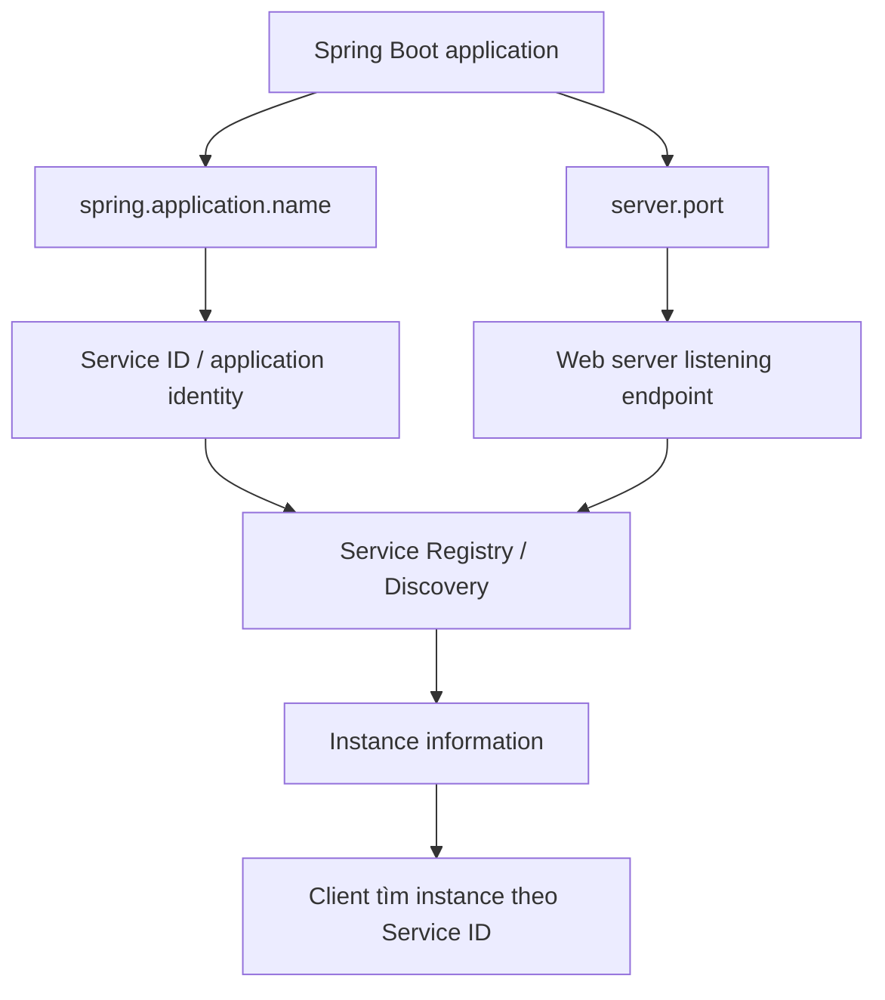

# Đặt spring.application.name và cổng chạy

Khi khởi tạo một dịch vụ Spring Boot trong hệ thống Spring Cloud, hai thuộc tính nên được xác định rõ ngay từ đầu là `spring.application.name` và `server.port`. Thuộc tính thứ nhất đặt **danh tính logic của ứng dụng**; thuộc tính thứ hai đặt **cổng mà web server nhúng trong ứng dụng lắng nghe**. Hai giá trị này thường xuất hiện cùng nhau trong cấu hình, nhưng chúng giải quyết hai vấn đề khác nhau.

Trong module **SPRING_CLOUD_CORE**, người học cần hiểu Spring Cloud Commons, Spring Cloud Context, cấu hình bên ngoài, discovery, service registry, giao tiếp giữa dịch vụ và cách kiểm thử các abstraction chung. Việc đặt tên ứng dụng và cổng chạy là bước khởi tạo cơ bản để những thành phần đó nhận diện đúng dịch vụ và kết nối tới đúng endpoint.

## 1. Hai thuộc tính, hai trách nhiệm

| Thuộc tính | Ý nghĩa | Ví dụ | Thành phần thường sử dụng |
| --- | --- | --- | --- |
| `spring.application.name` | Tên logic của ứng dụng/dịch vụ | `order-service` | Spring Cloud Discovery, service registry, Config Client và các tích hợp quan sát |
| `server.port` | Cổng của web server nhúng trong ứng dụng | `8081` | Spring Boot web server và các client kết nối trực tiếp tới endpoint |

Một cách ghi nhớ:

- **Tên ứng dụng trả lời:** “Đây là dịch vụ nào?”
- **Cổng chạy trả lời:** “Web server của tiến trình này đang lắng nghe ở cổng nào?”

Ví dụ, ba instance của cùng một dịch vụ có thể cùng mang tên logic `inventory-service`, nhưng chạy ở các địa chỉ khác nhau:

```text
inventory-service
  ├── instance A: 10.0.1.11:8080
  ├── instance B: 10.0.1.12:8080
  └── instance C: 10.0.2.15:8082
```

Service ID giống nhau giúp bên gọi tìm đúng loại dịch vụ; endpoint và thông tin instance giúp định tuyến tới một bản chạy cụ thể. Không cần đặt `spring.application.name` khác nhau cho từng replica. Mỗi replica thuộc cùng một dịch vụ logic, còn thông tin instance phải đủ để phân biệt các endpoint.

## 2. Đặt spring.application.name

`spring.application.name` là property trong Spring Environment, thường được khai báo trong cấu hình Spring Boot. Spring Cloud và các thư viện liên quan có thể dùng giá trị này làm tên ứng dụng hoặc Service ID khi đăng ký và khám phá dịch vụ.

Ví dụ, dịch vụ xử lý đơn hàng khai báo:

```yaml
spring:
  application:
    name: order-service
```

Hoặc dùng `application.properties`:

```properties
spring.application.name=order-service
```

Nên chọn tên ngắn, ổn định, dễ nhận diện, thường dùng chữ thường và dấu gạch nối:

| Vai trò | Tên gợi ý |
| --- | --- |
| Quản lý đơn hàng | `order-service` |
| Quản lý kho | `inventory-service` |
| Thanh toán | `payment-service` |
| Tài khoản | `account-service` |

Tên này nên mô tả **vai trò dịch vụ**, không mô tả một máy chủ hoặc một replica. Khi mở rộng từ một instance lên nhiều instance, Service ID vẫn giữ nguyên. Khi triển khai phiên bản mới, tên logic thường cũng giữ nguyên nếu dịch vụ vẫn thực hiện cùng vai trò và tương thích với hợp đồng giao tiếp.

### 2.1. Tên ứng dụng được dùng ở đâu?

Trong ứng dụng Spring Cloud, tên có thể được dùng trong một số ngữ cảnh:

- **Discovery và service registry:** tích hợp discovery thường dùng tên ứng dụng làm Service ID để đăng ký instance hoặc tìm các instance của dịch vụ.
- **Giao tiếp dịch vụ:** một HTTP client tích hợp Spring Cloud LoadBalancer có thể dùng tên logic như `http://inventory-service` để tìm instance trước khi gửi request.
- **Externalized configuration:** Spring Cloud Config Client có thể dùng tên ứng dụng khi xác định bộ cấu hình dành cho ứng dụng.
- **Log, trace và metric:** các tích hợp quan sát có thể dùng tên ứng dụng làm nhãn nhận diện hoặc thuộc tính tài nguyên.

Cách sử dụng cụ thể tùy vào provider và cấu hình. Chỉ đặt `spring.application.name` **không tự tạo registry, không đăng ký instance vào Eureka/Consul và không tự bật load balancing**. Ứng dụng cần các dependency, cấu hình và dịch vụ hạ tầng tương ứng.

### 2.2. Phân biệt tên ứng dụng và tên instance

Tên ứng dụng là danh tính chung của dịch vụ. Instance ID là danh tính của một bản chạy cụ thể.

```text
Application / Service ID: inventory-service
  ├── Instance ID: inventory-service-node-a
  ├── Instance ID: inventory-service-node-b
  └── Instance ID: inventory-service-node-c
```

Các registry có quy tắc tạo instance ID riêng. Không nên giả định instance ID luôn bằng `spring.application.name`, cũng không nên tự tạo instance ID trùng nhau cho nhiều replica. Nếu cấu hình instance ID thủ công, cần bảo đảm nó duy nhất trong phạm vi registry và phù hợp với vòng đời triển khai.

## 3. Đặt server.port

Với ứng dụng Spring Boot có web server nhúng, `server.port` xác định cổng lắng nghe HTTP/HTTPS của server. Nếu không cấu hình, cổng mặc định phổ biến của web server nhúng là `8080`.

Ví dụ:

```yaml
server:
  port: 8081
```

Hoặc:

```properties
server.port=8081
```

Khi ứng dụng khởi động thành công, web server sẽ bind vào cổng này trên địa chỉ mạng được cấu hình. Một ứng dụng khác trên cùng máy không thể đồng thời bind cùng địa chỉ IP và cổng nếu không có cơ chế chia sẻ socket tương ứng. Vì vậy, chạy nhiều dịch vụ local thường cần dùng các cổng khác nhau.

Ví dụ cấu hình hai dịch vụ chạy trên cùng máy:

```text
order-service      -> localhost:8081
inventory-service  -> localhost:8082
payment-service    -> localhost:8083
```

Mỗi dịch vụ có thể có tên logic riêng và cổng local riêng. Khi triển khai nhiều replica trên các máy/container khác nhau, các replica có thể dùng cùng cổng nội bộ, vì mỗi instance có network namespace hoặc địa chỉ IP riêng.

### 3.1. server.port không phải cổng của dịch vụ khác

Giả sử `order-service` gọi `inventory-service`. Cấu hình `server.port` trong `order-service` chỉ điều khiển web server của chính `order-service`. Nó không xác định cổng đích khi gọi sang `inventory-service`.

Địa chỉ đích được xác định bởi URL, DNS, Service ID kết hợp với discovery/load balancing hoặc một điểm truy cập do hạ tầng cung cấp. Tương tự, `server.port` cũng không phải cổng của Eureka Server, Consul hay Spring Cloud Config Server.

### 3.2. Dùng cổng ngẫu nhiên với server.port=0

Khi cần chạy nhiều ứng dụng kiểm thử hoặc nhiều instance trên cùng máy, có thể yêu cầu hệ điều hành cấp một cổng khả dụng bằng cách đặt:

```yaml
server:
  port: 0
```

Spring Boot sẽ khởi động web server trên một cổng ngẫu nhiên còn trống. Điều này hữu ích trong integration test vì tránh phụ thuộc vào một cổng cố định.

Không nên suy đoán cổng thực tế từ giá trị cấu hình `0`. Sau khi server khởi động, cần lấy cổng thực tế từ sự kiện khởi tạo web server, log hoặc cơ chế kiểm thử tương ứng. Nếu đăng ký instance vào service registry, cần xác minh registry công bố **cổng thực tế có thể truy cập**, thay vì để bên gọi nhận nhầm giá trị `0`.

### 3.3. Cổng ứng dụng và cổng quản trị

Nếu bật Spring Boot Actuator và muốn tách cổng quản trị, có thể cấu hình `management.server.port`:

```yaml
server:
  port: 8081

management:
  server:
    port: 9091
```

Trong ví dụ này, cổng phục vụ API ứng dụng là 8081; cổng management là 9091. Việc tách cổng không tự giới hạn quyền truy cập. Cần cấu hình bảo mật và mạng phù hợp cho các endpoint quản trị.

## 4. Khai báo hai thuộc tính trong application.yml

Một cấu hình khởi tạo đơn giản cho `order-service`:

```yaml
spring:
  application:
    name: order-service

server:
  port: 8081
```

Cấu hình này nói với Spring rằng ứng dụng có tên logic `order-service` và web server lắng nghe tại cổng 8081.

Có thể kết hợp placeholder để nhận cổng từ môi trường, đồng thời giữ giá trị mặc định cho local:

```yaml
spring:
  application:
    name: order-service

server:
  port: ${SERVER_PORT:8080}
```

Nếu biến môi trường `SERVER_PORT` tồn tại, Spring dùng giá trị đó; nếu không, cổng mặc định trong ví dụ là 8080. Với `spring.application.name`, cũng có thể truyền qua biến môi trường `SPRING_APPLICATION_NAME`.

## 5. Cấu hình theo môi trường: profile, environment và command line

Một dịch vụ có thể chạy trên local, test, staging và production. Không nên phải sửa file cấu hình chính mỗi lần chuyển môi trường. Spring Boot hỗ trợ nhiều nguồn cấu hình, cho phép giữ tên dịch vụ ổn định và điều chỉnh cổng theo cách triển khai.

### 5.1. Dùng profile

File `application.yml` chứa cấu hình chung:

```yaml
spring:
  application:
    name: order-service

server:
  port: 8080
```

File `application-dev.yml` ghi đè cổng khi profile `dev` hoạt động:

```yaml
server:
  port: 8081
```

Kích hoạt profile:

```bash
java -jar order-service.jar --spring.profiles.active=dev
```

Khi profile `dev` được kích hoạt, Spring Boot nạp cấu hình profile tương ứng. Tên ứng dụng vẫn là `order-service`, còn cổng được chọn theo cấu hình của profile. Profile là cách tổ chức cấu hình; nó không tự tạo một môi trường mạng riêng hoặc registry riêng.

### 5.2. Dùng biến môi trường

Có thể thiết lập trực tiếp trên môi trường chạy:

```bash
SPRING_APPLICATION_NAME=order-service
SERVER_PORT=8082
```

Tên biến môi trường sử dụng chữ hoa và dấu gạch dưới theo quy tắc ánh xạ relaxed binding của Spring Boot:

| Property | Environment variable |
| --- | --- |
| `spring.application.name` | `SPRING_APPLICATION_NAME` |
| `server.port` | `SERVER_PORT` |
| `spring.profiles.active` | `SPRING_PROFILES_ACTIVE` |

Cách đặt biến môi trường phụ thuộc shell, hệ điều hành hoặc nền tảng container. Trong Docker/Kubernetes, các biến có thể được khai báo qua cấu hình triển khai hoặc secret/config map theo chính sách của hệ thống.

### 5.3. Ghi đè qua command line

Spring Boot cho phép truyền property khi chạy ứng dụng:

```bash
java -jar order-service.jar \
  --spring.application.name=order-service \
  --server.port=8083
```

Tham số command line thường có độ ưu tiên cao hơn giá trị tương ứng trong file cấu hình. Vì vậy, nếu `application.yml` đặt cổng 8080 nhưng tham số chạy đặt `--server.port=8083`, ứng dụng sẽ dùng cổng 8083.

Khi debug cấu hình, hãy kiểm tra **giá trị hiệu lực trong Environment**, không chỉ nhìn một file YAML. Giá trị có thể đến từ profile, biến môi trường, tham số command line hoặc nguồn cấu hình bên ngoài.

### 5.4. Cấu hình bên ngoài và Spring Cloud Config

Spring Boot hỗ trợ externalized configuration: cùng một artifact có thể chạy ở nhiều môi trường với giá trị cấu hình khác nhau. Spring Cloud Config có thể cung cấp property từ Config Server, nhưng việc dùng Config Server cần client, server và cách import/kết nối phù hợp với phiên bản Spring Boot/Spring Cloud.

Một số nguyên tắc:

- Đặt `spring.application.name` ổn định để các thành phần nhận diện ứng dụng và, khi dùng Config Server, xác định cấu hình theo tên phù hợp.
- Đặt cổng theo môi trường triển khai bằng file profile, biến môi trường hoặc nguồn cấu hình được quản lý.
- Xác định thứ tự ưu tiên property source theo phiên bản và cơ chế Config Data đang sử dụng.
- Không lưu thông tin bí mật như mật khẩu, token hoặc private key trực tiếp trong file cấu hình được commit vào source control.

Với Spring Cloud, thời điểm tải cấu hình và cơ chế bootstrap/config import phụ thuộc release train. Cần theo hướng dẫn tương thích với phiên bản dự án thay vì sao chép cấu hình của một thế hệ Spring Cloud khác.

## 6. Liên hệ với discovery và service registry

Khi một ứng dụng dùng discovery, tên ứng dụng và cổng thực tế là hai thông tin quan trọng để công bố một instance:



Ví dụ:

- `inventory-service` khởi động với tên `inventory-service` và cổng 8082.
- Tích hợp discovery đăng ký instance với Service ID tương ứng và endpoint có thể truy cập.
- `order-service` tìm instance theo Service ID `inventory-service`.
- Client-side load balancer chọn một instance và gửi request tới endpoint đó.

Trong ví dụ này, tên dịch vụ giúp bên gọi tìm **nhóm instance**, còn host/port giúp kết nối tới **một instance cụ thể**. Nếu chỉ đặt tên mà chưa cấu hình discovery provider, registry sẽ không tự có bản ghi. Nếu đặt cổng nhưng server không khởi động hoặc không thể truy cập qua mạng, bản ghi cũng không bảo đảm request thành công.

### 6.1. Cấu hình mẫu với Eureka Client

Trong một dự án đã có dependency Eureka Client tương thích, cấu hình có thể trông như sau:

```yaml
spring:
  application:
    name: inventory-service

server:
  port: 8082

eureka:
  client:
    service-url:
      defaultZone: http://localhost:8761/eureka/
```

Đây là ví dụ cấu hình client kết nối tới Eureka Server tại địa chỉ local. Để hoạt động cần có Eureka Server thực sự chạy tại địa chỉ đó, dependency phù hợp và các điều kiện mạng/cấu hình khác. `spring.application.name` xác định tên ứng dụng; `server.port` là cổng của web server inventory; `defaultZone` là URL của registry. Ba giá trị có vai trò riêng.

Tên property của Eureka và hành vi đăng ký cụ thể phụ thuộc phiên bản Spring Cloud Netflix đang sử dụng. Khi triển khai thực tế, kiểm tra log đăng ký và thông tin instance trong registry để xác nhận endpoint được công bố đúng.

### 6.2. Cùng một tên, nhiều instance

Khi chạy nhiều replica, mỗi replica thường chia sẻ cùng Service ID:

```text
Service ID: inventory-service
  ├── replica 1 -> 10.0.0.11:8080
  ├── replica 2 -> 10.0.0.12:8080
  └── replica 3 -> 10.0.0.13:8080
```

Không nhất thiết các replica phải có cổng khác nhau. Chúng có thể cùng lắng nghe cổng 8080 vì địa chỉ IP hoặc network namespace khác nhau. Trong môi trường local cùng một host/network namespace, các tiến trình thường cần cổng khác nhau để tránh xung đột bind.

## 7. Cổng trong Docker và Kubernetes

Cần phân biệt cổng ứng dụng bên trong container với cổng được công bố ra bên ngoài.

Ví dụ container chạy web server ở cổng 8080, nhưng host mở cổng 18080:

```text
Máy host:       localhost:18080
                    |
                    | port mapping
                    v
Container:      0.0.0.0:8080
                    |
                    v
             Spring Boot server.port=8080
```

Trong cấu hình này, `server.port` vẫn là 8080. Docker mapping nối cổng host 18080 tới cổng container 8080. Một container khác trong cùng network thường kết nối qua địa chỉ service/container và cổng nội bộ 8080, không dùng cổng host 18080 trừ khi kiến trúc yêu cầu truy cập qua host.

Trong Kubernetes, Service có thể công bố cổng `port` ổn định và chuyển tới `targetPort` của Pod. Ứng dụng Spring Boot thường lắng nghe ở `server.port` tương ứng với `targetPort`. Cổng Service và cổng container là hai lớp cấu hình riêng.

Vì vậy, khi service registry đăng ký instance trong mạng nội bộ, phải bảo đảm endpoint mà client nhận được có thể truy cập từ vị trí của client. Công bố nhầm cổng host, cổng Service hoặc cổng management có thể làm request thất bại dù ứng dụng vẫn chạy.

## 8. Kiểm thử tên ứng dụng và cổng

Có thể kiểm tra hai property bằng Spring Environment:

```java
import org.springframework.core.env.Environment;
import org.springframework.stereotype.Component;

@Component
public class ApplicationIdentity {
    private final Environment environment;

    public ApplicationIdentity(Environment environment) {
        this.environment = environment;
    }

    public String applicationName() {
        return environment.getProperty("spring.application.name");
    }
}
```

Với ứng dụng web, integration test có thể dùng cổng ngẫu nhiên để tránh phụ thuộc cổng cố định:

```java
import static org.assertj.core.api.Assertions.assertThat;

import org.junit.jupiter.api.Test;
import org.springframework.beans.factory.annotation.Autowired;
import org.springframework.boot.test.context.SpringBootTest;
import org.springframework.boot.test.web.server.LocalServerPort;
import org.springframework.core.env.Environment;

@SpringBootTest(webEnvironment = SpringBootTest.WebEnvironment.RANDOM_PORT)
class ApplicationStartupTest {
    @LocalServerPort
    int actualPort;

    @Autowired
    Environment environment;

    @Test
    void exposesApplicationNameAndStartsWebServer() {
        assertThat(environment.getProperty("spring.application.name"))
                .isEqualTo("order-service");
        assertThat(actualPort).isPositive();
    }
}
```

Test minh họa xác nhận property tên ứng dụng và server đã được cấp cổng thực tế. Nếu dự án dùng Spring Boot phiên bản cũ hơn, package hoặc cách inject cổng trong test có thể khác; cần đối chiếu API test của phiên bản đang dùng.

Các bước kiểm tra khi chạy local:

1. Khởi động ứng dụng và đọc log để xác nhận web server đã start ở cổng dự kiến.
2. Gọi endpoint health hoặc endpoint thử nghiệm bằng đúng host/port.
3. Kiểm tra `spring.application.name` trong Environment hoặc thông tin log/registry.
4. Nếu dùng discovery, xác nhận Service ID và endpoint instance được đăng ký đúng.
5. Dừng một instance hoặc thay đổi cổng trong môi trường test để xác minh client không phụ thuộc vào địa chỉ cũ.

## 9. Lỗi thường gặp và cách xử lý

| Hiện tượng | Nguyên nhân có thể | Hướng kiểm tra |
| --- | --- | --- |
| Ứng dụng báo cổng đã được sử dụng | Một tiến trình khác đang bind cùng địa chỉ/cổng | Kiểm tra tiến trình đang dùng cổng; chọn cổng khác hoặc dừng tiến trình cũ |
| Registry hiển thị tên chung hoặc sai | Thiếu `spring.application.name`, giá trị bị ghi đè hoặc provider dùng quy tắc khác | Kiểm tra Environment hiệu lực, biến môi trường, tham số chạy và cấu hình provider |
| Client không tìm thấy dịch vụ | Service ID bên gọi khác tên đã đăng ký, hoặc registry không có instance | Đối chiếu `spring.application.name`, Service ID, trạng thái đăng ký và namespace |
| Registry có instance nhưng gọi không được | Host/port công bố không truy cập được từ client, firewall hoặc readiness chưa đúng | Thử kết nối từ network của client; kiểm tra port mapping, endpoint và health |
| Ứng dụng chạy ở cổng khác mong đợi | Profile, biến môi trường hoặc command line ghi đè cấu hình | Kiểm tra profile đang active và property source có độ ưu tiên cao |
| Test thất bại vì cổng cố định | Cổng test bị tiến trình khác chiếm | Dùng `RANDOM_PORT` và lấy cổng thực tế từ `@LocalServerPort` |
| API hoạt động nhưng Actuator không truy cập ở cổng chính | Đã cấu hình `management.server.port` riêng | Kiểm tra cổng management và chính sách mạng/bảo mật tương ứng |

### Phân biệt lỗi cấu hình và lỗi mạng

Nếu log cho biết server đã start ở 8081 nhưng bên gọi không kết nối được, cần kiểm tra địa chỉ và mạng mà bên gọi sử dụng. Việc server bind thành công chỉ xác nhận tiến trình lắng nghe tại một địa chỉ/cổng cục bộ; nó không chứng minh mọi máy/container đều truy cập được.

Nếu discovery trả về danh sách rỗng, cần kiểm tra Service ID và nguồn dữ liệu discovery. Nếu discovery trả về endpoint nhưng request timeout hoặc connection refused, cần kiểm tra endpoint, cổng, firewall, readiness và trạng thái instance. Hai tình huống có nguyên nhân khác nhau.

## 10. Những nhầm lẫn cần tránh

**Đặt `spring.application.name` đồng nghĩa ứng dụng đã đăng ký service.** Không đúng. Property chỉ cung cấp danh tính; cần provider/registry và cấu hình tích hợp để đăng ký.

**Đặt `server.port` là đặt cổng gọi tới dịch vụ khác.** Không đúng. Đây là cổng web server của ứng dụng hiện tại. Địa chỉ đích của outbound request được quyết định bởi client URL, DNS, discovery hoặc hạ tầng.

**Mỗi replica phải có tên ứng dụng khác nhau.** Thông thường không. Các replica của cùng dịch vụ chia sẻ Service ID; từng instance có endpoint và định danh instance riêng.

**Các container phải dùng cổng khác nhau.** Không nhất thiết. Các container có network namespace riêng có thể cùng lắng nghe cổng nội bộ 8080. Xung đột phụ thuộc địa chỉ và network namespace nơi bind.

**Cổng host, cổng container và cổng Service của Kubernetes là một.** Chúng có thể khác nhau. Cần lần theo port mapping hoặc Service `targetPort` để biết cổng thực tế mà ứng dụng lắng nghe.

**Cấu hình trong application.yml luôn là giá trị cuối cùng.** Không đúng. Profile, biến môi trường, tham số command line và nguồn cấu hình ngoài có thể ghi đè. Hãy kiểm tra giá trị trong Environment.

## Ghi nhớ

`spring.application.name` xác định danh tính logic mà các thành phần Spring Cloud có thể dùng để nhận diện ứng dụng và dịch vụ. `server.port` xác định cổng web server của tiến trình hiện tại. Khi kết hợp discovery và service registry, tên ứng dụng giúp tìm đúng nhóm instance, còn endpoint host/port giúp kết nối tới một instance cụ thể. Đặt hai thuộc tính tường minh, quản lý chúng qua cấu hình môi trường và xác minh endpoint thực tế sẽ giúp ứng dụng Spring Cloud khởi tạo, đăng ký và giao tiếp ổn định hơn.
