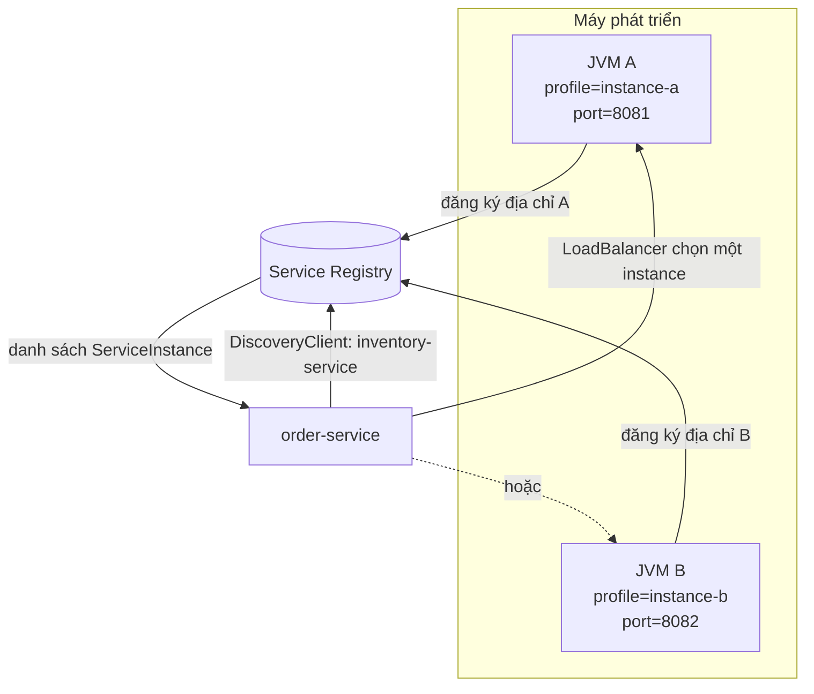
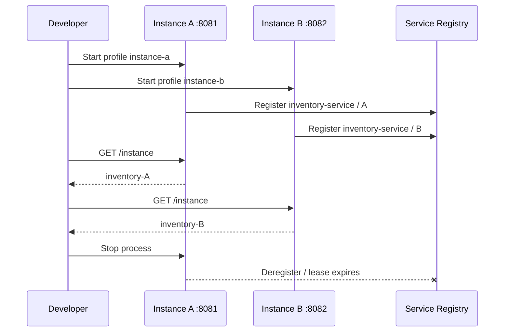

# Khởi chạy nhiều instance với profile và cổng khác nhau

## 1. Vì sao cần chạy nhiều instance?

Trong hệ thống phân tán, một service thường được triển khai thành nhiều **instance** để tăng khả năng phục vụ, mở rộng tải và hạn chế ảnh hưởng khi một tiến trình gặp lỗi. Khi phát triển trên máy cá nhân, ta có thể mô phỏng mô hình này bằng cách khởi chạy nhiều tiến trình Spring Boot từ cùng một ứng dụng, mỗi tiến trình sử dụng một **profile** và một **cổng HTTP** riêng.

Ví dụ, cùng một artifact `inventory-service.jar` được chạy hai lần:

| Thuộc tính | Instance A | Instance B |
| --- | --- | --- |
| Tên service logic | `inventory-service` | `inventory-service` |
| Profile | `instance-a` | `instance-b` |
| Cổng HTTP | `8081` | `8082` |
| Nhãn quan sát | `inventory-A` | `inventory-B` |
| Process | JVM A | JVM B |

Hai instance có cùng tên service để hệ thống discovery xem chúng là các bản chạy của cùng một dịch vụ. Chúng có profile và cổng khác nhau để cấu hình và truy cập độc lập.

Trong phạm vi **SPRING_CLOUD_CORE**, bài thực hành giúp kết nối các khái niệm Spring Boot profile và externalized configuration với Spring Cloud Commons: khi tích hợp service registry, mỗi instance có thể đăng ký địa chỉ riêng; phía client có thể discovery và lựa chọn một instance để gọi. Chạy được hai process trên máy cá nhân là bước đầu để quan sát cơ chế đó.

**Phân biệt ba khái niệm:**

- **Application/service name** xác định dịch vụ logic, ví dụ `inventory-service`.
- **Profile** chọn nhóm cấu hình phù hợp cho một lần chạy, ví dụ `instance-a`.
- **Port** xác định cổng mạng mà tiến trình đang lắng nghe, ví dụ `8081`.

Bật hai profile trong **một JVM** không tạo ra hai instance. Muốn có hai server độc lập trên cùng máy, phải chạy hai tiến trình ứng dụng và cấp cho chúng hai cổng không trùng nhau.

## 2. Chuẩn bị cấu hình chung và cấu hình theo profile

Spring Boot tự động đọc file cấu hình chung `application.yml` và file riêng theo profile có tên `application-{profile}.yml`. Ta đặt những giá trị dùng chung vào file đầu tiên, còn thuộc tính khác nhau giữa các instance vào các file profile.

Cấu trúc ví dụ:

```text
src/
└── main/
    └── resources/
        ├── application.yml
        ├── application-instance-a.yml
        └── application-instance-b.yml
```

### 2.1. Cấu hình dùng chung — `application.yml`

```yaml
spring:
  application:
    name: inventory-service

server:
  # Có thể bỏ hẳn port để profile nào cũng phải khai báo cổng riêng.
  # Giá trị dưới đây chỉ là mặc định khi không chọn profile có port.
  port: 8080

app:
  inventory:
    description: Inventory service for local multi-instance practice
```

`spring.application.name` giữ nguyên giữa các instance. Đây là tên ứng dụng được các tích hợp Spring Cloud sử dụng làm cơ sở nhận diện dịch vụ khi thích hợp.

### 2.2. Cấu hình cho instance A — `application-instance-a.yml`

```yaml
server:
  port: 8081

app:
  instance:
    label: inventory-A
```

### 2.3. Cấu hình cho instance B — `application-instance-b.yml`

```yaml
server:
  port: 8082

app:
  instance:
    label: inventory-B
```

Khi profile `instance-a` được kích hoạt, Spring Boot nạp `application.yml` và cấu hình profile tương ứng. Giá trị trong file profile ghi đè giá trị chung khi cùng một thuộc tính được khai báo. Instance B hoạt động tương tự với `application-instance-b.yml`.

Bạn có thể khai báo các giá trị quan sát được khác nhau trong từng profile, chẳng hạn nhãn instance, mức log, URL của dịch vụ giả lập hoặc cờ tính năng. Hãy giữ các thông tin bí mật như password, token và private key ở nguồn cấu hình an toàn; không commit chúng vào file profile của dự án.

**Lưu ý:** không đặt `spring.profiles.active` bên trong file cấu hình dành riêng cho profile như `application-instance-a.yml`. Hãy kích hoạt profile từ file cấu hình không phụ thuộc profile, biến môi trường hoặc tham số dòng lệnh. Trong bài thực hành, ta dùng tham số dòng lệnh để mỗi tiến trình có profile riêng.

## 3. Khởi chạy hai instance từ cùng một artifact

Cách dễ kiểm soát nhất là build ứng dụng một lần, sau đó chạy cùng file JAR trong hai terminal. Hai tiến trình dùng cùng code và cùng dependency, nhưng nhận các tham số khởi động khác nhau.

### 3.1. Build ứng dụng

Với Maven Wrapper:

```bash
./mvnw clean package
```

Trên Windows PowerShell:

```powershell
.\mvnw.cmd clean package
```

Với Gradle Wrapper:

```bash
./gradlew clean bootJar
```

Trên Windows PowerShell:

```powershell
.\gradlew.bat clean bootJar
```

Tên file JAR phụ thuộc `artifactId`, version và cấu hình build. Các ví dụ tiếp theo giả sử file là `target/inventory-service-0.0.1-SNAPSHOT.jar` đối với Maven hoặc `build/libs/inventory-service-0.0.1-SNAPSHOT.jar` đối với Gradle. Hãy thay bằng tên artifact thực tế trong dự án.

### 3.2. Chạy instance A

Mở terminal thứ nhất, tại thư mục dự án:

```bash
java -jar target/inventory-service-0.0.1-SNAPSHOT.jar --spring.profiles.active=instance-a
```

Nếu dùng file JAR từ Gradle:

```bash
java -jar build/libs/inventory-service-0.0.1-SNAPSHOT.jar --spring.profiles.active=instance-a
```

Ứng dụng kích hoạt profile `instance-a`, đọc `application-instance-a.yml` và khởi động web server trên cổng `8081`.

### 3.3. Chạy instance B

Mở terminal thứ hai và chạy cùng artifact:

```bash
java -jar target/inventory-service-0.0.1-SNAPSHOT.jar --spring.profiles.active=instance-b
```

Nếu dùng Gradle, thay đường dẫn JAR thành `build/libs/...jar` tương ứng.

Tiến trình thứ hai đọc `application-instance-b.yml` và khởi động trên cổng `8082`. Hai terminal cần được giữ mở để hai tiến trình tiếp tục chạy. Nếu một tiến trình kết thúc, instance tương ứng sẽ không còn nhận request.

### 3.4. Ghi đè cổng trực tiếp từ dòng lệnh

Không nhất thiết phải tạo file profile riêng chỉ để thay đổi port. Tham số dòng lệnh có thể ghi đè thuộc tính trong file cấu hình:

```bash
java -jar target/inventory-service-0.0.1-SNAPSHOT.jar --spring.profiles.active=instance-a --server.port=8181
```

Trong lần chạy này, profile `instance-a` vẫn được kích hoạt, nhưng server lắng nghe cổng `8181` thay vì `8081`. Thuộc tính truyền qua command line có độ ưu tiên cao hơn thuộc tính cùng tên trong file cấu hình.

Cách này hữu ích khi chạy nhiều bản thử nghiệm hoặc khi CI tạo cổng khác nhau theo job. Nếu cổng là một phần cố định của môi trường local, đặt trong file profile giúp người phát triển dễ đọc và tái sử dụng cấu hình.

## 4. Chạy trực tiếp bằng Maven hoặc Gradle

Khi đang phát triển, có thể dùng plugin thay vì đóng gói JAR sau mỗi lần sửa code. Mỗi instance vẫn phải chạy trong một terminal hoặc process riêng.

### 4.1. Maven Spring Boot Plugin

Terminal thứ nhất:

```bash
./mvnw spring-boot:run -Dspring-boot.run.arguments="--spring.profiles.active=instance-a"
```

Terminal thứ hai:

```bash
./mvnw spring-boot:run -Dspring-boot.run.arguments="--spring.profiles.active=instance-b"
```

Trên Windows, dùng `.\mvnw.cmd` thay cho `./mvnw`. Tham số `spring-boot.run.arguments` truyền đối số ứng dụng đến phương thức main, vì vậy profile và cổng được xử lý như khi chạy `java -jar`.

Nếu muốn chỉ định cổng trực tiếp:

```bash
./mvnw spring-boot:run -Dspring-boot.run.arguments="--spring.profiles.active=instance-a --server.port=8181"
```

### 4.2. Gradle Boot Run

Với Kotlin DSL hoặc Groovy DSL, task `bootRun` nhận tham số ứng dụng qua `--args`.

Terminal thứ nhất:

```bash
./gradlew bootRun --args="--spring.profiles.active=instance-a"
```

Terminal thứ hai:

```bash
./gradlew bootRun --args="--spring.profiles.active=instance-b"
```

Trên Windows PowerShell:

```powershell
.\gradlew.bat bootRun --args="--spring.profiles.active=instance-a"
```

Và ở terminal khác:

```powershell
.\gradlew.bat bootRun --args="--spring.profiles.active=instance-b"
```

Các lệnh trên giả sử plugin Spring Boot đã được áp dụng và task `bootRun` tồn tại. Với multi-module Gradle, có thể cần chỉ rõ project path, ví dụ `:inventory-service:bootRun`.

## 5. Xác minh cả hai instance đang hoạt động

Đừng chỉ dựa vào việc terminal không báo lỗi. Hãy kiểm tra profile, cổng và phản hồi HTTP của từng tiến trình.

### 5.1. Quan sát log lúc khởi động

Spring Boot thường ghi lại profile đang hoạt động và thông báo web server đã khởi động. Log cần cho thấy:

- Instance A sử dụng profile `instance-a` và Tomcat/Jetty/Netty (tùy stack) lắng nghe cổng `8081`.
- Instance B sử dụng profile `instance-b` và server lắng nghe cổng `8082`.
- Cả hai ứng dụng đều khởi động thành công, không có lỗi bind port hoặc lỗi cấu hình.

Tên web server và định dạng log phụ thuộc dependency; hãy tập trung vào profile active và cổng thực tế.

### 5.2. Kiểm tra bằng HTTP

Nếu dự án có thêm Spring Boot Actuator và endpoint health được bật, gọi:

```bash
curl http://localhost:8081/actuator/health
curl http://localhost:8082/actuator/health
```

Trên Windows PowerShell, có thể dùng `curl.exe` để gọi chương trình curl thực:

```powershell
curl.exe http://localhost:8081/actuator/health
curl.exe http://localhost:8082/actuator/health
```

Kết quả health thành công cho biết endpoint của từng tiến trình phản hồi. Nếu chưa thêm Actuator, hãy gọi một API nghiệp vụ mà ứng dụng đã cung cấp, ví dụ `GET /api/items/42`. Không mặc định endpoint `/actuator/health` tồn tại nếu chưa thêm dependency Actuator.

### 5.3. Tạo endpoint hiển thị nhãn instance

Để nhìn thấy request đang đi đến process nào, có thể tạo một endpoint thử nghiệm. Ví dụ dùng `@Value` để đọc thuộc tính nhãn:

```java
package com.example.inventory;

import org.springframework.beans.factory.annotation.Value;
import org.springframework.web.bind.annotation.GetMapping;
import org.springframework.web.bind.annotation.RestController;

import java.util.Map;

@RestController
public class InstanceController {

    private final String instanceLabel;

    public InstanceController(
            @Value("${app.instance.label:inventory-default}") String instanceLabel) {
        this.instanceLabel = instanceLabel;
    }

    @GetMapping("/instance")
    public Map<String, String> instance() {
        return Map.of(
                "service", "inventory-service",
                "instance", instanceLabel
        );
    }
}
```

Gọi hai địa chỉ:

```bash
curl http://localhost:8081/instance
curl http://localhost:8082/instance
```

Phản hồi kỳ vọng có nhãn khác nhau, chẳng hạn `inventory-A` và `inventory-B`. Đây là API phục vụ thực hành; không nên công khai thông tin nội bộ về instance trong endpoint không được bảo vệ ở môi trường production.

## 6. Profile, port và cấu hình bên ngoài

### 6.1. Profile là nhóm cấu hình, không phải process

Một profile là cách chọn tập cấu hình cho một lần chạy. Có thể dùng profile cho nhiều mục đích:

- `local`: kết nối database và dịch vụ giả lập trên máy phát triển.
- `test`: cấu hình cho kiểm thử tích hợp.
- `staging`: cấu hình môi trường tiền production.
- `instance-a`, `instance-b`: phân biệt hai bản chạy trong bài thực hành.

Có thể kích hoạt nhiều profile cùng lúc bằng danh sách phân tách dấu phẩy, nhưng **điều đó vẫn chỉ tạo một ApplicationContext và một process**. Nếu hai profile cùng định nghĩa `server.port`, kết quả phụ thuộc quy tắc nạp và độ ưu tiên cấu hình; tránh thiết kế profile chồng lấn mơ hồ. Đối với bài này, mỗi process chỉ kích hoạt một profile instance.

### 6.2. Nguồn cấu hình và độ ưu tiên

Các giá trị cấu hình có thể đến từ file YAML/properties, biến môi trường, Java system property và tham số dòng lệnh. Khi cùng một thuộc tính được khai báo ở nhiều nguồn, Spring Boot áp dụng thứ tự ưu tiên của externalized configuration. Trong các lệnh trên, `--server.port=8181` truyền qua command line ghi đè port lấy từ file profile.

Có thể sử dụng biến môi trường nếu muốn chạy mà không truyền tham số dài:

Trên Linux/macOS:

```bash
SPRING_PROFILES_ACTIVE=instance-a SERVER_PORT=8081 java -jar target/inventory-service.jar
```

Trên Windows PowerShell:

```powershell
$env:SPRING_PROFILES_ACTIVE = "instance-a"
$env:SERVER_PORT = "8081"
java -jar target\inventory-service.jar
```

Biến môi trường được kế thừa bởi process con trong terminal đó. Khi mở terminal mới, các biến đã gán trong PowerShell trước đó không tự động xuất hiện nếu bạn chưa thiết lập lại ở terminal mới. Để chạy hai instance trong cùng một terminal, cần thiết lập giá trị riêng cho từng process hoặc dùng command-line arguments; tránh thay đổi một biến môi trường dùng chung giữa hai lần chạy đang hoạt động.

### 6.3. Dùng thư mục cấu hình bên ngoài

Trong môi trường triển khai, có thể đặt cấu hình cạnh artifact hoặc ở thư mục được mount thay vì đóng gói vào JAR. Ví dụ:

```text
deployment/
├── inventory-service.jar
└── config/
    ├── application.yml
    ├── application-instance-a.yml
    └── application-instance-b.yml
```

Có thể thêm vị trí cấu hình bên ngoài qua `spring.config.additional-location`:

```bash
java -jar inventory-service.jar --spring.config.additional-location=optional:file:./config/ --spring.profiles.active=instance-a
```

Thư mục bổ sung được đưa vào quá trình nạp Config Data. Cần dùng đúng cú pháp URL/vị trí file và kiểm tra log cấu hình khi triển khai. Nếu dùng `spring.config.location` thay cho `spring.config.additional-location`, bạn có thể thay thế các vị trí mặc định; vì vậy chỉ dùng khi chủ đích kiểm soát toàn bộ vị trí cấu hình.

## 7. Kết nối với Spring Cloud Commons và service registry

Khi chạy hai instance local, cả hai có cùng `spring.application.name` là `inventory-service` nhưng có địa chỉ riêng:

- `inventory-service` tại `localhost:8081`.
- `inventory-service` tại `localhost:8082`.

Đây là mô hình cơ bản của một service có nhiều instance. Trong hệ thống có registry như Eureka hoặc Consul, mỗi process có thể đăng ký thông tin instance của mình. Phía client sử dụng abstraction của Spring Cloud Commons để tra cứu service ID và nhận danh sách `ServiceInstance`; Spring Cloud LoadBalancer có thể chọn một instance để gửi request.



Cần có **registry implementation và cấu hình tương ứng** để tự động đăng ký. Commons cung cấp abstraction như `ServiceRegistry`, `Registration` và `DiscoveryClient`; nó không tự tạo một registry server chỉ vì bạn chạy hai process.

Khi đăng ký nhiều instance, cần bảo đảm **mỗi instance có định danh riêng** theo yêu cầu của registry implementation. Một số registry yêu cầu cấu hình instance ID; cú pháp và quy tắc tạo ID phụ thuộc tích hợp cụ thể. Nếu hai tiến trình dùng cùng ID, một lần đăng ký có thể ghi đè hoặc che khuất tiến trình còn lại. Kiểm tra dashboard/CLI của registry để xác nhận có hai bản ghi cùng service name nhưng khác instance identity và địa chỉ.

**Không nhầm `SimpleDiscoveryClient` với việc tự đăng ký:** cấu hình danh sách instance tĩnh cho `SimpleDiscoveryClient` chủ yếu phục vụ phía client tra cứu các địa chỉ đã biết. Nó không thay thế registry server và không tự đăng ký process đang chạy như Eureka/Consul client.

### 7.1. Địa chỉ đăng ký phải truy cập được từ client

Trong ví dụ trên, `localhost` chỉ phù hợp khi client và server chạy trên cùng máy/network namespace. Nếu ứng dụng chạy trong Docker hoặc trên các máy khác nhau, địa chỉ quảng bá phải là hostname/IP mà client thực sự truy cập được. Đăng ký `localhost` từ bên trong container thường khiến client bên ngoài container không gọi được instance.

Với registry thực, hãy kiểm tra:

- Host và port được quảng bá có thể truy cập từ mạng của client.
- Mỗi instance có identity duy nhất.
- Health check và heartbeat phù hợp với registry.
- Instance bị dừng được hủy đăng ký hoặc hết lease đúng thời gian.
- Client nhìn thấy đủ các instance đang hoạt động.

## 8. Những va chạm thường gặp khi chạy nhiều process

Chạy nhiều instance trên cùng máy có thể tạo ra những xung đột ngoài cổng HTTP.

| Triệu chứng | Nguyên nhân thường gặp | Cách xử lý |
| --- | --- | --- |
| `Port already in use` hoặc `Address already in use` | Hai process cùng bind một địa chỉ/cổng | Cấp port riêng; kiểm tra process đang chiếm cổng |
| Cả hai log đều cho thấy cùng profile | Đã truyền cùng `spring.profiles.active` hoặc biến môi trường dùng chung | Kiểm tra tham số khởi động và environment của từng process |
| Profile đúng nhưng port vẫn giống nhau | File profile chưa được nạp, sai tên file hoặc có nguồn cấu hình ưu tiên cao hơn | Kiểm tra tên `application-{profile}.yml`, active profile và CLI/environment override |
| Registry chỉ hiển thị một instance | Trùng instance ID hoặc cấu hình registration sai | Tạo ID duy nhất theo implementation, xác minh host/port đăng ký |
| Client gọi được một instance nhưng không gọi được instance còn lại | Địa chỉ quảng bá không truy cập được, firewall hoặc backend chưa sẵn sàng | Kiểm tra địa chỉ trong registry từ góc nhìn của client |
| Cả hai process cùng xử lý một job | Scheduler hoặc message listener chạy trên mọi instance | Dùng cơ chế leader/single-consumer/distributed lock hoặc thiết kế job idempotent phù hợp |
| Hai process ghi đè file | Cùng log path, file upload path, PID/temp file hoặc thư mục dữ liệu | Tách đường dẫn theo instance hoặc dùng storage chia sẻ có kiểm soát |
| DB migration chạy đồng thời | Mỗi instance cùng khởi tạo migration | Dùng cơ chế khóa/migration runner phù hợp và kiểm thử concurrency |

### 8.1. Kiểm tra process đang giữ cổng

Trên Windows PowerShell:

```powershell
Get-NetTCPConnection -LocalPort 8081 -State Listen
Get-NetTCPConnection -LocalPort 8082 -State Listen
```

Trên Linux:

```bash
ss -ltnp | grep -E ':8081|:8082'
```

Nếu cổng đã được một ứng dụng khác sử dụng, chọn cổng khác hoặc dừng process đó theo quy trình phù hợp. Không nên tùy tiện kill một process chưa xác định vì nó có thể là dịch vụ khác đang cần thiết.

### 8.2. Cổng quản trị Actuator

Mặc định, endpoint Actuator có thể chạy cùng web server port. Nếu cấu hình `management.server.port` riêng, mỗi instance trên cùng host cũng phải có cổng quản trị khác nhau. Ví dụ:

```yaml
# application-instance-a.yml
server:
  port: 8081
management:
  server:
    port: 9081
```

```yaml
# application-instance-b.yml
server:
  port: 8082
management:
  server:
    port: 9082
```

Khi đó health endpoint (nếu Actuator được thêm và expose) nằm ở `http://localhost:9081/actuator/health` và `http://localhost:9082/actuator/health`. Nếu không cần tách management port, bỏ cấu hình này để Actuator dùng cổng ứng dụng theo mặc định.

### 8.3. Nhiều instance có thể nhân đôi tác dụng phụ

Một sai lầm phổ biến là nghĩ rằng chạy hai instance chỉ làm tăng số HTTP server. Trên thực tế, mỗi process có thể chạy lại các thành phần khởi động như:

- `@Scheduled` jobs;
- message consumers/listeners;
- tác vụ khởi tạo cache hoặc đồng bộ dữ liệu;
- migration hoặc công việc bảo trì database;
- logic tạo file và gửi thông báo.

Nếu hai process cùng thực hiện một tác vụ vốn chỉ nên chạy một lần, có thể tạo dữ liệu trùng, gửi hai email hoặc cập nhật cùng tài nguyên đồng thời. Cần dùng cơ chế điều phối phù hợp (ví dụ distributed lock, leader election, consumer group hoặc job scheduler có cơ chế khóa) và thiết kế thao tác có thể lặp an toàn khi cần.

## 9. Dùng cổng ngẫu nhiên trong kiểm thử

Khi chỉ cần khởi động một ứng dụng kiểm thử mà không muốn phụ thuộc cổng cố định, Spring Boot hỗ trợ `server.port=0` để hệ điều hành cấp một cổng trống:

```bash
java -jar inventory-service.jar --server.port=0
```

Trong kiểm thử tích hợp, có thể dùng `@SpringBootTest(webEnvironment = SpringBootTest.WebEnvironment.RANDOM_PORT)` để framework khởi động server trên cổng ngẫu nhiên và inject `@LocalServerPort` để lấy cổng thực tế.

Ví dụ:

```java
import org.junit.jupiter.api.Test;
import org.springframework.boot.test.context.SpringBootTest;
import org.springframework.boot.test.web.server.LocalServerPort;

import static org.junit.jupiter.api.Assertions.assertTrue;

@SpringBootTest(webEnvironment = SpringBootTest.WebEnvironment.RANDOM_PORT)
class InventoryHttpTest {

    @LocalServerPort
    int port;

    @Test
    void serverStartsOnRandomPort() {
        assertTrue(port > 0);
    }
}
```

Cách này phù hợp cho test độc lập và tránh xung đột port giữa các test run. Nếu instance cần đăng ký với service registry, phải bảo đảm implementation biết và quảng bá **cổng thực tế** sau khi server bind; không được đăng ký giá trị `0` như port có thể truy cập.

## 10. Quy trình thực hành hoàn chỉnh

Thực hiện theo thứ tự sau để kiểm tra kết quả có thể lặp lại:

1. Xác nhận dự án có ứng dụng Spring Boot chạy HTTP server và đã build được artifact.
2. Thêm `spring.application.name` chung trong `application.yml`.
3. Tạo `application-instance-a.yml` với port 8081 và nhãn `inventory-A`.
4. Tạo `application-instance-b.yml` với port 8082 và nhãn `inventory-B`.
5. Build JAR một lần.
6. Mở hai terminal và khởi chạy cùng JAR với profile tương ứng.
7. Đọc log để xác nhận active profile và port.
8. Gọi `/instance` hoặc API thực tế trên cả hai port để xác nhận hai process trả về nhãn khác nhau.
9. Nếu đã tích hợp registry, kiểm tra registry có hai bản ghi của `inventory-service` với instance identity và địa chỉ riêng.
10. Dừng từng process, quan sát registry và client phản ứng khi một instance không còn hoạt động.



## 11. Câu hỏi tự kiểm tra

1. Vì sao phải dùng hai process để mô phỏng hai instance trên cùng máy?
2. `spring.application.name` có nên khác nhau giữa hai instance của cùng một service không? Giải thích.
3. `application-instance-a.yml` được nạp khi nào?
4. Nếu profile khai báo port 8081 nhưng lệnh khởi động truyền `--server.port=8181`, server sẽ lắng nghe cổng nào?
5. Hai instance có cùng service name nhưng trùng instance ID trong registry có thể gây ra vấn đề gì?
6. Tại sao `SimpleDiscoveryClient` với danh sách địa chỉ tĩnh không tương đương một service registry có auto-registration?
7. Nếu đặt `management.server.port` riêng, cần chú ý điều gì khi chạy nhiều instance?
8. Vì sao `@Scheduled` hoặc message listener có thể gây tác dụng phụ khi chạy nhiều process?

## 12. Tài liệu tham khảo chính thức

- [Spring Boot — Profiles](https://docs.spring.io/spring-boot/reference/features/profiles.html) — kích hoạt profile và file cấu hình theo profile.
- [Spring Boot — Externalized Configuration](https://docs.spring.io/spring-boot/reference/features/external-config.html) — nguồn cấu hình và thứ tự ưu tiên.
- [Spring Boot — Running Your Application](https://docs.spring.io/spring-boot/reference/using/running-your-application.html) — chạy ứng dụng đóng gói và tham số dòng lệnh.
- [Spring Boot Maven Plugin — Run](https://docs.spring.io/spring-boot/maven-plugin/run.html) — chạy ứng dụng bằng Maven.
- [Spring Boot Gradle Plugin — Running Your Application](https://docs.spring.io/spring-boot/gradle-plugin/running.html) — task `bootRun` và tham số.
- [Spring Cloud Commons — Common Abstractions](https://docs.spring.io/spring-cloud-commons/reference/spring-cloud-commons/common-abstractions.html) — `DiscoveryClient`, `ServiceRegistry` và đăng ký service.
- [Spring Cloud LoadBalancer](https://docs.spring.io/spring-cloud-commons/reference/spring-cloud-commons/loadbalancer.html) — lựa chọn instance khi gọi dịch vụ.

*Ví dụ sử dụng cùng một artifact và hai cổng local để mô phỏng nhiều instance. Cấu hình registry, health check và địa chỉ quảng bá cụ thể cần điều chỉnh theo implementation và môi trường triển khai.*
