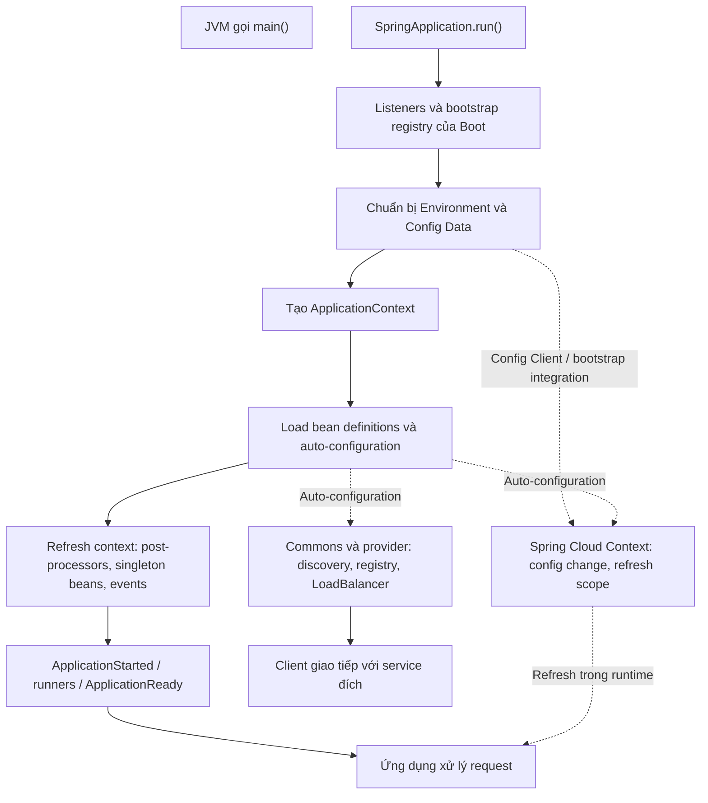
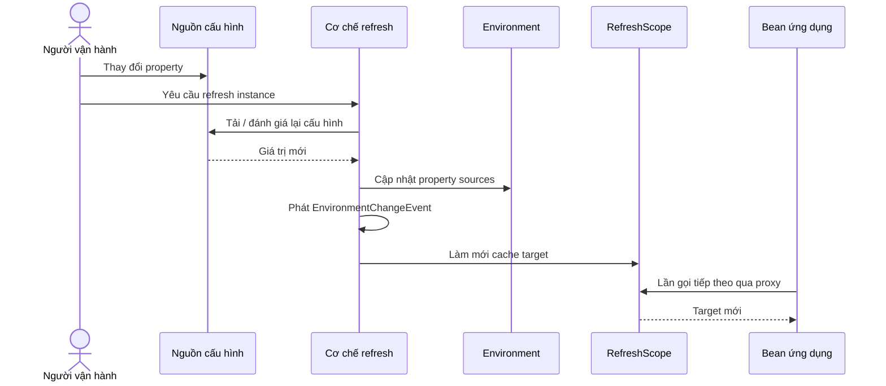
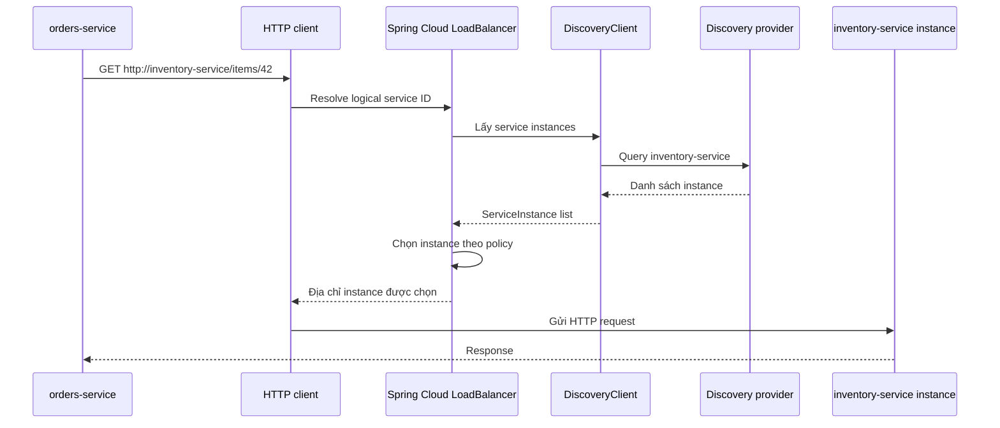

# Đường đi từ SpringApplication đến các thành phần Spring Cloud

## 1. Bức tranh tổng thể

Một ứng dụng Spring Cloud vẫn khởi động bằng **Spring Boot**. Điểm vào quen thuộc là `SpringApplication.run(...)`; Spring Boot chuẩn bị môi trường, tạo và refresh `ApplicationContext`, sau đó chạy các thành phần ứng dụng. Spring Cloud tham gia vào những giai đoạn phù hợp thông qua cơ chế mở rộng của Spring và Boot: nạp cấu hình, auto-configuration, bean, event, scope và các abstraction dùng khi ứng dụng hoạt động.

Để hiểu kiến trúc nền tảng, cần lần theo đường đi từ lúc process bắt đầu tới lúc một request được định tuyến tới dịch vụ đích:

1. JVM gọi phương thức `main` và ứng dụng tạo `SpringApplication`.
2. Spring Boot chuẩn bị Environment và các nguồn cấu hình.
3. Boot tạo rồi refresh application context; auto-configuration Spring Cloud đăng ký bean khi điều kiện phù hợp.
4. Các thành phần cấu hình, discovery, service registry, load balancing và client giao tiếp được kết nối qua các abstraction.
5. Trong thời gian chạy, ứng dụng xử lý event, health, refresh và request theo vòng đời của từng thành phần.

**SpringApplication điều phối quá trình khởi động; ApplicationContext quản lý bean; Spring Cloud cung cấp các thành phần và hợp đồng chung để ứng dụng phân tán tích hợp hạ tầng.** Không có một "Spring Cloud container" riêng thay thế application context của Boot.

Bài học thuộc mô-đun **SPRING_CLOUD_CORE**: nền tảng chung của Spring Cloud trong hệ thống phân tán, gồm Spring Cloud Commons, Context, cấu hình ngoài, tương thích phiên bản với Spring Boot, refresh scope, discovery, service registry, giao tiếp dịch vụ, kiểm thử và vận hành.

## 2. Các thành phần và trách nhiệm

| Thành phần | Vai trò | Ví dụ hoặc điểm mở rộng |
| --- | --- | --- |
| `SpringApplication` | Điều phối startup của Spring Boot | `run(args)`, listeners, initializers |
| `Environment` | Cung cấp các property có hiệu lực | File cấu hình, biến môi trường, Config Data, nguồn từ xa |
| `ApplicationContext` | Container quản lý bean và vòng đời | Dependency injection, event, scope, auto-configuration |
| Spring Cloud Context | Bổ sung tích hợp cấu hình và refresh | Bootstrap integration, `EnvironmentChangeEvent`, `@RefreshScope` |
| Spring Cloud Commons | Cung cấp abstraction chung cho hệ thống cloud | `DiscoveryClient`, `ServiceRegistry`, LoadBalancer API |
| Config Client | Lấy cấu hình từ Config Server | Config Data import hoặc bootstrap cũ |
| Discovery provider | Tìm kiếm và đăng ký instance | Eureka, Consul, Kubernetes hoặc provider khác |
| Spring Cloud LoadBalancer | Chọn một instance từ danh sách có thể dùng | Service instance supplier, thuật toán chọn instance |
| Client giao tiếp | Gửi request tới service đích | RestClient, WebClient, OpenFeign hoặc tích hợp tương ứng |
| Actuator | Cung cấp endpoint quan sát/quản trị | Health, metrics và các endpoint được expose |

Spring Cloud Commons định nghĩa hợp đồng mà các thư viện hoặc provider có thể triển khai. Ví dụ, ứng dụng có thể dùng `DiscoveryClient` mà không phải viết logic phụ thuộc trực tiếp vào API riêng của Eureka hoặc Consul. Provider cụ thể vẫn cần được đưa vào classpath và cấu hình đúng.

## 3. Đường đi trong SpringApplication.run

Đoạn mã vào ứng dụng thường rất ngắn:

```java
@SpringBootApplication
public class OrdersApplication {
    public static void main(String[] args) {
        SpringApplication.run(OrdersApplication.class, args);
    }
}
```

Một dòng gọi trên điều phối nhiều giai đoạn. Bảng sau mô tả thứ tự khái niệm thường gặp của Spring Boot; tên callback nội bộ và chi tiết có thể thay đổi giữa các thế hệ Boot.

| Giai đoạn | Spring Boot thực hiện | Spring Cloud tham gia ở đâu? |
| --- | --- | --- |
| 1. Tạo ứng dụng | Xác định primary source, web application type, listeners và initializers | Starter và metadata trên classpath giúp các integration được nhận diện. |
| 2. Bắt đầu startup | Tạo bootstrap registry của Boot và phát sự kiện khởi động sớm | Listener của thư viện có thể quan sát startup. Bootstrap registry của Boot không phải Cloud bootstrap context truyền thống. |
| 3. Chuẩn bị Environment | Nạp và hợp nhất property sources, xử lý profile và Config Data | Config Client có thể tải cấu hình từ xa qua Config Data; bootstrap cũ có thể chuẩn bị parent context/property sources. |
| 4. Tạo application context | Chọn loại context phù hợp với ứng dụng | Các initializer và integration thích hợp có thể chuẩn bị context. |
| 5. Nạp bean definitions | Đọc cấu hình nguồn, component scan và auto-configuration | Auto-configuration Spring Cloud đăng ký định nghĩa bean theo điều kiện. |
| 6. Refresh context | Chạy post-processors, tạo bean, inject dependency, áp dụng BeanPostProcessor và phát event | Config, discovery, registry, LoadBalancer, Context và các client hoàn thiện tích hợp qua bean. |
| 7. Startup hoàn tất | Phát sự kiện started/ready và gọi runner | Thành phần Cloud có thể phản ứng theo lifecycle; readiness và cấu hình triển khai quyết định khi nào instance nhận traffic. |

Luồng khái quát:



Sơ đồ là mô hình kiến trúc, không phải cam kết mọi bean Cloud được tạo theo một thứ tự cố định. Thứ tự thực tế còn phụ thuộc dependency, điều kiện auto-configuration, event listener và provider đang dùng.

## 4. Giai đoạn chuẩn bị Environment: cấu hình có trước bean

### 4.1. Vì sao Environment được chuẩn bị sớm?

Spring Boot cần biết cấu hình trước khi tạo nhiều bean: profile đang hoạt động, cổng HTTP, tên ứng dụng, địa chỉ Config Server, feature flag và các tham số auto-configuration. `Environment` tổng hợp các `PropertySource` theo thứ tự ưu tiên; các bean đọc property hiệu lực từ môi trường này.

Spring Cloud Config Client có thể đưa cấu hình từ Config Server vào Environment ngay trong giai đoạn Config Data. Ví dụ:

```yaml
spring:
  application:
    name: orders-service
  config:
    import: "optional:configserver:http://config-server:8888"

server:
  port: 8080

app:
  checkout:
    enabled: true
```

Khi dùng Config Data API, Spring Boot xử lý `spring.config.import` trong quá trình chuẩn bị cấu hình, trước khi refresh application context. Vì vậy auto-configuration và bean tạo sau đó có thể đọc giá trị đã được nạp. Tiền tố `optional:` cho phép startup tiếp tục nếu nguồn từ xa không sẵn sàng; ứng dụng khi đó có thể chạy bằng cấu hình local/default và cần có giám sát phù hợp.

### 4.2. Config Data và bootstrap context truyền thống

Hai khái niệm có tên gần nhau nhưng khác nhau:

- **Bootstrap registry của Spring Boot:** cơ chế Boot dùng trong startup để quản lý một số đối tượng cần thiết trước application context. Nó thuộc lifecycle của Boot.
- **Spring Cloud bootstrap context:** cơ chế bootstrap truyền thống của Spring Cloud, thường tạo một parent context để chuẩn bị property source và bean hạ tầng trước context chính.

Với mô hình bootstrap Spring Cloud cũ, ứng dụng có thể dùng `bootstrap.yml` và các thành phần như `PropertySourceLocator`. Từ Spring Cloud 2020.0, bootstrap truyền thống không còn tự bật trong thiết lập thông thường; các phiên bản hiện đại thường ưu tiên Config Data qua `spring.config.import`. Một số tích hợp vẫn có thể yêu cầu bật bootstrap bằng dependency/cấu hình dành cho đúng release.

| Đặc điểm | Config Data hiện đại | Bootstrap Spring Cloud truyền thống |
| --- | --- | --- |
| Cơ chế điều phối | Spring Boot Config Data API | Spring Cloud bootstrap lifecycle |
| Cấu hình thường gặp | `spring.config.import=configserver:...` trong cấu hình ứng dụng | `bootstrap.yml` hoặc nguồn tương ứng |
| Thời điểm | Trước khi refresh application context | Tạo context bootstrap sớm hơn context chính |
| Context cha riêng | Không bắt buộc | Thường có parent context trong mô hình cũ |
| Lựa chọn | Hướng thông dụng cho ứng dụng hiện đại | Dùng khi phiên bản/tích hợp yêu cầu |

Không nên thêm cả hai cơ chế theo thói quen. Hãy kiểm tra hướng dẫn của phiên bản Spring Boot, Spring Cloud và Config Client thực tế để tránh tải cùng cấu hình hai lần hoặc tạo thứ tự ưu tiên ngoài dự kiến.

### 4.3. Thứ tự ưu tiên và giá trị hiệu lực

Nhiều nguồn có thể cùng khai báo `app.checkout.enabled`. Giá trị cuối cùng phụ thuộc thứ tự `PropertySource`, profile và quy tắc ưu tiên của Boot/Cloud. Khi debug, cần kiểm tra **giá trị hiệu lực** và nguồn đã cung cấp nó, không chỉ nhìn file cấu hình local.

Không nên log toàn bộ Environment trong production vì có thể lộ token, mật khẩu, connection string hoặc thông tin nội bộ. Dùng Actuator/config diagnostics có kiểm soát và chỉ hiển thị các khóa không nhạy cảm.

## 5. Refresh trong runtime: trách nhiệm của Spring Cloud Context

Nạp cấu hình khi startup và cập nhật cấu hình khi ứng dụng đang chạy là hai giai đoạn khác nhau.

Spring Cloud Context bổ sung cơ chế thông báo thay đổi và làm mới bean phù hợp. Khi nguồn cấu hình thay đổi, một cơ chế refresh được hỗ trợ có thể cập nhật Environment, phát `EnvironmentChangeEvent` và làm mới các bean thuộc `RefreshScope`. Bean được đánh dấu `@RefreshScope` thường được truy cập qua proxy; sau khi target cũ bị loại khỏi cache, lần gọi sau tạo target mới với cấu hình hiện hành.

Ví dụ:

```java
@Service
@RefreshScope
public class CheckoutPolicy {
    private final boolean enabled;

    public CheckoutPolicy(
            @Value("${app.checkout.enabled:true}") boolean enabled) {
        this.enabled = enabled;
    }

    public boolean isEnabled() {
        return enabled;
    }
}
```

Một singleton thông thường giữ giá trị đã inject khi khởi tạo sẽ không tự chạy lại constructor chỉ vì Environment thay đổi. `@RefreshScope` giúp tái tạo target cho bean phù hợp; nó không restart toàn bộ process, không thay mọi singleton và không bảo đảm các instance trong cluster cập nhật cùng lúc.

Luồng runtime khái quát:



Endpoint `/actuator/refresh` chỉ có khi các thành phần cần thiết được đưa vào ứng dụng và endpoint được expose theo cấu hình. Trong production phải bảo vệ endpoint bằng xác thực, phân quyền và mạng quản trị phù hợp. Refresh một instance không tự lan truyền tới mọi instance; cần cơ chế phân phối/điều phối như Spring Cloud Bus nếu kiến trúc yêu cầu.

## 6. Auto-configuration: cách Spring Cloud đưa bean vào context

Starter Spring Cloud thường gom dependency cần thiết. Khi các JAR có mặt trong classpath, Boot có thể phát hiện các auto-configuration và áp dụng điều kiện như:

- Class cần thiết có tồn tại hay không (`@ConditionalOnClass`).
- Một property có bật tính năng hay không (`@ConditionalOnProperty`).
- Ứng dụng đã tự khai báo bean tương đương hay chưa (`@ConditionalOnMissingBean`).
- Ứng dụng có đúng loại context hoặc web environment cần thiết hay không.

Auto-configuration không đồng nghĩa mọi bean của mọi thư viện Cloud đều luôn được tạo. Một starter có thể mang theo nhiều module, nhưng các bean cụ thể chỉ xuất hiện khi điều kiện và cấu hình phù hợp.

Ở các thế hệ Spring Boot hiện đại, danh sách auto-configuration thường được công bố qua:

```text
META-INF/spring/org.springframework.boot.autoconfigure.AutoConfiguration.imports
```

Các phiên bản Boot cũ sử dụng cơ chế `spring.factories` cho nhiều loại đăng ký, trong đó có auto-configuration. Một số extension point và listener vẫn có thể dùng metadata/factory tương ứng tùy phiên bản. Khi viết thư viện tích hợp, phải theo đúng cơ chế mà phiên bản Boot mục tiêu yêu cầu.

### 6.1. Ví dụ về starter và điều kiện

Giả sử ứng dụng khai báo Config Client và một discovery provider. Các starter đưa module cần thiết vào classpath; auto-configuration có thể đăng ký Config Data integration, discovery implementation, health contributor và các bean hạ tầng liên quan. Nếu ứng dụng không khai báo provider discovery, Commons API có thể vẫn hiện diện nhưng không tự tạo ra một registry từ hư không.

Khi ứng dụng tự khai báo bean cùng loại, điều kiện `@ConditionalOnMissingBean` ở auto-configuration có thể nhường quyền cho cấu hình tùy chỉnh. Đây là điểm mở rộng quan trọng, nhưng việc override bean cần hiểu rõ lifecycle và hợp đồng của abstraction.

## 7. Từ Spring Cloud Commons đến discovery và service registry

Trong ứng dụng phân tán, hai nhu cầu thường được nhắc cùng nhau nhưng khác nhau:

- **Đăng ký instance:** cho hạ tầng biết một instance đang tồn tại, địa chỉ và trạng thái của nó.
- **Khám phá instance:** tìm danh sách instance hiện có của một service để chọn đích giao tiếp.

Spring Cloud Commons cung cấp các abstraction chung cho hai chiều này.

| Abstraction | Mục đích | Hành động thường gặp |
| --- | --- | --- |
| `ServiceRegistry<R>` | Đăng ký và hủy đăng ký instance | `register(registration)`, `deregister(registration)` |
| `Registration` | Mô tả thông tin instance đăng ký | Service ID, host, port và metadata |
| `DiscoveryClient` | Tra cứu service và instance | `getServices()`, `getInstances(serviceId)` |
| `ReactiveDiscoveryClient` | Tra cứu theo API reactive | Trả về publisher của service/instance |
| Auto-registration integration | Phối hợp đăng ký theo lifecycle ứng dụng | Đăng ký khi ứng dụng sẵn sàng theo provider/configuration |

Provider cụ thể như Eureka hoặc Consul hiện thực các hợp đồng phù hợp. Trong Kubernetes, một số thông tin discovery có thể đến từ service và endpoint do nền tảng quản lý; mô hình đăng ký và vòng đời không nhất thiết giống Eureka. Vì vậy, không được giả định mọi provider đều đăng ký instance theo cùng một cách.

Ví dụ đọc danh sách instance thông qua abstraction:

```java
import java.util.List;
import org.springframework.cloud.client.ServiceInstance;
import org.springframework.cloud.client.discovery.DiscoveryClient;
import org.springframework.stereotype.Service;

@Service
public class InventoryLookup {
    private final DiscoveryClient discoveryClient;

    public InventoryLookup(DiscoveryClient discoveryClient) {
        this.discoveryClient = discoveryClient;
    }

    public List<ServiceInstance> instances() {
        return discoveryClient.getInstances("inventory-service");
    }
}
```

Ví dụ giả định một discovery provider đã được cấu hình và cung cấp bean `DiscoveryClient`. Nếu danh sách rỗng, nguyên nhân có thể là provider chưa sẵn sàng, instance chưa đăng ký, service ID sai, metadata/profile sai hoặc môi trường chưa có service đích.

## 8. Từ service ID đến request: Spring Cloud LoadBalancer

Ứng dụng không nên cố định IP/port của một instance trong code khi mục tiêu là gọi một logical service. Thay vào đó, client dùng **service ID**, sau đó tích hợp LoadBalancer lấy danh sách instance và chọn một đích phù hợp.

Luồng khái quát:



Sơ đồ giản lược; một số provider có cache hoặc cung cấp instance list qua supplier, và client integration có thể xử lý chọn instance ở những điểm khác nhau. Điều quan trọng là phân biệt:

1. `DiscoveryClient` trả lời câu hỏi "có instance nào của service này?".
2. `ServiceRegistry` và provider quản lý việc đăng ký/trạng thái instance theo cơ chế tương ứng.
3. `Spring Cloud LoadBalancer` quyết định chọn instance nào cho request cụ thể.
4. HTTP client thực hiện request đến địa chỉ đã chọn, áp dụng timeout, retry và error handling theo cấu hình.

Spring Cloud có thể tích hợp LoadBalancer với RestClient, WebClient, OpenFeign hoặc client khác thông qua starter/annotation/cấu hình tương ứng. Cú pháp cụ thể thay đổi theo phiên bản và loại client; cần đọc tài liệu đúng release train trước khi chọn builder hoặc interceptor. Không phải cứ thêm Commons là mọi HTTP client tự động hiểu service ID.

## 9. Ghép các đường đi thành một lần khởi động thực tế

Xét dịch vụ `orders-service` có cấu hình ngoài, discovery và client gọi `inventory-service`. Trình tự logic có thể được hiểu như sau:

1. `SpringApplication.run(...)` bắt đầu startup và Boot chuẩn bị Environment.
2. Config Client xử lý Config Data import (hoặc bootstrap integration cũ nếu được bật), đưa cấu hình dịch vụ vào Environment.
3. Boot tạo application context và đọc component scan/auto-configuration.
4. Spring Cloud Context và Commons đăng ký các bean cần thiết khi classpath và property thỏa điều kiện.
5. Discovery provider chuẩn bị client và phối hợp đăng ký instance theo lifecycle của provider.
6. Các bean nghiệp vụ được tạo; controller/service nhận dependency qua constructor injection.
7. Ứng dụng hoàn tất startup; readiness/health và cơ chế triển khai quyết định khi nào instance nhận traffic.
8. Khi xử lý request, client dùng service ID; LoadBalancer lấy instance qua discovery abstraction và gửi request.
9. Khi cấu hình cần thay đổi, cơ chế refresh runtime cập nhật Environment/bean phù hợp; đây là luồng riêng sau startup.

### 9.1. Ví dụ cấu hình minh họa

```yaml
spring:
  application:
    name: orders-service
  config:
    import: "optional:configserver:http://config-server:8888"

app:
  inventory:
    service-id: inventory-service

management:
  endpoints:
    web:
      exposure:
        include: "health,info"
```

Đoạn cấu hình trên chỉ minh họa tên dịch vụ và Config Data import. Để thực sự có discovery và load balancing, dự án còn cần dependency provider phù hợp, LoadBalancer integration cho HTTP client và cấu hình địa chỉ/metadata cần thiết. Không thể suy ra rằng chỉ khai báo `spring.application.name` là ứng dụng đã tự có registry.

### 9.2. Ranh giới giữa startup và runtime

| Thời điểm | Việc chính | Câu hỏi vận hành |
| --- | --- | --- |
| Trước context refresh | Chuẩn bị Environment và Config Data | Config Server có trả đúng profile/property không? |
| Trong context refresh | Tạo bean và áp dụng auto-configuration | Có bean provider, discovery và client cần thiết không? |
| Sau context refresh | Hoàn tất lifecycle, runners, readiness | Instance đã sẵn sàng nhận traffic chưa? |
| Mỗi request | Discovery/LoadBalancer/client chọn và gọi đích | Service ID có instance khỏe và request có timeout phù hợp không? |
| Khi refresh runtime | Nạp thay đổi, phát event, làm mới target bean | Những bean nào thực sự nhận giá trị mới và instance nào đã refresh? |

## 10. Kiểm thử theo từng lớp của đường đi

Không nên kiểm thử toàn bộ nền tảng chỉ bằng một bài `@SpringBootTest`. Chia theo ranh giới giúp xác định lỗi thuộc cấu hình, container, provider hay giao tiếp.

| Lớp | Kiểu kiểm thử | Điều cần chứng minh |
| --- | --- | --- |
| SpringApplication và cấu hình | Context startup test | Ứng dụng khởi động, profile và property đúng. |
| Config Data | Integration test với Config Server giả/lab | Property từ xa được nạp trước khi bean cần nó khởi tạo. |
| Auto-configuration | Application context test | Bean có/không có theo classpath và điều kiện property; bean tùy chỉnh được ưu tiên khi mong muốn. |
| Spring Cloud Context | Test Environment và RefreshScope | Thay đổi property, sự kiện và target bean đúng với thiết kế. |
| DiscoveryClient | Test với provider test hoặc mock | Service ID trả về danh sách instance mong đợi; xử lý danh sách rỗng. |
| ServiceRegistry | Integration test | Instance được đăng ký/hủy đăng ký và metadata đúng theo provider. |
| LoadBalancer | Test chọn instance | Client gọi đúng một instance trong tập hợp, tuân thủ policy đã cấu hình. |
| HTTP client | Contract/integration test | URL logic được resolve, timeout/error/retry và serialization đúng. |
| Vận hành | Health/metrics/readiness test | Instance không nhận traffic trước khi sẵn sàng; endpoint quản trị được bảo vệ. |

Các bài test nên cô lập external dependency khi kiểm thử logic, sau đó có một số integration test xác nhận hợp đồng thực với provider đã chọn. Không cần khởi tạo một cluster thật cho mọi unit test.

## 11. Chẩn đoán lỗi theo giai đoạn

Khi startup hoặc request thất bại, xác định **lỗi xảy ra ở giai đoạn nào** trước khi thay đổi dependency hay cấu hình.

| Triệu chứng | Giai đoạn cần xem | Hướng kiểm tra |
| --- | --- | --- |
| Property từ xa không có | Environment preparation | `spring.config.import`, Config Server, profile, label, optional/fail-fast và property precedence |
| Bean không được tạo | Auto-configuration/context refresh | Starter trên classpath, condition evaluation, property bật/tắt, package scan và bean tùy chỉnh |
| `NoSuchBeanDefinitionException` cho DiscoveryClient | Provider auto-configuration | Dependency provider, conditional bean, cấu hình và phiên bản BOM |
| Discovery trả danh sách rỗng | Runtime discovery | Service ID, registration, network, provider health, namespace/zone và cache |
| Gọi service ID thất bại | LoadBalancer/client | Client có tích hợp LoadBalancer không, service ID có đúng, instance list và timeout |
| Refresh không đổi kết quả | Runtime refresh | Nguồn cấu hình đã đổi chưa, Environment có giá trị mới chưa, bean có refresh/rebind phù hợp không |
| Ứng dụng ready quá sớm hoặc quá muộn | Lifecycle/health | Startup event, readiness state, dependency ngoài và health indicator |
| Chỉ một số instance lỗi | Phân phối và cấu hình cluster | Version image, profile, registry state, property source và refresh state giữa instance |

Một số công cụ quan sát hữu ích là log startup, condition evaluation report, Actuator health/metrics và dependency report của Maven/Gradle. Chỉ expose các endpoint cần thiết và bảo vệ chúng; không đưa credential hoặc toàn bộ Environment vào log.

## 12. Những nhầm lẫn kiến trúc thường gặp

**Nhầm SpringApplication với ApplicationContext.** SpringApplication điều phối startup. ApplicationContext là container được tạo và refresh trong quá trình đó; hai đối tượng có trách nhiệm khác nhau.

**Nhầm bootstrap registry của Boot với bootstrap context của Spring Cloud.** Một cái thuộc lifecycle nội bộ của Boot; cái còn lại là mô hình context cha truyền thống của Spring Cloud.

**Cho rằng mọi Spring Cloud bean được tạo trước khi context refresh.** Config Data có thể được nạp trước refresh, nhưng phần lớn bean auto-configuration được đăng ký/tạo trong quá trình xây dựng và refresh application context.

**Cho rằng Commons tự cung cấp registry.** Commons định nghĩa abstraction; cần provider hoặc tích hợp nền tảng triển khai chức năng thật.

**Cho rằng DiscoveryClient chọn instance cho mỗi request.** Discovery trả danh sách instance; LoadBalancer lựa chọn instance; HTTP client gửi request.

**Cho rằng thêm starter là đủ để gọi service bằng service ID.** Client phải được tích hợp LoadBalancer và cấu hình phù hợp.

**Cho rằng refresh là restart.** Refresh cập nhật Environment và một số bean được hỗ trợ; restart dựng lại process/context và áp dụng toàn bộ quá trình khởi động.

## 13. Tổng kết và câu hỏi tự kiểm tra

Có thể đọc kiến trúc theo một chuỗi liên tục: **SpringApplication điều phối startup → Environment được chuẩn bị → ApplicationContext được tạo và refresh → auto-configuration đăng ký các bean Spring Cloud → provider hiện thực discovery/registry → LoadBalancer và client thực hiện giao tiếp → Context hỗ trợ thay đổi cấu hình khi runtime**.

Chuỗi này cũng cho biết cách tìm lỗi: cấu hình sai thường bắt đầu từ Environment; bean thiếu thường liên quan classpath/auto-configuration; không tìm thấy instance thuộc discovery/provider; chọn sai đích thuộc LoadBalancer; request lỗi thuộc client/network hoặc service đích; cấu hình mới không có hiệu lực thuộc refresh flow và lifecycle của bean.

Câu hỏi tự kiểm tra:

1. `SpringApplication.run()` điều phối những giai đoạn chính nào trước khi ứng dụng sẵn sàng nhận traffic?
2. Vì sao Config Data được xử lý trước khi application context refresh, và nó khác gì bootstrap context Spring Cloud truyền thống?
3. Spring Cloud auto-configuration dựa vào những điều kiện nào để đăng ký bean?
4. Phân biệt trách nhiệm của `DiscoveryClient`, `ServiceRegistry` và Spring Cloud LoadBalancer.
5. Vì sao `spring.application.name` chưa đủ để một dịch vụ được đăng ký và được dịch vụ khác gọi qua service ID?
6. Một bean `@RefreshScope` nhận giá trị mới theo luồng nào, và vì sao điều đó không bảo đảm mọi instance cập nhật cùng lúc?
7. Khi request tới service đích thất bại, cần kiểm tra theo thứ tự nào để khoanh vùng lỗi từ discovery đến HTTP client?
