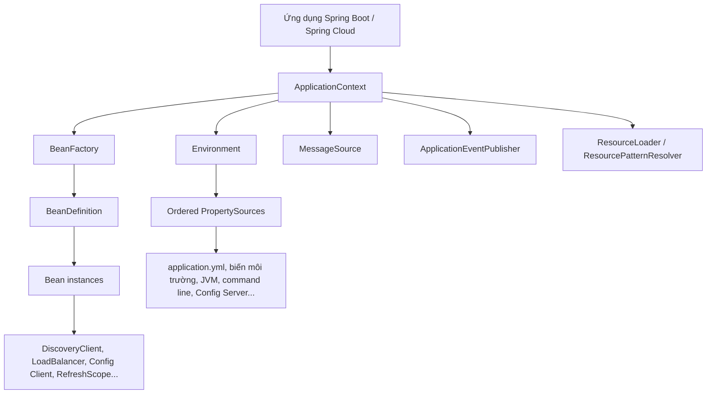
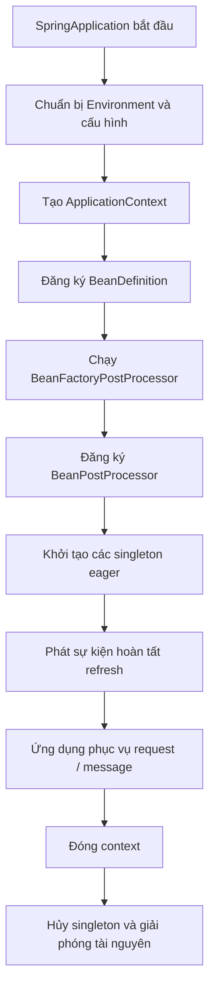
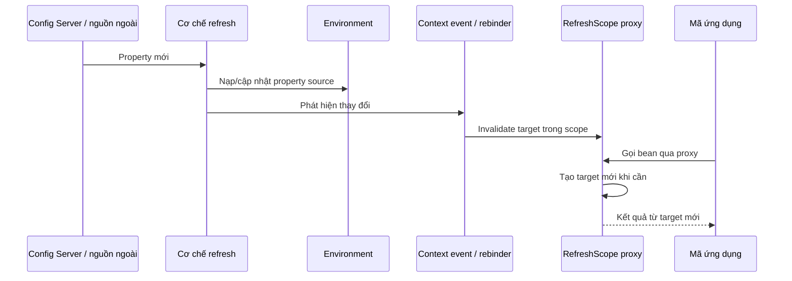

# Vai trò ApplicationContext, BeanFactory và Environment

Trong một ứng dụng Spring Cloud, các thành phần như discovery client, service registry, HTTP client, cấu hình bên ngoài và refresh scope đều cần được tạo, kết nối và quản lý trong suốt vòng đời ứng dụng. Ba khái niệm **`BeanFactory`**, **`ApplicationContext`** và **`Environment`** tạo nên nền tảng cho công việc đó:

- `BeanFactory` là lõi quản lý và cung cấp các bean.
- `ApplicationContext` là container cấp ứng dụng, mở rộng khả năng của `BeanFactory` bằng sự kiện, tài nguyên, thông điệp và tích hợp vòng đời.
- `Environment` cung cấp khả năng đọc thuộc tính cấu hình và profile từ các nguồn khác nhau.

Với **SPRING_CLOUD_CORE**, hiểu đúng ba vai trò này giúp giải thích vì sao một starter có thể tự đăng ký bean, vì sao profile quyết định cấu hình nào được nạp, và vì sao thay đổi một property không có nghĩa mọi bean đang chạy tự động nhận giá trị mới. Bài học thuộc chương **Kiến trúc nền tảng**, tập trung vào ranh giới giữa container, cấu hình và các cơ chế mở rộng của Spring Cloud.

## 1. Mục tiêu học tập

Sau bài này, bạn có thể:

1. Giải thích quan hệ kế thừa và trách nhiệm của `BeanFactory`, `ApplicationContext` và `Environment`.
2. Mô tả cách Spring tạo bean, tiêm phụ thuộc và điều phối vòng đời đối tượng.
3. Phân biệt bean definition, bean instance, scope và `FactoryBean`.
4. Giải thích cách `Environment` tổng hợp property source, profile và chuyển đổi kiểu dữ liệu.
5. Phân biệt nạp cấu hình, đọc cấu hình, bind cấu hình và refresh bean.
6. Mô tả cách Spring Boot và Spring Cloud mở rộng container để tích hợp cấu hình bên ngoài và `@RefreshScope`.
7. Thiết kế kiểm thử cho bean, profile và cấu hình mà không phụ thuộc vào một registry thật.

## 2. Bức tranh kiến trúc

Spring không chỉ là một tập hợp annotation. Khi ứng dụng khởi động, framework xây dựng một container, đọc cấu hình, đăng ký các mô tả bean, tạo đối tượng theo dependency graph và quản lý vòng đời của chúng.



Sơ đồ là mô hình khái niệm: `ApplicationContext` cung cấp nhiều khả năng cho ứng dụng, còn `BeanFactory` là phần container bean mà nó mở rộng. `Environment` là một đối tượng cấu hình được context cung cấp; nó không phải một kho bean thay thế `BeanFactory`.

### 2.1. Phân biệt nhanh ba thành phần

| Thành phần | Câu hỏi chính | Trách nhiệm |
| --- | --- | --- |
| `BeanFactory` | Đối tượng ứng dụng được tạo và lấy ra như thế nào? | Lưu bean definition, tạo và quản lý bean, giải quyết phụ thuộc, cung cấp bean theo tên/kiểu |
| `ApplicationContext` | Toàn bộ ứng dụng được tích hợp và quản lý ra sao? | Mở rộng bean factory, quản lý sự kiện, message, resource, lifecycle và tích hợp cơ chế framework |
| `Environment` | Cấu hình và profile nào đang có hiệu lực? | Đọc property qua property source có thứ tự, kiểm tra profile, chuyển đổi kiểu giá trị |

Một cách ghi nhớ hữu ích:

- `BeanFactory` quản lý **đối tượng**.
- `Environment` quản lý **thông tin cấu hình và profile**.
- `ApplicationContext` kết nối các khả năng đó thành **môi trường chạy của ứng dụng**.

## 3. BeanFactory: lõi của container

`org.springframework.beans.factory.BeanFactory` là giao diện cốt lõi để truy cập container bean. Nó cung cấp các thao tác như lấy bean theo tên hoặc kiểu, kiểm tra bean tồn tại và lấy provider cho việc phân giải phụ thuộc theo nhu cầu.

```java
Object bean = beanFactory.getBean("inventoryClient");
InventoryClient client = beanFactory.getBean(InventoryClient.class);
```

Ứng dụng Spring thông thường không tự gọi `getBean()` cho mọi lần sử dụng. Cách phổ biến là khai báo phụ thuộc qua constructor và để container tiêm đối tượng:

```java
@Service
public class StockService {
    private final InventoryClient inventoryClient;

    public StockService(InventoryClient inventoryClient) {
        this.inventoryClient = inventoryClient;
    }
}
```

Constructor injection giúp phụ thuộc hiển thị rõ trong chữ ký lớp, hỗ trợ đối tượng bất biến và làm unit test đơn giản hơn.

### 3.1. Bean definition và bean instance

Container phân biệt hai thứ:

- **Bean definition** là mô tả cách tạo bean: lớp, constructor/factory method, scope, dependency, điều kiện khởi tạo và metadata liên quan.
- **Bean instance** là đối tượng thực tế được tạo từ định nghĩa đó.

Bean definition có thể đến từ component scanning (`@Component`, `@Service`, `@Repository`, `@Controller`), phương thức `@Bean`, XML hoặc đăng ký lập trình. Spring Boot và Spring Cloud bổ sung nhiều bean definition qua auto-configuration.

Ví dụ:

```java
@Configuration
public class InventoryConfiguration {

    @Bean
    InventoryClient inventoryClient(WebClient.Builder builder) {
        return new InventoryClient(builder);
    }
}
```

Ở đây phương thức `@Bean` mô tả cách tạo một bean tên mặc định `inventoryClient`. Container giải quyết tham số `WebClient.Builder` từ những bean phù hợp trong context rồi gọi factory method. Nếu nhiều bean cùng kiểu, có thể cần `@Qualifier` hoặc `@Primary`.

### 3.2. Scope quyết định vòng đời instance

Scope không phải là số lượng bean definition; nó quy định container quản lý instance được tạo từ definition như thế nào.

| Scope | Hành vi khái quát | Trường hợp thường gặp |
| --- | --- | --- |
| `singleton` | Một instance cho mỗi bean definition trong một container | Service stateless, repository, client dùng chung |
| `prototype` | Tạo instance mới mỗi lần yêu cầu bean từ container | Đối tượng có vòng đời ngắn cần được tạo theo yêu cầu |
| `request` | Một instance trong phạm vi HTTP request | Dữ liệu chỉ thuộc một request web |
| `session` | Một instance trong phạm vi HTTP session | Trạng thái gắn với session người dùng |
| `application` | Một instance trong phạm vi `ServletContext` | Dữ liệu gắn với web application |

Các scope web cần web-aware application context. `singleton` là scope mặc định, nhưng **singleton không đồng nghĩa thread-safe**. Nếu bean singleton giữ mutable state dùng chung giữa nhiều request hoặc nhiều luồng, ứng dụng phải tự bảo vệ dữ liệu đó.

Một chi tiết quan trọng: container không tự gọi `destroy` callback cho prototype instance khi ứng dụng không còn dùng nó; phần quản lý cleanup sau khi lấy prototype thuộc trách nhiệm của mã gọi. Với singleton, container có thể điều phối callback hủy khi context đóng.

### 3.3. FactoryBean khác với bean factory

Tên hai khái niệm khá giống nhau nhưng vai trò khác biệt:

- `BeanFactory` là giao diện container.
- `FactoryBean<T>` là một bean đặc biệt có phương thức `getObject()` để tạo hoặc cung cấp một đối tượng khác cho container.

Ví dụ về mặt ý tưởng, một `FactoryBean<SomeClient>` có thể tạo client từ cấu hình phức tạp. Khi lấy bean theo tên thông thường, ứng dụng nhận đối tượng do factory tạo; thêm tiền tố `&` trước tên bean sẽ yêu cầu chính đối tượng factory.

Trong tích hợp framework, factory bean có thể được dùng để tạo proxy, client hoặc tài nguyên cần khởi tạo chuyên biệt. Không nên nhầm `FactoryBean` với `BeanFactory` chỉ vì cả hai đều có chữ “Factory”.

### 3.4. BeanFactoryPostProcessor và BeanPostProcessor

Spring cung cấp hai điểm mở rộng quan trọng:

- `BeanFactoryPostProcessor` tác động lên **metadata/bean definition** trước khi các bean thông thường được khởi tạo.
- `BeanPostProcessor` tác động lên **bean instance** trước và/hoặc sau bước initialization; nhiều cơ chế proxy và annotation được triển khai thông qua điểm mở rộng này.

Ví dụ, xử lý `@Configuration`, đăng ký bean từ component scan và tạo proxy cho một số annotation cần các processor phù hợp. `ApplicationContext` tự phát hiện và đăng ký những processor được khai báo đúng cách trong context. Nếu chỉ dùng một `BeanFactory` thuần, người lập trình phải chủ động thiết lập các processor cần thiết; không nên kỳ vọng mọi tích hợp của application context tự xuất hiện.

## 4. ApplicationContext: container cấp ứng dụng

`org.springframework.context.ApplicationContext` mở rộng các hợp đồng `ListableBeanFactory` và `HierarchicalBeanFactory`, đồng thời cung cấp thêm:

- `MessageSource`: tra cứu thông điệp và hỗ trợ quốc tế hóa.
- `ApplicationEventPublisher`: phát sự kiện trong phạm vi context.
- `ResourcePatternResolver`: đọc tài nguyên theo đường dẫn hoặc pattern.
- `EnvironmentCapable`: truy cập `Environment`.

`ConfigurableApplicationContext` bổ sung các thao tác cấu hình vòng đời như `refresh()`, `close()`, đặt parent, thêm bean factory post-processor và truy cập `ConfigurableEnvironment`.

Trong một ứng dụng Boot, `SpringApplication` tạo loại context thích hợp theo kiểu ứng dụng (non-web, servlet web hoặc reactive web), nạp và chuẩn bị cấu hình, sau đó refresh context để hoàn thiện container.

### 4.1. Vòng đời khái quát của context



Đây là luồng giản lược. Trong quá trình `refresh`, Spring còn chuẩn bị message source, event multicaster, listener, lifecycle processor và các callback khác. Thứ tự thực tế có ý nghĩa vì một số bean phải được đăng ký trước khi singleton eager được tạo.

### 4.2. Vì sao Spring Cloud quan tâm ApplicationContext?

Các starter Spring Cloud không chỉ thêm một thư viện để mã ứng dụng gọi trực tiếp. Chúng thường đóng góp:

- Bean cấu hình và client kết nối provider.
- `@Configuration` và auto-configuration có điều kiện.
- `BeanFactoryPostProcessor` hoặc `BeanPostProcessor` khi cần.
- Listener nhận sự kiện thay đổi cấu hình hoặc vòng đời.
- Proxy, scope và client được cấu hình cho từng dịch vụ.

Ví dụ, khi thêm starter discovery tương thích, auto-configuration có thể đăng ký `DiscoveryClient` phù hợp nếu dependency, property và điều kiện môi trường thỏa mãn. Khi thêm Spring Cloud LoadBalancer, context có thể tạo các thành phần cần thiết để một HTTP client được đánh dấu `@LoadBalanced` phân giải service ID.

Vì vậy, khi một bean Spring Cloud không xuất hiện, cần xem xét **điều kiện tạo bean trong ApplicationContext**, dependency đang có, profile và cấu hình `Environment`, thay vì chỉ tìm tên class trong mã nguồn.

### 4.3. Parent và child ApplicationContext

Spring hỗ trợ context phân cấp. Context con có thể tìm bean ở context cha khi phân giải dependency; context cha không tìm ngược bean chỉ tồn tại trong context con. Bean cùng tên trong context con có thể che khuất bean cùng tên ở cha theo quy tắc phân cấp.

Mô hình này hữu ích khi một ứng dụng cần nhóm cấu hình theo phạm vi. Một số thành phần Spring Cloud sử dụng context con theo tên dịch vụ để cô lập cấu hình của từng client. Ví dụ, cấu hình load-balancer cho `inventory-service` có thể khác cấu hình cho `payment-service` mà không phải đặt toàn bộ bean chuyên biệt vào context chính.

Không nên tạo context con thủ công cho mọi module. Chỉ sử dụng khi có ranh giới cấu hình/vòng đời thực sự cần thiết, vì nhiều context làm tăng độ phức tạp của khởi tạo, quan sát bean và xử lý sự kiện.

## 5. Environment: cấu hình và profile

`org.springframework.core.env.Environment` là giao diện để truy vấn property và kiểm tra profile. `ConfigurableEnvironment` bổ sung khả năng thay đổi tập profile và quản lý các `PropertySource`.

```java
String serviceName = environment.getProperty("spring.application.name");
String region = environment.getProperty("service.region", "local");
Duration timeout = environment.getProperty(
        "service.timeout", Duration.class, Duration.ofSeconds(2));
```

`Environment` không tự tạo `InventoryClient`, không đăng ký dịch vụ và cũng không tự làm mới bean. Nó trả lời câu hỏi: **giá trị cấu hình nào đang được phân giải tại thời điểm truy vấn?**

### 5.1. PropertySource và thứ tự ưu tiên

Một `PropertySource` là nguồn cung cấp cặp tên–giá trị. Ứng dụng có thể tổng hợp cấu hình từ nhiều nguồn:

| Nguồn thường gặp | Ví dụ | Mục đích |
| --- | --- | --- |
| File cấu hình | `application.yml`, `application.properties` | Cấu hình mặc định và theo môi trường |
| Biến môi trường | `SERVICE_REGION=ap-southeast-1` | Cấu hình triển khai/container |
| JVM system properties | `-Dservice.region=local` | Tùy chỉnh khi chạy JVM |
| Command-line arguments | `--service.region=local` | Ghi đè khi khởi chạy |
| JSON hoặc nguồn tùy chỉnh | `SPRING_APPLICATION_JSON`, `PropertySource` do ứng dụng cung cấp | Truyền cấu hình có cấu trúc hoặc tích hợp hệ thống khác |
| Cấu hình bên ngoài | Spring Cloud Config, Consul Config hoặc nguồn nền tảng | Quản lý tập trung theo môi trường |

Các property source có **thứ tự ưu tiên**. Khi nhiều nguồn cùng khai báo một key, giá trị từ nguồn ưu tiên cao hơn sẽ thắng theo thứ tự được thiết lập. Thứ tự chính xác do Spring Framework, Spring Boot và các tích hợp cấu hình quyết định; không nên tự suy đoán chỉ từ thứ tự các file được nhìn thấy trong repository.

Có thể kiểm tra những nguồn đang có trong môi trường:

```java
ConfigurableEnvironment configurableEnvironment =
        (ConfigurableEnvironment) applicationContext.getEnvironment();

for (PropertySource<?> source : configurableEnvironment.getPropertySources()) {
    System.out.println(source.getName());
}
```

Đoạn mã chỉ in tên nguồn để chẩn đoán. Tránh in toàn bộ giá trị vì property source có thể chứa mật khẩu, token, private key hoặc thông tin nhạy cảm.

### 5.2. Profiles chọn cấu hình theo môi trường

Profile biểu diễn một nhóm cấu hình/bean chỉ được kích hoạt khi profile tương ứng đang hoạt động. Ví dụ:

```yaml
# application.yml
spring:
  application:
    name: checkout-service
  profiles:
    default: local
```

```yaml
# application-local.yml
service:
  region: local
  timeout: 2s
```

```yaml
# application-prod.yml
service:
  region: ap-southeast-1
  timeout: 800ms
```

Khi chạy với profile `prod`, cấu hình dành cho `prod` được đưa vào theo quy tắc Config Data của Boot. Profile có thể được chọn qua property, biến môi trường hoặc command line phù hợp với cách khởi chạy.

Bean cũng có thể gắn điều kiện profile:

```java
@Configuration
public class InventoryClientConfiguration {

    @Bean
    @Profile("local")
    InventoryEndpoint localInventoryEndpoint() {
        return new InventoryEndpoint(URI.create("http://localhost:8082"));
    }

    @Bean
    @Profile("prod")
    InventoryEndpoint productionInventoryEndpoint(
            Environment environment) {
        URI endpoint = environment.getRequiredProperty(
                "inventory.base-url", URI.class);
        return new InventoryEndpoint(endpoint);
    }
}
```

Trong hệ thống thật, cấu hình production nên được cung cấp bởi nguồn triển khai hoặc secret/config management phù hợp. Không nên đưa credential hay endpoint nội bộ nhạy cảm vào file cấu hình được commit công khai.

### 5.3. `@Value` và `@ConfigurationProperties`

Hai cách phổ biến để đưa property vào bean:

**`@Value`** phù hợp với một vài giá trị riêng lẻ:

```java
@Component
public class InventoryTimeout {
    private final Duration timeout;

    public InventoryTimeout(
            @Value("${inventory.timeout:2s}") Duration timeout) {
        this.timeout = timeout;
    }
}
```

**`@ConfigurationProperties`** phù hợp với một nhóm cấu hình có cấu trúc và cần kiểm tra:

```java
@ConfigurationProperties(prefix = "inventory")
@Validated
public record InventoryProperties(
        @NotNull URI baseUrl,
        @NotNull Duration timeout,
        @Min(1) int maxAttempts) {
}
```

Kích hoạt binding bằng scan:

```java
@SpringBootApplication
@ConfigurationPropertiesScan
public class CheckoutApplication {
    public static void main(String[] args) {
        SpringApplication.run(CheckoutApplication.class, args);
    }
}
```

Với cấu hình:

```yaml
inventory:
  base-url: https://inventory.internal
  timeout: 2s
  max-attempts: 3
```

Ứng dụng có một bean `InventoryProperties` được bind theo prefix `inventory`. Cách này gom cấu hình liên quan, hỗ trợ relaxed binding, chuyển đổi kiểu và validation. Tùy cấu trúc ứng dụng, có thể dùng `@EnableConfigurationProperties(InventoryProperties.class)` thay cho scan.

**Phân biệt:** `Environment` phân giải giá trị; `@Value` lấy một giá trị vào bean; `@ConfigurationProperties` bind một nhóm giá trị thành object có cấu trúc. Chúng liên quan nhưng không phải cùng một lớp chức năng.

## 6. Spring Boot chuẩn bị Environment như thế nào?

Spring Boot bổ sung quy trình nạp cấu hình trước khi ApplicationContext hoàn tất refresh. Trong các phiên bản Boot hiện đại, cơ chế **Config Data** xử lý các file cấu hình và import nguồn cấu hình bên ngoài.

Ví dụ khi dùng Spring Cloud Config Client:

```yaml
spring:
  application:
    name: checkout-service
  config:
    import: optional:configserver:http://localhost:8888
```

Ứng dụng cần dependency Config Client tương thích và Config Server khả dụng theo cấu hình. `spring.config.import` khai báo nguồn cấu hình được nạp trong quy trình Config Data. Tiền tố `optional:` điều chỉnh hành vi khi nguồn đó không sẵn sàng ở thời điểm import; nó không có nghĩa các thay đổi sau này tự động được cập nhật liên tục.

Trong các kiến trúc cũ, Spring Cloud từng sử dụng **bootstrap context** để nạp một số thuộc tính từ xa trước application context. Với các dòng Spring Cloud hiện đại, Config Data là cách cấu hình phổ biến; bootstrap có thể xuất hiện trong ứng dụng dùng cơ chế tương thích cũ hoặc cấu hình bổ sung. Khi bảo trì hệ thống, hãy xác định rõ ứng dụng đang sử dụng cơ chế nào, tránh cấu hình trùng hoặc trông chờ thứ tự ưu tiên từ mô hình cũ.

### 6.1. Vì sao thứ tự nạp cấu hình quan trọng?

Một số quyết định phải được thực hiện rất sớm, trước khi bean nghiệp vụ được tạo:

- Tên ứng dụng và profile hoạt động.
- Nguồn cấu hình bên ngoài cần import.
- Cấu hình logging và các thiết lập bootstrap phù hợp.
- Property điều khiển auto-configuration hoặc điều kiện đăng ký bean.

Nếu property chỉ được nạp sau khi bean liên quan đã khởi tạo, bean đó có thể không được tạo đúng như mong đợi. Vì vậy, không phải nguồn cấu hình nào cũng có thể được thêm tùy ý ở bất kỳ thời điểm nào.

Ví dụ, `@PropertySource` được xử lý trong quá trình refresh context, nên không phải lựa chọn phù hợp cho mọi property cần có trước khi context bắt đầu. Với cấu hình Boot, nên dùng Config Data và cơ chế import được hỗ trợ cho trường hợp tương ứng.

## 7. Spring Cloud Context: từ Environment đến refresh scope

Spring Cloud Context mở rộng nền tảng context của Spring để hỗ trợ một số tình huống trong ứng dụng phân tán, đặc biệt là thay đổi cấu hình khi ứng dụng đang chạy.

Ba khái niệm cần phân biệt:

1. **Nạp cấu hình:** property source được đưa vào `Environment`.
2. **Nhận biết thay đổi:** ứng dụng nhận sự kiện hoặc thực hiện thao tác refresh để biết cấu hình mới.
3. **Áp dụng vào bean:** bean được bind lại, tái tạo qua scope hoặc cập nhật bằng cơ chế riêng.

Một bước không tự động bảo đảm hai bước còn lại. Nguồn Config Server có thể đã thay đổi nhưng instance ứng dụng chưa nạp lại; `Environment` có thể có giá trị mới nhưng singleton đã tạo vẫn giữ state cũ.

### 7.1. `@RefreshScope` hoạt động ra sao?

`@RefreshScope` của Spring Cloud Context tạo một scoped proxy cho bean. Khi bean được truy cập, proxy lấy target từ refresh scope. Khi cơ chế refresh phù hợp làm scope bị invalidate, target cũ bị loại khỏi cache và target mới được tạo ở lần truy cập kế tiếp.

Ví dụ:

```java
@Component
@RefreshScope
public class CheckoutPolicy {
    private final int maximumItems;

    public CheckoutPolicy(
            @Value("${checkout.maximum-items:20}") int maximumItems) {
        this.maximumItems = maximumItems;
    }

    public int maximumItems() {
        return maximumItems;
    }
}
```

Khi cấu hình `checkout.maximum-items` thay đổi và ứng dụng thực hiện refresh đúng cách, target tiếp theo của `CheckoutPolicy` có thể được tạo với giá trị mới.

`@RefreshScope` **không tự đi tìm Config Server**, không tự phát hiện file đã thay đổi và không biến mọi singleton thành bean động. Cần có nguồn cấu hình, cơ chế nạp lại/refresh và bean nằm trong phạm vi hỗ trợ.

### 7.2. EnvironmentChangeEvent và cấu hình có cấu trúc

Spring Cloud Context có các thành phần nhận biết thay đổi Environment và hỗ trợ cập nhật một số bean cấu hình, ví dụ những bean được quản lý bằng `@ConfigurationProperties`. Một sự kiện thay đổi cấu hình có thể dẫn đến cập nhật giá trị phù hợp, nhưng không có nghĩa mọi object đang tồn tại đều được dựng lại.

Hãy phân loại bean theo hành vi:

| Loại bean | Cách xử lý khi cấu hình thay đổi |
| --- | --- |
| Bean chỉ đọc cấu hình khi khởi tạo | Cần cơ chế rebind, refresh scope hoặc tái tạo có kiểm soát |
| Bean `@ConfigurationProperties` được hỗ trợ cập nhật | Có thể được bind lại theo cơ chế Spring Cloud Context đang dùng |
| Bean có `@RefreshScope` | Target được invalidate và tạo lại khi truy cập tiếp theo |
| Connection pool, socket, thread pool hoặc resource giữ trạng thái | Cần quy trình thay thế/đóng tài nguyên an toàn; refresh property đơn thuần có thể chưa đủ |
| Bean giữ dữ liệu nghiệp vụ mutable | Phải thiết kế đồng bộ và vòng đời riêng, không nên mặc định refresh scope là giải pháp |

### 7.3. Refresh endpoint và bảo vệ vận hành

Trong một số ứng dụng, thao tác refresh được kích hoạt qua Actuator endpoint hoặc qua sự kiện do hệ thống điều phối gửi tới. Endpoint chỉ hoạt động khi module, cơ chế tương ứng và cấu hình exposure cho phép.

Nếu mở endpoint quản trị, phải kiểm soát authentication, authorization và network exposure. Refresh có thể tác động đến nhiều bean cùng lúc; một thao tác sai hoặc lặp quá thường xuyên có thể gây gián đoạn, tạo lại kết nối hàng loạt hoặc làm các instance dùng cấu hình không đồng nhất trong một khoảng thời gian.

Đối với nhiều replica, cần có chiến lược phát tán thay đổi, chẳng hạn Spring Cloud Bus hoặc cơ chế orchestration của nền tảng. Một lần refresh trên một instance không đồng nghĩa toàn bộ cluster đã cập nhật.

### 7.4. Quan hệ giữa Environment, Context và RefreshScope



Đây là luồng khái niệm; thứ tự và thành phần cụ thể phụ thuộc Config Client, Spring Cloud Context, endpoint hoặc cơ chế event được triển khai. Điểm cốt lõi là **thay đổi Environment và tái tạo target bean là hai thao tác có liên hệ nhưng khác nhau**.

## 8. Áp dụng vào discovery và giao tiếp dịch vụ

Các abstraction chung của Spring Cloud dựa trên container để đăng ký bean và lấy cấu hình phù hợp:

| Thành phần | Vai trò của ApplicationContext/BeanFactory | Vai trò của Environment |
| --- | --- | --- |
| `DiscoveryClient` | Đăng ký client phù hợp thông qua auto-configuration | Cấu hình địa chỉ registry, service name, namespace hoặc thuộc tính provider |
| `ServiceRegistry` | Cung cấp bean tích hợp cho registration khi provider hỗ trợ | Cấu hình instance, health check, metadata và đăng ký |
| Spring Cloud LoadBalancer | Tạo supplier, load-balancer và cấu hình client | Cấu hình chiến lược, cache và thuộc tính theo service |
| Spring Cloud Config Client | Đăng ký thành phần lấy cấu hình từ xa | Nạp property source ngoài vào Environment |
| `@RefreshScope` | Tạo scoped proxy và quản lý target trong refresh scope | Cung cấp giá trị mới cho target khi được tạo lại |

Ví dụ: một service dùng `WebClient.Builder` được đánh dấu `@LoadBalanced`. Auto-configuration và bean configuration tạo client có khả năng phân giải service ID. Discovery client lấy danh sách instance từ nguồn đang dùng; Environment cung cấp cấu hình provider và service. Khi thay provider từ một discovery adapter sang adapter khác, mã nghiệp vụ có thể giữ nguyên nếu nó chỉ phụ thuộc vào hợp đồng chung và cấu hình đã được điều chỉnh.

### 8.1. Ví dụ cấu hình ứng dụng

```yaml
spring:
  application:
    name: checkout-service
  cloud:
    consul:
      host: localhost
      port: 8500

inventory:
  timeout: 2s
  max-attempts: 3
```

Ở đây `spring.application.name` và `spring.cloud.consul.*` là property được các thành phần Spring Boot/Spring Cloud tiêu thụ trong quá trình cấu hình bean. Nhóm `inventory.*` là cấu hình của ứng dụng, có thể bind thành `InventoryProperties`.

Nếu chuyển sang Eureka hoặc Kubernetes Discovery, nhóm property của provider có thể thay đổi; hợp đồng `DiscoveryClient` và mã nghiệp vụ không nhất thiết phải thay đổi. Điều này minh họa vai trò tách biệt của container và Environment: container tạo đúng implementation, còn Environment cung cấp đầu vào cấu hình cho implementation đó.

## 9. Kiểm thử container và Environment

Kiểm thử cần tách câu hỏi “bean được tạo đúng không?” khỏi câu hỏi “giá trị cấu hình được phân giải đúng không?” và khỏi câu hỏi “provider thật có hoạt động không?”.

### 9.1. Kiểm thử Environment độc lập

Với Spring Framework, có thể dùng `MockEnvironment` và `MockPropertySource` để kiểm tra logic phụ thuộc property mà không khởi tạo server:

```java
MockEnvironment environment = new MockEnvironment()
        .withProperty("inventory.timeout", "3s")
        .withProperty("inventory.max-attempts", "2");

Duration timeout = environment.getProperty(
        "inventory.timeout", Duration.class);

assertThat(timeout).isEqualTo(Duration.ofSeconds(3));
```

Kiểu kiểm thử này phù hợp cho phần logic đọc cấu hình. Với Spring Boot, có thể dùng `ApplicationContextRunner` để khởi tạo một context nhỏ, nạp property và kiểm tra điều kiện auto-configuration hoặc bean có được tạo hay không.

### 9.2. Kiểm thử bean trong ApplicationContext

Ví dụ kiểm tra cấu hình `InventoryProperties` được bind:

```java
@SpringBootTest(properties = {
        "inventory.base-url=http://localhost:8082",
        "inventory.timeout=1500ms",
        "inventory.max-attempts=2"
})
class InventoryPropertiesTest {

    @Autowired
    InventoryProperties properties;

    @Test
    void bindsInventoryProperties() {
        assertThat(properties.baseUrl())
                .isEqualTo(URI.create("http://localhost:8082"));
        assertThat(properties.timeout())
                .isEqualTo(Duration.ofMillis(1500));
        assertThat(properties.maxAttempts()).isEqualTo(2);
    }
}
```

Đoạn mã giả định class cấu hình đã được scan hoặc enable. `@SpringBootTest(properties = ...)` thêm property cho test context, giúp kiểm tra binding mà không cần thay file cấu hình của môi trường thật.

### 9.3. Kiểm thử profile

`@ActiveProfiles("test")` chọn profile cho test context. Có thể kiểm tra bean theo profile bằng cách xác nhận implementation mong đợi xuất hiện và implementation không phù hợp không được đăng ký. Với ứng dụng cần nhiều tổ hợp profile, nên tạo test riêng cho từng tổ hợp quan trọng thay vì chỉ kiểm tra profile mặc định.

### 9.4. Kiểm thử refresh

Đối với bean `@RefreshScope`, kiểm tra hai giai đoạn:

1. Tạo context với property ban đầu và gọi bean để xác nhận giá trị đầu.
2. Thay đổi nguồn property theo cơ chế refresh được hỗ trợ, kích hoạt refresh và gọi bean qua proxy lần nữa để xác nhận target mới nhận giá trị mới.

Test cần xác minh cả những gì **không** được refresh ngoài dự kiến, đặc biệt resource đang mở và state nghiệp vụ. Không nên chỉ assert rằng một event đã phát mà kết luận mọi bean đã cập nhật thành công.

### 9.5. Kiểm thử với provider thật

Mock `Environment` hoặc `ApplicationContextRunner` không chứng minh Consul/Eureka/Kubernetes hoạt động đúng. Cần integration test riêng khi muốn kiểm tra:

- Kết nối tới registry và quyền truy cập.
- Auto-registration, discovery và deregistration.
- Metadata và trạng thái health.
- Cấu hình timeout, cache và load-balancing.
- Nạp cấu hình ngoài và refresh trên nhiều instance.

## 10. Các lỗi thiết kế thường gặp

| Cách làm | Vấn đề | Hướng xử lý |
| --- | --- | --- |
| Gọi `context.getBean()` ở khắp nơi | Che giấu dependency, làm unit test khó và tăng coupling với container | Dùng constructor injection |
| Lấy `Environment` trong logic nghiệp vụ cho mọi thao tác | Trộn truy cập cấu hình với quy tắc nghiệp vụ, khó kiểm tra | Bind cấu hình thành `@ConfigurationProperties` hoặc object chuyên biệt |
| Nghĩ `BeanFactory` và `ApplicationContext` là một | Bỏ qua event, resource, message và các processor tự động của context | Hiểu ApplicationContext là container mở rộng BeanFactory |
| Cho rằng singleton luôn thread-safe | Nhiều request cùng truy cập một instance mutable | Thiết kế stateless hoặc đồng bộ state đúng cách |
| Đổi property source rồi chờ bean singleton tự đổi | Giá trị đã được đọc ở thời điểm khởi tạo có thể đã nằm trong field | Chọn rebind, refresh scope hoặc cơ chế cập nhật cụ thể |
| Gắn `@RefreshScope` cho mọi bean | Tạo lại nhiều resource không cần thiết, có thể gây gián đoạn | Chỉ refresh bean có vòng đời phù hợp |
| In toàn bộ Environment ra log | Có thể làm lộ secret và token | Chỉ log tên nguồn hoặc các key không nhạy cảm |
| Tạo quá nhiều parent/child context | Khó theo dõi bean, sự kiện và vòng đời | Chỉ phân cấp khi cần ranh giới cấu hình rõ ràng |
| Dùng profile như cơ chế bảo mật | Profile chỉ chọn cấu hình/bean, không cấp quyền truy cập | Dùng secret management và security policy phù hợp |

## 11. Tình huống thực tế: cấu hình thay đổi nhưng dịch vụ vẫn dùng giá trị cũ

Một `checkout-service` lấy `inventory.timeout=2s` từ Config Server. Sau đó nhóm vận hành đổi giá trị thành `800ms`, nhưng request vẫn dùng timeout cũ.

Phân tích theo từng lớp:

1. **Nguồn:** Config Server đã lưu giá trị `800ms` chưa?
2. **Nạp:** ứng dụng đã import nguồn đó và có cơ chế lấy property mới chưa?
3. **Environment:** `Environment#getProperty("inventory.timeout")` trên instance có trả về `800ms` không?
4. **Binding:** `InventoryProperties` có được bind lại theo cơ chế ứng dụng sử dụng không?
5. **Bean:** HTTP client hoặc timeout object đã được tạo từ giá trị cũ có được cập nhật hoặc tái tạo an toàn không?
6. **Phạm vi:** thao tác refresh đã tới tất cả replica chưa, hay chỉ một instance?

Nếu bước 3 trả về `800ms` nhưng client vẫn timeout sau `2s`, vấn đề nằm ở bước binding/bean/resource chứ không còn ở nguồn property. Nếu bước 3 vẫn là `2s`, hãy kiểm tra Config Data, thứ tự property source và cơ chế refresh. Cách phân tầng này giúp xác định đúng nơi cần sửa thay vì restart toàn bộ hệ thống theo cảm tính.

## 12. Nguyên tắc thiết kế

- Để container quản lý vòng đời bean; ưu tiên constructor injection và phụ thuộc tường minh.
- Dùng `ApplicationContext` khi cần các khả năng cấp ứng dụng như event, resource, message, profile và tích hợp framework.
- Xem `Environment` là giao diện đọc cấu hình có thứ tự ưu tiên; không coi nó là một cơ chế tự cập nhật mọi object.
- Gom property có cấu trúc vào `@ConfigurationProperties`, đặt validation ở biên cấu hình.
- Phân biệt rõ nạp cấu hình, thay đổi Environment, rebind và refresh target bean.
- Dùng `@RefreshScope` có chọn lọc, đặc biệt cẩn trọng với connection, pool và resource có trạng thái.
- Kiểm thử container, cấu hình và provider ở những cấp độ riêng; một unit test không thay thế integration test.
- Giữ secret ngoài log và ngoài repository; profile không phải ranh giới bảo mật.

## 13. Tổng kết

`BeanFactory`, `ApplicationContext` và `Environment` là ba phần nền tảng nhưng đảm nhiệm những trách nhiệm khác nhau. `BeanFactory` quản lý bean definition và instance; `ApplicationContext` bổ sung các khả năng cần thiết để một ứng dụng Spring vận hành và tích hợp; `Environment` phân giải property và profile từ nhiều nguồn cấu hình.

Trong Spring Cloud, auto-configuration dùng container để đăng ký discovery client, load-balancer, config client và các thành phần hỗ trợ. Spring Cloud Context mở rộng mô hình đó để phản ứng với thay đổi cấu hình và quản lý refresh scope. Muốn một thay đổi cấu hình thực sự tác động đến request đang chạy, phải theo dõi đầy đủ đường đi từ nguồn property đến Environment, binding và vòng đời bean.

Khi gặp sự cố, hãy hỏi lần lượt: **bean nào được tạo, bean được tạo từ cấu hình nào, property đến từ nguồn nào, và cơ chế nào khiến bean nhận giá trị mới?** Trả lời được bốn câu hỏi đó giúp khoanh vùng chính xác nhiều vấn đề về cấu hình và tích hợp trong hệ thống phân tán.

## 14. Tài liệu tham khảo

- [Spring Framework — The IoC Container](https://docs.spring.io/spring-framework/reference/core/beans.html)
- [Spring Framework — The BeanFactory API](https://docs.spring.io/spring-framework/reference/core/beans/beanfactory.html)
- [Spring Framework — ApplicationContext](https://docs.spring.io/spring-framework/reference/core/beans/basics.html)
- [Spring Framework — Environment Abstraction](https://docs.spring.io/spring-framework/reference/core/beans/environment.html)
- [Spring Boot — Externalized Configuration](https://docs.spring.io/spring-boot/reference/features/external-config.html)
- [Spring Boot — Profiles](https://docs.spring.io/spring-boot/reference/features/profiles.html)
- [Spring Boot — Configuration Metadata and Properties](https://docs.spring.io/spring-boot/reference/features/external-config.html)
- [Spring Cloud Context — Application Context Services](https://docs.spring.io/spring-cloud-commons/reference/spring-cloud-commons/application-context-services.html)
- [Spring Cloud Config — Client Side Usage](https://docs.spring.io/spring-cloud-config/reference/client.html)
