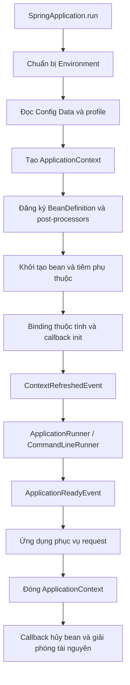

# Khởi tạo bean, binding thuộc tính và xử lý vòng đời

Một ứng dụng Spring Cloud không chỉ là tập hợp các bean được tạo ra khi JVM khởi động. Spring Boot chuẩn bị môi trường cấu hình, xây dựng `ApplicationContext`, đăng ký định nghĩa bean, tiêm phụ thuộc, khởi tạo các thành phần và phát các sự kiện vòng đời. Spring Cloud Context bổ sung những cơ chế làm mới một phần trạng thái cấu hình và bean trong một số trường hợp. Muốn vận hành đúng các abstraction của Spring Cloud Commons và Context, cần hiểu **khi nào một giá trị được đọc, khi nào một bean được tạo và điều gì thực sự xảy ra khi ứng dụng refresh hoặc shutdown**.

Bài này thuộc chương **Kiến trúc nền tảng** của `SPRING_CLOUD_CORE`. Nội dung tập trung vào ba mối liên hệ: **khởi tạo bean**, **binding thuộc tính cấu hình** và **vòng đời của ApplicationContext**. Đây là nền tảng để hiểu cấu hình bên ngoài, `@ConfigurationProperties`, `@RefreshScope`, discovery, service registry, giao tiếp dịch vụ và kiểm thử trong một hệ thống phân tán.

## 1. Mô hình tổng thể: từ cấu hình đến bean đang hoạt động

Một ứng dụng Spring Boot thường đi qua các giai đoạn khái quát sau:

1. Nhận tham số khởi động và chuẩn bị `Environment`.
2. Đọc các nguồn cấu hình áp dụng, bao gồm cấu hình ngoài và profile đang kích hoạt.
3. Tạo và chuẩn bị `ApplicationContext`.
4. Đăng ký `BeanDefinition`, cấu hình `BeanFactory` và các `BeanPostProcessor`.
5. Tạo bean, tiêm phụ thuộc, binding thuộc tính và chạy các callback khởi tạo.
6. Hoàn tất refresh context, chạy các tác vụ sau khởi động và chuyển ứng dụng sang trạng thái sẵn sàng.
7. Khi dừng, gọi các callback hủy bean và đóng tài nguyên do context quản lý.



Sơ đồ là trình tự khái niệm để định vị các hoạt động. Chi tiết nội bộ có thể khác theo phiên bản Spring Boot, loại application context, cấu hình lazy initialization và các extension được cài đặt. Ví dụ, một bean lazy có thể chưa được tạo ở thời điểm context hoàn tất refresh; một ứng dụng web còn có vòng đời server và request riêng.

Điểm cần nhớ là **đọc cấu hình và tạo bean là hai việc có liên quan nhưng không đồng nhất**. `Environment` có thể chứa giá trị trước khi bean tiêu thụ nó được tạo. Binding thuộc tính thường xảy ra trong quá trình khởi tạo bean được quản lý, còn refresh một bean sau đó là một cơ chế riêng.

## 2. ApplicationContext, BeanFactory và Environment

### 2.1. ApplicationContext quản lý vùng chứa bean

`ApplicationContext` là vùng chứa IoC cấp cao của Spring. Nó mở rộng các khả năng của `BeanFactory`, đồng thời cung cấp cơ chế quản lý tài nguyên, phát sự kiện, truy cập message source và tích hợp với môi trường ứng dụng.

Mỗi `ApplicationContext` quản lý định nghĩa bean và các đối tượng thuộc phạm vi của chính nó. Bean có scope mặc định `singleton` nghĩa là **một instance trong một bean factory/context tương ứng**, không phải một instance duy nhất cho mọi JVM hoặc mọi replica của dịch vụ.

Ví dụ:

```java
import org.springframework.stereotype.Component;

@Component
public class RequestCounter {
    private long value;

    public synchronized long next() {
        return ++value;
    }
}
```

Nếu ứng dụng chạy hai replica, mỗi JVM có `ApplicationContext` riêng và mỗi context có `RequestCounter` riêng. `synchronized` ở đây chỉ phối hợp thread truy cập cùng object trong một JVM. Nó không đồng bộ bộ đếm giữa hai replica. Dữ liệu cần dùng chung phải được lưu hoặc điều phối bằng cơ chế bên ngoài phù hợp với yêu cầu nghiệp vụ.

### 2.2. BeanDefinition mô tả cách tạo bean

Spring thường không tạo tất cả object ngay khi quét component. Quá trình quét cấu hình và xử lý annotation trước hết đăng ký các **định nghĩa bean** (`BeanDefinition`) mô tả lớp, scope, dependency, factory method và metadata liên quan. Khi đến thời điểm cần tạo bean, `BeanFactory` dùng định nghĩa đó để khởi tạo object và áp dụng các processor.

Các cách đăng ký bean thường gặp:

```java
import org.springframework.context.annotation.Bean;
import org.springframework.context.annotation.Configuration;

@Configuration
public class ClientConfiguration {
    @Bean
    CatalogGateway catalogGateway(CatalogClientProperties properties) {
        return new CatalogGateway(properties.getBaseUrl());
    }
}
```

`@Component`, `@Service`, `@Repository`, `@Controller` và `@Bean` đều có thể dẫn đến định nghĩa bean. Với `@Bean`, Spring gọi factory method để tạo đối tượng; tham số phương thức có thể được resolve từ các bean khác trong context.

### 2.3. Environment và PropertySource

`Environment` cung cấp cách truy cập các thuộc tính cấu hình và profile đang hoạt động. Giá trị có thể đến từ nhiều `PropertySource`, chẳng hạn:

- Tệp cấu hình trong ứng dụng như `application.properties` hoặc `application.yml`.
- Tệp cấu hình ngoài, thư mục cấu hình và các vị trí được chỉ định khi khởi động.
- Biến môi trường của hệ điều hành.
- Java system properties.
- Tham số dòng lệnh.
- JSON cấu hình và nguồn property do ứng dụng hoặc integration bổ sung.
- Nguồn cấu hình từ xa khi ứng dụng tích hợp Spring Cloud Config hoặc giải pháp tương đương.

Spring Boot quy định thứ tự ưu tiên giữa các nguồn. Các profile, config location, config import và cách khởi chạy có thể làm thay đổi giá trị cuối cùng. Vì vậy, không nên đoán giá trị hiệu lực chỉ bằng cách nhìn một tệp YAML; hãy kiểm tra nguồn cấu hình và tham số thực tế của tiến trình.

Có thể truy vấn một giá trị đã được Environment phân giải:

```java
import org.springframework.core.env.Environment;
import org.springframework.stereotype.Component;

@Component
public class StartupConfigurationReporter {
    public StartupConfigurationReporter(Environment environment) {
        String region = environment.getProperty("catalog.region", "local");
        // Dùng giá trị cho log chẩn đoán phù hợp; tránh ghi secret vào log.
    }
}
```

Đoạn code minh họa cách đọc giá trị; constructor không nên biến thành nơi in toàn bộ cấu hình, đặc biệt khi có mật khẩu, token hoặc thông tin nhạy cảm.

## 3. Nạp cấu hình ngoài và profile

Spring Boot hỗ trợ cấu hình bên ngoài để cùng một artifact có thể chạy ở môi trường local, test, staging và production với giá trị khác nhau. Ví dụ:

```yaml
spring:
  application:
    name: catalog-service

catalog:
  client:
    base-url: https://catalog.internal
    connect-timeout-ms: 1500
```

Profile cho phép bổ sung hoặc thay đổi cấu hình theo môi trường:

```yaml
# application-prod.yml
catalog:
  client:
    connect-timeout-ms: 800
```

Profile được kích hoạt qua cấu hình ứng dụng, biến môi trường, system property hoặc tham số khởi động tùy cách triển khai. Có thể có nhiều profile cùng hoạt động; quy tắc kết hợp cần được hiểu theo Spring Boot version và cấu trúc Config Data của dự án.

Trong các ứng dụng Spring Cloud Config, cấu hình từ xa có thể được nhập qua cơ chế tích hợp Config Client. Cách khai báo và hành vi khi Config Server không sẵn sàng phụ thuộc phiên bản Spring Cloud và cấu hình fail-fast/optional của ứng dụng. Không nên coi việc có dependency Config Client là bằng chứng rằng mọi giá trị từ xa đã được nạp thành công; cần xem startup log, import declaration và trạng thái kết nối.

Một số nguyên tắc vận hành:

1. Tách secret khỏi tệp cấu hình được commit; dùng secret store hoặc cơ chế cấp phát an toàn của môi trường.
2. Ghi rõ profile và nguồn cấu hình cần có khi khởi động, tránh để production vô tình chạy bằng default local.
3. Xác định rõ hành vi khi nguồn cấu hình ngoài không sẵn sàng: dừng startup, dùng cache/giá trị dự phòng hay bỏ qua import nếu nghiệp vụ cho phép.
4. Theo dõi phiên bản cấu hình đang áp dụng mà không tiết lộ giá trị nhạy cảm.
5. Kiểm thử cả trường hợp thiếu property bắt buộc và trường hợp property có giá trị sai định dạng.

## 4. Binding thuộc tính: từ key cấu hình sang object Java

### 4.1. Vì sao nên dùng ConfigurationProperties?

Khi một nhóm cấu hình có nhiều trường liên quan, `@ConfigurationProperties` giúp gom chúng vào một object có kiểu dữ liệu rõ ràng. Spring Boot Binder ánh xạ key từ `Environment` sang thuộc tính Java, hỗ trợ chuyển đổi kiểu và relaxed binding.

Ví dụ YAML:

```yaml
catalog:
  client:
    base-url: https://catalog.internal
    connect-timeout-ms: 1500
    enabled: true
```

Lớp nhận cấu hình:

```java
import jakarta.validation.constraints.Min;
import jakarta.validation.constraints.NotBlank;
import org.springframework.boot.context.properties.ConfigurationProperties;
import org.springframework.validation.annotation.Validated;

@Validated
@ConfigurationProperties(prefix = "catalog.client")
public class CatalogClientProperties {
    @NotBlank
    private String baseUrl;

    @Min(1)
    private int connectTimeoutMs = 1000;

    private boolean enabled = true;

    public String getBaseUrl() {
        return baseUrl;
    }

    public void setBaseUrl(String baseUrl) {
        this.baseUrl = baseUrl;
    }

    public int getConnectTimeoutMs() {
        return connectTimeoutMs;
    }

    public void setConnectTimeoutMs(int connectTimeoutMs) {
        this.connectTimeoutMs = connectTimeoutMs;
    }

    public boolean isEnabled() {
        return enabled;
    }

    public void setEnabled(boolean enabled) {
        this.enabled = enabled;
    }
}
```

Đăng ký lớp cấu hình bằng component scan chuyên dụng:

```java
import org.springframework.boot.SpringApplication;
import org.springframework.boot.autoconfigure.SpringBootApplication;
import org.springframework.boot.context.properties.ConfigurationPropertiesScan;

@SpringBootApplication
@ConfigurationPropertiesScan
public class CatalogApplication {
    public static void main(String[] args) {
        SpringApplication.run(CatalogApplication.class, args);
    }
}
```

`@ConfigurationPropertiesScan` tìm các lớp được đánh dấu trong phạm vi scan. Một lựa chọn khác là khai báo `@EnableConfigurationProperties(CatalogClientProperties.class)` trên configuration class. Chỉ đặt annotation trên lớp properties mà không đăng ký nó theo một trong các cách phù hợp thì chưa đủ để đảm bảo object được tạo và binding.

Ví dụ trên dùng package `jakarta.validation` như các ứng dụng Spring Boot hiện đại. Dự án thuộc dòng Spring Boot cũ có thể dùng namespace validation khác; hãy chọn dependency và import phù hợp với phiên bản thực tế.

### 4.2. Relaxed binding và chuyển đổi kiểu

Binder hỗ trợ nhiều cách viết tương ứng cho cùng một thuộc tính theo quy tắc relaxed binding. Chẳng hạn key YAML `connect-timeout-ms` có thể ánh xạ tới trường Java `connectTimeoutMs`. Binder cũng hỗ trợ chuyển đổi kiểu thông dụng như chuỗi thành số, boolean, enum, `Duration`, `DataSize`, collection và các kiểu được converter hỗ trợ.

Ví dụ dùng `Duration`:

```yaml
catalog:
  client:
    connect-timeout: 2s
    read-timeout: 750ms
```

```java
import java.time.Duration;
import org.springframework.boot.context.properties.ConfigurationProperties;

@ConfigurationProperties(prefix = "catalog.client")
public class CatalogTimeoutProperties {
    private Duration connectTimeout = Duration.ofSeconds(2);
    private Duration readTimeout = Duration.ofMillis(750);

    public Duration getConnectTimeout() {
        return connectTimeout;
    }

    public void setConnectTimeout(Duration connectTimeout) {
        this.connectTimeout = connectTimeout;
    }

    public Duration getReadTimeout() {
        return readTimeout;
    }

    public void setReadTimeout(Duration readTimeout) {
        this.readTimeout = readTimeout;
    }
}
```

Đơn vị tường minh như `s` và `ms` làm cấu hình dễ đọc hơn. Nếu giá trị thiếu đơn vị hoặc cần đơn vị mặc định khác, phải xác định rõ semantics của kiểu và converter được dùng.

### 4.3. Validation giúp phát hiện cấu hình sai sớm

Các annotation như `@NotBlank`, `@Min`, `@Max`, `@NotNull` và validation tùy chỉnh có thể kiểm tra dữ liệu binding. Khi dùng `@Validated`, ứng dụng cần có implementation Bean Validation thích hợp trên classpath. Nếu cấu hình bắt buộc không hợp lệ, nên để startup thất bại với thông báo dễ chẩn đoán thay vì chạy ứng dụng trong trạng thái nửa đúng nửa sai.

Ví dụ:

```java
@Validated
@ConfigurationProperties(prefix = "catalog.client")
public class CatalogClientProperties {
    @NotBlank
    private String baseUrl;

    @Min(100)
    @Max(10000)
    private int connectTimeoutMs = 1500;

    // Getter và setter được lược bớt.
}
```

Validation nên diễn đạt ràng buộc nghiệp vụ/cấu hình thực sự. Đặt giá trị mặc định quá rộng hoặc validation quá lỏng có thể khiến lỗi cấu hình chỉ bộc lộ khi request đi qua code path hiếm gặp.

### 4.4. Constructor binding và cấu hình bất biến

Với các cấu hình không cần thay đổi sau khi tạo, kiểu bất biến giúp tránh việc bean bị sửa từng trường trong quá trình chạy. Spring Boot hỗ trợ constructor binding cho `@ConfigurationProperties` theo quy tắc phụ thuộc phiên bản; các kiểu record cũng là lựa chọn tự nhiên trong các dòng Java/Spring Boot phù hợp.

Ví dụ minh họa kiểu record:

```java
import java.time.Duration;
import org.springframework.boot.context.properties.ConfigurationProperties;

@ConfigurationProperties(prefix = "catalog.client")
public record CatalogClientSettings(
        String baseUrl,
        Duration connectTimeout,
        boolean enabled) {
}
```

Việc binding record/constructor cần được đăng ký theo cơ chế properties scan hoặc enable properties và phải tương thích với Spring Boot version của project. Không thêm `@ConstructorBinding` một cách máy móc: annotation và quy tắc lựa chọn constructor đã thay đổi giữa các phiên bản Boot.

## 5. @Value và ConfigurationProperties khác nhau thế nào?

`@Value` phù hợp khi một bean cần một vài giá trị đơn lẻ:

```java
import org.springframework.beans.factory.annotation.Value;
import org.springframework.stereotype.Component;

@Component
public class CatalogEndpoint {
    private final String baseUrl;

    public CatalogEndpoint(
            @Value("${catalog.client.base-url}") String baseUrl) {
        this.baseUrl = baseUrl;
    }
}
```

So sánh:

| Tiêu chí | `@Value` | `@ConfigurationProperties` |
| --- | --- | --- |
| Mục đích | Tiêm một giá trị hoặc biểu thức vào bean | Gom và bind một nhóm thuộc tính có cấu trúc |
| Cấu trúc lồng nhau/collection | Có thể làm nhưng biểu thức dễ phức tạp | Hỗ trợ binding object, collection và map thuận tiện hơn |
| Relaxed binding | Hỗ trợ placeholder nhưng không có trải nghiệm bulk binding tương tự Binder | Hỗ trợ relaxed binding theo quy tắc Boot |
| Validation theo nhóm | Thường phải tự kiểm tra hoặc tích hợp riêng | Có thể dùng Bean Validation trên lớp properties |
| SpEL | Hỗ trợ biểu thức `#{...}` | Không dùng SpEL làm cơ chế binding chính |
| Kiểm soát kiểu | Placeholder được chuyển đổi theo conversion service | Binder chuyển đổi theo metadata và conversion service |

Không cần chuyển mọi giá trị đơn giản sang một lớp properties lớn. Hãy chọn theo cấu trúc cấu hình và khả năng bảo trì. Với nhóm cấu hình có nhiều trường liên quan, `@ConfigurationProperties` thường làm hợp đồng cấu hình rõ hơn.

## 6. Vòng đời của một Spring bean

### 6.1. Các bước khởi tạo điển hình

Với một bean singleton thông thường, trình tự khái quát gồm:

1. Spring tạo instance bằng constructor hoặc factory method.
2. Spring gán các dependency và thuộc tính được quản lý.
3. Các callback `Aware` thích hợp được gọi nếu bean triển khai interface tương ứng.
4. `BeanPostProcessor` có thể xử lý bean trước initialization.
5. Các callback khởi tạo được gọi.
6. `BeanPostProcessor` xử lý sau initialization; một số processor có thể trả về proxy thay cho object ban đầu.
7. Bean sẵn sàng để các thành phần khác sử dụng.

Ví dụ một bean có callback:

```java
import jakarta.annotation.PostConstruct;
import jakarta.annotation.PreDestroy;
import org.springframework.stereotype.Component;

@Component
public class CatalogConnectionManager {
    @PostConstruct
    public void initialize() {
        // Kiểm tra trạng thái cục bộ hoặc chuẩn bị tài nguyên nhẹ.
    }

    @PreDestroy
    public void close() {
        // Giải phóng tài nguyên do bean sở hữu.
    }
}
```

Với một bean có nhiều kiểu callback, thứ tự phổ biến là `@PostConstruct`, `InitializingBean.afterPropertiesSet()` rồi custom init method; khi hủy là `@PreDestroy`, `DisposableBean.destroy()` rồi custom destroy method. Nên chọn một cơ chế nhất quán để dễ hiểu. Các callback annotation thuộc Jakarta ở các phiên bản Spring hiện đại; dự án cũ có thể dùng namespace trước đây.

### 6.2. BeanPostProcessor và proxy

`BeanPostProcessor` cho phép can thiệp vào bean trước và sau initialization. Các tính năng như AOP, transaction, method validation và một số annotation xử lý qua cơ chế post-processing có thể tạo proxy để bổ sung hành vi.

Điều này giải thích một số lỗi dễ gặp:

- Gọi method cần transaction từ `@PostConstruct` có thể diễn ra trước khi proxy AOP được áp dụng đầy đủ cho bean.
- Self-invocation (một method trong bean gọi trực tiếp method khác cùng object) thường không đi qua proxy theo cơ chế proxy-based AOP.
- Lưu tham chiếu tới object thô quá sớm có thể khiến code bỏ qua hành vi được proxy cung cấp.

Không nên dùng callback khởi tạo để gọi sâu sang dịch vụ từ xa, chạy migration nghiệp vụ hoặc thực hiện tác vụ có thể retry lâu. Ưu tiên tách phần chuẩn bị nhẹ khỏi tác vụ sau khi ứng dụng sẵn sàng, và thiết kế timeout/failure rõ ràng cho thao tác I/O.

### 6.3. Constructor injection và thứ tự phụ thuộc

Constructor injection biểu đạt rõ dependency bắt buộc và giúp object có thể bất biến sau khi tạo:

```java
import org.springframework.stereotype.Service;

@Service
public class CatalogService {
    private final CatalogRepository repository;
    private final CatalogClientProperties properties;

    public CatalogService(
            CatalogRepository repository,
            CatalogClientProperties properties) {
        this.repository = repository;
        this.properties = properties;
    }
}
```

Spring giải quyết các dependency theo đồ thị bean. Nếu A cần B trong constructor và B cũng cần A trong constructor, ứng dụng gặp vòng phụ thuộc không thể khởi tạo theo cách thông thường. Thay vì dùng `@Lazy` hoặc setter để che mọi vòng lặp, nên xem lại trách nhiệm và tách thành phần dùng chung.

Khi một bean cần phụ thuộc bean khác, khai báo dependency qua constructor thường đủ để Spring biết thứ tự tạo. `@DependsOn` chỉ nên dùng khi có quan hệ khởi tạo phụ không thể biểu đạt bằng dependency injection; nó không thay thế hợp đồng phụ thuộc và không đảm bảo thứ tự hoàn tất mọi tác vụ bất đồng bộ.

## 7. Scope và vòng đời tài nguyên

### 7.1. Singleton và prototype

`singleton` là scope mặc định. Một bean được tạo và quản lý trong context; Spring thường khởi tạo eager các singleton không lazy trong quá trình refresh.

`prototype` tạo một instance mới mỗi khi container được yêu cầu resolve bean đó. Spring quản lý quá trình tạo và dependency injection, nhưng **không tự quản lý đầy đủ vòng đời hủy** của prototype sau khi giao object cho caller. Nếu prototype sở hữu tài nguyên cần đóng, phía nhận phải có trách nhiệm giải phóng.

| Scope | Phạm vi | Hệ quả cần lưu ý |
| --- | --- | --- |
| `singleton` | Một instance trong bean factory/context | Phù hợp service stateless; state mutable cần xem xét concurrency |
| `prototype` | Mỗi lần resolve tạo instance mới | Caller chịu trách nhiệm vòng đời sau khi nhận |
| `request` | Một HTTP request trong web context phù hợp | Không dùng tùy tiện ngoài request scope; cần proxy khi inject vào bean sống lâu |
| `session` | Một HTTP session | Không mặc định chia sẻ giữa nhiều instance; cần session store nếu muốn dùng chung |
| `application` | Một ServletContext | Phạm vi web application, vẫn không phải toàn cụm |

Các web scope chỉ có ý nghĩa khi loại context và môi trường hỗ trợ chúng. Không nên dùng request/session-scoped bean làm nơi lưu dữ liệu nghiệp vụ cần bền vững.

### 7.2. Tài nguyên cần đóng

Bean quản lý connection pool, executor, client hoặc file handle phải có cách shutdown rõ ràng. Có thể dùng `@PreDestroy`, `DisposableBean`, custom destroy method hoặc cơ chế lifecycle chuyên dụng. Cần tránh đóng tài nguyên do bean khác sở hữu hoặc đóng hai lần mà không có thiết kế idempotent.

Với thành phần nền cần start/stop có thứ tự, Spring có `Lifecycle` và `SmartLifecycle`. `SmartLifecycle` cho phép điều khiển auto-startup, phase và callback stop; phù hợp khi một component cần dừng nhận công việc trước khi đóng executor hoặc connection. Đây là cơ chế vòng đời trong một context, không phải điều phối graceful shutdown toàn cụm.

### 7.3. Shutdown trong hệ thống phân tán

Khi container bị dừng, tiến trình có thể nhận tín hiệu shutdown và Spring Boot đóng context. Một shutdown tốt cần:

1. Ngừng nhận công việc mới theo cơ chế của server/điều phối triển khai.
2. Cho request hoặc tác vụ đang chạy một khoảng thời gian hoàn tất có giới hạn.
3. Dừng consumer/scheduler để tránh nhận thêm việc khi dependency sắp đóng.
4. Đóng executor, connection pool và client theo thứ tự phù hợp.
5. Ghi log trạng thái dừng và để hệ thống orchestration biết tiến trình đã kết thúc.

Thời gian graceful shutdown của ứng dụng phải tương thích với termination grace period của nền tảng triển khai. Callback `@PreDestroy` không thể bảo đảm hoàn tất công việc nếu process bị kill cưỡng bức hoặc thời gian cho phép đã hết. Tác vụ nghiệp vụ cần khả năng phục hồi sau crash nên có trạng thái bền vững và cơ chế retry/claim, thay vì dựa vào callback shutdown.

## 8. Spring Cloud Context và giới hạn của refresh

### 8.1. Environment thay đổi không tự làm mọi bean thay đổi

Giả sử một service bind cấu hình lúc khởi động:

```yaml
catalog:
  client:
    base-url: https://catalog-v1.internal
```

Một bean nhận giá trị trong constructor:

```java
@Service
public class CatalogEndpoint {
    private final String baseUrl;

    public CatalogEndpoint(CatalogClientProperties properties) {
        this.baseUrl = properties.getBaseUrl();
    }
}
```

Nếu nguồn cấu hình đổi sau đó, object `CatalogEndpoint` đang tồn tại vẫn giữ `baseUrl` đã gán. Việc Environment có thể đọc được giá trị mới không có nghĩa mọi field trong mọi bean đã được gán lại. **Giá trị cấu hình đã được sao chép vào object là trạng thái của object**, với vòng đời riêng.

### 8.2. RefreshScope làm mới target bean theo scope

Spring Cloud Context cung cấp `@RefreshScope` cho những bean cần được tạo lại sau khi refresh phù hợp. Cơ chế này dùng scoped proxy và cache target bean; khi refresh scope được làm mới, target hiện tại bị loại khỏi cache và lần truy cập tiếp theo có thể tạo target mới với dependency/configuration hiện hành.

```java
import org.springframework.beans.factory.annotation.Value;
import org.springframework.cloud.context.config.annotation.RefreshScope;
import org.springframework.stereotype.Component;

@Component
@RefreshScope
public class RemoteCatalogSettings {
    private final String baseUrl;

    public RemoteCatalogSettings(
            @Value("${catalog.client.base-url}") String baseUrl) {
        this.baseUrl = baseUrl;
    }

    public String baseUrl() {
        return baseUrl;
    }
}
```

Ví dụ minh họa bean phụ thuộc giá trị cấu hình. Để refresh có tác dụng, instance phải nhận được giá trị mới trong Environment và refresh scope phải được kích hoạt đúng cách. Bean không thuộc refresh scope, object khác đã sao chép giá trị cũ, hoặc tài nguyên được giữ ngoài target có thể vẫn mang trạng thái cũ.

Không nên gắn `@RefreshScope` lên mọi service. Việc tạo lại target có thể đóng/mở lại tài nguyên và gây chi phí hoặc gián đoạn. Chỉ chọn bean có semantics tái tạo rõ ràng; các kết nối, cache và client cần kiểm tra cách hủy target cũ, tạo target mới và xử lý request đang chạy.

### 8.3. Refresh không phải khởi động lại toàn bộ context

Refresh scope không đồng nghĩa với việc tạo lại toàn bộ `ApplicationContext`, restart JVM hoặc đồng bộ trạng thái nghiệp vụ giữa các replica. Nó tác động tới bean nằm trong scope theo cơ chế của Spring Cloud Context. Những bean ngoài scope và các cấu hình đã được tiêu thụ theo cách không hỗ trợ rebinding có thể không đổi.

Một số bean `@ConfigurationProperties` có cơ chế rebinding liên quan Spring Cloud Context tùy phiên bản và cấu hình. Không nên giả định mọi object properties đều tự thay đổi theo cùng một cách. Với cấu hình immutable, hãy xác định rõ bean nào được tái tạo, bean nào cần rebind, và code tiêu thụ giá trị có giữ bản sao riêng hay không.

### 8.4. Refresh trong nhiều instance

Mỗi replica có JVM và context riêng. Nếu A nhận sự kiện refresh thành công nhưng B chưa nhận hoặc xử lý thất bại, hai instance có thể tạm thời dùng hai phiên bản cấu hình khác nhau. Spring Cloud Bus có thể truyền sự kiện refresh qua broker khi được thêm và cấu hình, nhưng truyền sự kiện không tạo transaction nguyên tử để mọi instance cùng thay đổi tại một thời điểm.

Với cấu hình ảnh hưởng quyết định nghiệp vụ, cần quản lý version cấu hình, khả năng tương thích trong giai đoạn rollout, giám sát trạng thái refresh của từng instance và phương án rollback. Nếu quyết định phải nhất quán tức thời, cân nhắc đưa quyết định đến một nguồn có thẩm quyền thay vì dựa vào giá trị cục bộ được refresh lệch thời điểm.

## 9. Sự kiện vòng đời và tác vụ sau khởi động

Spring cung cấp nhiều sự kiện và callback để ứng dụng phản ứng với tiến trình khởi động:

| Cơ chế | Thời điểm/ý nghĩa | Trường hợp phù hợp |
| --- | --- | --- |
| `@PostConstruct` | Sau khi dependency được inject và trước khi bean được công bố hoàn chỉnh | Kiểm tra trạng thái cục bộ, chuẩn bị nhẹ |
| `ContextRefreshedEvent` | Context đã được refresh | Thành phần cần biết context hoàn tất refresh |
| `ApplicationRunner` | Sau khi context được refresh, nhận `ApplicationArguments` | Nạp dữ liệu khởi tạo có kiểm soát, kiểm tra điều kiện sau startup |
| `CommandLineRunner` | Sau khi context được refresh, nhận raw arguments | Tác vụ startup cần tham số dòng lệnh |
| `ApplicationReadyEvent` | Ứng dụng đã sẵn sàng theo vòng đời Spring Boot | Ghi nhận readiness hoặc phát tín hiệu nội bộ |
| `@PreDestroy` | Khi bean được hủy trong quá trình đóng context | Giải phóng tài nguyên |

Không nên dùng mọi callback như các điểm tương đương. `@PostConstruct` chạy trong quá trình khởi tạo bean, còn runner chạy sau khi context đã refresh. Nếu cần gọi dịch vụ ngoài hoặc thực hiện thao tác có thể thất bại, runner thường dễ biểu đạt ý định sau startup hơn, nhưng vẫn cần timeout, retry và chính sách làm ứng dụng fail hay degraded.

Ví dụ runner:

```java
import org.springframework.boot.ApplicationArguments;
import org.springframework.boot.ApplicationRunner;
import org.springframework.stereotype.Component;

@Component
public class CatalogStartupCheck implements ApplicationRunner {
    private final CatalogHealthProbe healthProbe;

    public CatalogStartupCheck(CatalogHealthProbe healthProbe) {
        this.healthProbe = healthProbe;
    }

    @Override
    public void run(ApplicationArguments args) {
        healthProbe.checkConfiguredEndpoint();
    }
}
```

Đoạn ví dụ chỉ phù hợp nếu việc kiểm tra endpoint là một điều kiện startup có chủ đích. Nếu endpoint bên ngoài tạm thời không sẵn sàng nhưng service vẫn có thể hoạt động ở chế độ degraded, không nên để probe tùy tiện làm startup thất bại.

## 10. Những lỗi thường gặp khi khởi tạo và binding

### 10.1. Không tìm thấy bean properties

**Triệu chứng:** constructor cần `CatalogClientProperties` nhưng context báo không có bean phù hợp.

**Nguyên nhân thường gặp:** thiếu `@ConfigurationPropertiesScan`, thiếu `@EnableConfigurationProperties`, lớp nằm ngoài phạm vi scan hoặc cấu hình đăng ký không được import.

**Cách kiểm tra:** xem package của application class, vị trí lớp properties và cơ chế đăng ký. Không tạo thêm một bean thủ công trùng với bean được scan nếu chưa hiểu rõ hệ quả.

### 10.2. Property không bind như mong đợi

**Triệu chứng:** giá trị vẫn là `null`, default hoặc khác giá trị trong tệp YAML.

**Nguyên nhân thường gặp:** prefix sai, tên key không tương ứng, profile không được kích hoạt, nguồn cấu hình ưu tiên cao ghi đè, object không được đăng ký hoặc kiểu dữ liệu không chuyển đổi được.

**Cách kiểm tra:** xác nhận active profiles, config import/location, tên property, loại dữ liệu và nguồn cuối cùng. Có thể dùng Actuator `env`/`configprops` trong môi trường được bảo vệ để chẩn đoán; các endpoint này có thể tiết lộ thông tin nhạy cảm nên phải giới hạn truy cập và masking đúng.

### 10.3. Ứng dụng khởi động được dù cấu hình nghiệp vụ sai

**Triệu chứng:** service chạy nhưng request đầu tiên mới thất bại do URL rỗng, timeout âm hoặc credential thiếu.

**Nguyên nhân:** thiếu validation hoặc default che mất cấu hình bắt buộc.

**Cách kiểm tra:** phân loại trường bắt buộc/tùy chọn, thêm Bean Validation thích hợp, kiểm thử profile và cấu hình thiếu. Chỉ đặt default khi default đó có ý nghĩa an toàn với nghiệp vụ.

### 10.4. Bean dùng giá trị cũ sau refresh

**Triệu chứng:** Environment/nguồn cấu hình đã có giá trị mới nhưng service vẫn sử dụng endpoint hoặc timeout cũ.

**Nguyên nhân:** bean không thuộc refresh scope, không có cơ chế rebind phù hợp, bean khác giữ bản sao giá trị cũ, hoặc instance chưa nhận refresh.

**Cách kiểm tra:** truy vết bean tiêu thụ property, xác nhận trạng thái refresh của từng instance, kiểm tra proxy/scope và vòng đời resource. Không chỉ kiểm tra endpoint refresh trả HTTP thành công.

### 10.5. Bean khởi tạo quá sớm hoặc gọi mạng trong constructor

**Triệu chứng:** startup chậm, phụ thuộc ngoài làm ứng dụng không khởi động, hoặc lỗi xuất hiện trước khi health endpoint sẵn sàng.

**Nguyên nhân:** constructor hoặc `@PostConstruct` thực hiện I/O, retry dài hoặc side effect.

**Cách xử lý:** constructor tập trung vào dependency và thiết lập trạng thái object; tách thao tác ngoài thành thành phần có timeout/chính sách lỗi rõ ràng. Nếu thao tác bắt buộc để phục vụ request, biểu đạt nó thành kiểm tra startup có chủ đích.

### 10.6. Tạo tác vụ nền lặp ở mọi replica

**Triệu chứng:** mỗi lần scale thêm một instance, tác vụ startup hoặc scheduler chạy thêm một lần.

**Nguyên nhân:** callback khởi tạo và `@Scheduled` chạy theo từng ApplicationContext/JVM. Chúng không tự có tính chất “chỉ chạy một lần toàn cụm”.

**Cách xử lý:** dùng cơ chế claim job, scheduler phân tán, queue hoặc idempotency phù hợp. Callback lifecycle chỉ quản lý vòng đời cục bộ của bean.

## 11. Kiểm thử binding và vòng đời

Kiểm thử cấu hình nên kiểm tra cả trường hợp hợp lệ và không hợp lệ, đồng thời tách unit test khỏi integration test với context thật.

| Mục tiêu | Cách kiểm thử | Điều cần xác nhận |
| --- | --- | --- |
| Binding key cơ bản | Dùng `ApplicationContextRunner` hoặc context test phù hợp | Key YAML/property được ánh xạ đúng field |
| Relaxed binding | Cấp cùng giá trị qua các cách viết được hỗ trợ | Tên key được chuẩn hóa như dự kiến |
| Default | Bỏ một property tùy chọn | Default có giá trị mong muốn |
| Validation | Cấp URL rỗng hoặc timeout ngoài giới hạn | Startup/binding báo lỗi rõ ràng |
| Profile | Khởi động context với profile khác nhau | Đúng nguồn cấu hình được áp dụng |
| Bean lifecycle | Dùng spy/fake hoặc callback test | Init/destroy được gọi đúng theo vòng đời context |
| Refresh scope | Cấp giá trị, refresh scope, thay Environment theo cơ chế test | Target được tạo lại và giá trị mới thực sự được dùng |
| Nhiều instance | Chạy hai context/process độc lập | Refresh hoặc startup của A không được giả định tự tác động B |

Ví dụ test khái niệm với `ApplicationContextRunner`:

```java
import org.junit.jupiter.api.Test;
import org.springframework.boot.test.context.runner.ApplicationContextRunner;

class CatalogPropertiesTest {
    private final ApplicationContextRunner contextRunner =
            new ApplicationContextRunner()
                    .withUserConfiguration(TestPropertiesConfiguration.class)
                    .withPropertyValues(
                            "catalog.client.base-url=https://catalog.test",
                            "catalog.client.connect-timeout-ms=900");

    @Test
    void bindsCatalogClientProperties() {
        contextRunner.run(context -> {
            CatalogClientProperties properties =
                    context.getBean(CatalogClientProperties.class);
            // Assert baseUrl và connectTimeoutMs bằng giá trị đã cấp.
        });
    }
}
```

Đây là khung minh họa; `TestPropertiesConfiguration` phải đăng ký `CatalogClientProperties` bằng `@EnableConfigurationProperties`, và test cần dependency Boot test phù hợp. Khi kiểm thử validation, phải thêm Bean Validation provider vào test/runtime classpath.

### Kiểm thử vòng đời với context đóng

Một test có thể tạo context, lấy bean, sau đó đóng context và xác nhận callback hủy đã chạy. Với Spring Boot test, context thường được cache giữa các test; không nên giả định `@PreDestroy` chạy sau mỗi method test nếu context chưa bị đóng. Dùng context riêng hoặc cơ chế đóng chủ động khi muốn kiểm tra destruction.

Đối với `@RefreshScope`, kiểm thử phải xác nhận **target bean thực sự được tái tạo**, không chỉ xác nhận Environment đọc được property mới. Với ứng dụng nhiều replica, cần kiểm thử riêng từng process hoặc context độc lập để thấy trạng thái refresh không tự lan truyền.

## 12. Thực hành: theo dõi một property từ YAML đến bean

Hãy xây dựng một service nhỏ có `CatalogClientProperties` và `CatalogService`.

1. Khai báo `catalog.client.base-url` và `catalog.client.connect-timeout-ms` trong YAML.
2. Đăng ký lớp `@ConfigurationProperties` qua scan hoặc enable properties.
3. Tiêm lớp properties vào service bằng constructor injection.
4. Đặt một giá trị timeout không hợp lệ và bật validation để quan sát lỗi startup.
5. Chạy lại với profile khác và xác nhận giá trị được bind thay đổi theo cấu hình đang hoạt động.
6. Nếu thử `@RefreshScope`, đặt một bean tiêu thụ property vào scope và xác nhận target được tạo lại sau refresh hợp lệ.
7. Chạy hai instance độc lập, chỉ refresh một instance rồi quan sát sự khác biệt cho tới khi instance còn lại được cập nhật.

### Câu hỏi tự kiểm tra

1. `ApplicationContext` và `Environment` giữ vai trò khác nhau như thế nào?
2. Vì sao `@ConfigurationProperties` cần được đăng ký với context?
3. Khi nào nên dùng `@Value`, khi nào nên gom cấu hình bằng `@ConfigurationProperties`?
4. Vì sao constructor injection giúp biểu đạt dependency rõ hơn?
5. `@PostConstruct` có tương đương `ApplicationRunner` không?
6. Vì sao `@RefreshScope` không đồng nghĩa restart toàn bộ ứng dụng?
7. Khi một replica nhận refresh thành công, có thể kết luận các replica còn lại đã dùng cấu hình mới chưa?
8. Vì sao callback `@PreDestroy` không đủ để bảo đảm tác vụ nghiệp vụ đang chạy được hoàn tất khi pod bị kill?

**Gợi ý đáp án:** (1) `ApplicationContext` quản lý bean và sự kiện; `Environment` cung cấp profile/property; (2) Vì annotation mô tả binding nhưng bean vẫn cần được đăng ký; (3) `@Value` cho giá trị đơn, `@ConfigurationProperties` cho nhóm cấu hình có cấu trúc; (4) Dependency bắt buộc rõ ràng và object dễ bất biến; (5) Không, runner chạy sau khi context refresh; (6) Refresh scope chỉ làm mới target bean trong scope; (7) Không, mỗi replica có context riêng; (8) Process có thể bị kill cưỡng bức hoặc hết thời gian graceful shutdown.

## 13. Những nguyên tắc cần nhớ

- `ApplicationContext` quản lý bean trong phạm vi context; bean singleton không phải singleton toàn cụm.
- `Environment` là nơi phân giải thuộc tính và profile; cần xem toàn bộ nguồn cấu hình và thứ tự ưu tiên thực tế.
- `@ConfigurationProperties` phù hợp cho nhóm cấu hình có cấu trúc, có kiểu và có thể validation; `@Value` phù hợp cho giá trị đơn giản.
- Vòng đời bean gồm tạo instance, inject dependency, callback khởi tạo, post-processing và callback hủy; không đặt side effect dài hoặc khó phục hồi vào constructor.
- `@RefreshScope` cho phép tái tạo target bean theo scope khi refresh phù hợp; nó không tự cập nhật mọi bean hoặc đồng bộ nhiều replica.
- Kiểm thử phải xác nhận giá trị được bind, hành vi validation, callback lifecycle và kết quả refresh trên context/instance thực tế.

Hiểu được đường đi từ cấu hình đến bean giúp người học đọc đúng hành vi của Spring Cloud Context, đánh giá khả năng làm mới cấu hình, và thiết kế discovery, service registry, giao tiếp dịch vụ cùng quy trình kiểm thử/vận hành trên nhiều instance một cách có chủ đích.
