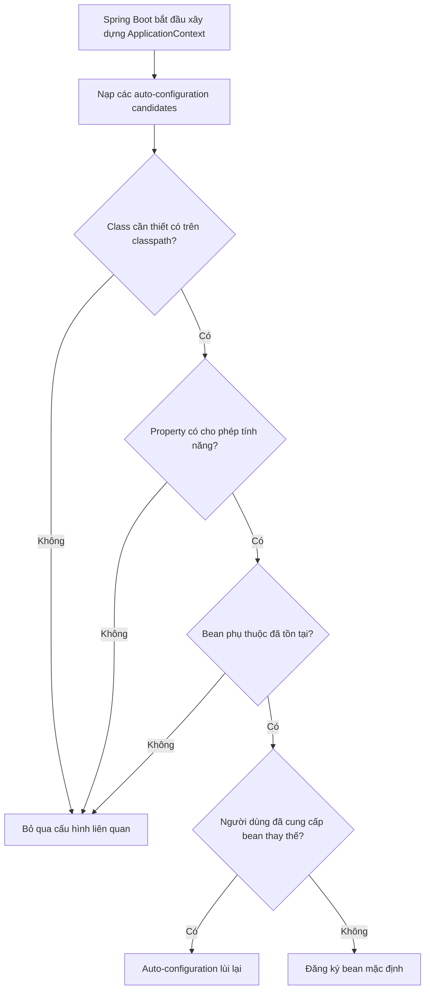
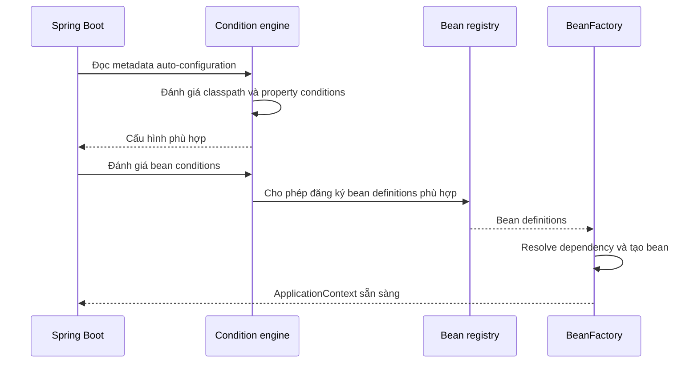

# Điều kiện kích hoạt theo classpath, bean và property

Khi thêm một starter vào ứng dụng Spring Boot, nhiều bean có thể xuất hiện dù người phát triển chưa viết cấu hình tương ứng. Khi tự khai báo một bean thay thế, một phần cấu hình mặc định có thể tự rút lui. Khi gỡ một thư viện khỏi classpath hoặc đổi một property, một nhóm tính năng có thể không còn được kích hoạt. Những hành vi này đến từ **conditional configuration** (cấu hình có điều kiện).

Spring Boot và các dự án Spring Cloud dùng điều kiện để quyết định một cấu hình hoặc bean có nên được đăng ký vào ApplicationContext hay không. Ba tín hiệu thường gặp nhất là:

- **Classpath:** thư viện và class mà ứng dụng thực sự có thể nạp.
- **Bean:** những bean đã được khai báo hoặc đăng ký trong ApplicationContext.
- **Property:** giá trị cấu hình có trong Spring Environment.

Bài học thuộc chương **Kiến trúc nền tảng** của **SPRING_CLOUD_CORE**. Chúng ta sẽ hiểu cách các điều kiện này phối hợp trong auto-configuration, cách Spring Cloud Commons/Context sử dụng chúng để tích hợp discovery và refresh, cách tránh các lỗi do thứ tự cấu hình và cách kiểm tra quyết định kích hoạt khi ứng dụng khởi động.

## 1. Mục tiêu học tập

Sau bài này, người học có thể:

1. Giải thích vì sao Spring Boot cần điều kiện để bật hoặc bỏ qua auto-configuration.
2. Phân biệt điều kiện theo classpath, bean, property và các loại điều kiện bổ sung.
3. Đọc và viết các annotation như `@ConditionalOnClass`, `@ConditionalOnBean`, `@ConditionalOnMissingBean` và `@ConditionalOnProperty`.
4. Giải thích ảnh hưởng của thứ tự đăng ký bean definitions đối với bean conditions.
5. Phân biệt việc điều kiện được đánh giá khi tạo ApplicationContext với việc refresh một bean đang chạy.
6. Dùng Condition Evaluation Report và `ApplicationContextRunner` để chẩn đoán, kiểm thử các nhánh cấu hình.

## 2. Tại sao cần cấu hình có điều kiện?

Hãy tưởng tượng một thư viện tích hợp service discovery. Nó muốn cung cấp một adapter để ứng dụng có thể sử dụng `DiscoveryClient` của Spring Cloud Commons. Tuy nhiên, không phải ứng dụng nào cũng thêm thư viện Commons hoặc một implementation discovery. Có ứng dụng tự cung cấp adapter riêng, có ứng dụng tắt tính năng discovery qua cấu hình.

Nếu thư viện luôn tạo adapter trong mọi tình huống, ứng dụng có thể gặp lỗi thiếu class, thiếu bean phụ thuộc hoặc xung đột với bean do người dùng cung cấp. Conditional configuration cho phép thư viện tự xác định khi nào nên áp dụng cấu hình mặc định.

Ví dụ, cấu hình adapter chỉ nên được đăng ký khi đồng thời thỏa mãn:

- API `DiscoveryClient` có mặt trong classpath.
- Một bean `DiscoveryClient` đã được cung cấp bởi discovery implementation.
- Property `app.discovery.bridge.enabled` được đặt thành `true`.
- Người dùng chưa định nghĩa một bean `DiscoveryBridge` thay thế.

Đây là một phép kết hợp điều kiện. Nếu một điều kiện bắt buộc không đạt, bean mặc định sẽ không được tạo.



Sơ đồ thể hiện một ví dụ logic. Thứ tự kiểm tra thực tế còn phụ thuộc loại điều kiện, giai đoạn xử lý cấu hình và cách các auto-configuration được sắp xếp.

**Điều kiện quyết định việc đăng ký cấu hình/bean.** Chúng không tự chứng minh rằng service bên ngoài đang khỏe, registry có dữ liệu, cấu hình nghiệp vụ đúng hoặc kết nối mạng thành công. Những vấn đề runtime đó cần health check, validation, timeout và kiểm thử riêng.

## 3. Auto-configuration và vị trí của điều kiện

### 3.1. Auto-configuration là gì?

Spring Boot auto-configuration là tập các cấu hình được áp dụng dựa trên những thư viện và thành phần mà ứng dụng cung cấp. Ví dụ:

- Có thư viện JDBC và những điều kiện liên quan phù hợp, Spring Boot có thể cấu hình hạ tầng DataSource.
- Có thư viện web servlet, ứng dụng có thể nhận cấu hình web tương ứng.
- Có thư viện hỗ trợ một công nghệ và chưa có bean do người dùng thay thế, cấu hình mặc định của thư viện có thể được áp dụng.

Ứng dụng thường bật cơ chế này qua `@SpringBootApplication` hoặc `@EnableAutoConfiguration`. Một auto-configuration được đánh dấu `@AutoConfiguration` và được Spring Boot phát hiện theo cơ chế đăng ký auto-configuration của phiên bản Boot tương ứng.

Với Spring Boot hiện đại, các class auto-configuration của thư viện được liệt kê trong file:

```text
META-INF/spring/org.springframework.boot.autoconfigure.AutoConfiguration.imports
```

Mỗi dòng chứa tên đầy đủ của một class auto-configuration. Ví dụ:

```text
com.example.discovery.autoconfigure.DiscoveryBridgeAutoConfiguration
com.example.discovery.autoconfigure.DiscoveryHealthAutoConfiguration
```

Việc viết một class có annotation `@AutoConfiguration` chưa đủ để đảm bảo Boot tự phát hiện nó. Class phải được đăng ký đúng cơ chế. Auto-configuration nên đặt trong package riêng và không được phát hiện tình cờ qua component scan; việc đăng ký cần rõ ràng qua imports file hoặc cơ chế tương ứng với phiên bản nền tảng.

### 3.2. Điều kiện có thể đặt ở đâu?

Điều kiện có thể áp dụng ở cấp cấu hình hoặc cấp phương thức bean:

```java
@Configuration(proxyBeanMethods = false)
@ConditionalOnProperty(
    prefix = "app.features",
    name = "metrics",
    havingValue = "true"
)
class MetricsConfiguration {

    @Bean
    MetricsReporter metricsReporter() {
        return new MetricsReporter();
    }

    @Bean
    MetricsHealthIndicator metricsHealthIndicator() {
        return new MetricsHealthIndicator();
    }
}
```

Ở ví dụ này, property được kiểm tra trên class cấu hình. Nếu điều kiện không khớp, cả cấu hình `MetricsConfiguration` không được đăng ký như một cấu hình hoạt động và các bean bên trong không được khai báo từ class đó.

Nếu điều kiện đặt trên một phương thức `@Bean`, chỉ bean tương ứng chịu ảnh hưởng; những bean khác trong cùng class có thể vẫn được đăng ký:

```java
@Configuration(proxyBeanMethods = false)
class MetricsConfiguration {

    @Bean
    @ConditionalOnProperty(
        prefix = "app.features",
        name = "metrics",
        havingValue = "true"
    )
    MetricsReporter metricsReporter() {
        return new MetricsReporter();
    }

    @Bean
    MetricsHealthIndicator metricsHealthIndicator() {
        return new MetricsHealthIndicator();
    }
}
```

Cách đặt điều kiện cần phản ánh phạm vi tính năng. Nếu mọi bean trong một cấu hình đều cần cùng một thư viện tùy chọn, điều kiện class-level thường dễ hiểu hơn. Nếu chỉ một bean cần điều kiện riêng, có thể đặt ở method-level.

## 4. Điều kiện theo classpath

Classpath là tập thư viện và class có thể được classloader của ứng dụng nhìn thấy. Starter, dependency trực tiếp, dependency bắc cầu, exclusion và phạm vi dependency đều có thể làm thay đổi classpath cuối cùng.

### 4.1. `@ConditionalOnClass`

`@ConditionalOnClass` chỉ cho phép cấu hình áp dụng khi một hoặc nhiều class chỉ định tồn tại:

```java
@Configuration(proxyBeanMethods = false)
@ConditionalOnClass(name = "com.example.codec.JsonCodec")
class JsonCodecConfiguration {

    @Bean
    JsonMessageConverter jsonMessageConverter() {
        return new JsonMessageConverter();
    }
}
```

Ở ví dụ này, Boot chỉ xử lý cấu hình khi class `com.example.codec.JsonCodec` có thể được tìm thấy. Dùng thuộc tính `name` cho phép khai báo tên class dưới dạng chuỗi; cách này hữu ích khi thư viện tích hợp cần xử lý dependency tùy chọn.

Có thể dùng class literal khi module auto-configuration có dependency compile tương ứng:

```java
@AutoConfiguration
@ConditionalOnClass(DiscoveryClient.class)
class DiscoveryBridgeAutoConfiguration {
    // Các bean tích hợp DiscoveryClient
}
```

`DiscoveryClient` là abstraction trong Spring Cloud Commons. Nếu dependency chứa class này không hiện diện, cấu hình tích hợp discovery có thể được bỏ qua.

### 4.2. `@ConditionalOnMissingClass`

`@ConditionalOnMissingClass` là chiều ngược lại: cấu hình được kích hoạt khi class chỉ định **không** có trong classpath.

```java
@Configuration(proxyBeanMethods = false)
@ConditionalOnMissingClass("com.example.nativeclient.NativeClient")
class FallbackClientConfiguration {

    @Bean
    FallbackClient fallbackClient() {
        return new FallbackClient();
    }
}
```

Mẫu này có ích khi một thư viện cung cấp implementation dự phòng nếu implementation chuyên biệt không được cài đặt. Tuy nhiên, phải đảm bảo fallback thực sự có khả năng đáp ứng hợp đồng; thiếu class không có nghĩa hệ thống đã sẵn sàng cho mọi chế độ hoạt động.

### 4.3. Lưu ý về class tùy chọn trong method signature

Một lỗi khó nhận biết xuất hiện khi class tùy chọn được dùng trực tiếp trong chữ ký phương thức của cấu hình, trong khi điều kiện classpath chỉ được đặt trên chính phương thức `@Bean`. JVM có thể cần nạp kiểu trả về hoặc tham chiếu method trước khi điều kiện của method được đánh giá.

Ví dụ không nên thiết kế cho dependency tùy chọn:

```java
@Configuration(proxyBeanMethods = false)
class OptionalClientConfiguration {

    @Bean
    @ConditionalOnClass(name = "com.example.optional.OptionalClient")
    com.example.optional.OptionalClient optionalClient() {
        return new com.example.optional.OptionalClient();
    }
}
```

Khi class `OptionalClient` không có mặt, chữ ký method vẫn tham chiếu đến class đó. Một cách an toàn hơn là cô lập tham chiếu trong cấu hình lồng nhau được bảo vệ ở cấp class:

```java
@AutoConfiguration
class OptionalClientAutoConfiguration {

    @Configuration(proxyBeanMethods = false)
    @ConditionalOnClass(name = "com.example.optional.OptionalClient")
    static class OptionalClientPresentConfiguration {

        @Bean
        @ConditionalOnMissingBean
        OptionalClientAdapter optionalClientAdapter() {
            return new OptionalClientAdapter(
                new com.example.optional.OptionalClient()
            );
        }
    }
}
```

Ví dụ trên giả định class adapter và API cần thiết được cung cấp trong module tương ứng. Điểm quan trọng là class tùy chọn chỉ được tham chiếu trong cấu hình con mà điều kiện classpath bảo vệ.

Spring Boot đọc metadata annotation để đánh giá class conditions trước khi cần xử lý các cấu hình con. Khi tạo composed annotation (annotation tùy chỉnh được gắn thêm một condition khác), tài liệu Boot lưu ý nên dùng thuộc tính `name` cho class conditions thay vì dựa vào class literal.

### 4.4. Classpath không đồng nghĩa dependency được khai báo

Một dependency có trong file build chưa chắc xuất hiện trong runtime classpath:

- Dependency có thể mang scope chỉ dùng khi compile hoặc test.
- Dependency có thể bị exclusion bởi một dependency khác.
- Một starter có thể kéo nhiều thư viện bắc cầu.
- Hai thư viện có thể xung đột và resolver chọn một phiên bản.
- Một thư viện có thể có mặt trong build nhưng bị classloader tùy chỉnh che khuất trong môi trường chạy.

Khi condition classpath không khớp, hãy xem dependency tree và classloader thực tế trước khi sửa annotation. Đừng thêm dependency ngẫu nhiên chỉ để làm cho điều kiện chuyển sang match.

## 5. Điều kiện theo bean trong ApplicationContext

Classpath cho biết một loại class có thể được nạp; **bean condition** trả lời một câu hỏi khác: ApplicationContext hiện có bean đáp ứng điều kiện hay chưa?

### 5.1. `@ConditionalOnBean`

`@ConditionalOnBean` cho phép cấu hình hoặc bean chỉ xuất hiện khi có bean phụ thuộc:

```java
@Bean
@ConditionalOnBean(DiscoveryClient.class)
DiscoveryHealthContributor discoveryHealthContributor(
        DiscoveryClient discoveryClient) {
    return new DiscoveryHealthContributor(discoveryClient);
}
```

Bean health contributor chỉ được đăng ký khi ApplicationContext có bean kiểu `DiscoveryClient`. Việc class `DiscoveryClient` tồn tại trong classpath chưa đủ để thỏa điều kiện này.

Có thể kiểm tra theo type hoặc name:

```java
@ConditionalOnBean(name = "discoveryClient")
class DiscoveryMonitoringConfiguration {
    // ...
}
```

Kiểm tra theo type thường bền vững hơn khi bean name có thể thay đổi. Kiểm tra theo name có ích khi hợp đồng tích hợp thực sự phụ thuộc vào tên bean cụ thể.

### 5.2. `@ConditionalOnMissingBean`

`@ConditionalOnMissingBean` thường được dùng để cho phép người dùng thay thế bean mặc định của thư viện:

```java
@AutoConfiguration
class DiscoveryBridgeAutoConfiguration {

    @Bean
    @ConditionalOnMissingBean(DiscoveryBridge.class)
    DiscoveryBridge discoveryBridge() {
        return new DefaultDiscoveryBridge();
    }
}
```

Nếu ứng dụng đã có một bean `DiscoveryBridge`, Boot sẽ không đăng ký bean mặc định này. Cơ chế đó gọi là **back-off**: auto-configuration lùi lại để tôn trọng lựa chọn của ứng dụng.

Đây là một trong những nguyên tắc quan trọng của Spring Boot: cung cấp mặc định hữu ích nhưng vẫn cho phép người dùng tùy chỉnh.

Có thể chỉ định type, name, annotation hoặc một số điều kiện tìm kiếm khác tùy API của phiên bản. Khi đặt trên method `@Bean`, target type mặc định được suy ra từ kiểu trả về của method. Vì vậy, kiểu trả về nên thể hiện đủ thông tin để condition engine có thể nhận diện bean.

Ví dụ, nếu method trả về interface chung trong khi object thực tế có type cụ thể, condition theo concrete type có thể không nhận được thông tin như mong muốn từ method signature. Hãy khai báo kiểu trả về phù hợp với hợp đồng cần kiểm tra và chỉ rõ type khi cần.

### 5.3. `@ConditionalOnSingleCandidate`

Có những integration cần đúng một ứng viên để inject một dependency. `@ConditionalOnSingleCandidate` cho phép kích hoạt khi chỉ có một bean phù hợp hoặc có một ứng viên chính (ví dụ được đánh dấu `@Primary`):

```java
@Bean
@ConditionalOnSingleCandidate(LoadBalancerClientFactory.class)
DiscoveryAwareRequestCustomizer requestCustomizer(
        LoadBalancerClientFactory factory) {
    return new DiscoveryAwareRequestCustomizer(factory);
}
```

Nếu có nhiều bean cùng type mà không có bean nào được xác định là primary, điều kiện không thỏa. Cơ chế này giúp tránh một auto-configuration chọn ngẫu nhiên giữa nhiều ứng viên.

### 5.4. Thứ tự đăng ký bean definitions rất quan trọng

Bean conditions dựa trên các bean definitions đã được xử lý tại thời điểm condition được đánh giá. Vì vậy, kết quả có thể phụ thuộc thứ tự cấu hình.

Giả sử một auto-configuration kiểm tra `@ConditionalOnBean(DiscoveryClient.class)` nhưng cấu hình tạo `DiscoveryClient` lại được xử lý sau. Ở thời điểm kiểm tra, bean có thể chưa được khai báo nên điều kiện không match, dù cuối cùng context có thể chứa một bean kiểu đó nếu cấu hình được sắp xếp khác.

Đó là lý do Spring Boot khuyến nghị dùng `@ConditionalOnBean` và `@ConditionalOnMissingBean` chủ yếu trong **auto-configuration**: chúng được áp dụng sau các bean definitions do người dùng khai báo. Với những auto-configuration phụ thuộc lẫn nhau, có thể khai báo quan hệ thứ tự:

```java
@AutoConfiguration(after = DiscoveryProviderAutoConfiguration.class)
class DiscoveryBridgeAutoConfiguration {
    // Các bean phụ thuộc DiscoveryProviderAutoConfiguration
}
```

Tên class trong ví dụ là tên minh họa cho một auto-configuration provider. Trong dự án thật, chỉ tham chiếu class thứ tự nếu dependency đó thực sự có mặt và nằm trong cùng ranh giới tương thích; có thể dùng tên class qua thuộc tính afterName khi cần tránh tham chiếu compile-time.

Cần nhớ:

- Thứ tự auto-configuration quyết định thứ tự khai báo bean definitions.
- Nó không phải thứ tự gọi constructor của mọi bean; việc khởi tạo còn phụ thuộc dependency graph và quan hệ `@DependsOn`.
- `@ConditionalOnBean`/`@ConditionalOnMissingBean` ở class-level và method-level có phạm vi ảnh hưởng khác nhau: class-level có thể ngăn đăng ký chính class cấu hình; method-level chỉ quyết định bean tương ứng.
- Không dùng thứ tự cấu hình như một cách chữa mọi lỗi dependency injection. Hãy kiểm tra điều kiện và dependency thực sự.

## 6. Điều kiện theo property trong Spring Environment

Classpath và bean cho biết ứng dụng có những thành phần nào. **Property condition** cho phép người vận hành hoặc ứng dụng lựa chọn tính năng qua cấu hình.

### 6.1. `@ConditionalOnProperty`

Ví dụ:

```java
@Configuration(proxyBeanMethods = false)
@ConditionalOnProperty(
    prefix = "app.discovery.bridge",
    name = "enabled",
    havingValue = "true",
    matchIfMissing = false
)
class DiscoveryBridgeConfiguration {

    @Bean
    DiscoveryBridgeMetrics discoveryBridgeMetrics() {
        return new DiscoveryBridgeMetrics();
    }
}
```

Cấu hình trên chỉ match khi property `app.discovery.bridge.enabled` có giá trị `true`. Vì `matchIfMissing = false`, nếu property không được khai báo thì cấu hình cũng không được kích hoạt.

Các thuộc tính quan trọng:

| Thuộc tính | Ý nghĩa |
| --- | --- |
| `prefix` | Phần tiền tố của property |
| `name` | Tên property cần kiểm tra; có thể chỉ định nhiều tên |
| `havingValue` | Giá trị chuỗi mong đợi |
| `matchIfMissing` | Có cho phép match khi property không tồn tại hay không |
| `value` | Alias của `name` trong API annotation |

Theo hành vi mặc định của `@ConditionalOnProperty`, property phải tồn tại và có giá trị không phải chuỗi `false` thì condition match. Vì vậy, nếu muốn bật tính năng một cách rõ ràng, thường nên ghi `havingValue = "true"` thay vì dựa vào hành vi mặc định.

Nếu chỉ định nhiều tên trong `name`, **tất cả** property phải đạt điều kiện thì annotation mới match.

### 6.2. Bảng chân trị minh họa

Với annotation:

```java
@ConditionalOnProperty(
    prefix = "app.discovery",
    name = "enabled",
    havingValue = "true",
    matchIfMissing = false
)
```

kết quả như sau:

| Giá trị property | Điều kiện match? | Lý do |
| --- | --- | --- |
| Không tồn tại | Không | `matchIfMissing=false` |
| `true` | Có | Bằng giá trị yêu cầu |
| `false` | Không | Khác giá trị yêu cầu |
| `yes` | Không | Không bằng chuỗi `true` |
| Chuỗi rỗng | Không | Không bằng chuỗi `true` |

Nếu bỏ `havingValue`, mặc định chỉ kiểm tra property tồn tại và không bằng `false`. Cần hiểu sự khác nhau này khi một property có nhiều giá trị chuỗi hoặc khi cấu hình đến từ biến môi trường.

### 6.3. Property condition lấy dữ liệu từ đâu?

`@ConditionalOnProperty` đọc property từ `Environment` của Spring. Giá trị có thể đến từ các nguồn cấu hình được Spring Boot nạp, chẳng hạn:

- `application.yml` hoặc `application.properties`.
- File cấu hình theo profile.
- Biến môi trường.
- Java system properties.
- Tham số dòng lệnh.
- Config Data từ nguồn bên ngoài được cấu hình.

Nếu cùng một property xuất hiện ở nhiều nguồn, quy tắc precedence quyết định giá trị hiệu lực. Khi điều kiện không match như dự kiến, hãy xác minh **giá trị hiệu lực trong Environment**, không chỉ nhìn một file YAML.

Ví dụ file cấu hình:

```yaml
app:
  discovery:
    bridge:
      enabled: true
      observation:
        include-instance-id: false
```

Có thể ghi đè trong môi trường triển khai:

```bash
APP_DISCOVERY_BRIDGE_ENABLED=false
```

Cú pháp biến môi trường và quy tắc chuyển đổi tên property của Spring Boot cần được áp dụng nhất quán. Nếu có nhiều file/profile hoặc biến môi trường, giá trị cuối cùng phụ thuộc thứ tự ưu tiên cấu hình.

### 6.4. Khi nào nên dùng `@ConfigurationProperties`?

`@ConditionalOnProperty` phù hợp cho quyết định có/không hoặc so khớp một vài giá trị. Nếu một tính năng có nhiều cấu hình, kiểu dữ liệu, validation và giá trị mặc định, nên dùng `@ConfigurationProperties` để bind cấu hình có cấu trúc.

```java
@ConfigurationProperties(prefix = "app.discovery.bridge")
public record DiscoveryBridgeProperties(
        boolean enabled,
        Duration refreshInterval,
        int maxInstances
) {
}
```

Sau đó có thể đăng ký bean properties và sử dụng nó trong các thành phần nghiệp vụ. Condition có thể kiểm tra một property bật/tắt; các giá trị chi tiết được bind thành object có kiểu dữ liệu rõ ràng.

Tránh tạo một điều kiện phức tạp với nhiều property rời rạc khi một lớp properties đã thể hiện rõ mô hình cấu hình. Điều này giúp kiểm tra validation, tài liệu cấu hình và test dễ hơn.

### 6.5. Giới hạn với collection property

`@ConditionalOnProperty` không phải công cụ tổng quát để kiểm tra mọi dạng cấu trúc dữ liệu, đặc biệt khi muốn kiểm tra sự hiện diện của các phần tử trong collection. Ví dụ, kiểm tra `app.discovery.zones[0]` không tương đương kiểm tra property gốc `app.discovery.zones`.

Nếu điều kiện phụ thuộc vào danh sách hoặc cấu trúc lồng nhau, hãy bind bằng `@ConfigurationProperties` rồi dùng validation hoặc logic cấu hình phù hợp. Đừng dựa vào cách viết key dạng index để suy ra một collection đã được cấu hình đầy đủ.

## 7. Các điều kiện khác thường gặp

Ngoài ba nhóm chính, Spring Boot có các condition hữu ích cho từng bối cảnh:

| Annotation | Điều kiện kích hoạt | Ví dụ sử dụng |
| --- | --- | --- |
| `@ConditionalOnResource` | Resource được chỉ định tồn tại | Chỉ nạp cấu hình nếu file schema hoặc resource có mặt |
| `@ConditionalOnWebApplication` | Context đang chạy là ứng dụng web | Cấu hình HTTP endpoint hoặc web filter |
| `@ConditionalOnNotWebApplication` | Ứng dụng không phải web | Cấu hình tác vụ nền |
| `@ConditionalOnWarDeployment` | Ứng dụng được triển khai theo mô hình WAR phù hợp | Tích hợp phụ thuộc servlet container |
| `@ConditionalOnJava` | Phiên bản Java đáp ứng điều kiện | Chọn implementation phụ thuộc Java runtime |
| `@ConditionalOnCloudPlatform` | Môi trường được nhận diện là một cloud platform | Tùy chỉnh theo môi trường triển khai |
| `@ConditionalOnExpression` | Biểu thức SpEL trả về điều kiện đúng | Trường hợp đặc biệt cần biểu thức |

Một số điều kiện có thể phụ thuộc môi trường hoặc cơ chế phát hiện của Boot. Không nên dùng chúng thay thế kiểm tra runtime thật. Ví dụ, `@ConditionalOnWebApplication` cho biết loại application context; nó không chứng minh cổng HTTP đã mở hoặc service có thể nhận request từ mạng.

### 7.1. Cẩn trọng với `@ConditionalOnExpression`

`@ConditionalOnExpression` cho phép dùng SpEL để tính điều kiện. Tuy nhiên, tham chiếu bean trong expression có thể khiến bean được khởi tạo rất sớm trong quá trình refresh context, trước khi các bước post-processing như binding cấu hình hoàn tất.

Vì vậy, nếu chỉ cần kiểm tra property, hãy ưu tiên `@ConditionalOnProperty`. Nếu cần kiểm tra class, dùng class condition; nếu cần kiểm tra bean, dùng bean condition. Expression nên dành cho tình huống thực sự cần biểu thức và đã hiểu rõ vòng đời bean.

### 7.2. Kết hợp nhiều điều kiện

Khi gắn nhiều condition độc lập lên cùng cấu hình, chúng thường phối hợp theo logic **AND**: tất cả điều kiện đều phải match. Ví dụ:

```java
@AutoConfiguration
@ConditionalOnClass(DiscoveryClient.class)
@ConditionalOnProperty(
    prefix = "app.discovery",
    name = "enabled",
    havingValue = "true"
)
class DiscoveryFeatureAutoConfiguration {
    // ...
}
```

Cấu hình chỉ được xét khi class có mặt và property bật. Nếu cần logic OR hoặc phủ định phức tạp, Spring Boot cung cấp các lớp hỗ trợ như `AnyNestedCondition`, `AllNestedConditions` và `NoneNestedConditions` để tạo condition tổng hợp. Hãy đặt tên và viết test cho từng nhánh để người đọc hiểu được quy tắc.

## 8. Kết hợp classpath, bean và property trong Spring Cloud

Hãy xây dựng một integration nhỏ cho Spring Cloud Commons. Mục tiêu là cung cấp `DiscoveryBridge` dùng `DiscoveryClient` khi dependency và provider hiện diện, tính năng được bật và ứng dụng chưa tự cung cấp bridge.

### 8.1. Khai báo auto-configuration

```java
package com.example.discovery.autoconfigure;

import org.springframework.boot.autoconfigure.AutoConfiguration;
import org.springframework.boot.autoconfigure.condition.ConditionalOnClass;
import org.springframework.boot.autoconfigure.condition.ConditionalOnMissingBean;
import org.springframework.boot.autoconfigure.condition.ConditionalOnBean;
import org.springframework.boot.autoconfigure.condition.ConditionalOnProperty;
import org.springframework.context.annotation.Bean;
import org.springframework.cloud.client.discovery.DiscoveryClient;

@AutoConfiguration
@ConditionalOnClass(DiscoveryClient.class)
@ConditionalOnProperty(
    prefix = "app.discovery.bridge",
    name = "enabled",
    havingValue = "true",
    matchIfMissing = false
)
public class DiscoveryBridgeAutoConfiguration {

    @Bean
    @ConditionalOnBean(DiscoveryClient.class)
    @ConditionalOnMissingBean(DiscoveryBridge.class)
    DiscoveryBridge discoveryBridge(DiscoveryClient discoveryClient) {
        return new DefaultDiscoveryBridge(discoveryClient);
    }
}
```

Đây là ví dụ minh họa về thiết kế condition; `DiscoveryBridge` và `DefaultDiscoveryBridge` là các kiểu do thư viện tự định nghĩa. Một implementation thật còn phải chọn provider discovery, xử lý trường hợp registry rỗng và kiểm soát lỗi khi gọi service.

Các điều kiện có vai trò khác nhau:

1. `@ConditionalOnClass` bảo vệ integration khỏi trường hợp thiếu Spring Cloud Commons.
2. `@ConditionalOnProperty` cho phép người vận hành chủ động bật/tắt bridge.
3. `@ConditionalOnBean` yêu cầu provider đã cung cấp `DiscoveryClient`.
4. `@ConditionalOnMissingBean` cho phép ứng dụng thay thế bridge mặc định.

Không điều kiện nào trong số này kiểm tra registry từ xa có đang khỏe hay có instance phù hợp. Chúng chỉ quyết định bean có được đăng ký trong ApplicationContext.

### 8.2. Đăng ký auto-configuration

Trong jar chứa class trên, cần thêm tên class vào file:

```text
META-INF/spring/org.springframework.boot.autoconfigure.AutoConfiguration.imports
```

Nội dung:

```text
com.example.discovery.autoconfigure.DiscoveryBridgeAutoConfiguration
```

Nếu thiếu đăng ký này, Boot có thể không phát hiện class dù class đã có annotation và mọi condition đều đúng. Với các phiên bản Boot cũ, cơ chế đăng ký auto-configuration từng sử dụng `spring.factories`; khi phát triển thư viện cần theo đúng tài liệu của dòng Boot mục tiêu.

### 8.3. Property để điều khiển tính năng

```yaml
app:
  discovery:
    bridge:
      enabled: true
```

Khi `enabled` là `false` hoặc property không tồn tại, cấu hình sẽ không match vì `matchIfMissing` được đặt là `false`. Nếu người dùng muốn bật lại, họ có thể khai báo property ở nguồn cấu hình phù hợp.

Đây là một cờ tính năng của ví dụ. Khi tạo starter dùng chung, nên chọn namespace riêng do thư viện sở hữu, tránh đặt key tùy tiện dưới các namespace dành riêng của Spring Boot như `server`, `management` hoặc `spring`.

## 9. Điều kiện không thay thế cơ chế refresh cấu hình

Trong Spring Cloud Context, `@RefreshScope` giúp một số bean được tạo lại khi scope được làm mới. Điều đó có liên quan đến property, nhưng cần phân biệt hai thời điểm:

- **Conditional evaluation:** diễn ra trong quá trình xây dựng ApplicationContext để quyết định có đăng ký một cấu hình hoặc bean hay không.
- **Refresh scoped target recreation:** làm mới target của bean thuộc refresh scope theo cơ chế Spring Cloud Context.

Ví dụ:

```java
@Component
@RefreshScope
class DiscoveryEndpointLabel {

    private final String label;

    DiscoveryEndpointLabel(Environment environment) {
        this.label = environment.getProperty(
            "app.discovery.label",
            "discovery"
        );
    }

    String currentLabel() {
        return label;
    }
}
```

Khi nguồn cấu hình thay đổi và quá trình refresh hợp lệ được kích hoạt, target của bean refresh scope có thể được tạo lại để đọc giá trị mới. Tuy nhiên, nếu một auto-configuration ban đầu không được đăng ký vì `app.discovery.bridge.enabled=false`, chỉ thay property thành `true` và refresh một bean không tự động khiến toàn bộ auto-configuration chạy lại như lúc khởi động.

Nếu thay đổi property làm thay đổi **sự tồn tại của bean** hoặc cấu trúc ApplicationContext, cần xem xét restart/recreate context hoặc một cơ chế quản lý vòng đời rõ ràng. Không nên dùng `@RefreshScope` như cơ chế bật/tắt mọi auto-configuration đang chạy.

Cũng cần lưu ý rằng refresh không bảo đảm mọi tài nguyên đều được tái tạo an toàn. Connection pool, client có thread nền, scheduler và cache cần được thiết kế vòng đời phù hợp.

## 10. Điều kiện được đánh giá lúc nào?

Một ApplicationContext được xây dựng qua nhiều giai đoạn: đọc cấu hình, phân tích bean definitions, xử lý điều kiện, đăng ký definitions và sau đó mới tạo các singleton bean cần thiết.

Có thể hình dung:



Đây là mô hình khái quát. Các condition có thể được đánh giá ở những phase khác nhau của quá trình xử lý configuration; Spring Boot dùng metadata và thứ tự auto-configuration để bảo đảm các điều kiện cần thiết được xét ở thời điểm phù hợp.

Một số hệ quả:

- Điều kiện match không có nghĩa constructor của bean đã chạy thành công.
- Bean condition dựa trên bean definitions đã biết ở thời điểm đánh giá, không phải một truy vấn tùy ý vào trạng thái runtime tương lai.
- Một property được thay đổi sau khi context đã khởi động không tự động buộc tất cả điều kiện được tính lại.
- Thứ tự auto-configuration ảnh hưởng đến việc condition nhìn thấy những bean definitions nào.

## 11. Chẩn đoán vì sao cấu hình không được kích hoạt

Khi một bean dự kiến không xuất hiện, hãy tìm **lý do condition không match** thay vì đoán và thêm dependency/configuration liên tục.

### 11.1. Bật Condition Evaluation Report

Có thể khởi động ứng dụng với tham số `--debug`:

```bash
java -jar application.jar --debug
```

Hoặc đặt system property phù hợp:

```bash
java -Ddebug=true -jar application.jar
```

Spring Boot sẽ in Condition Evaluation Report với các nhóm positive matches và negative matches. Hãy tìm tên auto-configuration liên quan, xem điều kiện nào match và điều kiện nào không.

### 11.2. Actuator conditions endpoint

Nếu ứng dụng có Spring Boot Actuator và endpoint conditions được bật/phơi bày theo cấu hình bảo mật phù hợp, có thể truy vấn:

```text
GET /actuator/conditions
```

Endpoint cung cấp thông tin condition evaluation để điều tra tại runtime. Không nên phơi endpoint quản trị ra Internet công khai. Chỉ expose trong phạm vi cần thiết và bảo vệ bằng xác thực, phân quyền, network policy.

### 11.3. Bảng chẩn đoán nhanh

| Triệu chứng | Kiểm tra đầu tiên | Hướng xử lý |
| --- | --- | --- |
| Auto-configuration không xuất hiện trong report | Imports file, component scan, dependency jar | Xác minh class được đăng ký đúng cơ chế |
| `@ConditionalOnClass` không match | Runtime dependency tree, classloader | Kiểm tra starter, scope, exclusion, version |
| `@ConditionalOnBean` không match | Bean definition của provider và thứ tự cấu hình | Xác minh provider đã được nạp và ordering phù hợp |
| `@ConditionalOnMissingBean` không match | Bean do ứng dụng hoặc thư viện khác cung cấp | Kiểm tra bean type, name, primary và context hierarchy |
| `@ConditionalOnProperty` không match | Giá trị thực trong Environment, profile và precedence | Sửa prefix/name, giá trị hoặc nguồn cấu hình |
| Bean có mặt nhưng khởi tạo thất bại | Constructor, dependency graph, external resource | Điều tra exception runtime; condition chỉ là bước đăng ký |
| Thay property nhưng bean không xuất hiện mới | Lifecycle của ApplicationContext | Cân nhắc recreate context/restart khi cấu trúc bean thay đổi |

### 11.4. Phân biệt condition mismatch và bean creation failure

Hai lỗi này thường bị nhầm:

- **Condition mismatch:** Spring quyết định không đăng ký bean. Condition report thường cho biết nguyên nhân.
- **Bean creation failure:** bean definition đã được đăng ký nhưng khi khởi tạo gặp lỗi, chẳng hạn thiếu dependency, lỗi kết nối hoặc constructor ném exception.

Nếu report cho thấy condition đã match mà ứng dụng vẫn lỗi, hãy xem stack trace của quá trình tạo bean. Chỉnh property trong trường hợp này có thể không giải quyết đúng nguyên nhân.

## 12. Kiểm thử auto-configuration bằng ApplicationContextRunner

Auto-configuration có thể bị ảnh hưởng bởi nhiều yếu tố: classpath, property, bean người dùng và thứ tự cấu hình. Vì vậy, test nên tạo một ApplicationContext nhỏ với từng tổ hợp điều kiện có chủ đích.

Spring Boot cung cấp `ApplicationContextRunner` để thực hiện việc này. Đây là cách kiểm thử nhanh mà không cần khởi động toàn bộ web server hoặc kết nối đến registry thật.

### 12.1. Chuẩn bị runner

```java
import org.junit.jupiter.api.Test;
import org.springframework.boot.autoconfigure.AutoConfigurations;
import org.springframework.boot.test.context.runner.ApplicationContextRunner;

class DiscoveryBridgeAutoConfigurationTests {

    private final ApplicationContextRunner contextRunner =
        new ApplicationContextRunner()
            .withConfiguration(
                AutoConfigurations.of(
                    DiscoveryBridgeAutoConfiguration.class
                )
            );

    @Test
    void disabledByDefault() {
        contextRunner.run(context -> {
            assertThat(context)
                .doesNotHaveBean(DiscoveryBridge.class);
        });
    }
}
```

Ví dụ giả định class auto-configuration và các kiểu nghiệp vụ đã được định nghĩa trong module đang kiểm thử. Cần thêm dependency test phù hợp và static import AssertJ theo setup của dự án.

### 12.2. Kiểm thử property bật/tắt

```java
@Test
void propertyMustBeEnabled() {
    contextRunner
        .withPropertyValues("app.discovery.bridge.enabled=false")
        .run(context -> {
            assertThat(context)
                .doesNotHaveBean(DiscoveryBridge.class);
        });
}

@Test
void missingPropertyDoesNotEnableBridge() {
    contextRunner.run(context -> {
        assertThat(context)
            .doesNotHaveBean(DiscoveryBridge.class);
    });
}
```

Hai test này xác nhận cả trường hợp property bị tắt và trường hợp property không được khai báo. Nếu cấu hình thay đổi mặc định thành `matchIfMissing=true`, test missing-property cần được điều chỉnh để phản ánh hợp đồng mới.

### 12.3. Kiểm thử bean do người dùng cung cấp

```java
@Configuration(proxyBeanMethods = false)
static class UserDiscoveryBridgeConfiguration {

    @Bean
    DiscoveryBridge customDiscoveryBridge() {
        return new CustomDiscoveryBridge();
    }
}

@Test
void userBeanTakesPrecedence() {
    contextRunner
        .withUserConfiguration(UserDiscoveryBridgeConfiguration.class)
        .withPropertyValues("app.discovery.bridge.enabled=true")
        .run(context -> {
            assertThat(context)
                .hasSingleBean(DiscoveryBridge.class);
            assertThat(context.getBean(DiscoveryBridge.class))
                .isInstanceOf(CustomDiscoveryBridge.class);
        });
}
```

Test xác nhận `@ConditionalOnMissingBean` đã cho auto-configuration lùi lại khi người dùng cung cấp bean riêng. Đây là một trong những behavior quan trọng nhất của starter có thể tùy chỉnh.

### 12.4. Kiểm thử khi dependency tùy chọn vắng mặt

```java
import org.springframework.boot.test.context.FilteredClassLoader;

@Test
void missingDiscoveryApiDisablesConfiguration() {
    contextRunner
        .withClassLoader(new FilteredClassLoader(DiscoveryClient.class))
        .withPropertyValues("app.discovery.bridge.enabled=true")
        .run(context -> {
            assertThat(context)
                .doesNotHaveBean(DiscoveryBridge.class);
        });
}
```

`FilteredClassLoader` giúp mô phỏng class không có mặt trong runtime. Test này đặc biệt hữu ích với starter có dependency optional, vì compile classpath của module auto-configuration có thể khác runtime classpath của ứng dụng tiêu thụ starter.

### 12.5. Ma trận test điều kiện

Một bộ test đầy đủ nên bao gồm các trường hợp sau:

| Classpath | Property | Bean phụ thuộc | Bean thay thế | Kết quả mong đợi |
| --- | --- | --- | --- | --- |
| Có | true | Có | Không | Tạo bean mặc định |
| Không | true | Không | Không | Không kích hoạt cấu hình |
| Có | false | Có | Không | Không tạo bean mặc định |
| Có | true | Không | Không | Không tạo bean phụ thuộc discovery |
| Có | true | Có | Có | Dùng bean do người dùng cung cấp |
| Có | Không khai báo | Có | Không | Theo `matchIfMissing` đã chọn |

Không cần test mọi hoán vị nếu chúng không đại diện behavior khác nhau. Nhưng mỗi condition quan trọng phải có ít nhất một test xác nhận match và một test xác nhận không match.

## 13. Các lỗi thiết kế phổ biến

**Chỉ kiểm tra classpath rồi giả định đã có bean.** Thư viện có thể có mặt nhưng provider chưa được cấu hình hoặc chưa tạo bean. Dùng bean condition khi integration thực sự phụ thuộc bean đó.

**Dùng bean condition trong cấu hình người dùng với kỳ vọng mọi bean tương lai đều được nhìn thấy.** Bean conditions dựa vào definitions đã xử lý. Hãy đặt logic phù hợp trong auto-configuration và quản lý ordering.

**Đặt condition classpath trên method có chữ ký tham chiếu class tùy chọn.** JVM có thể cần nạp kiểu trước khi condition method được áp dụng. Cô lập tham chiếu trong cấu hình con được bảo vệ ở class-level.

**Không chỉ rõ giá trị của property.** Một property có giá trị `yes` hoặc chuỗi rỗng có thể không có semantics mà người viết mong đợi. Với cờ boolean, chỉ định rõ `havingValue` và `matchIfMissing`.

**Dùng property condition để kiểm tra collection.** Dùng `@ConfigurationProperties` cho danh sách, map và cấu trúc lồng nhau.

**Cho rằng thay property khi runtime sẽ tạo bean mới.** Conditional configuration được đánh giá trong quá trình xây dựng context; refresh một bean không đồng nghĩa chạy lại mọi auto-configuration.

**Quên đăng ký auto-configuration.** Class có annotation nhưng không có trong imports file sẽ không được Boot phát hiện theo cơ chế hiện đại.

**Cho rằng condition match đồng nghĩa hệ thống khỏe.** Condition chỉ kiểm tra tín hiệu cấu hình. Nó không thay thế health check, readiness, timeout, discovery lookup hoặc integration test.

## 14. Áp dụng vào kiến trúc Spring Cloud Core

Trong các abstraction Spring Cloud, điều kiện giúp thư viện tích hợp chỉ kích hoạt khi ứng dụng có đúng dependency, bean và cấu hình cần thiết.

| Thành phần | Condition có thể kiểm tra | Ý nghĩa kiến trúc |
| --- | --- | --- |
| Spring Cloud Commons | Class/API chung có trên classpath | Chỉ nạp integration khi module Commons hiện diện |
| Discovery provider | Bean `DiscoveryClient` hoặc `Registration` phù hợp đã được đăng ký | Chỉ tạo thành phần phụ thuộc provider khi provider khả dụng trong context |
| Spring Cloud LoadBalancer | Class của LoadBalancer và các bean cần tích hợp | Chỉ bật adapter cho client khi dependency và bean phù hợp |
| Spring Cloud Context | Class/bean của context và property điều khiển tính năng | Tách phần hỗ trợ refresh khỏi ứng dụng không dùng capability đó |
| Spring Cloud Config Client | Dependency và cấu hình import/config phù hợp | Cho phép tích hợp cấu hình từ ngoài khi ứng dụng chọn dùng |
| Actuator/Observation | Class và bean của hệ quan sát | Bật health/metrics integration theo dependency và cấu hình |

Tên property, class auto-configuration và điều kiện cụ thể có thể thay đổi giữa các release train. Khi điều tra một hành vi thực tế, hãy xem source và reference của **đúng phiên bản Spring Boot/Spring Cloud** mà dự án đang sử dụng. Bài học này trình bày cách tư duy và nhóm condition; không nên coi bảng như danh sách cam kết mọi module đều dùng đúng một annotation hay property cụ thể.

### Một ví dụ vận hành: discovery bị tắt

Giả sử một môi trường development không cần service registry. Nhóm có thể tắt integration discovery bằng property. Khi context được tạo, cấu hình bridge có điều kiện property không match nên bean bridge không được đăng ký.

Ở môi trường staging, property được bật và discovery provider được thêm vào runtime. Khi context được tạo với đủ class và bean, bridge có thể được đăng ký. Nếu ứng dụng cung cấp bean bridge tùy chỉnh, auto-configuration mặc định lùi lại.

Các môi trường cần thống nhất rõ property và dependency. Nếu chỉ bật property mà quên starter/provider, condition bean sẽ không match. Nếu dependency tồn tại nhưng không có instance registry, bean có thể được tạo nhưng lời gọi discovery vẫn không tìm được service. Đó là hai tầng vấn đề khác nhau.

## 15. Checklist khi viết một auto-configuration có điều kiện

Trước khi phát hành starter hoặc module tích hợp, hãy tự hỏi:

1. **Class nào là tùy chọn?** Condition classpath có bảo vệ mọi tham chiếu đến API tùy chọn không?
2. **Bean nào là prerequisite?** Có cần `@ConditionalOnBean` hay chỉ cần class tồn tại?
3. **Người dùng có thể thay thế bean mặc định không?** Có dùng `@ConditionalOnMissingBean` đúng type/name không?
4. **Property nào bật/tắt tính năng?** Namespace có thuộc quyền sở hữu của thư viện không? Default khi thiếu có an toàn không?
5. **Thứ tự auto-configuration có quan trọng không?** Có cần khai báo before/after hoặc tách cấu hình con không?
6. **Auto-configuration đã được đăng ký đúng chưa?** Imports file có tên class tương ứng không?
7. **Các nhánh đã được test chưa?** Có test classpath thiếu, property tắt, bean prerequisite thiếu và user override không?
8. **Người vận hành biết vì sao không match chưa?** Có thể xem Condition Evaluation Report và log cần thiết không?
9. **Refresh có được hiểu đúng không?** Có phân biệt refresh target với thay đổi cấu trúc bean của context không?
10. **Có tài liệu theo phiên bản không?** Starter có công bố yêu cầu Spring Boot/Spring Cloud tương thích không?

## 16. Câu hỏi tự kiểm tra và bài tập

### Câu hỏi

1. Vì sao `@ConditionalOnClass(DiscoveryClient.class)` không chứng minh trong ApplicationContext đã có bean `DiscoveryClient`?
2. Khác nhau giữa `@ConditionalOnBean` và `@ConditionalOnMissingBean` là gì?
3. Nếu `app.discovery.bridge.enabled` không tồn tại, kết quả của điều kiện có `matchIfMissing=false` là gì?
4. Vì sao bean condition có thể không match nếu bean prerequisite được khai báo trong một auto-configuration xử lý sau?
5. Điều gì có thể xảy ra nếu một `@Bean` method tham chiếu trực tiếp đến class tùy chọn dù method đó được gắn `@ConditionalOnClass`?
6. Tại sao `@RefreshScope` không tự tạo lại một auto-configuration ban đầu đã bị loại vì property condition?
7. Bạn dùng công cụ nào để kiểm tra classpath và xem lý do auto-configuration không match?
8. Condition match có chứng minh registry hoặc downstream service đang khỏe không? Vì sao?

### Bài tập: thiết kế adapter cho service discovery

Hãy thiết kế một auto-configuration cho `InventoryDiscoveryAdapter` với yêu cầu:

- Chỉ hoạt động khi Spring Cloud Commons có mặt.
- Cần bean `DiscoveryClient` do provider cung cấp.
- Chỉ bật khi property `app.inventory.discovery.enabled=true`.
- Cho phép ứng dụng cung cấp adapter riêng để thay thế mặc định.
- Không làm ứng dụng lỗi chỉ vì dependency discovery tùy chọn không được thêm.

Hãy viết class auto-configuration, chỉ ra vị trí đặt từng condition và mô tả cách đăng ký class trong imports file. Sau đó lập các test case với `ApplicationContextRunner` để xác minh:

- Thiếu Commons class.
- Có class nhưng không có bean provider.
- Property tắt hoặc thiếu.
- Đủ điều kiện để tạo adapter mặc định.
- Ứng dụng đã cung cấp adapter riêng.

Cuối cùng, giải thích điều gì cần làm nếu property bật/tắt thay đổi sau khi ứng dụng đã khởi động.

## 17. Nguồn tham chiếu

- [Spring Boot Reference — Creating Your Own Auto-configuration](https://docs.spring.io/spring-boot/reference/features/developing-auto-configuration.html): đăng ký auto-configuration, class conditions, bean conditions, property conditions, ordering và testing.
- [Spring Boot Reference — Auto-configuration](https://docs.spring.io/spring-boot/reference/using/auto-configuration.html): nguyên tắc cấu hình tự động theo dependency và cấu hình ứng dụng.
- [Spring Cloud Commons](https://docs.spring.io/spring-cloud-commons/reference/): các abstraction discovery, registry và load balancing dùng chung trong hệ sinh thái Spring Cloud.
- [Spring Cloud Context](https://docs.spring.io/spring-cloud-commons/reference/spring-cloud-commons/application-context-services.html): context services và refresh scope.

## Ghi nhớ

Điều kiện kích hoạt là cơ chế giúp auto-configuration thích ứng với ứng dụng thực tế. **Classpath** trả lời thư viện có hiện diện hay không; **bean condition** trả lời prerequisite đã được đăng ký trong context hay chưa; **property condition** thể hiện lựa chọn cấu hình của môi trường. Kết hợp đúng ba tín hiệu giúp Spring Cloud Commons, Context và các integration khác cung cấp mặc định hữu ích mà vẫn cho phép ứng dụng tùy chỉnh. Muốn hệ thống dễ vận hành, hãy làm rõ thứ tự cấu hình, kiểm tra Condition Evaluation Report và kiểm thử từng nhánh bằng ApplicationContextRunner.
