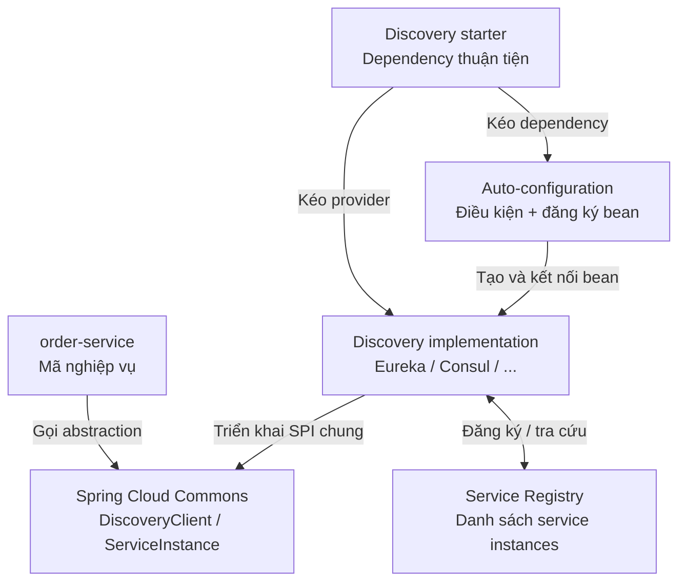
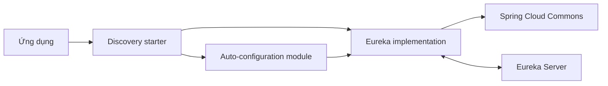
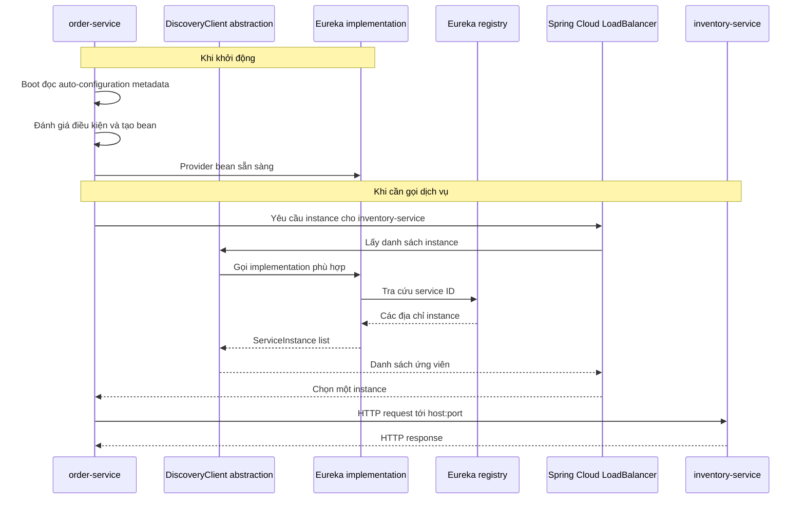

# Phân biệt SPI, auto-configuration và thành phần triển khai trong Spring Cloud

## 1. Ba khái niệm thường bị gộp làm một

Spring Cloud được xây dựng theo hướng chia sẻ hợp đồng chung và cho phép thay thế những thành phần hạ tầng cụ thể. Một ứng dụng có thể viết logic gọi dịch vụ dựa trên service ID mà không phải gắn mã nghiệp vụ trực tiếp với Eureka, Consul hoặc một hệ thống đăng ký dịch vụ riêng.

Để đạt được điều đó, hệ sinh thái sử dụng nhiều lớp có trách nhiệm khác nhau:

- **SPI (Service Provider Interface):** hợp đồng mở rộng mà một thành phần có thể triển khai để cung cấp một khả năng cho framework hoặc ứng dụng.
- **Auto-configuration:** cơ chế phát hiện điều kiện và tự động tạo, kết nối các bean Spring khi dependency và cấu hình phù hợp.
- **Implementation (thành phần triển khai):** mã thực hiện hợp đồng, kết nối với công nghệ hoặc hệ thống cụ thể.

Ví dụ, Spring Cloud Commons định nghĩa hợp đồng `DiscoveryClient` để tra cứu các instance của một service ID. Một discovery provider như Eureka cung cấp implementation thực hiện việc tra cứu từ registry. Spring Boot auto-configuration phát hiện các lớp cần thiết, kiểm tra điều kiện trên classpath/property/bean rồi đăng ký các bean để ứng dụng sử dụng.

Ba khái niệm này bổ trợ nhau nhưng không thay thế nhau. **SPI nói thành phần phải tuân theo hợp đồng nào; implementation nói ai thực hiện hợp đồng; auto-configuration nói khi nào và bằng cách nào các bean được đưa vào Spring ApplicationContext.**

Sau bài học, người đọc có thể lần theo một dependency từ starter đến provider, xác định bean được tạo bởi auto-configuration nào, phân biệt API dùng trong nghiệp vụ với SPI dành cho provider, và chẩn đoán lỗi khi implementation không được nạp.

## 2. Bức tranh kiến trúc từ ứng dụng đến provider

Giả sử `order-service` cần tìm địa chỉ của `inventory-service`. Ứng dụng gọi abstraction chung. Provider thực hiện truy vấn tới Eureka hoặc một registry khác. Auto-configuration lắp ghép provider và các thành phần phụ trợ dựa trên dependency cùng cấu hình.



Sơ đồ biểu diễn quan hệ phụ thuộc và trách nhiệm, không phải thứ tự request mạng. Starter thường chỉ là dependency tập hợp. Auto-configuration có thể nằm trong artifact riêng hoặc trong module provider; provider mới là nơi chứa logic tích hợp với hệ thống discovery. Ứng dụng có thể gọi trực tiếp `DiscoveryClient`, hoặc dùng một HTTP client đã tích hợp load balancer để gọi service ID.

| Lớp | Câu hỏi | Ví dụ trong hệ Spring Cloud |
| --- | --- | --- |
| API / SPI chung | Mã ứng dụng hoặc provider giao tiếp qua hợp đồng nào? | `DiscoveryClient`, `ServiceInstance`, `ServiceRegistry`, `Registration` |
| Implementation | Ai truy vấn/đăng ký vào hệ thống cụ thể? | Eureka Discovery Client, Consul Discovery, Zookeeper Discovery |
| Auto-configuration | Khi nào bean của provider được tạo? | Các lớp cấu hình có `@ConditionalOnClass`, `@ConditionalOnProperty`, `@ConditionalOnMissingBean` |
| Starter | Cần thêm dependency nào để có đủ các phần liên quan? | Starter cho Eureka Client, Config Client hoặc LoadBalancer |
| Application | Mã nghiệp vụ sử dụng khả năng chung ra sao? | Tra cứu service ID hoặc gọi URL qua client có load balancing |

## 3. SPI là hợp đồng mở rộng

### 3.1. SPI khác API ở mục đích sử dụng

API thường được nhìn từ phía **người gọi**: ứng dụng gọi phương thức nào để sử dụng một chức năng. SPI thường được nhìn từ phía **nhà cung cấp**: một module phải triển khai hợp đồng nào để framework có thể dùng nó.

Một interface có thể đóng cả hai vai trò tùy góc nhìn. Ví dụ `DiscoveryClient` vừa là API mà ứng dụng có thể gọi để tra cứu, vừa là SPI mà discovery provider triển khai để cung cấp danh sách instance. Không phải cứ tên interface là SPI; phải xem ai gọi interface và ai có trách nhiệm cung cấp implementation.

| Góc nhìn | Bên sở hữu trách nhiệm | Ví dụ |
| --- | --- | --- |
| Consumer / API | Ứng dụng gọi chức năng | `discoveryClient.getInstances("inventory-service")` |
| Provider / SPI | Module tích hợp cung cấp hành vi | Eureka provider triển khai `DiscoveryClient` |
| Framework integration | Framework tìm và cấu hình provider | Auto-configuration tạo bean từ provider nếu điều kiện phù hợp |

### 3.2. SPI không đồng nghĩa với Java ServiceLoader

Trong Java, thuật ngữ SPI thường gắn với `ServiceLoader` và file provider trong `META-INF/services`. Đây là một cơ chế nạp provider phổ biến, nhưng **không phải cơ chế duy nhất để Spring tìm extension**.

Trong ứng dụng Spring, một extension có thể được kết nối bằng:

- Spring bean được khai báo qua `@Bean` hoặc `@Component`.
- Auto-configuration được import từ metadata.
- `@Import`, `ImportSelector` hoặc cơ chế đăng ký cấu hình của Spring.
- `SpringFactoriesLoader` cho những extension point sử dụng Spring factories.
- Java `ServiceLoader` khi API hoặc thư viện cụ thể chọn cơ chế đó.

Do vậy, đọc một interface SPI mà không kiểm tra cách provider được phát hiện sẽ chưa đủ để hiểu vòng đời của nó. Cần tìm cả **hợp đồng**, **cơ chế nạp provider** và **điều kiện tạo bean**.

### 3.3. Các hợp đồng tiêu biểu trong Spring Cloud Commons

Spring Cloud Commons cung cấp các abstraction để module implementation và ứng dụng giao tiếp mà không phải phụ thuộc trực tiếp vào một registry.

| Hợp đồng | Trách nhiệm chính | Bên thường sử dụng |
| --- | --- | --- |
| `DiscoveryClient` | Trả về các `ServiceInstance` theo service ID | Ứng dụng, LoadBalancer và thành phần nền tảng |
| `ReactiveDiscoveryClient` | Cung cấp discovery theo mô hình reactive | Ứng dụng WebFlux và thành phần reactive |
| `ServiceInstance` | Mô tả một địa chỉ dịch vụ: service ID, host, port, URI, metadata | Provider, LoadBalancer, HTTP client integration |
| `Registration` | Mô tả thông tin instance cần đăng ký | Discovery provider |
| `ServiceRegistry<R extends Registration>` | Đăng ký, hủy đăng ký hoặc thao tác trạng thái theo khả năng provider | Vòng đời instance và thành phần quản trị |
| `LoadBalancerClient` | Chọn và thực hiện request qua một instance | HTTP client integration và mã gọi dịch vụ |

`DiscoveryClient` trả lời câu hỏi **có những instance nào?**; `ServiceRegistry` biểu diễn khả năng **đăng ký hoặc hủy đăng ký instance** ở implementation hỗ trợ. Hai hợp đồng có liên quan nhưng không đồng nghĩa. Một môi trường dùng DNS hoặc một discovery mechanism khác có thể cung cấp danh sách endpoint mà không dùng cùng mô hình đăng ký của Eureka.

Một SPI thường cố giữ hợp đồng ổn định, nhưng không có nghĩa mọi provider có cùng tính năng. Metadata, health state, đăng ký động, reactive lookup, quyền truy cập hay cách xử lý lỗi có thể khác nhau giữa các implementation.

## 4. Implementation biến hợp đồng thành hành vi thực tế

### 4.1. Một hợp đồng, nhiều provider

Các module discovery có thể triển khai cùng một abstraction chung nhưng giao tiếp với hệ thống hạ tầng khác nhau:

| Provider / cơ chế | Nơi lấy danh sách instance | Đặc điểm cần đọc trong tài liệu riêng |
| --- | --- | --- |
| Eureka Discovery Client | Eureka Server | Đăng ký, heartbeat/lease, trạng thái instance, metadata và cách cấu hình client |
| Consul Discovery | Consul agent/server | Health check, service catalog, tags và đăng ký |
| Zookeeper Discovery | Apache Zookeeper | Cấu trúc node, đăng ký và theo dõi thay đổi |
| Simple Discovery Client | Danh sách instance cấu hình sẵn trong properties | Phù hợp tình huống đơn giản/test; không tự tạo registry động |
| Kubernetes discovery integration | Kubernetes API/service metadata, tùy cách tích hợp | Phân biệt DNS/Service với Spring DiscoveryClient; quyền truy cập và cấu hình cluster |

Danh sách trên là các lựa chọn kiến trúc, không có nghĩa tất cả phải được thêm cùng lúc. Module Kubernetes và các provider khác có release train hoặc ma trận tương thích riêng; luôn tra tài liệu đúng phiên bản.

### 4.2. Vì sao không gọi thẳng Eureka từ mã nghiệp vụ?

Nếu `OrderService` tự dùng Eureka client API, mã nghiệp vụ sẽ biết loại registry, kiểu response và cách cấu hình riêng của Eureka. Khi chuyển sang Consul, nhiều lớp nghiệp vụ có thể phải thay đổi.

Nếu `OrderService` phụ thuộc `DiscoveryClient`, provider có thể đổi mà mã gọi vẫn sử dụng service ID. Phần tích hợp cụ thể được giữ trong module discovery. Đây là lợi ích của abstraction và dependency inversion: logic nghiệp vụ phụ thuộc vào hợp đồng mà nó cần, trong khi adapter/provider phụ thuộc vào công nghệ bên ngoài.

Tuy vậy, abstraction không thể che giấu mọi khác biệt. Nếu nghiệp vụ dựa vào metadata riêng, semantics của health check hoặc một tính năng độc quyền của provider, việc chuyển đổi vẫn cần thiết kế và kiểm thử tương ứng.

### 4.3. Ví dụ một provider rất nhỏ

Đoạn mã sau minh họa cách một implementation có thể cung cấp `DiscoveryClient` cho môi trường thử nghiệm. Nó trả về một địa chỉ cố định, không phải registry production:

```java
import java.util.List;

import org.springframework.cloud.client.DefaultServiceInstance;
import org.springframework.cloud.client.ServiceInstance;
import org.springframework.cloud.client.discovery.DiscoveryClient;

public final class StaticInventoryDiscoveryClient implements DiscoveryClient {

    @Override
    public String description() {
        return "Static inventory discovery for local testing";
    }

    @Override
    public List<ServiceInstance> getInstances(String serviceId) {
        if (!"inventory-service".equals(serviceId)) {
            return List.of();
        }

        return List.of(new DefaultServiceInstance(
                "inventory-local-1",
                "inventory-service",
                "127.0.0.1",
                8081,
                false
        ));
    }

    @Override
    public List<String> getServices() {
        return List.of("inventory-service");
    }
}
```

Ở đây:

- `DiscoveryClient` là hợp đồng chung mà implementation phải đáp ứng.
- `DefaultServiceInstance` là đối tượng dữ liệu mô tả instance.
- Lớp trên chưa đăng ký instance vào registry; nó chỉ trả một danh sách tĩnh.
- Khi chạy thật, provider phải giải quyết vòng đời instance, cập nhật địa chỉ, lỗi kết nối và các yêu cầu bảo mật/health check của nền tảng.

Nếu đăng ký lớp này bằng `@Component` trong ứng dụng thử nghiệm, Spring có thể đưa nó vào context thông qua component scan. Đó là cách tạo bean thông thường, **chưa phải một starter tự động cấu hình hoàn chỉnh**.

## 5. Auto-configuration làm nhiệm vụ lắp ghép

### 5.1. Từ dependency đến bean

Spring Boot auto-configuration dựa trên classpath, property, bean đã tồn tại và các điều kiện khác để quyết định cấu hình nào phù hợp. Nó giúp ứng dụng có thể thêm một dependency rồi nhận các bean mặc định mà không phải khai báo thủ công từng thành phần.

Một lớp auto-configuration thường:

1. Được đăng ký trong metadata để Boot có thể phát hiện.
2. Kiểm tra các class bắt buộc có trên classpath không.
3. Kiểm tra property bật/tắt hoặc điều kiện môi trường.
4. Kiểm tra bean khác đã được ứng dụng/provider tạo chưa.
5. Khai báo các bean mặc định và liên kết chúng với những dependency cần thiết.

Auto-configuration **không phải chính implementation của discovery**. Nó có thể tạo một bean provider, client, factory hoặc adapter; hành vi truy vấn registry vẫn nằm trong implementation tương ứng.

### 5.2. Các annotation điều kiện thường gặp

| Annotation | Mục đích | Câu hỏi cần đặt ra |
| --- | --- | --- |
| `@AutoConfiguration` | Đánh dấu lớp cấu hình tự động theo cơ chế Boot hiện đại | Lớp này đã được đăng ký trong metadata chưa? |
| `@Configuration` | Định nghĩa nguồn cấu hình Spring | Nó được import hoặc component scan từ đâu? |
| `@ConditionalOnClass` | Chỉ áp dụng khi class cần thiết có trên classpath | Dependency nào cung cấp class đó? |
| `@ConditionalOnMissingBean` | Chỉ tạo bean mặc định khi chưa có bean phù hợp | Bean tùy chỉnh có làm cấu hình mặc định back off không? |
| `@ConditionalOnBean` | Chỉ áp dụng khi một bean phụ thuộc đã tồn tại | Auto-configuration nào phải chạy trước? |
| `@ConditionalOnProperty` | Bật/tắt cấu hình theo property | Tên property, giá trị mặc định và profile nào đang áp dụng? |
| `@ConditionalOnWebApplication` | Giới hạn cấu hình cho loại ứng dụng web phù hợp | Ứng dụng đang chạy servlet hay reactive? |
| `@ConfigurationProperties` | Bind nhóm property vào object cấu hình | Prefix và kiểu dữ liệu có đúng tài liệu nhánh này không? |

Ví dụ minh họa một auto-configuration cho provider tĩnh:

```java
import org.springframework.boot.autoconfigure.AutoConfiguration;
import org.springframework.boot.autoconfigure.condition.ConditionalOnClass;
import org.springframework.boot.autoconfigure.condition.ConditionalOnMissingBean;
import org.springframework.boot.autoconfigure.condition.ConditionalOnProperty;
import org.springframework.context.annotation.Bean;
import org.springframework.cloud.client.discovery.DiscoveryClient;

@AutoConfiguration
@ConditionalOnClass(DiscoveryClient.class)
@ConditionalOnProperty(
        prefix = "demo.discovery",
        name = "enabled",
        havingValue = "true"
)
public class DemoDiscoveryAutoConfiguration {

    @Bean
    @ConditionalOnMissingBean(DiscoveryClient.class)
    DiscoveryClient demoDiscoveryClient() {
        return new StaticInventoryDiscoveryClient();
    }
}
```

Ví dụ chỉ nhằm giải thích điều kiện tạo bean. Một provider thực tế cần cân nhắc thứ tự auto-configuration, quan hệ với provider khác, property metadata, lifecycle, logging và việc có nên tạo một `DiscoveryClient` riêng hay tích hợp qua composite. Nếu classpath đã có Eureka/Consul, cấu hình tĩnh có thể cạnh tranh với provider đó; không nên đưa đồng thời các provider chỉ để “phòng trường hợp”.

### 5.3. Metadata phát hiện auto-configuration

Với các phiên bản Spring Boot hiện đại, auto-configuration thường được đăng ký qua file:

```text
META-INF/spring/org.springframework.boot.autoconfigure.AutoConfiguration.imports
```

Nội dung file là tên đầy đủ của lớp cấu hình, mỗi lớp một dòng:

```text
com.example.discovery.DemoDiscoveryAutoConfiguration
```

Đối với các thế hệ Spring Boot cũ, auto-configuration được khai báo bằng key `EnableAutoConfiguration` trong `META-INF/spring.factories`. Spring Boot 2.7 là giai đoạn chuyển tiếp hỗ trợ cơ chế metadata mới; từ Spring Boot 3, không tiếp tục dùng `spring.factories` để đăng ký danh sách auto-configuration theo cách cũ. Tuy nhiên, `spring.factories` và `SpringFactoriesLoader` vẫn có thể được dùng cho **các extension point khác**. Không được kết luận rằng mọi cơ chế Spring factories đã biến mất.

Vì metadata và cách nạp cấu hình phụ thuộc phiên bản, khi viết starter cần tra đúng Spring Boot reference và migration notes. Chỉ thêm lớp `@AutoConfiguration` vào source mà quên file metadata sẽ khiến Boot không tự phát hiện lớp đó.

### 5.4. Thứ tự và back-off

Auto-configuration thường được sắp xếp để cấu hình nền tảng cần thiết xuất hiện trước cấu hình phụ thuộc. Các annotation như `@AutoConfigureBefore`, `@AutoConfigureAfter` và `@AutoConfigureOrder` giúp biểu đạt thứ tự trong những trường hợp cần thiết.

`@ConditionalOnMissingBean` tạo khả năng **back-off**: nếu ứng dụng cung cấp bean riêng theo loại hoặc tên mà điều kiện kiểm tra, cấu hình mặc định có thể không tạo bean đó. Đây là một điểm mở rộng quan trọng để ứng dụng thay implementation mà không sửa starter.

Không nên lạm dụng thứ tự để giải quyết mọi xung đột. Nếu hai provider cùng đăng ký một hợp đồng, cần xác định rõ kiến trúc: chọn một provider, dùng composite nếu được hỗ trợ, hoặc tạo qualifier/bean riêng cho từng mục đích. Khi có nhiều bean cùng loại, injection không có qualifier có thể gây lỗi `NoUniqueBeanDefinitionException`.

## 6. Starter chỉ là cách đóng gói dependency

Starter giúp người dùng thêm một dependency thuận tiện. Nó thường kéo theo:

- API/implementation cần dùng.
- Module auto-configuration.
- Các dependency hỗ trợ.
- Metadata và property configuration đi kèm.

Starter **không đồng nghĩa** với implementation, và cũng không đảm bảo mọi auto-configuration luôn kích hoạt. Nếu một dependency tùy chọn không có trên classpath hoặc property tắt tính năng, bean tương ứng có thể không được tạo.

Ví dụ kiến trúc dependency ở mức khái niệm:



Tên artifact cụ thể phụ thuộc provider và release train. Khi đọc POM của starter, hãy xem dependency tree để biết nó kéo module nào, version nào và module nào là optional. Không nên đoán nội dung starter từ tên artifact.

### 6.1. Phân biệt ba thao tác

| Thao tác | Điều thực sự xảy ra | Ví dụ |
| --- | --- | --- |
| Thêm starter | Thay đổi dependency graph | Thêm starter Eureka Client |
| Nạp auto-configuration | Boot đọc metadata và đánh giá điều kiện | Eureka client bean được cấu hình nếu điều kiện phù hợp |
| Chọn implementation | Provider cụ thể được tạo và sử dụng | Eureka provider cung cấp thông tin instance |

Nếu ứng dụng đã thêm starter nhưng không có bean, hãy kiểm tra metadata và điều kiện. Nếu có bean nhưng không tìm thấy instance, hãy kiểm tra implementation, registry, service ID và mạng. Nếu tìm được instance nhưng HTTP thất bại, hãy chuyển sang tầng LoadBalancer/HTTP client.

## 7. Theo dấu một request qua các lớp



Đây là trình tự khái niệm. Trong một số cấu hình, LoadBalancer có thể nhận `ServiceInstanceListSupplier` hoặc cache danh sách instance, vì thế không nhất thiết gọi registry cho từng request. Auto-configuration chủ yếu chạy lúc dựng application context; nó không phải một hop mạng trong mỗi request.

Điều này giúp phân loại lỗi:

- **Không có bean:** xem dependency, metadata và condition evaluation.
- **Có bean nhưng danh sách rỗng:** xem provider, registry và service ID.
- **Có danh sách nhưng không gọi được:** xem instance được chọn, route, timeout, TLS và HTTP client.
- **Request thành công nhưng nghiệp vụ sai:** xem API contract và logic của dịch vụ đích.

## 8. Kiểm tra dependency và điều kiện auto-configuration

### 8.1. Maven và Gradle

Với Maven, dùng:

```bash
mvn dependency:tree -Dincludes=org.springframework.cloud
mvn help:effective-pom
```

Với Gradle:

```bash
./gradlew dependencies --configuration runtimeClasspath
./gradlew dependencyInsight --dependency spring-cloud-commons --configuration runtimeClasspath
```

Các lệnh giúp trả lời: starter có kéo module implementation không? Commons và provider có nằm trên runtime classpath không? Có override version ngoài BOM không? Có hai provider discovery cùng lúc không?

### 8.2. Condition evaluation report

Khi chạy ứng dụng với chế độ debug của Spring Boot, báo cáo điều kiện auto-configuration có thể cho biết cấu hình nào match hoặc không match và lý do. Nếu Actuator conditions endpoint được bật trong phiên bản và cấu hình hiện tại, có thể dùng endpoint đó trong môi trường được bảo vệ để điều tra.

Không nên mở rộng endpoint chẩn đoán ra mạng công cộng chỉ để tìm lỗi. Với môi trường production, cần tuân theo chính sách bảo mật, giới hạn quyền truy cập và tránh làm lộ thông tin classpath hoặc cấu hình nội bộ.

## 9. Kiểm thử SPI và auto-configuration

Nên kiểm tra riêng hợp đồng provider, điều kiện tạo bean và khả năng kết nối với hệ thống thật.

### 9.1. Kiểm thử implementation theo SPI

Với provider tĩnh, unit test có thể xác nhận service ID và instance trả về:

```java
import static org.assertj.core.api.Assertions.assertThat;

import java.util.List;

import org.junit.jupiter.api.Test;
import org.springframework.cloud.client.ServiceInstance;

class StaticInventoryDiscoveryClientTests {

    private final StaticInventoryDiscoveryClient client =
            new StaticInventoryDiscoveryClient();

    @Test
    void returnsInventoryInstanceForKnownService() {
        List<ServiceInstance> instances =
                client.getInstances("inventory-service");

        assertThat(instances).hasSize(1);
        assertThat(instances.get(0).getServiceId())
                .isEqualTo("inventory-service");
        assertThat(instances.get(0).getPort()).isEqualTo(8081);
    }

    @Test
    void returnsNoInstanceForUnknownService() {
        assertThat(client.getInstances("unknown-service")).isEmpty();
    }
}
```

Unit test này xác minh implementation tuân theo kỳ vọng của ví dụ. Nó không chứng minh đăng ký, heartbeat hoặc tra cứu qua Eureka/Consul hoạt động.

### 9.2. Kiểm thử auto-configuration bằng ApplicationContextRunner

`ApplicationContextRunner` cho phép kiểm tra điều kiện cấu hình trong một context nhỏ, không cần khởi động toàn bộ ứng dụng:

```java
import static org.assertj.core.api.Assertions.assertThat;

import org.junit.jupiter.api.Test;
import org.springframework.boot.autoconfigure.AutoConfigurations;
import org.springframework.boot.test.context.runner.ApplicationContextRunner;
import org.springframework.cloud.client.discovery.DiscoveryClient;

class DemoDiscoveryAutoConfigurationTests {

    private final ApplicationContextRunner contextRunner =
            new ApplicationContextRunner()
                    .withConfiguration(
                            AutoConfigurations.of(DemoDiscoveryAutoConfiguration.class));

    @Test
    void createsClientWhenEnabled() {
        contextRunner
                .withPropertyValues("demo.discovery.enabled=true")
                .run(context ->
                        assertThat(context).hasSingleBean(DiscoveryClient.class));
    }

    @Test
    void doesNotCreateClientWhenDisabled() {
        contextRunner
                .withPropertyValues("demo.discovery.enabled=false")
                .run(context ->
                        assertThat(context).doesNotHaveBean(DiscoveryClient.class));
    }
}
```

Đây là test cho auto-configuration minh họa ở mục 5.2. Test thực tế còn nên xác minh `@ConditionalOnMissingBean` back-off khi người dùng khai báo implementation riêng, điều kiện thiếu class, property mặc định và thứ tự khi có provider khác.

### 9.3. Kiểm thử tích hợp với registry

Với Eureka/Consul hoặc nền tảng thật, cần kiểm thử các hành vi mà unit test không thể chứng minh:

1. Provider đăng ký instance với service ID đúng.
2. Registry trả về danh sách instance sau khi đăng ký.
3. Discovery client của ứng dụng nhìn thấy instance theo thời gian cập nhật dự kiến.
4. Khi instance dừng hoặc mất kết nối, danh sách và request thay đổi theo chính sách health/lease/cache.
5. LoadBalancer chọn instance và HTTP client gọi được endpoint.

Có thể dùng môi trường test cô lập, container hoặc test infrastructure phù hợp. Không nên giả định `ApplicationContextRunner` thay thế được kiểm thử mạng và vòng đời registry.

## 10. Những lỗi thường gặp khi ba lớp không khớp

| Triệu chứng | Lớp cần kiểm tra trước | Hướng điều tra |
| --- | --- | --- |
| Thêm starter nhưng không có bean | Auto-configuration | Dependency tree, file metadata, `@ConditionalOnClass`, `@ConditionalOnProperty` |
| Có hai bean `DiscoveryClient` gây lỗi inject | Implementation + auto-configuration | Provider nào đang cùng tồn tại, back-off, qualifier và thứ tự cấu hình |
| Bean tồn tại nhưng trả danh sách rỗng | SPI implementation | Service ID, provider, registry state, quyền truy cập và cache |
| Discovery hoạt động nhưng HTTP không gọi được | LoadBalancer/HTTP client | `@LoadBalanced`, instance URI, network, timeout, TLS |
| Bean tùy chỉnh không được dùng | Auto-configuration | `@ConditionalOnMissingBean`, loại bean, package scan và thứ tự |
| Lớp auto-configuration không được phát hiện | Metadata/version | `AutoConfiguration.imports`, `spring.factories` theo thế hệ Boot, tên class |
| Chỉ lỗi khi nâng Boot | Tương thích và metadata | Compatibility matrix, migration notes, dependency alignment |
| Config/refresh không hoạt động như ví dụ | Provider và Context | Đúng Config Client, cơ chế Config Data/bootstrap, refresh event và scope |
| Discovery provider không có class cần thiết | Implementation dependency | Starter có kéo module provider chưa, scope dependency có đúng runtime không |

Một lỗi `NoSuchBeanDefinitionException` không tự động có nghĩa SPI bị sai. Có thể interface đúng nhưng không có provider, hoặc provider có mặt nhưng auto-configuration không match. Ngược lại, một bean có mặt chưa chứng minh provider kết nối được registry.

## 11. Ranh giới thiết kế khi thêm provider hoặc viết starter

Khi xây một integration mới, nên giữ trách nhiệm rõ ràng:

1. **Hợp đồng chung:** dùng SPI hiện có nếu nó diễn đạt đúng khả năng cần cung cấp. Tránh tạo interface trùng nghĩa chỉ vì muốn đổi tên.
2. **Implementation:** giữ logic giao tiếp với hệ thống bên ngoài trong adapter/provider; tránh để mã nghiệp vụ phụ thuộc client SDK riêng của registry.
3. **Auto-configuration:** tạo bean khi điều kiện rõ ràng; dùng `@ConditionalOnMissingBean` để hỗ trợ tùy chỉnh hợp lý; tránh khởi tạo kết nối ngoài không cần thiết trong mọi context.
4. **Starter:** chỉ kéo những dependency cần thiết và quản lý version qua BOM phù hợp. Tránh đưa đồng thời nhiều provider cạnh tranh vào starter mặc định.
5. **Cấu hình:** đặt property có prefix riêng, mô tả default và điều kiện bật/tắt; dùng `@ConfigurationProperties` cho nhóm cấu hình có cấu trúc.
6. **Quan sát:** ghi log đủ để biết provider nào được chọn, service ID nào được truy vấn và lỗi thuộc tầng nào; không ghi secrets hoặc thông tin nhạy cảm.
7. **Kiểm thử:** kiểm tra SPI contract, auto-configuration conditions, back-off, dependency metadata và integration với registry.

Nếu cần hỗ trợ nhiều implementation, hãy quyết định rõ đó là lựa chọn thay thế, composite discovery hay các client riêng cho từng use case. Đừng dựa vào thứ tự bean ngẫu nhiên để chọn registry.

## 12. Những điểm cần nhớ

- **SPI là hợp đồng mở rộng**, không nhất thiết được nạp bằng Java `ServiceLoader`.
- **Implementation là nơi thực thi hợp đồng**, ví dụ provider kết nối Eureka hoặc Consul.
- **Auto-configuration là cơ chế lắp ghép bean**, có điều kiện theo classpath, property và context.
- **Starter là gói dependency thuận tiện**, không tự bảo đảm mọi bean được tạo hoặc mọi kết nối thành công.
- **Spring Cloud Commons giữ các abstraction chung** như `DiscoveryClient`, `ServiceInstance` và `ServiceRegistry`; module provider thực hiện phần tích hợp cụ thể.
- **Phiên bản quyết định cách phát hiện auto-configuration và API có sẵn.** Cần kiểm tra tài liệu đúng Spring Boot/Spring Cloud release train trước khi sao chép metadata hoặc code.

Khi một ứng dụng không tìm thấy dịch vụ, hãy lần theo chuỗi: dependency có provider chưa → auto-configuration có được phát hiện và match không → bean nào được tạo → implementation có trả instance không → LoadBalancer/HTTP client có gọi được endpoint không. Phân biệt được SPI, auto-configuration và implementation giúp đặt lỗi đúng tầng, giữ mã nghiệp vụ ít phụ thuộc hạ tầng và thay thế provider có kiểm soát.
