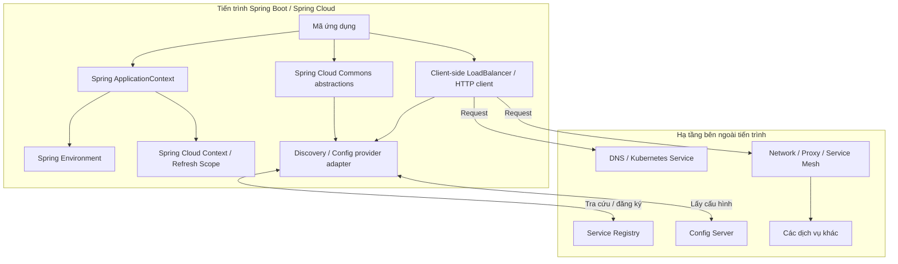
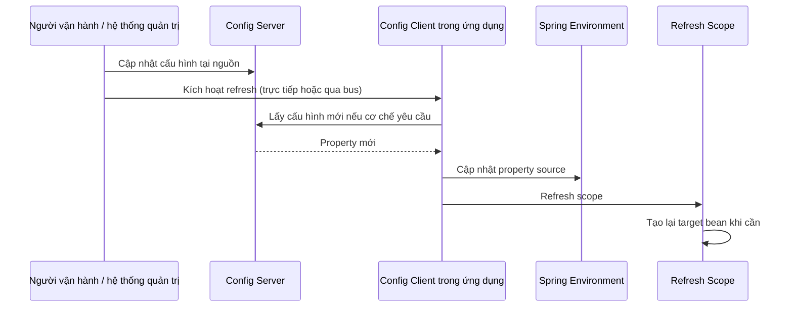
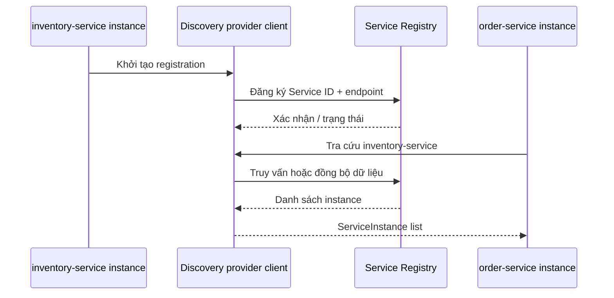

# Ranh giới giữa cơ chế trong tiến trình và hạ tầng bên ngoài

Một ứng dụng Spring Cloud chạy trong một tiến trình Spring Boot, nhưng nó tham gia vào một hệ thống phân tán gồm nhiều tiến trình, máy chủ, container và dịch vụ hạ tầng. Bên trong ứng dụng có các cơ chế như Spring ApplicationContext, Environment, bean, event, refresh scope, DiscoveryClient và bộ chọn instance. Bên ngoài ứng dụng có registry, Config Server, DNS, hệ thống điều phối container, mạng, proxy, message broker và các dịch vụ khác.

Muốn thiết kế và vận hành đúng, cần biết **cơ chế nào chạy bên trong tiến trình**, **thông tin nào đến từ hệ thống bên ngoài**, và **đường giao tiếp nào nối hai phía**. Ranh giới này là trọng tâm của kiến trúc nền tảng Spring Cloud: Commons và Context cung cấp abstraction/cơ chế chung trong ứng dụng; các provider và hạ tầng bên ngoài cung cấp dữ liệu hoặc dịch vụ thực tế.

## 1. Mô hình tư duy: ứng dụng là một nút trong hệ thống phân tán

Một tiến trình Spring Boot có thể chứa nhiều thành phần cùng phối hợp:

- **Spring container:** tạo và quản lý bean, dependency injection, lifecycle và event nội bộ.
- **Spring Environment:** tập hợp property source để ứng dụng đọc cấu hình hiệu lực.
- **Spring Cloud Context:** bổ sung một số cơ chế context, refresh và scope cho ứng dụng.
- **Spring Cloud Commons:** cung cấp abstraction chung như DiscoveryClient, ServiceInstance, ServiceRegistry.
- **Client và bộ chọn:** HTTP client, Spring Cloud LoadBalancer hoặc client tích hợp khác chọn đích và tạo request.
- **Adapter/provider:** kết nối abstraction trong ứng dụng tới một hệ thống cụ thể, ví dụ Eureka hoặc Consul.

Bên ngoài tiến trình là các thành phần có vòng đời và khả năng lỗi riêng:

- Registry hoặc hệ thống discovery giữ thông tin dịch vụ/instance.
- Config Server hoặc hệ thống quản lý cấu hình cung cấp property.
- DNS, Kubernetes Service, proxy hoặc service mesh phân giải tên và định tuyến.
- Mạng truyền request giữa các tiến trình.
- Message broker và hệ thống lưu trữ phục vụ giao tiếp hoặc dữ liệu.

Sơ đồ tổng quát:



Đây là sơ đồ khái niệm. Một kiến trúc cụ thể có thể không dùng Config Server, Eureka, Consul hoặc client-side LoadBalancer. Ví dụ, Kubernetes DNS và Service có thể đảm nhiệm phân giải/định tuyến mà không cần ứng dụng tự truy vấn registry. Điểm cốt lõi là phải nhận diện nơi thực hiện từng trách nhiệm.

## 2. Những gì thuộc về tiến trình ứng dụng

### 2.1. Spring ApplicationContext và bean

Spring ApplicationContext sống trong tiến trình JVM. Nó quản lý bean, dependency injection, cấu hình bean, lifecycle callback và các sự kiện được phát trong context. Khi ứng dụng khởi động, Spring tạo context và khởi tạo những bean cần thiết theo cấu hình.

Ví dụ:

```java
import org.springframework.stereotype.Service;

@Service
public class OrderPolicy {
    public boolean canSubmit(int itemCount) {
        return itemCount > 0;
    }
}
```

`OrderPolicy` là bean do Spring quản lý. Nó không cần một service registry bên ngoài để tồn tại. Nếu tiến trình dừng, bean và trạng thái trong bộ nhớ của nó cũng mất theo tiến trình, trừ khi trạng thái được lưu ở hệ thống bền vững bên ngoài.

Một bean có thể gọi dịch vụ bên ngoài, nhưng bản thân object, proxy, dependency và logic gọi vẫn tồn tại trong JVM của ứng dụng.

### 2.2. Environment và property source

Spring Environment là API trong tiến trình để đọc cấu hình hiệu lực. Property có thể đến từ nhiều nguồn: file cấu hình, profile, biến môi trường, tham số command line, Config Data hoặc một nguồn cấu hình ngoài được tích hợp.

```java
import org.springframework.core.env.Environment;
import org.springframework.stereotype.Component;

@Component
public class RuntimeIdentity {
    private final Environment environment;

    public RuntimeIdentity(Environment environment) {
        this.environment = environment;
    }

    public String serviceName() {
        return environment.getProperty("spring.application.name");
    }

    public int serverPort() {
        return environment.getProperty("server.port", Integer.class, 8080);
    }
}
```

Object Environment được đọc trong tiến trình. Tuy nhiên, **nguồn gốc property không nhất thiết ở trong tiến trình**. Nếu property được lấy từ Config Server, hệ thống ngoài cung cấp dữ liệu qua mạng; client tích hợp đưa dữ liệu đó vào Environment của ứng dụng.

Cần phân biệt ba việc:

1. Nguồn dữ liệu cấu hình được lưu hoặc quản lý ở đâu?
2. Cấu hình được tải hoặc đồng bộ vào tiến trình bằng cách nào?
3. Mã ứng dụng đọc giá trị hiệu lực từ đâu?

Trong nhiều trường hợp, mã nghiệp vụ chỉ đọc Environment mà không cần biết property đến từ file local, biến môi trường hay Config Server.

### 2.3. Event nội bộ và trạng thái trong bộ nhớ

Spring ApplicationEvent và listener có thể truyền thông tin giữa các thành phần trong cùng ApplicationContext. Ví dụ, một thành phần phát sự kiện nghiệp vụ và listener trong cùng tiến trình nhận sự kiện đó.

```java
import org.springframework.context.ApplicationEventPublisher;
import org.springframework.stereotype.Service;

@Service
public class OrderNotifier {
    private final ApplicationEventPublisher publisher;

    public OrderNotifier(ApplicationEventPublisher publisher) {
        this.publisher = publisher;
    }

    public void orderAccepted(String orderId) {
        publisher.publishEvent(new OrderAcceptedEvent(orderId));
    }
}
```

Event nội bộ không tự đi qua mạng, không tự được lưu bền vững và không tự đến listener của một JVM khác. Muốn gửi sự kiện sang tiến trình khác, cần một cơ chế truyền thông như Kafka, RabbitMQ, HTTP hoặc một bus được cấu hình.

Tương tự, cache, singleton bean và các object trong bộ nhớ thường chỉ có phạm vi một tiến trình. Hai replica có hai bộ nhớ riêng; cập nhật cache ở replica A không tự động cập nhật cache ở replica B.

## 3. Spring Cloud Context: cơ chế refresh nằm trong ứng dụng

Spring Cloud Context cung cấp các cơ chế hỗ trợ context và cập nhật cấu hình ở phía ứng dụng. Một ví dụ là `@RefreshScope`, cho phép bean thuộc refresh scope được làm mới khi refresh được kích hoạt theo cơ chế phù hợp.

```java
import org.springframework.beans.factory.annotation.Value;
import org.springframework.cloud.context.config.annotation.RefreshScope;
import org.springframework.stereotype.Component;

@Component
@RefreshScope
public class CheckoutSettings {
    @Value("${checkout.banner:Default banner}")
    private String banner;

    public String banner() {
        return banner;
    }
}
```

Bean `CheckoutSettings`, proxy và cơ chế quản lý refresh scope hoạt động trong tiến trình. Khi scope được refresh, target bean có thể được tạo lại để đọc giá trị mới từ Environment.

Nhưng refresh scope **không phải kho cấu hình**, không phải Config Server và cũng không phải cơ chế tự phát hiện thay đổi ở mọi hệ thống bên ngoài. Cần có nguồn property mới và một cách kích hoạt refresh. Nguồn và tác nhân kích hoạt có thể là endpoint quản trị, một sự kiện được phát qua hệ thống messaging hoặc cách triển khai khác.

### 3.1. Phân biệt refresh bean và phân phối cấu hình

| Trách nhiệm | Thành phần điển hình | Vị trí |
| --- | --- | --- |
| Lưu/quản lý cấu hình dùng chung | Git, Config Server hoặc hệ thống quản lý cấu hình | Ngoài tiến trình ứng dụng |
| Lấy property về ứng dụng | Config Client hoặc integration tương ứng | Client chạy trong tiến trình, giao tiếp qua mạng |
| Giữ property hiệu lực để mã đọc | Spring Environment | Trong tiến trình |
| Tạo lại target bean theo refresh scope | Spring Cloud Context | Trong tiến trình |
| Phát tín hiệu refresh đến nhiều ứng dụng | Message broker/bus hoặc cơ chế điều phối | Có thành phần truyền tin bên ngoài và listener trong từng tiến trình |

Một luồng tổng quát có thể là:



Sơ đồ chỉ minh họa một cách phối hợp thường gặp. Cơ chế tải cấu hình, endpoint, event và thứ tự xử lý phụ thuộc phiên bản Spring Boot/Spring Cloud cùng kiến trúc triển khai. Không phải mọi cấu hình đều tự được làm mới chỉ vì file ở Config Server đã thay đổi.

### 3.2. Refresh không thay thế restart cho mọi thay đổi

Một số property có thể được đọc lại khi bean được tạo mới; một số khác được dùng rất sớm trong bootstrap hoặc quyết định cấu trúc server/container. Thay đổi `server.port`, cấu hình thread pool đã tạo, listener socket hoặc thành phần hạ tầng có thể cần restart/redeploy thay vì chỉ refresh một bean.

Trước khi thiết kế cập nhật nóng, cần xác định:

- Property được đọc vào thời điểm nào?
- Bean nào giữ giá trị đó và bean có thuộc refresh scope không?
- Có proxy hoặc cache nào giữ trạng thái cũ không?
- Thay đổi có đòi hỏi khởi tạo lại tài nguyên hệ điều hành hoặc kết nối không?
- Tính nhất quán giữa nhiều replica được bảo đảm bằng cơ chế nào?

Không nên xem refresh như một nút “áp dụng mọi cấu hình mới” cho toàn bộ tiến trình.

## 4. Spring Cloud Commons: abstraction trong ứng dụng, registry ở bên ngoài

Spring Cloud Commons cung cấp các abstraction để mã ứng dụng làm việc với thông tin dịch vụ mà ít phụ thuộc vào một provider cụ thể. Ví dụ:

- `DiscoveryClient` truy vấn các dịch vụ và instance theo Service ID.
- `ServiceInstance` biểu diễn một instance với host, port, URI và metadata.
- `ServiceRegistry` và `Registration` mô tả thao tác đăng ký/hủy đăng ký khi provider hỗ trợ.

Các interface và object này được dùng trong tiến trình. Nhưng khi tích hợp Eureka hoặc Consul, thông tin đăng ký thường được lưu và quản lý bởi hệ thống registry bên ngoài.

Ví dụ sử dụng abstraction:

```java
import java.util.List;
import org.springframework.cloud.client.ServiceInstance;
import org.springframework.cloud.client.discovery.DiscoveryClient;
import org.springframework.stereotype.Service;

@Service
public class InventoryDirectory {
    private final DiscoveryClient discoveryClient;

    public InventoryDirectory(DiscoveryClient discoveryClient) {
        this.discoveryClient = discoveryClient;
    }

    public List<ServiceInstance> instances() {
        return discoveryClient.getInstances("inventory-service");
    }
}
```

Mã trên gọi phương thức của bean DiscoveryClient trong JVM hiện tại. Nếu bean được cung cấp bởi tích hợp Eureka, implementation tương ứng sẽ giao tiếp với Eureka hoặc sử dụng dữ liệu đã được client đồng bộ. Nếu dùng Consul, đường đi và giao thức khác. Nếu dùng SimpleDiscoveryClient, danh sách có thể đến từ cấu hình local thay vì registry động.

### 4.1. DiscoveryClient không phải Registry

| Thành phần | Vai trò | Phạm vi |
| --- | --- | --- |
| `DiscoveryClient` | API để ứng dụng truy vấn instance | Abstraction trong tiến trình |
| Implementation của DiscoveryClient | Thực hiện truy vấn, có thể dùng cache hoặc gọi provider | Code chạy trong tiến trình, kết nối ra ngoài tùy provider |
| Eureka Server / Consul | Lưu và phục vụ dữ liệu registry | Hạ tầng bên ngoài |
| `ServiceRegistry` | API đăng ký/hủy đăng ký | Abstraction trong tiến trình |
| Registration client/provider | Gửi thông tin đăng ký và heartbeat theo cơ chế provider | Code trong tiến trình trao đổi với hạ tầng |

Việc một ứng dụng có `DiscoveryClient` không có nghĩa nó đã có registry riêng. Nó chỉ có khả năng gọi abstraction; dữ liệu và hành vi cụ thể phụ thuộc bean implementation cùng nguồn discovery.

### 4.2. Đăng ký dịch vụ có hai phía

Một instance có thể gửi thông tin đăng ký từ ứng dụng tới registry. Registry lưu hoặc phân phối thông tin đó để client khác tra cứu. Khi instance dừng, provider và registry cần phối hợp loại bỏ hoặc đánh dấu instance không còn khả dụng.



Tùy provider, client có thể polling, duy trì kết nối, dùng heartbeat hoặc nhận thông báo. Vì thế không nên giả định mọi lần gọi `getInstances` đều tạo một HTTP request trực tiếp tới registry.

## 5. Load balancing và giao tiếp mạng: quyết định trong client, truyền request qua mạng

Spring Cloud LoadBalancer là thành phần phía client để chọn một instance từ danh sách có sẵn. Bộ chọn và cấu hình chính sách chạy trong tiến trình client. Request sau khi chọn endpoint sẽ đi qua network tới instance đích.

Ví dụ:

```java
import org.springframework.cloud.client.loadbalancer.LoadBalanced;
import org.springframework.context.annotation.Bean;
import org.springframework.context.annotation.Configuration;
import org.springframework.web.reactive.function.client.WebClient;

@Configuration
public class ClientConfiguration {
    @Bean
    @LoadBalanced
    WebClient.Builder loadBalancedWebClientBuilder() {
        return WebClient.builder();
    }
}
```

Sau đó client có thể dùng Service ID trong URI logic:

```java
WebClient client = loadBalancedWebClientBuilder
        .baseUrl("http://inventory-service")
        .build();
```

Khi được cấu hình đúng, Spring Cloud LoadBalancer chọn instance tương ứng trước khi request được gửi đi. **Logic chọn instance ở client**, còn việc truyền gói tin, DNS, routing, firewall và kết nối socket thuộc các lớp mạng/hạ tầng.

### 5.1. Discovery và load balancing là hai trách nhiệm

Discovery trả lời: “Có những instance nào được biết đến cho Service ID này?”

Load balancing trả lời: “Lần gọi này nên chọn instance nào?”

Một bộ chọn không tự tạo ra instance. Nếu danh sách rỗng, LoadBalancer không thể chọn endpoint hợp lệ. Nếu danh sách có endpoint cũ, lựa chọn vẫn có thể thất bại khi instance đã dừng nhưng dữ liệu chưa cập nhật.

### 5.2. Client-side và server-side routing

| Mô hình | Nơi chọn đích | Thành phần trong ứng dụng | Hạ tầng bên ngoài |
| --- | --- | --- | --- |
| Client-side load balancing | Client của ứng dụng gọi | Discovery integration, LoadBalancer, HTTP client | Registry hoặc nguồn danh sách; network tới instance |
| Server-side routing | Proxy, load balancer hoặc nền tảng điều phối | HTTP client gọi địa chỉ ổn định | Proxy, Kubernetes Service, service mesh hoặc load balancer |
| DNS-based service addressing | Resolver và hạ tầng mạng theo thiết kế | Client sử dụng hostname | DNS và định tuyến endpoint |

Không phải ứng dụng nào cũng cần Spring Cloud LoadBalancer. Nếu Kubernetes Service hoặc proxy đã cung cấp địa chỉ ổn định và thực hiện routing, client có thể gọi tới điểm truy cập đó bằng HTTP client thông thường.

### 5.3. Không nhầm tên logic với hostname DNS

Chuỗi `http://inventory-service` chỉ được hiểu là Service ID khi HTTP client đã tích hợp cơ chế discovery/load balancing phù hợp. Nếu không, HTTP client thông thường sẽ coi `inventory-service` là hostname và nhờ cơ chế DNS của hệ điều hành/mạng phân giải.

Vì vậy, lỗi `UnknownHostException` có thể chỉ ra rằng client đang dùng DNS resolution trong khi người phát triển kỳ vọng Spring Cloud LoadBalancer xử lý Service ID. Cần kiểm tra loại WebClient/RestClient, bean có `@LoadBalanced`, dependency và cấu hình provider.

## 6. Phân biệt trong tiến trình và bên ngoài qua từng chức năng

| Chức năng | Phần chạy trong tiến trình | Phần bên ngoài | Ranh giới cần kiểm tra |
| --- | --- | --- | --- |
| Quản lý bean | ApplicationContext, bean, proxy, lifecycle | Không bắt buộc có hạ tầng riêng | Bean có được tạo và inject đúng không? |
| Đọc cấu hình | Environment, property source đã nạp | Config Server, Git, env của container, secret store | Property source nào cung cấp giá trị hiệu lực? |
| Refresh | Refresh scope, event listener, cập nhật context | Nguồn cấu hình, bus hoặc tác nhân kích hoạt nếu có | Có tải giá trị mới và refresh đúng bean không? |
| Discovery | DiscoveryClient API, provider client, cache | Eureka, Consul hoặc nền tảng discovery | Danh sách instance đến từ đâu và cập nhật khi nào? |
| Service registration | Registration object, client lifecycle | Registry nhận và lưu registration | Service ID/host/port công bố có chính xác không? |
| Load balancing | Chọn instance, policy, client filter | Registry/danh sách endpoint, mạng | Chọn được endpoint nhưng có kết nối được không? |
| HTTP communication | HTTP client, request/response, timeout | DNS, network, proxy, dịch vụ đích | Lỗi ở bước phân giải, kết nối hay xử lý request? |
| Quan sát | Log, metric, trace instrumentation | Collector, dashboard, tracing backend | Dữ liệu được xuất và nhận ở đâu? |

Bảng này giúp đặt câu hỏi đúng khi debug. Ví dụ, “DiscoveryClient trả về instance” là bằng chứng ở lớp tra cứu, không phải bằng chứng network tới instance hoạt động. “Bean đã refresh” không chứng minh Config Server đã được cập nhật đúng. Mỗi ranh giới cần được kiểm tra riêng.

## 7. Cấu hình bên ngoài không phải cơ chế trong tiến trình

Externalized configuration là cách đưa cấu hình từ nguồn phù hợp vào ứng dụng. Nguồn có thể là file, biến môi trường, tham số chạy, Config Server hoặc hệ thống quản lý cấu hình khác.

Ví dụ một cấu hình ứng dụng:

```yaml
spring:
  application:
    name: order-service

server:
  port: ${SERVER_PORT:8080}
```

Ở runtime, Spring Boot đọc property và tạo Environment trong tiến trình. Nếu `SERVER_PORT` được cung cấp bởi container orchestrator, nguồn giá trị ở ngoài tiến trình, nhưng việc bind web server và sử dụng giá trị vẫn diễn ra trong tiến trình.

Với Spring Cloud Config, Config Server là thành phần ngoài; Config Client chạy trong ứng dụng và lấy cấu hình theo quy tắc đã cấu hình. Spring Cloud Context có thể hỗ trợ refresh bean, nhưng không thay thế kho lưu trữ hoặc quy trình phân phối property.

### 7.1. Tách cấu hình theo nơi sở hữu

- Cấu hình ứng dụng như tên logic, cổng, timeout và feature flag có thể được quản lý trong file/profile hoặc hệ thống cấu hình ngoài.
- Cấu hình triển khai như replica count, port mapping, resource limit và network policy thường do nền tảng triển khai quản lý.
- Secret như mật khẩu, token và private key nên được quản lý bằng cơ chế secret phù hợp, với quyền truy cập giới hạn.
- Cấu hình runtime nhạy cảm cần có quy trình thay đổi, audit và refresh/restart rõ ràng.

Tránh đặt cùng một giá trị ở nhiều nơi với ý nghĩa mơ hồ. Nếu file cấu hình, biến môi trường và Config Server cùng khai báo một property, cần biết quy tắc precedence để xác định giá trị hiệu lực.

## 8. Lỗi thường gặp khi nhầm ranh giới

### 8.1. “Đã có Commons thì registry cũng đã có”

Commons cung cấp API và abstraction. Registry như Eureka Server hoặc Consul là hệ thống riêng, có triển khai và vòng đời riêng. Cần kiểm tra provider client, địa chỉ registry, kết nối và trạng thái đăng ký.

### 8.2. “Refresh scope tự theo dõi file cấu hình bên ngoài”

Refresh scope quản lý target bean trong tiến trình. Việc phát hiện cấu hình thay đổi và chuyển giá trị mới vào Environment cần một luồng cập nhật khác. Cần kiểm tra Config Client, nguồn property, refresh trigger và trạng thái bean sau refresh.

### 8.3. “Có instance trong registry nghĩa là gọi được”

Registry có thể chứa dữ liệu cũ hoặc endpoint không thể truy cập từ network của client. Cần kiểm tra readiness, host, port, firewall, routing, timeout và trạng thái tiến trình đích.

### 8.4. “Event trong Spring sẽ tự gửi sang replica khác”

Spring ApplicationEvent chỉ hoạt động trong phạm vi context/tiến trình. Để truyền sang JVM khác, phải dùng broker, HTTP, bus hoặc một giao thức phân tán.

### 8.5. “Cache trong một replica tự đồng bộ với các replica còn lại”

Cache local là trạng thái trong bộ nhớ tiến trình. Nếu cần đồng bộ, phải thiết kế cơ chế invalidation/distribution hoặc dùng kho dữ liệu/cache dùng chung. Không nên dựa vào singleton bean để giữ trạng thái toàn cụm.

### 8.6. “LoadBalancer sửa được mọi lỗi mạng”

LoadBalancer chọn endpoint. Nó không bảo đảm endpoint còn sống, network không bị chặn hoặc request xử lý thành công. Timeout, retry, circuit breaker, bulkhead, idempotency và quan sát vẫn là các mối quan tâm riêng.

## 9. Quy trình kiểm tra một luồng end-to-end

Khi một request từ `order-service` tới `inventory-service` thất bại, nên lần theo ranh giới theo thứ tự:

1. **Cấu hình trong client:** Service ID có đúng không? HTTP client có được cấu hình discovery/load balancing hay đang phân giải hostname bằng DNS?
2. **Nguồn discovery:** Có provider phù hợp không? Registry hoặc nền tảng có đăng ký instance không?
3. **Dữ liệu instance:** Danh sách có host/port đúng và còn mới không? Instance đã sẵn sàng nhận request chưa?
4. **Quyết định chọn:** LoadBalancer có nhận danh sách và chọn được instance không?
5. **Đường mạng:** Client có phân giải được địa chỉ, mở kết nối và đi qua firewall/proxy không?
6. **Dịch vụ đích:** Server có lắng nghe cổng đúng không? Endpoint có tồn tại và xử lý request được không?
7. **Phản hồi:** Lỗi đến từ timeout, kết nối, mã HTTP hay logic nghiệp vụ?

Với refresh cấu hình, quy trình tương tự:

1. Nguồn ngoài có giá trị mới chưa?
2. Client có lấy được property mới không?
3. Environment trong tiến trình đã chứa giá trị mới chưa?
4. Refresh trigger đã được nhận chưa?
5. Bean có thuộc refresh scope hoặc cơ chế cập nhật tương ứng không?
6. Thành phần sử dụng property có thật sự đọc lại giá trị không?
7. Có cần restart vì thay đổi liên quan tài nguyên hoặc cấu trúc khởi động không?

Hai quy trình trên giúp phân loại lỗi theo lớp, tránh sửa nhầm hạ tầng khi vấn đề nằm ở bean hoặc ngược lại.

## 10. Kiểm thử theo ranh giới

Không nên chỉ kiểm thử một lớp rồi suy ra toàn bộ hệ thống hoạt động. Mỗi loại kiểm thử có mục tiêu khác nhau:

| Loại kiểm thử | Phạm vi | Có thể xác nhận | Không tự xác nhận |
| --- | --- | --- | --- |
| Unit test | Class, bean hoặc logic riêng | Logic và xử lý dữ liệu với dependency giả lập | Registry, DNS hoặc network thật |
| Spring context test | ApplicationContext và autoconfiguration | Bean, property, điều kiện cấu hình, injection | Hệ thống ngoài thực sự sẵn sàng |
| Integration test | Ứng dụng và một hoặc nhiều dịch vụ phụ thuộc | Giao thức, cấu hình kết nối, đăng ký/tra cứu trong môi trường test | Hành vi toàn production ở mọi thời điểm |
| Contract test | Hợp đồng giữa client và provider | Tương thích request/response và schema | Network, registry và hiệu năng production |
| Deployment/smoke test | Ứng dụng đã triển khai cùng hạ tầng | Kết nối, health, discovery và luồng request thực tế | Mọi trường hợp tải hoặc lỗi hiếm gặp |

### 10.1. Kiểm thử abstraction bằng test double

Một class phụ thuộc `DiscoveryClient` có thể được unit test với mock hoặc fake để xác nhận cách xử lý danh sách instance. Test này kiểm tra logic của class mà không cần khởi động Eureka/Consul.

```java
import static org.assertj.core.api.Assertions.assertThat;
import static org.mockito.Mockito.when;

import java.util.List;
import org.junit.jupiter.api.Test;
import org.springframework.cloud.client.ServiceInstance;
import org.springframework.cloud.client.discovery.DiscoveryClient;

class InventoryDirectoryTest {
    @Test
    void returnsInstancesFromDiscoveryClient() {
        DiscoveryClient discoveryClient =
                org.mockito.Mockito.mock(DiscoveryClient.class);

        ServiceInstance instance =
                org.mockito.Mockito.mock(ServiceInstance.class);

        when(discoveryClient.getInstances("inventory-service"))
                .thenReturn(List.of(instance));

        InventoryDirectory directory =
                new InventoryDirectory(discoveryClient);

        assertThat(directory.instances()).containsExactly(instance);
    }
}
```

Test double giúp kiểm tra cách class sử dụng abstraction. Nó không xác nhận Eureka client, Consul client hay network thật hoạt động.

### 10.2. Integration test với hạ tầng thực

Khi cần kiểm tra registry hoặc Config Server, có thể chạy hạ tầng test độc lập bằng container hoặc môi trường tích hợp. Kiểm thử cần xác nhận:

- Ứng dụng khởi động với đúng tên và cấu hình.
- Instance đăng ký với endpoint có thể truy cập.
- Client tra cứu được Service ID và nhận danh sách phù hợp.
- Request qua client/load balancer đến được dịch vụ đích.
- Khi instance dừng hoặc bị loại khỏi registry, hệ thống xử lý được dữ liệu cũ và lỗi kết nối.
- Cấu hình mới được tải và refresh theo quy trình đã thiết kế.

Nên kiểm thử cả trường hợp thành công lẫn thất bại: registry không sẵn sàng, danh sách rỗng, timeout, instance dừng đột ngột, property thiếu hoặc refresh không được kích hoạt.

## 11. Ranh giới kiến trúc và quyết định triển khai

Khi chọn cách tổ chức, cần cân nhắc ai sở hữu từng trách nhiệm:

- Nếu muốn **client tự chọn instance**, ứng dụng cần provider discovery, danh sách instance và LoadBalancer phù hợp.
- Nếu muốn **hạ tầng chọn instance**, dùng địa chỉ ổn định của proxy, Kubernetes Service hoặc service mesh; ứng dụng có thể đơn giản hơn.
- Nếu muốn **cấu hình thay đổi tập trung**, dùng hệ thống quản lý cấu hình và client tương ứng; xác định rõ property nào có thể refresh và property nào cần restart.
- Nếu muốn **truyền sự kiện giữa các tiến trình**, dùng messaging hoặc giao thức phân tán; không dùng Spring event nội bộ như thể nó là message broker.
- Nếu muốn **trạng thái dùng chung**, lưu ở hệ thống ngoài hoặc dùng cơ chế đồng bộ có thiết kế; không coi bộ nhớ của một replica là bộ nhớ toàn cụm.

Không có một lựa chọn duy nhất đúng cho mọi hệ thống. Một ứng dụng có thể dùng Config Server để quản lý property, Eureka để discovery, LoadBalancer để chọn instance và Kafka để truyền sự kiện; cũng có thể dùng Kubernetes DNS/Service và một hệ thống cấu hình khác. Điều cần giữ rõ là vị trí thực thi, quyền sở hữu dữ liệu và đường giao tiếp qua từng ranh giới.

## Ghi nhớ

Spring ApplicationContext, Environment, bean, event, refresh scope, DiscoveryClient abstraction và logic chọn instance là những cơ chế được sử dụng trong tiến trình ứng dụng. Registry, Config Server, DNS, message broker, proxy và network là các thành phần hoặc dịch vụ bên ngoài có vòng đời, trạng thái và khả năng lỗi riêng. Provider trong ứng dụng là cầu nối giữa hai phía. Khi debug hoặc thiết kế, hãy lần theo dữ liệu từ nguồn bên ngoài, qua adapter và abstraction, tới bean/client trong JVM rồi qua network đến dịch vụ đích. Phân biệt đúng ranh giới giúp chọn dependency phù hợp, thiết kế refresh/discovery có chủ đích và kiểm thử đúng phạm vi.
