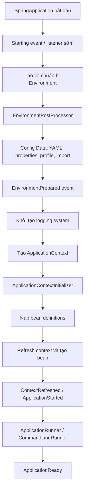

# Tác động của thứ tự khởi tạo đến cấu hình và logging

> **Chương:** Kiến trúc nền tảng  
> **Module:** `SPRING_CLOUD_CORE` — các nền tảng cốt lõi của Spring Cloud trong hệ thống phân tán, đặc biệt Spring Cloud Commons, Context, cấu hình bên ngoài, discovery, service registry, giao tiếp dịch vụ và khả năng kiểm thử, vận hành.  
> **Trọng tâm:** Cấu hình chỉ có tác dụng từ thời điểm nó được nạp. Thứ tự Spring Boot chuẩn bị Environment, khởi tạo logging, tạo ApplicationContext và refresh bean quyết định property nào có thể điều khiển giai đoạn nào.

## 1. Vì sao thứ tự khởi tạo quan trọng?

Một ứng dụng Spring Cloud thường nhận cấu hình từ nhiều nơi: file YAML đóng gói trong JAR, file bên ngoài, biến môi trường, tham số dòng lệnh, Config Server hoặc hệ thống cấu hình của nền tảng triển khai. Cùng một ứng dụng còn có thể dùng logging framework, discovery client, service registry và các bean có khả năng refresh.

Nếu không hiểu thứ tự khởi tạo, ta dễ gặp những hiện tượng khó giải thích:

- `logging.level.root` đã đặt trong một file nhưng những dòng log đầu tiên vẫn theo mức mặc định;
- cấu hình từ Config Server có hiệu lực trong bean nghiệp vụ, nhưng một phần logging đã được khởi tạo trước đó;
- một `@PropertySource` đọc được property trong bean nhưng không thay đổi được lựa chọn logging lúc startup;
- `ApplicationContextInitializer` thêm property vào Environment nhưng một thành phần đã đọc property trước đó;
- refresh cấu hình làm mới một bean `@RefreshScope`, nhưng không khởi chạy lại toàn bộ ứng dụng hay tự tải lại mọi appender của Logback.

Đây là vấn đề về **thời điểm và phạm vi sử dụng cấu hình**. Một property có thể tồn tại trong Environment mà vẫn đến quá muộn đối với thành phần đã khởi tạo.

### Kết quả học tập

Sau bài này, người học có thể:

1. mô tả các giai đoạn chính của Spring Boot startup và vị trí của Environment, Config Data, ApplicationContext, logging;
2. phân biệt cấu hình được nạp sớm với cấu hình chỉ xuất hiện khi bean được tạo;
3. giải thích vì sao `logging.*` cần có sẵn trước khi logging system khởi tạo;
4. lựa chọn Config Data, Spring Cloud Config hoặc legacy bootstrap phù hợp với phiên bản;
5. hiểu vai trò của `EnvironmentPostProcessor`, `ApplicationContextInitializer`, `@PropertySource` và event listener;
6. phân biệt refresh scope, cập nhật log level và tải lại toàn bộ logging configuration;
7. chẩn đoán khác biệt giữa local, CI và production bằng bằng chứng từ Environment, log và startup event.

## 2. Bản đồ vòng đời khởi động

### 2.1. Những giai đoạn cần nhận biết

Ở mức khái niệm, một ứng dụng Spring Boot đi qua các giai đoạn:

1. **Starting:** SpringApplication bắt đầu chạy; các listener sớm có thể nhận sự kiện trước khi Environment và ApplicationContext hoàn chỉnh.
2. **Chuẩn bị Environment:** tạo Environment, áp dụng cấu hình ban đầu và chạy các EnvironmentPostProcessor. Cơ chế Config Data nạp file cấu hình, profile và các nguồn được import.
3. **EnvironmentPrepared:** phát sự kiện cho biết Environment đã được chuẩn bị. Logging system được cấu hình ở giai đoạn rất sớm này, trước khi ApplicationContext refresh.
4. **Tạo và chuẩn bị ApplicationContext:** tạo context, gắn Environment, chạy các ApplicationContextInitializer và nạp nguồn bean.
5. **Refresh context:** xử lý bean definition, bean factory post processor, tạo các singleton không lazy, thực hiện khởi tạo bean và phát các context event.
6. **Started và Ready:** sau khi context refresh thành công, ứng dụng phát sự kiện started; sau khi các ApplicationRunner/CommandLineRunner hoàn tất, ứng dụng phát ready.
7. **Failed:** nếu một giai đoạn khởi tạo thất bại, ứng dụng phát sự kiện lỗi phù hợp và quá trình startup dừng.

Các tên sự kiện phổ biến gồm `ApplicationStartingEvent`, `ApplicationEnvironmentPreparedEvent`, `ApplicationContextInitializedEvent`, `ApplicationPreparedEvent`, `ContextRefreshedEvent`, `ApplicationStartedEvent`, `ApplicationReadyEvent` và `ApplicationFailedEvent`. Một số sự kiện chỉ có ý nghĩa trong Spring Boot; một số là event của Spring Framework.

### 2.2. Sơ đồ tổng quát



Thứ tự chính xác của các callback nội bộ còn phụ thuộc Spring Boot version và cấu hình ứng dụng. Điều cần ghi nhớ cho bài học này là:

- Config Data và EnvironmentPostProcessor chạy trước khi ApplicationContext được refresh.
- Logging được chuẩn bị rất sớm, trước giai đoạn refresh bean.
- Initializer và các cấu hình dựa trên bean chạy sau khi Environment đã được chuẩn bị.
- ApplicationRunner và ApplicationReadyEvent diễn ra khi phần lớn quá trình khởi tạo đã hoàn tất.

Nếu dùng legacy Spring Cloud bootstrap context, có thêm giai đoạn bootstrap trước ApplicationContext chính. Phần 6 giải thích sự khác nhau đó.

### 2.3. Environment không phải là một file cấu hình

Spring Environment là một tập hợp `PropertySource` có thứ tự ưu tiên. Khi hỏi một key như `spring.application.name` hoặc `logging.level.com.example`, Environment tìm giá trị theo thứ tự của các nguồn đang có.

Một property có thể đến từ:

- default properties do ứng dụng cung cấp;
- file `application.properties` hoặc `application.yml`;
- file cấu hình ngoài và profile;
- Config Data import từ nguồn từ xa;
- system properties hoặc environment variables;
- tham số dòng lệnh;
- nguồn do ứng dụng hoặc framework bổ sung.

Không nên nhớ một thứ tự ưu tiên rút gọn rồi áp dụng cho mọi ứng dụng. Hãy kiểm tra tài liệu Spring Boot của phiên bản đang dùng và giá trị hiệu lực tại runtime. Nguồn có độ ưu tiên cao hơn có thể ghi đè giá trị từ file đóng gói.

**Điểm mấu chốt:** Property chỉ có thể được sử dụng nếu nguồn chứa nó đã được nạp trước thời điểm thành phần cần đọc property đó.

## 3. Logging được khởi tạo rất sớm

### 3.1. Vì sao logging không chờ ApplicationContext?

Spring Boot cần logging để ghi nhận chính quá trình tạo Environment, nạp cấu hình và khởi tạo context. Nếu logging phải chờ toàn bộ bean được tạo mới hoạt động, nhiều lỗi startup quan trọng sẽ không có log phù hợp.

Vì vậy, logging system được chuẩn bị trước khi ApplicationContext refresh. Spring Boot dùng Environment đã chuẩn bị để áp dụng các thiết lập logging sớm, bao gồm các property như:

- `logging.config`: vị trí file cấu hình logging;
- `logging.level.*`: mức log theo logger hoặc package;
- `logging.file.name` và `logging.file.path`: cấu hình file log;
- `logging.pattern.*`: một số pattern do Spring Boot hỗ trợ.

Một số giá trị và cách diễn giải cụ thể phụ thuộc logging system và Spring Boot version. Không nên giả định mọi property bắt đầu bằng `logging.` đều có thể thay đổi sau khi ứng dụng chạy mà không cần cơ chế bổ sung.

### 3.2. Vì sao @PropertySource thường quá muộn?

`@PropertySource` được xử lý khi Spring đọc cấu hình và bean definition trong quá trình refresh ApplicationContext. Trong khi đó logging đã được khởi tạo ở giai đoạn trước.

Ví dụ:

```java
@Configuration
@PropertySource("classpath:late-logging.properties")
class LateLoggingConfiguration {
}
```

Nội dung `late-logging.properties`:

```properties
logging.level.root=DEBUG
logging.level.com.example.order=TRACE
```

Các property này có thể xuất hiện trong Environment sau khi cấu hình được xử lý, nhưng không nên trông đợi chúng điều khiển lần khởi tạo logging ban đầu. Đây là lý do Spring Boot khuyến nghị đặt thiết lập logging sớm trong Config Data hoặc nguồn cấu hình đã có sẵn trước giai đoạn logging initialization.

### 3.3. ApplicationContextInitializer cũng không phải điểm cấu hình logging ban đầu

`ApplicationContextInitializer` chạy khi ApplicationContext đã được tạo và Environment đã được chuẩn bị. Nó có thể thêm property source hoặc tùy chỉnh context trước refresh bean, nhưng logging system đã được thiết lập trước đó.

Ví dụ minh họa:

```java
public class ExampleInitializer
        implements ApplicationContextInitializer<ConfigurableApplicationContext> {

    @Override
    public void initialize(ConfigurableApplicationContext context) {
        // Property được thêm ở giai đoạn context initialization.
        // Không nên dùng đây làm nguồn duy nhất cho logging startup.
    }
}
```

Initializer hữu ích cho tùy chỉnh context và một số cấu hình trước refresh, nhưng không thay thế cơ chế nạp cấu hình sớm. Nếu muốn bổ sung property ảnh hưởng tới logging ban đầu, hãy cân nhắc Config Data hoặc `EnvironmentPostProcessor`.

### 3.4. Bean và @PostConstruct còn muộn hơn

Một bean cấu hình logging được tạo trong quá trình refresh hoặc một phương thức `@PostConstruct` chỉ chạy sau khi container bắt đầu tạo bean. Đến lúc đó, logging system đã được khởi tạo để phục vụ chính các giai đoạn này.

Không nên dùng `@Bean` hoặc `@PostConstruct` như cách nạp thiết lập logging ban đầu. Nếu cần thay đổi mức log sau startup, dùng cơ chế quản lý log level phù hợp thay vì cố gắng khởi tạo lại toàn bộ logging từ bean nghiệp vụ.

## 4. Nạp cấu hình sớm bằng Spring Boot Config Data

### 4.1. Config Data được xử lý khi nào?

Spring Boot Config Data là cơ chế nạp cấu hình trong giai đoạn chuẩn bị Environment. Nó đọc các file mặc định, file theo profile, vị trí cấu hình ngoài và các nguồn được khai báo bằng `spring.config.import`.

Vì Config Data được xử lý trước khi logging system khởi tạo, các property có trong nguồn cấu hình đã được nạp có thể ảnh hưởng tới logging ban đầu.

Ví dụ:

```yaml
spring:
  application:
    name: order-service
  profiles:
    active: prod

logging:
  level:
    root: INFO
    com.example.order: DEBUG
    org.springframework.cloud: INFO
```

Trong tình huống này, tên ứng dụng, profile và mức log nằm trong Config Data. Nếu không có nguồn cấu hình ưu tiên cao hơn ghi đè, logging có thể sử dụng các mức này ngay từ giai đoạn khởi tạo.

### 4.2. File cấu hình ngoài

Một ứng dụng có thể đặt file cấu hình bên ngoài JAR, ví dụ:

```text
/opt/order-service/
  order-service.jar
  config/
    application.yml
    application-prod.yml
```

Khi triển khai, cần xác định rõ file nào được tìm thấy và profile nào đang hoạt động. Có thể dùng các cơ chế như `spring.config.additional-location` hoặc `spring.config.location` để chỉ định vị trí. Hai property này có semantics khác nhau: một property bổ sung vị trí tìm kiếm, property kia thay đổi các vị trí mặc định theo quy tắc của Boot. Hãy xem tài liệu đúng version trước khi sử dụng.

Nếu file cấu hình ngoài được nạp trước logging initialization, `logging.level.*` trong file có thể áp dụng cho lần khởi tạo đó. Nếu file không được tìm thấy hoặc bị profile khác ghi đè, kết quả sẽ khác với kỳ vọng.

### 4.3. Tham số môi trường và dòng lệnh

Các nguồn được cung cấp trước khi ứng dụng bắt đầu xử lý Config Data cũng có thể quyết định cấu hình sớm, ví dụ:

```bash
java -jar order-service.jar --spring.profiles.active=prod
```

Hoặc đặt environment variable trong container:

```bash
SPRING_PROFILES_ACTIVE=prod
LOGGING_LEVEL_COM_EXAMPLE_ORDER=DEBUG
```

Quy tắc chuyển đổi tên property sang environment variable tuân theo quy tắc binding của Spring Boot. Với tên phức tạp, nên kiểm tra cách ánh xạ chính xác theo tài liệu. Trong môi trường container, tránh đưa secret vào command line vì có thể bị lộ qua process listing hoặc log triển khai.

## 5. Kết hợp Spring Cloud Config với thứ tự khởi tạo

### 5.1. Config Server qua Config Data import

Trong các phiên bản Spring Cloud Config hỗ trợ Config Data, client có thể khai báo import trong file cấu hình cục bộ:

```yaml
spring:
  application:
    name: order-service
  profiles:
    active: prod
  config:
    import: "optional:configserver:http://config-server:8888"

logging:
  level:
    root: INFO
    com.example.order: DEBUG
```

Ứng dụng cần dependency Config Client phù hợp. Khi Config Data xử lý import, client liên hệ Config Server để lấy cấu hình theo application name và profile. Nếu import thành công, các property từ nguồn từ xa được đưa vào Environment trong quá trình chuẩn bị.

Điều đó có nghĩa các thiết lập logging nhận từ Config Server **có thể có mặt trước lần khởi tạo logging ban đầu**, miễn là import được xử lý thành công và property có độ ưu tiên hiệu lực.

Tiền tố `optional:` thể hiện nguồn import là tùy chọn: nếu Config Server không sẵn sàng, ứng dụng có thể tiếp tục theo cấu hình còn lại. Nếu cấu hình yêu cầu nguồn từ xa bắt buộc, không dùng optional và cần thiết kế retry/fail-fast theo khả năng của phiên bản client. Cần cân nhắc kỹ vì khởi động thiếu cấu hình quan trọng có thể tạo service chạy nhưng hành vi sai.

### 5.2. Không phải mọi cấu hình từ xa đều được nạp cùng thời điểm

Cần phân biệt:

- Config Data import được xử lý trong giai đoạn chuẩn bị Environment;
- cấu hình được bean đọc trong quá trình bind hoặc tạo bean;
- cấu hình được làm mới sau startup qua cơ chế Spring Cloud Context/Bus;
- cấu hình được ứng dụng lấy thủ công từ một HTTP endpoint sau khi đã chạy.

Chỉ nhóm được nạp trước logging initialization mới có thể điều khiển cấu hình logging ban đầu. Nếu một service gọi API lấy cấu hình sau khi context đã refresh, các property nhận được không thể quay ngược thời gian để tác động tới log đã phát ra.

### 5.3. Legacy bootstrap context

Trong các thế hệ Spring Cloud trước khi Config Data trở thành cách tích hợp hiện đại, cơ chế bootstrap context được dùng để nạp property nguồn từ xa trước ApplicationContext chính. Một context bootstrap riêng có thể cung cấp property source và làm parent cho context ứng dụng theo kiến trúc của phiên bản đó.

Trong các hệ thống hiện đại, không nên mặc định `bootstrap.yml` luôn được nạp. Legacy bootstrap mode thường cần được bật rõ ràng bằng dependency hoặc cấu hình tương ứng với release train. Với Config Client hiện đại, `spring.config.import` là hướng tích hợp Config Data thường được ưu tiên.

Tránh trộn hai cơ chế mà không hiểu thứ tự và precedence. Nếu cùng một property xuất hiện trong bootstrap source, Config Data, file local và environment variable, phải xác định nguồn nào thắng và tại sao.

### 5.4. Tránh phụ thuộc vòng khi lấy cấu hình

Một dịch vụ không thể phụ thuộc vào cấu hình từ xa để biết địa chỉ của chính Config Server nếu không có nguồn khởi tạo tối thiểu khác. Các thông tin cần để liên hệ Config Server — chẳng hạn endpoint, trust material hoặc thông tin xác thực ban đầu — phải có sẵn từ một nguồn bootstrap phù hợp.

Cấu hình từ xa nên cung cấp phần cấu hình ứng dụng, không tạo vòng phụ thuộc khiến ứng dụng không thể tìm thấy nơi cung cấp cấu hình cho chính nó.

## 6. EnvironmentPostProcessor: điểm mở rộng trước logging

### 6.1. Vai trò

`EnvironmentPostProcessor` cho phép bổ sung hoặc điều chỉnh Environment trong giai đoạn chuẩn bị, trước khi ApplicationContext được tạo. Đây là một điểm mở rộng sớm hơn `ApplicationContextInitializer` và các bean cấu hình thông thường.

Nó phù hợp với một số trường hợp đặc biệt, ví dụ bổ sung property source từ một nguồn cục bộ có sẵn hoặc chuyển đổi cấu hình trước khi framework sử dụng. Tuy nhiên, với file YAML, profile và Config Server, hãy ưu tiên cơ chế Config Data tiêu chuẩn.

### 6.2. Ví dụ minh họa

Đoạn sau cho thấy ý tưởng thêm một property source sớm. Đây là ví dụ kỹ thuật, cần đăng ký processor và kiểm soát thứ tự thực thi theo Spring Boot version của ứng dụng.

```java
public final class EarlyLoggingEnvironmentPostProcessor
        implements EnvironmentPostProcessor, Ordered {

    @Override
    public void postProcessEnvironment(
            ConfigurableEnvironment environment,
            SpringApplication application) {

        Map<String, Object> values = Map.of(
                "logging.level.com.example.order", "DEBUG"
        );

        environment.getPropertySources().addFirst(
                new MapPropertySource("early-logging", values)
        );
    }

    @Override
    public int getOrder() {
        return Ordered.LOWEST_PRECEDENCE;
    }
}
```

Đăng ký processor bằng cơ chế Spring Boot hỗ trợ cho `EnvironmentPostProcessor`, thường là metadata `META-INF/spring.factories` với key tương ứng. Cần kiểm tra đúng quy tắc discovery của phiên bản Boot đang dùng.

Trong ví dụ, `addFirst` đưa nguồn lên đầu danh sách nên giá trị của nó có độ ưu tiên cao. Processor được sắp xếp sau các processor khác để có thể nhìn thấy những nguồn đã được nạp trước đó; tuy nhiên thứ tự thực tế phải được xác minh vì các processor khác cũng có thể thay đổi Environment. Không copy ví dụ vào production nếu chưa có lý do, kiểm thử precedence và tài liệu hóa nguồn property.

### 6.3. Vì sao không nên tạo quá nhiều processor?

Một EnvironmentPostProcessor chạy sớm và có thể ảnh hưởng toàn bộ quá trình khởi tạo. Nếu nhiều processor cùng sửa property source, thứ tự thực thi và precedence dễ trở nên khó dự đoán.

Nên:

- chỉ dùng khi Config Data hoặc cấu hình ngoài tiêu chuẩn không đáp ứng;
- đặt tên rõ cho property source;
- quyết định rõ addFirst/addLast và lý do;
- xác định thứ tự tương đối với Config Data processor;
- viết kiểm thử cho giá trị hiệu lực;
- tránh truy cập bean hoặc ApplicationContext vì chúng chưa được tạo.

## 7. Thứ tự event và ApplicationListener

### 7.1. Listener sớm và listener dạng bean

Spring Boot có các event được phát trước khi ApplicationContext refresh. Một listener được đăng ký như bean thông thường chỉ tồn tại khi context đã tạo và đăng ký bean; vì vậy nó không thể nhận những event xảy ra trước thời điểm đó.

Nếu cần lắng nghe sự kiện sớm, đăng ký listener trực tiếp với `SpringApplication` trước khi gọi `run` hoặc dùng cơ chế discovery listener mà phiên bản Boot hỗ trợ.

Ví dụ minh họa:

```java
@SpringBootApplication
public class OrderApplication {

    public static void main(String[] args) {
        SpringApplication application =
                new SpringApplication(OrderApplication.class);

        application.addListeners(new StartupPhaseListener());
        application.run(args);
    }
}
```

Listener có thể quan sát các event như `ApplicationStartingEvent` và `ApplicationEnvironmentPreparedEvent`. Không nên giả định mọi listener bean đều nhận được toàn bộ event của quá trình startup.

### 7.2. @Order không thay đổi vòng đời framework

`@Order` hoặc `Ordered` có thể quyết định thứ tự giữa các listener cùng xử lý một event hoặc giữa các thành phần có hỗ trợ order. Nó **không thể biến `@PropertySource` thành nguồn cấu hình có mặt trước Config Data**, cũng không thể chuyển ApplicationContextInitializer lên trước logging initialization.

Phân biệt:

- **Thứ tự framework phase:** Environment preparation, context creation, refresh, runners;
- **Thứ tự trong một phase:** thứ tự EnvironmentPostProcessor hoặc listener;
- **Precedence của property source:** nguồn nào thắng khi cùng một key xuất hiện.

Ba loại thứ tự này có quan hệ nhưng không đồng nghĩa. Chỉnh `@Order` ở một listener không tự động thay đổi precedence của Environment.

### 7.3. Các event thường dùng khi quan sát startup

| Event | Thời điểm khái quát | Ứng dụng thực tế |
| --- | --- | --- |
| `ApplicationStartingEvent` | Khi SpringApplication vừa bắt đầu | Ghi nhận tiến trình rất sớm |
| `ApplicationEnvironmentPreparedEvent` | Environment đã được chuẩn bị | Quan sát profile và cấu hình sớm |
| `ApplicationContextInitializedEvent` | Context đã được tạo và initializer đã chạy | Quan sát giai đoạn trước khi load bean definitions |
| `ApplicationPreparedEvent` | Context đã được chuẩn bị, trước refresh | Kiểm tra bước chuẩn bị context |
| `ContextRefreshedEvent` | Context đã refresh | Quan sát context đã khởi tạo |
| `ApplicationStartedEvent` | Sau refresh, trước runners | Thực hiện logic sau startup context |
| `ApplicationReadyEvent` | Sau khi runners hoàn tất | Ứng dụng sẵn sàng nhận traffic theo readiness |
| `ApplicationFailedEvent` | Khi startup thất bại | Thu thập nguyên nhân và báo lỗi |

Tên và thứ tự chi tiết có thể khác ở các nhánh framework; bảng là mô hình chung của Spring Boot hiện đại. Khi viết listener cần kiểm tra API event của version dự án.

## 8. Logging configuration: logback.xml và logback-spring.xml

### 8.1. Tại sao có hai tên file?

Spring Boot tích hợp với Logback và hỗ trợ file cấu hình theo quy ước. File `logback.xml` tiêu chuẩn có thể được Logback tự nạp theo cơ chế của chính Logback trước khi Spring Boot áp dụng các extension riêng.

`logback-spring.xml` cho phép Spring Boot kiểm soát quá trình nạp cấu hình và cung cấp extension như `<springProfile>` và `<springProperty>`. Vì vậy, khi cần dùng Spring Environment hoặc profile trong Logback, `logback-spring.xml` thường phù hợp hơn.

Không nên dùng các extension Spring Boot trong file `logback.xml` được Logback tự nạp quá sớm; chúng có thể chưa được nhận diện đúng.

### 8.2. Ví dụ logback-spring.xml

```xml
<configuration>
    <springProperty
        scope="context"
        name="applicationName"
        source="spring.application.name"
        defaultValue="unknown"/>

    <appender name="CONSOLE"
              class="ch.qos.logback.core.ConsoleAppender">
        <encoder>
            <pattern>
                %d{yyyy-MM-dd HH:mm:ss.SSS} %-5level
                [%property{applicationName}] [%thread]
                %logger{36} - %msg%n
            </pattern>
        </encoder>
    </appender>

    <springProfile name="prod">
        <root level="INFO">
            <appender-ref ref="CONSOLE"/>
        </root>
    </springProfile>

    <springProfile name="!prod">
        <root level="DEBUG">
            <appender-ref ref="CONSOLE"/>
        </root>
    </springProfile>
</configuration>
```

Ví dụ lấy `spring.application.name` từ Environment và dùng profile để chọn mức log root. Trong production thực tế, nên cấu hình mức log theo package, tránh bật DEBUG/TRACE toàn cục nếu không cần thiết.

Spring Boot thường tự tìm `logback-spring.xml` ở classpath root; có thể dùng `logging.config` để chỉ định file khác. File phải tồn tại và truy cập được tại thời điểm logging system khởi tạo.

### 8.3. Logging property và cấu hình Logback không hoàn toàn giống nhau

`logging.level.com.example=DEBUG` là thiết lập mức log theo logger mà Spring Boot có thể áp dụng thông qua LoggingSystem. Cấu hình appender, encoder, rolling policy, filter và layout thuộc logging framework.

Việc đổi mức log runtime thường đơn giản hơn việc thay đổi toàn bộ cấu trúc appender. Không nên giả định refresh một bean hoặc đổi property sẽ tự tải lại mọi cấu hình Logback.

## 9. Refresh cấu hình sau startup và giới hạn với logging

### 9.1. RefreshScope làm gì?

`@RefreshScope` cung cấp một proxy cho bean có target được cache theo cơ chế refresh scope. Khi có refresh hợp lệ, cache target có thể bị invalidated; target mới sẽ được tạo lại khi bean được truy cập tiếp theo.

Ví dụ:

```java
@Component
@RefreshScope
@ConfigurationProperties(prefix = "app")
class GreetingProperties {
    private String greeting = "Hello";

    public String getGreeting() {
        return greeting;
    }

    public void setGreeting(String greeting) {
        this.greeting = greeting;
    }
}
```

Nếu nguồn cấu hình thay đổi và ứng dụng thực hiện refresh theo cơ chế được cấu hình, target của bean có thể được tạo lại để đọc giá trị mới. Điều này không có nghĩa toàn bộ ApplicationContext được tạo lại từ đầu.

RefreshScope không phải cơ chế thay JAR hoặc nạp lại dependency. Nó không biến một phiên bản Spring Cloud cũ thành phiên bản mới.

### 9.2. EnvironmentChangeEvent và log level

Trong Spring Cloud Context, thay đổi Environment có thể được biểu diễn qua `EnvironmentChangeEvent`. Các thành phần hỗ trợ rebinding có thể phản ứng với event này để cập nhật một số cấu hình sau startup.

Trong những cấu hình Spring Cloud Context có `LoggingRebinder`, các property `logging.level.*` có thể được áp dụng lại cho LoggingSystem khi Environment thay đổi. Hành vi chi tiết phụ thuộc version và logging system.

Điều này cần phân biệt với khởi tạo logging lần đầu:

- logging ban đầu vẫn cần cấu hình có sẵn ở giai đoạn sớm;
- rebinding log level là hành động sau startup, khi có thay đổi Environment;
- thay đổi level không đồng nghĩa tự động dựng lại appender, encoder, file rolling policy hoặc mọi phần tử của file Logback;
- nếu cần thay đổi cấu trúc logging, hãy dùng cơ chế reload mà logging system hỗ trợ hoặc triển khai lại ứng dụng theo quy trình phù hợp.

### 9.3. Actuator loggers endpoint

Spring Boot Actuator có endpoint `loggers` cho phép xem và thay đổi mức log theo logger khi endpoint được bật và expose đúng cách. Đây là công cụ vận hành hữu ích để điều chỉnh mức log mà không cần thay đổi toàn bộ cấu hình file.

Tuy nhiên, endpoint vận hành cần được bảo vệ bằng authentication/authorization và chỉ expose trên phạm vi mạng phù hợp. Không mở endpoint quản trị log công khai chỉ để tiện debug.

### 9.4. Refresh không sửa được cấu hình đã đọc một lần ở giai đoạn sớm

Một số thiết lập chỉ có ý nghĩa khi startup, ví dụ vị trí Config Data, cấu hình khởi tạo logging hoặc cách tạo ApplicationContext. Refresh một bean không tự lặp lại các giai đoạn trước đó.

Nếu thay đổi một property nhưng component đã đọc nó và không hỗ trợ refresh, giá trị mới có thể xuất hiện trong Environment mà không làm component đổi hành vi. Khi đó cần restart/redeploy hoặc một cơ chế reconfigure cụ thể.

## 10. Ví dụ tổng hợp: cấu hình và logging trong order-service

Giả sử `order-service` lấy cấu hình từ Config Server và dùng Logback. Cấu hình cục bộ:

```yaml
spring:
  application:
    name: order-service
  profiles:
    active: prod
  config:
    import: "optional:configserver:http://config-server:8888"

logging:
  config: classpath:logback-spring.xml
  level:
    root: INFO
    com.example.order: INFO
```

Config Server có thể trả thêm các property cho profile `prod`, ví dụ mức log cho một package cụ thể. Nếu Config Data import hoàn tất trước logging initialization và property không bị nguồn ưu tiên cao hơn ghi đè, LoggingSystem có thể sử dụng giá trị đó ngay từ startup.

Khi triển khai, cần xác minh:

1. `spring.application.name` và active profile có đúng không;
2. Config Client dependency có đúng release train không;
3. Config Server có trả cấu hình cho đúng application/profile không;
4. import có thành công hay bị bỏ qua do `optional:`;
5. property nào thắng khi local và remote cùng khai báo;
6. `logback-spring.xml` được tìm thấy và đọc thành công;
7. mức log hiệu lực có đúng với môi trường không.

Nếu Config Server không truy cập được và import là optional, ứng dụng có thể khởi động bằng cấu hình còn lại. Điều đó có thể khiến log level hoặc cấu hình nghiệp vụ khác kỳ vọng. Với property bắt buộc, cần thiết kế chính sách fail startup thay vì im lặng chấp nhận thiếu cấu hình.

## 11. Kiểm thử và chẩn đoán thứ tự khởi tạo

### 11.1. Các câu hỏi điều tra

Khi cấu hình không có hiệu lực như mong muốn, hãy hỏi theo trình tự:

- Property nằm trong nguồn nào?
- Nguồn đó được nạp ở phase nào?
- Thành phần cần property đã khởi tạo ở thời điểm nào?
- Có nguồn nào ưu tiên cao hơn ghi đè không?
- Giá trị mới chỉ có trong Environment hay component thực sự đã áp dụng nó?
- Thay đổi cần refresh bean, cập nhật log level hay restart toàn ứng dụng?

Cách đặt câu hỏi này giúp tránh thay đổi nhiều file cấu hình mà không biết component đọc chúng lúc nào.

### 11.2. Bảng kiểm thử theo giai đoạn

| Kiểm thử | Cách thực hiện | Kết quả cần xác nhận |
| --- | --- | --- |
| Config Data local | Đặt một property trong application YAML | Property có trong Environment khi startup |
| Profile | Khởi chạy với profile khác nhau | File profile và giá trị tương ứng được nạp |
| External config | Đặt file ngoài JAR | Giá trị hiệu lực đúng với vị trí được chỉ định |
| Config Server import | Dùng Config Client và nguồn từ xa kiểm soát được | Remote property có trong Environment trước context refresh |
| Early logging | Đặt package log level trong Config Data | Log startup phù hợp với mức cấu hình |
| @PropertySource | Chuyển cùng property sang file nạp qua annotation | Xác nhận annotation không điều khiển lần logging init ban đầu |
| EnvironmentPostProcessor | Thêm property source sớm | Xác nhận thứ tự processor và precedence |
| ApplicationContextInitializer | Thêm property trước refresh | Phân biệt hiệu lực với logging đã khởi tạo |
| RefreshScope | Thay đổi property và refresh | Target bean được tạo lại khi truy cập theo thiết kế |
| Logging rebinding | Thay đổi logging.level và phát refresh | Xác nhận log level được cập nhật nếu thành phần rebinder hiện diện |
| Logging config file | Thay đổi appender/encoder | Xác nhận cơ chế reload thực tế; không giả định RefreshScope tự làm điều đó |

### 11.3. Quan sát startup

Một số nguồn thông tin hữu ích:

- log từ giai đoạn đầu, đặc biệt các dòng liên quan Config Data, active profiles và logging system;
- startup failure analysis và phần `Caused by`;
- Actuator `env` hoặc endpoint cấu hình tương ứng nếu đã expose an toàn;
- Actuator `loggers` để kiểm tra mức log hiện hành;
- startup metrics/tracing và ApplicationStartup nếu ứng dụng đã bật;
- log của Config Client/Config Server để xác nhận remote property source được lấy.

Khi kiểm tra endpoint `env`, chú ý masking secret và quyền truy cập. Không ghi token, password, private key hoặc thông tin xác thực vào log chỉ để chứng minh thứ tự nạp cấu hình.

### 11.4. --debug không đồng nghĩa root logger DEBUG

Tham số `--debug` của Spring Boot thường bật một số nhóm logger và báo cáo điều kiện auto-configuration, hữu ích khi tìm lý do một cấu hình được áp dụng hay bị bỏ qua. Nó không có nghĩa mọi logger được chuyển sang DEBUG.

Nếu cần log chi tiết cho một package, đặt `logging.level.ten.package=DEBUG` trong nguồn được nạp đủ sớm. Chỉ bật TRACE/DEBUG khi cần và tắt sau điều tra để tránh lượng log lớn hoặc rò rỉ dữ liệu nhạy cảm.

## 12. Những sai lầm thường gặp

**“Property đã có trong Environment nên logging chắc chắn đã đọc nó.”**  
Không. Cần biết property được nạp trước hay sau thời điểm LoggingSystem khởi tạo và nguồn nào có precedence cao hơn.

**“@PropertySource có thể cấu hình mọi thứ như application.yml.”**  
Không. Nó được xử lý khi context refresh; một số thiết lập như logging initialization cần có sớm hơn.

**“ApplicationContextInitializer chạy trước mọi thành phần Spring Boot.”**  
Không. Environment đã được chuẩn bị và logging đã được thiết lập trước giai đoạn initializer.

**“@Order có thể làm một bean listener nhận event trước khi bean tồn tại.”**  
Không. Listener phải được đăng ký trước thời điểm event được phát; @Order chỉ điều chỉnh thứ tự trong phạm vi cơ chế hỗ trợ.

**“Config Server luôn được gọi sau khi bean tạo.”**  
Không. Với Config Data import được hỗ trợ, remote configuration được nạp trong quá trình chuẩn bị Environment. Legacy bootstrap có vòng đời riêng.

**“RefreshScope làm khởi động lại toàn bộ ứng dụng.”**  
Không. Nó invalidates target bean thuộc scope; target được tạo lại khi cần. Các giai đoạn startup trước đó không chạy lại.

**“Refresh log level đồng nghĩa reload toàn bộ Logback.”**  
Không. Rebinding level và reload appender/encoder là các hành động khác nhau.

**“Config Server optional luôn là lựa chọn an toàn.”**  
Không. Nếu thiếu cấu hình mà ứng dụng vẫn khởi động với giá trị mặc định không an toàn, optional có thể che giấu sự cố. Hãy phân loại property bắt buộc và tùy chọn.

## 13. Bài tập vận dụng

### Bài tập 1 — Vì sao log đầu tiên vẫn là INFO?

Ứng dụng có `logging.level.com.example.order=DEBUG` trong file được nạp qua `@PropertySource`. Sau khi context khởi tạo, một số log là DEBUG nhưng log startup đầu tiên vẫn là INFO.

Giải thích thứ tự đọc property và đề xuất nơi đặt cấu hình để nó có hiệu lực trước logging initialization.

### Bài tập 2 — Remote configuration

`order-service` dùng Config Server. Khi Config Server hoạt động, package logger có mức DEBUG; khi Config Server không truy cập được, mức log quay về INFO. Hãy phân tích tác động của `optional:configserver:` và đề xuất cách kiểm tra property source, profile và giá trị hiệu lực.

### Bài tập 3 — Initializer và EnvironmentPostProcessor

Một nhóm thêm property trong `ApplicationContextInitializer` để đặt `logging.config`. File logging mới không được sử dụng lúc startup. Hãy giải thích tại sao và chọn extension point phù hợp hơn.

### Bài tập 4 — RefreshScope và logging

Sau khi phát refresh, bean `@RefreshScope` đọc được giá trị mới nhưng appender Logback vẫn dùng file cũ. Hãy giải thích sự khác nhau giữa refresh target bean, LoggingRebinder và reload cấu trúc logging.

### Câu hỏi tự kiểm tra

1. Config Data được nạp ở giai đoạn nào? **Trong lúc chuẩn bị Environment, trước khi ApplicationContext refresh.**
2. Logging system được khởi tạo trước hay sau khi tạo toàn bộ bean? **Rất sớm, trước context refresh.**
3. @PropertySource có phù hợp làm nguồn duy nhất cho logging startup không? **Không.**
4. EnvironmentPostProcessor có thể thêm property trước logging không? **Có, nếu đăng ký và sắp thứ tự phù hợp.**
5. ApplicationContextInitializer có thể làm lại logging initialization ban đầu không? **Không.**
6. RefreshScope có tạo lại toàn bộ ApplicationContext không? **Không.**
7. Config Server import qua Config Data có thể cung cấp log level ban đầu không? **Có, nếu import hoàn tất trước logging initialization và giá trị có hiệu lực.**

## 14. Checklist thiết kế và vận hành

Khi thiết kế thứ tự khởi tạo trong một ứng dụng Spring Cloud, hãy kiểm tra:

1. Đặt các property cần cho giai đoạn sớm trong Config Data, environment hoặc nguồn được nạp trước logging initialization.
2. Dùng `spring.config.import` cho Config Server Config Data nếu release train hỗ trợ; phân biệt optional với required.
3. Chỉ dùng legacy bootstrap khi dự án cần và hiểu rõ cấu hình bật cùng precedence của nó.
4. Dùng `EnvironmentPostProcessor` cho nhu cầu mở rộng thực sự ở giai đoạn Environment; tránh lạm dụng.
5. Dùng `ApplicationContextInitializer` cho tùy chỉnh context trước refresh, không dùng làm nguồn logging ban đầu.
6. Dùng `logback-spring.xml` khi cần extension Spring Boot như profile và property.
7. Phân biệt cập nhật log level, refresh bean và reload logging configuration.
8. Kiểm thử thứ tự nạp cấu hình ở local, CI và container.
9. Bảo vệ các endpoint vận hành và không để secret xuất hiện trong log.
10. Ghi nhận startup failure và trạng thái readiness để phân biệt ứng dụng chưa khởi động với ứng dụng đã sẵn sàng nhưng downstream lỗi.

**Thông điệp cốt lõi:** Trong Spring Boot và Spring Cloud, một cấu hình chỉ điều khiển được thành phần nếu nó có mặt đúng thời điểm và thành phần đó hỗ trợ cập nhật. Config Data và EnvironmentPostProcessor phục vụ giai đoạn sớm; ApplicationContextInitializer và bean configuration phục vụ giai đoạn context; RefreshScope và logging rebinding phục vụ một số thay đổi sau startup. Hiểu ranh giới này giúp thiết kế cấu hình, logging và vận hành có thể dự đoán được.

**Tài liệu tham khảo:** [Spring Boot Reference — Externalized Configuration](https://docs.spring.io/spring-boot/reference/features/external-config.html), [Spring Boot Reference — Logging](https://docs.spring.io/spring-boot/reference/features/logging.html), [Spring Boot Application Events](https://docs.spring.io/spring-boot/reference/features/spring-application.html), [Spring Cloud Config](https://docs.spring.io/spring-cloud-config/reference/) và [Spring Cloud Commons](https://docs.spring.io/spring-cloud-commons/reference/). Hãy chọn tài liệu của đúng phiên bản Spring Boot/Spring Cloud đang chạy vì chi tiết Config Data, bootstrap và refresh có thể thay đổi theo release train.
