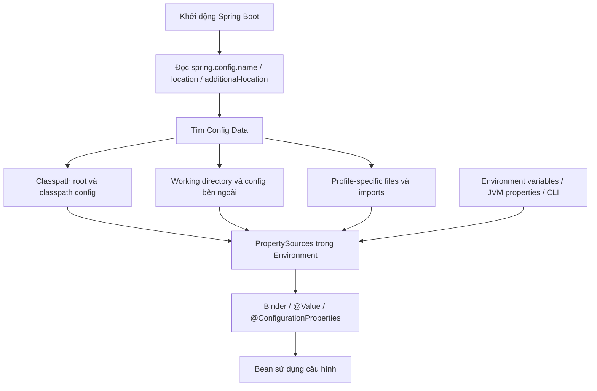

# Vị trí cấu hình trong JAR và bên ngoài JAR

Spring Boot cho phép ứng dụng lấy cấu hình từ cả những tệp được đóng gói trong artifact và những tệp nằm bên ngoài artifact. Cách tổ chức này rất quan trọng với hệ thống phân tán: cùng một JAR có thể chạy ở máy phát triển, máy chủ kiểm thử, container hoặc Kubernetes, trong khi URL dịch vụ, cổng, thông tin kết nối, profile và giới hạn vận hành thay đổi theo môi trường.

Với **SPRING_CLOUD_CORE**, hiểu vị trí cấu hình là nền tảng để sử dụng Spring Boot Config Data, Spring Cloud Config Client, discovery, service registry và các cơ chế refresh. Bài học thuộc chương **Nạp cấu hình**, tập trung vào câu hỏi: tệp cấu hình nằm ở đâu, Spring Boot tìm chúng theo thứ tự nào, và làm thế nào để cấu hình bên ngoài ghi đè giá trị mặc định trong JAR một cách có chủ đích.

## 1. Mục tiêu học tập

Sau bài này, bạn có thể:

- Phân biệt cấu hình nằm trong classpath của JAR và cấu hình nằm trên filesystem của máy/container.
- Liệt kê năm vị trí mặc định Spring Boot tìm `application.properties` hoặc `application.yaml`.
- Giải thích thứ tự ưu tiên giữa cấu hình đóng gói và cấu hình bên ngoài.
- Phân biệt `spring.config.location`, `spring.config.additional-location`, `spring.config.name` và `spring.config.import`.
- Thiết lập profile-specific configuration cho `dev`, `test`, `prod`.
- Tổ chức cấu hình khi chạy executable JAR, Docker và Kubernetes.
- Nhận diện vì sao thay đổi một tệp ngoài JAR không đồng nghĩa ứng dụng tự nạp lại cấu hình.
- Chẩn đoán lỗi do working directory, đường dẫn, profile, quyền đọc tệp hoặc cấu hình bị ghi đè.

## 2. Cấu hình trong JAR và bên ngoài JAR là gì?

### 2.1. Cấu hình đóng gói trong JAR

Các tệp trong `src/main/resources` được hệ thống build đưa vào classpath của ứng dụng. Với executable JAR do Spring Boot đóng gói, chúng thường nằm dưới `BOOT-INF/classes/`.

Ví dụ cấu trúc mã nguồn:

```text
checkout-service/
├── src/
│   └── main/
│       └── resources/
│           ├── application.yaml
│           └── config/
│               └── application.yaml
└── pom.xml
```

Sau khi build, hai tệp có thể xuất hiện trong JAR ở các vị trí tương ứng:

```text
BOOT-INF/classes/application.yaml
BOOT-INF/classes/config/application.yaml
```

Đây là cấu hình classpath:

- `classpath:/application.yaml` chỉ tới tài nguyên ở gốc classpath.
- `classpath:/config/application.yaml` chỉ tới tài nguyên trong package/thư mục `config` của classpath.

Ưu điểm của cấu hình đóng gói là có sẵn cùng artifact, thuận tiện cho giá trị mặc định và giúp artifact tự mô tả các thiết lập cơ bản. Nhược điểm là thay đổi tệp bên trong JAR thường cần build hoặc đóng gói lại artifact, sau đó triển khai phiên bản mới.

### 2.2. Cấu hình nằm ngoài JAR

Cấu hình bên ngoài là tệp trên filesystem của máy chạy ứng dụng, volume được mount vào container hoặc một vị trí do hệ thống triển khai cung cấp. Tệp này không cần nằm trong `src/main/resources` và không cần đóng gói vào JAR.

Ví dụ:

```text
/srv/checkout/
├── checkout-service.jar
└── config/
    ├── application.yaml
    └── application-prod.yaml
```

Khi Spring Boot tìm thấy `config/application.yaml` ở vị trí bên ngoài classpath theo quy tắc mặc định, các giá trị của nó có thể ghi đè giá trị cùng key trong tệp đóng gói. Nhờ vậy, nhóm phát triển có thể giữ một artifact cho nhiều môi trường và cung cấp cấu hình triển khai ở thời điểm chạy.

### 2.3. So sánh hai cách đặt cấu hình

| Tiêu chí | Trong JAR/classpath | Bên ngoài JAR/filesystem |
| --- | --- | --- |
| Vị trí phổ biến | `src/main/resources/application.yaml` | `./application.yaml`, `./config/application.yaml`, thư mục được chỉ định |
| Vòng đời | Đi cùng artifact đã build | Do môi trường triển khai quản lý |
| Thay đổi giá trị | Thường phải đóng gói/triển khai artifact mới | Có thể thay tệp mà không build lại JAR |
| Mục đích phù hợp | Giá trị mặc định, cấu hình không phụ thuộc môi trường | URL, cổng, profile, giới hạn và thiết lập theo môi trường |
| Bảo mật | Giá trị đóng gói có thể bị đọc từ artifact | Có thể giới hạn quyền file hoặc mount secret; vẫn phải bảo vệ quyền truy cập |
| Tái lập | Gắn với phiên bản artifact | Cần quản lý phiên bản và nguồn cấu hình riêng |

**Nguyên tắc thực tế:** đóng gói những giá trị mặc định không nhạy cảm; cung cấp giá trị phụ thuộc môi trường từ bên ngoài hoặc hệ thống quản lý cấu hình/secret. Không đặt mật khẩu, token hay private key vào JAR chỉ vì tiện cho chạy thử.

## 3. Năm vị trí mặc định Spring Boot tìm cấu hình

Khi khởi động, Spring Boot tự tìm `application.properties`, `application.yaml` hoặc `application.yml` tại các vị trí mặc định. Theo tài liệu Externalized Configuration, thứ tự từ **ưu tiên thấp đến ưu tiên cao** là:

| Thứ tự | Vị trí | Ví dụ | Loại |
| ---: | --- | --- | --- |
| 1 | Gốc classpath | `classpath:/application.yaml` | Trong JAR |
| 2 | Thư mục `config` của classpath | `classpath:/config/application.yaml` | Trong JAR |
| 3 | Thư mục làm việc hiện tại | `file:./application.yaml` | Bên ngoài JAR |
| 4 | Thư mục `config` bên dưới thư mục làm việc | `file:./config/application.yaml` | Bên ngoài JAR |
| 5 | Các thư mục con trực tiếp của `config` | `file:./config/<nhóm>/application.yaml` | Bên ngoài JAR |

Giá trị ở vị trí ưu tiên cao hơn có thể ghi đè giá trị cùng key ở vị trí thấp hơn. Vì vậy, cấu hình bên ngoài trong thư mục làm việc hoặc `config` thường thắng cấu hình được đóng gói trong JAR.

### 3.1. Hiểu `classpath` và `file`

- `classpath:` tìm tài nguyên trong classpath của ứng dụng, bao gồm tài nguyên được đóng gói trong JAR.
- `file:` tìm tài nguyên trên filesystem của tiến trình.
- `file:./` biểu thị thư mục làm việc hiện tại của tiến trình, không mặc nhiên là thư mục chứa JAR.
- Đường dẫn tương đối cần được hiểu theo working directory hoặc quy tắc import tương ứng; khi triển khai, đường dẫn tuyệt đối thường dễ kiểm soát hơn.

Ví dụ, nếu chạy:

```bash
cd /srv/checkout
java -jar /opt/apps/checkout-service.jar
```

thì `file:./config/application.yaml` được tìm dưới `/srv/checkout/config/`, bởi vì `/srv/checkout` là working directory. Nó không tự động trỏ tới `/opt/apps/config/` chỉ vì JAR nằm trong `/opt/apps`.

Đây là nguyên nhân phổ biến khiến cấu hình có trên máy nhưng ứng dụng không đọc được: lệnh khởi động được gọi từ thư mục khác với thư mục mà người vận hành giả định.

### 3.2. Ví dụ ghi đè cùng một property

Giả sử trong JAR có `application.yaml`:

```yaml
spring:
  application:
    name: checkout-service

inventory:
  base-url: http://localhost:8082
  timeout: 2s
  max-attempts: 2
```

Tệp bên ngoài `./config/application.yaml`:

```yaml
inventory:
  base-url: https://inventory.internal
  timeout: 800ms
```

Khi chạy từ thư mục có `config/application.yaml`, kết quả phân giải là:

| Property | Giá trị cuối cùng | Nguồn thắng |
| --- | --- | --- |
| `spring.application.name` | `checkout-service` | `application.yaml` trong JAR |
| `inventory.base-url` | `https://inventory.internal` | `./config/application.yaml` |
| `inventory.timeout` | `800ms` | `./config/application.yaml` |
| `inventory.max-attempts` | `2` | `application.yaml` trong JAR |

Spring Boot hợp nhất các property theo key; tệp bên ngoài không cần lặp lại toàn bộ cấu hình trong JAR. Các key không được khai báo ở nguồn có ưu tiên cao hơn vẫn có thể lấy giá trị từ nguồn thấp hơn.

### 3.3. Thư mục con trực tiếp của `config`

Spring Boot mặc định còn tìm trong các thư mục con trực tiếp của thư mục `config` bên ngoài. Điều này hữu ích khi một ứng dụng nhận cấu hình được mount theo nhóm:

```text
config/
├── database/
│   └── application.yaml
├── messaging/
│   └── application.yaml
└── observability/
    └── application.yaml
```

Các tệp ở các thư mục con trực tiếp có thể được nạp cùng với những vị trí mặc định khác. Spring Boot mở rộng vị trí wildcard mặc định theo thứ tự tên đường dẫn tuyệt đối; nếu nhiều tệp cùng đặt một key, cần tránh phụ thuộc vào thứ tự ngẫu nhiên do hệ thống triển khai tạo ra. Hãy đặt mỗi nhóm property ở một nguồn có trách nhiệm rõ ràng.

Wildcard mặc định chỉ áp dụng cho thư mục con trực tiếp và vị trí filesystem bên ngoài; không dùng wildcard classpath như cách thay thế tùy ý.

## 4. Vị trí cấu hình trong executable JAR

### 4.1. Cấu hình mặc định trong `src/main/resources`

Với Maven hoặc Gradle, các tệp dưới `src/main/resources` được copy vào output resources và đưa vào JAR. Cách thường dùng:

```text
src/main/resources/
└── application.yaml
```

Ví dụ:

```yaml
spring:
  application:
    name: payment-service

server:
  port: 8080

payment:
  currency: VND
  request-timeout: 3s
```

Đây là bộ giá trị mặc định có thể dùng khi chạy local. Không nên đưa endpoint production hoặc secret thật vào tệp này nếu artifact được chia sẻ qua nhiều môi trường.

### 4.2. Kiểm tra nội dung JAR

Có thể liệt kê nội dung JAR bằng lệnh:

```bash
jar tf target/payment-service.jar
```

Tìm những entry như:

```text
BOOT-INF/classes/application.yaml
BOOT-INF/classes/config/application.yaml
```

Với executable JAR của Spring Boot, ứng dụng classpath được tổ chức bên trong JAR. Tên `BOOT-INF/classes` là chi tiết đóng gói; khi cấu hình, nên dùng `classpath:/` và `classpath:/config/` thay vì phụ thuộc trực tiếp vào tên entry nội bộ.

Nếu file không xuất hiện trong JAR, kiểm tra:

- File có nằm trong `src/main/resources` hay không.
- Cấu hình build có loại trừ tài nguyên đó không.
- Tên file và phần mở rộng có đúng không.
- Artifact đang kiểm tra có đúng phiên bản vừa build không.

### 4.3. Cấu hình ngoài JAR không cần sửa artifact

Giữ JAR tại `/srv/payment/payment-service.jar`, đặt cấu hình ngoài:

```text
/srv/payment/
├── payment-service.jar
└── config/
    └── application.yaml
```

Khởi chạy:

```bash
cd /srv/payment
java -jar payment-service.jar
```

Spring Boot tự tìm `./config/application.yaml` theo vị trí mặc định. Có thể triển khai cùng một JAR sang nhiều máy, còn nội dung thư mục `config` được quản lý riêng theo từng môi trường.

### 4.4. Cố định working directory khi chạy bằng systemd

Nếu dùng systemd, khai báo `WorkingDirectory` để đường dẫn `file:./` luôn có ý nghĩa rõ ràng:

```ini
[Service]
WorkingDirectory=/srv/payment
ExecStart=/usr/bin/java -jar /opt/apps/payment-service.jar
User=payment
```

Trong ví dụ này, tệp `/srv/payment/config/application.yaml` được tìm theo working directory `/srv/payment`, mặc dù JAR nằm ở `/opt/apps`. Quyền đọc file cũng phải cho phép user `payment` truy cập.

## 5. Cấu hình bên ngoài bằng `spring.config.location`

Khi các vị trí mặc định không đáp ứng yêu cầu triển khai, có thể chỉ định vị trí cấu hình bằng `spring.config.location`.

Ví dụ:

```bash
java -jar payment-service.jar \
  --spring.config.location=file:/etc/payment/
```

Nếu giá trị trỏ tới thư mục, đường dẫn cần kết thúc bằng `/`. Spring Boot sẽ tìm tên file được chọn bởi `spring.config.name` trong thư mục đó và xử lý các biến thể profile phù hợp.

Có thể chỉ định trực tiếp một file:

```bash
java -jar payment-service.jar \
  --spring.config.location=file:/etc/payment/payment.yaml
```

`spring.config.location` nhận danh sách vị trí phân tách bằng dấu phẩy. Những vị trí này **thay thế tập vị trí mặc định**. Nếu đặt duy nhất `/etc/payment/`, ứng dụng không còn tự tìm các file ở classpath root, classpath `config`, working directory và `./config` theo danh sách mặc định.

### 5.1. Khi nào dùng `spring.config.location`?

Dùng khi muốn kiểm soát toàn bộ tập vị trí cấu hình được tìm. Ví dụ một dịch vụ chạy trong môi trường chuyên biệt, chỉ được phép đọc cấu hình từ `/etc/payment/` và một file bổ sung được chỉ định rõ.

Trường hợp này cần đảm bảo thư mục chỉ định chứa đủ các giá trị cần thiết hoặc có các nguồn khác cung cấp phần còn thiếu. Nếu vô tình dùng `spring.config.location` chỉ để thêm một file override, cấu hình mặc định trong JAR có thể không được nạp như mong đợi.

### 5.2. File hay thư mục?

| Giá trị | Ý nghĩa |
| --- | --- |
| `file:/etc/payment/` | Tìm các file theo tên cấu hình trong thư mục |
| `file:/etc/payment/application.yaml` | Đọc file được chỉ định trực tiếp |
| `file:./config/` | Tìm cấu hình trong thư mục `config` của working directory |
| `classpath:/defaults/` | Tìm cấu hình trong thư mục classpath `defaults` |

Khi chỉ định thư mục, thêm dấu `/` cuối đường dẫn. Khi chỉ định file, dùng tên file cụ thể. Các vị trí cũng có thể được mở rộng để tìm biến thể theo profile theo quy tắc Config Data.

## 6. Thêm vị trí ngoài mà vẫn giữ cấu hình mặc định

Trong phần lớn triển khai, ta muốn giữ giá trị mặc định đã đóng gói trong JAR, rồi thêm một thư mục bên ngoài để ghi đè. Khi đó, dùng `spring.config.additional-location`.

```bash
java -jar payment-service.jar \
  --spring.config.additional-location=optional:file:/etc/payment/
```

Thuộc tính này **bổ sung** vị trí vào tập mặc định. Property ở vị trí bổ sung được xử lý với ưu tiên cao hơn các vị trí mặc định, nên có thể ghi đè giá trị trong JAR.

### 6.1. So sánh hai thuộc tính

| Thuộc tính | Hành vi | Khi nên dùng |
| --- | --- | --- |
| `spring.config.location` | Thay thế các vị trí mặc định | Muốn giới hạn hoàn toàn nơi tìm config |
| `spring.config.additional-location` | Giữ vị trí mặc định và thêm vị trí mới có ưu tiên cao hơn | Muốn thêm file override bên ngoài mà vẫn giữ defaults trong JAR |

Đây là khác biệt quan trọng nhất khi triển khai executable JAR. Nếu mục tiêu chỉ là đưa cấu hình theo môi trường ra ngoài, `spring.config.additional-location` thường phù hợp hơn.

### 6.2. Cấu hình thuộc tính ở thời điểm khởi động

`spring.config.name`, `spring.config.location` và `spring.config.additional-location` được dùng rất sớm để xác định nguồn dữ liệu cấu hình. Vì vậy, phải truyền chúng qua môi trường, JVM system property hoặc command-line argument khi khởi động; không thể đặt chúng trong chính `application.yaml` mà chúng có nhiệm vụ chỉ đường để tìm.

Ví dụ bằng system property:

```bash
java -Dspring.config.additional-location=file:/etc/payment/ \
  -jar payment-service.jar
```

Ví dụ bằng command-line argument:

```bash
java -jar payment-service.jar \
  --spring.config.additional-location=file:/etc/payment/
```

Trong môi trường container, có thể truyền thuộc tính qua environment variable theo quy tắc ánh xạ tên property của Spring Boot, hoặc khai báo trong lệnh khởi chạy. Cần kiểm tra tên biến môi trường sau khi chuyển đổi dấu chấm/dấu gạch nối để tránh cấu hình sai key.

## 7. Đổi tên file với `spring.config.name`

Mặc định Spring Boot tìm basename `application`. Nếu muốn dùng tên khác, đặt `spring.config.name` trước khi Config Data được nạp:

```bash
java -jar payment-service.jar \
  --spring.config.name=payment \
  --spring.config.additional-location=optional:file:/etc/payment/
```

Với cấu hình này, Spring Boot tìm các tên như `payment.properties`, `payment.yaml` hoặc biến thể theo profile tại những vị trí được chọn. `spring.config.name` chỉ đổi basename, không tự xác định thư mục.

Ví dụ:

```text
/etc/payment/
├── payment.yaml
└── payment-prod.yaml
```

Nếu chỉ đặt `payment.yaml` nhưng không đổi `spring.config.name`, Spring Boot mặc định vẫn tìm `application.*`; file có tên `payment.yaml` sẽ không tự động được chọn theo basename mặc định.

## 8. Cấu hình theo profile trong và ngoài JAR

Spring Boot hỗ trợ file cấu hình chung và file riêng cho profile:

```text
application.yaml
application-dev.yaml
application-test.yaml
application-prod.yaml
```

Khi profile `prod` hoạt động, cấu hình chung và cấu hình `application-prod.yaml` được xem xét theo cùng quy tắc vị trí. File theo profile có thể ghi đè file chung. Nếu có nhiều profile cùng hoạt động, thứ tự profile và location group ảnh hưởng đến giá trị cuối cùng.

### 8.1. Ví dụ profile đóng gói và profile ngoài JAR

Trong JAR, `application.yaml`:

```yaml
spring:
  application:
    name: payment-service

payment:
  timeout: 3s
  currency: VND
```

Trong JAR, `application-prod.yaml`:

```yaml
payment:
  timeout: 1500ms
```

Ngoài JAR, `./config/application-prod.yaml`:

```yaml
payment:
  timeout: 900ms
```

Khởi chạy:

```bash
java -jar payment-service.jar --spring.profiles.active=prod
```

Ứng dụng dùng profile `prod`. Cấu hình ngoài JAR ở vị trí có ưu tiên cao hơn có thể đưa `payment.timeout` về `900ms`; `payment.currency` vẫn giữ `VND` từ cấu hình chung trong JAR vì không có nguồn ưu tiên cao hơn thay thế key này.

### 8.2. Không kích hoạt profile trong file profile-specific

Không dùng `spring.profiles.active` hoặc `spring.profiles.default` bên trong tài liệu chỉ được kích hoạt theo profile. Hãy kích hoạt profile từ nguồn cấu hình không phụ thuộc profile, chẳng hạn command line, system property hoặc environment variable. File `application-prod.yaml` nên chứa các giá trị dành cho profile `prod`.

### 8.3. Profile trong YAML nhiều tài liệu

Một file YAML có thể chứa nhiều tài liệu, phân tách bằng `---`. Có thể dùng `spring.config.activate.on-profile` để chỉ kích hoạt một tài liệu khi profile phù hợp:

```yaml
payment:
  timeout: 3s

---
spring:
  config:
    activate:
      on-profile: prod

payment:
  timeout: 900ms
```

Cách này hữu ích khi muốn gom cấu hình trong một file, nhưng các file `application-prod.yaml` riêng thường dễ quản lý hơn khi mỗi môi trường có nhiều giá trị khác nhau.

## 9. Import thêm file bằng `spring.config.import`

`spring.config.import` cho phép một tài liệu cấu hình khai báo nguồn Config Data bổ sung. Đây là cách hữu ích khi muốn một file mặc định trong JAR chỉ rõ một file ngoài JAR cần đọc.

Ví dụ `application.yaml` trong JAR:

```yaml
spring:
  application:
    name: payment-service
  config:
    import: "optional:file:./config/payment-overrides.yaml"
```

File ngoài JAR:

```yaml
payment:
  timeout: 750ms
  max-attempts: 4
```

Các giá trị từ file được import có thể ghi đè giá trị trong tài liệu khai báo import. Trong ví dụ này, `optional:` cho phép ứng dụng tiếp tục khởi động nếu file override không tồn tại. Nếu file là bắt buộc cho production, hãy bỏ `optional:` để ứng dụng báo lỗi rõ ràng khi không tìm thấy.

### 9.1. Import và additional-location khác nhau

| Cơ chế | Cách xác định nguồn | Đặc điểm |
| --- | --- | --- |
| `spring.config.location` | Đặt từ môi trường/JVM/command line trước khi nạp Config Data | Thay tập vị trí mặc định |
| `spring.config.additional-location` | Đặt từ môi trường/JVM/command line trước khi nạp Config Data | Thêm location vào tập mặc định |
| `spring.config.import` | Khai báo trong tài liệu cấu hình đã được tìm thấy | Tài liệu có thể nhập thêm file hoặc nguồn Config Data |

Import được xử lý khi Spring Boot phát hiện khai báo trong tài liệu. Giá trị được import được chèn theo quy tắc Config Data và có ưu tiên cao hơn tài liệu khai báo import. Một import chỉ được xử lý một lần dù xuất hiện nhiều lần.

### 9.2. Đường dẫn import tương đối và cố định

Một import không có tiền tố URL và không bắt đầu bằng `/` được xem là đường dẫn tương đối với file khai báo. Đường dẫn bắt đầu bằng `/` hoặc có tiền tố như `file:` hay `classpath:` là vị trí cố định theo scheme tương ứng.

Ví dụ:

```yaml
spring:
  config:
    import: "optional:overrides/payment.yaml"
```

Đường dẫn trên được phân giải tương đối với file khai báo. Trong khi đó:

```yaml
spring:
  config:
    import: "optional:file:/etc/payment/payment.yaml"
```

được chỉ định rõ trên filesystem tại `/etc/payment/payment.yaml`. Khi deploy ở nhiều môi trường, dùng đường dẫn cố định hoặc cấu hình import theo môi trường thường dễ kiểm soát hơn đường dẫn tương đối khó dự đoán.

## 10. Cấu hình trong Docker và Kubernetes

### 10.1. Docker: mount thư mục `config`

Giả sử image có:

```text
/app/
└── payment-service.jar
```

Chạy container với working directory `/app` và mount file cấu hình bên ngoài vào `/app/config`:

```yaml
services:
  payment:
    image: example/payment-service:1.0
    working_dir: /app
    volumes:
      - ./config:/app/config:ro
    command: ["java", "-jar", "/app/payment-service.jar"]
```

Với `working_dir: /app`, thư mục `/app/config` là vị trí mặc định bên ngoài JAR. Mount `:ro` giúp tiến trình chỉ đọc cấu hình. Khi triển khai thực tế, cần xác nhận user trong container có quyền đọc file và thư mục mount đúng.

Nếu image sử dụng working directory khác, hãy điều chỉnh mount path hoặc truyền `spring.config.additional-location` bằng đường dẫn tuyệt đối. Không nên giả định thư mục `config` trên máy host tự động trở thành `config` trong container nếu chưa mount volume.

### 10.2. Kubernetes: ConfigMap mount thành file

ConfigMap phù hợp cho cấu hình không bí mật. Có thể mount key `application.yaml` thành file trong `/app/config`:

```yaml
apiVersion: v1
kind: ConfigMap
metadata:
  name: payment-config
data:
  application.yaml: |
    payment:
      timeout: 900ms
      max-attempts: 4
```

Trong Pod/Deployment, volume có thể được mount:

```yaml
volumeMounts:
  - name: payment-config
    mountPath: /app/config
    readOnly: true

volumes:
  - name: payment-config
    configMap:
      name: payment-config
```

Ứng dụng phải có working directory `/app` hoặc một location được cấu hình trỏ tới `/app/config`. Nếu không, file mount có thể tồn tại nhưng Spring Boot không tìm thấy nó theo vị trí mặc định.

Không lưu password, token hoặc private key trong ConfigMap. Dùng Kubernetes Secret hoặc hệ thống quản lý secret phù hợp; với secret được mount thành file, Spring Boot có thể nhập dạng configuration tree.

### 10.3. Configuration tree cho secret dạng file

Một volume secret có cấu trúc:

```text
/run/secrets/
├── payment/
│   ├── api-token
│   └── merchant-id
```

Có thể import:

```yaml
spring:
  config:
    import: "optional:configtree:/run/secrets/"
```

Tên thư mục và tên file được kết hợp thành property name. Ví dụ file `payment/api-token` có thể cung cấp property `payment.api-token`. Cơ chế này phù hợp với nền tảng mount secret thành file, giúp ứng dụng đọc giá trị mà không cần đóng gói secret trong JAR.

Nếu secret bắt buộc để ứng dụng chạy, nên bỏ `optional:` để phát hiện cấu hình thiếu ngay khi khởi động. Quyền truy cập file và cách xoay vòng secret vẫn phải được quản lý ở tầng nền tảng.

## 11. Kết hợp với Spring Cloud Config

File bên ngoài JAR là một cách externalize cấu hình. Khi nhiều service cần dùng cấu hình tập trung, Spring Cloud Config có thể cung cấp nguồn cấu hình từ xa cho ứng dụng.

Ví dụ với Config Client:

```yaml
spring:
  application:
    name: payment-service
  config:
    import: "optional:configserver:http://config-server:8888"
```

Ứng dụng cần dependency Spring Cloud Config Client tương thích và Config Server có thể truy cập. Config Server trả về cấu hình theo application name, profile và label; Config Client đưa dữ liệu vào quy trình Config Data của Spring Boot.

Các nguồn có thể cùng tồn tại:

- Giá trị mặc định trong `application.yaml` đóng gói trong JAR.
- File ngoài JAR được tìm theo vị trí mặc định hoặc `additional-location`.
- File/nguồn bổ sung qua `spring.config.import`.
- Nguồn cấu hình từ Spring Cloud Config.
- Environment variables, JVM properties và command-line arguments.

Khi nhiều nguồn cùng khai báo một key, kết quả phụ thuộc thứ tự Config Data và thứ tự ưu tiên tổng thể của các property source. Cần quan sát giá trị cuối cùng trong môi trường thực tế, không chỉ dựa trên thứ tự file trong repository.

### 11.1. Cấu hình từ xa không tự đồng nghĩa refresh

Config Client nạp cấu hình trong quá trình khởi động theo cơ chế Config Data. Khi dữ liệu trên Config Server thay đổi, ứng dụng đang chạy không mặc nhiên đọc lại ngay lập tức. Muốn cập nhật động cần cơ chế refresh phù hợp, ví dụ Spring Cloud Context, endpoint refresh được bảo vệ hoặc Spring Cloud Bus cho nhiều instance.

Tương tự, khi một file được mount từ ConfigMap hoặc volume bên ngoài thay đổi, Spring Boot không tự động nạp lại toàn bộ Config Data chỉ vì filesystem đã cập nhật. Cần restart/rollout hoặc một cơ chế theo dõi và refresh đã được thiết kế, kiểm thử.

`@RefreshScope` chỉ giúp quản lý target bean khi cơ chế refresh được kích hoạt; nó không phải file watcher và không tự phát hiện mọi thay đổi trên đĩa.

## 12. Thứ tự ưu tiên: location và các nguồn cấu hình khác

Cần tách hai câu hỏi:

1. **Trong Config Data**, file nào được nạp sau và có thể ghi đè file nào?
2. **Trong toàn bộ Environment**, property source nào có mức ưu tiên cao hơn?

Bảng năm vị trí ở phần 3 chỉ mô tả thứ tự của các location file mặc định. Trong toàn bộ Spring Boot Environment, command-line arguments, system properties và environment variables cũng có thứ tự ưu tiên riêng và thường có thể ghi đè giá trị từ file cấu hình.

Ví dụ, file ngoài JAR có:

```yaml
server:
  port: 8080
```

Nhưng tiến trình được khởi chạy:

```bash
java -jar payment-service.jar --server.port=9090
```

thì command-line property có thể làm cổng cuối cùng là `9090`. Nếu chỉ xem file YAML, ta sẽ kết luận sai về giá trị mà ứng dụng thực sự dùng.

### 12.1. Sơ đồ tổng hợp



Sơ đồ khái quát các nguồn. Thứ tự chính xác trong từng trường hợp phụ thuộc loại property source, profile, location group và import; hãy dùng tài liệu chính thức cùng kiểm tra runtime để xác nhận.

## 13. Chẩn đoán khi Spring Boot không đọc đúng file

| Triệu chứng | Nguyên nhân thường gặp | Cách kiểm tra |
| --- | --- | --- |
| Giá trị trong JAR luôn thắng file ngoài | File ngoài đặt sai vị trí hoặc không được nạp | Kiểm tra working directory, đường dẫn và log Config Data |
| File tồn tại nhưng ứng dụng báo không tìm thấy | Process chạy từ working directory khác | In working directory của process; dùng đường dẫn tuyệt đối |
| Cấu hình mặc định trong JAR biến mất sau khi thêm location | Đã dùng `spring.config.location` thay vì `additional-location` | Kiểm tra tham số khởi động và đổi sang thuộc tính bổ sung nếu cần |
| `application-prod.yaml` không được áp dụng | Profile `prod` chưa active hoặc sai tên file | Kiểm tra `spring.profiles.active` và tên file |
| Một vài key đúng, một vài key sai | Nhiều nguồn đang ghi đè từng key | Kiểm tra property source và giá trị cuối cùng |
| Thêm file import nhưng không thấy hiệu lực | Import sai đường dẫn, sai scheme hoặc thứ tự | Kiểm tra `spring.config.import`, đường dẫn tương đối/cố định và `optional:` |
| Container không đọc được file | Volume mount sai path hoặc quyền đọc không đủ | Kiểm tra mount path trong container và user runtime |
| File đã thay đổi nhưng ứng dụng vẫn dùng giá trị cũ | Config Data đã được nạp lúc startup; không có refresh | Restart/rollout hoặc thiết kế cơ chế refresh rõ ràng |
| Secret không được bind | Cây thư mục hoặc tên file không khớp property path | Kiểm tra `configtree:` và mapping tên file/thư mục |

### 13.1. Quy trình kiểm tra theo thứ tự

1. **Xác định artifact:** JAR đang chạy có đúng bản build không? File mặc định có được đóng gói trong `BOOT-INF/classes` không?
2. **Xác định working directory:** tiến trình được chạy từ đâu? Với systemd/container, xem `WorkingDirectory` hoặc `working_dir`.
3. **Xác định location:** có tham số `spring.config.location` hoặc `spring.config.additional-location` nào được truyền không?
4. **Xác định basename:** ứng dụng đang tìm `application` hay tên khác qua `spring.config.name`?
5. **Xác định profile:** profile nào active? File profile-specific có đúng tên và vị trí không?
6. **Xác định import:** có nguồn Config Data được import thêm không? Nguồn đó optional hay bắt buộc?
7. **Xác định property source:** giá trị cuối cùng đến từ file, environment, JVM hay command line?
8. **Xác định thời điểm:** ứng dụng có được restart/refresh sau khi thay đổi nguồn cấu hình không?

### 13.2. Quan sát mà không làm lộ secret

Có thể kiểm tra giá trị cuối cùng bằng `Environment` trong code chẩn đoán:

```java
String timeout = environment.getProperty("payment.timeout");
```

Không nên in toàn bộ Environment hoặc toàn bộ property source vào log. Nếu dùng Spring Boot Actuator endpoint `env` hoặc `configprops`, chỉ expose khi cần, giới hạn truy cập bằng security và xem xét che dữ liệu nhạy cảm.

Khi cần biết các nguồn property đang tồn tại, có thể liệt kê tên `PropertySource` mà không dump toàn bộ giá trị:

```java
for (PropertySource<?> source : environment.getPropertySources()) {
    log.info("Property source: {}", source.getName());
}
```

## 14. Những hiểu lầm thường gặp

| Hiểu lầm | Thực tế |
| --- | --- |
| “JAR nằm ở đâu thì `file:./` nằm ở đó.” | `file:./` phụ thuộc working directory của tiến trình |
| “Cấu hình trong JAR luôn có ưu tiên cao nhất.” | Vị trí filesystem bên ngoài thường có ưu tiên cao hơn các vị trí classpath mặc định |
| “Chỉ cần thêm `spring.config.location` là thêm file ngoài.” | Thuộc tính này thay thế các vị trí mặc định; dùng `additional-location` khi muốn bổ sung |
| “File ngoài JAR phải có đầy đủ mọi property.” | Các nguồn được hợp nhất theo key; key không bị ghi đè có thể giữ giá trị mặc định |
| “Thay file bên ngoài là ứng dụng tự reload.” | Config Data thông thường được nạp khi khởi động; cần restart hoặc cơ chế refresh |
| “`optional:` luôn nên được bật.” | Với cấu hình bắt buộc, `optional:` có thể che giấu lỗi triển khai |
| “Profile tự động được bật khi có file `application-prod.yaml`.” | Cần kích hoạt profile `prod` từ nguồn phù hợp |
| “ConfigMap là nơi an toàn để đặt password.” | ConfigMap dành cho dữ liệu không bí mật; secret cần cơ chế quản lý riêng |

## 15. Tình huống thực tế: một JAR cho ba môi trường

Một nhóm phát triển `checkout-service` và muốn phát hành cùng một artifact cho `dev`, `staging` và `prod`.

### 15.1. Giá trị mặc định trong JAR

`src/main/resources/application.yaml`:

```yaml
spring:
  application:
    name: checkout-service

server:
  port: 8080

checkout:
  request-timeout: 3s
  max-items: 20
```

### 15.2. Cấu hình riêng ngoài JAR

`/etc/checkout/application-prod.yaml`:

```yaml
checkout:
  request-timeout: 900ms
  max-items: 50

inventory:
  base-url: https://inventory.internal
```

### 15.3. Lệnh khởi động

```bash
java -jar checkout-service.jar \
  --spring.profiles.active=prod \
  --spring.config.additional-location=optional:file:/etc/checkout/
```

Spring Boot nạp cấu hình mặc định trong JAR, sau đó bổ sung file bên ngoài và biến thể profile `prod` phù hợp. Các property tại `/etc/checkout/application-prod.yaml` có thể ghi đè các giá trị cùng key từ file mặc định.

Nhóm vận hành quản lý file `/etc/checkout/application-prod.yaml` theo phiên bản cấu hình của môi trường. Nhóm phát triển phát hành JAR mới khi có thay đổi mã hoặc giá trị mặc định, không phải build lại artifact chỉ vì timeout production đổi từ `900ms` thành `800ms`.

### 15.4. Những gì cần kiểm thử trước triển khai

- JAR có `BOOT-INF/classes/application.yaml`.
- Lệnh chạy có profile `prod` và additional location chính xác.
- User runtime đọc được `/etc/checkout/application-prod.yaml`.
- `Environment` trả về timeout `900ms` trong cấu hình production.
- Các bean bind property sử dụng đúng giá trị sau khởi động.
- Thay đổi file không được kỳ vọng tự refresh nếu chưa cấu hình cơ chế refresh.
- Secret được cấp qua Secret/configuration tree hoặc hệ thống quản lý secret, không được nhúng vào JAR.

## 16. Tổng kết kiến thức

Spring Boot hỗ trợ hai nhóm vị trí cấu hình quan trọng: **classpath trong JAR** để cung cấp mặc định và **filesystem bên ngoài JAR** để điều chỉnh theo môi trường triển khai. Theo thứ tự mặc định, cấu hình classpath được xét trước; các vị trí bên ngoài như working directory và thư mục `config` có ưu tiên cao hơn và có thể ghi đè từng property.

Ba thuộc tính cần phân biệt:

- `spring.config.location`: thay thế tập vị trí mặc định.
- `spring.config.additional-location`: thêm vị trí mới và giữ các vị trí mặc định.
- `spring.config.import`: nhập thêm Config Data từ một tài liệu cấu hình đã được tìm thấy.

Khi triển khai, hãy kiểm soát working directory, profile, tên file, đường dẫn mount và quyền đọc. Cấu hình bên ngoài giúp dùng một artifact cho nhiều môi trường, nhưng việc thay đổi file không tự động làm mới `Environment` hoặc bean đang chạy. Cần thiết kế rõ thời điểm nạp, refresh và quản lý secret.

## 17. Tài liệu tham khảo

- [Spring Boot Reference — Externalized Configuration](https://docs.spring.io/spring-boot/reference/features/external-config.html)
- [Spring Boot Reference — Importing Additional Data](https://docs.spring.io/spring-boot/reference/features/external-config.html#features.external-config.files.importing)
- [Spring Boot Reference — Profile Specific Files](https://docs.spring.io/spring-boot/reference/features/external-config.html#features.external-config.files.profile-specific)
- [Spring Boot Reference — Configuration Trees](https://docs.spring.io/spring-boot/reference/features/external-config.html#features.external-config.files.configtree)
- [Spring Cloud Config — Client Side Usage](https://docs.spring.io/spring-cloud-config/reference/client.html)
- [Spring Cloud Commons — Application Context Services](https://docs.spring.io/spring-cloud-commons/reference/spring-cloud-commons/application-context-services.html)
