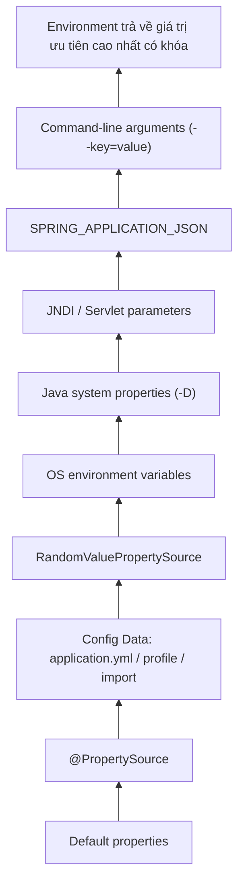
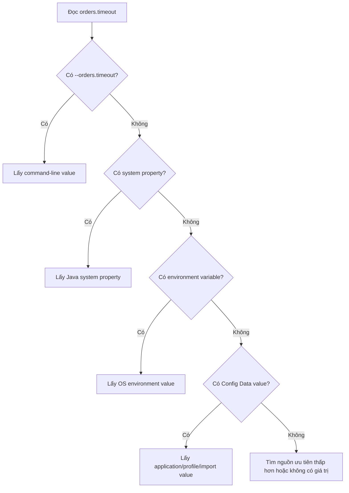

# Thứ tự ưu tiên giữa tệp, biến môi trường, system property và tham số dòng lệnh

## 1. Vì sao phải hiểu thứ tự ưu tiên cấu hình?

Một ứng dụng Spring Boot thường nhận cấu hình từ nhiều nơi: file `application.yml`, file cấu hình theo profile, biến môi trường của container, Java system properties, tham số dòng lệnh và đôi khi cả cấu hình tập trung từ Spring Cloud Config. Các nguồn này có thể cùng khai báo một khóa như `server.port` hoặc `spring.application.name` nhưng mang giá trị khác nhau.

Spring không chọn ngẫu nhiên một giá trị. `Environment` của Spring Framework chứa nhiều `PropertySource` theo một thứ tự ưu tiên. Khi nhiều nguồn cùng có một khóa, nguồn có độ ưu tiên cao hơn sẽ thắng khi ứng dụng đọc khóa đó. Hiểu quy tắc này giúp người phát triển giải thích tại sao cấu hình trong file không có hiệu lực, tại sao container chạy khác máy local và cách ghi đè cấu hình khi deploy.

Bài học thuộc chương **Nạp cấu hình** của module **SPRING_CLOUD_CORE**. Đây là nền tảng để hiểu externalized configuration, cấu hình tập trung, Spring Cloud Context và cách vận hành các dịch vụ phân tán. Sau bài học, người học có thể:

- Xếp hạng các nguồn cấu hình chính của Spring Boot.
- Phân biệt biến môi trường, Java system property và tham số dòng lệnh.
- Giải thích thứ tự ưu tiên bên trong Config Data: file đóng gói, file bên ngoài và file theo profile.
- Dự đoán giá trị cuối cùng khi cùng một property xuất hiện ở nhiều nguồn.
- Dùng `Environment`, `@ConfigurationProperties` và công cụ chẩn đoán để tìm nguồn đang thắng.
- Hiểu cấu hình remote từ Spring Cloud Config có thể tác động đến thứ tự ưu tiên ra sao.

## 2. Nguyên tắc cốt lõi: PropertySource có thứ tự

Spring Framework biểu diễn các nguồn thuộc tính bằng `PropertySource`. `Environment` tổng hợp những nguồn đó và giải quyết một property theo thứ tự: **tìm từ nguồn ưu tiên cao xuống thấp, trả về giá trị đầu tiên tìm thấy**.

Ví dụ, giả sử cùng một ứng dụng có:

```yaml
# application.yml
server:
  port: 8080
```

Biến môi trường của container:

```bash
SERVER_PORT=8081
```

Java system property:

```bash
-Dserver.port=8082
```

Tham số khi chạy ứng dụng:

```bash
--server.port=8083
```

Khi cả bốn giá trị cùng được cung cấp trong một lần chạy Spring Boot thông thường, cổng được chọn là **8083** vì command-line arguments có độ ưu tiên cao hơn system properties, environment variables và Config Data.

Không nên suy luận rằng file cấu hình “bị bỏ qua”. File vẫn được nạp; chỉ là có nguồn ưu tiên cao hơn cung cấp cùng khóa.

### 2.1. Thứ tự tổng quát trong Spring Boot

Với một ứng dụng chạy bình thường (không xét các nguồn đặc thù của test hoặc DevTools), có thể ghi nhớ thứ tự từ thấp đến cao như sau:

| Thứ tự | Nguồn | Ví dụ |
| ---: | --- | --- |
| 1 | Default properties của `SpringApplication` | `application.setDefaultProperties(...)` |
| 2 | `@PropertySource` trên các lớp cấu hình | File properties được khai báo bằng annotation |
| 3 | Config Data | `application.yml`, `application.properties`, file profile, file import |
| 4 | `RandomValuePropertySource` | `${random.uuid}`, `${random.int}` |
| 5 | Biến môi trường của hệ điều hành | `SERVER_PORT=8081` |
| 6 | Java system properties | `-Dserver.port=8082` |
| 7 | JNDI attributes | `java:comp/env` trong môi trường phù hợp |
| 8 | ServletContext init parameters | Tham số khởi tạo Servlet context |
| 9 | ServletConfig init parameters | Tham số khởi tạo Servlet |
| 10 | `SPRING_APPLICATION_JSON` | JSON từ environment variable hoặc system property |
| 11 | Command-line arguments | `--server.port=8083` |

Các nguồn ở các dòng 7–9 chỉ liên quan khi ứng dụng chạy trong môi trường Servlet phù hợp. Trong ứng dụng Boot thông thường, bốn nguồn thường được so sánh nhất là:

**File cấu hình < biến môi trường < Java system property < command-line argument.**

Thứ tự trên mô tả thứ tự ưu tiên của các nguồn trong Spring Boot; thứ tự khởi tạo hoặc thời điểm một file được đọc không phải lúc nào cũng là thứ tự ưu tiên. Các annotation dùng trong kiểm thử và cấu hình DevTools có quy tắc riêng, được đề cập ở phần sau.

### 2.2. Sơ đồ nguồn cấu hình



Sơ đồ tập trung vào các nguồn runtime phổ biến. Nếu cùng một khóa xuất hiện ở nhiều tầng, tầng cao hơn trong sơ đồ có quyền ghi đè tầng thấp hơn.

## 3. Phân biệt bốn nguồn cấu hình thường gặp

### 3.1. File cấu hình: Config Data

Spring Boot hỗ trợ `application.properties` và các định dạng YAML như `application.yml`. Đây là cách phổ biến để lưu cấu hình mặc định, cấu hình theo môi trường và các nhóm property có cấu trúc.

Ví dụ:

```yaml
spring:
  application:
    name: order-service

server:
  port: 8080

orders:
  timeout: 3s
  retry:
    max-attempts: 3
```

Ưu điểm:

- Có thể quản lý cùng source code hoặc đóng gói cùng artifact.
- Dễ tổ chức theo profile như `application-dev.yml` và `application-prod.yml`.
- Hỗ trợ cấu trúc lồng nhau, list, map và binding vào object.
- Phù hợp để mô tả giá trị mặc định có thể ghi đè khi triển khai.

File cấu hình thường có ưu tiên thấp hơn biến môi trường, system properties và command-line arguments. Vì thế, file nên chứa giá trị mặc định phù hợp; môi trường triển khai có thể cung cấp giá trị khác mà không cần build lại artifact.

### 3.2. Biến môi trường của hệ điều hành

Biến môi trường thường được đặt bởi shell, Docker, Kubernetes, hệ thống CI/CD hoặc nền tảng chạy ứng dụng. Spring Boot hỗ trợ relaxed binding để ánh xạ tên biến sang property.

Ví dụ ánh xạ phổ biến:

| Property | Environment variable |
| --- | --- |
| `spring.application.name` | `SPRING_APPLICATION_NAME` |
| `server.port` | `SERVER_PORT` |
| `orders.timeout` | `ORDERS_TIMEOUT` |
| `spring.cloud.service-registry.auto-registration.enabled` | `SPRING_CLOUD_SERVICE_REGISTRY_AUTO_REGISTRATION_ENABLED` |

Quy tắc khái quát khi chuyển tên canonical property sang biến môi trường:

1. Thay dấu chấm (`.`) bằng dấu gạch dưới (`_`).
2. Bỏ dấu gạch ngang (`-`).
3. Chuyển toàn bộ sang chữ hoa.

Ví dụ chạy trên Linux:

```bash
export SERVER_PORT=8085
export SPRING_APPLICATION_NAME=order-service
java -jar order-service.jar
```

Trong Docker Compose có thể khai báo:

```yaml
services:
  order-service:
    image: example/order-service:1.0
    environment:
      SERVER_PORT: "8085"
      SPRING_APPLICATION_NAME: "order-service"
```

Trong Kubernetes, giá trị có thể được đưa vào container thông qua `env`, `ConfigMap` hoặc `Secret`. Dù được cung cấp bởi ConfigMap/Secret, khi process nhận nó dưới dạng environment variable thì Spring Boot vẫn xử lý nó như một nguồn biến môi trường.

Lưu ý: tên biến môi trường có thể khó biểu diễn một số cấu trúc phức tạp như map key có ký tự đặc biệt hoặc list index. Với property phức tạp, file YAML/JSON hoặc `SPRING_APPLICATION_JSON` có thể dễ đọc và ít nhầm hơn.

### 3.3. Java system properties

Java system properties thuộc JVM, thường được truyền bằng tham số `-Dname=value` trước tên JAR hoặc main class:

```bash
java -Dserver.port=8086 -Dspring.application.name=order-service -jar order-service.jar
```

Chương trình Java cũng có thể đọc chúng qua `System.getProperty(...)`, còn Spring có thể truy cập chúng qua `Environment`.

System property có ưu tiên cao hơn biến môi trường. Điều này hữu ích khi cần truyền cấu hình JVM hoặc cấu hình ứng dụng trong lệnh khởi chạy. Tuy nhiên, không nên dùng `-D` để nhầm lẫn với tham số ứng dụng có tiền tố `--`.

**Phân biệt:**

- `-Dserver.port=8086` là system property do JVM nhận.
- `--server.port=8087` là command-line property do Spring Boot nhận.

Hai cách có cú pháp gần giống nhưng đi vào hai nguồn cấu hình khác nhau và có thứ tự ưu tiên khác nhau.

### 3.4. Command-line arguments

Spring Boot có thể chuyển tham số dạng `--key=value` thành property. Ví dụ:

```bash
java -jar order-service.jar --server.port=8087 --orders.timeout=5s
```

Command-line arguments có ưu tiên cao hơn các nguồn thông thường ở trên, vì vậy thường được dùng để ghi đè một số cấu hình trong lần chạy cụ thể, ví dụ khi chạy thử hoặc khởi động container với tham số được nền tảng cung cấp.

Có thể tắt việc chuyển command-line arguments thành property bằng `SpringApplication.setAddCommandLineProperties(false)` nếu ứng dụng có yêu cầu đặc biệt về cách xử lý đối số. Khi tắt, cần bảo đảm các thành phần khác không trông đợi property được tạo từ tham số `--`.

Không nên đưa mật khẩu, token hoặc bí mật vào command line nếu môi trường có thể lưu lệnh trong process list, log triển khai hoặc lịch sử shell. Hãy dùng cơ chế secret phù hợp.

## 4. Ví dụ tính giá trị cuối cùng

Giả sử ứng dụng có property `orders.timeout` với các giá trị sau:

| Nguồn | Giá trị |
| --- | --- |
| `application.yml` | `2s` |
| Environment variable `ORDERS_TIMEOUT` | `3s` |
| System property `-Dorders.timeout=4s` | `4s` |
| Command line `--orders.timeout=5s` | `5s` |

Kết quả khi chạy đồng thời cả bốn nguồn là `5s`.

Nếu bỏ command-line argument, giá trị thắng là `4s`. Nếu bỏ cả command-line và system property, giá trị thắng là `3s`. Nếu chỉ còn file, giá trị là `2s`.



Cây quyết định chỉ mô tả bốn nguồn chính. Trong thực tế, giữa chúng có thêm các nguồn khác như JSON và RandomValuePropertySource.

### 4.1. Ví dụ chạy với nhiều nguồn

Trên Linux/macOS:

```bash
export SERVER_PORT=8081

java -Dserver.port=8082 \
  -jar order-service.jar \
  --server.port=8083
```

Nếu `application.yml` khai báo `server.port: 8080`, kết quả là:

```text
server.port = 8083
```

Lý do: command line thắng system property; system property thắng environment variable; environment variable thắng Config Data.

Trong PowerShell, cú pháp đặt biến môi trường khác:

```powershell
$env:SERVER_PORT = "8081"
java -Dserver.port=8082 -jar order-service.jar --server.port=8083
```

Không nên kiểm tra thứ tự ưu tiên bằng cách chỉ đọc file YAML. Cần kiểm tra toàn bộ cách process thực sự được khởi chạy, bao gồm biến môi trường và tham số JVM/application.

## 5. Thứ tự ưu tiên bên trong Config Data

Nhóm Config Data có nhiều lớp. Một file ngoài JAR thường có thể ghi đè file được đóng gói trong JAR; file profile-specific lại thường ghi đè file chung trong cùng nhóm location.

Ví dụ artifact có file:

```text
src/main/resources/application.yml
src/main/resources/application-prod.yml
```

Máy chủ triển khai có thêm:

```text
./application.yml
./application-prod.yml
```

Với cấu hình mặc định của Spring Boot, thứ tự khái quát từ thấp đến cao trong các nhóm file này là:

1. File chung được đóng gói trong JAR.
2. File theo profile được đóng gói trong JAR.
3. File chung bên ngoài JAR.
4. File theo profile bên ngoài JAR.

Vì vậy, khi profile `prod` đang hoạt động, `./application-prod.yml` có thể ghi đè cùng property trong `application-prod.yml` được đóng gói trong JAR.

Ví dụ:

```yaml
# Trong JAR: application.yml
server:
  port: 8080
orders:
  timeout: 2s
```

```yaml
# Bên ngoài JAR: application-prod.yml
server:
  port: 9080
orders:
  timeout: 4s
```

Khi profile `prod` hoạt động và file ngoài được tìm thấy, các giá trị tương ứng có thể là `server.port=9080` và `orders.timeout=4s`, trừ khi có nguồn ưu tiên cao hơn như environment variable hoặc command line ghi đè tiếp.

### 5.1. Profile-specific configuration

Profile cho phép dùng các cấu hình khác nhau theo môi trường:

```yaml
# application.yml
spring:
  application:
    name: order-service

orders:
  timeout: 2s
```

```yaml
# application-dev.yml
orders:
  timeout: 10s
```

```yaml
# application-prod.yml
orders:
  timeout: 3s
```

Kích hoạt profile bằng environment variable:

```bash
SPRING_PROFILES_ACTIVE=prod java -jar order-service.jar
```

Hoặc command line:

```bash
java -jar order-service.jar --spring.profiles.active=prod
```

Khi nhiều profile cùng được kích hoạt, thứ tự profile và cách chúng được nhóm/bao gồm có ảnh hưởng đến kết quả. Với các profile được khai báo cùng cấp, profile được xét sau có thể ghi đè giá trị của profile trước nếu cùng khóa. Hãy giữ danh sách profile có chủ đích và kiểm tra cấu hình đã nạp thực tế.

### 5.2. File import và vị trí cấu hình

Spring Boot hỗ trợ nạp thêm cấu hình qua `spring.config.import`. Import giúp một file hoặc một nguồn cấu hình khác tham gia vào Config Data processing:

```yaml
spring:
  config:
    import: optional:file:./config/observability.yml
```

Tài liệu được import được chèn vào thứ tự Config Data theo quy tắc import; giá trị trong imported document có thể ghi đè document khai báo import theo cách sắp xếp nguồn của Boot. Khi có nhiều import, thứ tự khai báo và vị trí import cần được xem xét, không nên chỉ nhìn một file gốc.

Hai thuộc tính thường bị nhầm:

- `spring.config.location` thay thế các vị trí tìm kiếm mặc định của Config Data.
- `spring.config.additional-location` bổ sung vị trí tìm kiếm bên cạnh các vị trí mặc định, và các vị trí bổ sung có thể dùng để ghi đè giá trị đã tìm thấy trước đó.

Ví dụ:

```bash
java -jar order-service.jar \
  --spring.config.additional-location=optional:file:./deploy/
```

Các thuộc tính điều khiển việc tìm file như `spring.config.name`, `spring.config.location` và `spring.config.additional-location` cần có sẵn rất sớm trong quá trình khởi động. Đặt chúng bên trong chính file mà chúng đang giúp Boot tìm kiếm có thể quá muộn; hãy truyền qua environment variable, system property hoặc command line.

Nếu trong cùng một vị trí có cả `application.properties` và `application.yml`, file properties được ưu tiên hơn file YAML theo quy tắc Config Data của Boot. Để dễ vận hành, nên thống nhất một định dạng cho cùng một location thay vì khai báo trùng khóa trong hai định dạng.

## 6. Các nguồn bổ sung cần nhận diện

### 6.1. SPRING_APPLICATION_JSON

`SPRING_APPLICATION_JSON` cho phép truyền một cấu trúc JSON vào environment dưới dạng một property source:

```bash
SPRING_APPLICATION_JSON='{"server":{"port":8090},"orders":{"timeout":"6s"}}' \
java -jar order-service.jar
```

Hoặc qua system property:

```bash
java -Dspring.application.json='{"server":{"port":8090}}' -jar order-service.jar
```

Nguồn JSON có ưu tiên cao hơn system properties và environment variables nhưng thấp hơn command-line arguments trong thứ tự thông thường của Boot. JSON hữu ích khi cần truyền cấu trúc lồng nhau mà biến môi trường khó biểu diễn.

Một lưu ý đặc biệt: giá trị JSON `null` được xem như giá trị không có trong quá trình phân giải property của Spring. Do đó, không thể dùng `null` trong JSON để xóa/ghi đè một giá trị thấp hơn theo cách thông thường.

### 6.2. RandomValuePropertySource

Spring Boot cung cấp các placeholder như `${random.value}`, `${random.int}`, `${random.long}`, `${random.uuid}` và các dạng giới hạn. Nguồn này nằm sau Config Data nhưng trước environment variables trong thứ tự thông thường.

Ví dụ:

```yaml
app:
  instance-token: ${random.uuid}
```

Không dùng giá trị random như một cơ chế quản lý secret lâu dài hoặc một định danh ổn định giữa các lần restart. Giá trị được tạo theo cơ chế random của Boot, không phải kho bí mật có vòng đời và chính sách truy cập.

### 6.3. @PropertySource

Spring Framework cho phép khai báo file property trên lớp cấu hình:

```java
@Configuration
@PropertySource("classpath:custom.properties")
class CustomPropertiesConfiguration {
}
```

Nguồn này có vị trí ưu tiên thấp hơn Config Data trong thứ tự Boot. Ngoài ra, `@PropertySource` được thêm trong giai đoạn refresh application context; vì vậy không phù hợp để cung cấp các thuộc tính cần thiết rất sớm trong quá trình khởi động, chẳng hạn một số cấu hình `logging.*` hoặc `spring.main.*`.

Nếu mục tiêu là cấu hình ứng dụng chính, nên ưu tiên Config Data. `@PropertySource` phù hợp hơn với các trường hợp tích hợp có phạm vi rõ ràng.

### 6.4. Cấu hình trong kiểm thử

Trong test, các nguồn bổ sung có thể ghi đè cấu hình ứng dụng:

- Thuộc tính trong annotation như `@SpringBootTest(properties = ...)`.
- `@DynamicPropertySource` cho giá trị động từ test infrastructure.
- `@TestPropertySource`.
- Các cơ chế test-specific khác của Spring Test.

Những nguồn này có thể có độ ưu tiên cao hơn cấu hình runtime thông thường. Điều đó hữu ích để test cô lập, nhưng cũng có thể khiến test pass trong khi cấu hình production sai. Khi debug, cần phân biệt property đang thắng trong test context với property sẽ thắng trong tiến trình production.

## 7. Cách Spring Cloud Config tham gia vào thứ tự ưu tiên

Spring Boot externalized configuration giải quyết việc nạp cấu hình từ file, environment, system property và command line. Khi nhiều dịch vụ cần dùng chung cấu hình tập trung, Spring Cloud Config có thể bổ sung Config Server và Config Client.

Trong cách tích hợp Config Data hiện đại, client có thể khai báo:

```yaml
spring:
  application:
    name: order-service
  config:
    import: optional:configserver:http://config-server:8888
```

Config Client truy vấn Config Server theo application name, profile và label tương ứng để nhận property sources. Các property sources remote được đưa vào `Environment` của client. **Không nên mặc định rằng cấu hình local luôn thắng remote hoặc remote luôn thắng mọi nguồn runtime**: khả năng ghi đè còn phụ thuộc cơ chế tích hợp, cách property sources được đặt và chính sách override mà Config Server cho phép.

Một số điểm quan trọng:

- Remote property sources thường có quyền ưu tiên cao theo cấu hình mặc định của Spring Cloud Config.
- Quyền cho phép ứng dụng ghi đè cấu hình remote được điều khiển bởi thiết lập phía Config Server/nguồn cấu hình, tiêu biểu là `spring.cloud.config.allowOverride`; chỉ đặt thuộc tính này ở local client không nhất thiết cấp quyền override.
- Các tùy chọn `spring.cloud.config.overrideNone` và `spring.cloud.config.overrideSystemProperties` có thể điều chỉnh cách remote property sources được sắp xếp khi override được cho phép.
- Cú pháp `optional:configserver:...` cho phép ứng dụng tiếp tục trong trường hợp nguồn Config Server không khả dụng theo semantics của Config Data import; nếu cấu hình remote là bắt buộc cho nghiệp vụ, cần cân nhắc bỏ `optional:` để khởi động thất bại rõ ràng.
- `spring.config.import` là cơ chế Config Data hiện đại; các dự án cũ có thể sử dụng bootstrap context. Không nên trộn hai cơ chế nếu chưa hiểu rõ thứ tự và hành vi của phiên bản đang dùng.

Khi một giá trị từ Config Server không như mong đợi, hãy kiểm tra property source thực tế trong `Environment`, response từ server, application/profile/label, chính sách override và các nguồn runtime có ưu tiên cao hơn. Đừng chỉ sửa file local rồi suy luận rằng remote config sẽ tự thay đổi theo.

### 7.1. Ví dụ tình huống nhiều dịch vụ

Giả sử `order-service` và `payment-service` cùng đọc `payments.timeout` từ Config Server. Config Server cung cấp mặc định `3s`. Môi trường production đặt `PAYMENTS_TIMEOUT=5s`. Một lần chạy đặc biệt truyền `--payments.timeout=8s`.

Nếu các thiết lập override remote cho phép những nguồn local này ghi đè remote, giá trị mà lần chạy có command-line argument nhận được sẽ là `8s`. Nếu chính sách remote không cho phép override, property source remote có thể thắng các nguồn local theo cấu hình của tích hợp. Vì vậy, thứ tự local thông thường chưa đủ để kết luận khi có remote property source.

## 8. Đọc và kiểm tra giá trị cuối cùng trong ứng dụng

### 8.1. Dùng Environment

`Environment` là API trực tiếp để kiểm tra property đã được phân giải:

```java
@Component
class ConfigurationInspector {
    private static final org.slf4j.Logger log =
            org.slf4j.LoggerFactory.getLogger(ConfigurationInspector.class);
    private final Environment environment;

    ConfigurationInspector(Environment environment) {
        this.environment = environment;
    }

    void logEffectivePort() {
        String port = environment.getProperty("server.port");
        // Chỉ log giá trị không nhạy cảm trong môi trường phù hợp.
        log.info("Effective server.port={}", port);
    }
}
```

`Environment.getProperty("server.port")` trả về giá trị thắng theo thứ tự property source. API này hữu ích khi chẩn đoán, nhưng bản thân giá trị cuối cùng không cho biết nguồn nào đã cung cấp nó.

### 8.2. Bind cấu hình có cấu trúc bằng @ConfigurationProperties

Thay vì rải nhiều `@Value`, có thể bind một nhóm property vào class:

```java
@ConfigurationProperties(prefix = "orders")
public record OrderProperties(
        Duration timeout,
        Retry retry
) {
    public record Retry(int maxAttempts) {}
}
```

Đăng ký cấu hình:

```java
@Configuration
@EnableConfigurationProperties(OrderProperties.class)
class OrderConfiguration {
}
```

Các giá trị có thể đến từ file YAML, environment variables, system properties hoặc command line. Boot thực hiện relaxed binding và chuyển đổi kiểu phù hợp, ví dụ chuỗi `3s` thành `Duration`. Với cấu hình nghiệp vụ quan trọng, nên thêm validation bằng annotation phù hợp để phát hiện giá trị thiếu hoặc ngoài giới hạn khi startup.

### 8.3. Chẩn đoán property source

Khi cần biết property đến từ đâu:

- Kiểm tra command khởi chạy, biến môi trường thực tế và JVM options của process.
- Kiểm tra profile đang active, file Config Data được tìm thấy và các import.
- Dùng Actuator `env` và `configprops` khi đã bật endpoint phù hợp và bảo vệ quyền truy cập.
- Trong test, kiểm tra các annotation/property source bổ sung.
- Với Spring Cloud Config, kiểm tra application/profile/label và chính sách override của server.

Không nên expose endpoint `env` hoặc `configprops` công khai không kiểm soát vì chúng có thể tiết lộ thông tin cấu hình nhạy cảm. Cần dùng cơ chế security, sanitization và giới hạn endpoint theo chính sách vận hành.

## 9. Một quy trình debug có hệ thống

Khi một property không nhận giá trị mong đợi, thực hiện lần lượt:

1. **Xác định canonical property name.** Ví dụ `server.port`, không nhầm với tên biến môi trường `SERVER_PORT`.
2. **Liệt kê mọi nguồn có thể khai báo khóa đó.** Tìm trong application files, profile, imports, env, JVM options, command line và remote Config Server.
3. **Xác định nguồn nào thực sự được nạp.** File ngoài có được mount đúng đường dẫn? Profile có active? Config Server có trả property source?
4. **Áp thứ tự ưu tiên.** Xem nguồn nào có giá trị và nguồn đó có quyền ghi đè hay không.
5. **Kiểm tra binding và kiểu dữ liệu.** Property có đúng tên, đúng cấu trúc, đúng đơn vị và convert được không?
6. **Kiểm tra thời điểm đọc.** Một số thuộc tính quyết định startup phải có trước khi context được tạo; đổi giá trị sau đó không làm mọi thành phần tự cấu hình lại.
7. **Kiểm tra giá trị trong runtime.** Đọc qua `Environment` hoặc Actuator được bảo vệ, rồi đối chiếu với nguồn thực tế.
8. **Sửa đúng nguồn quản lý.** Nếu giá trị do Helm, Compose, CI/CD hoặc Config Server cung cấp, hãy cập nhật ở nơi có quyền sở hữu cấu hình đó để tránh lần deploy sau ghi đè lại.

Ví dụ: `application.yml` ghi `server.port: 8080` nhưng ứng dụng mở cổng 8085. Hãy kiểm tra `SERVER_PORT`, `-Dserver.port`, `--server.port` và nguồn JSON trước khi sửa file YAML. Nếu chạy trong Kubernetes, kiểm tra manifest hoặc cấu hình triển khai đã đưa biến môi trường/argument nào vào container.

## 10. Những lỗi và ngộ nhận thường gặp

| Ngộ nhận / triệu chứng | Giải thích | Cách xử lý |
| --- | --- | --- |
| “File YAML luôn là cấu hình chính.” | Config Data có thể bị env, system property, JSON hoặc CLI ghi đè. | Kiểm tra mọi property source theo thứ tự ưu tiên. |
| “Environment variable thắng mọi nguồn khác.” | System properties và CLI có ưu tiên cao hơn trong thứ tự thông thường. | Phân biệt `SERVER_PORT`, `-Dserver.port` và `--server.port`. |
| “`-Dserver.port` và `--server.port` giống nhau.” | Một bên là JVM system property, bên kia là Boot command-line property. | Kiểm tra cách truyền tham số của runtime/container. |
| “Đặt property trong file profile là đủ.” | Environment/CLI vẫn có thể ghi đè; profile còn phải active. | Kiểm tra profile và nguồn có độ ưu tiên cao hơn. |
| “`@PropertySource` dùng được cho mọi thuộc tính startup.” | Annotation được xử lý trong giai đoạn context refresh, có thể quá muộn cho thuộc tính rất sớm. | Dùng Config Data hoặc nguồn có sẵn trước startup. |
| “`null` trong SPRING_APPLICATION_JSON xóa giá trị thấp hơn.” | JSON null được xem như không có giá trị trong phân giải property. | Dùng thiết kế cấu hình rõ ràng thay vì dựa vào null để xóa. |
| “Config Server luôn bị local override.” | Remote source có chính sách ưu tiên và override riêng. | Kiểm tra cấu hình override phía server và property source thực tế. |
| “Test pass nghĩa là production nhận cùng cấu hình.” | Test annotations và dynamic properties có thể ghi đè nguồn runtime. | Kiểm tra cấu hình trong môi trường chạy thực. |
| “Sửa file cấu hình khi app đang chạy thì mọi bean tự cập nhật.” | Giá trị mới không tự động refresh mọi singleton hoặc thuộc tính startup. | Xác định cơ chế reload/refresh, scope và giới hạn của bean. |

## 11. Nguyên tắc quản lý cấu hình trong hệ thống phân tán

- **Một nguồn sở hữu cho mỗi nhóm cấu hình:** xác định giá trị mặc định ở file, giá trị theo môi trường ở deployment config và giá trị tập trung ở Config Server nếu có.
- **Giữ thứ tự override có chủ ý:** tránh khai báo cùng khóa ở quá nhiều tầng khiến người vận hành khó dự đoán.
- **Không đóng gói bí mật vào artifact:** dùng Secret manager, environment/secret injection hoặc cơ chế phù hợp; hạn chế ghi bí mật ra command line và log.
- **Phân biệt cấu hình startup với cấu hình runtime:** port, web application type và nhiều thiết lập khởi tạo cần được xác định trước khi context hoàn tất; refresh không thay thế restart cho mọi loại property.
- **Quản lý tương thích:** Spring Boot và Spring Cloud có ma trận tương thích theo release train. Khi thay version, kiểm tra lại Config Data, bootstrap behavior, starter và chính sách override.
- **Kiểm tra cấu hình như một phần của vận hành:** xác minh giá trị hiệu lực, nguồn cung cấp và profile trong mỗi môi trường triển khai.
- **Bảo vệ thông tin cấu hình:** các endpoint chẩn đoán có thể tiết lộ cấu hình; chỉ expose qua cơ chế được bảo vệ.

## 12. Tài liệu tham khảo

- [Spring Boot — Externalized Configuration](https://docs.spring.io/spring-boot/reference/features/external-config.html): thứ tự ưu tiên PropertySource, Config Data, profile, environment variables, system properties và command line.
- [Spring Framework — Environment Abstraction](https://docs.spring.io/spring-framework/reference/core/beans/environment.html): `Environment`, `PropertySource` và cơ chế phân giải thuộc tính.
- [Spring Boot — Type-safe Configuration Properties](https://docs.spring.io/spring-boot/reference/features/external-config.html#features.external-config.typesafe-configuration-properties): binding và chuyển đổi kiểu cho cấu hình có cấu trúc.
- [Spring Cloud Config](https://docs.spring.io/spring-cloud-config/reference/): Config Server/Client, Config Data import và chính sách override remote property sources.
- [Spring Cloud — Project and Release Trains](https://spring.io/projects/spring-cloud): kiểm tra tương thích Spring Cloud với Spring Boot.

**Ghi nhớ:** Trong cấu hình Spring Boot thông thường, file Config Data thường là nền tảng; biến môi trường có thể ghi đè file, Java system properties ghi đè environment, và command-line arguments có ưu tiên cao hơn các nguồn đó. Khi có profile, import hoặc Spring Cloud Config, hãy xét thêm thứ tự bên trong Config Data và chính sách remote override để xác định chính xác giá trị cuối cùng.
