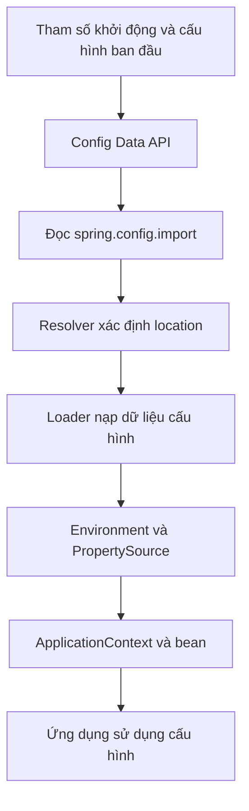
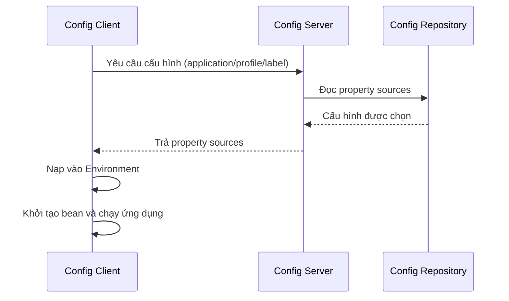

# Nhập cấu hình bằng `spring.config.import`

Một ứng dụng Spring Cloud thường cần kết hợp cấu hình đi kèm artifact với cấu hình theo môi trường hoặc được quản lý tập trung. Spring Boot cung cấp **Config Data API** để xác định và nạp các nguồn cấu hình ngay trong giai đoạn chuẩn bị `Environment`. Thuộc tính `spring.config.import` là điểm khai báo quan trọng của cơ chế này: ứng dụng có thể nhập thêm tệp cục bộ, cấu hình dạng cây thư mục hoặc dữ liệu từ Spring Cloud Config Server.

Hiểu đúng `spring.config.import` giúp người học xác định cấu hình nào có mặt trước khi bean được tạo, điều gì xảy ra khi nguồn cấu hình không truy cập được, và cách profile cùng thứ tự import tác động đến giá trị cuối cùng. Đây là kiến thức nền cho module **`SPRING_CLOUD_CORE`**: tìm hiểu Spring Cloud Context, cấu hình bên ngoài, tương thích Spring Boot, refresh scope, discovery, service registry và giao tiếp dịch vụ.

## 1. `spring.config.import` giải quyết vấn đề gì?

Trước khi có Config Data API, ứng dụng có thể nạp thêm tệp bằng các cơ chế cấu hình khác nhau hoặc dùng bootstrap context trong một số tích hợp Spring Cloud. Spring Boot 2.4 giới thiệu Config Data API để chuẩn hóa quá trình khám phá và nạp dữ liệu cấu hình. Các phiên bản Spring Cloud Config Client hiện đại tích hợp với cơ chế này bằng location có tiền tố `configserver:`.

Thay vì tự viết code đọc tệp hoặc gọi HTTP trong `@PostConstruct`, ứng dụng khai báo nguồn cấu hình ngay từ đầu:

```properties
spring.config.import=optional:file:./config/extra.properties
```

Khi khởi động, Spring Boot xử lý location được khai báo, nạp dữ liệu phù hợp và đưa các property source vào `Environment`. Bean được tạo sau đó có thể tiêu thụ các giá trị đã phân giải thông qua `@Value`, `@ConfigurationProperties` hoặc `Environment`.



Sơ đồ mô tả luồng khái quát. Mỗi loại location có resolver/loader tương ứng; ví dụ `file:` được Spring Boot hỗ trợ sẵn, còn `configserver:` được cung cấp bởi Spring Cloud Config Client. Các custom config data location có thể bổ sung cơ chế riêng.

**Điểm quan trọng:** `spring.config.import` tham gia quá trình nạp cấu hình lúc khởi động. Nó không tự theo dõi tệp hoặc server để cập nhật liên tục mọi bean trong ứng dụng đang chạy. Làm mới cấu hình sau startup là một chủ đề khác, liên quan Spring Cloud Context và cơ chế refresh phù hợp.

## 2. Cú pháp và nguyên tắc chung

Thuộc tính có thể được khai báo trong `application.properties`:

```properties
spring.config.import=optional:file:./config/extra.properties
```

Hoặc trong `application.yml`:

```yaml
spring:
  config:
    import: "optional:file:./config/extra.yml"
```

Một location có thể gồm:

- **Prefix loại nguồn:** `file:`, `classpath:`, `configtree:` hoặc prefix do integration cung cấp như `configserver:`.
- **Địa chỉ/vị trí:** đường dẫn tệp, thư mục, URL hoặc định danh mà resolver tương ứng hiểu được.
- **Tiền tố `optional:` (nếu cần):** cho phép ứng dụng tiếp tục khi location tùy chọn không có sẵn theo quy tắc của loader.

Ví dụ nhiều location có thể khai báo thành danh sách phân tách bằng dấu phẩy:

```properties
spring.config.import=optional:file:./config/local.properties,optional:configserver:
```

Thứ tự import trong cùng một khai báo có ý nghĩa đối với độ ưu tiên. Các import được xử lý theo thứ tự khai báo; khi có key trùng nhau, import đứng sau có thể ghi đè import đứng trước. Ngoài ra, dữ liệu được import có độ ưu tiên cao hơn tài liệu cấu hình khai báo import đó. Cần xem xét cả profile và các property source khác khi xác định giá trị cuối cùng.

`spring.config.import` có thể được cung cấp từ nguồn cấu hình ban đầu như tệp `application.yml`, biến môi trường `SPRING_CONFIG_IMPORT` hoặc tham số dòng lệnh. Vì Boot cần biết location để nạp dữ liệu, không thể chỉ trông chờ vào một giá trị `spring.config.import` nằm trong chính nguồn từ xa mà ứng dụng chưa biết cách truy cập.

## 3. Nhập tệp cấu hình cục bộ

### 3.1. Dùng `file:` để nhập tệp ngoài artifact

Giả sử cấu trúc triển khai:

```text
catalog-service/
  catalog-service.jar
  config/
    catalog-extra.yml
```

Tệp `application.yml` đi cùng ứng dụng:

```yaml
spring:
  application:
    name: catalog-service
  config:
    import: "optional:file:./config/catalog-extra.yml"
```

Nội dung `catalog-extra.yml`:

```yaml
catalog:
  search:
    page-size: 40
    include-discontinued: false
```

Sau khi location được nạp, bean có thể nhận các giá trị đó:

```java
import org.springframework.boot.context.properties.ConfigurationProperties;

@ConfigurationProperties(prefix = "catalog.search")
public class CatalogSearchProperties {
    private int pageSize = 20;
    private boolean includeDiscontinued;

    public int getPageSize() {
        return pageSize;
    }

    public void setPageSize(int pageSize) {
        this.pageSize = pageSize;
    }

    public boolean isIncludeDiscontinued() {
        return includeDiscontinued;
    }

    public void setIncludeDiscontinued(boolean includeDiscontinued) {
        this.includeDiscontinued = includeDiscontinued;
    }
}
```

Lớp properties vẫn cần được đăng ký qua `@ConfigurationPropertiesScan` hoặc `@EnableConfigurationProperties`. Việc import thành công chỉ làm các key có mặt trong `Environment`; nó không tự đăng ký mọi lớp Java tiêu thụ chúng.

Đường dẫn `./config/catalog-extra.yml` là đường dẫn tương đối với working directory của tiến trình. Trong container hoặc service manager, working directory có thể khác máy phát triển. Với đường dẫn ổn định, có thể dùng đường dẫn tuyệt đối phù hợp môi trường, hoặc mount thư mục cấu hình vào một vị trí đã thống nhất.

### 3.2. Dùng `classpath:` khi cấu hình nằm trong artifact

Nếu tệp được đóng gói trong classpath, có thể nhập bằng `classpath:`:

```properties
spring.config.import=classpath:defaults/catalog-defaults.yml
```

Đây là lựa chọn cho cấu hình mặc định được phát hành cùng ứng dụng. Nếu nội dung cần thay đổi độc lập theo từng môi trường mà không build lại artifact, nên cân nhắc nguồn ngoài như `file:` hoặc Config Server.

### 3.3. Dùng `optional:` có chủ đích

Nếu tệp ngoài chỉ phục vụ cấu hình bổ sung, có thể dùng `optional:` để ứng dụng vẫn khởi động khi tệp chưa tồn tại:

```properties
spring.config.import=optional:file:./config/developer-overrides.properties
```

Nếu tệp là nguồn bắt buộc, bỏ `optional:`:

```properties
spring.config.import=file:/etc/catalog/required-settings.yml
```

Khi đó, lỗi không tìm thấy hoặc không đọc được nguồn theo điều kiện của loader sẽ làm quá trình nạp cấu hình thất bại. Cách này phù hợp khi chạy thiếu cấu hình đồng nghĩa ứng dụng không thể phục vụ an toàn.

Không nên gắn `optional:` cho mọi nguồn theo thói quen. Nếu ứng dụng cần URL dịch vụ, thông tin kết nối hoặc ngưỡng bảo vệ quan trọng, việc âm thầm bỏ qua nguồn cấu hình có thể khiến bean nhận default sai và tạo lỗi muộn hơn. Hãy phân loại location thành bắt buộc và tùy chọn dựa trên yêu cầu nghiệp vụ.

## 4. Nhập cấu hình từ Spring Cloud Config Server

Spring Cloud Config Server cung cấp cấu hình bên ngoài cho nhiều ứng dụng. Config Client truy vấn cấu hình theo tên ứng dụng, profile và label; dữ liệu thường được quản lý trong Git hoặc một backend được hỗ trợ. Với Config Data API, location có prefix `configserver:` là điểm tích hợp để client lấy dữ liệu từ server trong quá trình khởi động.

### 4.1. Khai báo dependency Config Client

Ứng dụng cần có Spring Cloud Config Client trên classpath. Với Maven, dependency thường được khai báo qua starter và được quản lý version bởi Spring Cloud BOM:

```xml
<dependency>
    <groupId>org.springframework.cloud</groupId>
    <artifactId>spring-cloud-starter-config</artifactId>
</dependency>
```

Với Gradle:

```groovy
dependencies {
    implementation "org.springframework.cloud:spring-cloud-starter-config"
}
```

Không tự thêm version cho starter nếu dự án đang dùng BOM Spring Cloud đúng cách. Cần đối chiếu release train với phiên bản Spring Boot trước khi chọn bộ dependency.

### 4.2. Khai báo Config Server location

Một cấu hình thường gặp trong `application.yml`:

```yaml
spring:
  application:
    name: catalog-service
  config:
    import: "optional:configserver:"

  cloud:
    config:
      uri: http://localhost:8888
      label: main
```

Ở đây:

- `spring.application.name` là tên ứng dụng client gửi lên Config Server, thường dùng để chọn bộ cấu hình tương ứng.
- `spring.config.import` khai báo rằng Config Data cần lấy thêm dữ liệu từ Config Server.
- `optional:` cho phép ứng dụng tiếp tục nếu Config Server không sẵn sàng theo semantics của Config Client; nếu kết nối được, dữ liệu từ server vẫn được nhập.
- `spring.cloud.config.uri` chỉ địa chỉ server khi location `configserver:` không chứa URL trực tiếp. Giá trị mặc định thường là `http://localhost:8888` nếu không cấu hình khác.
- `spring.cloud.config.label` chọn nhãn/nhánh/tag cấu hình phía server theo cách backend hỗ trợ; `main` trong ví dụ là giá trị minh họa.

Nếu Config Server là dependency bắt buộc để ứng dụng khởi động đúng, hãy bỏ `optional:`:

```yaml
spring:
  config:
    import: "configserver:http://config.internal:8888"
```

Trong ví dụ này, URL được chỉ định ngay trên location. Cách dùng `spring.cloud.config.uri` và cách gắn URL trực tiếp đều có thể dùng; chọn một cách nhất quán để dễ quan sát cấu hình hiệu lực.

**Lưu ý:** Khi dùng Config Data import, không cần bật bootstrap context legacy chỉ để lấy cấu hình Config Server theo cơ chế hiện đại. Một dự án cũ có thể vẫn dùng `bootstrap.yml` cùng `spring-cloud-starter-bootstrap`; khi di chuyển, cần xác định rõ cơ chế nào đang hoạt động và tránh cấu hình chồng chéo khiến khó truy nguyên nguồn giá trị.

### 4.3. Config Server chọn cấu hình nào?

Config Client thường gửi tên ứng dụng, các profile đang hoạt động và label. Ví dụ:

```text
application = catalog-service
profiles   = prod
label      = main
```

Config Server dùng thông tin này để tìm tập property source phù hợp. Tên ứng dụng thường lấy từ `spring.application.name`; profile gắn với các profile đang hoạt động của client; label xác định nhánh/phiên bản cấu hình ở backend, tùy cấu hình server.

Vì vậy, khi nhận được cấu hình sai, cần kiểm tra đồng thời:

1. Client có đúng `spring.application.name` không?
2. Profile nào thực sự active lúc startup?
3. Label có đúng nhánh/tag cấu hình mong muốn không?
4. Config Server có đang đọc đúng repository/backend và đúng revision không?
5. Có nhiều import hoặc property source khác ghi đè giá trị nhận được không?

Không nên suy ra cấu hình được chọn chỉ từ tên file trong Git. Hãy kiểm tra response của Config Server trong môi trường được phép, log client và các property source cuối cùng.

### 4.4. Cấu hình kết nối phải có sẵn đủ sớm

Để truy cập Config Server, client cần biết endpoint và thông tin định danh cần thiết trước khi tải cấu hình từ xa. Những giá trị bootstrap như URL, thông tin xác thực, TLS và service discovery để tìm Config Server phải được cung cấp từ nguồn mà client truy cập được trong giai đoạn Config Data.

Ví dụ, nếu Config Server yêu cầu xác thực, thông tin đăng nhập có thể được cung cấp qua cơ chế secret/environment được quản lý an toàn và các thuộc tính Config Client tương ứng. Tránh nhúng password/token vào URL, tệp cấu hình được commit hoặc log startup.

## 5. `optional:` và chính sách khi nguồn cấu hình không sẵn sàng

Quyết định nguồn cấu hình là bắt buộc hay tùy chọn tác động trực tiếp đến độ tin cậy của startup.

| Khai báo | Ý nghĩa vận hành | Trường hợp phù hợp |
| --- | --- | --- |
| `configserver:` | Import bắt buộc; lỗi truy cập/nạp cấu hình có thể làm startup thất bại | Ứng dụng không thể chạy đúng nếu thiếu cấu hình tập trung |
| `optional:configserver:` | Config Server không sẵn sàng có thể được bỏ qua để tiếp tục startup | Ứng dụng có default an toàn hoặc chế độ degraded được thiết kế rõ |
| `file:/etc/app/required.yml` | Tệp bắt buộc | Tệp chứa cấu hình không thể thiếu |
| `optional:file:./local-overrides.yml` | Tệp có thể vắng mặt | Override cục bộ chỉ dùng ở một số môi trường |

Với Config Server, có hai cách thiết kế thường gặp:

**Bắt buộc có cấu hình tập trung:**

```properties
spring.config.import=configserver:http://config.internal:8888
```

Nếu server không thể truy cập hoặc quá trình nạp thất bại, startup báo lỗi để nền tảng triển khai không đưa một instance thiếu cấu hình vào phục vụ.

**Cho phép khởi động khi server tạm thời vắng mặt:**

```properties
spring.config.import=optional:configserver:http://config.internal:8888
```

Ứng dụng có thể dùng cấu hình còn lại. Cách này chỉ an toàn nếu các default/nguồn local đủ để hoạt động ở chế độ được cho phép. Ví dụ service có thể khởi động nhưng không được phép xử lý thanh toán nếu thiếu giới hạn rủi ro; kiểm tra readiness hoặc logic bảo vệ phải phản ánh điều kiện đó.

Không nhầm `optional:` với retry. `optional:` quyết định ứng dụng có thể bỏ qua location không sẵn sàng hay không; retry là chính sách thử lại kết nối/lấy dữ liệu trong một khoảng thời gian. Hành vi retry và các thuộc tính hỗ trợ phụ thuộc phiên bản Spring Cloud Config Client. Nếu cần retry, tham khảo tài liệu đúng release train và kiểm thử tình huống timeout, DNS, xác thực và server trả lỗi.

Spring Boot còn có thuộc tính toàn cục như `spring.config.on-not-found=ignore` để bỏ qua một số lỗi không tìm thấy config location. Đây là thiết lập có phạm vi rộng hơn việc đánh dấu một location cụ thể là `optional:`; chỉ dùng khi hiểu rõ các nguồn bị ảnh hưởng, tránh vô tình che mất tệp bắt buộc.

## 6. Thứ tự ưu tiên và nhiều nguồn import

### 6.1. Import có độ ưu tiên so với tài liệu khai báo

Ví dụ `application.yml`:

```yaml
catalog:
  search:
    page-size: 20

spring:
  config:
    import: "file:./config/search-overrides.yml"
```

Và `search-overrides.yml`:

```yaml
catalog:
  search:
    page-size: 50
```

Giá trị được nhập có thể ghi đè giá trị trong tài liệu khai báo import, nên `page-size` hiệu lực là `50` trong ví dụ đơn giản này.

### 6.2. Thứ tự các import

Giả sử:

```properties
spring.config.import=file:./config/base.properties,file:./config/environment.properties
```

Nếu cả hai tệp khai báo cùng key, import xuất hiện sau có độ ưu tiên cao hơn import trước theo thứ tự xử lý. Vì thế, trong ví dụ trên `environment.properties` có thể ghi đè `base.properties`.

Nên sắp xếp theo nguyên tắc dễ đọc: nguồn nền tảng trước, nguồn theo môi trường sau, và nguồn override có chủ đích ở vị trí cuối. Tuy nhiên, phải tính cả các property source ngoài danh sách import, profile-specific config, tham số dòng lệnh và quy tắc riêng của integration.

### 6.3. Profile-specific config

Spring Boot có thể nạp tài liệu cấu hình theo profile, ví dụ `application-prod.yml`, hoặc dùng multi-document YAML với `spring.config.activate.on-profile`. Một location được import có thể chứa tài liệu profile-specific; Boot xử lý chúng theo profile đang active và quy tắc Config Data.

Ví dụ multi-document:

```yaml
catalog:
  client:
    connect-timeout: 2s
---
spring:
  config:
    activate:
      on-profile: prod

catalog:
  client:
    connect-timeout: 800ms
```

Tài liệu thứ hai chỉ áp dụng khi profile `prod` active. Không nên đặt `spring.profiles.active` hoặc `spring.profiles.default` trong tài liệu chỉ được kích hoạt bởi một profile; hãy xác định profile ở nguồn cấu hình không phụ thuộc profile đó.

Nếu import chỉ xuất hiện trong tài liệu được kích hoạt theo profile, location đó cũng phụ thuộc việc profile tương ứng có active. Khi debug, hãy ghi lại profile thực tế chứ không chỉ đọc tên file.

## 7. Nhập secrets bằng `configtree:`

Trong container, Kubernetes hoặc môi trường triển khai khác, secret có thể được mount thành các file trong một thư mục. Config Data API hỗ trợ `configtree:` để ánh xạ tên file thành property key và nội dung file thành property value.

Giả sử mount:

```text
/run/secrets/
  catalog.api-key
  database.username
  database.password
```

Khai báo:

```properties
spring.config.import=optional:configtree:/run/secrets/
```

Các tên file trở thành key như `catalog.api-key`, `database.username` và `database.password`; nội dung từng file trở thành giá trị tương ứng. Ứng dụng có thể bind bằng `@ConfigurationProperties` hoặc lấy qua `Environment`.

```java
import org.springframework.beans.factory.annotation.Value;
import org.springframework.stereotype.Component;

@Component
public class CatalogApiCredentials {
    private final String apiKey;

    public CatalogApiCredentials(@Value("${catalog.api-key}") String apiKey) {
        this.apiKey = apiKey;
    }
}
```

Đối với secret bắt buộc, cân nhắc bỏ `optional:` để thiếu mount làm startup thất bại. Không log giá trị secret, không đưa nội dung secret vào exception/message hoặc endpoint quản trị không được bảo vệ. Quyền truy cập file và cách rotate secret thuộc trách nhiệm của nền tảng cấp phát.

## 8. Tích hợp Config Server qua service discovery

Trong một số kiến trúc, địa chỉ Config Server không cố định mà được đăng ký trong service registry. Config Client có thể dùng discovery-first lookup nếu tích hợp discovery tương ứng đã được cấu hình.

Ví dụ khái niệm:

```yaml
spring:
  application:
    name: catalog-service
  config:
    import: "optional:configserver:"
  cloud:
    config:
      discovery:
        enabled: true
        service-id: configserver
```

Khi bật discovery-first, client cần có discovery client implementation phù hợp và registry phải sẵn sàng đủ sớm để tìm Config Server. Tên `configserver` trong ví dụ là service ID minh họa; phải khớp với ID thực tế được đăng ký.

Discovery-first có thêm một bước phụ thuộc: để tải cấu hình, client cần truy cập registry trước; nếu registry không sẵn sàng, client có thể không tìm được Config Server. Với hệ thống có endpoint cấu hình ổn định, dùng URI trực tiếp có thể đơn giản hơn. Hãy chọn theo yêu cầu định tuyến, tính sẵn sàng và khả năng bootstrap của hạ tầng.

## 9. `spring.config.import` không phải cơ chế refresh runtime

Đây là một nhầm lẫn thường gặp: thay đổi file cấu hình hoặc commit mới lên Git của Config Server **không tự làm các instance đang chạy đọc lại dữ liệu** chỉ vì chúng đã khai báo `spring.config.import`.

Phân biệt các giai đoạn:

| Giai đoạn | Cơ chế | Kết quả |
| --- | --- | --- |
| Startup | Config Data API và `spring.config.import` | Nạp property source để chuẩn bị Environment trước khi bean sử dụng cấu hình |
| Refresh một instance | Cơ chế refresh của Spring Cloud Context, ví dụ endpoint phù hợp khi được bật | Cập nhật Environment/refresh scope theo khả năng của instance |
| Phát tín hiệu cho nhiều instance | Spring Cloud Bus hoặc cơ chế điều phối tương ứng | Gửi sự kiện để các client nhận và xử lý refresh; không phải transaction nguyên tử toàn cụm |
| Rollout/restart | Nền tảng triển khai thay thế hoặc khởi động lại instance | Nạp lại Config Data từ đầu theo artifact và môi trường hiện tại |

Luồng khởi động ban đầu:



Luồng refresh sau startup là một quy trình riêng. Nếu dùng `@RefreshScope`, chỉ những target bean nằm trong scope và có thể tái tạo mới được làm mới theo cơ chế đó. Nếu có nhiều replica, mỗi replica phải nhận và xử lý sự kiện hoặc được rollout tương ứng; không thể suy ra trạng thái của toàn cụm từ response của một instance.

## 10. Bảo mật và vận hành nguồn cấu hình

Config Server và tệp cấu hình ngoài có thể chứa thông tin nhạy cảm hoặc ảnh hưởng trực tiếp tới hành vi dịch vụ. Khi thiết kế import, cần chú ý:

1. **Xác thực và phân quyền:** chỉ client được cấp quyền mới truy cập cấu hình ứng dụng tương ứng.
2. **TLS:** dùng kết nối được bảo vệ khi truyền dữ liệu cấu hình qua mạng không tin cậy.
3. **Secret management:** ưu tiên secret store hoặc cơ chế cấp phát bảo mật; không commit password/token vào repository cấu hình dạng plaintext.
4. **Quản lý label/revision:** biết rõ client đang đọc nhánh, tag hoặc revision nào; có quy trình review và rollback thay đổi.
5. **Audit:** ghi nhận ai thay đổi cấu hình và thay đổi được triển khai đến instance nào.
6. **Readiness:** không đánh dấu instance sẵn sàng nếu cấu hình thiết yếu chưa được nạp hoặc validation chưa đạt.
7. **Masking:** giới hạn Actuator `env` và `configprops`; các endpoint này có thể tiết lộ key hoặc dữ liệu nhạy cảm dù một số giá trị được che mặc định.

Đừng dùng `optional:` để né lỗi xác thực hoặc TLS. Nếu Config Server là nguồn bắt buộc, lỗi credential hoặc chứng chỉ nên được phát hiện rõ ràng trong startup và được xử lý qua quy trình cấp phát đúng.

## 11. Chẩn đoán lỗi thường gặp

| Triệu chứng | Nguyên nhân có thể | Hướng kiểm tra |
| --- | --- | --- |
| `Config data location ... does not exist` | Tệp local sai đường dẫn hoặc không được mount | Kiểm tra working directory, absolute path, tên file và quyền đọc |
| `No spring.config.import property has been defined` hoặc lỗi yêu cầu import từ Config Client | Config Client đang yêu cầu Config Data import nhưng cấu hình import thiếu | Xác nhận `spring.config.import` ở nguồn ban đầu và đúng profile |
| Không kết nối được Config Server | URI, DNS, port, network policy, TLS hoặc server chưa sẵn sàng | Kiểm tra URL hiệu lực, log server/client và kết nối từ đúng container |
| Client nhận cấu hình của ứng dụng khác | `spring.application.name` sai hoặc cấu hình phía server không khớp | Kiểm tra application/profile/label trong request và response |
| Giá trị local không ghi đè giá trị remote như dự kiến | Độ ưu tiên property source hoặc override policy phía Config Server | Xem property sources và cấu hình `allowOverride`/override liên quan của phiên bản đang dùng |
| Ứng dụng chạy với default dù Config Server lỗi | Import đang optional và app tiếp tục với nguồn còn lại | Xác minh policy optional/required, validation và readiness |
| Thay đổi ở Git chưa xuất hiện trong ứng dụng đang chạy | Import chỉ nạp trong startup; client chưa refresh hoặc restart | Kiểm tra quy trình refresh/bus/rollout và trạng thái từng instance |
| Local chạy được nhưng container không tìm thấy file | Đường dẫn tương đối phụ thuộc working directory hoặc volume mount khác | Kiểm tra working directory, mount path và quyền file trong container |

### Trình tự chẩn đoán đề xuất

1. Ghi lại command line, biến môi trường, profile active và tên ứng dụng.
2. Xác nhận `spring.config.import` thực sự được đọc từ nguồn ban đầu.
3. Xác định location nào là required, location nào có prefix `optional:`.
4. Kiểm tra URI/path, DNS, quyền đọc, credential, TLS và network từ chính môi trường chạy.
5. Kiểm tra Config Server đang trả cấu hình theo application/profile/label nào.
6. Xác định property source nào cung cấp giá trị cuối cùng và có key nào bị ghi đè.
7. Kiểm tra validation và giá trị đã bind vào bean tiêu thụ.
8. Nếu lỗi xảy ra sau startup, tách vấn đề refresh runtime khỏi lỗi Config Data import ban đầu.

Trong môi trường được bảo vệ, Actuator `env` và `configprops` có thể giúp kiểm tra property source và binding. Chỉ bật endpoint cần thiết, giới hạn network/authentication và kiểm tra masking trước khi sử dụng.

## 12. Kiểm thử `spring.config.import`

Kiểm thử nên bao gồm cả nguồn có sẵn, nguồn bị thiếu và nguồn trả dữ liệu không hợp lệ.

| Kịch bản | Cách kiểm thử | Kết quả cần xác nhận |
| --- | --- | --- |
| Import tệp bắt buộc tồn tại | Khởi động context với file test | Property được nạp và bind đúng |
| Import tệp bắt buộc bị thiếu | Dùng path không tồn tại, không có `optional:` | Startup thất bại với lỗi xác định được |
| Import tệp optional bị thiếu | Dùng path không tồn tại với `optional:` | Ứng dụng tiếp tục theo thiết kế default |
| Import nhiều nguồn có key trùng | Đặt giá trị khác nhau ở từng nguồn | Kết quả đúng thứ tự ưu tiên dự kiến |
| Profile-specific document | Khởi động với và không có profile tương ứng | Chỉ tài liệu đúng profile được áp dụng |
| Config Server khả dụng | Dùng server kiểm thử hoặc môi trường tích hợp | Client gửi đúng application/profile/label và nhận property sources |
| Config Server không khả dụng | Dừng server hoặc giả lập timeout | Required import fail; optional import tiếp tục nếu semantics cho phép |
| Secret config tree | Mount thư mục test với các file key/value | Key được ánh xạ đúng, secret không xuất hiện trong log |
| Refresh sau startup | Thay nguồn, gọi cơ chế refresh phù hợp | Xác nhận riêng Environment, bean scope và từng instance |

### Ví dụ kiểm thử với tệp cấu hình tạm

Có thể tạo một tệp test ngoài classpath và khởi động ứng dụng với import trỏ tới tệp đó. Khi dùng `@SpringBootTest`, cung cấp location qua property sớm trong quá trình tạo context:

```java
import org.springframework.boot.test.context.SpringBootTest;
import org.springframework.test.context.TestPropertySource;

@SpringBootTest
@TestPropertySource(properties = {
    "spring.config.import=optional:file:./src/test/resources/test-extra.properties"
})
class ConfigImportIntegrationTest {
    // Inject bean properties và assert giá trị đã được bind.
}
```

Đây là ví dụ minh họa cách cấp property trong test; việc xử lý Config Data import có thể cần kiểm tra theo cách khởi động test context và phiên bản Boot cụ thể. Với kiểm thử Config Server, nên dùng server test/fixture riêng hoặc mock HTTP ở ranh giới client; tránh phụ thuộc vào server production trong unit test.

## 13. Thực hành: nhập cấu hình cho catalog-service

Giả sử `catalog-service` cần cấu hình local mặc định, một tệp override tùy chọn và Config Server ở môi trường staging/production.

**Bước 1 — Khai báo tên ứng dụng và import:**

```yaml
spring:
  application:
    name: catalog-service
  config:
    import: "optional:file:./config/catalog-local.yml,optional:configserver:"
  cloud:
    config:
      uri: https://config.internal.example
      label: main
```

**Bước 2 — Khai báo default an toàn trong `application.yml`:**

```yaml
catalog:
  client:
    connect-timeout: 2s
    enabled: false
```

**Bước 3 — Khai báo cấu hình theo môi trường trên Config Server:**

```yaml
catalog:
  client:
    connect-timeout: 800ms
    enabled: true
```

**Bước 4 — Xác minh:** kiểm tra log Config Client, application/profile/label được gửi, property sources và giá trị sau binding. Chạy thử khi Config Server không truy cập được để chứng minh ứng dụng thực sự có thể hoạt động theo default và readiness policy.

**Bước 5 — Xem xét production:** nếu Config Server là nguồn bắt buộc, bỏ `optional:` cho location đó. Nếu tệp local override chỉ dành cho developer, bảo đảm không mount hoặc không sử dụng nó trong production. Bảo vệ URI/credential, xác thực TLS và kiểm tra từng replica sau rollout.

### Câu hỏi tự kiểm tra

1. `spring.config.import` được xử lý ở giai đoạn nào của quá trình khởi động?
2. Prefix `optional:` thay đổi hành vi gì khi location không sẵn sàng?
3. Vì sao `spring-cloud-starter-config` và `configserver:` có vai trò khác nhau?
4. Config Server dùng những thông tin nào để chọn cấu hình cho client?
5. Nếu hai import có cùng key, thứ tự khai báo có ý nghĩa gì?
6. Vì sao thay đổi Git repository không tự cập nhật bean đang chạy?
7. Khi Config Server là nguồn bắt buộc, vì sao không nên để import optional?
8. Khi dùng `configtree:`, tên file và nội dung file được ánh xạ thành gì?

**Gợi ý đáp án:** (1) Trong giai đoạn Config Data chuẩn bị Environment trước khi bean tiêu thụ cấu hình được khởi tạo; (2) Cho phép bỏ qua location tùy chọn theo quy tắc loader; (3) Starter đưa Config Client vào classpath, còn `configserver:` khai báo location cần import; (4) Tên ứng dụng, profile và label; (5) Import đứng sau có thể ghi đè import đứng trước; (6) Import là cơ chế nạp lúc startup, refresh là quy trình riêng; (7) Vì ứng dụng có thể khởi động thiếu cấu hình thiết yếu; (8) Tên file thành property key, nội dung thành property value.

## 14. Những nguyên tắc cần nhớ

- `spring.config.import` khai báo nguồn Config Data cần nạp trong giai đoạn startup; các resolver/loader xử lý location tương ứng.
- `file:`, `classpath:`, `configtree:` và `configserver:` phục vụ các loại nguồn khác nhau; location phải phù hợp với môi trường thực tế.
- `optional:` là quyết định về khả năng bỏ qua nguồn không sẵn sàng. Chỉ dùng khi ứng dụng có default hoặc chế độ hoạt động thay thế an toàn.
- Spring Cloud Config Client cần dependency phù hợp và import `configserver:`; Config Server chọn dữ liệu dựa trên application/profile/label.
- Thứ tự import, profile và property source khác quyết định giá trị cuối cùng. Cần truy nguyên nguồn giá trị thay vì chỉ đọc một file.
- Import lúc khởi động không tự refresh bean hoặc đồng bộ nhiều replica. Refresh scope, Bus và rollout là những cơ chế riêng.
- Kiểm thử cả required/optional, nguồn thiếu, thứ tự ưu tiên, profile, Config Server lỗi, secret và trạng thái sau refresh.

Khi nắm được cách `spring.config.import` đưa cấu hình vào `Environment`, người học có thể xác định ranh giới giữa nạp cấu hình, binding bean và refresh runtime. Đây là nền tảng để xây dựng ứng dụng Spring Cloud có cấu hình rõ ràng, có thể kiểm tra và vận hành nhất quán trong môi trường nhiều instance.
