# Nguồn bắt buộc, nguồn optional và hành vi khi không tồn tại

Một ứng dụng Spring Boot có thể lấy cấu hình từ nhiều nơi: file trên classpath, file bên ngoài, biến môi trường, tham số dòng lệnh, Config Server hoặc thư mục secret được mount vào container. Khi một nguồn cấu hình không tồn tại hoặc tạm thời không truy cập được, ứng dụng nên dừng khởi động hay tiếp tục chạy với cấu hình còn lại? Câu trả lời phụ thuộc vào việc nguồn đó được khai báo là **bắt buộc** hay **optional**.

Trong module **SPRING_CLOUD_CORE**, chủ đề này kết nối externalized configuration của Spring Boot với Spring Cloud Config Client và các cơ chế của Spring Cloud Context. Người thiết kế phải phân biệt rõ ba câu hỏi: nguồn cấu hình có bắt buộc phải hiện diện không, property quan trọng có bắt buộc phải có giá trị không, và ứng dụng sẽ làm gì khi nguồn không sẵn sàng.

## 1. Nguồn cấu hình và lý do cần phân loại

Một ứng dụng có thể kết hợp nhiều nguồn:

| Nguồn | Ví dụ | Nơi cung cấp |
| --- | --- | --- |
| Cấu hình mặc định của ứng dụng | `application.yml` | Classpath trong artifact |
| Cấu hình theo môi trường | `application-prod.yml` | Classpath hoặc filesystem |
| Cấu hình triển khai bên ngoài | `/etc/myapp/application.yml` | Máy chủ/container |
| Biến môi trường | `SERVER_PORT=8081` | Process environment |
| Tham số dòng lệnh | `--server.port=8081` | Lệnh khởi chạy |
| Cấu hình tập trung | Spring Cloud Config Server | Dịch vụ qua mạng |
| Secret dạng cây thư mục | `/run/secrets/db/password` | Volume hoặc secret store được mount |

Không phải nguồn nào cũng có tầm quan trọng như nhau. Một file bổ sung dành cho môi trường developer có thể không tồn tại ở production và ứng dụng vẫn chạy đúng. Ngược lại, nếu production bắt buộc lấy thông tin kết nối hoặc chính sách bảo mật từ Config Server, chạy tiếp với cấu hình thiếu có thể khiến ứng dụng khởi động sai hoặc hoạt động không an toàn.

**Bắt buộc/optional là chính sách đối với một nguồn được khai báo**, không phải nhãn chung cho mọi property trong ứng dụng.

## 2. Nguồn bắt buộc và nguồn optional khác nhau thế nào?

Trong cơ chế Config Data của Spring Boot, một location được import mà không có tiền tố `optional:` được xem là bắt buộc. Nếu location không thể được tìm thấy hoặc nạp theo yêu cầu, quá trình khởi động có thể thất bại.

Khi thêm tiền tố `optional:`, ứng dụng có thể tiếp tục khởi động nếu location đó không hiện diện hoặc nguồn tương ứng không khả dụng theo cách loader xử lý. Những property không lấy được từ nguồn optional sẽ không tự xuất hiện trong Environment; ứng dụng dùng giá trị từ nguồn khác hoặc giá trị mặc định nếu có.

| Khía cạnh | Nguồn bắt buộc | Nguồn optional |
| --- | --- | --- |
| Khai báo Config Data | `file:...`, `classpath:...`, `configserver:...` | `optional:file:...`, `optional:classpath:...`, `optional:configserver:...` |
| Khi nguồn không tồn tại/không khả dụng | Thông thường làm startup thất bại | Có thể bỏ qua nguồn và tiếp tục |
| Property từ nguồn | Được nạp nếu nguồn hợp lệ | Được nạp khi nguồn có và đọc được |
| Khi property không có ở các nguồn khác | Không tự tạo giá trị | Không tự tạo giá trị |
| Mục đích | Bảo vệ điều kiện cấu hình thiết yếu | Cho phép cấu hình bổ sung hoặc phụ thuộc tùy môi trường |

Cần phân biệt **nguồn optional** với **property optional**. Ví dụ, Config Server được khai báo optional có thể không sẵn sàng mà ứng dụng vẫn khởi động. Nhưng nếu ứng dụng cần `payment.api-key` để xử lý giao dịch, việc nguồn optional không cung cấp property này không làm property tự trở thành hợp lệ. Ứng dụng vẫn cần giá trị ở nguồn khác hoặc phải báo lỗi qua kiểm tra cấu hình.

## 3. Cú pháp optional: trong spring.config.import

Spring Boot Config Data hỗ trợ khai báo nguồn bổ sung bằng `spring.config.import`. Ví dụ một file local có thể import thêm file cấu hình:

```yaml
spring:
  config:
    import: "optional:file:./config/extra.yml"
```

Nếu `./config/extra.yml` không tồn tại, ứng dụng có thể tiếp tục mà không nạp file này. Nếu file hiện diện và hợp lệ, property trong file được đưa vào quá trình xây dựng Environment theo quy tắc Config Data.

Nếu muốn file phải có mặt, bỏ tiền tố `optional:`:

```yaml
spring:
  config:
    import: "file:./config/required.yml"
```

Khi file bắt buộc không tồn tại, ứng dụng không thể hoàn tất quá trình nạp cấu hình và startup thất bại.

Có thể khai báo nhiều import, phân cách bằng dấu phẩy:

```properties
spring.config.import=optional:file:./config/local.yml,optional:file:./config/feature-flags.yml
```

Với mỗi location, quyết định optional hay required được thể hiện ngay trong khai báo. Hãy ghi rõ mục đích của từng nguồn để người vận hành hiểu vì sao một file được phép thiếu.

### 3.1. Classpath và filesystem

Ví dụ import file nằm trong classpath:

```properties
spring.config.import=optional:classpath:/defaults/extra.yml
```

Ví dụ import file nằm trên filesystem:

```properties
spring.config.import=optional:file:/etc/order-service/extra.yml
```

Hai location có ý nghĩa khác nhau:

- `classpath:` tìm tài nguyên được đóng gói hoặc được cung cấp trên classpath của ứng dụng.
- `file:` tìm tài nguyên trên filesystem của môi trường đang chạy.
- Đường dẫn tương đối của `file:` được diễn giải theo working directory của process, nên cần xác định rõ thư mục làm việc khi triển khai.

Có thể import một thư mục cấu hình thay vì một file cụ thể; khi dùng directory location, cú pháp và dấu phân cách cần tuân thủ quy tắc Config Data của Spring Boot. Trong triển khai, đường dẫn tuyệt đối thường dễ kiểm soát hơn đường dẫn tương đối.

### 3.2. Optional không che giấu mọi lỗi của file

Tiền tố `optional:` thể hiện rằng ứng dụng có thể bỏ qua một nguồn không hiện diện/không khả dụng theo cơ chế loader. Nó không phải cơ chế “nuốt mọi exception”.

Ví dụ, một file đã tồn tại nhưng có YAML sai cú pháp, cấu trúc không thể phân tích hoặc nội dung gây lỗi binding vẫn có thể làm ứng dụng thất bại. Lỗi quyền truy cập, lỗi xác thực và lỗi máy chủ cũng có thể có cách xử lý riêng theo loại location và loader. Không nên dùng optional như một cách che lỗi cấu hình sai.

## 4. Với Spring Cloud Config Server: chọn bắt buộc hay optional

Spring Cloud Config Client có thể lấy cấu hình từ Config Server thông qua Config Data import. Trong cấu hình hiện đại dựa trên Config Data, ứng dụng thường khai báo:

```yaml
spring:
  application:
    name: order-service
  config:
    import: "optional:configserver:"

  cloud:
    config:
      uri: http://localhost:8888
```

Trong ví dụ này:

- `spring.application.name` là tên ứng dụng mà Config Client dùng trong yêu cầu cấu hình.
- `spring.cloud.config.uri` xác định địa chỉ Config Server.
- `optional:configserver:` cho phép ứng dụng tiếp tục khởi động nếu Config Server không sẵn sàng theo cơ chế xử lý của Config Data loader.

Nếu cấu hình tập trung là điều kiện bắt buộc, hãy bỏ `optional:`:

```yaml
spring:
  application:
    name: order-service
  config:
    import: "configserver:"

  cloud:
    config:
      uri: http://config.internal:8888
```

Với import bắt buộc, nếu Config Server không thể được truy cập khi nạp cấu hình, ứng dụng sẽ không hoàn tất startup. Đây là lựa chọn phù hợp khi chạy thiếu cấu hình tập trung có thể gây lỗi nghiệp vụ hoặc vi phạm yêu cầu vận hành.

### 4.1. Sơ đồ quyết định khi Config Server không sẵn sàng

```mermaid
flowchart TD
    A["Ứng dụng bắt đầu nạp Config Data"] --> B["Kết nối Config Server"]
    B --> C{"Nguồn có khả dụng?"}
    C -->|Có| D["Nhận property và nạp vào Environment"]
    D --> E["Tiếp tục startup"]
    C -->|Không| F{"Import có optional: ?"}
    F -->|Không| G["Báo lỗi nạp cấu hình / startup thất bại"]
    F -->|Có| H["Bỏ qua nguồn theo chính sách loader"]
    H --> I["Dùng các nguồn còn lại và giá trị mặc định"]
    I --> J["Tiếp tục startup; kiểm tra property thiết yếu"]
```



Sơ đồ mô tả trường hợp nguồn Config Server không khả dụng. Các lỗi như cấu hình server sai định dạng, lỗi phân tích property hoặc lỗi xác thực có thể có hành vi riêng. Cần đọc exception/log cụ thể thay vì kết luận mọi lỗi đều được optional bỏ qua.

### 4.2. Optional Config Server không có nghĩa ứng dụng luôn an toàn khi server ngừng

Giả sử `order-service` lấy các property sau từ Config Server:

```yaml
payment:
  gateway:
    base-url: https://payments.example.internal
    api-key: ${PAYMENT_API_KEY}
    connect-timeout: 2s
```

Nếu Config Server không khả dụng và import optional, ứng dụng có thể tiếp tục với cấu hình local. Nhưng nếu không có `payment.gateway.api-key`, ứng dụng không thể gọi cổng thanh toán đúng cách.

Vì vậy, sau khi cho phép một nguồn vắng mặt, cần xác định:
- Property nào có default an toàn?
- Property nào được cung cấp bởi secret store hoặc environment?
- Property nào bắt buộc phải có trước khi ứng dụng nhận traffic?
- Nếu thiếu property thiết yếu, ứng dụng nên fail startup hay ở trạng thái không sẵn sàng?

Không nên dùng giá trị giả hoặc chuỗi rỗng cho credential chỉ để vượt qua bước khởi động.

### 4.3. Lưu ý phiên bản và cơ chế bootstrap

Các ví dụ `spring.config.import` trong bài sử dụng **Config Data API** của Spring Boot (được giới thiệu từ Spring Boot 2.4) cùng phiên bản Spring Cloud Config Client có hỗ trợ location `configserver:`. Với dự án cũ dùng cơ chế bootstrap context, cấu hình có thể nằm trong `bootstrap.yml` và cách điều khiển fail-fast/khởi tạo Config Client khác với Config Data. Không sao chép nguyên xi `spring.config.import` vào một dự án chưa hỗ trợ cơ chế này.

Trước khi áp dụng, kiểm tra release train Spring Cloud tương thích với Spring Boot, phiên bản Config Client đang dùng và tài liệu của chính release train đó. BOM quản lý phiên bản giúp các module Spring Cloud đi cùng nhau; nó không tự chuyển một dự án cũ sang Config Data.

## 5. Fallback: nguồn không có thì lấy giá trị từ đâu?

Khi một nguồn optional bị bỏ qua, Spring không tự suy đoán giá trị thay thế. Giá trị hiệu lực có thể đến từ:

1. Một property source khác có khai báo cùng key.
2. Giá trị mặc định được khai báo trong placeholder hoặc binding.
3. Giá trị mặc định được thiết lập trong class cấu hình.
4. Không có giá trị nào; khi đó ứng dụng cần xử lý trường hợp thiếu.

Ví dụ placeholder có default:

```yaml
feature:
  recommendation:
    enabled: ${FEATURE_RECOMMENDATION_ENABLED:false}
```

Nếu không có biến môi trường hoặc property source khác cung cấp `FEATURE_RECOMMENDATION_ENABLED`, giá trị mặc định là `false`.

Ví dụ dùng `@Value`:

```java
@Value("${feature.recommendation.enabled:false}")
private boolean recommendationEnabled;
```

Ví dụ dùng `@ConfigurationProperties`:

```java
import org.springframework.boot.context.properties.ConfigurationProperties;

@ConfigurationProperties(prefix = "feature.recommendation")
public class RecommendationProperties {
    private boolean enabled = false;

    public boolean isEnabled() {
        return enabled;
    }

    public void setEnabled(boolean enabled) {
        this.enabled = enabled;
    }
}
```

Trong cả ba trường hợp, fallback là một quyết định rõ ràng của ứng dụng. Nó không phải hệ quả tự động của `optional:`.

### 5.1. Nguồn optional và property bắt buộc có thể cùng tồn tại

Một file cấu hình bổ sung có thể optional, trong khi một property cụ thể vẫn bắt buộc:

```yaml
spring:
  config:
    import: "optional:file:./config/feature-overrides.yml"

payment:
  gateway:
    base-url: ${PAYMENT_GATEWAY_URL}
```

File feature override được phép thiếu. Nhưng nếu `PAYMENT_GATEWAY_URL` không có ở bất kỳ nguồn nào, placeholder có thể làm binding/khởi động thất bại. Đây là cách tách biệt tính linh hoạt của nguồn và yêu cầu cấu hình nghiệp vụ.

## 6. Kiểm tra property thiết yếu bằng ConfigurationProperties

Với cấu hình quan trọng, nên gom property vào một class có kiểu dữ liệu rõ ràng và kiểm tra điều kiện hợp lệ khi khởi động.

Ví dụ:

```java
import jakarta.validation.constraints.NotBlank;
import java.time.Duration;
import org.springframework.boot.context.properties.ConfigurationProperties;
import org.springframework.validation.annotation.Validated;

@Validated
@ConfigurationProperties(prefix = "payment.gateway")
public class PaymentGatewayProperties {
    @NotBlank
    private String baseUrl;

    @NotBlank
    private String apiKey;

    private Duration connectTimeout = Duration.ofSeconds(2);

    public String getBaseUrl() {
        return baseUrl;
    }

    public void setBaseUrl(String baseUrl) {
        this.baseUrl = baseUrl;
    }

    public String getApiKey() {
        return apiKey;
    }

    public void setApiKey(String apiKey) {
        this.apiKey = apiKey;
    }

    public Duration getConnectTimeout() {
        return connectTimeout;
    }

    public void setConnectTimeout(Duration connectTimeout) {
        this.connectTimeout = connectTimeout;
    }
}
```

Cần bật đăng ký `@ConfigurationProperties` bằng `@ConfigurationPropertiesScan` hoặc `@EnableConfigurationProperties`, và có dependency validation tương ứng trên classpath. Ví dụ dùng package `jakarta.validation`; dự án Spring Boot thế hệ cũ có thể sử dụng namespace validation khác. Hãy chọn theo phiên bản Boot thực tế.

Validation giúp phát hiện thiếu giá trị bắt buộc ngay khi tạo cấu hình, thay vì để lỗi xuất hiện khi request đầu tiên đi qua. Nếu thiếu API key, ứng dụng có thể fail startup rõ ràng thay vì tiếp tục nhận traffic trong trạng thái không thể xử lý thanh toán.

Tuy nhiên, validation property chỉ kiểm tra dữ liệu được nạp vào. Nó không xác nhận endpoint bên ngoài thực sự hoạt động hoặc credential có quyền truy cập; những điều đó cần integration/health check phù hợp.

## 7. Optional với config tree và secret được mount

Trong môi trường container, secret có thể được mount thành các file riêng, ví dụ:

```text
/run/secrets/
  payment-api-key
  database-password
```

Spring Boot hỗ trợ config tree để ánh xạ tên file thành property. Ví dụ:

```yaml
spring:
  config:
    import: "optional:configtree:/run/secrets/"
```

Với config tree, tên file trở thành tên property và nội dung file trở thành giá trị. Nếu thư mục secret không bắt buộc trong môi trường local, prefix optional có thể cho phép local startup không cần mount thư mục đó.

Trong production, nếu secret là điều kiện bắt buộc để ứng dụng xử lý request, nên dùng import bắt buộc hoặc validation property tương ứng. Không nên để ứng dụng khởi động rồi nhận traffic với credential rỗng/thiếu.

Secret cần được quản lý bằng cơ chế phù hợp, giới hạn quyền đọc và tránh ghi giá trị nhạy cảm vào log. Việc một location optional không có mặt không phải lý do để log hoặc in toàn bộ nội dung các nguồn cấu hình.

## 8. Optional, profile và cấu hình theo môi trường

Một nguồn có thể chỉ cần ở một profile. Ví dụ môi trường developer dùng cấu hình local, còn production lấy thêm cấu hình từ Config Server.

Cấu hình mặc định:

```yaml
spring:
  application:
    name: order-service
  config:
    import: "optional:file:./config/local-overrides.yml"
```

Cấu hình production trong `application-prod.yml`:

```yaml
spring:
  config:
    import: "configserver:"
  cloud:
    config:
      uri: http://config.internal:8888
```

Khi profile `prod` hoạt động, cấu hình profile được nạp theo quy tắc Config Data và Config Server trở thành nguồn bắt buộc trong ví dụ này. Profile khác có thể không cần Config Server.

Cần chú ý:
- File profile phải được kích hoạt đúng.
- Không đặt import vào tài liệu profile mà profile đó không được chọn.
- Kiểm tra log để biết property source nào đã được nạp.
- Tránh tạo cấu hình local optional vô tình che mất property bắt buộc ở production.
- Nếu nhiều nguồn khai báo cùng key, cần kiểm tra thứ tự precedence và kết quả Environment thực tế.

### 8.1. Nguồn optional không thay thế profile

Profile chọn nhóm cấu hình theo môi trường. Optional quyết định ứng dụng phản ứng thế nào khi một location được khai báo không hiện diện hoặc không khả dụng. Hai khái niệm bổ sung nhau:

| Khái niệm | Mục đích | Ví dụ |
| --- | --- | --- |
| Profile | Chọn cấu hình theo môi trường/nhóm chạy | `dev`, `test`, `prod` |
| Optional location | Cho phép một nguồn có thể thiếu | `optional:file:./config/local.yml` |
| Required location | Bắt buộc nạp một nguồn | `configserver:` |
| Property default | Cung cấp giá trị khi key không được nguồn nào định nghĩa | `${FEATURE_ENABLED:false}` |

## 9. Global ignore và các cấu hình cần thận trọng

Spring Boot có property `spring.config.on-not-found=ignore` để điều chỉnh cách xử lý một số trường hợp location không tìm thấy ở phạm vi rộng hơn. Đây là lựa chọn toàn cục, có thể làm nhiều location vốn đáng lẽ phải được phát hiện là thiếu trở thành bị bỏ qua.

Ví dụ:

```properties
spring.config.on-not-found=ignore
```

Không nên dùng cấu hình này như cách mặc định để né lỗi thiếu nguồn bắt buộc. Nếu chỉ một file là tùy chọn, gắn `optional:` ngay tại location đó thể hiện ý định chính xác và dễ review hơn.

Tương tự, `spring.config.location` có thể thay thế các vị trí tìm kiếm mặc định, trong khi `spring.config.additional-location` bổ sung vị trí tìm kiếm. Hai thuộc tính này có tác động rộng hơn một import đơn lẻ; khi thay đổi, cần xác nhận ứng dụng vẫn tìm thấy cấu hình mặc định mong muốn.

## 10. Hành vi khi nguồn vắng mặt: các trường hợp cần phân biệt

| Tình huống | Hành vi mong đợi | Việc cần làm |
| --- | --- | --- |
| Required file không tồn tại | Startup thất bại khi nạp Config Data | Kiểm tra đường dẫn, mount và quy trình triển khai |
| Optional file không tồn tại | Bỏ qua location và tiếp tục | Xác minh default/fallback đủ an toàn |
| Optional file tồn tại nhưng YAML sai cú pháp | Có thể startup thất bại do lỗi parse | Sửa nội dung; không kỳ vọng optional che lỗi cú pháp |
| Required Config Server không kết nối được | Nạp cấu hình thất bại, startup không hoàn tất | Kiểm tra DNS, network, URI, credentials và trạng thái server |
| Optional Config Server không sẵn sàng | Loader có thể bỏ qua nguồn và cho startup tiếp tục | Kiểm tra property thiết yếu có nguồn khác không |
| Config Server trả cấu hình nhưng thiếu một key | Nguồn đã nạp; key đó vẫn có thể thiếu | Dùng default có chủ đích hoặc validation |
| Secret directory optional không tồn tại | Ứng dụng có thể tiếp tục mà không nạp secret | Chỉ cho phép nếu môi trường đó không cần secret |
| Secret bắt buộc không tồn tại | Startup nên thất bại hoặc ứng dụng không đạt readiness | Sửa mount/secret delivery và kiểm tra quyền truy cập |
| Nguồn có giá trị cũ | Ứng dụng có thể khởi động với dữ liệu cũ nếu nguồn vẫn đọc được | Xác định freshness, version và chính sách cập nhật |

Bảng này nhấn mạnh rằng **không tồn tại**, **không truy cập được**, **không phân tích được** và **có dữ liệu nhưng thiếu key** là những trạng thái khác nhau. Chẩn đoán phải dựa vào exception, log và property source thực tế.

## 11. Kiểm thử hành vi required và optional

Nên kiểm thử cả hai nhánh, thay vì chỉ xác nhận ứng dụng khởi động trong trường hợp mọi nguồn đều sẵn sàng.

### 11.1. Kiểm thử file optional không tồn tại

Giả sử cấu hình:

```properties
spring.config.import=optional:file:./config/extra.yml
app.mode=local
```

Trong test, bảo đảm file `./config/extra.yml` không tồn tại và xác minh context vẫn khởi động, `app.mode` vẫn có giá trị local. Đồng thời xác minh property chỉ có trong file extra không xuất hiện nếu không có nguồn khác cung cấp.

### 11.2. Kiểm thử file required không tồn tại

Đổi import thành:

```properties
spring.config.import=file:./config/required.yml
```

Khi location không tồn tại, kiểm thử cần xác nhận quá trình khởi tạo context thất bại. Kiểu exception cụ thể có thể thay đổi theo phiên bản hoặc lớp loader, nên nên kiểm tra nguyên nhân/nhóm lỗi và hành vi startup thay vì phụ thuộc quá chặt vào một thông điệp exception.

### 11.3. Kiểm thử Config Server

Có thể chạy Config Server test trong container hoặc môi trường tích hợp và kiểm tra:
- Server đang chạy: client lấy được property đúng ứng dụng/profile/label.
- Server dừng trước startup với import required: ứng dụng không hoàn tất startup.
- Server dừng trước startup với import optional: ứng dụng có thể tiếp tục nếu không có lỗi khác và property thiết yếu được cung cấp từ nguồn khác.
- Server phục hồi: lần khởi động hoặc refresh tiếp theo lấy được dữ liệu mới theo cơ chế đã cấu hình.
- Server trả cấu hình thiếu key bắt buộc: validation phát hiện lỗi.

Không dùng unit test mock Config Client để kết luận network, xác thực và Config Server thật đã hoạt động. Những phần đó cần integration test.

### 11.4. Kiểm thử property sau khi nạp

Một kiểm thử có thể đọc Environment hoặc inject `@ConfigurationProperties` để xác nhận giá trị hiệu lực. Cần kiểm tra cả trường hợp nguồn có mặt và vắng mặt, bao gồm:
- Giá trị từ nguồn mặc định.
- Giá trị bị override bởi profile/environment.
- Giá trị fallback khi key thiếu.
- Lỗi validation khi property bắt buộc thiếu.

## 12. Quan sát và vận hành

Khi ứng dụng dùng nguồn optional, startup thành công không đồng nghĩa mọi nguồn đã được nạp. Cần có khả năng quan sát để biết nguồn nào thực sự hoạt động.

Các thông tin nên theo dõi:

- Log nạp Config Data, gồm location được import và lỗi kết nối/parse nếu có.
- Trạng thái Config Client và registry trong môi trường tích hợp.
- Profile đang active và danh tính ứng dụng.
- Kết quả validation các property thiết yếu.
- Readiness của ứng dụng: chỉ nhận traffic khi các điều kiện cần thiết cho chức năng chính đã thỏa mãn.
- Thời điểm/version cấu hình được áp dụng, nhưng không log nội dung secret.

Nếu Config Server optional và tạm thời mất kết nối, ứng dụng có thể chạy với cấu hình local. Để quyết định đó có an toàn không, phải biết cấu hình nào đã fallback, tính năng nào bị ảnh hưởng và liệu readiness có nên chuyển sang trạng thái không sẵn sàng hay không.

### 12.1. Quy tắc chọn required/optional

Một nguồn nên là **required** khi:
- Thiếu nguồn làm ứng dụng không thể thực hiện trách nhiệm cốt lõi.
- Cấu hình trong nguồn là điều kiện bảo mật hoặc kết nối thiết yếu.
- Chạy với cấu hình mặc định có thể gây sai dữ liệu hoặc tác dụng phụ.
- Tổ chức muốn phát hiện sớm lỗi triển khai thay vì cho ứng dụng chạy sai.

Một nguồn có thể là **optional** khi:
- Nó chỉ bổ sung chức năng không bắt buộc.
- Môi trường local/test không có dịch vụ đó theo thiết kế.
- Có fallback rõ ràng, được kiểm thử và an toàn.
- Ứng dụng có thể tiếp tục với chức năng bị giới hạn mà vẫn đáp ứng readiness/contract đã định.

Không quyết định chỉ dựa vào việc “ứng dụng có khởi động được không”. Hãy dựa vào hậu quả nghiệp vụ và vận hành khi dữ liệu nguồn vắng mặt.

## 13. Những nhầm lẫn thường gặp

**Optional nghĩa là mọi lỗi đều bị bỏ qua.** Không đúng. Optional chủ yếu thể hiện nguồn có thể vắng mặt/không khả dụng theo loader; lỗi parse, binding, bảo mật hoặc lỗi khác vẫn cần xử lý theo ngữ cảnh.

**Optional Config Server đồng nghĩa mọi property từ server đều có default.** Không đúng. Nếu server không cung cấp property và không có nguồn khác, key vẫn thiếu. Default phải được khai báo riêng hoặc được kiểm tra bằng validation.

**Required source nghĩa là mọi property trong nguồn đều bắt buộc.** Không đúng. Required yêu cầu location được nạp; nó không tự kiểm tra từng key. Muốn property bắt buộc phải có, cần validation hoặc cơ chế kiểm tra tương ứng.

**Config Server optional luôn là lựa chọn tốt để tăng khả năng khởi động.** Không nhất thiết. Nếu cấu hình từ server xác định endpoint thanh toán, chính sách truy cập hoặc thông tin thiết yếu, chạy thiếu nó có thể nguy hiểm hơn việc fail startup.

**Dùng `spring.config.on-not-found=ignore` thay cho việc phân loại từng location.** Cách này làm chính sách khó nhìn thấy tại nơi khai báo nguồn. Ưu tiên gắn `optional:` vào đúng location có thể thiếu.

**File optional đã tồn tại thì mọi nội dung đều được chấp nhận.** Không đúng. File vẫn phải có cú pháp và giá trị hợp lệ; validation vẫn có thể từ chối dữ liệu.

## Ghi nhớ

Required và optional mô tả cách ứng dụng phản ứng khi một **nguồn cấu hình** được khai báo không tồn tại hoặc không khả dụng. Required giúp fail fast khi thiếu điều kiện cần thiết; optional cho phép tiếp tục khi nguồn đó thật sự có thể vắng mặt. Nhưng optional không tự cung cấp fallback và cũng không làm property thiết yếu trở nên không bắt buộc. Với Spring Boot Config Data và Spring Cloud Config, hãy quyết định ở từng location, xác định default rõ ràng, kiểm tra property quan trọng bằng validation, rồi kiểm thử cả trường hợp nguồn sẵn sàng lẫn vắng mặt.
