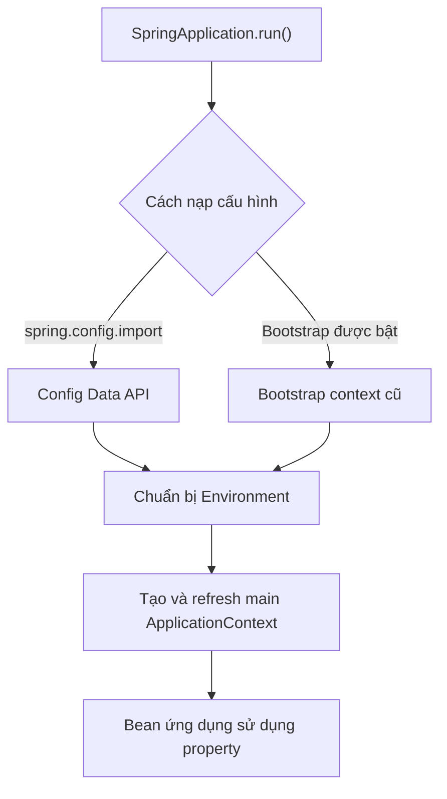

# Phân biệt Config Data với cơ chế bootstrap cũ

## 1. Vì sao có hai cách nạp cấu hình?

Một ứng dụng Spring Boot có thể nhận cấu hình từ file local, biến môi trường, tham số dòng lệnh, Config Server, Vault hoặc hệ thống cấu hình khác. Các giá trị này cần được đưa vào `Environment` đủ sớm để Spring Boot quyết định profile, auto-configuration và giá trị inject vào bean.

Trong các thế hệ Spring Cloud trước đây, việc lấy cấu hình từ xa thường dựa vào **bootstrap context**: một context được dựng sớm, làm parent của application context chính và chuẩn bị các property source bên ngoài. Ứng dụng thường khai báo `bootstrap.yml` để cấu hình cách kết nối nguồn từ xa.

Từ Spring Boot 2.4, **Config Data API** cung cấp cơ chế chuẩn để khai báo nguồn cấu hình cần import bằng `spring.config.import`. Spring Cloud Config Client đã tích hợp cách này và đây là cách mặc định được khuyến nghị trong tài liệu hiện hành. Ứng dụng có thể nạp cấu hình từ Config Server trước khi application context chính được refresh mà không cần tạo bootstrap context truyền thống.

Hai cách giải quyết một nhu cầu chung nhưng có lifecycle, cách kích hoạt, vị trí cấu hình và quy tắc nạp property khác nhau. Hiểu rõ sự khác biệt giúp tránh tình trạng cấu hình bị tải hai lần, profile không được áp dụng như dự kiến hoặc ứng dụng khởi động bằng giá trị local ngoài ý muốn.

Bài thuộc chương **Nạp cấu hình** của mô-đun **SPRING_CLOUD_CORE**. Nội dung đặt hai cơ chế trong bối cảnh Spring Cloud Commons, Context và Config Client; mục tiêu là biết chọn cách nạp cấu hình, đọc đúng thứ tự ưu tiên và kiểm tra hành vi trong môi trường thực tế.

Sau bài học, người học có thể:

- Giải thích Config Data API và bootstrap context truyền thống khác nhau ở đâu.
- Viết cấu hình Config Client bằng `spring.config.import` và hiểu ý nghĩa của `optional:`.
- Biết khi nào cần kích hoạt bootstrap cũ, dùng `bootstrap.yml` và cấu hình địa chỉ Config Server.
- Phân biệt bootstrap context, bootstrap registry của Spring Boot và main application context.
- Phân tích profile, property source precedence, fail-fast và lỗi startup.
- Lập kế hoạch chuyển từ bootstrap cũ sang Config Data mà vẫn giữ hành vi cấu hình mong muốn.

## 2. Hai cơ chế nhìn từ vòng đời ứng dụng

### 2.1. Config Data API

Config Data là cơ chế của Spring Boot để khai báo và nạp các nguồn cấu hình. Trong giai đoạn chuẩn bị Environment, Boot đọc các cấu hình ban đầu, xử lý khai báo import và yêu cầu resolver/loader tương ứng nạp dữ liệu. Config Client cung cấp integration cho location có scheme `configserver:`.

Ví dụ:

```yaml
spring:
  application:
    name: orders-service
  config:
    import: "optional:configserver:http://config-server:8888"
```

Boot xử lý import trong quá trình chuẩn bị cấu hình, trước khi refresh application context. Các bean được tạo sau đó có thể đọc property đã nạp từ xa qua `Environment`. Không cần tạo parent bootstrap context chỉ để kết nối Config Server.

### 2.2. Bootstrap context truyền thống

Trong cơ chế cũ, Spring Cloud tạo một bootstrap context trước context chính. Bootstrap context thường là parent của main application context. Nó có thể tạo các bean bootstrap và chạy `PropertySourceLocator` để lấy property từ nguồn ngoài, ví dụ Config Server.

Ứng dụng thường có file `bootstrap.yml`:

```yaml
spring:
  application:
    name: orders-service
  cloud:
    config:
      uri: http://config-server:8888
```

Khi bootstrap đã được bật, Config Client dùng `spring.cloud.config.uri` để kết nối Config Server và thêm property source từ xa vào Environment. File `bootstrap.yml` cấu hình quá trình bootstrap; nó không giống file `application.yml` được dùng cho main application context.

### 2.3. So sánh nhanh

| Khía cạnh | Config Data API | Bootstrap Spring Cloud truyền thống |
| --- | --- | --- |
| Cơ chế | Spring Boot Config Data | Spring Cloud bootstrap lifecycle |
| Cách khai báo Config Server | `spring.config.import=configserver:...` | `spring.cloud.config.uri` trong bootstrap configuration |
| Cấu hình thường dùng | `application.yml` hoặc biến môi trường | `bootstrap.yml` / `bootstrap.properties` và biến môi trường |
| Thời điểm | Khi Boot chuẩn bị Config Data và Environment, trước context refresh | Tạo bootstrap context trước main context |
| Parent context riêng | Không cần cho việc import Config Data | Có trong mô hình bootstrap truyền thống |
| Profile | Config Data có thể tải default rồi các profile được kích hoạt | Bootstrap chuẩn bị nguồn từ xa theo cấu hình/profile bootstrap |
| Mặc định hiện nay | Cách mặc định của Config Client hiện đại | Phải bật rõ ràng |
| Khuyến nghị | Ưu tiên cho ứng dụng mới và migration thông thường | Duy trì khi hệ thống còn phụ thuộc vào bootstrap lifecycle |

Không nên đồng nhất **bootstrap registry** của Spring Boot với **bootstrap context** của Spring Cloud. Bootstrap registry là một phần lifecycle của Boot; bootstrap context là mô hình parent context truyền thống của Spring Cloud.



## 3. Cấu hình Config Data với Spring Cloud Config Client

### 3.1. Dependency

Với Maven, ứng dụng cần Config Client starter và Spring Cloud BOM tương thích với phiên bản Spring Boot:

```xml
<dependencyManagement>
    <dependencies>
        <dependency>
            <groupId>org.springframework.cloud</groupId>
            <artifactId>spring-cloud-dependencies</artifactId>
            <version>SPRING_CLOUD_RELEASE_TRAIN_DA_CHON</version>
            <type>pom</type>
            <scope>import</scope>
        </dependency>
    </dependencies>
</dependencyManagement>

<dependencies>
    <dependency>
        <groupId>org.springframework.cloud</groupId>
        <artifactId>spring-cloud-starter-config</artifactId>
    </dependency>
</dependencies>
```

Tên version ở ví dụ là placeholder. Chọn release train theo compatibility matrix chính thức; không tự lấy bản mới nhất cho mọi module.

### 3.2. Khai báo import

Ví dụ dùng YAML:

```yaml
spring:
  application:
    name: orders-service
  profiles:
    active: dev
  config:
    import: "optional:configserver:http://localhost:8888"
```

Tương đương trong `application.properties`:

```properties
spring.application.name=orders-service
spring.profiles.active=dev
spring.config.import=optional:configserver:http://localhost:8888
```

Các thành phần quan trọng:

- `configserver:` là scheme do Spring Cloud Config Client cung cấp cho Config Data.
- Địa chỉ có thể được đặt ngay trong import. Nếu địa chỉ được đặt ở import và `spring.cloud.config.uri`, địa chỉ trong import có độ ưu tiên cao hơn.
- `optional:` cho phép ứng dụng tiếp tục startup khi Config Server không kết nối được. Khi đó ứng dụng có thể không nhận được cấu hình từ xa.
- Nếu bỏ `optional:`, Config Client phải kết nối thành công; nếu không, startup thất bại.

### 3.3. Optional hay bắt buộc?

Đây là quyết định vận hành, không chỉ là khác biệt cú pháp.

| Chế độ | Cấu hình | Hành vi khi Config Server không sẵn sàng | Khi phù hợp |
| --- | --- | --- | --- |
| Optional | `optional:configserver:...` | Có thể tiếp tục với nguồn cấu hình còn lại | Dịch vụ có default an toàn và chấp nhận chạy thiếu remote config |
| Bắt buộc | `configserver:...` | Không lấy được cấu hình thì startup lỗi | Cấu hình từ xa là điều kiện bắt buộc để chạy an toàn |

Ví dụ, một dịch vụ thanh toán không nên tự chạy với chế độ giới hạn giao dịch mặc định nếu remote config chứa chính sách kiểm soát rủi ro. Với trường hợp đó, fail-fast thường an toàn hơn. Ngược lại, một ứng dụng demo có cấu hình local đầy đủ có thể chấp nhận optional.

Không nên dùng optional chỉ để "làm cho startup xanh". Nếu ứng dụng khởi động mà thiếu một số property quan trọng, hãy có validation và readiness phù hợp để nó không nhận traffic với trạng thái cấu hình không hợp lệ.

### 3.4. Config Data có thể gọi Config Server nhiều lần

Config Data của Spring Cloud Config Client xử lý cấu hình theo hai bước:

1. Tải cấu hình với profile `default` để thu thập property ban đầu, trong đó có thể có thông tin kích hoạt profile khác.
2. Sau khi xác định các profile đang hoạt động, tải thêm cấu hình tương ứng với các profile đó.

Vì vậy, log có thể cho thấy nhiều request tới Config Server trong một lần startup. Đây là hành vi bình thường của quy trình hai bước, không mặc nhiên là lỗi lặp request. Nó cho phép profile được kích hoạt từ cấu hình nhận về từ server.

## 4. Bootstrap cũ: cách kích hoạt và cấu hình

### 4.1. Bootstrap không còn tự bật trong thiết lập thông thường

Trong các ứng dụng Spring Cloud hiện đại, muốn dùng cơ chế bootstrap truyền thống thì phải kích hoạt rõ ràng. Có hai cách thường gặp:

**Cách A — thêm starter bootstrap:**

```xml
<dependency>
    <groupId>org.springframework.cloud</groupId>
    <artifactId>spring-cloud-starter-bootstrap</artifactId>
</dependency>
```

Version được quản lý bởi Spring Cloud BOM.

**Cách B — bật bằng system property hoặc environment variable:**

```bash
java -Dspring.cloud.bootstrap.enabled=true -jar orders-service.jar
```

Hoặc đặt biến môi trường:

```bash
SPRING_CLOUD_BOOTSTRAP_ENABLED=true
```

Khi dùng thuộc tính `spring.cloud.bootstrap.enabled=true`, tài liệu Config Client yêu cầu nó được đặt ở system property hoặc environment variable để có hiệu lực đủ sớm cho bootstrap. Chỉ đặt nó trong một file `application.yml` được đọc ở giai đoạn main context có thể là quá muộn.

Không cần dùng đồng thời cả starter và biến môi trường để "bật mạnh hơn". Chọn cách phù hợp với deployment và kiểm tra đúng phiên bản Spring Cloud đang chạy.

### 4.2. File bootstrap.yml

Ví dụ:

```yaml
spring:
  application:
    name: orders-service
  cloud:
    config:
      uri: http://config-server:8888
  profiles:
    active: dev
```

Trong mô hình này:

- `spring.application.name` xác định tên ứng dụng mà Config Server dùng để tìm cấu hình.
- `spring.cloud.config.uri` chỉ địa chỉ Config Server.
- Profile xác định biến thể cấu hình cần tải; nếu profile được quyết định trong bootstrap phase, đặt nó ở cấu hình bootstrap thích hợp.
- Config Client cần có mặt trên classpath để thực hiện tích hợp.

File `bootstrap.yml` không tự kích hoạt bootstrap ở các cấu hình hiện đại nếu dependency/cờ bootstrap chưa được bật.

### 4.3. Context hierarchy và PropertySource

Bootstrap context truyền thống thường làm parent của main application context. Property source do bootstrap locator tải được đưa vào context chính theo quy tắc của hierarchy. Cần phân biệt:

- Property source có tên `bootstrap` chứa dữ liệu từ các `PropertySourceLocator`; theo mặc định truyền thống, dữ liệu từ xa có thể có độ ưu tiên cao.
- Property source chứa nội dung file `bootstrap.yml` là cấu hình dùng để chuẩn bị bootstrap; bản thân nó thường có độ ưu tiên thấp hơn cấu hình được nạp trong main context.
- Child application context có thể ghi đè property từ parent theo quy tắc phân giải property source của Spring.

Do đó, câu "bootstrap luôn thắng application.yml" là quá đơn giản và dễ gây sai. Phải xem **property source cụ thể** nào đang chứa khóa cần tra cứu và thứ tự ưu tiên của nó.

## 5. Property precedence: vì sao cùng một khóa có thể cho kết quả khác?

Spring Boot hợp nhất cấu hình từ nhiều nguồn. Ví dụ, khóa `orders.timeout-seconds` có thể xuất hiện ở:

- Cấu hình mặc định đóng gói trong JAR.
- `application.yml`.
- Profile-specific file như `application-dev.yml`.
- Config Server hoặc một nguồn import khác.
- Environment variable.
- Java system property.
- Tham số dòng lệnh.

Không nên ghi nhớ một thứ tự duy nhất cho mọi tình huống mà không xét cách nguồn được thêm vào. Với Config Data, thứ tự import và thứ tự các tài liệu cấu hình ảnh hưởng đến precedence; các nguồn ưu tiên cao của Boot như command-line arguments, system properties và OS environment variables vẫn có thể ghi đè giá trị từ import.

Ví dụ hai nguồn import:

```yaml
spring:
  config:
    import:
      - "configserver:http://config-server:8888"
      - "optional:file:./config/region.yml"
```

Trong Config Data, import sau có độ ưu tiên cao hơn import trước. Vì thế giá trị trong file vùng có thể ghi đè giá trị cùng khóa từ Config Server. Đổi thứ tự import sẽ đổi kết quả. Khi một khóa có giá trị bất ngờ, hãy kiểm tra:

1. Nguồn nào thật sự được nạp?
2. Import có thứ tự nào?
3. Profile nào đang hoạt động?
4. Có biến môi trường, system property hoặc tham số command line ghi đè không?
5. Ứng dụng có vô tình bật bootstrap cũ cùng lúc không?

Không in toàn bộ `Environment` trong log production. Có thể làm lộ mật khẩu, token hoặc thông tin kết nối. Chỉ truy vấn khóa không nhạy cảm và dùng endpoint chẩn đoán được bảo vệ.

## 6. Config Data và bootstrap: chọn cách nào?

### 6.1. Chọn Config Data cho ứng dụng mới

Ưu tiên Config Data khi:

- Dự án dùng Spring Boot 2.4 trở lên và Spring Cloud Config Client hỗ trợ release tương ứng.
- Muốn khai báo nguồn ngoài ngay trong cấu hình ứng dụng bằng `spring.config.import`.
- Cần thứ tự rõ ràng giữa nhiều config location.
- Muốn profile được kích hoạt từ cấu hình remote tham gia quy trình hai bước.
- Không có tích hợp cũ nào phụ thuộc bootstrap parent context hoặc lifecycle của `PropertySourceLocator`.

Ví dụ cấu hình production có thể bỏ optional để buộc tải cấu hình:

```yaml
spring:
  application:
    name: orders-service
  config:
    import: "configserver:https://config.internal.example"
```

Địa chỉ thật, TLS và xác thực phải được cấu hình theo môi trường; không đặt secret trực tiếp vào file cấu hình được commit.

### 6.2. Duy trì bootstrap khi có phụ thuộc cụ thể

Có thể cần bootstrap cũ khi:

- Một thư viện nội bộ hoặc extension hiện hữu được thiết kế dựa trên bootstrap context.
- Cần giữ tương thích với quy trình triển khai cũ đã được kiểm thử và chưa thể migration ngay.
- Một integration cụ thể yêu cầu bootstrap phase hoặc dùng các bean/parent context chỉ có trong mô hình đó.

Trong trường hợp này, phải ghi rõ lý do duy trì, version Spring Cloud liên quan, cách bật bootstrap và kế hoạch chuyển đổi. Đừng thêm starter bootstrap chỉ vì dự án có một file `bootstrap.yml` cũ.

### 6.3. Tránh cấu hình hai cơ chế cho cùng nguồn

Config Data và bootstrap là hai cách khởi tạo nguồn cấu hình. Tránh cùng lúc cấu hình Config Server qua `spring.config.import` và bootstrap legacy nếu không có yêu cầu cụ thể đã được tài liệu phiên bản xác nhận. Nếu cả hai cùng hoạt động, có thể có nhiều lần gọi, property source trùng hoặc kết quả precedence khó dự đoán.

Khi cần giữ cả hai trong giai đoạn chuyển tiếp, phải xác định nguồn nào là chủ đạo, so sánh property sources thực tế và viết integration test cho các khóa quan trọng. Không coi việc ứng dụng khởi động thành công là bằng chứng hai cơ chế phối hợp đúng.

## 7. Chuyển từ bootstrap cũ sang Config Data

Migration nên được thực hiện theo từng thay đổi có thể kiểm chứng.

### Bước 1. Ghi nhận hành vi hiện tại

Trước khi sửa cấu hình, ghi lại:

- Phiên bản Spring Boot, Spring Cloud release train và Config Client.
- Dependency `spring-cloud-starter-bootstrap` có được khai báo hay không.
- Cờ `spring.cloud.bootstrap.enabled` đang được đặt ở đâu.
- Nội dung bootstrap và application configuration; đặc biệt là application name, profile, Config Server URI, credentials và label.
- Các `PropertySourceLocator` tùy chỉnh hoặc thư viện nội bộ tham gia bootstrap.
- Khóa cấu hình quan trọng, giá trị hiệu lực và nguồn cung cấp.

### Bước 2. Chuyển cấu hình kết nối sang Config Data

Đưa import vào cấu hình ứng dụng:

```yaml
spring:
  application:
    name: orders-service
  config:
    import: "configserver:http://config-server:8888"
```

Nếu môi trường chấp nhận chạy với cấu hình local khi server chưa sẵn sàng, có thể dùng `optional:`. Nếu remote configuration là điều kiện bắt buộc, giữ import ở dạng không optional.

Đảm bảo profile, label, tên ứng dụng và thông tin xác thực vẫn được cung cấp đúng. Một số thuộc tính có thể tiếp tục nằm trong `application.yml` hoặc biến môi trường; không phải mọi giá trị từng có trong bootstrap file đều phải chuyển nguyên xi sang một file duy nhất.

### Bước 3. Gỡ bootstrap legacy khi không còn cần

Sau khi Config Data hoạt động:

1. Gỡ `spring-cloud-starter-bootstrap` nếu không còn thư viện nào cần bootstrap.
2. Bỏ cờ `spring.cloud.bootstrap.enabled=true` khỏi system properties và environment variables.
3. Xóa hoặc chuyển các cấu hình trong `bootstrap.yml` sang nơi thích hợp; chỉ xóa khi đã xác nhận không còn integration sử dụng chúng.
4. Kiểm tra code tùy chỉnh dựa trên parent context hoặc `PropertySourceLocator`.

### Bước 4. So sánh kết quả

So sánh giá trị hiệu lực của các khóa đại diện ở từng profile trước và sau migration. Kiểm tra log Config Client, số request Config Server, profile và label được gửi, cũng như hành vi khi Config Server không sẵn sàng.

### Bước 5. Kiểm thử rollback

Giữ lại bản cấu hình trước migration và cách bật bootstrap cũ trong thời gian chuyển đổi. Nếu ứng dụng thiếu property bắt buộc hoặc startup behavior thay đổi ngoài dự kiến, có thể rollback theo quy trình release. Sau khi migration ổn định, bỏ đường cũ để giảm số cơ chế cần vận hành.

## 8. Ví dụ kiểm thử hai chế độ

### 8.1. Kiểm thử Config Data

Một integration test hoặc môi trường lab nên xác minh:

1. Config Server trả cấu hình cho đúng application name.
2. Profile mặc định và profile đang active được tải như mong muốn.
3. Property remote có mặt trong Environment trước khi bean phụ thuộc nó được khởi tạo.
4. Với import optional, ứng dụng khởi động được khi server không sẵn sàng và có giá trị fallback an toàn.
5. Với import bắt buộc, ứng dụng dừng startup khi không thể tải cấu hình.

Có thể quan sát request Config Server và log startup để xác nhận quá trình hai bước. Không nên kiểm tra bằng cách chỉ đọc một file local, vì file đó không chứng minh remote source đã được nạp.

### 8.2. Kiểm thử bootstrap legacy

Với ứng dụng duy trì bootstrap, kiểm tra:

1. Bootstrap thực sự được bật bằng starter hoặc system property/environment variable.
2. Bootstrap context được tạo trước main context theo mô hình legacy.
3. `spring.cloud.config.uri` được đọc ở đúng phase.
4. Remote property source được đưa vào context chính.
5. Thứ tự ưu tiên giữa remote source, bootstrap file và application file đúng với thiết kế.

### 8.3. Kiểm thử bean tiêu thụ cấu hình

Giả sử bean dùng property:

```java
@Component
public class OrderLimits {
    private final int maxItems;

    public OrderLimits(
            @Value("${orders.max-items:20}") int maxItems) {
        this.maxItems = maxItems;
    }

    public int maxItems() {
        return maxItems;
    }
}
```

Kiểm tra giá trị bean nhận được sau khi context khởi tạo. Nếu dùng refresh runtime, cần một bài test riêng cho `@RefreshScope` hoặc cơ chế rebind; việc Config Data tải đúng lúc startup **không tự chứng minh** bean singleton sẽ tự thay đổi sau đó.

## 9. Lỗi thường gặp và cách xử lý

| Triệu chứng | Nguyên nhân có thể | Cách kiểm tra |
| --- | --- | --- |
| Config Server không được gọi | Thiếu Config Client, sai scheme hoặc import không được đọc | Kiểm tra starter, `spring.config.import` và log Config Data |
| Startup tiếp tục nhưng thiếu property remote | Đã dùng `optional:` và server không sẵn sàng | Kiểm tra kết nối, log và fallback; cân nhắc bỏ optional nếu remote là bắt buộc |
| Startup thất bại ngay khi remote lỗi | Import bắt buộc hoặc legacy fail-fast | Xác nhận đây là chính sách mong muốn; kiểm tra URI, TLS, credentials và availability |
| `bootstrap.yml` không có tác dụng | Bootstrap chưa được bật | Kiểm tra starter bootstrap hoặc system property/environment variable |
| Property bị ghi đè bất ngờ | Import order, profile, environment variable hoặc parent/child property source | Kiểm tra Environment và precedence của từng nguồn |
| Profile remote không được tải | Profile chưa active hoặc Config Server không trả profile như mong muốn | Kiểm tra default request, active profile và response của Config Server |
| Cấu hình bị tải nhiều lần | Config Data hai bước, retry hoặc đồng thời bật nhiều integration | Đối chiếu log/request và xác định đó là hành vi bình thường hay cấu hình trùng |
| Migration làm thay đổi giá trị | Bootstrap locator, thứ tự property source hoặc tùy chỉnh cũ chưa được chuyển | So sánh giá trị hiệu lực trước/sau và kiểm tra integration tùy chỉnh |

## 10. Những điểm cần kiểm tra theo phiên bản

- Config Data API được Spring Boot giới thiệu từ **2.4**. Ứng dụng và Spring Cloud Config Client phải dùng các phiên bản tương thích với nhau.
- Config Client hiện đại dùng Config Data làm cách kết nối Config Server mặc định; legacy bootstrap cần được kích hoạt rõ ràng.
- Các phiên bản Spring Cloud khác nhau có thể thay đổi thời điểm chạy `PropertySourceLocator`. Tài liệu Spring Cloud ghi nhận từ 2022.0.3 locator được gọi hai lần: lần đầu không có profile để có thể kích hoạt profile; lần tiếp theo chạy sau khi main context bắt đầu với các profile đang active. Ở các bản trước đó, locator chạy trong main context; thuộc tính `spring.cloud.config.initialize-on-context-refresh=true` trong bootstrap configuration có thể yêu cầu chạy chúng trong bootstrap context. Khi duy trì legacy, cần đối chiếu migration notes của đúng release.
- Không ghép tùy ý Spring Boot, Spring Cloud release train và Config Client. Dùng BOM chính thức, kiểm tra compatibility verifier và dependency tree.
- Một số hệ thống cấu hình khác (Vault, Kubernetes, Consul) cũng có thể cung cấp Config Data import riêng; cú pháp location và thứ tự ưu tiên phụ thuộc integration tương ứng.

## 11. Tài liệu chính thức

- [Spring Cloud Config Client — Spring Boot Config Data Import và Config First Bootstrap](https://docs.spring.io/spring-cloud-config/reference/client.html)
- [Spring Cloud Reference — Spring Cloud Context: Bootstrap Application Context](https://docs.spring.io/spring-cloud/docs/current/reference/htmlsingle/spring-cloud.html)
- [Spring Boot Externalized Configuration — Config Data](https://docs.spring.io/spring-boot/reference/features/external-config.html)

Khi triển khai, luôn chọn tài liệu đúng phiên bản Spring Boot và Spring Cloud release train của dự án; trang tài liệu hiện hành có thể mô tả hành vi mới hơn phiên bản đang chạy.

## 12. Tổng kết và câu hỏi tự kiểm tra

**Config Data** khai báo nguồn cấu hình trong quy trình cấu hình của Spring Boot, thường qua `spring.config.import`. Nó là lựa chọn mặc định hiện nay cho Spring Cloud Config Client và không yêu cầu bootstrap context truyền thống. **Bootstrap cũ** tạo một context sớm làm parent của main context; muốn dùng phải bật rõ ràng bằng starter hoặc system property/environment variable và thường cấu hình kết nối trong `bootstrap.yml`.

Khi chọn giữa hai cách, hãy bắt đầu từ phiên bản, yêu cầu của integration và thứ tự property source. Nếu dùng Config Data, quyết định remote config là optional hay bắt buộc. Nếu giữ bootstrap, ghi rõ lý do và kiểm tra parent context. Khi migration, so sánh giá trị hiệu lực và kiểm thử cả tình huống Config Server sẵn sàng lẫn không sẵn sàng.

Câu hỏi tự kiểm tra:

1. Config Data API được xử lý ở giai đoạn nào trong startup của Spring Boot?
2. Vì sao Config Data không cần tạo bootstrap context truyền thống?
3. Khi nào `optional:configserver:...` phù hợp, và khi nào cần bỏ tiền tố optional?
4. Cơ chế bootstrap cũ được bật bằng những cách nào? Vì sao thuộc tính bật bootstrap phải được cung cấp đủ sớm?
5. Bootstrap context khác bootstrap registry của Spring Boot ở điểm nào?
6. Vì sao không thể kết luận remote property luôn thắng application property chỉ dựa vào tên bootstrap?
7. Config Data của Config Client có thể gọi Config Server nhiều lần vì lý do gì?
8. Khi migration, cần so sánh những gì để bảo đảm ứng dụng vẫn nhận đúng cấu hình?
