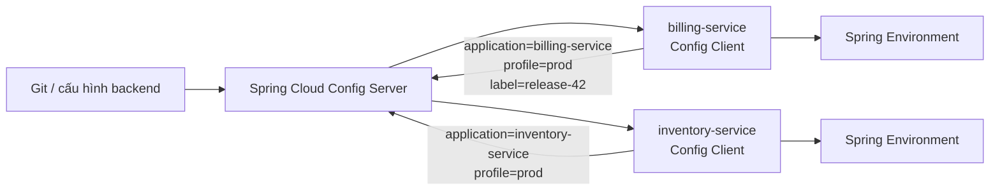
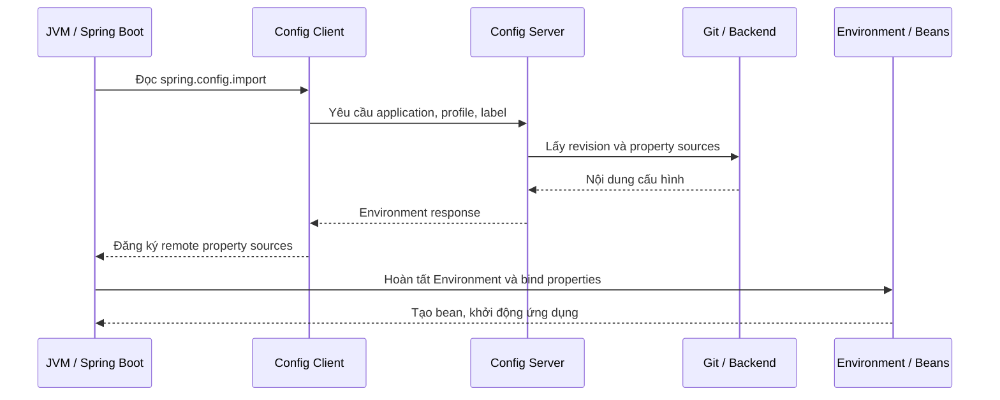

# Vai trò Config Client khi kết nối nguồn cấu hình từ xa

Trong một hệ thống phân tán, mỗi dịch vụ thường cần các giá trị cấu hình khác nhau theo ứng dụng và môi trường: endpoint của dịch vụ phụ thuộc, timeout, feature flag, giới hạn kết nối hoặc mức log. Nếu mỗi nhóm tự đóng gói mọi giá trị vào artifact, việc cập nhật và kiểm soát khác biệt giữa dev, staging và production sẽ nhanh chóng trở nên khó khăn.

**Spring Cloud Config Client** cho phép một ứng dụng Spring Boot lấy cấu hình từ xa từ **Spring Cloud Config Server** trong quá trình khởi động. Client đưa các property source nhận được vào `Environment` để Spring Boot bind cấu hình và tạo bean. Nhờ vậy, nhóm vận hành có thể quản lý cấu hình tập trung, theo dõi phiên bản và phân phối một bộ giá trị theo tên ứng dụng, profile và label.

Bài học thuộc chương **Nạp cấu hình** của module **SPRING_CLOUD_CORE**. Trọng tâm là vai trò của client, cách kết nối nguồn từ xa bằng Config Data, cách xử lý lỗi kết nối, bảo mật, refresh, kiểm thử và vận hành.

## 1. Mục tiêu học tập

Sau bài học, người học có thể:

- Phân biệt Config Client, Config Server và repository/backend chứa cấu hình.
- Giải thích cách client xác định tên ứng dụng, profile và label khi yêu cầu cấu hình.
- Cấu hình Config Client bằng `spring.config.import` và hiểu khác biệt giữa nguồn bắt buộc với nguồn `optional`.
- Mô tả thời điểm cấu hình từ xa được nạp vào `Environment` trong vòng đời khởi động Spring Boot.
- Hiểu chính sách ưu tiên giữa remote property sources và cấu hình cục bộ, không suy đoán thứ tự khi có nhiều nguồn.
- Bảo vệ kết nối đến Config Server bằng xác thực, TLS, quyền truy cập và quản lý secret.
- Thiết kế retry, fail-fast, fallback, refresh và kiểm thử khi Config Server không khả dụng.

## 2. Config Client nằm ở đâu trong kiến trúc?

Spring Cloud Config chia trách nhiệm thành ba phần:

- **Config Client:** thư viện nằm trong từng ứng dụng cần cấu hình từ xa. Client biết tên ứng dụng, profile, label và địa chỉ Config Server; nó gửi yêu cầu, nhận property sources rồi đưa chúng vào môi trường cấu hình của ứng dụng.
- **Config Server:** dịch vụ HTTP tập trung, đọc cấu hình từ backend được cấu hình (thường là Git, nhưng có thể dùng backend khác), rồi cung cấp dữ liệu cho client.
- **Configuration repository/backend:** nơi lưu trữ và quản lý phiên bản các file cấu hình, ví dụ Git repository chứa `application.yml`, `billing-service-prod.yml` hoặc cấu trúc tương ứng.



Config Client không phải là Config Server. Thêm starter vào một ứng dụng chỉ giúp ứng dụng có khả năng làm client; nó không tự tạo server, Git repository, xác thực hoặc cơ chế đồng bộ cấu hình.

## 3. Client yêu cầu cấu hình bằng những thông tin nào?

Một yêu cầu cấu hình thường được xác định bởi ba thành phần:

| Thành phần | Nguồn mặc định/khai báo | Ý nghĩa |
| --- | --- | --- |
| Application name | `spring.application.name` | Xác định bộ cấu hình dành cho dịch vụ |
| Profile | `spring.profiles.active` và profile được kích hoạt | Chọn cấu hình chung và cấu hình riêng môi trường |
| Label | `spring.cloud.config.label` | Chọn nhánh, tag hoặc revision mà backend/server hỗ trợ |

Client cũng cho phép điều chỉnh các giá trị tra cứu bằng `spring.cloud.config.name`, `spring.cloud.config.profile` và `spring.cloud.config.label`. Nếu `spring.cloud.config.name` được đặt, nó có thể thay tên ứng dụng dùng để lấy remote properties; vì vậy hãy kiểm tra cả `spring.application.name` lẫn cấu hình Config Client khi server trả nhầm bộ cấu hình.

Ví dụ ứng dụng:

```yaml
spring:
  application:
    name: billing-service
  profiles:
    active: prod
  cloud:
    config:
      label: release-42
```

Với tên ứng dụng `billing-service`, profile `prod` và label `release-42`, Config Client yêu cầu dữ liệu tương ứng từ Config Server. Tên endpoint minh họa của Config Server:

```http
GET /billing-service/prod/release-42
```

Đường dẫn cụ thể và cách diễn giải label phụ thuộc backend/cấu hình Config Server. Với Git backend, label thường đại diện cho branch, tag hoặc commit mà server có thể checkout. Trong môi trường production, nên chọn một revision bất biến hoặc quy trình promotion rõ ràng; dùng branch đang thay đổi liên tục có thể khiến hai lần khởi động nhận hai bộ cấu hình khác nhau.

Nếu không chỉ định label, Config Server sử dụng label mặc định do server cấu hình (với Git backend thường là branch mặc định của repository). Không nên giả định tên branch mặc định là `main` hay `master`; hãy xác minh trên server.

Nếu không khai báo tên ứng dụng riêng, client thường sử dụng `spring.application.name`. Đặt tên ứng dụng ổn định và duy nhất trong phạm vi quản lý cấu hình giúp tránh việc hai dịch vụ vô tình đọc chung một tập property.

### 3.1. Cách đặt tên file trong repository

Một cấu trúc Git backend minh họa:

```text
config-repo/
├── application.yml
├── application-prod.yml
├── billing-service.yml
├── billing-service-prod.yml
├── inventory-service.yml
└── inventory-service-prod.yml
```

Quy ước phổ biến:

- `application.yml` chứa giá trị dùng chung cho các ứng dụng.
- `application-prod.yml` chứa giá trị chung cho profile prod.
- `billing-service.yml` chứa giá trị riêng của billing-service.
- `billing-service-prod.yml` chứa giá trị dành riêng cho billing-service ở profile prod.

Config Server tổng hợp các property sources phù hợp với application và profile. Với Git backend, các nguồn dùng chung và riêng ứng dụng/profile được trả về theo thứ tự do server quy định; nguồn xuất hiện sau có thể ghi đè nguồn trước nếu cùng khóa. Không nên chỉ nhìn tên file rồi đoán một khóa cuối cùng chắc chắn có giá trị nào; hãy kiểm tra response server và giá trị hiệu lực trong client.

## 4. Thêm Config Client vào ứng dụng Spring Boot

Một ứng dụng Maven cần dependency Config Client. Ví dụ phần dependency:

```xml
<dependency>
    <groupId>org.springframework.cloud</groupId>
    <artifactId>spring-cloud-starter-config</artifactId>
</dependency>
```

Dependency này phải được quản lý bởi Spring Cloud BOM tương thích với phiên bản Spring Boot đang dùng:

```xml
<properties>
    <java.version>17</java.version>
    <spring-cloud.version>2024.0.0</spring-cloud.version>
</properties>

<dependencyManagement>
    <dependencies>
        <dependency>
            <groupId>org.springframework.cloud</groupId>
            <artifactId>spring-cloud-dependencies</artifactId>
            <version>${spring-cloud.version}</version>
            <type>pom</type>
            <scope>import</scope>
        </dependency>
    </dependencies>
</dependencyManagement>
```

Cặp phiên bản trên chỉ minh họa cấu trúc Maven. Khi triển khai, tra bảng tương thích Spring Cloud release train với Spring Boot và chọn phiên bản còn được hỗ trợ trong dự án. Không tự ghép một starter Config Client mới với một Boot version không tương thích.

## 5. Kết nối bằng Config Data import

Với các thế hệ Spring Boot hiện đại (từ Boot 2.4), cách phổ biến là khai báo Config Server trong `spring.config.import`. Ví dụ `application.yml` của billing-service:

```yaml
spring:
  application:
    name: billing-service
  config:
    import: "configserver:http://localhost:8888"
```

Khi Spring Boot xử lý Config Data, Config Client kết nối đến Config Server ở địa chỉ trên để lấy property sources trước khi hoàn tất khởi tạo application context. Config Server phải đang chạy và có cấu hình phù hợp cho application/profile mà client yêu cầu.

Có thể dùng địa chỉ service DNS trong môi trường container hoặc Kubernetes:

```yaml
spring:
  config:
    import: "configserver:http://config-server:8888"
```

Tên host phải phân giải được từ network namespace của ứng dụng. Địa chỉ localhost trong container trỏ về chính container đó, không tự trỏ đến Config Server ở container khác.

### 5.1. Nguồn bắt buộc và nguồn optional

Hai khai báo dưới đây có ý nghĩa vận hành khác nhau:

```yaml
spring:
  config:
    import: "configserver:http://config-server:8888"
```

```yaml
spring:
  config:
    import: "optional:configserver:http://config-server:8888"
```

- **Bắt buộc:** nếu không thể lấy cấu hình từ Config Server, quá trình nạp cấu hình có thể thất bại và ứng dụng dừng khởi động. Phù hợp khi remote configuration là điều kiện để dịch vụ hoạt động an toàn.
- **Optional:** nếu nguồn từ xa không sẵn sàng, Spring có thể tiếp tục với các nguồn cấu hình còn lại. Điều này chỉ an toàn khi ứng dụng có cấu hình dự phòng đầy đủ, được validate và không trỏ nhầm môi trường.

Không dùng `optional:` chỉ để che sự cố Config Server. Ví dụ nếu endpoint thanh toán production chỉ tồn tại ở cấu hình từ xa, khởi động bằng giá trị mặc định localhost có thể nguy hiểm hơn việc dừng ứng dụng.

### 5.2. Chỉ định profile và label

Profile thường được bật qua biến môi trường hoặc tham số khởi động:

```bash
java -jar billing-service.jar --spring.profiles.active=prod
```

Label có thể được chỉ định bằng `spring.cloud.config.label`:

```yaml
spring:
  cloud:
    config:
      label: release-42
```

Hoặc truyền từ command line:

```bash
java -jar billing-service.jar \
  --spring.profiles.active=prod \
  --spring.cloud.config.label=release-42
```

Client dùng thông tin này để yêu cầu đúng bộ cấu hình. Nếu server không tìm thấy label hoặc backend không thể checkout revision đó, yêu cầu có thể thất bại. Nên xác minh label trong quy trình release trước khi rollout.

### 5.3. URI có thể khai báo ở nguồn cấu hình nào?

URI thường được viết trực tiếp trong `spring.config.import`. Với các cấu hình cần thay đổi theo môi trường, có thể truyền import/endpoint qua cơ chế cấu hình phù hợp với phiên bản Boot và Cloud. Cần tránh tạo vòng phụ thuộc: ứng dụng không thể lấy một giá trị từ Config Server nếu chính địa chỉ Config Server lại chỉ có thể biết sau khi đọc từ Config Server.

Thông tin tối thiểu để kết nối Config Server (host, port, TLS trust, credential hoặc service discovery) phải có sẵn trước khi client thực hiện request đầu tiên.

Ngoài URI đặt ngay trong import, client có thể dùng `spring.cloud.config.uri` (mặc định thường là `http://localhost:8888`). Khi URI được ghi trực tiếp trong `spring.config.import`, URI trong import có độ ưu tiên cao hơn thuộc tính `spring.cloud.config.uri`. Không cấu hình hai địa chỉ khác nhau nếu chưa có chủ ý rõ ràng.

### 5.4. Tìm Config Server qua service discovery

Nếu Config Server tự đăng ký vào một registry đã có, client có thể tìm server qua `DiscoveryClient` thay vì giữ URL cố định. Cách này cần discovery implementation (chẳng hạn Eureka hoặc Consul) được cấu hình và sẵn sàng trước khi Config Client cần kết nối.

Ví dụ cấu hình:

```yaml
spring:
  cloud:
    config:
      discovery:
        enabled: true
        service-id: configserver
```

`configserver` là service ID mặc định thường dùng; có thể đổi bằng `spring.cloud.config.discovery.serviceId`. Discovery-first có thêm một lượt network call để tìm địa chỉ Config Server khi khởi động, nhưng cho phép thay đổi tọa độ server mà client không phải đóng gói lại URL mới. Trong mô hình Config Data, cần tuân theo yêu cầu `spring.config.import` của phiên bản đang dùng; tài liệu hiện hành yêu cầu dạng import phù hợp, thường là `optional:configserver:` khi lookup dựa trên discovery. Xác minh hành vi fail-fast/optional theo phiên bản trước khi áp dụng.

### 5.5. Bootstrap context trong dự án cũ

Một số dự án cũ dùng cơ chế **config-first bootstrap** với `bootstrap.yml` và bootstrap context. Cơ chế này không tự bật chỉ vì có Config Client trên classpath; cần bật bằng `spring.cloud.bootstrap.enabled=true` (đặt ở system property hoặc environment) hoặc thêm `spring-cloud-starter-bootstrap` theo hướng dẫn phiên bản.

Ví dụ cấu hình cũ:

```yaml
spring:
  application:
    name: billing-service
  cloud:
    config:
      uri: https://config-server.internal:8888
```

Với cách này, `bootstrap.yml` chứa thông tin đủ để client tìm Config Server và nạp remote property sources trong bootstrap context. Không trộn lẫn hướng dẫn bootstrap legacy với Config Data import mà không hiểu thứ tự khởi tạo. Với dự án mới, ưu tiên `spring.config.import`; khi nâng cấp dự án cũ, kiểm tra migration guide và các cờ override/retry đang phụ thuộc bootstrap.

## 6. Vòng đời nạp cấu hình từ xa

Config Client tham gia vào giai đoạn nạp cấu hình sớm của Spring Boot. Luồng tổng quát:



Các bước cần lưu ý:

1. Spring Boot đọc các nguồn cấu hình ban đầu để biết import, application name và thông tin cần kết nối.
2. Config Client gửi yêu cầu đến Config Server.
3. Config Server truy xuất backend, chọn các file/property sources phù hợp.
4. Client nhận response và đưa remote property sources vào cấu hình của ứng dụng theo quy tắc của phiên bản.
5. Spring Boot tiếp tục bind properties và tạo bean dựa trên Environment hiệu lực.

Đây là lý do Config Data import quan trọng: các giá trị từ xa có thể cần thiết ngay khi tạo bean. Nếu đợi đến khi controller nhận request mới gọi một API lấy cấu hình, ứng dụng có thể đã tạo bean với giá trị sai hoặc thiếu.

### 6.1. Client có thể thực hiện nhiều lần truy vấn lúc khởi động

Config Data giải quyết cấu hình theo hai giai đoạn: đầu tiên client tải cấu hình với profile `default` để Spring Boot có thể phát hiện profile bổ sung được kích hoạt từ cấu hình; sau đó client tải thêm cấu hình cho các profile đang hoạt động. Vì vậy, log có thể cho thấy nhiều request đến Config Server trong một lần khởi động. Đây là hành vi bình thường của Config Data import, không nhất thiết là lỗi hoặc dấu hiệu client tải trùng vô hạn.

Nếu log cho thấy lặp lại bất thường, hãy kiểm tra cấu hình profile activation, import và hành vi của phiên bản đang dùng.

## 7. Remote properties và cấu hình cục bộ

Một điểm dễ gây nhầm lẫn là thứ tự ưu tiên giữa remote property sources và local property sources.

Config Server có thể trả về các property sources được đưa vào `Environment` của client. Với **legacy config-first bootstrap**, chính sách override có thể chịu ảnh hưởng bởi các cờ do **repository từ xa** cung cấp, chẳng hạn:

```yaml
spring:
  cloud:
    config:
      allowOverride: true
      overrideNone: false
      overrideSystemProperties: true
```

Các cờ này là ví dụ về chính sách override trong Spring Cloud Config. Điểm quan trọng là `allowOverride` cần được đặt ở phía cấu hình từ xa theo cơ chế Config Server; chỉ thêm nó trong file local không nhất thiết thay đổi quyền ưu tiên mà server đã quyết định. `overrideNone` được tài liệu mô tả là chỉ có tác dụng với config-first bootstrap. Với **Config Data import**, vị trí của import và thứ tự các import quyết định cách property sources được ghép vào cấu hình; import được xử lý tại vị trí khai báo và dữ liệu được import có thể ghi đè tài liệu đã khai báo import. Vì vậy, không nên dùng các cờ bootstrap như quy tắc chung cho mọi ứng dụng Config Data. Hãy đối chiếu tài liệu release train và kiểm tra giá trị hiệu lực trong chính ứng dụng.

Khi chẩn đoán một giá trị sai, không nên kết luận “remote luôn thắng” hoặc “environment luôn thắng” mà không xác minh:

- Server trả về những property sources nào và theo thứ tự nào?
- Client đã yêu cầu đúng application, profile và label chưa?
- Chính sách override từ xa cho phép nguồn local nào ghi đè?
- Có biến môi trường, tham số dòng lệnh hoặc system property nào đang thay đổi kết quả?
- Giá trị bean đã bind ở thời điểm khởi động hay đã được refresh sau đó?

Không đưa giá trị secret vào log khi kiểm tra property origin.

## 8. Xác thực và bảo vệ kết nối

Config Server thường chứa thông tin ảnh hưởng đến endpoint, credential, feature flag và hành vi của nhiều dịch vụ. Kết nối client phải được bảo vệ như một kênh quản trị.

### 8.1. Xác thực HTTP Basic

Nếu Config Server bảo vệ bằng HTTP Basic, client có thể được cấu hình bằng credential do nền tảng cấp. Ví dụ cấu hình minh họa:

```yaml
spring:
  cloud:
    config:
      username: ${CONFIG_SERVER_USERNAME}
      password: ${CONFIG_SERVER_PASSWORD}
```

Tên property và cách truyền credential phải được kiểm tra theo phiên bản Config Client. Trong production, inject giá trị qua secret manager hoặc secret của nền tảng; không commit username/password thật vào Git hoặc image.

Không nhúng credential vào URL import, vì URL có thể xuất hiện trong log, process arguments hoặc thông tin chẩn đoán.

### 8.2. TLS và chứng thư

Dùng HTTPS khi Config Client kết nối qua network không hoàn toàn tin cậy. Với những release train hỗ trợ cấu hình TLS riêng cho Config Client, có thể khai báo truststore và keystore như sau:

```yaml
spring:
  cloud:
    config:
      tls:
        enabled: true
        key-store: /run/secrets/config-client.p12
        key-store-type: PKCS12
        key-store-password: ${CONFIG_KEYSTORE_PASSWORD}
        key-password: ${CONFIG_KEY_PASSWORD}
        trust-store: /run/secrets/config-server-trust.p12
        trust-store-type: PKCS12
        trust-store-password: ${CONFIG_TRUSTSTORE_PASSWORD}
```

Tên property và hỗ trợ TLS tùy phiên bản; kiểm tra tài liệu đúng release train. Nếu không chỉ định truststore riêng, JVM có thể dùng truststore mặc định. Không tắt kiểm tra hostname hoặc certificate validation để xử lý lỗi TLS tạm thời.

Nếu hệ thống yêu cầu mutual TLS, client cần certificate và private key phù hợp. Mount file với quyền truy cập tối thiểu, inject password qua secret manager và không commit keystore/private key vào Git.

### 8.3. Timeout và health indicator

Có thể đặt giới hạn thời gian chờ kết nối và đọc response từ Config Server:

```yaml
spring:
  cloud:
    config:
      request-connect-timeout: 2000
      request-read-timeout: 5000
```

Hai giá trị ví dụ tính bằng mili giây. Chọn timeout dựa trên latency mạng và startup budget của nền tảng; timeout quá dài có thể khiến rollout chậm, timeout quá ngắn dễ làm startup thất bại khi mạng có độ trễ bình thường.

Config Client có thể cung cấp health indicator kiểm tra khả năng tải cấu hình từ Config Server. Tùy phiên bản, có thể tắt bằng `management.health.config.enabled=false` và điều chỉnh cache TTL bằng `health.config.time-to-live` (mili giây). Indicator thường cache kết quả để tránh gọi Config Server liên tục. Nếu dùng indicator này cho readiness/liveness, phân biệt lỗi Config Server hiện tại với việc instance đã có cấu hình hợp lệ từ trước; không để một lần kiểm tra thất bại làm restart hàng loạt không cần thiết.

### 8.4. Quyền truy cập theo dịch vụ và môi trường

Một client chỉ nên đọc các cấu hình nó cần. Nếu mọi dịch vụ dùng chung một credential có quyền đọc toàn repository, sự cố ở một dịch vụ có thể làm lộ cấu hình của các dịch vụ khác.

Nên cân nhắc:

- Credential hoặc role riêng cho từng workload/nhóm workload.
- Phân quyền theo repository, path, profile hoặc backend nếu hệ thống hỗ trợ.
- Tách dữ liệu nhạy cảm khỏi file cấu hình thông thường.
- Giới hạn network access tới Config Server.
- Ghi audit về client, thời điểm và revision cấu hình được truy cập.

### 8.5. Secret không nên được coi là property thông thường

Config Server giúp phân phối cấu hình, nhưng một Git repository thông thường không phải nơi lưu secret dạng rõ. Dùng secret manager/Vault backend hoặc cơ chế mã hóa và giải mã được quản lý đúng cách. Cần bảo vệ cả khóa mã hóa; không lưu khóa giải mã cạnh dữ liệu đã mã hóa trong cùng nơi có cùng quyền truy cập.

## 9. Xử lý Config Server không khả dụng

Config Server có thể không truy cập được do DNS, network policy, TLS, credential hết hạn, backend Git lỗi hoặc server đang deploy. Cần xác định ứng dụng nên dừng hay tiếp tục.

| Tình huống | Hành vi cần cân nhắc |
| --- | --- |
| Remote config bắt buộc để xác định endpoint production | Fail fast, không nhận traffic khi thiếu |
| Remote config chỉ cung cấp feature flag không trọng yếu và local defaults đã được validate | Có thể dùng optional/fallback nếu đã kiểm thử |
| Server tạm thời lỗi khi khởi động | Retry có giới hạn và backoff nếu phù hợp |
| Server lỗi sau khi ứng dụng đã chạy | Ứng dụng thường tiếp tục dùng cấu hình đang có trong memory; thay đổi mới chưa được tải |
| Credential/TLS không hợp lệ | Sửa danh tính hoặc trust chain; retry vô hạn không giải quyết lỗi |

### 9.1. Fail fast và retry

Với cấu hình bắt buộc, giữ import không có `optional:` để ứng dụng không khởi động với cấu hình thiếu. Để dùng cơ chế retry được tài liệu Config Client hỗ trợ, thêm cả dependency `spring-retry` và `spring-boot-starter-aop`, sau đó cấu hình các thuộc tính retry phù hợp với phiên bản.

Ví dụ cấu hình retry minh họa:

```yaml
spring:
  cloud:
    config:
      fail-fast: true
      retry:
        max-attempts: 6
        initial-interval: 1000
        max-interval: 5000
        multiplier: 1.5
```

Cần có cả Spring Retry và AOP cho cơ chế retry được mô tả ở trên. Retry hoạt động với `spring.config.import`; nếu import nằm trong file profile-specific, các tham số retry có thể cần được đặt dưới dạng URL query parameters ngay trong import, theo tài liệu phiên bản. Retry chỉ giúp với lỗi tạm thời như network timeout hoặc server restart. Nó không sửa được sai credential, sai label, cấu hình YAML không hợp lệ hoặc version không tương thích.

Ví dụ khi import được khai báo trong file profile-specific, các tùy chọn retry có thể đặt trên URI (tên và cách dùng cần khớp phiên bản):

```yaml
spring:
  config:
    import: "configserver:https://config-server.internal:8888?fail-fast=true&max-attempts=6&initial-interval=1000&max-interval=5000&multiplier=1.5"
```

Không đặt số lần retry quá lớn và không retry liên tục không giới hạn; thời gian khởi động kéo dài có thể làm rollout bị treo hoặc vượt startup probe deadline. Đồng bộ retry budget với timeout của orchestrator.

### 9.2. Optional và fallback

Nếu dùng `optional:configserver:`, hãy thiết kế rõ bộ cấu hình dự phòng:

- Property bắt buộc vẫn phải validate.
- Endpoint mặc định không được trỏ nhầm sang sandbox/local khi chạy production.
- Feature flag mặc định phải an toàn theo nghiệp vụ.
- Log/metric phải thể hiện client đã không tải được remote configuration.
- Readiness chỉ chuyển sang trạng thái sẵn sàng khi ứng dụng thực sự có thể xử lý request an toàn.

Fallback có thể khiến ứng dụng khởi động thành công nhưng chạy sai hành vi. Vì vậy, “process đang chạy” không đồng nghĩa “cấu hình hợp lệ”.

### 9.3. Ứng dụng đang chạy khi Config Server mất kết nối

Sau khi startup hoàn tất, ứng dụng giữ cấu hình trong Environment và các bean đã bind. Nếu Config Server tạm thời mất kết nối, request đang phục vụ thường tiếp tục với cấu hình đã nạp. Client không tự thay đổi cấu hình hiện tại chỉ vì server lỗi.

Khi cần refresh, client phải kết nối lại hoặc nhận tín hiệu refresh theo cơ chế được thiết kế. Nếu không tải được bản mới, nên giữ cấu hình đang hoạt động và phát cảnh báo; không xóa cấu hình hợp lệ trong memory chỉ vì một lần fetch thất bại.

## 10. Refresh sau khi cấu hình từ xa thay đổi

Config Client tải cấu hình khi khởi động. Nếu Git repository được cập nhật sau đó, các instance đang chạy không tự động nhận thay đổi chỉ vì commit mới đã xuất hiện.

Có một số cách phân phối thay đổi:

- **Restart/rolling restart:** instance mới khởi động sẽ lấy revision cấu hình mới.
- **Refresh thủ công có kiểm soát:** một tác nhân quản trị gọi cơ chế refresh của ứng dụng; Config Client tải lại cấu hình và Spring Cloud Context phát sự kiện để các thành phần liên quan cập nhật.
- **Spring Cloud Bus:** khi được tích hợp, Bus có thể phát thông báo refresh tới nhiều instance; cần cấu hình broker, xác thực và cơ chế quan sát việc nhận sự kiện.

`@RefreshScope` hỗ trợ tạo lại target bean sau refresh. Nó không đảm bảo mọi singleton hoặc mọi tài nguyên được cập nhật. Connection pool, HTTP client, cache, static field và đối tượng đã copy property có thể cần cách xử lý riêng.

Nếu dùng Actuator refresh endpoint, chỉ expose endpoint cần thiết, bảo vệ bằng authentication/authorization và giới hạn mạng. Endpoint refresh có thể làm thay đổi hành vi runtime, vì vậy phải có audit và quy trình rollback.

## 11. Kiểm thử Config Client

Kiểm thử nên bao gồm cả đường đi thành công và lỗi kết nối. Một test chỉ khởi động context với file local không chứng minh Config Client lấy được cấu hình remote.

### 11.1. Kiểm tra hợp đồng Config Server

Dùng curl để gọi endpoint Config Server (địa chỉ, application, profile và label cần khớp môi trường):

```bash
curl -i http://localhost:8888/billing-service/prod/release-42
```

Response thường là JSON mô tả application, profiles, label/version và danh sách property sources. Xác nhận:

- HTTP status là thành công.
- Application/profile/label trong response đúng yêu cầu.
- Property source dự kiến xuất hiện.
- Giá trị cấu hình nhạy cảm đã được mã hóa/che theo chính sách, không bị lộ trong log hoặc output test.

### 11.2. Kiểm thử client với server giả lập

Có thể dùng WireMock, MockWebServer hoặc một Config Server test để trả response xác định. Test nên xác nhận client gửi đúng tên ứng dụng/profile/label và giá trị remote được bind vào bean.

Ví dụ một thuộc tính kiểm thử:

```yaml
demo:
  payment:
    endpoint: https://payment.test.internal
```

Trong test, inject properties và assert endpoint nhận được là giá trị server trả về. Không nên hardcode phụ thuộc vào Config Server production trong unit test; test phải tái lập được và không cần credential thật.

### 11.3. Kiểm thử lỗi kết nối

Tạo các tình huống:

1. Config Server không mở port hoặc trả timeout.
2. Server trả HTTP 401/403 do credential sai.
3. Server trả 404 do application/profile/label không tồn tại.
4. TLS handshake thất bại do truststore/certificate.
5. Backend Git không truy cập được hoặc label không tồn tại.
6. Remote YAML/property có kiểu không hợp lệ khiến binding/validation thất bại.

Với mỗi tình huống, xác minh ứng dụng dừng hay tiếp tục đúng chính sách bắt buộc/optional. Kiểm tra cả log và health/readiness, không chỉ exit code.

### 11.4. Không để test vô tình gọi server thật

Các test dùng `@SpringBootTest` có thể kế thừa `spring.config.import` từ application config. Nếu import trỏ tới Config Server bắt buộc, test sẽ cố kết nối server mỗi lần chạy. Cần cung cấp test configuration rõ ràng, dùng server giả lập hoặc cơ chế tắt Config Client phù hợp với phiên bản. Nếu dùng optional để test offline, vẫn phải kiểm tra test không âm thầm dùng giá trị mặc định sai.

## 12. Quan sát và vận hành

Một Config Client production cần được quan sát như một phụ thuộc hạ tầng quan trọng.

Các thông tin nên theo dõi:

- Thời gian kết nối Config Server và thời gian tải property sources.
- Tỷ lệ startup thất bại do Config Server, DNS, TLS hoặc authentication.
- Application name, profile và label/revision đã tải.
- Thời điểm lần cuối tải cấu hình thành công.
- Số instance đã nhận revision mới sau một đợt refresh/rollout.
- Tình trạng readiness khi remote configuration là yêu cầu bắt buộc.

Không log toàn bộ giá trị property. Chỉ log khóa không nhạy cảm, nguồn, revision hoặc checksum được phép. Tránh đưa credential, token, private endpoint có thông tin xác thực hoặc secret vào metric label.

Actuator có thể cung cấp health/metrics và các endpoint chẩn đoán tùy dependency, phiên bản và cấu hình exposure. Endpoint `env`, `configprops`, `conditions` và các endpoint quản trị cần được bảo vệ; không expose rộng chỉ để tiện debug.

### 12.1. Quy trình phát hành cấu hình

Một quy trình an toàn có thể gồm:

1. Commit cấu hình vào branch/label dành cho môi trường thử nghiệm.
2. Kiểm tra cú pháp YAML, tên property và schema/validation.
3. Khởi động một instance staging bằng đúng application/profile/label.
4. Chạy smoke test và kiểm tra log, health, endpoint tích hợp.
5. Promote revision đã kiểm tra sang label/revision production bất biến.
6. Rolling restart hoặc refresh theo quy trình được phê duyệt.
7. Xác nhận mọi instance đã nhận revision mong muốn; theo dõi lỗi và rollback khi cần.

Cấu hình là một phần của thay đổi vận hành. Cần review tương tự thay đổi mã nguồn, đặc biệt khi nó tác động endpoint, timeout, security hoặc feature flag.

## 13. Sự cố thường gặp và hướng xử lý

| Triệu chứng | Nguyên nhân có thể | Hướng kiểm tra |
| --- | --- | --- |
| Ứng dụng không khởi động vì không tìm thấy Config Server | URI sai, DNS/network lỗi, server dừng | Kiểm tra `spring.config.import`, DNS, port và log server |
| HTTP 401 | Username/password hoặc token sai/hết hạn | Kiểm tra secret injection và quyền của client |
| HTTP 403 | Client đã xác thực nhưng không có quyền đọc cấu hình | Kiểm tra role/repository/path policy |
| HTTP 404 | Sai application, profile, label hoặc file pattern | Kiểm tra `spring.application.name`, active profile, label và repository |
| Lấy nhầm cấu hình của dịch vụ khác | Application name bị trùng hoặc bị override | Kiểm tra property `spring.application.name` hiệu lực |
| Lấy nhầm môi trường | Profile không được kích hoạt hoặc sai profile | Kiểm tra `spring.profiles.active` của đúng tiến trình |
| Giá trị remote không xuất hiện | Property source không được trả về hoặc bị nguồn khác ghi đè | Kiểm tra response, override policy và Environment |
| TLS handshake error | Truststore/CA/certificate/hostname không đúng | Kiểm tra chứng thư và trust chain; không tắt validation |
| Khởi động chậm khi server lỗi | Retry/timeout quá dài | Điều chỉnh retry budget và startup probe |
| Commit mới nhưng app vẫn dùng giá trị cũ | Chưa restart/refresh hoặc instance chưa nhận sự kiện | Kiểm tra revision hiện tại và cơ chế phân phối refresh |
| Chỉ một số instance nhận cấu hình mới | Refresh/rollout chưa đồng bộ hoặc request thất bại | Đối chiếu revision và trạng thái từng instance |

Luôn bắt đầu từ request cụ thể: client nào, application nào, profile nào, label nào và server trả mã HTTP gì. Cách này thu hẹp nguyên nhân nhanh hơn việc thay nhiều giá trị cấu hình cùng lúc.

## 14. Bài tập vận dụng

Một hệ thống có hai dịch vụ `order-service` và `inventory-service`. Cả hai dùng chung Config Server tại `http://config-server:8888`. Production yêu cầu endpoint inventory chính xác và timeout kết nối 2 giây; dịch vụ không được khởi động nếu không lấy được cấu hình bắt buộc.

Hãy thực hiện:

1. Thêm `spring-cloud-starter-config` và import Spring Cloud BOM tương thích.
2. Khai báo `spring.application.name` cho từng dịch vụ.
3. Cấu hình `spring.config.import` ở dạng bắt buộc.
4. Tạo file cấu hình chung và file riêng cho từng service/profile trong repository.
5. Chỉ định profile prod và một label release bất biến.
6. Bổ sung validation cho endpoint và timeout.
7. Thiết kế retry có giới hạn cho lỗi tạm thời; mô tả hành vi khi Config Server trả 401, 404 hoặc timeout.
8. Thiết kế test bằng Config Server giả lập để xác nhận đúng application/profile/label và property binding.
9. Đề xuất cách rollout khi revision cấu hình thay đổi và cách xác nhận mọi instance đã nhận revision mới.

**Câu hỏi phân tích:** Nếu Config Server ngừng hoạt động sau khi hai dịch vụ đã khởi động, các request đang chạy có tự động mất cấu hình không? Điều gì xảy ra khi một instance mới được tạo trong thời gian server vẫn lỗi? Hãy phân biệt cấu hình đã nằm trong memory của instance cũ với yêu cầu nạp cấu hình lúc startup của instance mới.

## 15. Ghi nhớ

- Config Client là thành phần trong ứng dụng; Config Server là dịch vụ cung cấp cấu hình; repository/backend là nơi lưu dữ liệu cấu hình.
- Client xác định bộ cấu hình bằng application name, profile và label.
- `spring.config.import` là cách tích hợp Config Data phổ biến trong các thế hệ Spring Boot hiện đại; bootstrap legacy là cơ chế của một số dự án cũ.
- Nguồn bắt buộc giúp fail fast khi thiếu cấu hình; `optional` chỉ an toàn khi fallback đã được thiết kế và validate.
- Cấu hình remote được nạp trong quá trình khởi động trước khi ứng dụng hoàn tất tạo bean; thay đổi ở repository không tự động cập nhật mọi instance.
- Xác thực, TLS, phân quyền, secret management và label/revision rõ ràng là yêu cầu vận hành của Config Client.
- Retry cần giới hạn; lỗi xác thực, sai label hoặc cấu hình không hợp lệ không được giải quyết bằng retry vô hạn.
- Muốn refresh, phải có cơ chế tải lại và phát sự kiện phù hợp; `@RefreshScope` không làm mới mọi loại bean/tài nguyên.
- Kiểm thử cả response của server, giá trị được bind, lỗi kết nối và hành vi của instance khi startup/refresh.

## 16. Tài liệu tham khảo

- [Spring Cloud Config Client Reference](https://docs.spring.io/spring-cloud-config/reference/client.html) — Config Data import, bootstrap legacy, discovery-first, retry, label, bảo mật và health indicator.
- [Spring Boot Externalized Configuration](https://docs.spring.io/spring-boot/reference/features/external-config.html) — cách nạp và hợp nhất các nguồn cấu hình trong Spring Boot.

