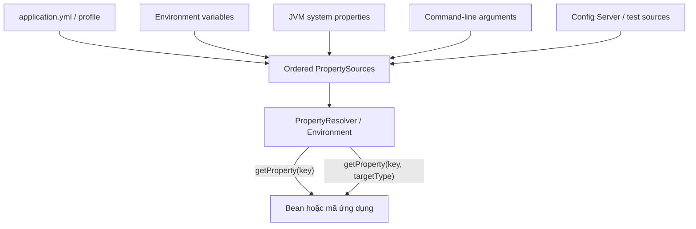

# Đọc thuộc tính với getProperty, kiểu dữ liệu và giá trị mặc định trong Spring Environment

## 1. Mục tiêu và bối cảnh

Một ứng dụng Spring Boot thường chạy ở nhiều môi trường: local, kiểm thử, staging và production. URL dịch vụ, timeout, số lần thử lại hoặc cờ bật/tắt có thể khác nhau giữa các môi trường. Nếu viết cứng những giá trị này trong Java, mỗi lần đổi môi trường có thể phải sửa source và đóng gói lại ứng dụng.

Spring cung cấp abstraction `Environment` để đọc thuộc tính từ nhiều nguồn cấu hình. Spring Boot bổ sung Config Data, profile, biến môi trường, tham số dòng lệnh và các nguồn khác. Spring Cloud Config có thể cung cấp thêm thuộc tính từ máy chủ cấu hình tập trung.

Ví dụ, `order-service` cần gọi `inventory-service`:

```yaml
inventory:
  client:
    base-url: http://localhost:8081
    timeout: 800ms
    max-attempts: 3
    enabled: true
```

Mã Java yêu cầu `Environment` trả về thuộc tính theo khóa. Spring đảm nhiệm việc tìm nguồn và chuyển đổi kiểu. Sau bài học, người đọc có thể dùng đúng overload `getProperty`, phân biệt giá trị thiếu/rỗng/sai định dạng, đặt default có chủ đích và biết khi nào nên dùng `@ConfigurationProperties`.

## 2. Environment, PropertyResolver và PropertySource

`Environment` thuộc Spring Core và mở rộng `PropertyResolver`. `PropertyResolver` định nghĩa các thao tác đọc thuộc tính và giải quyết placeholder; `Environment` bổ sung profile đang hoạt động và profile mặc định.

Một `Environment` có thể nhìn thấy nhiều `PropertySource`. Mỗi nguồn cung cấp các cặp khóa/giá trị:

| Nguồn | Ví dụ | Vai trò |
| --- | --- | --- |
| File cấu hình | `application.yml` | Giá trị chung của ứng dụng |
| File theo profile | `application-prod.yml` | Giá trị cho môi trường production |
| Biến môi trường | `INVENTORY_CLIENT_ENABLED` | Cấu hình từ container/host |
| Java system properties | `-Dinventory.client.timeout=1s` | Cấu hình JVM |
| Tham số dòng lệnh | `--inventory.client.max-attempts=5` | Ghi đè khi chạy Spring Boot |
| Config Server | Cấu hình theo ứng dụng/profile/label | Quản lý tập trung |
| Nguồn kiểm thử | Map hoặc test properties | Cô lập tình huống test |

Các nguồn được tổ chức theo thứ tự ưu tiên. Khi một khóa xuất hiện ở nhiều nguồn, nguồn có độ ưu tiên cao hơn được dùng. Thứ tự chính xác phụ thuộc phiên bản Boot, loại nguồn và cách cấu hình; khi cần xác định nguồn thắng, hãy kiểm tra property sources thực tế thay vì suy đoán theo tên file.



Sơ đồ biểu diễn các nguồn có thể tham gia phân giải, không khẳng định mọi ứng dụng đều bật tất cả nguồn hoặc luôn có cùng thứ tự. Spring Boot quy định thứ tự externalized configuration; hãy tra tài liệu đúng phiên bản nếu ứng dụng phụ thuộc vào thứ tự đó.

### 2.1. Inject Environment vào bean

```java
import org.springframework.core.env.Environment;
import org.springframework.stereotype.Service;

@Service
public class InventorySettingsReader {
    private final Environment environment;

    public InventorySettingsReader(Environment environment) {
        this.environment = environment;
    }
}
```

Không tự tạo `new StandardEnvironment()` trong bean ứng dụng. Một instance tự tạo không nhất thiết chứa những nguồn cấu hình mà Spring Boot đã nạp vào application context.

## 3. Các overload của getProperty

`Environment` kế thừa những phương thức đọc thuộc tính từ `PropertyResolver`:

| Phương thức | Khi đọc được giá trị | Khi không có kết quả |
| --- | --- | --- |
| `getProperty(String key)` | Trả về `String` | Trả `null` |
| `getProperty(String key, String defaultValue)` | Trả về `String` | Trả default |
| `getProperty(String key, Class<T> targetType)` | Chuyển sang kiểu yêu cầu | Trả `null` |
| `getProperty(String key, Class<T> targetType, T defaultValue)` | Chuyển sang kiểu yêu cầu | Trả default kiểu `T` nếu kết quả phân giải/chuyển đổi là `null` |
| `getRequiredProperty(String key)` | Trả về `String` | Ném `IllegalStateException` |
| `getRequiredProperty(String key, Class<T> targetType)` | Chuyển sang kiểu yêu cầu | Ném `IllegalStateException` |
| `containsProperty(String key)` | Kiểm tra khóa có giá trị | Trả `false` nếu không có |

### 3.1. Đọc String

```java
String baseUrl = environment.getProperty("inventory.client.base-url");

String region = environment.getProperty(
        "inventory.region",
        "local"
);
```

`baseUrl` có thể là `null` nếu khóa không tồn tại. `region` nhận `"local"` khi không tìm thấy khóa. Nếu khóa tồn tại với chuỗi rỗng, default không tự động thay thế chuỗi rỗng.

### 3.2. Đọc kiểu dữ liệu

```java
Integer maxAttempts = environment.getProperty(
        "inventory.client.max-attempts",
        Integer.class,
        3
);

Boolean enabled = environment.getProperty(
        "inventory.client.enabled",
        Boolean.class,
        false
);
```

Spring dùng conversion service của property resolver để chuyển giá trị nguồn sang kiểu đích. Với kiểu cơ bản như `Integer` và `Boolean`, conversion service thông thường đã hỗ trợ.

### 3.3. Đọc thuộc tính bắt buộc

```java
String endpoint = environment.getRequiredProperty(
        "inventory.client.base-url"
);

Integer maxAttempts = environment.getRequiredProperty(
        "inventory.client.max-attempts",
        Integer.class
);
```

Nếu khóa không tồn tại, `getRequiredProperty` ném `IllegalStateException`. Nếu khóa có giá trị nhưng không chuyển đổi được sang kiểu đích, lỗi chuyển đổi vẫn có thể xảy ra. Dùng phương thức này khi thiếu cấu hình sẽ khiến ứng dụng không thể hoạt động an toàn.

### 3.4. containsProperty

```java
if (environment.containsProperty("inventory.client.base-url")) {
    String endpoint = environment.getProperty("inventory.client.base-url");
    // Xử lý endpoint đã được khai báo.
}
```

Sự tồn tại không chứng minh giá trị hợp lệ. Một khóa có thể tồn tại nhưng rỗng, sai định dạng hoặc vi phạm quy tắc nghiệp vụ. Cần kiểm tra giá trị sau khi đọc.

## 4. Chuyển đổi kiểu dữ liệu

### 4.1. ConversionService

Nhiều nguồn cấu hình lưu giá trị dưới dạng chuỗi. Khi gọi `getProperty(key, Integer.class)`, Spring yêu cầu conversion service chuyển giá trị sang `Integer`:

```yaml
inventory:
  client:
    max-attempts: "4"
    enabled: "true"
    pool-size: "12"
```

```java
Integer attempts = environment.getProperty(
        "inventory.client.max-attempts",
        Integer.class
);
Boolean enabled = environment.getProperty(
        "inventory.client.enabled",
        Boolean.class
);
Long poolSize = environment.getProperty(
        "inventory.client.pool-size",
        Long.class
);
```

Không nên ép kiểu thủ công từ `Object` lấy trực tiếp ở `PropertySource`. Giá trị nguồn có thể là chuỗi, số hoặc object tùy nguồn; hãy yêu cầu kiểu đích qua resolver để việc chuyển đổi được quản lý tập trung.

### 4.2. Enum

```java
public enum InventoryMode {
    LOCAL,
    REMOTE
}

InventoryMode mode = environment.getProperty(
        "inventory.client.mode",
        InventoryMode.class,
        InventoryMode.LOCAL
);
```

Giá trị cấu hình phải tuân theo quy tắc chuyển đổi của converter. Với kiểu dữ liệu riêng, có thể đăng ký converter phù hợp vào conversion service do Spring quản lý. Nên thống nhất cách viết enum và kiểm thử giá trị không hợp lệ.

### 4.3. Duration và kiểu đặc thù của Spring Boot

Spring Boot thường cung cấp converter cho các kiểu như `Duration` hoặc `DataSize`:

```yaml
inventory:
  client:
    timeout: 750ms
```

```java
import java.time.Duration;

Duration timeout = environment.getProperty(
        "inventory.client.timeout",
        Duration.class,
        Duration.ofSeconds(2)
);
```

Ví dụ này cần conversion service có hỗ trợ chuỗi có đơn vị sang `Duration` như môi trường Spring Boot tương ứng. Với `StandardEnvironment` thuần của Spring Framework hoặc môi trường tùy chỉnh, không mặc định rằng mọi converter đặc thù của Boot đều có sẵn; cần kiểm tra conversion service hoặc đăng ký converter cần thiết. Ghi đơn vị rõ như `750ms` hoặc `2s` giúp tránh hiểu nhầm.

### 4.4. Chuyển đổi thất bại không tự dùng default

Giả sử cấu hình có `max-attempts: many` nhưng mã yêu cầu `Integer`:

```java
Integer attempts = environment.getProperty(
        "inventory.client.max-attempts",
        Integer.class,
        3
);
```

Default `3` được dùng khi kết quả đọc theo kiểu đích là `null`; trường hợp phổ biến là không tìm thấy khóa. Với một số converter, chuỗi rỗng cũng có thể được chuyển thành `null`, trong khi converter khác có thể từ chối hoặc giữ giá trị rỗng. Nếu khóa có giá trị `many` nhưng không chuyển đổi được thành số nguyên, Spring báo lỗi chuyển đổi; không trông đợi default thay thế một giá trị sai định dạng.

Phân biệt bốn trạng thái:

- **Missing:** không có khóa trong các nguồn được xét.
- **Present and valid:** có khóa và giá trị chuyển đổi được.
- **Present but invalid:** có khóa nhưng không chuyển đổi hoặc vi phạm quy tắc ứng dụng.
- **Present but blank:** có khóa với chuỗi rỗng hoặc khoảng trắng; cách xử lý tùy kiểu đích và converter.

Không gộp các trạng thái này thành một phép kiểm tra null.

## 5. Giá trị mặc định và thuộc tính bắt buộc

### 5.1. Default trong getProperty

```java
String region = environment.getProperty("inventory.region", "local");

Integer maxAttempts = environment.getProperty(
        "inventory.client.max-attempts",
        Integer.class,
        3
);
```

Default trong overload String được dùng khi resolver không tìm thấy giá trị; với overload có kiểu đích, default được dùng khi kết quả phân giải/chuyển đổi là `null`. Vì vậy, cách một chuỗi rỗng được xử lý có thể phụ thuộc converter và kiểu đích. Default không ghi ngược giá trị vào `Environment`, không sửa file cấu hình và không làm khóa xuất hiện trong nguồn nào.

### 5.2. Default khác với required

Một timeout có thể có default hợp lý; endpoint production có thể cần bắt buộc khai báo:

```java
Duration timeout = environment.getProperty(
        "inventory.client.timeout",
        Duration.class,
        Duration.ofMillis(800)
);

String baseUrl = environment.getRequiredProperty(
        "inventory.client.base-url"
);
```

Nếu dùng default cho một giá trị thực ra bắt buộc, lỗi cấu hình có thể bị che khuất và chỉ xuất hiện khi request thật được gửi đi. Hãy quyết định rõ khóa nào có default an toàn và khóa nào phải có.

### 5.3. Default trong YAML, placeholder và Java

**Trong YAML:**

```yaml
inventory:
  client:
    max-attempts: 3
```

**Trong placeholder:**

```java
@Value("${inventory.client.max-attempts:3}")
private int maxAttempts;
```

**Trong lời gọi getProperty:**

```java
int maxAttempts = environment.getProperty(
        "inventory.client.max-attempts",
        Integer.class,
        3
);
```

Chúng khác nhau về vị trí và thời điểm áp dụng. YAML là giá trị của property source; placeholder có default khi Spring resolve biểu thức; overload `getProperty` có default trong lần đọc đó. Không nên đặt nhiều default khác nhau cho cùng một khóa mà không có quy ước.

## 6. Missing, blank, sai định dạng và ngoài miền hợp lệ

| Tình huống | Ví dụ | Cách hiểu |
| --- | --- | --- |
| Không có khóa | Không khai báo `inventory.region` | `getProperty` trả null; overload có default trả default |
| Chuỗi rỗng | `inventory.region: ""` | Khóa có giá trị rỗng; default không tự thay thế |
| Khoảng trắng | `inventory.region: "   "` | Không tự giả định là missing; chuẩn hóa/validate theo yêu cầu |
| Sai kiểu | `max-attempts: many` khi yêu cầu Integer | Phát hiện lỗi chuyển đổi |
| Ngoài miền hợp lệ | `max-attempts: 0` khi phải lớn hơn 0 | Conversion thành công nhưng validation nghiệp vụ từ chối |

Ví dụ chủ động xem null, chuỗi rỗng và khoảng trắng là cùng một trường hợp:

```java
String region = environment.getProperty("inventory.region");
if (region == null || region.isBlank()) {
    region = "local";
}
```

Đây là **quyết định nghiệp vụ**, không phải hành vi mặc định của `getProperty`. Chỉ dùng khi giá trị rỗng thực sự được phép coi như chưa khai báo.

Với số lần thử lại, cần kiểm tra cả miền giá trị:

```java
Integer attempts = environment.getProperty(
        "inventory.client.max-attempts",
        Integer.class
);

if (attempts == null || attempts < 1 || attempts > 10) {
    throw new IllegalStateException(
            "inventory.client.max-attempts must be between 1 and 10"
    );
}
```

Với nhiều trường cấu hình, nên cân nhắc `@ConfigurationProperties` kết hợp validation thay vì lặp điều kiện trong nhiều bean.

## 7. Ví dụ hoàn chỉnh: đọc cấu hình cho client

```yaml
inventory:
  client:
    base-url: http://localhost:8081
    timeout: 750ms
    max-attempts: 4
    enabled: true
```

```java
import java.net.URI;
import java.time.Duration;

import org.springframework.core.env.Environment;
import org.springframework.stereotype.Component;

@Component
public class InventoryClientSettings {
    private final URI baseUrl;
    private final Duration timeout;
    private final int maxAttempts;
    private final boolean enabled;

    public InventoryClientSettings(Environment environment) {
        this.baseUrl = URI.create(
                environment.getRequiredProperty("inventory.client.base-url")
        );
        this.timeout = environment.getProperty(
                "inventory.client.timeout",
                Duration.class,
                Duration.ofSeconds(2)
        );
        this.maxAttempts = environment.getProperty(
                "inventory.client.max-attempts",
                Integer.class,
                3
        );
        this.enabled = environment.getProperty(
                "inventory.client.enabled",
                Boolean.class,
                false
        );

        if (maxAttempts < 1 || maxAttempts > 10) {
            throw new IllegalStateException(
                    "inventory.client.max-attempts must be between 1 and 10"
            );
        }
    }

    public URI getBaseUrl() { return baseUrl; }
    public Duration getTimeout() { return timeout; }
    public int getMaxAttempts() { return maxAttempts; }
    public boolean isEnabled() { return enabled; }
}
```

Ví dụ minh họa đọc từng khóa, default và validation đơn giản. Thuộc tính `Duration` cần conversion service phù hợp như môi trường Spring Boot đã cấu hình. Nếu `base-url` rỗng hoặc sai URI, `URI.create` báo lỗi; default của thuộc tính khác không che lỗi đó.

## 8. Khi nào dùng Binder và ConfigurationProperties?

`Environment.getProperty` phù hợp khi cần đọc một hoặc vài khóa riêng lẻ. Nếu cấu hình gồm nhiều trường có quan hệ với nhau, Spring Boot Binder và `@ConfigurationProperties` thường dễ quản lý hơn.

| Cách đọc | Phù hợp khi | Điểm cần lưu ý |
| --- | --- | --- |
| `Environment.getProperty` | Đọc một khóa đơn lẻ hoặc giá trị phụ thuộc ngữ cảnh | Mã tự tổ chức việc đọc nhiều trường và validation |
| `@Value` | Inject một giá trị vào bean | Placeholder, default và conversion; dễ phân tán khi có nhiều thuộc tính |
| `@ConfigurationProperties` | Bind nhóm cấu hình có cấu trúc | Relaxed binding, metadata, validation và nhóm property |
| `Binder` | Bind có lập trình từ `Environment` vào một kiểu dữ liệu | Hữu ích trong infrastructure hoặc logic binding động |

### 8.1. Ví dụ ConfigurationProperties

```java
import java.net.URI;
import java.time.Duration;

import jakarta.validation.constraints.Max;
import jakarta.validation.constraints.Min;
import jakarta.validation.constraints.NotNull;

import org.springframework.boot.context.properties.ConfigurationProperties;
import org.springframework.validation.annotation.Validated;

@Validated
@ConfigurationProperties(prefix = "inventory.client")
public class InventoryClientProperties {
    @NotNull
    private URI baseUrl = URI.create("http://localhost:8081");

    @NotNull
    private Duration timeout = Duration.ofMillis(750);

    @Min(1)
    @Max(10)
    private int maxAttempts = 3;

    private boolean enabled = true;

    public URI getBaseUrl() { return baseUrl; }
    public void setBaseUrl(URI baseUrl) { this.baseUrl = baseUrl; }
    public Duration getTimeout() { return timeout; }
    public void setTimeout(Duration timeout) { this.timeout = timeout; }
    public int getMaxAttempts() { return maxAttempts; }
    public void setMaxAttempts(int maxAttempts) { this.maxAttempts = maxAttempts; }
    public boolean isEnabled() { return enabled; }
    public void setEnabled(boolean enabled) { this.enabled = enabled; }
}
```

Đăng ký class bằng `@ConfigurationPropertiesScan` hoặc `@EnableConfigurationProperties` tùy cấu trúc ứng dụng. Validation cần dependency/provider validation phù hợp. Giá trị khởi tạo trong class đóng vai trò default cho trường chưa được bind; các annotation min/max/not-null kiểm tra ràng buộc khi validation được kích hoạt.

Namespace validation cũng phụ thuộc thế hệ Spring Boot: các dự án Boot 3 dùng `jakarta.validation`; dự án Boot 2 thường dùng `javax.validation`. Chọn dependency và import theo đúng nhánh Boot của dự án.

`Environment` hữu ích trong lớp tích hợp hoặc factory cần đọc một thuộc tính theo điều kiện. Với cấu hình client gồm URL, timeout, retry và cờ bật/tắt, `@ConfigurationProperties` giúp tập trung kiểu dữ liệu, default và validation. Không inject `Environment` vào mọi lớp nghiệp vụ chỉ để thay thế một object cấu hình đã được bind.

## 9. Placeholder, profile và Spring Cloud Config

### 9.1. Placeholder

Spring có thể resolve placeholder tham chiếu thuộc tính khác:

```yaml
service:
  host: localhost
  port: 8081
  url: "http://${service.host}:${service.port}"
```

Hoặc trong annotation:

```java
@Value("${inventory.client.max-attempts:3}")
private int maxAttempts;
```

`Environment` cung cấp `resolvePlaceholders` và `resolveRequiredPlaceholders` để giải quyết placeholder trong một chuỗi:

```java
String message = environment.resolvePlaceholders(
        "Inventory endpoint: ${inventory.client.base-url:unset}"
);
```

Placeholder có default riêng trong biểu thức. `resolveRequiredPlaceholders` báo lỗi nếu placeholder bắt buộc không thể giải quyết. Không ghi chuỗi đã resolve ra log nếu nó có thể chứa token hoặc mật khẩu.

### 9.2. Profile

```yaml
# application.yml
inventory:
  client:
    base-url: http://localhost:8081
    max-attempts: 2
```

```yaml
# application-prod.yml
inventory:
  client:
    base-url: https://inventory.internal
    max-attempts: 4
```

Khi profile `prod` được kích hoạt, cấu hình profile-specific tham gia vào tập property source theo thứ tự Spring Boot. Mã đọc vẫn dùng cùng khóa:

```java
String url = environment.getRequiredProperty("inventory.client.base-url");
```

Mã nghiệp vụ không cần biết giá trị đến từ file local hay file profile. Cách kích hoạt profile và thứ tự ưu tiên chính xác cần tra tài liệu Spring Boot của phiên bản dự án.

### 9.3. Spring Cloud Config và refresh

Spring Cloud Config có thể đưa thuộc tính từ Config Server vào môi trường của client. Khi Config Client nạp cấu hình thành công, ứng dụng vẫn đọc bằng cùng API:

```java
String inventoryUrl = environment.getRequiredProperty(
        "inventory.client.base-url"
);
```

Nguồn cung cấp property thay đổi, còn hợp đồng `PropertyResolver` mà mã sử dụng vẫn giữ nguyên. Tuy nhiên, **đọc qua Environment không tự động đồng nghĩa bean luôn nhận cấu hình mới**:

1. Nếu bean đọc thuộc tính lúc khởi tạo rồi lưu vào field, field giữ giá trị đã đọc cho đến khi bean được tạo lại hoặc mã chủ động cập nhật.
2. Nếu gọi `environment.getProperty` mỗi lần cần giá trị, resolver đọc từ các property source hiện tại. Nhưng property source chỉ đổi khi cơ chế cấu hình/refresh cập nhật nó.

Spring Cloud Context cung cấp cơ chế refresh cho bean được hỗ trợ, ví dụ `@RefreshScope`. Khi thay đổi cấu hình tập trung, cần kích hoạt quy trình refresh phù hợp và hiểu bean nào được làm mới. Chỉ sửa file trên Config Server không tự đẩy giá trị mới vào mọi instance đang chạy.

## 10. Kiểm thử việc đọc thuộc tính

`MockEnvironment` từ Spring Test tạo môi trường nhỏ với thuộc tính do test kiểm soát:

```java
import static org.assertj.core.api.Assertions.assertThat;

import org.junit.jupiter.api.Test;
import org.springframework.mock.env.MockEnvironment;

class EnvironmentPropertyTests {

    @Test
    void readsTypedValueAndUsesDefaultWhenMissing() {
        MockEnvironment environment = new MockEnvironment()
                .withProperty("inventory.client.max-attempts", "5")
                .withProperty("inventory.client.enabled", "true");

        Integer attempts = environment.getProperty(
                "inventory.client.max-attempts",
                Integer.class
        );
        Boolean enabled = environment.getProperty(
                "inventory.client.enabled",
                Boolean.class,
                false
        );
        Integer missing = environment.getProperty(
                "inventory.client.timeout-seconds",
                Integer.class,
                2
        );

        assertThat(attempts).isEqualTo(5);
        assertThat(enabled).isTrue();
        assertThat(missing).isEqualTo(2);
    }

    @Test
    void distinguishesBlankFromMissing() {
        MockEnvironment environment = new MockEnvironment()
                .withProperty("inventory.region", "");

        assertThat(environment.containsProperty("inventory.region")).isTrue();
        assertThat(environment.getProperty("inventory.region")).isEmpty();
        assertThat(environment.containsProperty("inventory.unknown")).isFalse();
    }
}
```

Test đầu tiên kiểm tra chuyển kiểu và default khi khóa không tồn tại. Test thứ hai nhấn mạnh chuỗi rỗng khác khóa không tồn tại. Có thể bổ sung test cho giá trị sai định dạng, thuộc tính required bị thiếu và giới hạn nghiệp vụ.

| Ca kiểm thử | Dữ liệu | Kết quả mong đợi |
| --- | --- | --- |
| Có khóa hợp lệ | `max-attempts=5` | Nhận số nguyên 5 |
| Không có khóa, có default | Không khai báo | Nhận default |
| Không có khóa, required | Không khai báo | Báo lỗi thiếu thuộc tính |
| Có chuỗi rỗng | `region=""` | Phân biệt với missing |
| Sai định dạng | `max-attempts=many` | Phát hiện lỗi chuyển đổi |
| Ngoài miền hợp lệ | `max-attempts=0` | Validation nghiệp vụ từ chối |
| Nhiều nguồn cùng khai báo | YAML và system property | Dùng giá trị nguồn ưu tiên cao hơn |
| Profile khác nhau | `dev` và `prod` | Cùng khóa, giá trị theo profile |

`MockEnvironment` chỉ kiểm tra resolver độc lập, không xác minh toàn bộ thứ tự externalized configuration của Spring Boot. Với kiểm thử tích hợp, dùng application context test có profile và property overrides để xác nhận cấu hình được nạp như môi trường chạy thật.

## 11. Chẩn đoán lỗi và kiểm tra nguồn cung cấp

| Triệu chứng | Nguyên nhân có thể | Cách xử lý |
| --- | --- | --- |
| `getProperty` trả `null` | Sai tên khóa, profile chưa bật hoặc nguồn chưa nạp | Kiểm tra key, active profiles và property sources |
| Giá trị rỗng cho kết quả khác kỳ vọng | String có thể giữ chuỗi rỗng; converter cho kiểu đích có thể trả null hoặc báo lỗi | Kiểm tra overload, target type và converter; chuẩn hóa/validate blank nếu nghiệp vụ cho phép |
| Lỗi chuyển đổi sang Integer/Boolean | Giá trị sai định dạng hoặc converter không phù hợp | Kiểm tra giá trị nguồn, kiểu đích và conversion service |
| Giá trị khác mong đợi | Property source ưu tiên cao hơn ghi đè | Kiểm tra nguồn chứa khóa và thứ tự ưu tiên |
| Config Server đổi nhưng bean vẫn dùng giá trị cũ | Bean lưu giá trị lúc khởi tạo hoặc chưa refresh | Kiểm tra refresh event/scope và vòng đời bean |
| Test khác production | Test dùng MockEnvironment hoặc profile khác | Bổ sung context test và xác minh runtime |
| Cấu hình bị rời rạc | Đọc từng khóa ở nhiều bean | Dùng `@ConfigurationProperties` và validation |
| Giá trị số ngoài miền | Conversion thành công nhưng quy tắc domain không đạt | Kiểm tra min/max và validation |

Khi cần biết nguồn nào cung cấp một khóa, có thể duyệt `ConfigurableEnvironment.getPropertySources()` trong môi trường chẩn đoán:

```java
import org.springframework.core.env.ConfigurableEnvironment;
import org.springframework.core.env.PropertySource;

if (environment instanceof ConfigurableEnvironment configurable) {
    for (PropertySource<?> source : configurable.getPropertySources()) {
        if (source.containsProperty("inventory.client.max-attempts")) {
            System.out.println("Property is present in: " + source.getName());
        }
    }
}
```

Đoạn mã chỉ ghi tên nguồn, không in giá trị. Đây là lựa chọn an toàn hơn khi property có thể chứa thông tin nhạy cảm. Tránh log token, mật khẩu, private key hoặc toàn bộ property source.

## 12. Nguyên tắc sử dụng

1. Dùng `getProperty(key)` khi chấp nhận giá trị có thể thiếu và muốn tự xử lý `null`.
2. Dùng overload có default khi giá trị mặc định thực sự an toàn; hiểu rằng overload có kiểu đích dùng default khi kết quả phân giải/chuyển đổi là null.
3. Dùng overload có `targetType` để Spring chuyển kiểu thay vì tự parse rải rác.
4. Dùng `getRequiredProperty` cho cấu hình bắt buộc để phát hiện lỗi sớm.
5. Phân biệt missing, blank, sai định dạng và ngoài miền hợp lệ.
6. Dùng `@ConfigurationProperties` cho nhóm cấu hình có cấu trúc, cần relaxed binding và validation.
7. Với Spring Cloud Config, nhớ rằng nguồn cấu hình có thể đổi nhưng bean đã giữ giá trị cũ không tự cập nhật nếu không có refresh phù hợp.
8. Không ghi giá trị bí mật hoặc toàn bộ property source ra log.

`Environment` là điểm truy cập thống nhất tới các thuộc tính đã được Spring nạp. Hiểu rõ overload `getProperty`, conversion service và quy tắc default giúp ứng dụng đọc cấu hình có kiểm soát, dễ kiểm thử và thích ứng với nhiều môi trường mà không gắn logic nghiệp vụ vào một nguồn cấu hình cụ thể.
