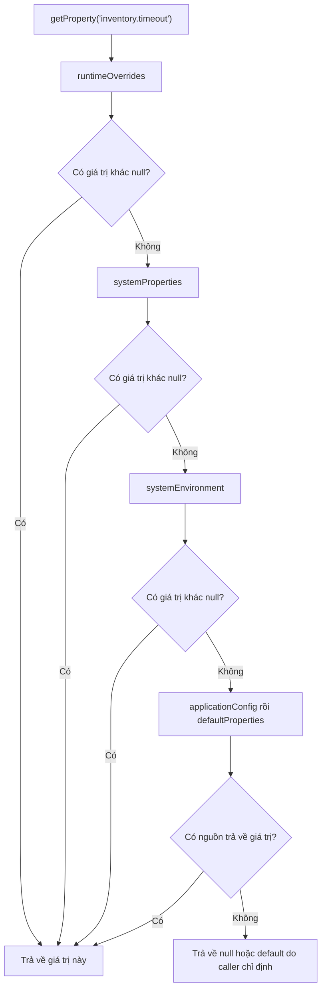

# MutablePropertySources và thứ tự tra cứu

Trong ứng dụng Spring, một thuộc tính như `inventory.timeout` có thể được khai báo ở nhiều nơi: file cấu hình trong JAR, file bên ngoài, biến môi trường, JVM system property, tham số dòng lệnh hoặc nguồn cấu hình do ứng dụng tích hợp. Khi các nguồn cùng cung cấp một key, Spring cần một quy tắc rõ ràng để quyết định giá trị nào có hiệu lực.

`PropertySource` đại diện cho một nguồn thuộc tính; `MutablePropertySources` quản lý tập nguồn đó theo thứ tự ưu tiên; `Environment` sử dụng các nguồn này để phân giải property. Hiểu ba thành phần này là nền tảng để vận hành **SPRING_CLOUD_CORE**, đặc biệt khi tích hợp Spring Boot externalized configuration, Spring Cloud Config, discovery, service registry và refresh scope.

Bài học thuộc chương **Environment**, tập trung vào cách sắp xếp, tra cứu và thay đổi nguồn thuộc tính. Mục tiêu là giải thích được tại sao một giá trị ghi đè giá trị khác, cách thêm nguồn cấu hình đúng vị trí và giới hạn của việc thay đổi `Environment` trong ứng dụng đang chạy.

## 1. Mục tiêu học tập

Sau bài này, bạn có thể:

- Phân biệt `PropertySource`, `PropertySources`, `MutablePropertySources` và `Environment`.
- Giải thích quy tắc tra cứu theo thứ tự: nguồn ưu tiên cao hơn được kiểm tra trước.
- Sử dụng `addFirst`, `addLast`, `addBefore`, `addAfter`, `replace` và `remove`.
- Nhận biết vai trò của tên `PropertySource` và cách kiểm tra vị trí ưu tiên.
- Phân biệt thứ tự mặc định của `StandardEnvironment` với tập nguồn cấu hình do Spring Boot bổ sung.
- Hiểu cách property resolver xử lý giá trị `null`, chuỗi rỗng và chuyển đổi kiểu.
- Phân biệt việc cập nhật `Environment` với việc rebind hoặc tạo lại bean.
- Kiểm thử thứ tự property source một cách xác định và chẩn đoán lỗi ghi đè cấu hình.

## 2. Bốn khái niệm nền tảng

### 2.1. `PropertySource`: một nguồn cung cấp thuộc tính

`org.springframework.core.env.PropertySource<T>` là lớp trừu tượng bao bọc một nguồn dữ liệu có tên. Nó định nghĩa thao tác quan trọng:

```java
Object getProperty(String name);
```

Phương thức trả về giá trị nếu nguồn có key tương ứng, hoặc `null` nếu không cung cấp giá trị đó. Nguồn dữ liệu có thể là map, biến môi trường, JVM properties hoặc một hệ thống tùy chỉnh.

Các implementation thường gặp:

| Kiểu | Nguồn dữ liệu |
| --- | --- |
| `MapPropertySource` | `Map<String, Object>` |
| `SystemEnvironmentPropertySource` | Biến môi trường của tiến trình |
| `PropertiesPropertySource` | Đối tượng `java.util.Properties` |
| `CompositePropertySource` | Tập nhiều `PropertySource` được gom lại |
| `StubPropertySource` | Nguồn placeholder được dùng trong một số giai đoạn khởi tạo context |

`EnumerablePropertySource` là nhánh mở rộng có khả năng liệt kê tên property. Không phải mọi `PropertySource` đều có thể liệt kê key; một nguồn từ xa có thể chỉ hỗ trợ truy vấn theo tên.

Tên nguồn giúp phân biệt và quản lý nó trong tập `PropertySources`. Nên đặt tên ổn định, dễ hiểu như `runtimeOverrides`, `tenantDefaults` hoặc `remoteConfiguration`.

### 2.2. `PropertySources`: hợp đồng tập hợp các nguồn

`PropertySources` là giao diện biểu diễn một tập các `PropertySource<?>`. Nó cho phép duyệt qua các nguồn theo thứ tự. Bản thân giao diện này không yêu cầu tập hợp phải sửa đổi được.

### 2.3. `MutablePropertySources`: tập nguồn có thể thay đổi

`org.springframework.core.env.MutablePropertySources` là implementation có thể thêm, thay thế, xóa và sắp xếp lại `PropertySource`. Nó thường được truy cập qua `ConfigurableEnvironment#getPropertySources()`.

```java
ConfigurableEnvironment environment = new StandardEnvironment();
MutablePropertySources sources = environment.getPropertySources();
```

Đặc điểm cốt lõi: **thứ tự trong `MutablePropertySources` chính là thứ tự ưu tiên khi phân giải property**. Phần tử đứng trước có ưu tiên cao hơn phần tử đứng sau.

`MutablePropertySources` hỗ trợ truy cập và cập nhật tập nguồn theo cách an toàn cho nhiều luồng ở mức collection. Điều đó không tự bảo đảm rằng mọi object bên trong nguồn dữ liệu đều thread-safe, hoặc một thay đổi cấu hình đang chạy sẽ được áp dụng đồng bộ cho tất cả bean.

### 2.4. `Environment`: giao diện đọc cấu hình

`Environment` cung cấp các thao tác như:

```java
String region = environment.getProperty("service.region");
Integer port = environment.getProperty("server.port", Integer.class);
boolean enabled = environment.getProperty(
        "feature.enabled", Boolean.class, false);
```

`Environment` cũng cung cấp các thao tác liên quan tới profile, ví dụ `getActiveProfiles()` và `acceptsProfiles(...)`.

Ứng dụng thông thường đọc property qua `Environment`; phần triển khai bên dưới duyệt các `PropertySource` theo thứ tự. Nếu cần thay đổi tập nguồn, phải có `ConfigurableEnvironment` hoặc truy cập `MutablePropertySources` tương ứng.

## 3. Quy tắc tra cứu: nguồn đầu tiên có giá trị thắng

Giả sử tập nguồn có thứ tự:

```text
runtimeOverrides       <- ưu tiên cao nhất
systemProperties
systemEnvironment
applicationConfig
defaultProperties      <- ưu tiên thấp nhất
```

Khi gọi:

```java
String timeout = environment.getProperty("inventory.timeout");
```

Spring lần lượt hỏi từng nguồn. Nguồn đầu tiên trả về giá trị khác `null` sẽ quyết định kết quả. Các nguồn phía sau không còn được dùng cho key đó.



Đây là cách mô tả khái quát. Tập nguồn và thứ tự thực tế phụ thuộc loại `Environment`, Spring Boot, Spring Test và các tích hợp đã đăng ký.

### 3.1. Ví dụ hai nguồn cùng khai báo một key

```java
MutablePropertySources sources = new MutablePropertySources();

Map<String, Object> defaults = Map.of(
        "inventory.timeout", "2000",
        "inventory.region", "local");

Map<String, Object> deployment = Map.of(
        "inventory.timeout", "800");

sources.addLast(new MapPropertySource("applicationDefaults", defaults));
sources.addFirst(new MapPropertySource("deploymentOverrides", deployment));

PropertySourcesPropertyResolver resolver =
        new PropertySourcesPropertyResolver(sources);

String timeout = resolver.getProperty("inventory.timeout");
String region = resolver.getProperty("inventory.region");
```

Kết quả:

| Key | Kết quả | Lý do |
| --- | --- | --- |
| `inventory.timeout` | `"800"` | `deploymentOverrides` đứng trước và có giá trị |
| `inventory.region` | `"local"` | Nguồn ưu tiên cao không có key, resolver tiếp tục tìm ở `applicationDefaults` |

Ví dụ sử dụng `PropertySourcesPropertyResolver` để làm rõ thuật toán mà `Environment` dựa vào. Trong ứng dụng Spring Boot, thường dùng trực tiếp `Environment` đã được framework cấu hình.

### 3.2. `null` khác chuỗi rỗng

Resolver tiếp tục tìm nguồn tiếp theo khi `getProperty(name)` trả về `null`. Một giá trị chuỗi rỗng `""` vẫn là một giá trị khác `null`, do đó nó **chặn** các nguồn thấp hơn.

Ví dụ:

```java
Map<String, Object> defaults = Map.of("service.endpoint", "http://localhost:8080");
Map<String, Object> deployment = Map.of("service.endpoint", "");
```

Nếu `deployment` đứng trước `defaults`, kết quả là chuỗi rỗng. Spring không tự bỏ qua giá trị rỗng để lấy URL mặc định. Đây là lý do một biến môi trường được đặt thành chuỗi rỗng có thể khiến cấu hình hợp lệ trong file bị ghi đè ngoài dự kiến.

Với `MapPropertySource`, map entry có giá trị `null` cũng được xem như không cung cấp giá trị khi truy vấn. Nếu cần biểu diễn trạng thái “đã cấu hình nhưng cố ý để trống”, phải dùng một quy ước giá trị rõ ràng và kiểm tra nó ở tầng ứng dụng.

### 3.3. Giá trị mặc định trong lời gọi `getProperty`

Các overload cho phép truyền giá trị mặc định:

```java
int maxAttempts = environment.getProperty(
        "inventory.max-attempts", Integer.class, 3);
```

Giá trị mặc định chỉ được dùng khi không nguồn nào trả về giá trị cho key. Nếu nguồn ưu tiên cao trả về `""`, resolver không tự chuyển sang default; việc chuyển đổi chuỗi rỗng sang kiểu đích có thể thất bại hoặc tùy converter.

`getRequiredProperty(...)` phù hợp khi ứng dụng bắt buộc phải có key: nếu không tìm thấy, nó ném lỗi thay vì trả `null`.

## 4. Thứ tự mặc định của các Environment phổ biến

Không có một danh sách property source cố định cho mọi ứng dụng Spring. Tập nguồn được quyết định bởi loại Environment và framework/tích hợp đã cấu hình.

### 4.1. `StandardEnvironment`

`StandardEnvironment` là một `ConfigurableEnvironment` thường dùng cho ứng dụng không gắn với web context. Khi khởi tạo, nó có hai nguồn tiêu chuẩn:

| Thứ tự tra cứu | Tên nguồn | Ý nghĩa |
| ---: | --- | --- |
| 1 | `systemProperties` | JVM system properties, ví dụ `-Dservice.region=local` |
| 2 | `systemEnvironment` | Biến môi trường của tiến trình, ví dụ `SERVICE_REGION=prod` |

Vì `systemProperties` đứng trước, nếu cả hai nguồn cùng cung cấp một thuộc tính, JVM system property thắng trong `StandardEnvironment` mặc định.

`StandardServletEnvironment` mở rộng mô hình này cho ứng dụng servlet và bổ sung các nguồn liên quan đến Servlet API, như init parameters của `ServletContext` và `ServletConfig`. Thứ tự cụ thể được mô tả trong Javadoc của lớp tương ứng.

### 4.2. Spring Boot bổ sung nhiều nguồn hơn

Spring Boot chuẩn bị Environment trong quá trình `SpringApplication` khởi động. Ngoài các nguồn tiêu chuẩn, Boot thêm Config Data, random values, command-line arguments, JSON application properties, test property sources và các nguồn khác tùy môi trường.

Một thứ tự **rút gọn theo mức ưu tiên tăng dần** thường gặp trong ứng dụng Boot là:

1. Giá trị mặc định do `SpringApplication#setDefaultProperties`.
2. `@PropertySource` trên các lớp cấu hình.
3. Config Data như `application.yaml`, file theo profile và nguồn được import.
4. Các nguồn runtime như biến môi trường và JVM system properties.
5. `SPRING_APPLICATION_JSON`.
6. Command-line arguments.
7. Các nguồn test như `@DynamicPropertySource` và `@TestPropertySource` khi chạy kiểm thử.

Đây là danh sách khái quát để hiểu nguyên tắc, không phải bản liệt kê đầy đủ cho mọi loại ứng dụng. Boot có thể thêm nguồn cho JNDI, servlet, devtools và test; thứ tự chính xác có thể thay đổi theo phiên bản. Khi cần kết luận trong production, hãy xem `environment.getPropertySources()` của đúng tiến trình và đối chiếu tài liệu Boot tương ứng.

### 4.3. Vì sao không nên suy luận thứ tự từ tên file?

Một ứng dụng có thể có:

- `application.yaml` trong JAR.
- `application-prod.yaml` trong JAR.
- `./config/application.yaml` bên ngoài.
- `./config/application-prod.yaml` bên ngoài.
- Biến môi trường `INVENTORY_TIMEOUT`.
- Tham số `--inventory.timeout=500`.

Kết quả cuối cùng không chỉ phụ thuộc thứ tự file mà còn phụ thuộc profile active, Config Data location, import, property source do Boot tạo và nguồn runtime có ưu tiên cao hơn. Hãy kiểm tra **tập nguồn đã được nạp**, sau đó xem key đang xuất hiện ở nguồn nào.

## 5. Các thao tác của MutablePropertySources

`MutablePropertySources` cung cấp các phương thức chính để quản lý collection.

| Phương thức | Tác dụng | Ảnh hưởng ưu tiên |
| --- | --- | --- |
| `addFirst(source)` | Đưa nguồn lên đầu danh sách | Ưu tiên cao nhất |
| `addLast(source)` | Đưa nguồn xuống cuối danh sách | Ưu tiên thấp nhất |
| `addBefore(name, source)` | Chèn trước nguồn có tên `name` | Cao hơn nguồn tham chiếu |
| `addAfter(name, source)` | Chèn sau nguồn có tên `name` | Thấp hơn nguồn tham chiếu |
| `replace(name, source)` | Thay nguồn đang có bằng nguồn mới cùng vị trí | Giữ vị trí ưu tiên |
| `remove(name)` | Xóa nguồn theo tên | Các nguồn phía sau dịch lên |
| `get(name)` | Lấy nguồn theo tên | Không thay đổi thứ tự |
| `contains(name)` | Kiểm tra nguồn có tồn tại | Không thay đổi thứ tự |
| `precedenceOf(source)` | Lấy chỉ số ưu tiên của nguồn | Chỉ đọc |

### 5.1. `addFirst` và `addLast`

```java
MutablePropertySources sources = environment.getPropertySources();

sources.addFirst(new MapPropertySource(
        "emergencyOverrides",
        Map.of("payment.read-only", "true")));

sources.addLast(new MapPropertySource(
        "fallbackDefaults",
        Map.of("payment.retry-limit", "2")));
```

`addFirst` dùng khi nguồn phải có ưu tiên cao hơn các nguồn hiện tại. `addLast` dùng cho fallback/default có ưu tiên thấp. Nếu một nguồn có cùng tên đã tồn tại, các thao tác add sẽ loại bỏ vị trí cũ trước khi thêm nguồn vào vị trí mới; vì vậy tên nguồn cần được quản lý nhất quán.

Không dùng `addFirst` chỉ vì muốn “đảm bảo giá trị có mặt”. Nó có thể ghi đè biến môi trường, JVM property hoặc command-line argument mà nhóm vận hành mong muốn được ưu tiên.

### 5.2. `addBefore` và `addAfter`

Khi cần đặt một nguồn ở vị trí tương đối với nguồn đã biết:

```java
MutablePropertySources sources = environment.getPropertySources();

sources.addBefore(
        "systemEnvironment",
        new MapPropertySource(
                "deploymentMetadata",
                Map.of("service.region", "ap-southeast-1")));
```

Nguồn `deploymentMetadata` sẽ được kiểm tra trước `systemEnvironment`, nhưng sau những nguồn đang đứng trước `systemEnvironment`. Tên nguồn tham chiếu phải tồn tại; nếu không, thao tác không thể xác định vị trí chèn và sẽ báo lỗi.

`addAfter` có ý nghĩa ngược lại: nguồn mới được kiểm tra sau nguồn tham chiếu. Chọn vị trí tương đối giúp giữ lại chính sách ưu tiên chung của framework.

### 5.3. `replace` giữ vị trí, `remove` loại nguồn

```java
MutablePropertySources sources = environment.getPropertySources();

sources.replace(
        "deploymentMetadata",
        new MapPropertySource(
                "deploymentMetadata",
                Map.of("service.region", "ap-southeast-2")));

sources.remove("fallbackDefaults");
```

`replace` hữu ích khi nguồn dữ liệu cần được thay thế nhưng vị trí ưu tiên phải giữ nguyên. Tên nguồn được thay thế phải tồn tại. `remove` xóa nguồn khỏi tập; sau khi xóa, resolver tiếp tục tìm key ở các nguồn còn lại.

### 5.4. Kiểm tra thứ tự hiện tại

```java
MutablePropertySources sources = environment.getPropertySources();

for (PropertySource<?> source : sources) {
    log.info("PropertySource: {}", source.getName());
}

PropertySource<?> deployment = sources.get("deploymentMetadata");
if (deployment != null) {
    log.info("Deployment precedence: {}", sources.precedenceOf(deployment));
}
```

Chỉ số `0` là vị trí đầu tiên và có ưu tiên cao nhất. Khi chẩn đoán, log tên và vị trí nguồn thường hữu ích hơn việc dump toàn bộ nội dung.

## 6. Ví dụ thực hành: thêm nguồn ghi đè cho một ứng dụng

Giả sử ứng dụng `checkout-service` có mặc định:

```yaml
inventory:
  region: local
  max-attempts: 2
  enabled: true
```

Trong một môi trường thử nghiệm, nhóm vận hành muốn thay `region` và `max-attempts` bằng nguồn `deploymentOverrides`.

### 6.1. Tạo nguồn MapPropertySource trước khi context refresh

```java
import java.util.Map;

import org.springframework.context.ApplicationContextInitializer;
import org.springframework.context.ConfigurableApplicationContext;
import org.springframework.core.env.MapPropertySource;

public class DeploymentOverridesInitializer
        implements ApplicationContextInitializer<ConfigurableApplicationContext> {

    @Override
    public void initialize(ConfigurableApplicationContext context) {
        Map<String, Object> values = Map.of(
                "inventory.region", "ap-southeast-1",
                "inventory.max-attempts", "4");

        context.getEnvironment().getPropertySources().addFirst(
                new MapPropertySource("deploymentOverrides", values));
    }
}
```

Đăng ký initializer khi tạo `SpringApplication`:

```java
SpringApplication application = new SpringApplication(CheckoutApplication.class);
application.addInitializers(new DeploymentOverridesInitializer());
application.run(args);
```

`ApplicationContextInitializer` chạy trước khi context refresh, vì vậy nguồn mới có thể tham gia vào quá trình tạo bean và đánh giá nhiều điều kiện auto-configuration. Tuy nhiên, initializer không phải lúc nào cũng đủ sớm cho những quyết định đã được thực hiện trong giai đoạn chuẩn bị Environment hoặc nạp Config Data. Nếu nguồn cần tác động đến chính việc xác định Config Data location, hãy dùng hook Environment sớm phù hợp như `EnvironmentPostProcessor` và sắp xếp thứ tự chạy đúng với Config Data processing.

### 6.2. Đọc kết quả qua Environment

```java
@Component
public class InventorySettings {
    private final String region;
    private final int maxAttempts;
    private final boolean enabled;

    public InventorySettings(Environment environment) {
        this.region = environment.getProperty(
                "inventory.region", "unknown");
        this.maxAttempts = environment.getProperty(
                "inventory.max-attempts", Integer.class, 1);
        this.enabled = environment.getProperty(
                "inventory.enabled", Boolean.class, false);
    }
}
```

Kết quả mong đợi sau khi initializer được đăng ký:

| Key | Giá trị | Nguồn |
| --- | --- | --- |
| `inventory.region` | `ap-southeast-1` | `deploymentOverrides` |
| `inventory.max-attempts` | `4` | `deploymentOverrides` |
| `inventory.enabled` | `true` | `application.yaml` |

Các key không có trong nguồn ưu tiên cao tiếp tục được tìm ở nguồn thấp hơn. Đây là hành vi hợp nhất theo từng key, không phải thay thế nguyên một file.

### 6.3. Lưu ý về thời điểm đăng ký

Nếu thêm nguồn sau khi một singleton đã được tạo, lời gọi `Environment#getProperty` mới có thể thấy giá trị mới, nhưng field đã được tiêm qua `@Value` hoặc `@ConfigurationProperties` không tự động thay đổi. Vì thế, phải chọn đúng thời điểm:

- **Trước refresh context:** khi nguồn cần ảnh hưởng đến điều kiện tạo bean, Config Data hoặc cấu hình khởi tạo.
- **Sau khi context chạy:** chỉ khi ứng dụng chủ động quản lý cập nhật, rebind hoặc refresh bean theo thiết kế.

Không nên dùng một `@Bean` thông thường để sửa Environment rồi giả định mọi auto-configuration đã chạy trước đó sẽ được đánh giá lại.

## 7. PropertySource tùy chỉnh

Khi cấu hình đến từ một nguồn không phải map hoặc file, có thể tạo implementation riêng của `PropertySource<T>`.

```java
public final class RegionPropertySource
        extends PropertySource<RegionSettings> {

    public RegionPropertySource(String name, RegionSettings source) {
        super(name, source);
    }

    @Override
    public Object getProperty(String name) {
        if ("service.region".equals(name)) {
            return getSource().region();
        }
        if ("service.zone".equals(name)) {
            return getSource().zone();
        }
        return null;
    }
}
```

Implementation trên minh họa cách chuyển một object cấu hình thành property source. Nếu nguồn dữ liệu có nhiều key và cần liệt kê chúng, có thể mở rộng `EnumerablePropertySource<T>` và triển khai `getPropertyNames()`.

### 7.1. Những điều phải cân nhắc với nguồn tùy chỉnh

- **Độ trễ:** `getProperty` có thể được gọi nhiều lần. Không nên gọi mạng đồng bộ tới Config Server cho từng lần truy vấn.
- **Cache:** nếu cache dữ liệu từ xa, phải xác định thời gian sống, cập nhật và xử lý khi nguồn không sẵn sàng.
- **Kiểu dữ liệu:** trả về giá trị phù hợp hoặc chuỗi có thể chuyển đổi; tránh để converter nhận kiểu bất ngờ.
- **Bảo mật:** không để `toString`, debug hoặc log vô tình in credential.
- **Thứ tự:** đặt nguồn vào đúng vị trí theo chính sách ghi đè.
- **Lỗi:** quyết định rõ khi nguồn không có key, trả `null`, timeout hoặc lỗi xác thực.
- **Vòng đời:** nguồn cần kết nối hoặc tài nguyên phải có cách đóng phù hợp khi context dừng.

Trong nhiều ứng dụng, tích hợp Spring Cloud Config hoặc cơ chế cấu hình nền tảng đã có sẵn sẽ phù hợp hơn việc tự viết một property source truy cập mạng.

## 8. PropertySources và cơ chế bind của Spring Boot

Spring Boot dùng `Environment` để cung cấp cấu hình, đồng thời có cơ chế Binder để bind property thành object `@ConfigurationProperties`. Hai đường truy cập có liên quan nhưng không hoàn toàn giống nhau.

### 8.1. Tra cứu chính xác qua Environment

```java
String timeout = environment.getProperty("inventory.timeout");
```

Đây là tra cứu theo tên property thông qua resolver và các property source. Một số implementation, chẳng hạn `SystemEnvironmentPropertySource`, có quy tắc ánh xạ tên để tương thích biến môi trường.

### 8.2. Relaxed binding qua Binder

Spring Boot Binder hỗ trợ relaxed binding cho các dạng tên cấu hình tương đương trong các ngữ cảnh được hỗ trợ. Ví dụ `inventory.max-attempts` có thể được biểu diễn bằng biến môi trường `INVENTORY_MAX_ATTEMPTS` khi bind `@ConfigurationProperties`.

```java
@ConfigurationProperties(prefix = "inventory")
public record InventoryProperties(
        String region,
        int maxAttempts,
        boolean enabled) {
}
```

Binder sử dụng cơ chế `ConfigurationPropertySource` để chuẩn hóa và bind property theo quy tắc của Boot. Không nên suy ra rằng mọi cách gọi `Environment#getProperty` đều có toàn bộ relaxed binding behavior giống Binder.

### 8.3. Nguồn cấu hình được thêm có ảnh hưởng tới Binder không?

Khi một `PropertySource` được thêm vào Environment đúng thời điểm và được chuyển đổi qua adapter cấu hình của Boot, Binder có thể nhìn thấy property đó. Nhưng nếu nguồn được thêm muộn sau khi bean `@ConfigurationProperties` đã bind, object hiện tại không tự cập nhật chỉ vì nguồn mới đã xuất hiện.

Nếu cần cập nhật cấu hình sau khởi động, phải dùng cơ chế rebind/refresh được hỗ trợ trong kiến trúc đang chạy, đồng thời kiểm tra bean nào thực sự được cập nhật.

## 9. Liên hệ với Spring Cloud Config và RefreshScope

Spring Cloud Config Client đưa cấu hình từ xa vào quy trình Config Data của Spring Boot. Khi đã nạp, các giá trị đó được biểu diễn trong Environment qua các property source tương ứng. Chúng tham gia tra cứu theo thứ tự ưu tiên của Environment.

Một mô hình đơn giản:

```text
Command-line arguments
        |
        v
Environment
        ^
        |
Spring Cloud Config property source
        ^
        |
Config Server
```

Config Server không thay thế `MutablePropertySources`; nó là một nguồn cung cấp dữ liệu được tích hợp vào quá trình cấu hình. Nếu nhiều nguồn cùng khai báo `inventory.region`, nguồn có precedence cao hơn trong Environment sẽ quyết định kết quả.

### 9.1. Thay nguồn không đồng nghĩa refresh bean

Giả sử `Environment` ban đầu trả về `inventory.timeout=2s`. Sau đó một property source được thay thế và giá trị mới là `800ms`.

- Lời gọi `environment.getProperty("inventory.timeout")` tiếp theo có thể thấy `800ms`.
- Bean singleton đã đọc giá trị `2s` trong constructor vẫn giữ field cũ.
- Bean dùng `@ConfigurationProperties` không tự động được bind lại trong mọi trường hợp.
- Bean nằm trong `@RefreshScope` cần cơ chế refresh làm invalidate target; lần truy cập sau đó mới tạo target mới theo cấu hình hiện hành.

Spring Cloud Context bổ sung các cơ chế hỗ trợ refresh và rebinding. Chúng cần được cấu hình, kích hoạt và bảo vệ phù hợp; `MutablePropertySources` tự nó không phát tán sự kiện refresh.

### 9.2. Không dùng MutablePropertySources như kho trạng thái nghiệp vụ

Có thể thêm nguồn runtime để cung cấp một override có kiểm soát, nhưng không nên dùng Environment làm nơi lưu trạng thái giao dịch, trạng thái người dùng hoặc dữ liệu thay đổi theo từng request.

Environment thích hợp cho **cấu hình của ứng dụng**. Nếu mỗi tenant có một giá trị khác nhau theo request, hãy dùng tenant context hoặc service cấu hình chuyên biệt. Thêm một PropertySource global cho mỗi request có thể gây rò rỉ cấu hình giữa các request và tạo race condition về mặt nghiệp vụ.

## 10. Kiểm thử thứ tự tra cứu

Kiểm thử thứ tự giúp bảo đảm một nguồn mới không vô tình ghi đè cấu hình quan trọng.

### 10.1. Unit test với MutablePropertySources

```java
class PropertySourceOrderTest {

    @Test
    void firstNonNullSourceWins() {
        MutablePropertySources sources = new MutablePropertySources();
        sources.addLast(new MapPropertySource(
                "defaults",
                Map.of("service.region", "local")));
        sources.addFirst(new MapPropertySource(
                "deployment",
                Map.of("service.region", "ap-southeast-1")));

        PropertySourcesPropertyResolver resolver =
                new PropertySourcesPropertyResolver(sources);

        assertThat(resolver.getProperty("service.region"))
                .isEqualTo("ap-southeast-1");
    }
}
```

### 10.2. Kiểm thử fallback khi nguồn trên không có key

```java
@Test
void missingKeyFallsThroughToLowerPrioritySource() {
    MutablePropertySources sources = new MutablePropertySources();
    sources.addFirst(new MapPropertySource(
            "runtime",
            Map.of("service.region", "staging")));
    sources.addLast(new MapPropertySource(
            "defaults",
            Map.of("service.timeout", "2000")));

    PropertySourcesPropertyResolver resolver =
            new PropertySourcesPropertyResolver(sources);

    assertThat(resolver.getProperty("service.timeout"))
            .isEqualTo("2000");
}
```

### 10.3. Kiểm thử chuỗi rỗng ghi đè

```java
@Test
void emptyStringIsStillAResolvedValue() {
    MutablePropertySources sources = new MutablePropertySources();
    sources.addFirst(new MapPropertySource(
            "deployment",
            Map.of("service.endpoint", "")));
    sources.addLast(new MapPropertySource(
            "defaults",
            Map.of("service.endpoint", "http://localhost:8080")));

    PropertySourcesPropertyResolver resolver =
            new PropertySourcesPropertyResolver(sources);

    assertThat(resolver.getProperty("service.endpoint")).isEmpty();
}
```

Các test trên cô lập thuật toán tra cứu, không phụ thuộc biến môi trường của máy developer. Với kiểm thử Spring Boot, có thể dùng `ApplicationContextRunner` để xác minh property source và auto-configuration trong context nhỏ.

### 10.4. Kiểm thử tích hợp Environment thật

Khi cần xác minh cấu hình trong ứng dụng Boot:

1. Khởi tạo context với các property được khai báo ở nhiều nguồn.
2. Lấy `ConfigurableEnvironment` từ context.
3. Liệt kê tên `PropertySource` theo thứ tự hiện tại.
4. Đọc giá trị của key quan trọng qua `Environment`.
5. Xác minh bean được bind nhận giá trị mong đợi.
6. Kiểm tra profile và nguồn cấu hình từ xa nếu có.

Test này giúp phát hiện sự khác nhau giữa thứ tự của một `MutablePropertySources` tự tạo và thứ tự thật mà Spring Boot chuẩn bị khi khởi động.

## 11. Quan sát và chẩn đoán trong môi trường chạy

Khi một property có giá trị sai, hãy kiểm tra theo trình tự:

1. **Key:** tên property có chính xác không? Có nhầm dấu gạch nối, dấu chấm hoặc chữ hoa không?
2. **Nguồn:** key xuất hiện ở những `PropertySource` nào?
3. **Thứ tự:** nguồn nào đứng đầu và nguồn nào trả về giá trị khác `null` đầu tiên?
4. **Giá trị:** nguồn ưu tiên cao có đang trả về chuỗi rỗng hoặc giá trị không mong muốn không?
5. **Kiểu:** giá trị có chuyển đổi được sang kiểu đích không?
6. **Thời điểm:** nguồn được thêm trước hay sau khi bean đã đọc property?
7. **Refresh:** nếu cấu hình thay đổi lúc runtime, bean có cơ chế rebind hoặc refresh phù hợp không?

Ví dụ liệt kê thứ tự nguồn mà không in giá trị:

```java
ConfigurableEnvironment environment =
        (ConfigurableEnvironment) applicationContext.getEnvironment();

int index = 0;
for (PropertySource<?> source : environment.getPropertySources()) {
    log.info("PropertySource[{}] = {}", index++, source.getName());
}
```

Trong Spring Boot Actuator, các endpoint `env` và `configprops` có thể hỗ trợ chẩn đoán nguồn và binding. Chỉ expose khi cần, giới hạn quyền truy cập và bảo đảm dữ liệu nhạy cảm được che. Không đưa token, mật khẩu hoặc nội dung secret vào log để tìm nguồn ghi đè.

### 11.1. Một số triệu chứng thường gặp

| Triệu chứng | Nguyên nhân có thể | Hướng xử lý |
| --- | --- | --- |
| File YAML có giá trị mới nhưng `Environment` trả giá trị cũ | Nguồn ưu tiên cao hơn đang ghi đè | Liệt kê property source và kiểm tra biến môi trường/JVM/CLI |
| `Environment` trả giá trị mới nhưng bean vẫn dùng giá trị cũ | Bean đã đọc property khi khởi tạo | Kiểm tra binding, refresh scope và vòng đời bean |
| `addBefore` hoặc `addAfter` báo lỗi | Tên nguồn tham chiếu không tồn tại | Kiểm tra `get(name)` và tên nguồn thực tế |
| Thêm nguồn rồi không thấy key | Source trả `null`, key sai hoặc thêm vào Environment khác | Kiểm tra `getProperty`, context đang dùng và source identity |
| Một biến môi trường rỗng ghi đè file | Chuỗi rỗng khác `null` | Kiểm tra giá trị thực của biến và validation |
| Test pass nhưng production khác | Boot tạo thêm nguồn hoặc thứ tự khác | Kiểm tra Environment thực trong đúng profile/runtime |
| Binder và `Environment#getProperty` cho kết quả khác | Relaxed binding/adapter khác với tra cứu tên trực tiếp | Kiểm tra tên canonical và cách bind `@ConfigurationProperties` |

## 12. Những lỗi thiết kế nên tránh

- Thêm tất cả nguồn bằng `addFirst`: làm mất chính sách ưu tiên dự kiến của command line, system property hoặc biến môi trường.
- Dùng tên nguồn trùng lặp thiếu chủ ý: thao tác add có thể di chuyển/thay thế nguồn đã tồn tại.
- Gọi `addBefore` với tên không ổn định: dễ lỗi khi thay Boot version hoặc thay loại Environment.
- Dùng `replace` để đổi vị trí: `replace` giữ vị trí; muốn đổi precedence phải dùng thao tác chèn phù hợp.
- Thay `MutablePropertySources` sau khi bean đã khởi tạo và mong bean tự đổi: Environment lookup và bean lifecycle là hai việc khác nhau.
- Dùng PropertySource global để lưu dữ liệu theo request/tenant: dễ tạo ảnh hưởng chéo giữa các luồng.
- Log toàn bộ property source: có thể lộ secret hoặc dữ liệu vận hành nhạy cảm.
- Dùng một test tự tạo `MutablePropertySources` để kết luận thứ tự Boot production: test đó chỉ chứng minh resolver và thứ tự do test tạo ra.

## 13. Tình huống thực tế: vì sao cấu hình deployment không thắng?

`checkout-service` có ba nguồn:

```text
1. applicationDefaults
   inventory.timeout = 2000

2. deploymentOverrides
   inventory.timeout = 800

3. emergencyOverrides
   inventory.timeout = 500
```

Nhóm phát triển mong muốn `deploymentOverrides` thắng, nhưng ứng dụng vẫn dùng `500`. Khi quan sát Environment, thấy `emergencyOverrides` được thêm bằng `addFirst`.

Phân tích:

- Resolver không biết nguồn nào “hợp lý hơn”; nó tuân thủ thứ tự collection.
- `emergencyOverrides` ở vị trí đầu nên giá trị `500` thắng.
- Sửa đúng là xác định lại chính sách precedence và vị trí chèn nguồn, không phải thay code đọc property hoặc đổi tên key một cách tùy tiện.
- Nếu `emergencyOverrides` chỉ có tác dụng tạm thời, cần có thao tác loại bỏ nguồn và kiểm thử để bảo đảm giá trị fallback trở lại đúng.

Ví dụ loại bỏ:

```java
environment.getPropertySources().remove("emergencyOverrides");
```

Sau khi xóa, resolver tìm tiếp và có thể trả `800` từ `deploymentOverrides`. Nếu bean đã giữ giá trị `500` từ trước, cần xử lý vòng đời/rebind phù hợp để bean nhận giá trị mới.

## 14. Nguyên tắc sử dụng trong Spring Cloud Core

1. Xem `MutablePropertySources` là **danh sách có thứ tự ưu tiên**, không phải một map hợp nhất không có quy tắc.
2. Đặt nguồn mặc định bằng `addLast`, override có chủ đích bằng `addFirst` hoặc chèn tương đối; luôn ghi rõ lý do.
3. Dùng tên nguồn ổn định và kiểm tra nguồn tham chiếu trước khi gọi `addBefore`, `addAfter` hoặc `replace`.
4. Đăng ký nguồn cấu hình sớm nếu nó ảnh hưởng tới auto-configuration hoặc điều kiện tạo bean.
5. Dùng `Environment` để đọc property; dùng `@ConfigurationProperties` cho nhóm cấu hình có cấu trúc.
6. Phân biệt tra cứu trực tiếp với relaxed binding của Spring Boot Binder.
7. Khi thay đổi cấu hình runtime, thiết kế riêng việc cập nhật Environment, rebind và refresh bean.
8. Không dùng Environment thay cho kho dữ liệu nghiệp vụ hoặc cơ chế phân quyền.
9. Kiểm thử cả thuật toán precedence lẫn Environment thực tế do Spring Boot tạo.
10. Bảo vệ secret và chỉ quan sát tên nguồn/giá trị đã được phép khi chẩn đoán.

## 15. Tổng kết

`PropertySource` đại diện cho một nguồn thuộc tính. `MutablePropertySources` quản lý nhiều nguồn theo thứ tự; phần tử đứng trước có ưu tiên cao hơn. Khi phân giải một key, resolver tìm nguồn đầu tiên trả về giá trị khác `null`. Vì vậy, một chuỗi rỗng vẫn có thể ghi đè giá trị hợp lệ ở nguồn thấp hơn.

`StandardEnvironment` có các nguồn mặc định cho JVM system properties và system environment; Spring Boot bổ sung Config Data, command-line arguments, JSON, test sources và các nguồn theo môi trường. Do đó, thứ tự trong một ứng dụng Boot thực tế cần được quan sát trực tiếp và đối chiếu với tài liệu của phiên bản đang dùng.

Các thao tác `addFirst`, `addLast`, `addBefore`, `addAfter`, `replace` và `remove` cho phép điều khiển precedence. Tuy nhiên, thay đổi collection chỉ tác động đến lần tra cứu sau đó; nó không tự động làm mới field đã được tiêm vào bean. Trong hệ thống Spring Cloud, việc cập nhật cấu hình cần phối hợp đúng giữa Environment, Binder, Spring Cloud Context và vòng đời bean.

## 16. Tài liệu tham khảo

- [Spring Framework Reference — Environment Abstraction](https://docs.spring.io/spring-framework/reference/core/beans/environment.html)
- [Spring Framework Javadoc — MutablePropertySources](https://docs.spring.io/spring-framework/docs/current/javadoc-api/org/springframework/core/env/MutablePropertySources.html)
- [Spring Framework Javadoc — PropertySource](https://docs.spring.io/spring-framework/docs/current/javadoc-api/org/springframework/core/env/PropertySource.html)
- [Spring Framework Javadoc — PropertySourcesPropertyResolver](https://docs.spring.io/spring-framework/docs/current/javadoc-api/org/springframework/core/env/PropertySourcesPropertyResolver.html)
- [Spring Framework Javadoc — StandardEnvironment](https://docs.spring.io/spring-framework/docs/current/javadoc-api/org/springframework/core/env/StandardEnvironment.html)
- [Spring Boot Reference — Externalized Configuration](https://docs.spring.io/spring-boot/reference/features/external-config.html)
- [Spring Boot Reference — Type-safe Configuration Properties](https://docs.spring.io/spring-boot/reference/features/external-config.html#features.external-config.typesafe-configuration-properties)
- [Spring Cloud Commons — Application Context Services](https://docs.spring.io/spring-cloud-commons/reference/spring-cloud-commons/application-context-services.html)
- [Spring Cloud Config — Client Side Usage](https://docs.spring.io/spring-cloud-config/reference/client.html)
