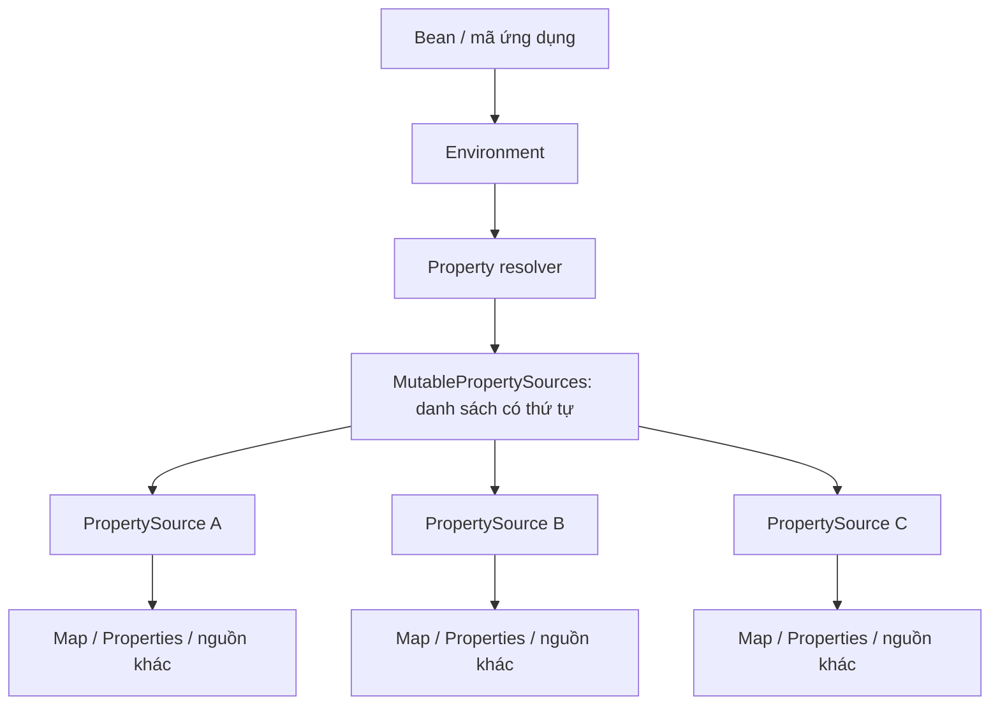

# MapPropertySource, PropertiesPropertySource và CompositePropertySource

Trong Spring Framework, `Environment` cung cấp cách đọc cấu hình thống nhất dù giá trị đến từ file, biến môi trường, tham số dòng lệnh hay một hệ thống bên ngoài. Nền tảng của cơ chế này là `PropertySource`: một nguồn có tên, biết cách trả về giá trị theo tên property. Spring cung cấp nhiều kiểu `PropertySource` để biểu diễn dữ liệu khác nhau.

Ba kiểu cần hiểu rõ là:

- `MapPropertySource`: đọc property từ một `Map<String, Object>`.
- `PropertiesPropertySource`: đọc property từ một đối tượng `java.util.Properties`.
- `CompositePropertySource`: gom nhiều `PropertySource` thành một nguồn tổng hợp có thứ tự tra cứu bên trong.

Chúng đều thuộc package `org.springframework.core.env`. Hiểu đúng khác biệt giữa chúng giúp đọc thứ tự ưu tiên cấu hình, tạo nguồn cấu hình lập trình, tích hợp cấu hình ngoài và kiểm thử hành vi của Spring Cloud Commons/Context.

## 1. PropertySource nằm ở đâu trong Spring Environment?

Spring `Environment` đại diện cho môi trường của ứng dụng, gồm profile và các property source. Khi gọi:

```java
String serviceName = environment.getProperty("spring.application.name");
```

Spring không cần biết giá trị đến từ file YAML, file properties, biến môi trường hay nguồn cấu hình do một integration cung cấp. Nó tra cứu qua các `PropertySource` theo thứ tự đã được thiết lập.

Cấu trúc khái niệm:



`Environment` cung cấp API đọc property. `MutablePropertySources` là collection các nguồn có thứ tự và cho phép thêm, thay thế hoặc loại bỏ nguồn khi cần. Mỗi `PropertySource` đại diện cho một nơi tra cứu cụ thể.

Khi cùng một key xuất hiện ở nhiều nguồn, thứ tự có ý nghĩa: nguồn được tra cứu trước có thể cung cấp giá trị hiệu lực. Vì vậy, hiểu cấu trúc nguồn và precedence quan trọng không kém việc biết property nằm trong file nào.

## 2. PropertySource và EnumerablePropertySource

`PropertySource<T>` là abstraction cơ bản cho một nguồn cấu hình có tên. Nó giữ một đối tượng nguồn kiểu `T` và cung cấp phương thức tra cứu giá trị theo key. Các lớp con quyết định cách đọc dữ liệu từ đối tượng đó.

Một số nguồn còn kế thừa `EnumerablePropertySource<T>`. Loại này có thể liệt kê tên các property mà nguồn chứa thông qua `getPropertyNames()`. `MapPropertySource` và `PropertiesPropertySource` là các ví dụ enumerable vì chúng có thể lấy danh sách key từ dữ liệu nền.

| Kiểu | Dữ liệu nền | Có thể liệt kê key? | Dùng khi |
| --- | --- | --- | --- |
| `PropertySource<T>` | Tùy implementation | Không nhất thiết | Chỉ cần tra cứu theo key |
| `EnumerablePropertySource<T>` | Tùy implementation | Có | Cần biết các key có trong nguồn |
| `MapPropertySource` | `Map<String, Object>` | Có | Dữ liệu dạng map |
| `PropertiesPropertySource` | `java.util.Properties` | Có | Dữ liệu dạng Properties |
| `CompositePropertySource` | Tập hợp các PropertySource | Có thể tổng hợp key từ các nguồn enumerable | Gom nhiều nguồn thành một nguồn logic |

Không nên giả định mọi `PropertySource` đều có thể liệt kê tất cả key. Một nguồn có thể chỉ biết cách trả lời “key này có giá trị không?” mà không thể cung cấp danh sách key hoàn chỉnh.

## 3. MapPropertySource: nguồn cấu hình từ Map

`MapPropertySource` là lớp con của `EnumerablePropertySource<Map<String, Object>>`. Nó sử dụng một map làm dữ liệu nền và tra cứu giá trị theo tên property.

Ví dụ:

```java
import java.util.LinkedHashMap;
import java.util.Map;
import org.springframework.core.env.MapPropertySource;

Map<String, Object> values = new LinkedHashMap<>();
values.put("spring.application.name", "order-service");
values.put("server.port", 8081);
values.put("feature.checkout.enabled", true);

MapPropertySource source =
        new MapPropertySource("runtimeOverrides", values);
```

Tên `runtimeOverrides` là tên định danh của nguồn. Các key và value nằm trong map. Value có thể là chuỗi hoặc object có kiểu cụ thể, tùy cách ứng dụng sử dụng.

Có thể thêm nguồn vào Environment:

```java
import org.springframework.core.env.ConfigurableEnvironment;

void addRuntimeOverrides(ConfigurableEnvironment environment) {
    Map<String, Object> overrides = Map.of(
            "feature.checkout.enabled", true,
            "checkout.timeout.seconds", 3
    );

    environment.getPropertySources().addFirst(
            new MapPropertySource("runtimeOverrides", overrides)
    );
}
```

`ConfigurableEnvironment` cung cấp `getPropertySources()`, trả về collection `MutablePropertySources`. Gọi `addFirst` đưa nguồn lên đầu danh sách, tức ưu tiên tra cứu cao hơn các nguồn đứng sau.

Ví dụ này phù hợp với cấu hình được tạo trong mã, giá trị ghi đè cho test hoặc một adapter cần chuyển dữ liệu từ cấu trúc map thành Spring PropertySource. Trong ứng dụng thực tế, nên thêm nguồn vào thời điểm phù hợp trong quá trình khởi tạo context, trước khi các bean phụ thuộc vào property được tạo và bind.

### 3.1. MapPropertySource giữ tham chiếu tới Map

`MapPropertySource` sử dụng map được truyền vào làm nguồn dữ liệu. Nếu map đó có thể thay đổi, việc cập nhật map có thể làm thay đổi kết quả tra cứu tiếp theo:

```java
Map<String, Object> flags = new LinkedHashMap<>();
flags.put("feature.search.enabled", false);

MapPropertySource source =
        new MapPropertySource("featureFlags", flags);

flags.put("feature.search.enabled", true);

// Lần tra cứu tiếp theo có thể thấy giá trị mới trong map.
Object enabled = source.getProperty("feature.search.enabled");
```

Đây là hành vi của nguồn dữ liệu nền, không đồng nghĩa mọi bean đã bind giá trị cũ sẽ tự cập nhật. Ví dụ, một field đã được inject bằng `@Value` thường giữ giá trị tại thời điểm bean được tạo. Muốn bean nhận cấu hình mới cần một cơ chế cập nhật phù hợp, chẳng hạn refresh scope trong những trường hợp được hỗ trợ.

Đối với cấu hình có thể thay đổi đồng thời từ nhiều thread, cần tự bảo đảm tính an toàn luồng của map và quy trình cập nhật. Không nên chia sẻ một `HashMap` đang bị ghi đồng thời giữa nhiều thread mà không có đồng bộ thích hợp.

### 3.2. MapPropertySource phù hợp với kiểu giá trị nào?

Map có thể chứa giá trị không phải chuỗi:

```java
Map<String, Object> values = Map.of(
        "feature.audit.enabled", true,
        "retry.max-attempts", 4,
        "service.tags", new String[] {"internal", "critical"}
);
```

Khi đọc bằng `Environment.getProperty(key, TargetType.class)`, Spring có thể chuyển đổi giá trị thông qua cơ chế conversion phù hợp. Khả năng chuyển đổi cụ thể phụ thuộc kiểu dữ liệu, converter được đăng ký và phiên bản framework.

Đối với cấu hình ứng dụng có nhiều field liên quan, `@ConfigurationProperties` thường phù hợp hơn việc đọc từng key rời rạc. `MapPropertySource` chỉ là cách biểu diễn một nguồn; nó không thay thế binding, validation hay quy tắc cấu hình.

## 4. PropertiesPropertySource: nguồn từ java.util.Properties

`PropertiesPropertySource` là một dạng `MapPropertySource` dành cho dữ liệu `java.util.Properties`. Nó cho phép tích hợp dữ liệu dạng key/value truyền thống vào cùng cơ chế Environment.

Ví dụ:

```java
import java.util.Properties;
import org.springframework.core.env.PropertiesPropertySource;

Properties properties = new Properties();
properties.setProperty("spring.application.name", "inventory-service");
properties.setProperty("server.port", "8082");
properties.setProperty("inventory.cache.enabled", "true");

PropertiesPropertySource source =
        new PropertiesPropertySource("legacyProperties", properties);
```

Sau đó thêm vào Environment theo thứ tự mong muốn:

```java
environment.getPropertySources().addLast(source);
```

`Properties` thường lưu giá trị dưới dạng chuỗi. Vì vậy, khi cần số nguyên hoặc boolean, có thể yêu cầu kiểu đích khi đọc:

```java
String appName = environment.getProperty("spring.application.name");
Integer port = environment.getProperty("server.port", Integer.class);
Boolean cacheEnabled =
        environment.getProperty("inventory.cache.enabled", Boolean.class);
```

### 4.1. Khi nào dùng PropertiesPropertySource?

Dùng `PropertiesPropertySource` khi dữ liệu đã có dưới dạng đối tượng `Properties`, chẳng hạn:
- Một thư viện cũ cung cấp cấu hình qua `Properties`.
- Một adapter đọc file `.properties` hoặc nhận dữ liệu từ hệ thống khác rồi tạo đối tượng Properties.
- Ứng dụng cần đưa dữ liệu Properties vào Environment mà không tự viết một implementation PropertySource.

Lưu ý: `PropertiesPropertySource` **không phải trình đọc file**. Nó biểu diễn một đối tượng `Properties` đã có trong bộ nhớ. Việc đọc resource từ filesystem/classpath là trách nhiệm của code nạp resource hoặc một lớp khác.

### 4.2. So sánh MapPropertySource và PropertiesPropertySource

| Tiêu chí | MapPropertySource | PropertiesPropertySource |
| --- | --- | --- |
| Dữ liệu đầu vào | `Map<String, Object>` | `java.util.Properties` |
| Kiểu value | Có thể là object bất kỳ | Thường là chuỗi key/value |
| Mục tiêu | Cấu hình linh hoạt, dữ liệu tạo trong mã | Tích hợp dữ liệu Properties truyền thống |
| Tra cứu | Theo key trong map | Theo key trong Properties |
| Liệt kê key | Có | Có |
| Quan hệ kế thừa | Kế thừa EnumerablePropertySource | Kế thừa MapPropertySource |
| Khi chọn | Đã có dữ liệu dạng Map | Đã có dữ liệu dạng Properties |

Về mặt kiến trúc, `PropertiesPropertySource` chuyên biệt hóa cách biểu diễn dữ liệu Properties. Cả hai đều tham gia cùng cơ chế precedence của Environment; không có một quy tắc ưu tiên mặc định nào chỉ vì nguồn là Map hay Properties.

## 5. CompositePropertySource: gom nhiều nguồn thành một

`CompositePropertySource` là một `EnumerablePropertySource<Object>` chứa nhiều `PropertySource<?>` bên trong. Nó hữu ích khi một integration muốn trình bày nhiều nguồn cấu hình như một nguồn logic có tên.

Ví dụ, một ứng dụng có thể ghép cấu hình chung và cấu hình tenant:

```java
import java.util.Map;
import org.springframework.core.env.CompositePropertySource;
import org.springframework.core.env.MapPropertySource;

MapPropertySource tenantOverrides = new MapPropertySource(
        "tenantOverrides",
        Map.of(
                "checkout.banner", "Welcome to tenant A",
                "checkout.timeout.seconds", 2
        )
);

MapPropertySource sharedDefaults = new MapPropertySource(
        "sharedDefaults",
        Map.of(
                "checkout.banner", "Welcome",
                "checkout.timeout.seconds", 5,
                "checkout.audit.enabled", true
        )
);

CompositePropertySource checkoutConfig =
        new CompositePropertySource("checkoutConfiguration");

checkoutConfig.addPropertySource(tenantOverrides);
checkoutConfig.addPropertySource(sharedDefaults);
```

Composite chứa hai nguồn theo thứ tự được thêm. Khi tra cứu một key, nó tìm lần lượt trong các nguồn con và trả về giá trị đầu tiên tìm thấy. Trong ví dụ:

- `checkout.banner` nhận giá trị từ `tenantOverrides`.
- `checkout.timeout.seconds` nhận giá trị 2 từ `tenantOverrides`.
- `checkout.audit.enabled` không có trong nguồn tenant, nên lấy giá trị từ `sharedDefaults`.

Như vậy, composite tạo ra một cấu hình logic bằng cách tra cứu từng key trong nhiều nguồn. Nó không cần hợp nhất toàn bộ map thành một map mới.

### 5.1. Thứ tự bên trong CompositePropertySource

Thứ tự thêm nguồn con ảnh hưởng đến key trùng nhau. Ví dụ, nếu hai nguồn cùng khai báo `checkout.timeout.seconds`, nguồn được duyệt trước có giá trị không null sẽ thắng.

```text
CompositePropertySource: checkoutConfiguration
  1. tenantOverrides
       checkout.timeout.seconds = 2
  2. sharedDefaults
       checkout.timeout.seconds = 5

Kết quả: checkout.timeout.seconds = 2
```

Nếu đảo thứ tự hai nguồn, giá trị hiệu lực có thể thay đổi. Do đó, thứ tự trong composite là một phần của chính sách cấu hình, không phải chi tiết triển khai vô hại.

### 5.2. CompositePropertySource không giống MutablePropertySources

Hai loại này đều liên quan tới nhiều nguồn nhưng có cấp độ khác nhau:

| Thành phần | Vai trò |
| --- | --- |
| `MutablePropertySources` | Danh sách các PropertySource ở cấp Environment; hỗ trợ addFirst/addLast và thay đổi thứ tự top-level |
| `CompositePropertySource` | Một PropertySource duy nhất, bên trong chứa nhiều PropertySource con |
| `Environment` | API đọc property và truy cập profile, sử dụng danh sách nguồn |

Có thể hình dung:

```text
Environment
  |
  +-- MutablePropertySources
        |
        +-- commandLineArgs
        +-- systemEnvironment
        +-- checkoutConfiguration (CompositePropertySource)
        |      +-- tenantOverrides
        |      +-- sharedDefaults
        +-- applicationConfig
```

Ở cấp ngoài, Environment so sánh các nguồn theo thứ tự trong `MutablePropertySources`. Khi một nguồn ngoài là composite, composite lại tra cứu theo thứ tự các nguồn con. Vì vậy có hai lớp precedence:

1. Thứ tự giữa các PropertySource ở cấp Environment.
2. Thứ tự giữa các PropertySource bên trong CompositePropertySource.

## 6. Cách tra cứu và quy tắc precedence

Khi ứng dụng gọi `environment.getProperty("checkout.timeout.seconds")`, cơ chế resolver duyệt danh sách nguồn theo thứ tự. Nguồn đầu tiên trả về giá trị khác `null` sẽ cung cấp kết quả. Nếu một nguồn không có key, việc tìm kiếm tiếp tục ở nguồn sau.

Ví dụ:

```java
ConfigurableEnvironment environment = new StandardEnvironment();

MapPropertySource highPriority = new MapPropertySource(
        "runtimeOverrides",
        Map.of("checkout.timeout.seconds", "2")
);

MapPropertySource lowPriority = new MapPropertySource(
        "defaults",
        Map.of("checkout.timeout.seconds", "5")
);

environment.getPropertySources().addFirst(highPriority);
environment.getPropertySources().addLast(lowPriority);

String timeout = environment.getProperty("checkout.timeout.seconds");
// Giá trị: "2"
```

`addFirst` đưa nguồn lên đầu danh sách và tạo ưu tiên cao hơn các nguồn phía sau. `addLast` đưa nguồn xuống cuối danh sách. Ngoài hai thao tác này, `MutablePropertySources` còn có thể thêm trước/sau một nguồn đã biết, thay thế hoặc loại bỏ nguồn theo tên.

### 6.1. Giá trị trống khác với key không tồn tại

Đây là điểm quan trọng khi xử lý fallback:

- Nếu nguồn đầu không có key và trả `null`, resolver tiếp tục tìm ở nguồn sau.
- Nếu nguồn đầu có key với giá trị chuỗi rỗng `""`, đó vẫn là một giá trị khác `null`; nó có thể che giá trị ở nguồn thấp hơn.
- Giá trị mặc định trong placeholder thường được dùng khi property không được tìm thấy, không phải để tự thay thế mọi chuỗi rỗng.

Ví dụ:

```java
MapPropertySource high = new MapPropertySource(
        "high",
        Map.of("service.region", "")
);

MapPropertySource low = new MapPropertySource(
        "low",
        Map.of("service.region", "ap-southeast-1")
);
```

Nếu `high` được đặt trước `low`, kết quả tra cứu là chuỗi rỗng. Nếu ứng dụng muốn coi chuỗi rỗng như thiếu giá trị, cần xử lý quy tắc đó trong binding/validation hoặc logic ứng dụng; không nên giả định Environment sẽ tự bỏ qua.

### 6.2. Precedence bên trong Composite và bên ngoài Environment

Giả sử top-level Environment có:
- `runtimeOverrides` đứng đầu.
- `remoteConfiguration` là CompositePropertySource đứng sau.
- `applicationDefaults` đứng cuối.

Trong composite, `tenantOverrides` đứng trước `sharedDefaults`.

Nếu key xuất hiện trong cả ba tầng, kết quả là:
1. Environment kiểm tra `runtimeOverrides` trước.
2. Nếu key chưa có, chuyển tới composite.
3. Composite kiểm tra `tenantOverrides` rồi `sharedDefaults`.
4. Nếu composite không có key, Environment tiếp tục tới `applicationDefaults`.

Một giá trị ở top-level source có thể thắng mọi giá trị trong composite nếu top-level source đứng trước composite. Ngược lại, composite có thể thắng nguồn khác nếu nó được thêm lên đầu danh sách Environment.

## 7. Kết hợp ba loại PropertySource trong ứng dụng

Ví dụ sau minh họa một composite có nguồn Map và Properties, sau đó được thêm vào Environment:

```java
import java.util.LinkedHashMap;
import java.util.Map;
import java.util.Properties;

import org.springframework.core.env.CompositePropertySource;
import org.springframework.core.env.ConfigurableEnvironment;
import org.springframework.core.env.MapPropertySource;
import org.springframework.core.env.PropertiesPropertySource;

public class PropertySourceSetup {

    public void configure(ConfigurableEnvironment environment) {
        Map<String, Object> runtimeValues = new LinkedHashMap<>();
        runtimeValues.put("feature.checkout.enabled", true);
        runtimeValues.put("checkout.timeout.seconds", 3);

        MapPropertySource runtime =
                new MapPropertySource("runtimeOverrides", runtimeValues);

        Properties legacyValues = new Properties();
        legacyValues.setProperty("checkout.timeout.seconds", "5");
        legacyValues.setProperty("checkout.currency", "VND");

        PropertiesPropertySource legacy =
                new PropertiesPropertySource("legacyProperties", legacyValues);

        CompositePropertySource composite =
                new CompositePropertySource("checkoutConfiguration");

        composite.addPropertySource(runtime);
        composite.addPropertySource(legacy);

        environment.getPropertySources().addFirst(composite);
    }
}
```

Kết quả tra cứu:
- `feature.checkout.enabled` lấy từ Map source.
- `checkout.timeout.seconds` lấy từ Map source vì composite duyệt runtime trước.
- `checkout.currency` lấy từ Properties source vì key không có trong Map source.

Có thể đọc qua Environment:

```java
Boolean enabled = environment.getProperty(
        "feature.checkout.enabled", Boolean.class, false);

Integer timeout = environment.getProperty(
        "checkout.timeout.seconds", Integer.class, 0);

String currency = environment.getProperty("checkout.currency");
```

Ví dụ dùng `Map.of` và cú pháp Java hiện đại ở các phần trước cần Java 9 trở lên. Nếu dự án dùng Java 8, có thể dùng `Collections.singletonMap` hoặc `LinkedHashMap` để tạo map.

### 7.1. Nên thêm nguồn ở đâu trong vòng đời?

Thêm PropertySource trước khi các bean cần cấu hình được tạo là cách dễ kiểm soát nhất. Nếu thêm hoặc thay đổi nguồn sau khi context đã khởi tạo:
- Lần đọc trực tiếp Environment tiếp theo có thể thấy giá trị mới.
- Field đã được inject bằng `@Value` có thể vẫn giữ giá trị cũ.
- Bean đã bind bằng `@ConfigurationProperties` không tự động được tạo lại trong mọi trường hợp.
- Các thành phần đã tạo connection pool, server socket hoặc client có thể không tự áp dụng cấu hình mới.

Nếu mục tiêu là refresh cấu hình trong runtime, cần thiết kế cùng Spring Cloud Context, refresh scope hoặc cơ chế cập nhật tương ứng. Thay đổi thứ tự PropertySource chỉ thay đổi nơi Environment tra cứu; nó không tự refresh mọi đối tượng đang sống.

## 8. Liên hệ với Spring Cloud Config và cấu hình ngoài

Spring Cloud Config Client lấy property từ Config Server và đưa vào môi trường của ứng dụng. Một integration có thể biểu diễn dữ liệu nhận được thành một hoặc nhiều PropertySource, hoặc gom chúng vào một CompositePropertySource để giữ nhóm nguồn logic.

Ví dụ khái niệm:

```text
Environment
  |
  +-- systemEnvironment
  +-- commandLineArgs
  +-- configService (CompositePropertySource)
         +-- application-wide remote config
         +-- profile-specific remote config
         +-- label / repository source
  +-- local application defaults
```

Tên cụ thể và cách tổ chức property source phụ thuộc phiên bản Spring Cloud Config Client và cơ chế nạp cấu hình. Không nên dựa vào một tên source nội bộ cố định trong logic nghiệp vụ. Nếu cần kiểm tra, hãy quan sát Environment trong runtime hoặc xem log Config Client của phiên bản đang dùng.

### 8.1. Composite không đồng nghĩa Config Server

`CompositePropertySource` là cấu trúc trong Spring Core để gom nguồn. Config Server là một dịch vụ cung cấp cấu hình qua mạng. Config Client là phần tích hợp trong ứng dụng để lấy dữ liệu từ server.

Một ứng dụng có thể tự tạo CompositePropertySource mà không có Config Server. Ngược lại, một Config Client có thể tổ chức property source nội bộ theo cách riêng. Không nên đánh đồng abstraction của Spring Core với dịch vụ hạ tầng.

### 8.2. Liên hệ với Spring Cloud Context

Sau khi property source được cập nhật trong Environment, Spring Cloud Context có thể tham gia quy trình refresh bean. Nhưng việc thay đổi nguồn cấu hình và việc cập nhật object đang sử dụng cấu hình là hai bước khác nhau.

Ví dụ:
1. Config Client tải property mới.
2. PropertySource được cập nhật hoặc thay thế.
3. Environment tra cứu giá trị mới.
4. Cơ chế refresh được kích hoạt.
5. Bean thuộc refresh scope có thể được tạo lại.

Nếu dừng ở bước 2, các bean giữ giá trị cũ có thể chưa đổi. Nếu chỉ refresh bean mà nguồn không có giá trị mới, bean mới vẫn đọc dữ liệu cũ hoặc fallback.

## 9. Kiểm tra nguồn và thứ tự trong Environment

Có thể duyệt các nguồn top-level để quan sát tên và vị trí:

```java
import org.springframework.core.env.ConfigurableEnvironment;
import org.springframework.core.env.PropertySource;

void printPropertySourceNames(ConfigurableEnvironment environment) {
    for (PropertySource<?> source : environment.getPropertySources()) {
        System.out.println(source.getName()
                + " -> " + source.getClass().getSimpleName());
    }
}
```

Nếu một source là `CompositePropertySource`, có thể duyệt các nguồn con bằng API của composite để kiểm tra thứ tự. Khi debug, nên ghi tên và loại source, không ghi toàn bộ giá trị cấu hình vì có thể chứa credential hoặc secret.

Một cách kiểm tra key cụ thể:

```java
String value = environment.getProperty("checkout.timeout.seconds");
Boolean enabled = environment.getProperty(
        "feature.checkout.enabled", Boolean.class);
```

Để hiểu vì sao giá trị được chọn, cần đối chiếu:
- Key có mặt ở những source nào?
- Source nào đứng trước trong top-level list?
- Nếu là composite, source con nào đứng trước?
- Giá trị ở source đầu là `null`, chuỗi rỗng hay giá trị thực?
- Có conversion/binding nào thay đổi kiểu dữ liệu sau khi tra cứu không?

### 9.1. Actuator và thông tin nhạy cảm

Spring Boot Actuator có endpoint hỗ trợ quan sát Environment tùy cấu hình và phiên bản. Khi bật endpoint này, cần giới hạn quyền truy cập và giữ cơ chế che giấu giá trị nhạy cảm. Không nên công khai danh sách property source hoặc giá trị cấu hình cho người dùng không có quyền.

## 10. Kiểm thử precedence và CompositePropertySource

Có thể kiểm tra thứ tự bằng một `StandardEnvironment` mới và hai MapPropertySource:

```java
import static org.assertj.core.api.Assertions.assertThat;

import java.util.Map;
import org.junit.jupiter.api.Test;
import org.springframework.core.env.MapPropertySource;
import org.springframework.core.env.StandardEnvironment;

class PropertySourceOrderTest {

    @Test
    void firstSourceWinsWhenKeysOverlap() {
        StandardEnvironment environment = new StandardEnvironment();

        environment.getPropertySources().addFirst(
                new MapPropertySource(
                        "highPriority",
                        Map.of("demo.region", "north")
                )
        );

        environment.getPropertySources().addAfter("highPriority",
                new MapPropertySource(
                        "lowPriority",
                        Map.of("demo.region", "south")
                )
        );

        assertThat(environment.getProperty("demo.region"))
                .isEqualTo("north");
    }
}
```

Kiểm thử composite có thể xác nhận cả fallback giữa nguồn con:

```java
@Test
void compositeChecksItsSourcesInOrder() {
    CompositePropertySource composite =
            new CompositePropertySource("combined");

    composite.addPropertySource(new MapPropertySource(
            "tenant",
            Map.of("demo.region", "tenant-region")
    ));

    composite.addPropertySource(new MapPropertySource(
            "global",
            Map.of(
                    "demo.region", "global-region",
                    "demo.currency", "VND"
            )
    ));

    StandardEnvironment environment = new StandardEnvironment();
    environment.getPropertySources().addFirst(composite);

    assertThat(environment.getProperty("demo.region"))
            .isEqualTo("tenant-region");
    assertThat(environment.getProperty("demo.currency"))
            .isEqualTo("VND");
}
```

Hai test này kiểm tra quy tắc tra cứu của Spring Core. Chúng không kiểm tra Config Server, Eureka, network hay thứ tự Config Data của một ứng dụng Boot cụ thể. Những phần tích hợp đó cần context/integration test riêng.

### 10.1. Các ca kiểm thử nên có

| Ca kiểm thử | Kỳ vọng |
| --- | --- |
| Key chỉ có ở nguồn đầu | Lấy giá trị nguồn đầu |
| Key chỉ có ở nguồn sau | Tiếp tục tìm và lấy giá trị nguồn sau |
| Key trùng ở hai nguồn | Nguồn có precedence cao hơn thắng |
| Nguồn đầu trả `null` | Tra cứu tiếp nguồn sau |
| Nguồn đầu chứa chuỗi rỗng | Chuỗi rỗng có thể che giá trị ở nguồn sau |
| Composite có key trùng | Nguồn con đứng trước thắng |
| Composite không có key | Environment tiếp tục sang top-level source sau |
| Map thay đổi sau khi thêm source | Lần tra cứu sau có thể thấy map mới; bean đã bind cần kiểm tra riêng |
| Properties source | Giá trị chuỗi được đọc và chuyển kiểu khi yêu cầu |
| Nguồn cấu hình chứa secret | Quan sát/log không làm lộ giá trị nhạy cảm |

## 11. Những lỗi và nhầm lẫn thường gặp

**MapPropertySource tự tạo một file cấu hình.** Không đúng. Nó bọc một Map đã tồn tại trong bộ nhớ. Việc đọc file là trách nhiệm của resource loader hoặc cơ chế cấu hình khác.

**PropertiesPropertySource là một trình đọc file .properties.** Không đúng. Nó bọc đối tượng `java.util.Properties`; quá trình nạp file để tạo đối tượng đó là bước riêng.

**CompositePropertySource hợp nhất mọi key thành một Map duy nhất.** Không nhất thiết. Nó giữ nhiều nguồn con và tra cứu lần lượt theo thứ tự; với key trùng, nguồn con được duyệt trước có thể thắng.

**addFirst chỉ là thứ tự hiển thị.** Không đúng. Nó ảnh hưởng thứ tự tra cứu và do đó ảnh hưởng giá trị hiệu lực.

**MapPropertySource đứng trước luôn thắng kể cả khi giá trị là null.** Không đúng. Resolver thường tiếp tục khi nguồn trả về `null`. Chuỗi rỗng là giá trị khác `null` và có thể che nguồn thấp hơn.

**Thay đổi Map tự refresh mọi bean.** Không đúng. Lần đọc Environment tiếp theo có thể thấy giá trị mới, nhưng object đã bind/inject trước đó không tự được cập nhật trong mọi trường hợp.

**CompositePropertySource và MutablePropertySources là cùng một loại collection.** Không đúng. Một cái là một PropertySource chứa các nguồn con; cái kia là danh sách nguồn cấp Environment.

## Ghi nhớ

`MapPropertySource` và `PropertiesPropertySource` biểu diễn hai dạng dữ liệu nền khác nhau nhưng cùng tham gia cơ chế tra cứu theo key của Spring Environment. `CompositePropertySource` gom nhiều nguồn con và áp dụng thứ tự tra cứu bên trong; `MutablePropertySources` quyết định thứ tự các nguồn ở cấp Environment. Giá trị hiệu lực được xác định bởi precedence ở cả hai lớp. Khi tích hợp cấu hình ngoài hoặc Spring Cloud Config, hãy kiểm tra nguồn nào được thêm vào, thứ tự ra sao, key trùng được xử lý thế nào và bean có cần refresh hay không.
