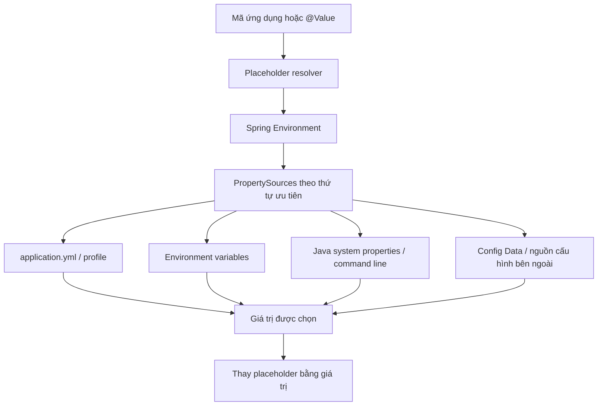

# Placeholder, giá trị tham chiếu và lỗi không phân giải được

Trong một ứng dụng Spring Boot, một giá trị cấu hình hiếm khi đứng riêng lẻ. URL kết nối có thể ghép hostname, port và tên database; một dịch vụ có thể dùng chung endpoint của dịch vụ khác; tên môi trường hoặc thông tin triển khai có thể đến từ biến môi trường, file cấu hình hay Config Server. Nếu sao chép cùng một giá trị vào nhiều nơi, các cấu hình dễ lệch nhau khi thay đổi.

Spring hỗ trợ **placeholder** để một giá trị cấu hình tham chiếu đến giá trị khác. Cú pháp thường gặp là `${property.name}`. Khi Spring giải quyết placeholder, nó tra cứu key trong các nguồn cấu hình của `Environment`, thay biểu thức bằng giá trị tương ứng và có thể dùng giá trị mặc định nếu key chưa tồn tại.

Bài học thuộc chương **Environment** của **SPRING_CLOUD_CORE**. Trọng tâm là cú pháp placeholder, giá trị mặc định, tham chiếu lồng nhau, nguồn cấu hình và thứ tự ưu tiên, cách dùng với `@Value`/`@ConfigurationProperties`, tích hợp Spring Cloud Config, quan hệ với refresh scope và cách xử lý lỗi placeholder không phân giải được.

## 1. Mục tiêu học tập

Sau bài này, người học có thể:

1. Giải thích placeholder là gì và vì sao nên tham chiếu cấu hình thay vì lặp lại giá trị.
2. Viết placeholder cơ bản, placeholder có default value và placeholder lồng nhau.
3. Phân biệt key không tồn tại, giá trị rỗng và giá trị mặc định.
4. Giải thích cách `Environment` và `PropertySources` tìm giá trị từ nhiều nguồn.
5. Phân biệt placeholder trong `@Value` với binding có kiểu dữ liệu bằng `@ConfigurationProperties` và biểu thức SpEL.
6. Hiểu lỗi unresolved placeholder, circular reference, sai key và lỗi nguồn cấu hình.
7. Chẩn đoán, kiểm thử placeholder trong ứng dụng Spring Boot và Spring Cloud.

## 2. Placeholder là gì?

Placeholder là một biểu thức đại diện cho giá trị cần được tra cứu khi Spring xử lý cấu hình. Ví dụ, file cấu hình có thể khai báo:

```yaml
app:
  service:
    host: inventory.internal
    port: 8082
    url: http://${app.service.host}:${app.service.port}
```

Giá trị hiệu lực của `app.service.url` sau khi giải quyết placeholder là:

```text
http://inventory.internal:8082
```

Hai thuộc tính `host` và `port` được khai báo một lần; URL tham chiếu lại chúng. Khi địa chỉ inventory thay đổi, nhóm chỉ cần cập nhật giá trị gốc tại nguồn cấu hình phù hợp.

Một ví dụ khác sử dụng biến môi trường:

```yaml
app:
  payment:
    endpoint: ${PAYMENT_ENDPOINT:https://sandbox-payments.example}
```

Nếu `PAYMENT_ENDPOINT` có giá trị trong Environment, giá trị đó được dùng. Nếu key không tồn tại, Spring dùng default URL được ghi sau dấu phân cách `:`.

Placeholder **không phải phép tính**. Nó thực hiện tra cứu và thay thế giá trị. Muốn ghép giá trị, đặt giá trị mặc định hoặc chuyển đổi kiểu dữ liệu, hãy sử dụng đúng cơ chế tương ứng; đừng coi placeholder là một ngôn ngữ lập trình cấu hình.

### 2.1. Placeholder được xử lý ở đâu?

Placeholder có thể xuất hiện trong:

- Giá trị của `application.properties` hoặc `application.yml`.
- Annotation `@Value` trên field, constructor parameter hoặc method parameter.
- Bean definition và cấu hình Spring có sử dụng embedded value resolver.
- Một số cấu hình bên ngoài được nạp vào `Environment`.
- Property do Spring Cloud Config Client đưa vào Environment.

Cùng một biểu thức có thể được giải quyết ở các giai đoạn khác nhau tùy nơi nó xuất hiện. Với cấu hình ứng dụng Boot thông thường, Config Data được nạp vào Environment trước khi các bean cần giá trị được tạo. Khi `@Value` được xử lý, placeholder được thay bằng giá trị từ Environment.

## 3. Cú pháp cơ bản và giá trị mặc định

### 3.1. Tham chiếu một property

Cú pháp:

```text
${property.name}
```

Ví dụ:

```yaml
app:
  inventory:
    host: inventory.internal
    port: 8082
    base-url: http://${app.inventory.host}:8082
```

`app.inventory.base-url` tham chiếu `app.inventory.host`. Spring tra cứu key theo Environment hiện hành, không yêu cầu hai property phải nằm trong cùng một file.

Tên property nên viết theo dạng canonical kebab-case, ví dụ `app.inventory.base-url`. Đây là dạng dễ thống nhất giữa YAML, properties, biến môi trường và metadata cấu hình Spring Boot.

### 3.2. Placeholder có giá trị mặc định

Cú pháp:

```text
${property.name:defaultValue}
```

Ví dụ:

```yaml
app:
  discovery:
    registry-url: ${DISCOVERY_REGISTRY_URL:http://localhost:8761}
    connect-timeout: ${DISCOVERY_CONNECT_TIMEOUT:2s}
```

Nếu key chưa có, giá trị sau dấu `:` được sử dụng. Default value đặc biệt hữu ích cho cấu hình phát triển, giá trị tùy chọn hoặc giá trị có fallback an toàn.

**Không nên dùng default tùy tiện cho cấu hình bắt buộc.** Nếu môi trường production phải khai báo endpoint hoặc secret riêng, một default trỏ tới máy local hoặc tài khoản thử nghiệm có thể che giấu lỗi triển khai. Với dữ liệu bắt buộc, để placeholder không có default và fail-fast khi thiếu thường an toàn hơn.

### 3.3. Key không tồn tại khác với giá trị rỗng

Giả sử:

```yaml
app:
  feature:
    label: ""
```

Và code/config dùng `${app.feature.label:Unknown}`. Vì key đã tồn tại và giá trị là chuỗi rỗng, placeholder nhận giá trị rỗng. Default `Unknown` không tự động được dùng chỉ vì chuỗi rỗng.

| Trạng thái property | Ví dụ | Kết quả của `${app.feature.label:Unknown}` |
| --- | --- | --- |
| Không tồn tại | Không có key | `Unknown` |
| Có giá trị | `label: Ready` | `Ready` |
| Có giá trị rỗng | `label: ""` | Chuỗi rỗng |
| Có khoảng trắng | `label: "   "` | Chuỗi khoảng trắng |

Nếu muốn coi blank là không hợp lệ, hãy dùng validation hoặc logic kiểm tra riêng. Placeholder default chỉ giải quyết trường hợp không tìm thấy giá trị theo quy tắc resolver.

### 3.4. Default rỗng và property tùy chọn

Có thể viết:

```yaml
app:
  proxy:
    username: ${PROXY_USERNAME:}
```

Khi key không tồn tại, kết quả là chuỗi rỗng. Cách này phù hợp với trường tùy chọn nếu code hiểu rõ ý nghĩa của chuỗi rỗng. Tuy nhiên, với secret hoặc endpoint quan trọng, default rỗng có thể làm lỗi xuất hiện muộn hơn; hãy cân nhắc validation để thông báo rõ ràng ngay khi khởi động.

## 4. Placeholder lồng nhau và tham chiếu nhiều cấp

### 4.1. Tham chiếu đến property đã chứa placeholder

Một property có thể tham chiếu một property khác, property được tham chiếu lại có thể tiếp tục chứa placeholder:

```yaml
app:
  network:
    host: inventory.internal
    port: 8082
    authority: ${app.network.host}:${app.network.port}
    url: http://${app.network.authority}/api
```

Khi giá trị được giải quyết, các placeholder lồng nhau được xử lý đệ quy cho đến khi có giá trị cuối cùng.

Điều này giúp tách cấu hình theo trách nhiệm: host/port là dữ liệu gốc, authority là tổ hợp, URL là endpoint được sử dụng. Khi đọc file, người vận hành cần lần theo chuỗi tham chiếu để hiểu giá trị hiệu lực.

### 4.2. Default value cũng có thể là placeholder

Ví dụ:

```yaml
app:
  network:
    default-host: localhost
    host: ${INVENTORY_HOST:${app.network.default-host}}
    port: ${INVENTORY_PORT:8082}
    url: http://${app.network.host}:${app.network.port}
```

Thứ tự lựa chọn cho host là:

1. Dùng `INVENTORY_HOST` nếu có giá trị.
2. Nếu không có, lấy `app.network.default-host`.
3. Nếu giá trị mặc định đó cũng không tồn tại, placeholder cuối cùng không có giá trị để phân giải và có thể phát sinh lỗi.

Nested placeholders giúp biểu diễn fallback theo nhiều tầng, nhưng không nên lạm dụng đến mức khó truy vết. Khi có nhiều môi trường và nhiều nguồn cấu hình, một property canonical rõ ràng thường dễ bảo trì hơn một biểu thức lồng nhiều cấp.

### 4.3. Placeholder trong URL và chuỗi có dấu phân cách

Ví dụ:

```yaml
app:
  service:
    url: ${SERVICE_URL:https://api.example:8443/v1}
```

Dấu `:` đầu tiên phân cách key và default value. Các dấu `:` tiếp theo thuộc nội dung default URL. Nếu default có ký tự đặc biệt hoặc khoảng trắng, có thể đặt trong chuỗi YAML có quote để tránh nhầm lẫn với cú pháp YAML; việc quote không thay đổi nguyên tắc phân giải placeholder của Spring.

### 4.4. Tránh vòng tham chiếu

Hai property tham chiếu lẫn nhau:

```yaml
app:
  first: ${app.second}
  second: ${app.first}
```

Không có giá trị gốc để giải quyết. Spring có thể phát hiện vòng tham chiếu và báo lỗi circular placeholder reference. Một chuỗi tham chiếu dài nhiều tầng cũng khó chẩn đoán nếu có vòng lặp ở giữa.

Nguyên tắc thiết kế:

- Chọn một property gốc cho mỗi giá trị cấu hình.
- Để property dẫn xuất tham chiếu theo một hướng.
- Không để hai profile hoặc hai nguồn cấu hình tạo vòng tham chiếu gián tiếp.
- Nếu cần default, đặt default tại điểm phù hợp và có ý nghĩa vận hành.

## 5. Environment và PropertySources: nơi tìm giá trị

Spring `Environment` cung cấp giao diện truy cập các profile và property của ứng dụng. Các giá trị được lấy từ nhiều `PropertySource`, chẳng hạn file cấu hình, biến môi trường, system properties, command-line arguments hoặc property sources được tích hợp từ hệ thống bên ngoài.



Sơ đồ chỉ mô tả các nhóm nguồn phổ biến; thứ tự chính xác phụ thuộc loại nguồn và cách ứng dụng nạp cấu hình. Khi cùng một key xuất hiện nhiều lần, resolver sử dụng nguồn có độ ưu tiên cao hơn theo quy tắc Environment/Config Data.

### 5.1. Đọc giá trị bằng Environment

Có thể inject `Environment` và tra cứu trực tiếp:

```java
import org.springframework.core.env.Environment;
import org.springframework.stereotype.Component;

@Component
class InventoryEndpointProvider {

    private final String endpoint;

    InventoryEndpointProvider(Environment environment) {
        this.endpoint = environment.getProperty(
            "app.inventory.url",
            "http://localhost:8082"
        );
    }

    String endpoint() {
        return endpoint;
    }
}
```

`getProperty` cho phép truyền default value và có các overload hỗ trợ chuyển đổi kiểu dữ liệu. Nếu property không có và không có default, phương thức trả về `null`. Vì vậy, code cần quyết định rõ giá trị đó là bắt buộc hay tùy chọn.

Nếu cần phân giải placeholder trong một chuỗi tùy ý, Environment cung cấp hai phương thức đáng chú ý:

```java
String resolved = environment.resolvePlaceholders(
    "http://${app.inventory.host:localhost}:${app.inventory.port:8082}"
);

String required = environment.resolveRequiredPlaceholders(
    "${app.inventory.host}"
);
```

Khác biệt quan trọng:

- `resolvePlaceholders` là chế độ không bắt buộc: placeholder không giải quyết được có thể được giữ nguyên trong chuỗi kết quả.
- `resolveRequiredPlaceholders` yêu cầu mọi placeholder phải giải quyết được; nếu thiếu, nó ném lỗi `IllegalArgumentException`.

Không nên dùng chế độ không bắt buộc cho giá trị mà ứng dụng cần để tạo kết nối hoặc bảo đảm an toàn. Nếu placeholder còn nguyên được truyền xuống HTTP client, lỗi sẽ xuất hiện ở nơi khác và khó truy ra nguồn.

### 5.2. Giá trị property có thể đến từ nguồn ưu tiên cao hơn

Ví dụ file `application.yml`:

```yaml
app:
  inventory:
    host: inventory.default.internal
    port: 8082
    url: http://${app.inventory.host}:${app.inventory.port}
```

Nếu môi trường triển khai cung cấp biến môi trường cho host và port tương ứng, giá trị hiệu lực có thể thay đổi mà không cần sửa file. Trong Spring Boot, tên biến môi trường thường chuyển từ dạng canonical bằng cách thay dấu chấm bằng gạch dưới, bỏ dấu gạch ngang và viết hoa; ví dụ `APP_INVENTORY_HOST` tương ứng với `app.inventory.host` trong relaxed binding.

Không nên chỉ kiểm tra file cấu hình để kết luận URL cuối cùng. Hãy xem nguồn nào đang ghi đè key và giá trị nào được Environment chọn.

### 5.3. Placeholder không làm thay đổi precedence

Giả sử `app.service.host` có ở file mặc định và biến môi trường. Placeholder `${app.service.host}` nhận giá trị hiệu lực sau khi quy tắc ưu tiên nguồn đã được áp dụng. Placeholder không tự chọn file profile hoặc nguồn cấu hình có vẻ phù hợp hơn; nó dùng Environment đã được xây dựng.

Đây là điểm quan trọng khi điều tra khác biệt giữa local, staging và production: cùng một file YAML có thể cho kết quả khác nhau do profile, environment variables, command-line arguments hoặc Config Server.

## 6. Dùng placeholder trong @Value

`@Value` là cơ chế inject giá trị vào bean. Placeholder có thể được dùng ở field, constructor parameter hoặc method parameter.

```java
import java.time.Duration;
import org.springframework.beans.factory.annotation.Value;
import org.springframework.stereotype.Component;

@Component
class InventoryClientSettings {

    private final String baseUrl;
    private final Duration timeout;

    InventoryClientSettings(
            @Value("${app.inventory.base-url}") String baseUrl,
            @Value("${app.inventory.timeout:2s}") Duration timeout) {
        this.baseUrl = baseUrl;
        this.timeout = timeout;
    }

    String baseUrl() {
        return baseUrl;
    }

    Duration timeout() {
        return timeout;
    }
}
```

Trong ví dụ, Spring giải quyết placeholder rồi chuyển đổi giá trị chuỗi sang kiểu đích nếu có converter phù hợp. Nếu property bắt buộc `app.inventory.base-url` không tồn tại, quá trình tạo bean có thể thất bại với thông báo không phân giải được placeholder. Timeout có default `2s` nên vẫn có giá trị khi property chưa khai báo.

### 6.1. Default value trong @Value

Cú pháp:

```java
@Value("${app.banner.message:Welcome}")
private String bannerMessage;
```

Nếu property không có, field nhận `Welcome`. Cần phân biệt trường hợp key tồn tại nhưng rỗng; default không nhất thiết thay thế chuỗi rỗng.

Đối với cấu hình bắt buộc, không đặt default chỉ để ứng dụng khởi động qua được. Lỗi thiếu cấu hình nên được phát hiện ở thời điểm khởi động với thông báo có tên key rõ ràng.

### 6.2. Placeholder khác với SpEL

Hai dạng sau dùng hai cơ chế khác nhau:

```java
@Value("${app.inventory.timeout:2s}")
private Duration timeout;

@Value("#{systemProperties['user.timezone']}")
private String timeZone;
```

- `${...}` là placeholder: tra cứu property từ Environment.
- `#{...}` là biểu thức SpEL: đánh giá expression theo ngữ cảnh Spring.

Không nên dùng SpEL cho việc tra cứu property đơn giản. Placeholder dễ đọc, dễ kiểm tra precedence và phù hợp với cấu hình ứng dụng. SpEL dành cho trường hợp thật sự cần biểu thức.

### 6.3. Cấu hình placeholder trong ứng dụng Spring thuần

Spring Boot tự thiết lập hạ tầng placeholder cần thiết cho các trường hợp thông thường. Với ứng dụng Spring Framework không dùng Boot, việc xử lý placeholder trong bean definitions và `@Value` có thể cần khai báo `PropertySourcesPlaceholderConfigurer`:

```java
import org.springframework.context.annotation.Bean;
import org.springframework.context.annotation.Configuration;
import org.springframework.context.support.PropertySourcesPlaceholderConfigurer;

@Configuration
class PlaceholderConfiguration {

    @Bean
    static PropertySourcesPlaceholderConfigurer
            propertySourcesPlaceholderConfigurer() {
        return new PropertySourcesPlaceholderConfigurer();
    }
}
```

Configurer này xử lý placeholder dựa trên property sources của context. Phương thức factory được khai báo `static` để bean post-processor có thể được tạo ở giai đoạn sớm mà không phải khởi tạo instance của class cấu hình trước.

Trong Spring Boot, không thêm một configurer trùng lặp chỉ vì thấy ví dụ này. Hãy dùng hạ tầng mặc định của Boot trừ khi có yêu cầu cụ thể về cách xử lý placeholder.

## 7. @ConfigurationProperties: binding có kiểu dữ liệu

`@Value` tiện cho một vài giá trị đơn. Khi có một nhóm cấu hình liên quan, `@ConfigurationProperties` thường phù hợp hơn vì nó bind cấu hình thành object có kiểu dữ liệu, hỗ trợ relaxed binding, validation và metadata cho IDE.

Ví dụ:

```yaml
app:
  inventory:
    base-url: ${INVENTORY_BASE_URL:http://localhost:8082}
    connect-timeout: ${INVENTORY_CONNECT_TIMEOUT:2s}
    read-timeout: ${INVENTORY_READ_TIMEOUT:5s}
    enabled: ${INVENTORY_ENABLED:true}
```

Class cấu hình:

```java
import java.time.Duration;
import org.springframework.boot.context.properties.ConfigurationProperties;
import org.springframework.validation.annotation.Validated;
import jakarta.validation.constraints.NotNull;

@Validated
@ConfigurationProperties(prefix = "app.inventory")
public record InventoryProperties(
        String baseUrl,
        @NotNull Duration connectTimeout,
        @NotNull Duration readTimeout,
        boolean enabled
) {
}
```

Đăng ký class bằng `@ConfigurationPropertiesScan` hoặc `@EnableConfigurationProperties(InventoryProperties.class)` theo cách tổ chức ứng dụng. Sau khi bind, code sử dụng một object có cấu trúc thay vì rải nhiều `@Value` trong các bean.

### 7.1. Placeholder và binding là hai bước khác nhau

Có thể hiểu luồng xử lý như sau:

1. Config Data nạp các nguồn property vào Environment.
2. Placeholder trong giá trị property được phân giải theo các nguồn có sẵn.
3. Binder đọc các property thuộc prefix và chuyển đổi sang kiểu dữ liệu đích.
4. Validation kiểm tra các ràng buộc được khai báo.
5. Bean cấu hình được sử dụng bởi các thành phần ứng dụng.

Nếu một property có placeholder không giải quyết được, lỗi có thể xảy ra trước hoặc trong lúc binding. Nếu placeholder được giải quyết nhưng giá trị không chuyển đổi được, ứng dụng sẽ gặp lỗi conversion/binding. Nếu chuyển đổi thành công nhưng vi phạm constraint, validation sẽ báo lỗi.

Đây là ba lớp lỗi khác nhau, nên đọc nguyên nhân gốc trong exception thay vì gom tất cả thành “lỗi YAML”.

### 7.2. Chọn canonical property name

Khi tham chiếu property trong `@Value`, nên dùng dạng canonical kebab-case, ví dụ `${app.inventory.read-timeout}`. Với biến môi trường, Spring Boot có quy tắc chuyển đổi tên tương ứng; tránh tự đặt nhiều biến thể khác nhau như `app.inventory.readTimeout` và `APP_INVENTORY_READ_TIMEOUT` ở các môi trường.

Tên nhất quán giúp placeholder, binding và tài liệu cấu hình cùng nói về một key.

## 8. Placeholder với externalized configuration và Spring Cloud Config

Trong hệ thống phân tán, một dịch vụ có thể nhận cấu hình từ file local, biến môi trường, secret store hoặc Config Server. Khi nguồn cấu hình đã được nạp vào Environment, placeholder có thể tham chiếu giá trị đó.

### 8.1. Spring Boot Config Data

Spring Boot dùng cơ chế Config Data để nạp file cấu hình và các nguồn được import. Ví dụ, một ứng dụng dùng Spring Cloud Config Client có thể khai báo:

```yaml
spring:
  application:
    name: inventory-service
  config:
    import: "optional:configserver:"
```

Cấu hình trên yêu cầu dependency Config Client tương ứng và một Config Server có thể truy cập theo cấu hình triển khai. Prefix `optional:` cho phép ứng dụng tiếp tục khởi động khi nguồn Config Server không sẵn sàng theo semantics của Config Data import.

Một giá trị do Config Server cung cấp có thể được dùng trong placeholder của ứng dụng:

```yaml
app:
  inventory:
    host: ${inventory.host:localhost}
    base-url: https://${app.inventory.host}/api
```

Ở đây `inventory.host` có thể đến từ property source của Config Server; nếu không có, ứng dụng dùng `localhost`. Khi bỏ `optional:` hoặc đánh dấu một nguồn import là bắt buộc, lỗi truy cập nguồn cấu hình có thể làm ứng dụng không khởi động.

### 8.2. Optional import không thay thế default cho property bắt buộc

Có hai câu hỏi độc lập:

1. Ứng dụng có tiếp tục khởi động khi Config Server không truy cập được không?
2. Sau khi tiếp tục, các property bắt buộc có thực sự tồn tại không?

`optional:configserver:` xử lý câu hỏi thứ nhất. Nó không tự tạo giá trị cho một placeholder bắt buộc như `${payment.api-key}`. Nếu nguồn bên ngoài không nạp được và key không tồn tại ở nguồn khác, quá trình resolve vẫn có thể thất bại khi bean cần key đó được tạo.

Đây là lý do cần phân loại cấu hình:

- **Bắt buộc:** phải có ở mọi môi trường; thiếu thì fail-fast.
- **Tùy chọn:** có thể bỏ qua hoặc dùng default an toàn.
- **Có thể refresh:** thay đổi trong runtime theo cơ chế được hỗ trợ.
- **Chỉ đọc khi khởi động:** thay đổi yêu cầu restart hoặc tái tạo thành phần.

### 8.3. Placeholder và profile

Một file cấu hình có thể kích hoạt theo profile hoặc được import tùy điều kiện. Placeholder được giải quyết trên Environment sau khi các nguồn thích hợp đã được nạp theo quy trình Config Data.

Ví dụ:

```yaml
# application.yml
app:
  service:
    name: inventory
    url: ${app.service.base-url:http://localhost:8082}
```

```yaml
# application-prod.yml
app:
  service:
    base-url: https://inventory.prod.internal
```

Khi profile `prod` được kích hoạt, property source tương ứng có thể cung cấp base URL. Ở môi trường khác, default được dùng nếu key không có trong các nguồn ưu tiên còn lại.

Không nên giả định một file luôn là nguồn cuối cùng. Hãy kiểm tra active profiles, imported config, biến môi trường và thứ tự precedence khi giá trị không giống mong đợi.

## 9. Placeholder và Spring Cloud Context refresh scope

Spring Cloud Context cung cấp `@RefreshScope` để quản lý vòng đời target bean có thể được làm mới. Placeholder có thể được dùng trong bean này để đọc giá trị hiện hành khi target được tạo.

```java
import org.springframework.beans.factory.annotation.Value;
import org.springframework.cloud.context.config.annotation.RefreshScope;
import org.springframework.stereotype.Component;

@Component
@RefreshScope
class InventoryBanner {

    private final String message;

    InventoryBanner(
            @Value("${app.inventory.banner:Inventory service}")
            String message) {
        this.message = message;
    }

    String message() {
        return message;
    }
}
```

Khi Environment được cập nhật và một refresh hợp lệ được kích hoạt, target của bean refresh scope có thể bị loại khỏi cache để được tạo lại ở lần truy cập sau. Constructor nhận lại giá trị placeholder từ Environment mới.

### 9.1. Singleton thông thường không tự đổi giá trị

Nếu một singleton thông thường nhận `@Value` trong constructor, giá trị được inject khi bean được tạo. Thay đổi property source sau đó không tự thay đổi field final đã được lưu trong object đó.

Nếu cần nhận giá trị mới, hãy chọn một cơ chế rõ ràng:

- Đặt bean trong `@RefreshScope` khi vòng đời của bean phù hợp.
- Dùng cơ chế rebinding được hỗ trợ cho cấu hình typed trong phiên bản Spring Cloud tương ứng.
- Đọc giá trị qua một abstraction truy cập Environment khi thực sự cần giá trị động và có kiểm soát.
- Restart/recreate ứng dụng khi thay đổi cấu hình đòi hỏi khởi tạo lại toàn bộ hạ tầng.

### 9.2. Refresh không tự sửa unresolved placeholder

Nếu property bắt buộc vẫn không có trong Environment mới, việc tạo lại target có thể tiếp tục thất bại vì placeholder không giải quyết được. Refresh không tự tạo default, không sửa typo và không đảm bảo Config Server đã trả về đủ property.

Quy trình vận hành nên xác minh nguồn cấu hình mới đã nạp thành công, key đã có giá trị hợp lệ rồi mới kích hoạt refresh. Nếu endpoint refresh được expose qua Actuator, cần bảo vệ endpoint bằng xác thực, phân quyền và network policy.

## 10. Lỗi không phân giải được placeholder

Lỗi thường gặp có dạng:

```text
Could not resolve placeholder 'app.inventory.host'
in value "${app.inventory.host}"
```

Thông báo cho biết resolver không tìm thấy giá trị cần thiết trong các property sources hiện có tại thời điểm xử lý. Nó không nhất thiết cho biết file YAML nào bị sai; key có thể thiếu, bị viết nhầm, không thuộc profile đang chạy hoặc nguồn cấu hình chưa được nạp.

### 10.1. Nguyên nhân phổ biến

| Nguyên nhân | Ví dụ | Cách kiểm tra |
| --- | --- | --- |
| Key chưa được khai báo | Dùng `${app.inventory.host}` nhưng không có property | Tìm key trong các nguồn cấu hình hiệu lực |
| Sai tên hoặc sai prefix | `app.inventory.hostname` thay vì `app.inventory.host` | So sánh key tham chiếu và key khai báo |
| Profile chưa kích hoạt | Property chỉ có trong `application-prod.yml` nhưng profile không phải prod | Kiểm tra active profiles |
| Biến môi trường sai tên | Dùng `INVENTORY_HOST` nhưng deployment đặt `INVENTORY_URL` | Kiểm tra environment của process |
| Config Server không nạp được | Import bị optional và remote source không khả dụng | Kiểm tra log Config Client và nguồn fallback |
| Placeholder lồng nhau thiếu key | Default tham chiếu một property khác cũng không tồn tại | Lần theo chuỗi placeholder |
| Circular reference | A tham chiếu B và B tham chiếu A | Kiểm tra đồ thị phụ thuộc của property |
| Cấu hình chỉ có trong test | Chạy ngoài test nhưng thiếu test property | Xác định profile/PropertySource của môi trường |

### 10.2. Không có default cho property bắt buộc

Ví dụ:

```yaml
app:
  payment:
    endpoint: ${PAYMENT_ENDPOINT}
```

Nếu `PAYMENT_ENDPOINT` không có trong Environment, ứng dụng có thể dừng khi property được giải quyết. Với endpoint thanh toán, đây thường là behavior phù hợp: ứng dụng không nên âm thầm kết nối đến một địa chỉ mặc định không đúng môi trường.

Nếu key là tùy chọn, có thể dùng default:

```yaml
app:
  payment:
    mock-enabled: ${PAYMENT_MOCK_ENABLED:false}
```

Default này chỉ hợp lý khi semantics của ứng dụng cho phép tắt mock trong trường hợp không khai báo. Không nên dùng default để che giấu một cấu hình bắt buộc.

### 10.3. Sai tên property

Giả sử khai báo:

```yaml
app:
  inventory:
    base-url: https://inventory.internal
```

Nhưng tham chiếu:

```java
@Value("${app.inventory.url}")
private String inventoryUrl;
```

`base-url` và `url` là hai key khác nhau. Relaxed binding hỗ trợ các dạng tên tương đương theo quy tắc của Boot trong những ngữ cảnh phù hợp, nhưng không thể tự suy ra hai tên khác nghĩa. Cần thống nhất canonical key và sửa một trong hai phía.

### 10.4. Giá trị tồn tại nhưng sai kiểu

Placeholder có thể phân giải thành chuỗi, nhưng khi inject vào `Duration`, `URI`, `Integer` hoặc một kiểu khác, chuyển đổi có thể thất bại.

Ví dụ:

```yaml
app:
  inventory:
    timeout: soon
```

Nếu bean yêu cầu `Duration`, chuỗi `soon` không phải duration hợp lệ. Lỗi này không phải unresolved placeholder; nó là lỗi conversion hoặc binding. Giá trị nên có dạng hợp lệ như `2s`, `500ms` hoặc định dạng được converter hỗ trợ.

### 10.5. Vòng tham chiếu và chuỗi phụ thuộc dài

Nếu `app.a` tham chiếu `app.b`, `app.b` tham chiếu `app.c` và `app.c` quay lại `app.a`, resolver không thể tạo ra giá trị cuối. Tách giá trị gốc, bỏ chu trình và giảm số tầng tham chiếu sẽ giúp lỗi dễ phát hiện hơn.

### 10.6. Không nhầm lỗi placeholder với lỗi kết nối

Một placeholder có thể phân giải thành `http://inventory.internal:8082` nhưng service vẫn không truy cập được. Khi đó lỗi nằm ở DNS, routing, TLS, firewall, readiness hoặc service registry; không còn là lỗi resolve property.

Phân biệt theo thứ tự:

1. Placeholder có được thay bằng giá trị thực không?
2. Giá trị sau thay thế có đúng định dạng không?
3. Client có tạo được request từ giá trị đó không?
4. Kết nối đến endpoint có thành công không?
5. Dịch vụ có trả kết quả nghiệp vụ hợp lệ không?

## 11. Chẩn đoán theo từng lớp

### 11.1. Kiểm tra Environment trực tiếp

Trong một bean hoặc test, đọc property theo key:

```java
String host = environment.getProperty("app.inventory.host");
String url = environment.getProperty("app.inventory.url");

if (host == null || host.isBlank()) {
    throw new IllegalStateException(
        "Required property app.inventory.host is missing"
    );
}
```

Cách này giúp tách lỗi thiếu key khỏi lỗi ở client sử dụng giá trị. Không log toàn bộ Environment hoặc mọi property; có thể vô tình để lộ password, token và thông tin nhạy cảm.

### 11.2. Kiểm tra nguồn property bằng Actuator

Nếu Actuator được cài đặt và endpoint `env` được cấu hình expose, có thể kiểm tra:

```text
GET /actuator/env/app.inventory.host
GET /actuator/env/app.inventory.url
```

Endpoint có thể hiển thị nguồn property và thông tin origin tùy cấu hình/version. Tuy nhiên, dữ liệu môi trường có thể chứa secret. Chỉ expose endpoint trong phạm vi quản trị cần thiết, bật xác thực/phân quyền và giữ cơ chế masking/sanitization phù hợp. Không mở endpoint này công khai chỉ để debug một placeholder.

### 11.3. Kiểm tra profile và biến môi trường

Các câu hỏi nên trả lời:

- Profile nào đang active?
- Process thực sự nhận biến môi trường nào?
- Có command-line argument hoặc system property ghi đè không?
- File cấu hình nào được import?
- Config Server có trả về property source không?
- Property key được tham chiếu có đúng canonical name không?

Một cấu hình đúng trong IDE có thể thất bại trong container nếu biến môi trường chưa được truyền vào container. Hãy kiểm tra môi trường của **process đang chạy**, không chỉ terminal của người phát triển.

### 11.4. Thông báo lỗi nên chỉ rõ key và ngữ cảnh

Khi tự kiểm tra cấu hình bắt buộc, tạo thông báo dễ hành động:

```java
String endpoint = environment.getProperty("app.payment.endpoint");

if (endpoint == null || endpoint.isBlank()) {
    throw new IllegalStateException(
        "Missing required configuration: app.payment.endpoint"
    );
}
```

Không đưa giá trị secret vào exception message. Tên key thường đủ để người vận hành tìm đúng nguồn cấu hình.

## 12. Kiểm thử placeholder

Placeholder là một phần của hợp đồng cấu hình. Nên kiểm thử trường hợp có giá trị, thiếu giá trị, default, override từ nguồn ưu tiên cao hơn và dữ liệu sai kiểu.

### 12.1. Kiểm thử property có default

Với Spring Boot, có thể dùng `ApplicationContextRunner` hoặc `@SpringBootTest` với test properties. Ví dụ đơn giản dùng context runner:

```java
class InventoryPropertiesTests {

    private final ApplicationContextRunner runner =
        new ApplicationContextRunner()
            .withUserConfiguration(InventoryConfiguration.class);

    @Test
    void usesDefaultWhenPropertyIsMissing() {
        runner.run(context -> {
            InventoryProperties properties =
                context.getBean(InventoryProperties.class);

            assertThat(properties.connectTimeout())
                .isEqualTo(Duration.ofSeconds(2));
        });
    }
}
```

Test giả định cấu hình có default `2s` và đã đăng ký `InventoryProperties`. Test cần sử dụng đúng dependency test và cách đăng ký configuration properties của dự án.

### 12.2. Kiểm thử override

```java
@Test
void environmentPropertyOverridesDefault() {
    runner
        .withPropertyValues(
            "app.inventory.connect-timeout=750ms"
        )
        .run(context -> {
            InventoryProperties properties =
                context.getBean(InventoryProperties.class);

            assertThat(properties.connectTimeout())
                .isEqualTo(Duration.ofMillis(750));
        });
}
```

Kiểm thử này xác nhận giá trị được cung cấp trong test Environment được dùng thay cho default. Nếu ứng dụng có nhiều nguồn cấu hình, nên thêm test thể hiện nguồn nào có precedence cao hơn theo yêu cầu triển khai.

### 12.3. Kiểm thử unresolved placeholder

Có thể tạo một bean yêu cầu property bắt buộc và xác nhận context không khởi động khi key thiếu:

```java
@Configuration(proxyBeanMethods = false)
class RequiredEndpointConfiguration {

    @Bean
    RequiredEndpoint requiredEndpoint(
            @Value("${app.payment.endpoint}") String endpoint) {
        return new RequiredEndpoint(endpoint);
    }
}

record RequiredEndpoint(String value) {}
```

Test có thể dùng `ApplicationContextRunner` để kiểm tra context failure khi không truyền `app.payment.endpoint`, sau đó truyền property và xác nhận context khởi động thành công. Hãy kiểm tra nguyên nhân gốc trong `context.getStartupFailure()` thay vì chỉ assert rằng context có lỗi; lỗi cần đúng là unresolved placeholder.

### 12.4. Ma trận kiểm thử

| Trường hợp | Dữ liệu | Kết quả mong đợi |
| --- | --- | --- |
| Key có giá trị | `app.inventory.host=inventory.internal` | Placeholder nhận giá trị đó |
| Key thiếu, có default | `${app.inventory.host:localhost}` | Nhận `localhost` |
| Key thiếu, không default | `${app.inventory.host}` | Resolve required thất bại khi được xử lý |
| Key có chuỗi rỗng | `app.inventory.host=""` | Nhận chuỗi rỗng, không tự dùng default |
| Nguồn ưu tiên cao hơn | Env cung cấp host khác file | Nhận giá trị từ nguồn có precedence cao hơn |
| Placeholder lồng nhau | Default tham chiếu key khác | Giải quyết theo chuỗi nếu các key tồn tại |
| Circular reference | A → B → A | Báo lỗi vòng tham chiếu |
| Sai kiểu | `timeout=soon` cho Duration | Lỗi conversion/binding |
| Remote config optional bị unavailable | Config Server không truy cập được | Ứng dụng có thể tiếp tục; property bắt buộc vẫn phải có nguồn khác |

Không nên chỉ test happy path. Các trường hợp thiếu cấu hình và sai kiểu thường là nguyên nhân làm ứng dụng production khởi động thất bại.

## 13. Thực hành thiết kế cấu hình an toàn

**Phân loại property theo mức độ bắt buộc.** Endpoint, khóa xác thực và định danh môi trường thường cần được khai báo rõ. Một banner hoặc nhãn hiển thị có thể dùng default.

**Dùng một nguồn gốc cho mỗi giá trị.** Nếu host được khai báo tại một key, URL nên tham chiếu key đó thay vì lặp host ở nhiều nơi.

**Ưu tiên canonical names.** Dùng dạng kebab-case nhất quán và quy ước tên biến môi trường rõ ràng.

**Giảm độ sâu của placeholder lồng nhau.** Một hoặc hai tầng fallback thường dễ hiểu; chuỗi tham chiếu dài làm tăng chi phí điều tra.

**Không đặt secret vào default value.** Secret phải đến từ secret manager hoặc nguồn cấu hình được bảo vệ; tránh ghi vào source control, log hoặc exception.

**Validate cấu hình sớm.** Dùng `@ConfigurationProperties` cùng validation để báo lỗi rõ khi giá trị thiếu, blank hoặc sai miền giá trị.

**Tách lỗi resolve khỏi lỗi runtime.** Một endpoint đã resolve vẫn có thể không truy cập được; cần quan sát và kiểm tra kết nối riêng.

**Kiểm soát refresh.** Chỉ refresh bean có vòng đời phù hợp; nếu thay đổi property ảnh hưởng cấu trúc context hoặc hạ tầng không refresh-safe, dùng restart/rolling deployment.

## 14. Những hiểu lầm phổ biến

**“Có default nghĩa là ứng dụng không thể lỗi vì thiếu property.”** Default chỉ áp dụng cho placeholder cụ thể khi key không tồn tại. Nó không bảo đảm giá trị đúng kiểu, đúng môi trường hoặc endpoint có thể kết nối.

**“Property rỗng sẽ dùng default.”** Giá trị rỗng vẫn là một giá trị hiện hữu; default không tự thay thế nó.

**“Đã khai báo trong application.yml là chắc chắn được dùng.”** Environment có thể nhận giá trị từ nguồn ưu tiên cao hơn như biến môi trường, system property hoặc command-line argument.

**“Placeholder là SpEL.”** Placeholder tra cứu property; SpEL đánh giá biểu thức. Hai cơ chế có cú pháp và mục đích khác nhau.

**“Optional Config Server import sẽ cung cấp default cho mọi property.”** Optional chỉ ảnh hưởng cách xử lý nguồn import không sẵn sàng. Placeholder bắt buộc vẫn có thể unresolved.

**“Refresh scope làm mọi singleton nhận giá trị mới.”** Chỉ target bean thuộc refresh scope được tái tạo theo cơ chế tương ứng; singleton thông thường không tự đổi field đã inject.

**“Lỗi Could not resolve placeholder là lỗi mạng.”** Nó thường là lỗi thiếu giá trị trong Environment. Chỉ khi đã có endpoint hợp lệ mới điều tra DNS, TLS và network.

## 15. Bài tập áp dụng

### Bài tập 1. Ghép endpoint dịch vụ

Một ứng dụng có cấu hình:

```yaml
app:
  inventory:
    host: ${INVENTORY_HOST:localhost}
    port: ${INVENTORY_PORT:8082}
    base-url: http://${app.inventory.host}:${app.inventory.port}/api
```

Hãy xác định `base-url` trong ba trường hợp:

1. Không có biến môi trường nào được cung cấp.
2. `INVENTORY_HOST=inventory.prod.internal` và `INVENTORY_PORT=9090`.
3. File có `host: ""` nhưng không có biến môi trường tương ứng.

Giải thích vì sao trường hợp thứ ba không tự dùng `localhost`.

### Bài tập 2. Điều tra unresolved placeholder

Một ứng dụng dừng khi khởi động với thông báo:

```text
Could not resolve placeholder 'payment.gateway.url'
in value "${payment.gateway.url}"
```

Hãy lập trình tự điều tra gồm:

- Xác định canonical property key.
- Kiểm tra profile đang active.
- Kiểm tra property source và biến môi trường của process.
- Xác minh Config Server import có hoạt động không.
- Quyết định property có bắt buộc hay được phép có default.
- Bổ sung test cho trường hợp thiếu property.

Không giải quyết bằng cách đặt một URL production giả định vào default value.

### Bài tập 3. Placeholder và refresh

Một bean `PaymentBanner` inject `@Value("${app.payment.banner}")` trong constructor. Sau khi Config Server đổi giá trị và một refresh event được gửi, bean vẫn hiển thị chuỗi cũ.

Hãy giải thích sự khác nhau giữa singleton thông thường và bean `@RefreshScope`, mô tả cách target refresh scope được tạo lại và liệt kê các điều kiện để giá trị mới xuất hiện trong Environment trước khi refresh.

### Câu hỏi tự kiểm tra

1. `${key}` và `${key:default}` khác nhau thế nào?
2. Giá trị rỗng có được coi như key không tồn tại không?
3. `Environment.resolvePlaceholders` khác gì `resolveRequiredPlaceholders`?
4. Placeholder tham chiếu property từ một nguồn cấu hình khác file có được không? Vì sao?
5. Spring Cloud Config Client đưa remote properties vào đâu để ứng dụng có thể dùng chúng?
6. Vì sao `optional:configserver:` không thay thế default cho một property bắt buộc?
7. Lỗi unresolved placeholder khác lỗi conversion của `Duration` thế nào?
8. Khi nào nên dùng `@ConfigurationProperties` thay cho nhiều annotation `@Value`?

## 16. Nguồn tham chiếu

- [Spring Boot Reference — Externalized Configuration](https://docs.spring.io/spring-boot/reference/features/external-config.html): Config Data, property sources, placeholder, profile và thứ tự ưu tiên.
- [Spring Framework Reference — Environment Abstraction](https://docs.spring.io/spring-framework/reference/core/beans/environment.html): Environment, PropertySource và PropertyResolver.
- [Spring Framework Reference — Using @Value](https://docs.spring.io/spring-framework/reference/core/beans/annotation-config/value-annotations.html): inject giá trị, placeholder và SpEL.
- [Spring Cloud Config Reference](https://docs.spring.io/spring-cloud-config/reference/): Config Server/Client và tích hợp Config Data.
- [Spring Cloud Context Reference](https://docs.spring.io/spring-cloud-commons/reference/spring-cloud-commons/application-context-services.html): refresh scope và application context services.

## Ghi nhớ

Placeholder giúp một property tham chiếu đến giá trị khác trong Spring Environment. Hãy hiểu rõ cú pháp `${key:default}`, phân biệt key không tồn tại với giá trị rỗng, theo dõi nguồn property và thứ tự ưu tiên, đồng thời phân biệt resolve với type conversion. Với Spring Cloud, Config Server có thể bổ sung property sources và refresh scope có thể tạo lại target bean để đọc cấu hình mới. Khi gặp lỗi unresolved placeholder, hãy lần theo key, profile, nguồn cấu hình và chuỗi tham chiếu; chỉ dùng default khi giá trị đó thực sự an toàn cho nghiệp vụ.
